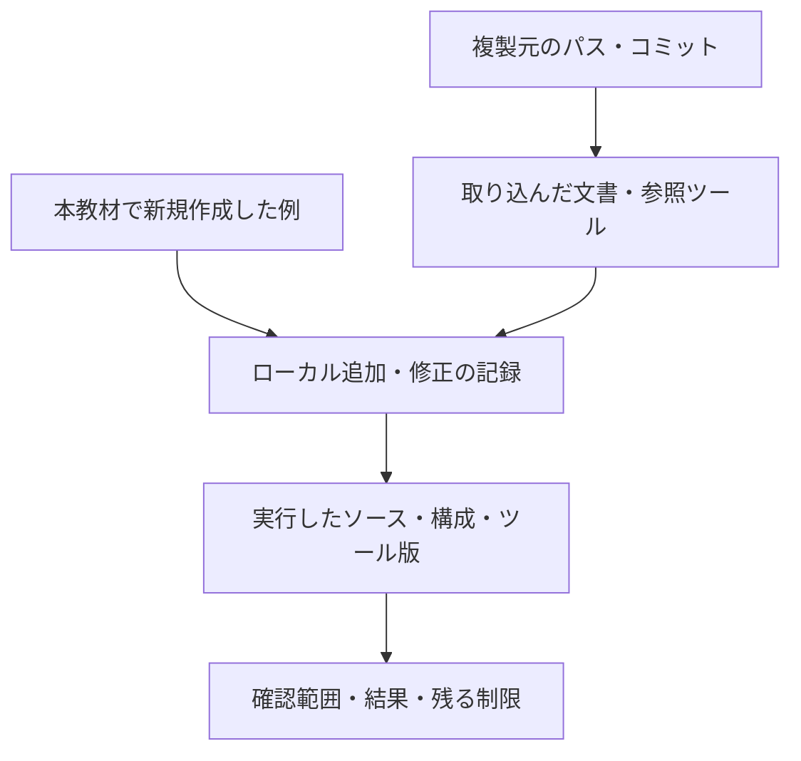

# 由来

このリポジトリの資料とツールの基礎は、[kirimasim-tests](https://github.com/kurochan001/kirimasim-tests)から複製したものです。最初の複製はコミット`c88b0c3`（2026-10-24）からで、その後に元で更新された資料は、表に示すコミットから複製し直しています。
複製時には、Markdownの相対リンクを書き換えました。コピー先にある資料へのリンクは、新しい場所への相対リンクにしました。コピー先に無い資料へのリンクは、元のリポジトリの同じコミットへの固定リンクにしました。
`README.md`、`docs/case-study-ieee1800/README.md`、`tools/README.md`、`PROVENANCE.md`、`.gitignore`、`docs/templates/`、`examples/`、`.gitlab-ci.yml`（2026-10-31に削除）は、このリポジトリで新しく書いたものです。一般化した手順書には、以下の追記・改訂があります。

## 由来と現在の証跡を分ける

複製元の版、ローカルでの追加・修正、実行した版と範囲をそれぞれ記録します。

図は記録の関係です。過去の数値や成功記録は当時の版の結果として読み、現行版の再実行結果へ読み替えません。

## このリポジトリでの追記・改訂

- `docs/method/spec-to-verification-method.md`は、下表のファイルを派生元として維持します。`3142ad7`で、製品開発の設計・検証・製造上の確認項目を14節に追加しました。
- 2026-10-25の全体レビューで、機能カバレッジと正しさの判定、構成ごとの適用と集計、証跡とフォーマル検証の条件、仕様変更の影響確認、開発段階別のサインオフと例外承認を明確にしました。技術的な役割を確認した一次資料は、手順書の付録Cに示しています。これらは半導体仕様への適用実績ではなく、今後検証する運用案です。
- `docs/templates/signoff-record.md`は、改訂した手順に沿って新設した雛形です。`tools/README.md`には、複製元での復元先・依存ファイル・検証方法を追記しています。
- `docs/method/uvm-verification.md`は、このリポジトリで新しく書いたUVMへの適用案です。Accelleraの公式資料・参照実装を参照し、要求IDとの対応、RAL、テスト終了とリグレッションの判定を整理しました。一般化した手順書の9.7節と、サインオフ記録から参照します。UARTの記録例は説明用であり、実行済みの証跡ではありません。
- `docs/method/feature-interaction-verification.md`は、このリポジトリで新しく書いた機能間クロス検証の運用案です。依存関係からの目標選定、同時・順序・中断の観測、高次の組み合わせ、到達と合格の計測を追記しました。UVMの実装説明とサインオフ記録も対応させています。NISTとAccelleraの一次資料を参考にしましたが、相互作用表と割り込みIPの12目標は本リポジトリの計画例であり、適用済みの実績ではありません。
- `docs/method/constrained-random-verification.md`は、このリポジトリで新しく書いたランダム検証の運用案です。制約と探索方針、生成失敗、seedと再現性、リグレッション、未達の調整、失敗の縮小と完了条件を整理しました。AccelleraとVerilatorの一次資料を参照し、UVM・クロス検証・サインオフ記録も対応させています。割り込みの9実行は未実施の計画例です。
- `docs/method/sva-verification.md`は、このリポジトリで新しく書いたSVAの運用案です。assert・assume・cover、サンプリング、リセット・vacuous pass、シミュレーション・フォーマル検証の記録と完了条件を整理しました。DVConの著者論文とYosysHQ・Verilatorの一次資料を参照しています。割り込みのチェッカーは本リポジトリで作成した説明用コードで、規格の例の転載や製品IPへの適用実績ではありません。
- `docs/method/functional-coverage.md`は、このリポジトリで新しく書いたcovergroupの運用案です。機能一覧からのbin・crossの設計、サンプリング、除外と閾値、インスタンス・DBの集計、判定との対応を整理しました。Accellera・OpenTitan・Verilatorの一次資料を参照しています。基本動作の16目標を扱うコレクターは本リポジトリで作成した説明用コードです。
- `docs/method/formal-verification.md`は、このリポジトリで新しく書いたフォーマル検証の運用案です。仮定・初期状態、抽象化と証明の分割、安全性・活性、有界検査と非有界の証明、反例・到達性、完了判定を整理しました。YosysHQ・YoWASPの一次資料を参照しています。割り込みの小さなモデル、証明設定と故障注入は本リポジトリで作成し、説明用モデルで動作確認したもので、製品IPへの適用実績ではありません。
- `docs/method/verification-gap-review.md`と`docs/templates/verification-scope.md`は、このリポジトリで新しく書いた検証領域の点検手順と適用範囲の雛形です。既存資料で概要にとどまっていた領域を、lint、リセット・X伝搬、CDC/RDC、転送・異常・復帰、性能、低電力、セキュリティ、コードカバレッジ、等価性・統合などの試験・解析と完了条件へ展開しました。OpenTitan・Verilator・Accelleraの一次資料を参照しています。割り込みの追加試験案は未実施の計画で、製品への適用実績ではありません。
- 同資料のCDC検証に、同期化レイテンシをランダムに変えるDynamic CDC／メタスタビリティ影響注入を追記しました。Siemensの著者解説とsemifyの公開モデルを参照し、クロックジッター・実行ごとのFF段数変更との区別、−1／0／＋1のモデル条件、再収束と観測・判定を整理しています。外部モデルの導入・転載・動作確認を行ったものではありません。
- `docs/method/mutation-verification.md`は、このリポジトリで新しく書いたミューテーション検証の運用案です。YosysHQ MCYの一次資料を参照し、検証環境の検出力と安全機構への故障注入の区別、変異の選定、対照実行、未検出・等価性の分析、分類・集計・証跡を整理しました。割り込みの確認例は、既存のSVA・フォーマル検証資料に記録した説明用モデルの結果を参照しています。MCYの導入や製品での変異キャンペーンの実施を示すものではありません。
- `docs/method/verification-reduction.md`は、このリポジトリで新しく書いた検証規模の縮退の運用案です。ASTQB・NISTの一次資料を参照し、同値分割・境界値、組み合わせの次数、代表構成、リグレッション・seed・変異の選択、抽象化、削減後の目標・検出力・証跡の確認を整理しました。3因子の例は組の選択を説明するためのもので、DUTの実行結果や既存の割り込み目標の削減を示すものではありません。
- `docs/method/continuous-regression.md`は、このリポジトリで新しく書いた継続的リグレッションの運用案です。Cadence・GitLabの一次資料を参照し、vManager／Verisium ManagerとCIの役割、総費用、リグレッションの段階、manifestと分散実行、ライセンス・資源、判定・retry・カバレッジ・証跡を整理しました。本文は運用案であり、製品向けランナーや専用検証管理製品の導入・接続・実行実績ではありません。GitLab CI/CDの説明用実行例は次項に分けて記録しています。
- `examples/local-irq-cdc/`と`.gitlab-ci.yml`は、本リポジトリで新しく実装した独立した最小例です。架空のIRQ回路、16基本動作・12時間関係・動作中リセット・CDC遅延モデル・ランダム操作列、4種類の変異・X注入、Pythonランナー、8要求・50目標の判定、JUnit・manifest、GitLab設定と実行手順を含みます。GitLab・Icarusの公式資料を参照し、ローカルの動作と異常時の判定を確認しています。2026-10-25にGitLabデモへ例を登録し、Linux RunnerとDebian・Icarus 11で通常リグレッション・夜間リグレッション、失敗時のJUnit・artifact保存、MRのマージ禁止と正常復帰を確認しました。検証後、同日にデモをPublicへ変更しました。URLと確認範囲は[例の実行記録](examples/local-irq-cdc/README.md#5-確認した範囲)に記載しています。上流のツールの汎用化、製品への適用、毎晩の継続運用の実績を示すものではありません。
- ケーススタディの報告とツールのコードは、上流の履歴を示す資料・参照実装として扱います。一般化した手順書の追加項目が、そのまま現行ツールで検査できるという意味ではありません。
- 2026-10-26のレビュー修正では、照合キットの`propose.py`・`merge.py`へ、このリポジトリ独自の承認時スナップショットを追加しました。照合案・テスト入力・関連要求の変更と、スナップショットのない旧形式の承認を検出し、未統合の承認に不備があれば台帳を書かずに停止します。`test_matching_kit.py`にリグレッションテストを追加し、README・手順書・Workflowの再レビュー手順も更新しました。過去の上流での承認・集計を、この修正で再検証したという意味ではありません。
- 同日の文書修正では、SVA演算子表のエスケープ、動的配列の`new[3](d)`の復元、設計網羅率と実行確認率の区別、同期基準時点のテスト総数、ランダム検証例の実装状況、IRQ変異の個数を訂正しました。同期基準と下表の複製元コミットは維持し、これらをローカル改訂として記録します。
- 同日に、README・一般化した手順書・GitLab実行例・照合キットの説明へMermaid図と補足表を追加しました。全体の流れ、UVMの接続、SVAの観測時点、到達と合格の分類、ランダムリグレッション・フォーマル検証・変異検証・縮退・CI・承認時の版照合を図示しています。CDCのタイミング表は、本リポジトリの説明用モデルと受信回路に対応する例です。図表は既存の説明・実装を整理したもので、新しい製品適用実績や未実装機能の追加を示すものではありません。
- 同日に、`docs/glossary.md`と`docs/faq.md`を新規作成しました。既存の手順書・計測規則・実行例を参照し、用語の意味、検証方式の使い分け、指標・完了条件、実装済みの範囲を整理しています。用語の説明にはAccellera・YosysHQ・GitLabの公式資料も参照しています。新しい検証機能や製品での実績の追加ではありません。
- 同日の日本語表現の見直しで、一般化文書・FAQ・用語集・実行例・ケーススタディの説明を推敲しました。検証部品やフォーマル検証の表記を統一し、検証完了、カバレッジ収束、独立レビュー、vacuous passなどの説明を明確にしました。用語表記の参考にしたCadence・Synopsysの日本語資料は用語集から参照できます。コード・実行条件・数値結果は変更していません。

`examples/local-fifo/`は、2026-10-26に本リポジトリで新しく作成したFIFOのランダム検証例です。説明用の同期FIFO、独立した参照キューを使うテストベンチ、seed・全入力列の保存、構成別の要求・カバレッジ判定、3種類の変異の検出、GitLabの6構成matrixリグレッションとランナーのセルフテストを含みます。プロセス実行とログ判定は既存IRQ例の処理を再利用します。GitLabの公式matrix・JUnit資料を参照し、ローカルで全6構成のsmoke・nightlyを確認しました。GitLabの確認用MR !2でもDebian・Icarus 11.0で全6構成のsmokeとランナーのセルフテストが成功しています。URLと範囲は[FIFO例の実行記録](examples/local-fifo/README.md#7-保存する証跡と確認範囲)に記載しています。製品FIFOへの適用や非同期FIFOの検証実績を示すものではありません。

`examples/local-fifo-formal/`は、2026-10-26に新規作成したオープンソースツールによるFIFOのフォーマル検証例です。既存の同期FIFOを対象に、制御の非有界証明、データの有界検査、6目標の到達性、3種類の変異の反例、過剰なリセット仮定の診断を実装しています。YoWASP・YosysHQの公式資料を参照し、ツール版、実際に読み込んだassert・assume・cover、状態・ログ・トレースを記録します。ローカルとGitLabのMR !3で動作を確認し、ツールの自動準備を含む実行範囲は[確認記録](examples/local-fifo-formal/README.md#7-実行確認の記録)に記載しています。幅8・深さ1／3の説明例であり、非有界のデータ整合性証明や製品FIFOへの適用を示すものではありません。

## 最新版との照合

2026-10-25の同期時に上流を取得し、その時点の最新`main`の[`3faf239af2614fd8d65cf31c54b0f297108704dd`](https://github.com/kurochan001/kirimasim-tests/commit/3faf239af2614fd8d65cf31c54b0f297108704dd)に対して、当時の対象32ファイルを照合しました。変更のあったツール4ファイルを更新しました。内容が変わっていないファイルは、従来の複製元コミットを残しています。その後の一般化文書の追記・改訂は上記に分けて記録しています。

今回のツール更新には、指摘番号が付いた保留判定の重複登録防止、テスト作成・独立検証時の注意事項の追加、計測対象シミュレータのLyraへの更新、環境変数`IEEE1800_SOURCE`による規格資料の参照先指定を含みます。
また、`simulator-differences.md`で過去のリンク書き換えが配列の説明とコード例に入り込んでいた2箇所を、上流の記述に戻しました。
2026-10-25の公開前整備では、同資料の6.20.5（module-body specparam）の説明を、このリポジトリ独自の表現へ書き直しました。新規作成物と複製・改訂物のライセンス適用範囲もREADMEに明記しています。

### 文書と集計の更新（2026-10-26）

本リポジトリの`3fb116a`で、kirimasim-testsの[`0da4f2fc`](https://github.com/kurochan001/kirimasim-tests/commit/0da4f2fc247bfcee27fc407b8ef0cd8d8f768dfc)からケーススタディ文書5件を取り込みました。対象は元の手順書、計測規則、照合レビューの累積、シミュレータ差異、未登録テストの照合報告です。下表はその追加を含む33ファイルの由来を示します。参照ツールの同期基準は`3faf239`のままです。

今回の文書更新では、上流の[`b2de3bc5`の集計](https://github.com/kurochan001/kirimasim-tests/blob/b2de3bc5ef17071be53d44c6742700c03b1b12a7/coverage/behavior-summary.json)を読み、READMEの概要値と計測規則のテスト本数を更新しました。本文1〜40章の値は同JSONの章別件数を合計して算出しています。上流の台帳・テスト・ツール一式をこの版へ同期したものではありません。過去の報告は、当時の版・数値の記録として保持します。

GitLabではMR !2・!3のmainへのマージと、mainのCI #2988462019の12ジョブ・JUnit 90件の成功を確認しました。各実行例とREADMEへその状態を反映しています。コード、検証条件、CI設定は今回変更していません。

## ファイルごとの複製元・派生元

| このリポジトリ | kirimasim-tests（複製元のコミット） |
| --- | --- |
| `docs/method/spec-to-verification-method.md` | [`docs/spec-to-verification-method.md`](https://github.com/kurochan001/kirimasim-tests/blob/0ccbd37/docs/spec-to-verification-method.md) |
| `docs/case-study-ieee1800/requirements-to-tests-method.md` | [`docs/requirements-to-tests-method.md`](https://github.com/kurochan001/kirimasim-tests/blob/0da4f2fc/docs/requirements-to-tests-method.md) |
| `docs/case-study-ieee1800/requirement-extraction.md` | [`docs/requirement-extraction.md`](https://github.com/kurochan001/kirimasim-tests/blob/0ccbd37/docs/requirement-extraction.md) |
| `docs/case-study-ieee1800/requirement-extraction-notes.md` | [`docs/requirement-extraction-notes.md`](https://github.com/kurochan001/kirimasim-tests/blob/c88b0c3/docs/requirement-extraction-notes.md) |
| `docs/case-study-ieee1800/coverage-rules.md` | [`coverage/README.md`](https://github.com/kurochan001/kirimasim-tests/blob/0da4f2fc/coverage/README.md) |
| `docs/case-study-ieee1800/existing-test-matching-20percent-20261023.md` | [`docs/existing-test-matching-20percent-20261023.md`](https://github.com/kurochan001/kirimasim-tests/blob/c88b0c3/docs/existing-test-matching-20percent-20261023.md) |
| `docs/case-study-ieee1800/existing-test-matching-review-20261022.md` | [`docs/existing-test-matching-review-20261022.md`](https://github.com/kurochan001/kirimasim-tests/blob/0da4f2fc/docs/existing-test-matching-review-20261022.md) |
| `docs/case-study-ieee1800/header-vpi-tests-and-matching-20261023.md` | [`docs/header-vpi-tests-and-matching-20261023.md`](https://github.com/kurochan001/kirimasim-tests/blob/c88b0c3/docs/header-vpi-tests-and-matching-20261023.md) |
| `docs/case-study-ieee1800/keyword-tests-20261024.md` | [`docs/keyword-tests-20261024.md`](https://github.com/kurochan001/kirimasim-tests/blob/c88b0c3/docs/keyword-tests-20261024.md) |
| `docs/case-study-ieee1800/gap-tests-20261024.md` | [`docs/gap-tests-20261024.md`](https://github.com/kurochan001/kirimasim-tests/blob/b13204c/docs/gap-tests-20261024.md) |
| `docs/case-study-ieee1800/gap-tests-2-20261024.md` | [`docs/gap-tests-2-20261024.md`](https://github.com/kurochan001/kirimasim-tests/blob/0ccbd37/docs/gap-tests-2-20261024.md) |
| `docs/case-study-ieee1800/lyra-disagreement-review-20261025.md` | [`docs/lyra-disagreement-review-20261025.md`](https://github.com/kurochan001/kirimasim-tests/blob/3faf239/docs/lyra-disagreement-review-20261025.md) |
| `docs/case-study-ieee1800/existing-test-matching-unregistered-20261025.md` | [`docs/existing-test-matching-unregistered-20261025.md`](https://github.com/kurochan001/kirimasim-tests/blob/0da4f2fc/docs/existing-test-matching-unregistered-20261025.md) |
| `docs/case-study-ieee1800/simulator-differences.md` | [`docs/simulator-differences.md`](https://github.com/kurochan001/kirimasim-tests/blob/0da4f2fc/docs/simulator-differences.md) |
| `tools/matching_kit/README.md` | [`tools/matching_kit/README.md`](https://github.com/kurochan001/kirimasim-tests/blob/c88b0c3/tools/matching_kit/README.md) |
| `tools/matching_kit/propose.py` | [`tools/matching_kit/propose.py`](https://github.com/kurochan001/kirimasim-tests/blob/c88b0c3/tools/matching_kit/propose.py) |
| `tools/matching_kit/merge.py` | [`tools/matching_kit/merge.py`](https://github.com/kurochan001/kirimasim-tests/blob/3faf239/tools/matching_kit/merge.py) |
| `tools/matching_kit/runsim.py` | [`tools/matching_kit/runsim.py`](https://github.com/kurochan001/kirimasim-tests/blob/c88b0c3/tools/matching_kit/runsim.py) |
| `tools/matching_kit/partition.py` | [`tools/matching_kit/partition.py`](https://github.com/kurochan001/kirimasim-tests/blob/c88b0c3/tools/matching_kit/partition.py) |
| `tools/matching_kit/withdrawn-20261023.json` | [`tools/matching_kit/withdrawn-20261023.json`](https://github.com/kurochan001/kirimasim-tests/blob/c88b0c3/tools/matching_kit/withdrawn-20261023.json) |
| `tools/matching_kit/workflows/match.js` | [`tools/matching_kit/workflows/match.js`](https://github.com/kurochan001/kirimasim-tests/blob/c88b0c3/tools/matching_kit/workflows/match.js) |
| `tools/matching_kit/workflows/gap.js` | [`tools/matching_kit/workflows/gap.js`](https://github.com/kurochan001/kirimasim-tests/blob/3faf239/tools/matching_kit/workflows/gap.js) |
| `tools/matching_kit/workflows/interpretation-review.js` | [`tools/matching_kit/workflows/interpretation-review.js`](https://github.com/kurochan001/kirimasim-tests/blob/c88b0c3/tools/matching_kit/workflows/interpretation-review.js) |
| `tools/matching_kit/test_matching_kit.py` | [`tools/test_matching_kit.py`](https://github.com/kurochan001/kirimasim-tests/blob/c88b0c3/tools/test_matching_kit.py) |
| `tools/generators/common.py` | [`generators/common.py`](https://github.com/kurochan001/kirimasim-tests/blob/c88b0c3/generators/common.py) |
| `tools/generators/generate.py` | [`generators/generate.py`](https://github.com/kurochan001/kirimasim-tests/blob/c88b0c3/generators/generate.py) |
| `tools/generators/keywords.py` | [`generators/keywords.py`](https://github.com/kurochan001/kirimasim-tests/blob/c88b0c3/generators/keywords.py) |
| `tools/reference/behavior_coverage.py` | [`tools/behavior_coverage.py`](https://github.com/kurochan001/kirimasim-tests/blob/3faf239/tools/behavior_coverage.py) |
| `tools/reference/requirement_audit.py` | [`tools/requirement_audit.py`](https://github.com/kurochan001/kirimasim-tests/blob/c88b0c3/tools/requirement_audit.py) |
| `tools/reference/requirement_matching.py` | [`tools/requirement_matching.py`](https://github.com/kurochan001/kirimasim-tests/blob/c88b0c3/tools/requirement_matching.py) |
| `tools/reference/requirement_source.py` | [`tools/requirement_source.py`](https://github.com/kurochan001/kirimasim-tests/blob/3faf239/tools/requirement_source.py) |
| `tools/reference/suite_results.py` | [`tools/suite_results.py`](https://github.com/kurochan001/kirimasim-tests/blob/c88b0c3/tools/suite_results.py) |
| `LICENSE` | [`LICENSE`](https://github.com/kurochan001/kirimasim-tests/blob/c88b0c3/LICENSE) |

## APBレジスタ検証例の追加（2026-10-26）

`examples/local-apb/`は、このリポジトリ向けに新規作成した説明用RTL・テストベンチ・ランナーです。ArmのAPB仕様を参照し、独自のレジスタマップ、W1Cのイベント優先、エラー時の状態保持、同期リセットを定義しました。待ち状態0／1／3の独立判定、seed付き入力、3種類の変異、要求・カバレッジとJUnitを実装し、既存FIFO例のランナー構成とIRQ例のプロセス実行・終了判定処理を再利用しています。APB仕様書の本文・図・コードの転載ではありません。実行範囲と確認結果は[APB例](examples/local-apb/README.md)を参照してください。

APB追加のMR !4はGitLab CI #2988642917で全16ジョブ成功、JUnit 108件・失敗／エラー0件を確認しました。mainへのマージとschedule全例の129件の実行は今回行っていません。

## APBと割り込みの結合検証例の追加（2026-10-26）

`examples/local-apb-irq/`は既存APB RTLを再利用し、下位4ビットのマスクとイベント保持状態から割り込みを出力する説明用結合回路です。ランナー・チェッカーはAPB例を基に拡張し、IRQ例のプロセス実行・終了判定処理も利用します。4要因×マスク×クリア×イベントの32クロスに、順序・同時動作・複数要因・待ち・エラー・リセットを加えました。構成ごとの44／45目標と3種類の変異を判定し、証跡を保存します。単一要因の`irq_pending`を二重に接続せず、既存APB内のPENDINGを保持状態として使っています。

併せて、APB単体例のMR !4がmainへマージされ、CI #2988663611で全16ジョブ・JUnit 108件が成功した状態を確認しました。今回の結合検証追加後の構成は20ジョブ・通常JUnit 126件、scheduleは153件を予定します。製品割り込みシステムや実ソフトウェアへの適用を示すものではありません。

結合検証のMR !5でCI #2988726525の全20ジョブ・JUnit 126件が成功し、保存済み証跡でも各構成の44／45目標と3種類の変異の検出を確認しました。nightly全3構成はローカルで確認し、GitLabのschedule全例153件は今回実行していません。MR !5のmainへのマージは行っていません。

## ready/valid通信のランダム検証例の追加（2026-10-26）

`examples/local-stream/`は、新規の説明用ready/validバッファと、FIFO例を基に拡張したランナー・チェッカーです。IRQ例のプロセス実行・終了判定処理を利用します。LaForestのready/valid設計資料を参照し、データ保持、満杯時の入替え、同期リセットによる破棄をこの回路の仕様として定めました。外部資料のRTLや図の転載ではありません。深さ1／3×幅8／16で必須25／29目標と3種類の変異を判定し、最後の排出、受理数・受信数・リセット破棄数を照合します。

併せて、APBと割り込みの結合検証のMR !5がmainへマージされ、CI #2988757915で全20ジョブ・JUnit 126件が成功した状態を確認しました。今回のready/valid追加後は25ジョブ・通常JUnit 150件、scheduleは185件を予定します。AXI全体への適合性や任意の待ち時間に対する活性を証明した結果ではありません。

ready/validのMR !6でCI #2989066110の全25ジョブ・JUnit 150件が成功し、保存済み証跡でも各構成の25／29目標、3種類の変異の検出、転送数の照合を確認しました。nightly全4構成はローカルで確認し、GitLabのschedule全例185件は今回実行していません。MR !6のmainへのマージは行っていません。

## SVAの実行例の追加（2026-10-26）

`examples/local-sva/`は、既存IRQ RTLとプロセス実行・終了判定処理を利用して作成したSVA実行例です。要求6件に対応する並行アサーション6個・カバー12目標を接続し、RTL変異3件とチェッカー入力の違反3件、前件不足の診断を実装しました。Verilatorの公式資料を参照し、カバーログとネイティブカウンター、接続先・ソースを照合します。最後の観測クロックでは新規の1サイクル後件の開始だけを抑止します。本文の説明用SVAコードを基に、使用ツールに合わせた記法へ展開しています。

GitLabのMR !6が未マージのため、SVAのMR !7はそのソースブランチを宛先として追加しました。SVAを含む設定は27ジョブ・通常JUnit 160件、scheduleは197件を予定し、ランナーのセルフテスト78件は別枠です。2値シミュレーションであり、X/ZやSVA全構文の対応、形式証明を示すものではありません。

SVAのMR !7でCI #2989571313の全27ジョブ・JUnit 160件が成功しました。Verilator 5.006のネイティブDBの形式差に対応し、5.052と同じラベル・ソース・階層・件数の検査を行います。保存済み証跡でも要求6件・12目標、感度確認6件、診断1件、予定ケースの完了を確認しました。nightlyはローカルで実行し、GitLabのschedule全例197件は今回実行していません。MR !6・!7のマージは行っていません。

## リグレッションの縮退の比較例の追加（2026-10-26）

`examples/local-reduction/`は、新規の比較ランナー・テストベンチ・履歴依存変異のラッパーです。既存IRQ RTLと3種類の変異、プロセス実行・終了判定処理を再利用します。正常な全候補の観測で貪欲に選択し、全件・目標だけの選択・ストレス保持を新たに実行します。19目標の維持と検査サイクル数、3基本変異、選択に検出結果を使わない追加の履歴依存変異を比較します。縮退の一般的な検出率や製品の妥当性を示す実績ではありません。

併せて、SVAのMR !7がready/validのブランチへ取り込まれ、そのMR !6もmainへマージされたことと、mainのCI #2989619450が全27ジョブ・JUnit 160件で成功したことを確認しました。縮退例追加後は29ジョブ・通常JUnit 178件、scheduleは215件を予定します。ランナーのセルフテスト89件は別枠です。

縮退比較のMR !8でCI #2989712015の全29ジョブ・JUnit 178件が成功し、保存済み証跡でも19目標の維持、233／42／47検査サイクル、基本変異3件の検出と履歴依存変異の検出差を確認しました。初回の既存ジョブの失敗はRunner準備時の認証エラーで、検証コードを変更せず再実行しました。nightlyはローカルで確認し、GitLabのschedule全例215件とMR !8のマージは今回行っていません。

## アービタの検証例の追加（2026-10-26）

`examples/local-arbiter/`は新規の説明用ラウンドロビンRTL・テストベンチと、FIFO例を基に拡張したランナーです。IRQ例のプロセス実行・終了判定処理を再利用します。要求元2／3／4で排他制御、受信待ち中の選択保持、受理順序と条件付き公平性を検査し、21／31／49目標を構成ごとに判定します。受理数と待ちの記録、受信停止の診断、3種類の変異、順序比較を無効にした専用構成での独立した公平性モニターの違反検出も実装しました。任意の無限の要求列や製品への適用を実証した結果ではありません。

併せて、縮退比較のMR !8がmainへマージされ、CI #2989744619で全29ジョブ・JUnit 178件が成功したことを確認しました。アービタ追加後は33ジョブ・通常JUnit 199件、scheduleは242件を予定します。ランナーのセルフテスト102件は別枠です。

アービタのMR !9でCI #2989838991の全33ジョブ・JUnit 199件が成功しました。保存済み証跡でも構成ごとの21／31／49目標、3種類の変異、停止診断、受理数と待ちの照合を確認しました。nightlyはローカルで実行し、GitLabのschedule全例242件とMR !9のマージは今回行っていません。

## UARTのランダム検証例の追加（2026-10-26）

`examples/local-uart/`のRTLとシリアル刺激・波形比較テストベンチは、この教材用に作成しました。ランナーと自己セルフテストはFIFO例を基に拡張し、IRQ例のプロセス実行・終了判定を再利用しています。フレーム形式と受信エラーの基本事項はREADMEに記載したMicrochipの一次資料を参照し、特定製品のRTLや検証IPを転載したものではありません。開始パルス、エラー通知、リセットなどは教材独自の仕様です。

8N1／8E1／8O1と分周数8／16の6構成、独立した送受信照合、代表パターン、エラー注入、偽スタート、転送中リセットと復帰、21／22目標と3／4種類の変異を実装しました。ローカルでsmoke全6構成、13テスト、および各構成3 seed×1000ランダム操作を確認しました。周波数誤差、ノイズ耐性、アナログCDC安全性、製品UARTの規格適合性の実証ではありません。

併せてMR !9のmainへのマージと、CI #2989957235の全33ジョブ・JUnit 199件成功を確認しました。UART追加後は40ジョブ・通常JUnit 239件、scheduleは294件を予定し、ランナーのセルフテスト115件は別枠です。

UARTのMR !10で[CI #2990037734](https://gitlab.com/kurochan001/lsi-verification-method-ci-demo/-/pipelines/2990037734)の全40ジョブ・JUnit 239件が成功しました。保存済み証跡でも構成ごとの目標達成、変異検出、完了数、ソースハッシュと実行コミットを照合しました。GitLabのschedule全例294件とMR !10のマージは今回行っていません。

## APB・UART・割り込みの結合検証例の追加（2026-10-26）

`examples/local-apb-uart/`は既存UARTをそのまま使い、UART用APBレジスタと割り込み保持回路を新規に作成した教材です。APBの待ち・完了処理とマスク・W1Cの考え方は既存例を引き継ぎ、ランナー・自己セルフテストはUART例を基に拡張しました。IRQ例のプロセス実行・終了判定を再利用しています。刺激生成と予定受信は独立したPythonで作成し、実装内部のUART出力・イベントを期待値に使いません。

9構成で実際の送受信、エラー、バス応答、割り込み、W1C・マスク更新・受信読出しの競合を確認し、60／61／69／70目標と5種類の変異を判定します。OpenTitanのUARTテスト計画・操作例は観点の参考で、コードやレジスタ仕様の転載ではありません。受信保持は1バイト、レジスタと優先順位は教材独自の仕様で、CPU・実ドライバ・異なるクロック間の結合を検証した結果ではありません。

ローカルでランナー14テストとnightly全9構成（seed 17〜19を各128シナリオ）を確認しました。併せてUARTのMR !10がmainへマージされ、CI #2990074629で全40ジョブ・JUnit 239件が成功したことを確認しました。結合例を加えると50ジョブ・通常JUnit 311件、scheduleは384件を予定し、ランナーのセルフテスト129件は別枠です。

結合例のMR !11で[CI #2990155891](https://gitlab.com/kurochan001/lsi-verification-method-ci-demo/-/pipelines/2990155891)の全50ジョブ成功とJUnit 311件をGitLab画面で確認しました。保存済みの全9構成のsummary・coverageでも必須目標、5種類の変異、全7ケースの完了と適用除外を照合しました。GitLabのschedule全例384件は今回行っていません。その後MR !11のmainへのマージと、[mainのCI #2990167574](https://gitlab.com/kurochan001/lsi-verification-method-ci-demo/-/pipelines/2990167574)の全50ジョブ成功・JUnit 311件・失敗／エラー0件を確認しました。

## 現行ドキュメントの再照合（2026-10-26）

kirimasim-testsの公開main [`5fb3c45d`](https://github.com/kurochan001/kirimasim-tests/commit/5fb3c45d73e4946d99690389752b82c86eecaa50)を確認し、[同版の集計JSON](https://github.com/kurochan001/kirimasim-tests/blob/5fb3c45d73e4946d99690389752b82c86eecaa50/coverage/behavior-summary.json)と集計文書から、READMEの概要値と計測規則のテスト本数・参照先を更新しました。12,319要求中の対応済み10,209・実行成功5,639、7,144テスト中の対応登録4,730・未登録2,414です。本文1〜40章は章別件数を合計し、9,486要求中7,833対応・3,765実行成功と算出しました。分母が未承認の暫定値で、複数環境の実行成功の和集合です。文書の取り込み基準`0da4f2fc`、参照ツールの同期基準`3faf239`を変更したものではありません。

GitLabでは確認記録のMR !12のmainへの取り込みと、main `ec594de7`の[CI #2990241122](https://gitlab.com/kurochan001/lsi-verification-method-ci-demo/-/pipelines/2990241122)の成功を確認しました。MR !12のCI #2990210417は全50ジョブ・JUnit 311件・失敗／エラー0件です。現行手順に残っていた12ジョブ・90件の記述を50ジョブ・311件へ修正し、過去の実行記録の数値はその時点の値として明記しました。ランナーのセルフテスト129件とschedule予定384件も区別しています。RTL、検証条件、CI設定の変更やリグレッションの再実行は今回行っていません。

## 全体レビューによる修正（2026-10-27）

ドキュメント、実行例、CI設定、参照ツールを照合し、次の2点を修正しました。

- アービタ例で`+WAVE`の引数を受け取っていなかったため、VCDを生成していませんでした。テストベンチへ波形保存を追加し、既存の3構成確認で正常・変異・停止診断の全ケースのVCDファイルとヘッダを検査します。
- SVA例では要求カタログのアサーション名とカバーの対応を検査していませんでした。未実装のアサーション名でもリグレッションが成功することを再現し、固定した6アサーション・12カバーとの照合と、誤記・重複・対応違い・欠落のセルフテストを追加しました。正常カタログのネイティブSVAリグレッションも再確認しました。

SVAランナーのセルフテストは11から12テストとなり、実行例全体の確認は130テストです。ジョブ数と通常／scheduleのJUnit予定件数は50ジョブ・311／384件のままです。今回の修正と確認はローカルで行い、既存のGitLabのCI記録は対象コミットの実行結果として保持します。参照ツールは同期基準`3faf239`の追跡済みファイルを一時ディレクトリへ復元し、本リポジトリの写しを対応先へ重ねた環境で89テストの成功を確認しました。

実行例のセルフテストは修正後の合計130件が成功し、アービタは4要求元のnightlyでも49目標と3種類の変異・波形保存を確認しました。SVAはVerilatorで12ネイティブカバーと6種類の違反検出が成功し、不正カタログが終了コード1になることを確認しました。固定版の一時フォーマル環境でFIFOの深さ1・3の計16タスクと、文書から保存したIRQコード例のbmc・prove・coverも成功しました。図20件の構文、ローカル参照先434件と見出し参照も確認しました。これらは記載範囲のローカル確認で、製品への適用やGitLabでの修正後のCI実行を示すものではありません。

## ローカル専用の3例の追加（2026-10-27）

`examples/local-ecc/`、`examples/local-spi/`、`examples/local-timer-watchdog/`のRTL・テストベンチ・刺激生成・要求カタログ・セルフテストは、この教材用に作成しました。`examples/local-common/`は新規の共通ランナーで、既存IRQ例のプロセス実行・タイムアウト・終了判定処理を再利用します。3例とも商用IPや製品のRTL・検証IPを転載したものではありません。

ECCは短縮拡張ハミング(13,8)の全256データと0／1／2ビット誤り23,552パターンを、コードブックと最小距離による独立した期待値で照合します。SECDEDの用語はREADME記載のMicrochip一次資料を参照し、符号配置・出力仕様は教材独自です。3ビットの誤訂正と4ビットの無通知誤りの2例は保証範囲外の診断で、正常検証の97目標へ算入しません。

SPIのCPOL／CPHAの対応はREADME記載のMicrochip一次資料を参照しました。4モード×2分周の8構成で、予定時刻から独立に駆動・照合し、各16目標を判定します。開始・完了・CS保持期間は教材独自です。タイマー・ウォッチドッグも独自の同期仕様で、幅4／8の2構成、各20目標を、enableの仮想時刻と満了予定時刻を使う参照モデルで照合します。ウォッチドッグはリセット要求だけを出力し、自動でシステムをリセットするモデルではありません。

全11構成でsmoke／nightly、計44件の構成と変異の組み合わせの検出、ECC診断2件をローカルで確認しました。正常時JUnitは全構成合計smoke 79件／nightly 101件です。追加のセルフテストは共通14＋ECC 6＋SPI 4＋タイマー・ウォッチドッグ6＝30件で、既存GitLab例のランナーのセルフテスト130件とは別枠です。確認環境はPython 3.14.7、Icarus Verilog 14.0開発版です。任意入力列の証明、実デバイスのタイミング・物理特性や製品の安全性の確認ではありません。

ルートのGitLab CI設定と既存例のCI設定は変更せず、GitLabへの追加・CI起動は行っていません。既存のGitLab集計50ジョブ・通常JUnit 311件・schedule予定384件はそのままです。README・FAQと継続リグレッション・ミューテーション検証の文書へ、ローカル専用であることと実行先のリンクを追加しました。

## 非同期FIFO・I²C・APBタイマー結合例の追加（2026-10-27）

`examples/local-async-fifo/`、`examples/local-i2c/`、`examples/local-apb-timer/`のRTL・テストベンチ・刺激／期待値生成・要求カタログ・セルフテストは、この教材用に作成しました。前2例は新規RTL、APB結合例は既存`local-timer-watchdog/rtl/timer_watchdog.sv`を変更せずに接続する新規ラッパーです。既存のローカル共通ランナーを利用し、製品IPや外部の検証コードの転載は行っていません。

非同期FIFOは深さ4／8×同期段数2／3の4構成で、参照キューと遅延させた絶対累計によりデータ・フラグを照合し、各17目標を判定します。送信元Grayポインターの変化も検査します。2種類のクロック比、同周期、離散ジッター−1／0／＋1、共通リセットを含みます。Alteraの一次資料は物理的なCDC制約の必要性の参照先で、物理遅延やメタステーブルを再現するモデルではありません。

I²Cは7ビットアドレスの1バイトターゲットと独立したコントローラーBFMで、2構成・各18目標を判定します。ACK／NACK、Repeated START、ストレッチ、途中リセットを信号線で検査します。バスの基本手順はREADME記載のNXP UM10204 Rev.7.0を参照し、レジスタ・拒否入力・リセット仕様は教材独自です。複数コントローラーの仲裁や電気的タイミングの適合性は対象外です。

APB結合例は幅4／8×待ち状態0／2の4構成・各24目標です。レジスタの受付規則と仮想時刻・満了予定による独立モデルで、バス完了、満了とclear／kick／load、IRQマスク、リセット中断を照合します。バス転送の基本手順はArmのAPB一次資料を参照し、レジスタ構成と優先順位は教材独自です。ウォッチドッグはリセット要求の出力だけで、システムのリセット配線はモデル化していません。

新しい10構成のsmoke／nightly、各4種類の変異（構成との組合せ40件）とセルフテスト18件が、Python 3.14.7・Icarus Verilog 14.0開発版でローカル成功しました。追加分のJUnitはsmoke 70件／nightly 90件です。既存3例と合わせたローカル6例は21構成、JUnit合計149／191件、共通を含むセルフテスト48件となります。README・FAQ・共通手順・継続リグレッション・ミューテーション検証のリンクと現行の集計を更新しました。

GitLabへの登録・CI起動と既存CI設定の変更は行っていません。既存GitLab例の50ジョブ・通常JUnit 311件・schedule予定384件・ランナーのセルフテスト130件へ、ローカル例の数値を合算しません。

## AHB-Lite・AXI4-Liteのローカル例の追加（2026-10-27）

`examples/local-ahb/`と`examples/local-axi/`のRTL・テストベンチ・刺激／期待値生成・要求カタログ・セルフテストを、この教材用に作成しました。既存ローカル共通ランナーの実行・判定・証跡保存を利用します。バスの基本事項は各READMEに記載したArm一次資料IHI 0033AとIHI 0022Eを参照し、規格本文や外部のRTL・検証コードの転載は行っていません。

AHB-Liteは32ビットの信号サブセットで、待ち状態0／1／3の3構成・各21目標です。アドレスとデータのパイプライン、3サイズのバイトレーン、SINGLE／INCR4・BUSY、2サイクルのERROR、次アドレスの取消しとリセットを、バイト記憶領域と絶対時刻の完了予定による独立モデルで照合します。非整列・過大HSIZEは不正要求を意図した負のテストです。複数マスターやAHB全体の適合性は対象外です。

AXI4-Liteは32ビット・各方向1件に受付を制限した回路で、応答生成の追加遅延0／2の2構成・各39目標です。AW／Wの別キューと応答予定時刻で、先行順序、全16通りのWSTRB、B／Rの保持、同一エッジの読書き、保留読出し中の更新、半要求・応答のリセットを照合します。全WSTRB反映、AR受理時スナップショット、エラー方針と固定遅延は教材独自の仕様です。AXI4のバースト・ID・アウトオブオーダーやAXI4-Streamの例ではありません。

新しい5構成のsmoke／nightly、各4種類の変異（構成との組合せ20件）、AHB 8＋AXI 8のセルフテスト16件がPython 3.14.7・Icarus Verilog 14.0開発版で成功しました。追加分のJUnitはsmoke 35件／nightly 45件です。既存分を含めたローカル8例は26構成、JUnit合計184／236件、共通を含むセルフテスト64件となります。README、共通手順、FAQ、継続リグレッションとミューテーション検証へ導線と適用範囲を追記しました。

GitLabへの登録・CI起動と既存CI設定の変更は行っていません。GitLab例の50ジョブ・通常JUnit 311件・schedule予定384件・ランナーのセルフテスト130件は、ローカル例と分けて保持します。

## AHB／AXIのランダム拡張とフォーマル例（2026-10-27）

AHB-Liteのランダム生成にSINGLE／INCR4、BUSY、転送中リセットを、AXI4-Liteには長めのチャネル遅延・応答待ちと、AWのみ／Wのみ／B保留／R保留でのリセットを加えました。seedと生成ベクトルを保存する既存の実行・判定方式を維持し、追加2テストを含めてシミュレーション・共通の確認は66件です。リグレッションのJUnit予定数184／236件は変わりません。

`examples/local-bus-formal/`は新規のローカル専用ハーネス・ランナー・セルフテストです。既存IRQ例のプロセス実行処理と既存FIFOフォーマル例の固定版ツール群を利用します。入力の保持・初回リセット以外に公平性やAW／W同時到着を仮定せず、2値・単一クロック・サンプリング時のリセットというモデルで検査します。SBY／Yosysの一次資料とArmの仕様は各READMEへ記載し、外部のコードは転載していません。

AHBでは応答タイミング・ERROR・リセットの3プロパティ、AXIでは受付・応答・保持・因果関係・リセットと補助条件の11プロパティを非有界に証明します。AXI RTLへFORMAL専用のassertを4個加え、参照モデルの補助条件1個と併せて帰納法を強めました。入力を制約するassumeではなく、補助条件も検証対象です。通常シミュレーションの動作は変えません。任意の定数で選んだ1ワードを追跡してデータ比較し、AHB計4・AXI計12プロパティのデータ検査は深さ12のBMCとして扱います。

固定版ツールとPython 3.14.7で、AHB 3構成27タスクとAXI 2構成18タスク、計45タスクが予定どおりに判定されました。正常coverは8×3＋12×2の48目標、変異は4×5の20反例です。全5構成で、常時リセットの過剰な仮定による証明PASSと正常cover未達も確認しました。AHBのdemo-bug 1では、安全性証明がPASSしてもデータBMCでFAILし、リグレッション全体の終了コードが1になりました。

判定・証跡テスト12件を追加し、ローカル確認は66＋12＝78件です。ランダム拡張後のAHB／AXI全5構成のsmoke／nightlyも成功しました。README・各例の手順・FAQ・継続リグレッション・フォーマル文書へ実行方法と保証範囲を追記しています。GitLabへの登録・CI起動と既存CI設定の変更は行っていません。既存GitLab例の50ジョブ・311／384件・ランナーのセルフテスト130件へ合算しません。

## AHB／AXIの追加検査・APBブリッジ・AXI4（2026-10-27）

`examples/local-bus-validation/`に、ポートだけを使う独立チェッカー、ネイティブSVA、明示的なクロス目標、4値X検査、クロック間の短パルスリセット、性能・長時間応答待ち、lint・line／toggle収集を追加しました。既存AHB／AXI-Liteテストベンチの追加計測は`BUS_VALIDATION`定義時だけ有効です。元のRTL・通常リグレッション・フォーマルの対象は変えません。AHBのクロスは各12、AXI-Liteは各22目標です。

チェッカーには意図した各違反を加え、予定の検出ラベルと異常終了を照合します。Icarusの4値とVerilatorの2値を分け、無効ペイロードのXを誤検出しないこと、クロック間のリセットで保持義務を取り消すことも確認します。ネイティブSVAの取消しには非同期リセット世代の変化も使用します。実DUTへの幅1ns・位相3種類のリセットはデジタル動作の試験であり、RDCやrecovery／removalの物理検証ではありません。

`examples/local-bus-bridge/`は新規のAHB-Lite／AXI4-Lite→APB3ブリッジです。既存のAPBレジスタ・APBタイマー・タイマー／ウォッチドッグRTLを接続し、上位応答とAPB・周辺状態を独立モデルで照合します。2バス×APB待ち0／2の4構成・各18目標・4種類の変異です。部分書込みを対応外、ゼロWSTRBを割当領域内のno-opとする方針を明記しました。既存のPythonタイマー参照モデルも使うため、共通ランナーに任意の`EXTRA_INPUTS`のハッシュ記録を加えました。

`examples/local-axi4/`は、Liteとは別の新規メモリRTLです。32ビット・INCR 1〜4ビート・2ビットID・読書き各2件までの未完了転送に限定し、バイト配列の期待値でBID・RID・RESP・RLAST・データを照合します。同一IDの順序、部分／ゼロストローブ、合法な4KiB境界直前・直後と不正な境界越え、応答保持、W先行、読書きの重なり、リセットを26目標・4種類の変異で確認します。アウトオブオーダーやバースト交互返却は実装せず、全AXI4規則の適合性やフォーマル証明としては扱いません。

バス規則は各READMEに記載したArm IHI 0033A・IHI 0022E、計測はVerilatorの一次資料を参照しました。RTL・チェッカー・期待値・試験・要求カタログは教材用の新規作成または本リポジトリ内の再利用であり、外部IPや規格本文の転載は行っていません。

Python 3.14.7、Icarus Verilog 14.0開発版、Verilator 5.052で追加検査のsmoke／nightlyが成功しました。親JUnitは64件、子はブリッジ28／36件とAXI4 7／9件です。性能ケースは各構成で書込み・読出し各512／4096件を照合しました。lintの既知警告は理由を残し、コードカバレッジは未到達も保存して、100%合格とは扱いません。既存RTLのフォーマル45タスクの結果を新規ブリッジ・AXI4へ拡張しません。

追加のセルフテストはブリッジ9・AXI4 6・追加検査6の21件です。既存78件も含む計99件が成功しました。共通ランナーのシミュレーションは10例31構成、JUnitは219／281件となります。追加検査からも同じ子リグレッションを呼べるため、親判定と子結果を同一の件数として二重計上しません。

README・共通手順・AHB／AXIの手順・FAQ・継続リグレッション・フォーマル・ミューテーションの文書へ導線と対象範囲を追記しました。GitLabへの登録・CI起動・CI設定変更は行っていません。既存GitLab例の50ジョブ・JUnit 311／384件・ランナーのセルフテスト130件と分けて管理します。

## 結合・復旧・低電力・等価性の7例（2026-10-27）

`examples/local-dma/`、`local-interconnect/`、`local-cdc-bridge/`、`local-recovery/`、`local-power/`をローカル専用のシミュレーション教材として追加しました。RTL・独立期待値・要求カタログ・変異検出・セルフテストを用意し、既存のローカル共通ランナーで実行します。外部IPや検証コードの転載はありません。

DMAはAPB設定とAXI4メモリ間コピー、割り込みを実接続し、境界分割・部分的な書込みの残存・中断・エラー・リセットを2構成各12目標で照合します。インターコネクトは2マスター×2 RAMターゲット、各方向の所有者・ID・ラウンドロビン・応答保持を1構成12目標で確認します。いずれも既存`local-axi4/rtl/axi4_ram.sv`を利用します。

非同期APBブリッジは、既存非同期FIFOを基にしたワイドパケットFIFOと既存APBレジスタを接続します。元のFIFOは変更せず、新しいFIFOの幅・ドメイン別リセットを教材内で拡張しました。2つのクロック構成で各7目標を照合し、どちらかのリセットで両方向を破棄する契約を明記しています。

復旧例は4／8クロックの期限と古いtagの排除、上位応答保持、tag枯渇を各10目標で検査します。tagは周回させず、再利用には下位応答も破棄する協調リセットを要求します。低電力例は2構成各10目標で、排出・隔離・保持・復帰を検査し、OFF中の内部Xが外へ漏れないことを確認します。UPFや物理検証の結果としては扱いません。

`examples/local-axi4-formal/`と`local-equivalence/`を追加しました。共通の`local-formal-common/runner.py`で、ソースの写し・ハッシュ、実際のプロパティ／仮定の名前・数、ツール終了・status・エンジン完了、VCD・witnessを照合します。UNKNOWN、TIMEOUT、別のassertだけの違反、証跡欠落を成功にしません。ツールは既存の固定版YoWASP・Z3で、`memory_map`による論理回路への展開を使用します。

AXI4 RTLへメモリ容量パラメーターを追加し、既定8KiBのシミュレーション動作は維持しました。`FORMAL`専用の補助assertと読出し値の過大近似も追加しています。16／32バイト・1／2ビートの制御／件数11条件を非有界に証明し、実メモリを使う直列入力のデータ比較等15条件を深さ12でBMCします。並行受付を含む9到達目標は別タスクで扱います。各構成9タスクで計18件、正常到達18目標・変異8反例です。8KiB・4ビートや任意の並行データ列まで証明したとは扱いません。

等価性例は4ビット・深さ2／4のシフト方式とリング方式をSBY miterで比較します。5条件の非有界証明、各5到達目標、4種類の変異、過剰な仮定の診断で計16タスクです。EQYを起動した結果ではなく、合成後ネットリストの等価性でもありません。参照実装の仕様適合性は別の機能検証・レビューが必要と明記しました。

`examples/local-system-regression/`は全7例を呼ぶ親ランナーです。子の成功・終了コードと予定／結果の件数を確認し、親の7件の集約判定と子の詳細JUnitを分けて保存します。追加シミュレーション9構成のJUnitは63／81件、フォーマルは18＋16件です。既存のリグレッションと同じ試験を二重集計しません。

Python 3.14.7、Icarus Verilog 14.0開発版、固定版YoWASP・Z3で、全7例の通常リグレッション・各構成4種類の変異、5例のnightlyが成功しました。元のAXI4のsmoke／nightlyも再確認しました。追加の確認はシミュレーション28、共通フォーマル8、AXI4計画3、等価性計画2、親ランナー3の計44テストで、既存99件を含む143件が成功しました。共通シミュレーションは15例40構成、JUnit 282／362件です。

README、各例・共通手順、FAQ、継続リグレッション・フォーマル・ミューテーションの導線と保証範囲を更新しました。Arm AXI仕様、YosysHQ SBY・EQY、AMDの仲裁に関する一次資料を参照し、対象・制約・方針は各READMEに記載しています。GitLabへの登録・CI起動・CI設定変更は行っていません。既存GitLab例の50ジョブ・JUnit 311／384件・ランナーのセルフテスト130件へ合算しません。

## パケット・C・数値演算・差分・完了期限の7例（2026-10-27）

`examples/local-axis/`、`local-dsp/`、`local-memory-order/`、`local-c-driver/`、`local-cocotb/`、`local-differential/`、`local-progress/`を追加しました。いずれもローカル専用で、外部IPや検証コードの転載はありません。既存のRTL・テストベンチ・プロセス実行機構を再利用した範囲は、各READMEに記載しています。

AXI4-Streamは新規の32ビットパケットFIFOです。深さ2／4で、TLAST・TKEEP・停止・同時入出力・途中パケット破棄の各11目標を照合します。固定小数点例は新規の2タップFIRで、FRAC 3／4と待ち時間を組み合わせた2構成・各10目標です。Pythonの商・余りによる丸めとRTLの広い整数演算を照合し、符号・上下限ちょうど・丸め・飽和・履歴・保持を確認します。

同一領域の競合例は、既存インターコネクトとAXI4 RAMを変更せず使います。実際のW受理とRスナップショットの予定時刻に基づくバイト参照メモリを新設し、ターゲットと要求元の両方でデータを照合します。同時エッジの読出しは更新前の値という本RAMの契約です。1構成9目標で、応答先・デコード・WデータのRTL変異3件と、誤った同時エッジ優先順位の期待値側変異1件を実行します。要求元へ戻るRDATAを破損させるセルフテストも追加しました。全AXIマスター間の一般的なメモリモデルの証明ではありません。

CドライバはC11としてコンパイルし、オブジェクトをVerilatorの実行ファイルへリンクします。MMIOコールバックがAPB信号を駆動し、既存DMA RTLの設定・コピー・IRQ・エラー・中断後の再実行を照合します。メモリ側はC++のバイトモデルです。CPU命令や実機MMIOの検証ではありません。1構成8目標、ワード数・完了判定・IRQ・エラー判定のCコード側4種類の変異を検出します。

cocotbは2.1.0と依存パッケージを専用の一時仮想環境へ固定しました。既存APB RTLをPythonのコルーチンで駆動し、SETUP／ACCESS・待ち・読出しと更新状態をレジスタ参照モデルで照合します。待ち0／2の各6目標、RTL変異3件と誤った期待IDの診断1件を実行し、生JUnitとFSTも照合します。誤った期待値で正しいRTLも失敗する診断を、RTL変異検出率へ含めません。

差分例はDSP・Streamの全4構成へ同じ入力を与え、IcarusとVerilatorの各参照モデル照合を要求してから、正規化した有効観測を比較します。各3目標です。期待値比較を無効にして片側だけデータを反転する診断と、Icarusだけの有効X入力診断を別に実行します。無効入力のXを誤比較しない正常ケースも含めます。X/Zや欠落・重複・壊れた観測を一致扱いにせず、診断は通常実行のカバレッジへ加算しません。

完了期限は新規の2要求元サーバーで、READYの連続停止長を制限した受付・完了期限、保持・所有者と補助条件12個を非有界に証明します。安全性だけなら進行条件を外しても証明できることと、READY停止時には完了期限へ違反する反例も別に確認します。2構成各8タスク、正常到達14目標、RTL変異8反例、環境反例2件です。一般のLTL活性やシステム全体のデッドロックの証明ではありません。共有フォーマル判定へ、予定した環境反例の分類を追加しました。

`local-host-common/`はC・cocotb・差分の厳密な終了・件数・要求・証跡を集計し、`local-advanced-regression/`は全7例を起動します。親7件、シミュレーション子72／96件、完了期限16件のJUnitを階層別に保存します。このうち共通シミュレーション3例は35／45件、ホスト3例は37／51件で、同じ試験を二重計上しません。

Python 3.14.7、Icarus Verilog 14.0開発版、Verilator 5.052、固定版cocotb・YoWASP・Z3で、全7例の通常リグレッションとシミュレーション6例のnightlyが成功しました。追加確認はStream 6・DSP 6・競合6・ホスト共通8・Cドライバ4・cocotb 5・差分5・完了期限3・親3・共有フォーマルへの追加1の47件です。既存143件と合わせ190件が成功しました。共通シミュレーションは18例45構成、JUnit 317／407件になりました。

README・共通手順・FAQ・継続リグレッション・フォーマル・ミューテーションと既存接続例の導線を更新し、Arm AXI、AMD Stream、cocotb、YosysHQの一次資料を参照しました。GitLab登録・CI起動・CI設定変更は行っていません。既存GitLabの50ジョブ・JUnit 311／384件・ランナーのセルフテスト130件とは別集計です。

## 失敗の縮小・収束・幅変換・保護・ECCメモリ・クロック・UVM（2026-10-27）

`examples/local-failure-reduction/`、`local-coverage-feedback/`、`local-width-converter/`、`local-access-control/`、`local-ecc-memory/`、`local-clock-reset/`、`local-uvm/`の7例と、共通証跡補助`local-exploration-common/`、集約ランナー`local-workflow-regression/`を追加しました。教材RTL・テストベンチ・参照モデル・探索コードは本リポジトリで新規に作成し、既存Stream、SECDED、APB、共通ランナーを再利用しています。

失敗の縮小はStreamのデータ反転変異を対象に、同じ違反ラベルを維持して操作列を削り、値の単純化、再実行、正常RTLでの合格、単一操作削除の極小性まで確認します。seed 17のsmoke 25操作・nightly 101操作は各1操作へ縮小し、RTL試行は各9／11回でした。固定の初期化・排出条件を含む教材であり、未知の不具合の発見能力や全候補中の最短性の評価ではありません。Hypothesisの一次資料を参考にしましたが、同ツールを起動した例ではありません。

刺激調整はStreamの実観測11目標を使い、未達に対応する操作を次のバッチへ入れます。固定分布のランダム方式も同じ故障・リセット条件を生成可能です。各方式のサイクル予算をsmoke 384、nightly 768×3 seedにそろえました。今回のseed 17／18／19では両方式とも最終的に11目標へ到達し、フィードバックによる次バッチの選択も記録しました。一般的な性能優位を示す結果とは扱いません。

幅変換はAXI4-Lite 64→32ビット・8バイト整列・単一操作の教材で、下位アクセスを独立に照合します。2アクセスの原子性やエラー時のロールバックは提供せず、既に完了した書込みとリセット後の再読出しを確認します。待ち0／2の各15目標と4種類の変異です。Arm AXI仕様を参照し、対応範囲・エラー集約等は教材の方針として定めました。

アクセス保護はAPBのPPROTと設定ロックを使い、許可／拒否の応答、禁止読出しの0応答、拒否書込みの無副作用を照合します。待ち0／2の各14目標・4種類の変異です。OpenTitanのREGWENの一次資料を参考にした独自実装で、外部RTLの転載や上位要求元の認証を行った例ではありません。

ECCメモリは既存の符号回路と独立した符号語集合を使い、読出し修復・巡回訂正・通知・通常書込み優先を照合します。深さ4／8の各11目標・4種類の変異です。単体のECC全数検査と区別し、特定のSRAMマクロ・単一ポート実装・MBIST・機能安全適合の評価ではありません。

クロック・リセットは常時動作側と停止可能側の動作モデルで、排出・実クロックエッジ数・再開・非同期リセットのアサートとワーククロックによる同期解除を確認します。解除2／3段の各10目標・4種類の変異です。物理的なグリッチ・メタステーブル・STA・CDC/RDC・UPFの保証とは区別しています。

UVMは既存APBをSystemVerilogのagent・sequencer・driver・monitor・独立したスコアボード・adapter・RALで駆動します。frontdoorの戻りstatus、auto prediction、ハードウェアイベント後の明示的な予測、実読出しによるミラー照合、DUTとモデルの別々のリセットを扱います。待ち0／2の各9目標、3種類のRTL変異と誤った期待IDの診断を確認します。seed付きデータ列は独自の固定アルゴリズムで、SVの制約付きrandomizeは使いません。ネイティブcovergroup DBや本文のUART UVMの実装ではありません。

AccelleraのUVM 2020-3.2公式アーカイブは外部の一時ディレクトリへダウンロードし、SHA-256を固定しました。配布物は変更せず、LICENSE・NOTICE・DEVIATIONSを保持し、本リポジトリへは転載していません。実行時にはsrc全ファイルのハッシュを保存します。Verilator 5.052、UVM_NO_DPI構成で実行し、既知の2警告を明示、UVM_FATALを非ゼロ終了へ変換し、件数・native summary・VCDを照合します。

Python 3.14.7、Icarus Verilog 14.0開発版、Verilator 5.052で、全7例のsmoke／nightlyが成功しました。親JUnitは各7件の合否判定、子の合計は83／111件です。4回路・8構成の56／72件、縮小6件、刺激調整8／16件、UVM 13／17件を含みます。探索中の実行数は別記録です。追加セルフテスト40件もすべて成功し、各子マニフェストのソースハッシュが現行ソースと一致することを確認しました。既存190件と合わせたローカルセルフテストの計画は230件で、今回の実行は追加40件です。

共通シミュレーションの計画は22例・53構成、JUnit 373／479件です。README・共通手順・FAQ・UVM・ランダム・カバレッジ・継続リグレッション・ミューテーションの導線を更新しました。GitLabの登録・CI起動・CI設定変更は行っていません。既存GitLabの50ジョブ・JUnit 311／384件・ランナーのセルフテスト130件へ合算しません。

## 全体レビュー：幅変換の判定・観測と停止処理（2026-10-27）

全体の文書・実行例・共通判定・参照ツールを見直し、次の問題を再現して修正しました。製品への適用や全機能の正しさを保証するレビューではなく、本リポジトリの教材・説明・判定の整合性を確認したものです。

- 幅変換のテストベンチは、読出しにB応答を返す誤実装でも終了コード0になりました。要求種別と応答チャネルを照合し、書込みにR応答を返す逆方向の誤りも検出するようにしました。
- 上位半分だけに有効なWSTRBがあり、最初の下位応答後にリセットする正常操作を、期待メモリの更新誤りで失敗させていました。最初に実行する有効ストローブ側を期待メモリへ反映するようにしました。
- AW/Wの先行順を入力の開始予定時刻からカバーしていました。実際のVALID/READYの成立エッジから計測し、Wを先に提示しても受付が後ならW先行へ加算しません。
- リセット復帰のカバーを固定番地への読出しだけで記録していました。先行する途中リセットと、その領域の再読出しの成功を要求するようにしました。
- 共通プロセス停止処理で`os.killpg()`がエラーになると、その例外で集計・JUnit保存前に中断しました。子プロセスへの停止を試み、最終待ちに上限を設け、停止失敗も実行エラーとして保存します。プロセスグループ全体の停止を確認できない場合を、成功や変異検出へ読み替えません。

リグレッションテストは幅変換4件、共通停止処理2件を追加しました。幅変換の確認は9件、IRQは14件となり、ローカル例234件・GitLab向け132件の計366件がすべて成功しました。スキップはありません。UVMを含む最新7例のsmoke／nightlyも成功し、親JUnit各7件・子83／111件、現行ソースのハッシュ一致を確認しました。既存のリグレッションJUnit計画や50個のGitLabジョブ数は変更していません。

参照ツールは、同期基準`3faf239`の追跡済みtools・coverage・tests・generators・READMEを一時ディレクトリへ復元し、本リポジトリの写しを対応先へ重ねて89テストの成功を確認しました。元の上流チェックアウトや本リポジトリの参照コードには変更を加えていません。この確認は参照ツールの単体テストであり、上流シミュレータ全スイートの再実行ではありません。

examplesとtoolsのPython 121ファイルの構文、要求カタログのJSON、文書81件のローカルリンク673件、差分の空白を確認しました。README・実行手順・継続リグレッションの現在のテスト件数を更新し、以前のGitLab上の実行記録は当時の版として保持しています。GitLabへの登録・push・CI起動は行っていません。今回の動作変更は検証・実行管理側で、教材RTLの機能は変更していません。

## UVMランダム化・仕様生成・反例再現・結合検証の7例（2026-10-27）

`examples/local-uvm-random/`、`local-register-spec/`、`local-formal-replay/`、`local-priority-irq/`、`local-descriptor-dma/`、`local-credit-link/`、`local-cache-dma/`と集約ランナー`local-soc-regression/`を追加しました。教材のRTL・テストベンチ・参照モデル・生成器は本リポジトリで作成しています。既存APB・UVM agent／scoreboard、DMAコア、AXI RAM、FIFOペアとフォーマルハーネス、共通ランナー・証跡補助を再利用しています。外部RTLや検証IPの転載はありません。

UVM例では実際のSV制約付きランダム化とネイティブcovergroupを実行します。各待ち構成・各通常実行で24 binを要求し、独立したスコアボード、合法性、同一seedの再現、充足不能な制約と収集無効化、3種類のRTL変異を確認します。固定境界操作も含むため、ランダム方式の収束性能を評価した結果ではありません。Accellera UVM 2020-3.2は既存の固定アーカイブを外部一時ディレクトリへ展開したものを使い、変更・転載せずsrcのハッシュを保存します。

レジスタ生成は実SystemRDLコンパイラー1.30.1と依存パッケージを固定し、RTL・Cヘッダー・UVM RAL・メタデータを生成します。手書きの独立契約で全ビューに共通する誤りを検出し、RTLの実行、C11のコンパイルと定数照合、UVM参照実装のRALの属性照合を行います。生成RALからRTLへのフロントドアアクセスは実装していません。反例再現は既存FIFOの4種類の変異×深さ2／4で新しいwitnessを生成し、トップ入力だけで同じ違反を再現して正常RTLの合格も確認します。内部状態の強制や、証明範囲の拡大は行いません。

4回路はそれぞれ2構成です。優先順位付き割り込みはclaim／completeとイベントの競合、リング式DMAは記述子取得・コピー・エラー・中断・IRQ、クレジット通信は2チャネルの受付・送信・返却・保持、小規模キャッシュは1ワードのラインと部分書込み・保守操作・DMAの可視性を検査します。キャッシュ例は直列要求のモデルで、実CPU・OSやハードウェアコヒーレンシの検証ではありません。各回路4種類の変異を確認し、故障注入以外の診断と区別しています。

Python 3.14.7、Icarus Verilog 14.0開発版、Verilator 5.052、固定版SystemRDL・SBY・YoWASP・Z3で、7例のsmoke／nightlyが成功しました。親JUnitは各7件、直下の子は113／137件です。内訳は4回路56／72件、UVM17／21件、生成16／20件、反例再現24件です。反例生成の入れ子BMC 8件を二重計上しません。新しいセルフテスト36件もすべて成功しました。既存234件を加えたローカル確認の計画は270件で、今回の実行は新規36件です。

共通シミュレーションの計画は26例・61構成、JUnit429／551件です。一次資料はVerilator、Accellera SystemRDL、SystemRDL Compiler、YosysHQ、OpenTitan、RISC-V PLICの公式資料を参照し、各READMEへ対象範囲と出典を記載しました。GitLabの登録・push・CI起動・CI設定変更は行っていません。既存GitLabの50ジョブ・JUnit311／384件・ランナーのセルフテスト132件へ合算しません。

最終確認では、SystemRDL生成器が未対応の階層や追加属性を読み飛ばさず拒否することも確認しました。修正後に生成例のsmoke／nightlyと確認5件、空白調整後に4回路のsmoke／nightlyを再実行し、該当する現行ソースのハッシュ一致を確認しています。UVM・反例再現と集約の保存済みハッシュも現行版と一致しました。examples・toolsのPython138ファイルの構文、JSON41件、文書91件のローカルファイル参照754件、追加・変更ファイルの空白を確認しました。

## ドキュメントの図表整備（2026-10-27）

README、手法11資料、用語集・FAQ、適用範囲・サインオフの雛形、ケーススタディの一部、実行例と共通手順、ツール案内の計74文書を更新しました。Mermaid図74件と表47件を追加し、文字だけの構成図やAHBのタイミング表も置き換えています。図表は本リポジトリの本文・実装・確認記録を基に作成し、外部資料の図表は転載していません。

図ではデータ経路と期待値の経路、サンプリングと状態更新、IRQ通知とclaim、キャッシュ保守前後の可視性、証明・BMC・到達性、集約側の合否判定と子リグレッションの関係を分けました。ケーススタディの数値は当時の版の要約と明記し、概念図の省略や各教材の制約は注記しています。

文書91件すべてに図または表があります。Mermaid 11.17.2で全95図の構文、Markdownの全212表の列数、ローカルリンク782件・見出し参照98件、コードフェンスと空白を確認しました。変更した文書の実行コード・コマンド113ブロックは追記前と同一であることを照合しています。今回の確認は図表・文書構造の検査です。

## 全体レビュー：SystemRDLのイベント仕様・RAL属性・リグレッション集約（2026-10-27）

文書、図表、実行例、判定・集約処理を見直し、次を修正しました。

- SystemRDLのPENDINGは、原本に保持方式・競合優先順位の指定がなく、生成RTLだけがイベント保持・イベント優先になっていました。原本へ`stickybit; precedence=hw;`を明示し、対応しない方針や省略した定義を生成器で拒否します。SystemRDL 2.0の9.9.1・9.10節と実コンパイラーの解釈を確認し、独立契約にも更新方式・優先順位を加えました。
- 生成RALがハードウェア更新可能なPENDINGまで非volatileにしていました。コンパイラーのアクセス属性からvolatileを生成し、UVM参照実装のオブジェクトで照合します。volatile属性だけを破損するネガティブテストを追加しました。生成RALは引き続き構造・属性の照合で、生成RTLへのフロントドアアクセスはありません。
- 4つの集約ランナーで、一覧の結果数が予定数と一致すれば、同じIDの重複結果でも成功できました。修正前の受理を再現し、空でない一意のID、結果の要素型と合否を確認するよう修正しました。保存済みの実際の子結果21件も新しい判定で受理することを確認しました。
- 小規模キャッシュの説明で、キャッシュラインを「ワードライン」と呼んでいました。「1ワードを1ラインとする1／2ライン構成」へ訂正しました。実行手順と集計の件数も更新しました。

リグレッション確認はSystemRDL1件・4集約ランナー各1件の計5件を追加し、ローカル275件・GitLab向け132件の計407テストが成功しました。原本を最終化した後のSystemRDL確認6件も再実行しています。7例のsmoke／nightlyは親各7件の合否判定、子114／138件が成功しました。SystemRDL例のvolatile診断追加で子は17／21件となり、他のリグレッション計画は維持しています。原本の最終化後には生成例の両プロファイルを再実行し、対応する現行ソースのハッシュも確認しました。

Python138ファイル・JSON41件・YAML12件、Mermaid95図・Markdown212表、文書のローカルリンク782件・見出し参照98件、差分の空白を確認しました。過去の確認結果・件数は当時の版の記録として保持しています。GitLabの登録・CI起動は行っていません。

## RALとRTLの接続・AXI応答順序・DMA所有権・Stream DMA・CRC・カウンター・MBIST（2026-10-27）

`examples/local-generated-ral/`、`local-axi-reorder/`、`local-dma-ownership/`、`local-stream-dma/`、`local-packet-crc/`、`local-counter-snapshot/`、`local-mbist/`と集約ランナー`local-extension-regression/`を追加しました。新規RTL・テストベンチ・独立モデル・教材の図表は本リポジトリで作成しています。既存のSystemRDL原本・生成器・独立契約、UVM agent・adapter・monitor、AXI4 RAM、リング制御・DMAコア、Stream FIFOと共通ランナーを再利用しました。外部IPや検証コードは転載していません。

生成RALは実APBへフロントドアアクセスで接続し、独立したスコアボード、UVM_CHECK、W1Cとイベント後の仕様値予測、DUTとモデルの別々のリセットを確認します。各待ち構成の通常実行で9目標、RTL3変異と誤ったミラー値の診断1件です。PENDINGはvolatileのまま使い、既知のミラー警告3件とDPIなしの2警告だけを許可します。Accellera UVMは既存の固定版を外部へ展開したものを変更せず使い、src全ファイルのハッシュを保存しています。

AXI4応答順序は共有RAMへ各方向2／4トランザクションのバッファを追加し、ID内の順序、ID間の入替え、保持を各10目標で確認します。release_enableは教材のスケジューリング入力で、選択済みVALIDを撤回しません。Rはバースト単位で処理し、インターリーブや任意のAXI属性を扱うモデルではありません。

DMA所有権は内部記述子RAMの公開・処理・完了返却・回収と、処理中追加・周回・IRQを、実際の既存DMAコピーと併せて各11目標で確認します。共有DRAM上のCPUキャッシュ・バリアや動的tailを実装したものではありません。Stream DMAは既存RAM・FIFOへつなぎ、0〜32バイトの一方向転送、KEEP・LAST、エラー位置に応じた残存範囲を各12目標で確認します。メモリ側は単一ビート・未完了1件という限定です。

CRCはpoly 0x07、初期値0／0xFF、反転・最終XORなしの8ビットエンジンです。Pythonのメッセージ全体の多項式除算と既知ベクトル、受信CRCの比較、境界・初期化・保持を各8目標で確認します。CRCは別フィールドの出力で、ペイロードへ直列挿入する回路ではありません。64ビットカウンターは32ビットAPBのスナップショット、分割書込みの一括反映、桁上がり、比較とW1Cの競合を各10目標で検査する教材独自の仕様です。

MBISTは8／16個のビットセルでMarch C−の10N操作、最初の失敗位置、固着・遷移・別名化・特定の反転結合モデル、待ち・途中リセットを各9目標で検査します。Pythonの予定操作・独立セルモデルと、SVの実操作・故障モデルを照合します。実SRAM、ワード指向化、製造故障全体の網羅、ATPGや機能安全認証の評価は行っていません。

Python 3.14.7、Icarus Verilog 14.0開発版、Verilator 5.052、SystemRDL Compiler 1.30.1、UVM 2020-3.2で、全7例のsmoke／nightlyが成功しました。親各7件の合否判定、子99／127件（6回路12構成84／108件＋生成RAL15／19件）で、各構成の変異と通常実行のカバレッジ目標を別判定しています。新規セルフテスト36件もすべて成功しました。既存407件は今回再実行した本数へ加算せず、確認計画は全443件（ローカル311＋GitLab向け132）です。実行時マニフェストのソースと、外部UVM srcのハッシュ一致を確認しました。

共通シミュレーションの計画は32例・73構成、JUnit513／659件です。README、各手順と既存例、FAQ、UVM・継続リグレッション・クロス・検証領域の案内を更新しました。Arm AXI、AMD Stream、CRC RevEng、Microchip March C−の一次資料を参照し、教材の選択方針と対応範囲を明記しています。GitLabへの登録・CI起動・CI設定変更は行っていません。

最終確認ではPython154ファイル・JSON47件、文書99件のMermaid103図・Markdown220表、ローカルリンク833件・見出し参照98件、追加・変更ファイルの空白を確認しました。各実行のVCDと生成物ハッシュも照合しています。

## 追加7例のレビュー修正（2026-10-28）

追加したRTL・テストベンチ・独立モデル・集約・説明を見直し、次を修正しました。

- DMA所有権の内部記述子読出しと外部データ読出しを、番地だけで振り分けていました。転送元を6144番地からにすると完了しないことを再現し、記述子用ID=0とコピー用ID=1も含めて判定するよう修正しました。深さ2／4の固定ケースとセルフテストへ追加しています。
- 同例の初期メモリは256バイト周期で、コピー元と先が最初から同じデータになる場合がありました。上位アドレスも初期値へ混ぜ、コピーによって最終メモリが変わることを確認しました。返却数は8ビットで256で折り返す点も明記しました。
- AXI応答順序の符号付き通し番号を桁あふれ直前にすると、同一IDのRデータ順序が崩れることを再現しました。未返却バッファ内の相対順位に変更し、返却時に順位を詰めるため、通し番号の桁あふれは発生しません。リセットを挟まない連続バッチのスロット再利用試験も追加しました。
- Stream DMAのAW番地チェッカーがWの受理数を使っており、合法なW先行で誤って失敗しました。AW専用のカウンターへ修正し、1ビートのテスト用バッファでW先行を発生させる固定・ランダム試験を追加しました。各構成の目標は12から13へ更新しています。
- 同例ではB応答を待たずに完了する不良RTLが正常扱いになることを再現しました。終了時のAR・R・AW・W・BおよびStream入出力の件数を照合し、不良RTLを拒否するセルフテストを追加しました。
- カウンターの上位値が変わるだけで桁上がり目標を加算しており、停止中のLOADでも目標へ到達できました。有効な加算による実際の桁上がり・全体折り返しだけを数え、LOADによる変化では加算しない確認を追加しました。

AW／Wの独立性と同一IDの応答順序は、[Arm AXI仕様](https://documentation-service.arm.com/static/602a9df190ee6824a1e02b98)のA3.3・A6章を参照しました。各READMEと共通手順、ルートREADME、継続リグレッションの件数・確認範囲も更新しています。

追加7例の確認は5件増えて41件です。既存例を含む67スイート・全448件（ローカル316＋GitLab向け132）が成功しました。全7例のsmoke／nightlyも再実行し、親各7件の合否判定、子99／127件が成功しました。通常実行のカバレッジとネガティブテストの判定は分けたまま、実行したソース、生成物、外部UVM srcのハッシュを照合しています。

Python154ファイル・JSON48件（examples内47件とtools内1件）・YAML12件、文書99件のMermaid103図・Markdown220表、ローカルリンク833件・見出し参照98件、差分の空白を確認しました。GitLabへの登録・CI起動・CI設定変更は行っていません。上の追加時点の記録は当時の版の結果として保持しています。

## 追加7例と集約手順への図表追加（2026-10-28）

生成RAL・AXI応答順序・DMA所有権・Stream DMA・CRC・カウンター・MBISTの7例と集約手順、計8件のREADMEへ、Mermaid図8点・補足表8点を追加しました。既存の構成図に加え、PENDINGの予測と実読出し、ID別の具体的な返却順、IRQ ACKと回収、5バイト転送とW先行、CRCのバイト順と結果保持、桁上がり前後のスナップショット、故障検出後の全操作継続、親の集約判定と証跡の見方を説明しています。

新しい8図をSVG・PNGへ描画し、日本語ラベルと配置を確認しました。Mermaid 11.17.2で文書全99件・図111点の構文、Markdown全228表の列数、ローカルリンク833件・見出し参照98件、コードフェンスと差分の空白を確認しています。既存の図と実行コマンド、文書以外の管理対象342ファイルは追記前と一致しています。AXIの返却順とCRCの数値例は既存の独立Pythonモデルでも照合しました。今回の確認範囲は図表と文書構造です。

## 検証領域を補う6例（2026-10-28）

`examples/local-secure-lifecycle/`、`local-performance-monitor/`、`local-cdc-handshake/`、`local-jtag-tap/`、`local-address-map/`、`local-lockstep-monitor/`と集約ランナー`local-gap-regression/`を追加しました。教材のRTL・テストベンチ・独立モデル・図表は本リポジトリで作成しています。既存の共通ランナー、証跡補助、Icarus実行の流れを再利用し、外部RTLや検証IPは転載していません。

6例は、検証領域の点検で挙がった次の範囲をデジタル動作の教材として補います。

- セキュリティ・ライフサイクル：セキュア／非セキュア属性、ロック、デバッグ鍵の試行制限、タンパー時の鍵消去、W1CのIRQ。鍵は確認用にセキュア読出しを許す教材で、実製品の鍵管理ではない。
- 性能モニター：タグ付き要求のアウトスタンディング数、完了数、レイテンシ最大値、測定区間の完了数・経過サイクル、不正応答。8ビットの最大値とシミュレーションサイクルに限定。
- CDCハンドシェイク：複数ビットの4相req/ack、toggleによるパルス同期、非同期アサート・同期デアサートのリセット。2／3段の同期と3種類のクロック比、ジッターを扱う。メタスタビリティの物理特性は扱わない。
- JTAG TAP：16状態のTAP、IR/DR、IDCODE、BYPASS、SAMPLE/PRELOAD、EXTEST、8ビット境界走査。IEEE 1149.1の全命令・全必須動作の適合証明ではない。
- アドレスマップ：RAM・タイマー・GPIOのデコード、別名、未割当アクセス、バイトストローブ、2ビットのIRQ集約とW1C。単純なゼロ待ちバスで、実APBや実SoCのアドレス変換ではない。
- ロックステップ監視：2コアの比較、1ビット故障注入、安全状態、復帰時の再同期、不正命令。実CPUのロックステップや安全認証ではない。

各例は2構成・4種類の変異を持ち、通常実行のカバレッジ目標はセキュリティ15、性能13、CDC14、JTAG12、アドレスマップ13、ロックステップ12です。固定シナリオとランダム刺激を別に用意し、ネガティブテストの観測を通常実行のカバレッジへ加算しません。PythonはRTLのビット割当やシフトレジスタを写さず、レジスタ・要求・応答・状態遷移を別に保持します。

2026-10-28にPython 3.14.7、Icarus Verilog 14.0開発版で、6例のsmoke／nightlyが成功しました。親JUnitは各6件、子はsmoke 84件／nightly 108件です。6例のセルフテストは33件（セキュリティ5、性能5、CDC6、JTAG6、アドレスマップ6、ロックステップ5）で、集約ランナーの4件を加えると37件です。既存の316件へ37件を加えたローカル確認の計画は353件、GitLab向け132件を含む全体は485件です。今回実行した確認は新規37件で、既存316件は再実行していません。既存例の実行結果を新規例へ流用していません。

README、共通手順、検証領域の点検へ、各例の対象範囲・一次資料・実行コマンド・限界を追記しました。GitLabの登録・CI設定変更・CI起動は行っていません。

## 追加6例のレビュー・図表・再発防止（2026-10-29）

`bc0aee7`で追加した6例と集約手順を見直し、RTL・期待値・チェッカー・カバレッジの次の点を修正しました。

- 性能モニターはSLOTS=2でもタグ2／3を受理し、アウトスタンディング数に含まれない要求を作れました。有効タグを0〜SLOTS−1へ制限し、範囲外応答は不正応答にします。300サイクルの待ちが下位8ビットへ切り詰められることも再現しました。最大値を255での飽和と明記し、RTLは要求ごとの飽和経過値、Pythonは幅制限のない時刻差から計算します。応答の入替えカバレッジは独立した受付順で判定します。
- CDCはクロックエッジ以外でも受理・パルスの目標を加算し、単一パルスで連続パルス目標を満たせました。送受信の立上りでのみ計数し、実際の待ちエッジと2つのパルスを発生させる刺激へ修正しました。データと送信数・受信数・リセット破棄数、パルスの残数をサイクルモデルと別に照合し、終了前に排出します。RTLとサイクル期待値へ同じデータ破損を入れても、独立照合で拒否することを確認しました。ジッターのprofile3も必須とし、各構成14から15目標へ更新しています。
- JTAGは通常モードのピン値がUpdate-DRまで反映されず、PRELOADの出力保持段もありませんでした。Capture/Shift段と出力保持段を分離し、IRと出力保持段をUpdate状態の立下りで更新します。EXTEST選択時にPRELOAD値を駆動し、シフト中は保持します。未実装IRを1ビットBYPASSへ振り分け、LSB先行のランダムIDCODE命令を訂正しました。偶数の試験IDはLSB=1の0x12345679へ変更し、JEDEC登録された製品IDではないことを明記しています。PythonはLSB先頭のビット列で予測し、TMS=1を5回与える復帰を全16状態から実RTLでも検査します。PRELOADの2目標を追加し、各構成12から14目標です。
- アドレスマップはGPIO出力を直接比較しておらず、出力を常に0にする不良RTLを短い通常ケースが受理しました。ピン値を毎サイクル比較し、最終書込み後にはRAM全64ワードを読み戻します。最後のワード・別名、ゼロストローブ、タイマー／GPIOイベントとW1Cの競合も固定ケースとセルフテストへ追加しました。
- ロックステップはerror_codeの比較を直前のopが不正命令のときに限定し、最終操作後の状態も未観測でした。全サイクルでcodeを比較し、最終操作後に観測を置きます。LOAD結果を常に0にする不良RTLの最終操作を見逃すことを再現し、修正後の拒否を確認しました。復帰と再検出のカバレッジも、recoverの提示時点ではなく実際の状態を確認します。
- セキュリティはタンパー時の鍵消去を更新エッジ直後にも比較し、鍵書込みとの競合を追加しました。非セキュアSCRATCH読出しをセキュア読出しの目標へ加算しないよう修正しています。SCRATCHもタンパー入力中は書けないこと、DEBUGの鍵はwdataでなく専用入力であること、lifecycle=1〜3の違いは未実装であることを説明しました。認証成功履歴はLOCK／タンパーで消去されず、実デバッグポートの認可出力ではないという実装範囲も明記しています。

パルス間隔の説明は[AMDのXPM_CDC_PULSE](https://docs.amd.com/r/en-US/pg382-xpm-cdc-generator/XPM_CDC_PULSE)、JTAGのIDCODEとPRELOAD・立下り更新は[AMD UG570](https://docs.amd.com/r/en-US/ug570-ultrascale-configuration/Device-Identification-IDCODE-Register)と[Intelの境界走査資料](https://cdrdv2-public.intel.com/820039/ug-ag-jtagbst-820038-820039.pdf)を参照しました。外部マクロの間隔・リセット条件や命令番号を、そのまま教材の仕様にしたものではありません。

再発防止を12件追加し、今回の確認は49件（6例45＋親4）で全件成功しました。smoke／nightlyも全6例・12構成が成功し、子JUnitは84／108件、親は各6件の合否判定です。各構成の4種類の変異を予定したチェッカーで検出し、通常実行のカバレッジへ混ぜていません。両プロファイルのソースハッシュ各40項目を現行ファイルと照合しました。全体の確認計画は497件（ローカル365＋GitLab向け132）ですが、今回の確認実行数へ既存448件を加算していません。

各例と集約手順の計7件へMermaid図7点・表7点を追加し、性能モニターの既存構成図も修正しました。新規・修正の8図を描画して確認し、文書106件のMermaid125図・Markdown255表、ローカルリンク875件・見出し参照98件、Python168ファイル・JSON54件、コードフェンスと差分の空白を確認しました。実行コマンドとJUnitの階層を保ち、各例の前提・対象外を更新しました。GitLabの登録・CI設定変更・CI起動は行っていません。

## 日本語表現と用語の見直し（2026-10-29）

日本語文書106件を確認し、92件の本文・見出し・図中ラベルを推敲しました。バス操作の「取引」は「トランザクション」、変更後の再検証は「リグレッション」、「直接テスト」は「ディレクテッドテスト」にそろえています。「負の試験」は「ネガティブテスト」とし、標準RTLで要求動作を確認する通常実行、意図した不具合や不正な検証条件の検出確認、検証環境のセルフテストを用語集で区別しました。通常実行にもDUTの異常応答の検証を含むため、これらを一律に「異常系テスト」へ置き換えてはいません。

集約処理の「ゲート」は「合否判定」と説明し、回路・言語仕様のゲート配列、ゲート付きクロック、クロックのゲート制御は原表記を維持しました。アウトスタンディング数、測定区間、スコアボード、フロントドアアクセスなども、対象や処理が分かる表現へ整理しています。カウンターの「上位の生値読出し」は、保存値ではなく現在値を返す変異だと明記しました。用語集の古いUVM未実装の記述は、現在の実行例への参照へ更新し、ランダム検証手順の未実装の計画例と実装済みのUVM例も区別しています。

表記の参考には、Cadenceの[機能カバレッジ・アサーション・リグレッションの日本語解説](https://www.cadence.com/japan/archive/soconline/vol22/tech/tech_1.html)と[トランザクションを使う性能検証の日本語解説](https://www.cadence.com/ja_JP/home/for-testing-only/newsoc/2021/may/volume34/issue2.html)、Synopsysの[日本語の検証製品説明](https://www.synopsys.com/ja-jp/verification.html)を参照しました。用語集の定義には、本リポジトリ内の実行区分や集計規則も明示しています。

文書以外の管理対象374ファイルのハッシュ、Mermaid以外のコードブロック163個、インラインの識別子・API・コマンドが変更前と一致することを確認しました。従来の仕様値・件数・実行結果を表す数値も維持しています。見出し名を変更した参照先を更新し、文書106件のローカルリンク878件・見出し参照98件、Mermaid125図の構文とMarkdown255表の列数、コードフェンス、差分の空白を確認しました。ラベルを変更した30図はSVG・PNGへ描画して配置も確認しています。今回の確認範囲は文書表現と構造です。

## 機能クロス網羅の提案の取り込み（2026-10-29）

提供された`docs/feature-interaction-coverage-proposal.md`を検討記録として残し、機能間クロス検証・検証規模の縮退・機能カバレッジ・一般化した検証手順へ運用案を反映しました。設定に加えて事前状態・受理・時間関係をモデル化し、必要な次数と重点群をレビューし、既存テストの実観測・判定から未達への追加を選びます。計画上の充足、観測した到達、判定付きの合格を別々に記録します。

`docs/templates/interaction-coverage-plan.md`を新設し、モデル・対象集合・証跡・未達・比較コスト・採用判断の記入欄を設けました。サインオフ・適用範囲・FAQ・用語集・READMEから対応する説明へつなぎます。4因子3水準の9行が54件の2因子目標を覆う数学的な説明と、禁止行の削除だけでは合法な目標を失う例も追加しました。RTLテスト数や製品の削減効果を示す実測値ではありません。

APB＋割り込みの32クロスは、対象ビットの事前PENDINGが1で有効なW1C転送が完了した場合に記録することを既存テストベンチと照合し、試行計画へ明記しました。wait=0の44目標、wait=1／3の45目標と構成別判定を維持し、計画例の12目標と合算しません。比較試行・生成器・自動コレクターの実装、RTL・ランナー・既存カタログ・GitLab CIの変更は行っていません。

参照した一次資料は、提案書にあるAccellera UVM 1.2 User's Guide 4.10.1〜4.10.2、NIST SP 800-142、NIST IR 7878、次数選択と事象列の指針です。手順・雛形は本リポジトリ向けの運用案であり、引用元が本提案やLSIのサインオフ基準を実証したという意味ではありません。

新規の提案書・記録雛形を含む108文書の相対リンク・見出し参照、127個のMermaid構文、274表の列数を検査しました。4因子3水準の表は、81行の全組合せに対し9行で54件の2因子目標を覆うこと、3因子は各27件中9件にとどまること、禁止行の削除で成立可能な目標が失われることを独立した列挙で確認しました。管理対象の非Markdown 374ファイルと、既存の実行コードブロックは変更していません。

## APB＋割り込みへのクロスモデルの適用（2026-10-29）

`examples/local-apb-irq-coverage/`を新設し、機能クロス網羅の提案を既存のAPB＋割り込み教材へ適用しました。要因ごとに事前PENDING・マスク・W1Cクリア・イベントの2因子96目標、事前PENDING=1の重点32目標、イベントとW1Cの-1／0／+1エッジの時間関係48目標を別に計測します。既存カタログの44／45目標を保持し、4因子64目標は診断として別表示します。通常のRTL2ファイルと既存カタログは変更していません。

既存のAPB＋割り込みテストベンチに任意のTRACE出力とREGISTER_MUTATION（既定0）を追加しました。更新前後の実信号とサイクル単位の判定から観測を収集し、計画上の充足と実際の到達、全チェック完了後の合格を分けます。通常のコマンド・COVER・JUnit件数は維持し、既存APB＋割り込みの12テストが成功しました。プロセス実行・終了判定、greedy選択、集約証跡の処理は既存の共通ランナーを再利用します。

候補は、既存の境界・ランダム2／4ケース、状態64ケース、時間関係48ケースの計114／116ケースです。合格した学習実績から、既存ケースを保持して不足を補う候補を選び、全候補と選択後を新しく実行します。マスク中の保存欠落、マスク無視、IRQ保持、クリア優先順位、SETUPでの早期書込み、不正書込みの副作用の6種類を、各方式に含まれる固定順のケースで最初の予定検出まで確認します。変異の観測を通常の合格に加算しません。

Icarus Verilog 14.0開発版でwait=0／1／3のsmoke・nightlyを実行し、各61件の集約判定が成功しました。seed=17・既定操作数で、smokeの全候補114ケースからwait=0／1は36、wait=3は30ケースを選択し、検査サイクル数は1847→1124、2512→1556、3823→2284でした。nightlyは116ケースから6／9／12ケースを選び、15911→14874、22315→20987、35230→33317サイクルでした。各構成・両方式で2因子96・重点32・時間関係48・既存44／45目標と6種類の検出を維持しました。

新規セルフテスト16件が成功し、観測欠落・重複・X・入力不一致、異なる時間窓、通常実行の誤実装、未達目標、追加候補の省略、ビルド失敗、既存出力の上書きを合格にしないことも確認しました。現在のローカルセルフテストの計画は365＋16＝381件（GitLab例132件とは別）で、全件を今回再実行したという意味ではありません。

測定には学習・準備・版取得・ビルド・再実行・変異検出の負担を残します。nightlyのサイクル削減は約5〜7%で、ケース数の削減率をそのまま費用削減へ読み替えません。商用ライセンス使用量、計測の最大メモリ、手作業の解析コストは未測定です。検査サイクルは観測した入力列の数で、計測区間外の初期クロックを含みません。元のAPBリグレッションを短縮したという比較や、製品での削減効果・全プロトコルへの適合性を示すものではありません。

READMEの一覧、提案の状態、機能間クロス・機能カバレッジ・縮退の手順、記録雛形・FAQ・既存APB例から新しい実行例へ案内を追加しました。GitLabのCI設定・ジョブの追加・CI起動は行っていません。実行したソースハッシュをsmoke・nightlyのマニフェストと現行ファイルで照合し、各ケースの波形・観測・合否とともに保存しています。

## 文書全体のレビューと全検証例の動作確認（2026-10-30）

管理対象のMarkdown 109件を確認し、技術説明・集計・実行条件・日本語表現を修正しました。機能検証の実行数を減らす意味の「縮退」は「削減」とし、ATPGの「故障縮退」と区別しました。「優先度付き割り込み」「シミュレータ」などの表記、メモリへの書込みの反映時点、CRCの誤り見逃し、異常系入力と変異検出の説明も整理しています。本書の過去の作業記録は当時の表記を保持します。

技術面では、SVAのPreponedでのサンプリングと、NBA更新後のObservedでの評価を混同した図を訂正しました。UVMの実時間上限による判定不能と、仕様の応答期限違反による失敗を区別し、非有界の等価性証明の説明も明確にしています。SVAの掲載チェッカーをVerilatorでコンパイル・実行し、通常動作の合格・競合後のカバー到達と、クリア優先へ変えた場合の`IRQ_SET_WINS`による検出を確認しました。

IEEE 1800ケーススタディには、記録時点と複製元のディレクトリ構成を前提とすることを明記しました。未登録テスト照合報告は当時の上流コミット・台帳と照合し、45本の内訳、保留512本・803判断・1,198ペア、実行確認4,153行へ訂正しました。要求の解釈保留を解消しても同じ節に別の未解決論点が残る場合は、節が`in_progress`のままであることも修正しています。照合手順の入力digestに関する古い説明は、本リポジトリの承認時スナップショットを照合する実装に合わせました。シミュレータ差異の資料では、URLへの変換で壊れていた動的配列生成など3か所の記述を復元しています。

動作確認はPython 3.13.15、Icarus Verilog 14.0開発版、Verilator 5.052で実行しました。フォーマル検証・SystemRDL・cocotbは各例で固定した依存パッケージを専用の仮想環境に導入し、UVMは既存の準備スクリプトで取得・ハッシュ照合した1800.2-2020.3.2を使っています。

- 全75ディレクトリのセルフテスト513件が成功しました。内訳はGitLab向け132件、ローカル381件です。SystemRDLの6件は、依存パッケージ未導入の初回実行を合格に数えず、専用環境で再実行して成功を確認しました。
- 集約ランナーを含む全71個の`run.py`を、直接または親から実行しました。GitLab向けの全構成とローカル例のsmoke／nightly、フォーマル検証を含む109回の起動がすべて成功しました。生成された211個のJUnitには失敗・エラー・スキップがなく、211個のマニフェストに記録されたソース282ファイルのハッシュも現行ファイルと一致しました。親の合否判定と子のテスト件数は合算していません。
- 参照用照合キットは、上流の配置を一時ディレクトリへ再現し、承認スナップショット9件と節分割1件の計10件が成功しました。複製元の要求台帳・テストスイート・規格資料を必要とする全検査は、このリポジトリ単体の確認には含めていません。
- 文書109件の相対リンク952件・見出し参照139件、Markdown 280表の列数、コードフェンス、Mermaid 128図の構文と`git diff --check`を確認しました。

今回の変更は文書のみです。確認範囲で追加修正が必要なRTL・Python・C/C++の明らかな誤りは見つかりませんでした。GitLab向けジョブもローカルで実行した結果であり、GitLab側のCIは起動していません。コマンド・ログ・JUnit・マニフェストと検査結果は、git管理外の`artifacts/review-20261030/`へ保存しています。

## Qiita・mxfp4の仕様と回路の取り込み（2026-10-30）

ユーザー指定の[Qiita設計仕様記事](https://qiita.com/sukimaengineer/items/ead428dd5487ae3cd7da)と、その後に指定された[mxfp4リポジトリ](https://github.com/kurochan001/mxfp4)から、`examples/local-mxfp4/`を追加しました。取り込み元は`347edbb8e45454e84945a13c1815e08937feff3f`に固定し、仕様書Rev.1.0〜1.3・付録・図・RTL・SV/UVM検証環境・再現ケース・Makefileなど106ファイルを保存しています。元ファイルのSHA-256と取得元は`upstream.json`へ記録しました。取り込み元にLICENSEファイルはなく、元ファイルへ新たなライセンス表記は追加していません。

記事の説明だけから作り始めた試作は採用せず、実装済みのRev.1.3を基準にしました。MXFP4のブロック内積・4×4 GEMM・FP32からの量子化、FIFO、near/far、gradual underflow、3/4スケーリングを実行できます。付録BのFP16/MXFP8拡張は仕様のみで、元のRTLには実装されていません。付録AのUVM環境も取り込みましたが、今回の成功にUVM・sukimasim・商用シミュレータの実行は含めていません。

取り込み時には次を修正・追加しました。

- 参照モデルの`x/y`と`X/Y`の名前を整理し、Verilator 5.052のSIMILARNAME警告を解消しました。クラスの乱数要素配列は同じ要素配置のpacked配列へ変更し、生成される一時配列のUNDRIVEN警告を回避しています。制約とランダム化の成功確認は維持しました。
- 元のSVテストはエラー表示後も終了コード0になり得たため、不一致・シミュレーション時間切れを`$fatal`で非ゼロ終了にしました。Makefileの絶対パスのビルド先と、Verilator実行ファイルの指定も修正しました。
- GEMMのテストを構成変更可能にし、4×4・KBLK=4、4×4・KBLK=1、2×3・KBLK=3で検査しました。全出力、完了サイクル、done前の出力保持、処理中リセットによる取消し、入力バッファを保持した再起動を確認します。KBLK=1を非対応としていた仕様と幅0になり得る骨格の宣言も、実装と確認結果に合わせました。
- 独立したPython有理数モデルとSVテストベンチを追加しました。拡張指数の項を加算前にFP32へ切り詰めず、各累積ステップで丸めます。全256通りの要素積、全7中点と隣接値・正負、特殊値の全入力位置、極端なスケール、順序依存、ランダム列を照合します。誤った期待ビットによる`BDP_DATA`の検出も別に確認します。
- 仕様の「realによる厳密計算」という説明、全列を合計して最後だけ丸める方式との違い、量子化バイアスの向き、確率的丸めを前提とする不偏性とRNEの違い、UVMの実装状況を整理しました。旧版も含むMarkdownの誤リンク化・表内の未エスケープの縦棒を修正しました。演算RTLの機能変更は行っていません。

Python 3.14.7、Verilator 5.052とPATH上のZ3で、smoke・nightlyの各19件の合否判定が成功しました。nightlyの12回のSV実行では合計4,649,535チェック・エラー0です。独立した有理数照合は4構成で各7,259入力サイクル、各BDP 1,548結果・エンコーダ1,144結果を比較しました。親子のJUnitやネイティブcovergroupの達成率へ読み替えていません。新規セルフテスト8件と既存の共通ランナー14件も成功しています。全セルフテストの現在の計画は521件（GitLab向け132件・ローカル389件）ですが、既存全件を今回再実行したという意味ではありません。

根拠・ログ・JUnit・VCD・有理数ベクトルはGit管理外の`artifacts/qiita-gemm-20261030/`に保存しています。READMEの検証例一覧と共通手順から案内し、GitLab CIへの追加・起動や取り込み元への書込みは行っていません。

## FP16／MXFP8拡張の実装（2026-10-30）

上記取り込み後の依頼により、付録Bの案Aを基に`examples/local-mxfp4/rtl/`へFP16・MXFP8（E4M3）・MXFP4の内積、GEMM、FP32からの変換を実装しました。要素配置は136ビットの共通バス、1拍の要素数は8／16／32です。既存のMXFP4回路を保持し、FP32加算器コアを共有します。実装仕様、入出力契約、丸め位置、実行手順は`MULTIPRECISION.md`へ記載しました。E5M2・BF16、UVM環境の3モード対応、合成・STA・PPA評価は実施範囲に含めていません。

実装・仕様レビューで次を修正しました。

- FP16の有限値の積は厳密なFP32値へ変換し、8→4→2→1の平衡加算ツリーの各段と、拍ごとのアキュムレータ加算でRNEします。草案にあった「FP32逐次和」の参照モデル説明を修正し、逐次加算と結果が異なる例を検査しました。
- E4M3は2拍の32項を符号付き42ビットで厳密に積和し、ブロック末のFP32化とアキュムレータ加算を別々の丸め点として実装・照合します。指数補正はsa+sb−272です。
- E4M3エンコーダの「相対指数−10以下なら0」という誤りを修正しました。非正規化域は2^-9刻みでRNEし、半LSBのタイとその直上を区別します。最大指数でNaNコードへ丸まり得る場合も448へ飽和させます。FP16変換は非正規化数、Inf、正規化NaNに対応します。
- MXFP8の前半拍のスケールを受理時に保持し、入力休止を挟んでも後半拍と正しく比較します。不一致時は診断を立て、前半のスケールを採用します。途中mode変更とFP16の非ゼロヘッダも診断し、捕捉したmodeで演算します。予約modeを拒否し、出力停止時にはデータと制御情報を保持します。
- 元の長方形GEMMでも、共通アドレスポートとA/B個別バッファの添字幅が異なる箇所を修正しました。アドレスの範囲を全幅で検査してから幅を絞り、範囲外の書込みを無視します。有効なアドレスの数値演算は変えません。

独立したPython有理数モデルとSVテストベンチで、3モードの積和・変換・GEMM、出力停止、処理中リセットと再起動、誤った期待値での異常終了を確認しました。FP4は既存BDP／GEMMのビット列とサイクル、既存エンコーダの変換結果も直接比較します。GEMMは4×4・KBLK=4、4×4・KBLK=1、2×3・KBLK=3です。

Python 3.14.7、Verilator 5.052、Z3で、既存部分を含むsmoke／nightlyの各26件、要求15群の対応、セルフテスト18件がすべて成功しました。nightlyはE4M3の全65,536要素ペアと全65,536 FP16コードのFP32経由の変換を含み、拡張BDP 67,289結果、エンコーダ2,481入力・9,193出力拍、GEMM各134回を照合しました。NaNの変換は規定の正規化NaNと比較します。全FP16要素ペアや全FP32入力の網羅を示すものではありません。全セルフテストの現在の計画は531件（GitLab向け132件・ローカル399件）で、今回の18件とは区別します。

両プロファイルのマニフェストに記録した96ソースのハッシュは現行版と一致しました。文書125件のローカルリンク1,026件・見出し参照139件、Markdown483表、コードフェンス、Mermaid130図の構文と差分の空白も確認しました。証跡はGit管理外の`artifacts/multiprecision-20261030/`へ保存しています。GitLab CIへの追加・起動や、取り込み元リポジトリへの書込みは行っていません。

## FP16／MXFP8拡張のレビューと検証補強（2026-10-30）

`b3cd107`の追加内容をレビューし、数値規約・パイプライン・入出力制御・独立モデル・合否判定を確認しました。確認範囲で算術・制御RTLの新たな不具合は見つからず、RTLの変更はありません。検証側では次を修正しました。

- 構成変更可能なGEMMテストベンチの期待値が512ビット固定で、16出力を超える構成では切り詰められる問題を修正しました。期待値の幅を32×ROWS×COLSへ変更しています。
- GEMMのランナーが完了回数を照合する一方、比較件数を合格条件に含めていませんでした。完了前の出力保持、最終値、既存回路との比較、リセット取消し、起動拒否を含む予定比較件数との一致を要求するよう修正しました。
- FP16の全コード往復だけでは丸めの中点を検査できないため、nightlyに隣接する非負有限値31,743組すべての中点と前後のFP32値を追加しました。正負を合わせ190,458要素です。期待値は変換モデルを流用せず、隣接FP16コードと仮数の偶奇で決めます。smokeにも各指数の桁上がりと非正規化数／正規数の境界を追加しました。
- MXFP8のブロック末と累積の2段階丸めを省略すると結果が変わる例、全モードの途中mode変更、エンコーダの最初の出力時点を明示的に検査します。FP4の既存回路比較も入力modeの誤変更に引きずられないよう修正しました。
- 長方形GEMMでは表現可能な全範囲外アドレスへ書き込み、後続の行列結果が保たれることを検査します。予約modeの起動拒否についても、既存の非ゼロ結果を保持することを追加しました。

Python 3.14.7、Verilator 5.052、Z3で、既存MXFP4を含むsmoke（seed 42）／nightly（seed 17）の各26件と要求15群、セルフテスト19件が成功しました。nightlyは全65,536 E4M3要素ペアと全FP16コードの変換に加え、上記の中点検査を含みます。エンコーダは8,429入力・32,985出力拍を照合しました。GEMMの追加構成は1×1・KBLK=1、3×2・KBLK=3、5×4・KBLK=1を各22回実行し、すべて成功しました。3×2構成のBバッファの範囲検査を外す変異は、ビルド成功後に`MP_GEMM_DATA`で検出されました。これら追加構成と変異の確認は、既定ランナーの26件とは別のレビュー時の実行です。

両プロファイルの96ソースのハッシュ一致、文書125件のローカルリンク1,026件・見出し139件、Markdown483表、Mermaid130図、Python構文・JSON・差分の空白も確認しました。全セルフテストの現在の計画は532件（GitLab向け132件・ローカル400件）です。コマンド・ログ・JUnit・VCD・追加構成と変異の確認スクリプトは、Git管理外の`artifacts/mp-review-20261030/`へ保存しています。

## 全体レビュー：APBのリセット応答と検証の抜けの補強（2026-10-30）

全検証例のRTL、テストベンチ、ランナー、文書をレビューしました。仕様と異なるRTLは、APBレジスタ2回路のリセット中の応答だけでした。それ以外は、READMEや要求に書かれた動作へ誤実装を入れても合格してしまう、検証側の抜けです。各項目は、作業用コピーへ誤実装を注入して修正前の計画で合格することを再現し、修正後に予定した検査ラベルで失敗することを確認しました。

RTLでは次を修正しました。

- `local-apb/rtl/apb_regs.sv`と`local-apb-uart/rtl/apb_uart.sv`は、リセット中のACCESSでPREADY=1を返し、不正番地ではPSLVERR=1も返していました。「リセット中は転送を受理しない」「PSLVERRは完了サイクルのみ」の仕様に合わせ、後発の`local-access-control`などと同じくPREADYを`rst_n`でゲートしました。APB、APB＋割り込み、APB＋UARTのテストベンチに、リセット中のPREADY・PSLVERRの検査を追加しています。`apb_regs`を再利用する`local-bus-bridge`・`local-cdc-bridge`・`local-apb-irq-coverage`も成功しました。

検証側では次を補強しました。

- UART：低いストップビットの直後にラインをhighへ戻していたため、ライン復帰の待機を省く誤実装が合格していました。2ビット分lowを保つ刺激へ変更しました（APB＋UARTも同様）。パリティ誤りと低いストップビットの同時発生も追加し、パリティ有効時は9要求・23目標です。
- APB＋UART：境界ケースでエラーフレームの受信後にSTATUSを読んでおらず、エラービットの固定故障がパリティなしのsmokeで合格していました。フレーミング誤り（パリティ有効時はパリティ誤りも）の後にSTATUSを読みます。
- APB＋割り込みのクロス網羅：`selected/fresh`は呼出し側が付けた段階名を照合するだけで、`selected/mandatory`は`selection`と同じ条件でした。前者を、学習時のトレースのSHA-256と判定付き目標を再実行で再現することの照合へ変更し、後者を削除しました。JUnitは全3構成で58件、1構成で20件です。
- MXFP4拡張：内積とエンコーダのテストベンチが出力する、出力停止中の保持サイクル数をランナーが照合していませんでした。予定値との一致を合格条件に加えました。
- バス・アドレス：アドレスマップの未割当範囲と上位番地、AHBの0x14〜0x1Fのエラー境界、アクセス保護の下位5ビットだけが既存レジスタと一致する番地を追加しました。AXI4はWLAST受理前のBVALIDと、不正書込み先の読み戻しを検査します。AXI応答順序入れ替えは、RESPのXも失敗にします。
- 受付後の保持：幅変換、複数マスター接続、同一領域のアクセス競合では、AW・W・ARの受付後に上位側の値を反転し、受付時の値を保持して使うことを確認します。幅変換は前回の応答コードが残るだけの誤りも検出するよう、固定操作を36件にしました。
- 時間関係・競合：CDCハンドシェイク（要求中に別の次データを提示）、非同期APBブリッジ（SETUP・待ち数、片側リセットによるレジスタ初期化）、DSP（処理中・出力待ち中の入力VALID）、クレジット方式（満杯のチャネルの送信と同じエッジの返却）、64ビットカウンター（enable中のLOAD_HI・COMPARE_HI）、低電力（sleep_req受付時に取り込むretain）を追加しました。
- DMA・メモリ：DMA（IRQクリア後の状態、拒否した書込み、startとabortの同時指定）、リング式ディスクリプタDMA（完了前のIRQ）、DMAリングの所有権（毎クロックのIRQ）、キャッシュ（DMAが書き換えた番地のcleanな古い行のclean・追い出し）を検査します。
- その他：MBIST（busy中のstart、doneの保持とbusy解除、失敗後の再startによる記録の消去）、優先度付き割り込み（ROレジスタへの書込み）、SPI（アイドル中のMOSI保持）、セキュリティ・ライフサイクル（リセットによる鍵スロットの消去をsmokeで確認）、アクセス保護（`reset/reconfigure`をロック後のリセットだけで達成）を追加しました。
- cocotb：`access/wait-policy`を無条件に出力していたため、設定どおりの待ち数でPREADYを観測した場合だけに変更しました。固定試験に非整列番地を入れ、READMEの「3要求」を2要求へ訂正しました。cocotbが未導入の環境だったため、この例は実行していません。CDCハンドシェイクのREADMEの目標数も15へ訂正しました。

Python 3.14.7、Icarus Verilog 14.0開発版、Verilator 5.052、Z3で、変更した例のsmoke／nightly、共通ランナー38例と差分検証のsmoke（JUnit 613件）、変更したGitLab向け4例（APB、APB＋割り込み、APB＋UART、UART）の全構成、MXFP4の26件、6つの集約ランナーのシミュレーション段階（`core`／`simulation`）が成功しました（`local-advanced-regression`内の`local-cocotb`だけは依存ツールの不足により失敗）。全セルフテスト532件は、systemrdl未導入の`local-register-spec`の3件を除いて成功し、件数は変わりません。共通ランナーのJUnit計画（smoke 597件／nightly 767件）とGitLab CIの予定件数（311件／384件）も変わりません。UVM、cocotb、SBY、systemrdlを使う例は、依存ツールがないため実行していません。GitLab CIへの反映・実行は行っていません。

## 外部ツールを使う例の実行確認（2026-10-30）

前節のレビュー時には依存ツールがなく実行できなかった、UVM、cocotb、SBY、SystemRDLを使う例を確認しました。ツールはシステム全体へ入れず、一時的な作業領域へ用意しています。

- フォーマル：`local-bus-formal/tools-requirements.txt`の固定版（YoWASP Yosys 0.70.0.0.post1259とSBY、wasmtime 47.0.1、z3-solver 4.15.3.0）を仮想環境へ導入しました。
- UVM：`local-uvm/setup_uvm.py`でAccellera UVM 2020-3.2を取得し、アーカイブのSHA-256の一致を確認しました。
- cocotb 2.1.0、systemrdl-compiler 1.30.1：各`tools-requirements.txt`の固定版を、それぞれ別の仮想環境へ導入しました。

Python 3.14.7、Icarus Verilog 14.0開発版、Verilator 5.052で、次がすべて予定どおり成功しました。JUnit件数は各READMEの記載と一致しています。

- フォーマル：FIFO（深さ1／3、各8件）、AHB／AXI-Liteの45タスク、AXI4の18件、FIFO等価性の16件、完了期限の16件、反例再現の24件（smoke／nightly）。
- UVM：APBのUVM・RALの13／17件、UVMの制約付きランダムの17／21件、生成RTL＋UVM RALの15／19件、SystemRDLによる仕様生成の17／21件（smoke／nightly）。
- cocotb：14／18件（smoke／nightly）。前節で変更した`access/wait-policy`の条件付き出力も、実際のcocotb実行で確認しました。
- セルフテスト：SystemRDLの6件と、`COCOTB_PYTHON`を指定したcocotbの5件（実際のcocotb実行2件を含む）が成功しました。これで全セルフテスト532件が成功しています。`tools/matching_kit`はkirimasim-testsの構成が前提のため対象外です。
- 集約ランナー：6つの全段階（smoke）が成功しました。子のJUnitは、system 97件（シミュレーション63件、AXI4 18件、等価性16件）、workflow 83件、soc 114件、extension 99件、gap 84件、advanced 88件（シミュレーション72件、完了期限16件）です。前節で依存ツールの不足により失敗していた、cocotbを含むadvancedも成功しました。

GitLab CIでの実行は行っていません。

## AI用回路の5例と集約手順（2026-10-30）

`examples/local-systolic-array/`、`local-requantize/`、`local-activation/`、`local-conv-window/`、`local-topk/`と集約ランナー`local-ai-regression/`を追加しました。RTL・テストベンチ・独立モデル・図表は本リポジトリで作成しています。外部のRTLや検証IPは転載していません。既存の共通ランナー（Icarus・フォーマル）と証跡補助を再利用しています。ルートREADMEの検証例一覧に「AI用回路」の節を設け、既存のFP16／MXFP8／MXFP4の例をそこへ移しました。

- INT8シストリックアレイ：重み固定方式、N=2／4。入力のずらしとそろえ直し、全体停止、処理中の重み書込みの待機、累算幅。N=2で16ビットを超える和は全要素-128の1通りだけで、乱数（seed 17〜19、96ベクトル）は累算幅の変異を見逃すことをセルフテストで確認。
- 再量子化：INT32→INT8、チャネルごとの倍率・シフト・ゼロ点。丸め規則は[gemmlowpの固定小数点関数](https://github.com/google/gemmlowp/blob/master/fixedpoint/fixedpoint.h)（`SaturatingRoundingDoublingHighMul`と`RoundingDivideByPOT`）の丸め方を書き下した。gemmlowpやTensorFlow Liteのコードは実行・転載していない。Pythonの期待値は有理数の整数演算で、gemmlowpと同じ整数手順との一致をセルフテストで照合。
- 活性化関数：区分線形近似のsigmoid（Q3.8）・tanh（Q2.9）、64区間。表の値は倍精度で計算した定数。期待値は`math.exp`・`math.tanh`による正確な値で、上限1.25 LSBで判定。実測の最大誤差は237/256・272/256 LSB。上限2.5 LSBの診断で、1 LSB程度の変異2種が合格してしまうことを示す。
- 畳み込みのラインバッファ：3×3窓、ゼロパディング、ストライド1／2、W+1回の排出。上端・下端の0埋めを外す変異は、排出とリセットが0を流すこの設計では出力を変えない等価変異であることを、設計の説明とセルフテストで示す。
- Top-K選択：奇偶転置ソートによる安定な上位K個（N=4・K=2、N=8・K=3）。6つのassertをk-induction（深さ4）で証明し、4変異はBMCの反例で検出。別にIcarusとPythonの安定ソートで小規模な全数・同点の多い乱数を照合。

2026-10-30に、Python 3.14.7、Icarus Verilog 14.0開発版、Verilator 5.052、YoWASP版Yosys・SBY・Z3（`local-bus-formal/tools-requirements.txt`の固定版）で確認しました。集約ランナーの全段階のsmoke／nightlyが成功しています。

- 子のJUnitは、smoke 98件（Icarusの4例60件、Top-K 12件、MXFP4 26件）、nightly 114件（同76件・12件・26件）です。親の合否判定は各6件です。
- 通常実行の目標数は、シストリックアレイ18、再量子化19、活性化関数14、ラインバッファ17です。Top-Kのcoverは6目標です。どの例も、両構成とも固定シナリオだけで全目標に達します。
- 新しい確認テストは39件（シストリックアレイ7、再量子化9、活性化関数7、ラインバッファ7、Top-K 4、集約5）で、すべて成功しました。
- 既存の400件へ39件を加えたローカル確認の計画は439件、GitLab向け132件を含む全体は571件です。件数はテストの読み込みで数えました。今回実行した確認は新規の39件で、既存の400件は再実行していません。
- 共通シミュレーションランナーの計画は42例・93構成、JUnitはsmoke 657件／nightly 843件になります。

変更した文書8件について、ローカルリンク・見出し参照・表の列数を確認しました。図10点の構文は、Mermaid 11.17.2（jsdom上の`mermaid.parse`）で確認しています。GitLabの登録・CI設定変更・CI起動は行っていません。

## 補足表の追加（2026-10-30）

文章だけでは追いにくい箇所に、表を7点追加しました。図は追加していません。既存の図表で足りている資料には手を入れていません。

- ケーススタディの手順：段階A〜Gごとの成果物、次へ進める条件、詳細の章を1つの表にしました。
- 要求抽出の未解決事項：46論点を、保留が続く19論点と解消した27論点の表に分けました。各論点の節にある「2026-10-24の再検討」の記載から機械的に作成し、件数が本文の19／27と一致することを確認しています。
- 機能クロスの提案：通常範囲・重点範囲・時間関係の対象、選び方、達成とみなさないことを表にしました。
- AI用回路の3例：
  - シストリックアレイ：1ベクトルを各PEが処理するエッジ（N=2）
  - 再量子化：2段階の丸めと、1回だけ丸めた場合との計算例
  - ラインバッファ：処理の番号ごとに届く画素と、そろう窓の中心
  - 数値は各例のPython期待値モデルで求めました。

変更した6文書のローカルリンク、見出し参照、表の列数、図5点の構文を確認しました。新しい見出しリンク53件は、GitHubが表示している同じ文書の見出しIDとも一致しています。

## 検証手法を補う4例（2026-10-31）

既存の例になかった検証手法を扱う4例を追加しました。RTL・テストベンチ・期待値モデル・生成スクリプトは本リポジトリで作成しています。外部のRTLや検証IPは転載していません。

- SoCの接続性（`examples/local-connectivity/`）：接続表（CSV）とYosysで読み出した端子一覧から検査回路を生成し、8ブロックを端子だけのブラックボックスにした上位配線を証明します。オープンソース版YosysのVerilog読込みは`bind`も階層参照も扱えないため、平坦化したSoCの内部端子を`expose`で取り出します。そのため、[共通フォーマル手順](examples/local-formal-common/README.md)に読込み手順を差し替える`prepare`フックと、パラメーターを照合するモジュールを指定する`PARAMETER_MODULE`を加えました。生成時には、表の漏れ・重複・幅の不一致・未使用の出力を検出します。
- 合成後ネットリストのシミュレーション（`local-gate-sim/`）：同じテストベンチを、RTLと、YoWASP版Yosys 0.70で合成したネットリスト（`simcells.v`のセル、リセットなしのフリップフロップ、初期値なし）で実行します。`translate_off`、`parallel_case`、初期値による起動時リセット、別ブロックのブロッキング代入の4変異は、RTLでは合格し、ネットリストでだけ失敗します。[共通Icarus手順](examples/local-common/README.md)に、構成・変異ごとのソースを準備する`build_sources`フックと、オプションを追加する`add_arguments`フックを加えました。変異4のRTLでの合格がIcarusの実行順に依存することは、ブロックの順序を入れ替えるセルフテストで確認しています。
- 多サイクル除算器（`local-divider/`）：特別な場合の結果は[RISC-VのM拡張](https://github.com/riscv/riscv-isa-manual/blob/main/src/unpriv/m-st-ext.adoc)の定義に合わせました。32・8ビットはシミュレーション、4・8ビットはフォーマルで、Verilogの`/`・`%`との一致を全入力について証明します。補助不変条件がない場合に帰納法が閉じる最小の深さはW+2（W=4で6、W=8で10）、補助不変条件があればW=8で深さ2でした。W=16はどちらの方法でも10分以内に終わりませんでした。
- RISC-VコアとISSの逐次比較（`local-riscv-iss/`）：5段パイプラインのRV32Iコア（ワード単位のロード・ストアと演算・分岐・ジャンプの32命令）の退出を、PythonのISSの記録と1命令ずつ比べます。アセンブラの命令語は、固定の命令列とランダムな命令列2本について、LLVM 23.1.4の`llvm-mc`の出力と一致することをセルフテストで確認しています。データメモリの待ちの間に転送元がWBから退出する場面は、設計時に見つけて対処しました。この対処を外した変異4は、待ちを入れない比較では検出できません。

2026-10-31に、Python 3.14.7、Icarus Verilog 14.0開発版、Verilator 5.052、YoWASP版Yosys・SBY・Z3（`local-bus-formal/tools-requirements.txt`の固定版）で確認しました。

- 接続性：6タスクが成功しました（各約2秒）。証明のタスクに4変異を入れると、どれもFAILになりました。
- 合成後ネットリスト：smoke／nightlyが成功し、JUnitは14／18件、目標は9です。
- 多サイクル除算器：シミュレーションはsmoke／nightlyが成功し、JUnitは14／18件、目標は16です。フォーマルは12タスクが成功しました（約2分）。
- RISC-VコアとISS：smoke／nightlyが成功し、JUnitは7／9件、目標は16です。
- 4例とも、固定シナリオだけで全目標に達し、4変異をすべて予定どおり検出しました。新しいRTLは、Verilatorの`--lint-only -Wall`で確認しました。合成後ネットリストの例だけは、変異の書き方そのものへの警告が残ります（READMEに記載）。
- 新しい確認テストは33件です（接続性9、合成後ネットリスト6、除算器8、RISC-V 8、共通フォーマル手順1、共通Icarus手順1）。すべて成功しました。
- 既存の439件へ33件を加えたローカル確認の計画は472件、GitLab向け132件を含む全体は604件です。件数はテストの読み込みで数えました。既存のテストのうち、変更した2つの共通手順のテスト（15件・10件）は再実行し、ほかは再実行していません。
- 共通Icarus手順の変更後に、この手順を使う45例すべてのsmokeを実行し、成功しました。JUnitは実測で692件・98構成です。nightlyの888件は、既存の843件に新しい3例の実測45件を加えた値です。共通フォーマル手順の変更後には、FIFOの等価性の例を再実行し、成功しました。

GitLabの登録・CI設定変更・CI起動は行っていません。

## GitLabからの撤退と初期の11例の改名（2026-10-31）

GitLab CIでの実行をやめました。各例はもともと、このリポジトリを取得した手元の環境で実行できます。GitLabの無料枠の制約で、READMEの同期だけのMRでも月替わりまでマージできない状態になり、CIを維持する手間に見合わないと判断しました。

- [公開GitLabデモ](https://gitlab.com/kurochan001/lsi-verification-method-ci-demo)は実行をやめ、アーカイブして当時の実行記録を残します。READMEを同期するMR !14は取り込みません。
- ルートの`.gitlab-ci.yml`と、各例の`gitlab-ci.yml`（計12ファイル）を削除しました。各ランナーのマニフェストからは、CI設定ファイルのハッシュとCIの識別子（`CI_COMMIT_SHA`・`CI_PIPELINE_ID`・`CI_JOB_ID`）を外しました。
- `gitlab-*`の11例を次のとおり改名しました。リポジトリ内の参照は、この記録より前の記録も含めて新しい名前に置き換えています。GitLabのデモの中のパスは、デモ側の名前のままです。

| 旧名 | 新しい名前 |
| --- | --- |
| `gitlab-regression` | `local-irq-cdc` |
| `gitlab-fifo` | `local-fifo` |
| `gitlab-formal` | `local-fifo-formal` |
| `gitlab-apb` | `local-apb` |
| `gitlab-apb-irq` | `local-apb-irq` |
| `gitlab-stream` | `local-stream` |
| `gitlab-sva` | `local-sva` |
| `gitlab-reduction` | `local-reduction` |
| `gitlab-arbiter` | `local-arbiter` |
| `gitlab-uart` | `local-uart` |
| `gitlab-apb-uart` | `local-apb-uart` |

- 文書では、GitLabを前提にした手順（CIへの登録、パイプライン変数、schedule、アーティファクトの保持期間、マージ条件）を、手元での実行と、CI一般での注意に置き換えました。ルートREADMEの付録は「初期の11例の構成と過去のCI実行記録」に改めました。各例の日付付きのCI実行記録は残しています。製品としてのGitLab CI/CDに触れる方法論の記述（検証管理ツールとの役割分担、費用、公式資料）も残しています。
- セルフテストの区分「GitLab向け132件」は「初期の11例の132件」と呼びます。件数は変わりません。

2026-10-31に、全86ディレクトリのセルフテスト604件が成功しました。SystemRDLの6件は、専用のPython環境で実行しています。改名した11例のsmoke（フォーマルは深さ1）も成功しました。

## GitLabのプロジェクトの削除（2026-10-31）

前項ではデモのプロジェクトをアーカイブとしていましたが、方針を改め、プロジェクトを削除することにしました。この項より前の記録にあるgitlab.comへのリンク（MR・パイプライン・コミット）は開けなくなります。記録の本文は、当時の経緯としてそのまま残します。

- READMEからはGitLabへの言及をすべて外しました。各例の過去のCI実行記録の段落は削除し、Debian・Icarus Verilog 11.0（SVAはVerilator 5.006、フォーマルはPython 3.11.17）の環境でも成功したという結果だけを、日付とともに残しています。IRQ・CDCの例では、この環境でCDCモデルの`input integer`がコンパイルエラーになり、修正したことも残しました。
- ルートREADMEの付録は「初期の11例の構成」に改めました。
- README以外の文書では、デモと過去の記録への案内を外しました。製品としてのGitLab CI/CDに触れる方法論の記述（検証管理ツールとの役割分担、費用、公式資料へのリンク）と、用語集のMR・PRの説明は残しています。

## 全体レビューと修正（2026-10-31）

この日の3コミット（4例の追加、GitLabからの撤退と改名、READMEからのGitLabの削除）を、観点を分けた3つの独立したレビューで点検しました。観点は、新しい4例の正しさ、共通ランナーと改名の影響、文書の正確さです。指摘は実際に再現してから直しています。

- 多サイクル除算器：受理した除算が結果を出さずに消えても、証明が通る抜けがありました。`ap_latency`は結果が出たときの時点しか見ていなかったためです。取消しもリセットもなければ結果が必ず出ることを表す`ap_completion`と、補助不変条件`ai_pending`を加え、assertは13個になりました。両方とも負の除算の結果を捨てる誤りで、証明がFAILになることを確かめています。補助不変条件がない場合に帰納法が閉じる最小の深さはW+3（W=4で7、W=8で11）に変わり、表を測り直しました。
- 接続性：
  - 表だけを変えて検査回路を再生成し忘れても、証明が通っていました。生成物の先頭に表とRTLのSHA-256を書き込み、`run.py`は一致しなければ証明を始めずに止まるようにしました。
  - 表の検査を強めました。使わない出力の検査はポート単位からビット単位にし、SoCの入力も対象に加えました。`from`・`when`・`reset`には、ブロックの出力とSoCの入力しか書けないようにしています。
  - 証明の深さを2から3にしました。深さ2では、レジスタを通すCPUへの割り込みの行の誤りが、FAILではなくUNKNOWNになっていました。
  - セルフテストは9件から12件に増えました。
- RISC-VコアとISS：
  - 待っているアクセスをはさんだ転送の印が、ジャンプの直後（転送が起きない）や、転送値が古い値と同じ場合（誤りが見えない）にも付いていたので、条件を絞りました。
  - pc+4へ成立した分岐が「不成立」と数えられていたので、ISSが評価した条件で決めるようにしました。
  - `--iterations`の上限で命令列がテストベンチのメモリを超え、正しいコアでも失敗していたので、メモリを16384に広げ、超える場合はベクトルの生成でエラーにしました。
  - セルフテストは8件から10件に増えました。
- 合成後ネットリスト：
  - `builds.json`に、準備（合成）の結果、Yosysの版、使った`simcells.v`の場所、実際にコンパイルしたファイルのSHA-256を残すようにしました。
  - `simcells.v`は、`--yosys`で指定したYosysに付属するものを使います。
  - 準備が失敗したときは、実在するログを案内します。
  - 要求カタログの説明のバースト間隔を正しました（2サイクル）。
  - Verilatorの警告は、変異の書き方への警告のほかに、優先度付き`casez`への`CASEOVERLAP`・`CASEINCOMPLETE`も出ます。どちらも意図した書き方で、この日の前の項の記載を補います。
- 共通手順のテスト：フォーマル手順の`prepare`の手順が実際にSBYの設定へ入ること、準備の失敗時に全ケースの結果がそろうことを確かめるようにしました。
- 文書：
  - FAQなどに残っていた、CIの設定がある前提の記述を直しました。
  - フォーマル手順の既定値の説明に、Top-K・接続性・除算器を加えました。
  - 共通Icarus手順のREADMEでは、題名を改め、テストのコマンド一覧に不足していた14例を加え、セルフテストの総数を「ランナー自体の確認」の節へ移しました。
- セルフテストは、ローカルで472件から478件、全体で604件から610件になりました。

直していない指摘もあります。
- フォーマル手順の`prepare`は、ホスト連携の手順の`prepare`と同じ名前ですが、別のランナーが呼ぶため衝突しません。
- 撤退で`ci`の項目を外したマニフェストの`schema_version`は、読む側がないため上げていません。

修正後に次を確認しました。
- 全86ディレクトリのセルフテスト610件が成功しました。SystemRDLとcocotbは専用の環境で実行し、cocotbの2件は`COCOTB_PYTHON`を設定していないためスキップしています。
- 共通Icarus手順を使う45例のsmokeが成功しました（JUnit 692件・98構成）。
- 除算器のフォーマル12タスク（約1分半）と接続性の6タスクが成功しました。
- RISC-Vのnightlyと`--iterations 10000`のsmokeが成功しました。
- 合成後ネットリストのsmokeが、YoWASP版とHomebrew版のYosysの両方で成功しました。
- 文書のリンク・見出し参照・表の列数と、図の構文に問題はありません。

## プロセッサの例の追加：RISC-Vの命令デコーダ（2026-10-31）

`examples/local-riscv-decoder/`を追加しました。手で書いたRV32Iのデコーダが、公式の命令表から生成した期待値と、全2^32命令語で一致することをフォーマルに証明します。

- 期待値の元は、RISC-V Internationalの[riscv-opcodes](https://github.com/riscv/riscv-opcodes)のコミット`f24ac23ec9fa947011781a09cd6fd25a7c36dc45`の`extensions/rv_i`・`extensions/rv32_i`です。BSD-3-ClauseのLICENSEとともに`upstream/`へ変更せずに取り込み、取り込み元とSHA-256を`upstream.json`に記録しました。RV32Iは、`rv_i`の疑似命令以外の37行と、`rv32_i`がRV32の形で定義するシフト3命令の、計40命令です。
- FENCEの`rs1`・`rd`を無視することと、予約された命令語の動作が規定されていないことは、[ISAマニュアル](https://github.com/riscv/riscv-isa-manual/blob/main/src/unpriv/rv32.adoc)の本文で確かめました。この例のデコーダは、表にない命令語をすべて不正とします。
- 4変異（RV64の形のシフト量、FENCEの予約フィールドの拒否、funct7のビット30だけでの判定、分岐の即値のビット11）は、どれも反例の命令語とともに検出しました。ISSとの比較の例が作る命令列ではどれも見えず、一様な乱数10万語でも変異1を見逃すseedがあることを、Icarus Verilogで確かめています。
- 証明のタスクに`--demo-bug 1`を入れると、帰納ステップの途中の反例（witnessなし）が残り、共通フォーマル手順がFAILではなくERRORにしていました。帰納ステップの反例は到達できない状態から始まることがあり、実際の反例ではありません。そこで共通フォーマル手順では、これを保存はするものの、witnessを要求せず、反例にも数えないようにしました（確認テスト1件を追加）。

2026-10-31に、Python 3.14.7とYoWASP版Yosys・SBY・Z3で6タスク（全体で約16秒）、セルフテスト9件（Icarus Verilog 14.0開発版、LLVM 23.1.4の`llvm-mc`）が成功しました。証明のタスクに4変異を入れると、どれもFAILになりました。共通フォーマル手順の変更後に、FIFOの等価性と接続性の例も再実行し、成功しました。セルフテストは、ローカルで478件から488件、全体で610件から620件になりました。

## プロセッサの例の追加：分岐予測器（2026-10-31）

`examples/local-branch-predictor/`を追加しました。ISSとの比較の例のRV32Iコアに、`PREDICT`パラメーター（0：予測しない、1：JALと後ろへの分岐を成立と予測、2：16個の2ビット飽和カウンター）と、性能カウンター`perf_ctrl`・`perf_flush`を加えています。既定の0では従来と同じ動作で、ISSとの比較の例の回帰とセルフテストは成功のままです。

- テストベンチに、カウンターの期待値の行（種別4、`ISS_PERF`で照合）と、2つの網羅の印（ループの出口、予測外れの2つ後ろでの予測）を加えました。ISSとの比較の例のベクトルには種別4の行がないので、その例ではカウンターを照合しません。
- ランダムな命令列の生成器に、回数を数えるループを作るオプション（既定は無効）を加えました。無効のときの生成結果が変わらないことを、変更前の生成器と比べて確かめています。
- コアの変異5〜8は予測器の誤りです。予測しない構成では何も変えず、動的予測では性能の誤り（変異6・7）が見えないことを、診断として確かめています。固定の命令列の初版は、初期化していないレジスタを読んでいました。コアのレジスタは不定値、ISSは0として扱うため、テストベンチが不一致として検出し、命令列を直しました。

2026-10-31に、Python 3.14.7、Icarus Verilog 14.0開発版で、3構成のsmoke／nightly（JUnit 21／27件）、10目標、変異の検出6件と診断6件、セルフテスト6件が成功しました。Verilator 5.052の`--lint-only -Wall`では、`PREDICT`0〜2と変異0〜8のどの組合せでも警告はありません。共通シミュレーションランナーの計画は46例・101構成、JUnit 713／915件、セルフテストはローカル494件、全体626件になります。

## プロセッサの例の追加：ロード・ストア（2026-10-31）

`examples/local-load-store/`を追加しました。ISSとの比較の例のRV32Iコアに、バイト・ハーフワードのロード・ストア（LB・LH・LBU・LHU・SB・SH）と、データメモリへのバイト単位の書込み許可`dmem_be`を加えています。テストベンチは、書込み許可のあるバイトだけを書き換えます。

- ISSとアセンブラに6命令を加えました。追加した命令の番号は従来の32命令の後で、ISSはサブワードのストアで該当するバイトだけを書き換えます。全命令の目標が求める命令の一覧はベクトルで渡すようにし、ISSとの比較の例は従来の32命令を求めます。ISSとの比較の例の命令列と期待値は変わりません。
- ランダムな命令列の生成器に、ロード・ストアのサイズも選ぶオプション（既定は無効）を加えました。無効のときの生成結果が変わらないことを、変更前の生成器と比べて確かめています。
- コアの変異9〜12は、ロード・ストアの誤り（ゼロ拡張、書込みレーン、読出しレーン、転送路だけの拡張漏れ）です。
- 固定の命令列は、最初はロード・ストアの命令だけで、全命令の目標にランダムな命令列でしか届きませんでした。ISSとの比較の例の固定の命令列を前に置き、固定の命令列だけで全目標に届くようにしました。

2026-10-31に、Python 3.14.7、Icarus Verilog 14.0開発版で、smoke／nightly（JUnit 7／9件）、11目標、4種類の変異、セルフテスト8件が成功しました。6命令の符号化は、LLVM 23.1.4の`llvm-mc`の出力と一致しています。Verilator 5.052の`--lint-only -Wall`では、`PREDICT`0〜2と変異0〜12のどの組合せでも警告はありません。ISSとの比較の例と分岐予測器の例の回帰・セルフテストも成功のままです。共通シミュレーションランナーの計画は47例・102構成、JUnit 720／924件、セルフテストはローカル502件、全体634件になります。

## プロセッサの例の追加：例外と割り込み（2026-10-31）

`examples/local-riscv-traps/`を追加しました。ISSとの比較の例のRV32Iコアに、`TRAPS`パラメーターと割り込み線`irq`を加えています。`TRAPS=1`では、機械モードのCSR（mstatusのMIE・MPIE、mieのMEIE、直接モードのmtvec、mscratch、mepc、mcause、mtval、mip）、4種類の同期例外（不正な命令、ECALL、境界に合わないロード・ストア）、外部割り込み、MRETが動きます。トラップ・CSRの書込み・MRETはMEM段で確定するので、例外は精密です。既定の`TRAPS=0`では従来と同じ動作です。

- 不正な命令の判定には、命令デコーダの例で証明した`rv32i_decoder`をコアに組み込んで使います。そのため、ISSとの比較の例のソースにデコーダのRTLを加えました。ISSも、同じriscv-opcodesの命令表で判定します。
- ISSに、トラップを有効にするオプション（既定は無効）と8つのCSR、ECALL・MRET・CSR命令を加えました。テストベンチは、データメモリの最後のワードへのストアで割り込み線を動かし、トラップを退出の記録の種別3（mcause、mtval）として照合します。割り込みは、線が立って許可された後、最初にMEMへ進む命令の前で受け付けます。ISSも次の命令の前で受け付けるので、退出の列を1命令ずつ比べられます。外から任意の時刻に割り込むコアでは、DUTに合わせる比較が必要なことをREADMEに書きました。
- コアの変異13〜16は、mepcの誤り、MIEを見ない割り込み、境界に合わないロードのrdへの書込み、CSRの値を読んだ直後の待ち忘れです。
- 作成中に次の問題を見つけ、直しました。ランダムな命令列に事象を差し込む処理が、AUIPCとJALRの間に命令を入れ、計算した飛び先がずれて命令列の外へ出ていました（nightlyで発見）。CSRを読んで使う事象が、生成器のレジスタ初期化より前に入り、初期化していないレジスタを読んでいました（コアは不定値、ISSは0として扱うため、テストベンチが不一致として検出）。また、CSRを読んだ直後の命令がその値を使っておらず、変異16をランダムな命令列だけでは300命令で検出できていませんでした。どれも差し込む位置と内容を直し、セルフテストで前提を確かめています。固定の命令列には、ロード直後の使用を加えました。

2026-10-31に、Python 3.14.7、Icarus Verilog 14.0開発版で、2構成のsmoke／nightly（JUnit 14／18件）、10目標、変異の検出8件、セルフテスト9件が成功しました。seed 1〜12と20〜25の2000命令でも合格し、seed 17〜19のランダムな命令列だけで、変異13〜16を300命令ですべて検出しました。Verilator 5.052の`--lint-only -Wall`では、`PREDICT`0〜2、`TRAPS`0〜1、変異0〜16のどの組合せでも警告はありません。ISSとの比較・分岐予測器・ロード・ストアの例の回帰とセルフテスト、命令デコーダの例も成功のままです。共通シミュレーションランナーの計画は48例・104構成、JUnit 734／942件、セルフテストはローカル511件、全体643件になります。

## PMP・キャッシュコヒーレンシ・内部スキャンの追加（2026-10-31）

既存のアクセス保護・キャッシュとDMA・JTAG TAPでは扱っていなかった、次の3例を追加しました。RTL・期待値モデル・テストベンチ・セルフテストは、本リポジトリ向けの新規作成です。

- [`local-riscv-pmp`](examples/local-riscv-pmp/README.md)：[RISC-V特権仕様 v20260120](https://docs.riscv.org/reference/isa/v20260120/priv/machine.html)を参照した、4エントリーの縮小モデルです。TOR／NA4／NAPOT、最小番号の優先順位、アクセス全体の包含、Mモードの権限、設定ロックとTOR下限のロックを、バイト単位の所属を調べるPythonモデルと照合します。仕様上の実装数は0・16・64で、この回路はPMP全体の準拠実装ではありません。16／18ビットの2構成・16目標です。
- [`local-cache-coherence`](examples/local-cache-coherence/README.md)：2クライアントが1ワードずつのキャッシュを持ち、MSIを簡略化した中央の回路が要求を直列に処理します。[gem5の公式教材](https://www.gem5.org/documentation/learning_gem5/part3/cache-intro/)を状態の考え方の参照先とし、応答と全有効ラインを、キャッシュのないメモリモデルの最新値と比較します。無効化、dirtyデータの受渡し、追出し時の書戻し、応答保持を確認します。遅延1／3の2構成・12目標です。
- [`local-scan-atpg`](examples/local-scan-atpg/README.md)：[OpenROADのDFT資料](https://openroad.readthedocs.io/en/latest/main/src/dft/README.html)を参照し、明示的な内部スキャン回路を作りました。4フリップフロップの状態16通りと一次入力4通りの計64入力について、7ノードの計14単一縮退故障を全数調査し、貪欲法で3パターンを選びます。検出可能な13故障をRTLのシリアル出力で観測し、残る1故障は冗長として区別します。両シフト方向の2構成・10目標です。セルフテストでは、64入力×14故障を両構成のRTLで照合します。

作成中に、スキャンの故障注入関数が故障入力だけの変化で再評価されず、sa1のキャプチャ値が期待値と一致しない問題をIcarusで検出しました。故障入力も関数の引数として渡すように直しています。

各例に4変異と7セルフテストを設けました。スキャンの変異4は検証用故障モデルの接続漏れです。3例とも固定シナリオだけで全目標へ到達します。READMEの一覧・共通手順・検証領域の点検資料へ案内を追加し、PMPのコア統合、分散コヒーレンシ、物理DFTなどの対象外も明記しました。

確認結果（Python 3.14.7、Icarus Verilog 14.0開発版）：

- 共通シミュレーション51例・110構成のsmokeが成功しました（JUnit 776件）。追加3例のnightlyも成功しました（JUnit 54件）。全51例のnightly 996件は計画上の件数で、この追記時点で再実行したnightlyは追加3例です。
- 93ディレクトリのセルフテスト664件が、失敗・スキップなく成功しました。SystemRDL・cocotbは既存の専用環境を使い、cocotbの実行環境を明示して確認しました。追加21件により、ローカルの計画は532件、共通シミュレーションとそのランナーは350件です。
- Verilator 5.052の`--lint-only -Wall`で、新規RTLの全6構成×変異0〜4の30組合せが警告なく成功しました。Yosysで全6構成を読み込み、`proc; opt; check -assert`も成功しました。
- 文書142ファイルのリンク・表と、Mermaid図146件の構文に問題はありません。全smoke・追加nightly・下記の命令デコーダの証明の55実行について、マニフェストのソースハッシュ373件が現在のソースと一致しています。

## 命令デコーダ用のオープンソース環境の導入（2026-10-31）

`artifacts/toolchains/formal-venv`へ専用のPython仮想環境を作り、既存の固定requirementsからYoWASP版Yosys・SBY・Z3を導入しました。`/tmp`を使わず、OSの一時ファイル削除の対象にならない場所へ置きます。環境と証跡はGit管理外です。[共通手順](examples/local-formal-common/README.md)と[命令デコーダの手順](examples/local-riscv-decoder/README.md)に、初回準備と次回以降の実行方法を記載しました。

配布物は`yowasp-yosys==0.70.0.0.post1259`、`yowasp-runtime==1.96`、`wasmtime==47.0.1`、`z3-solver==4.15.3.0`です。Yosysは0.70（`28ba3cb92`）、Z3は4.15.3です。SBYの版表示は`unknown SBY version`であり、同梱するYoWASP配布物の固定版で識別します。商用EDAライセンスは使いません。

この環境で命令デコーダの6タスクが成功しました（各SBYタスクの実行時間の合計は約18秒）。全2^32命令語の一致の証明、6個のcoverの到達、4変異の予定したassertの反例と波形・witnessを確認しています。さらに、証明対象へ`--demo-bug 1..4`を入れた4実行はすべて証明FAIL・終了コード1になりました。セルフテスト9件は、上記の664件にも含まれます。

## 仮想記憶・情報の流れ・静的タイミング解析の追加（2026-10-31）

前の3例の追加後も手薄だった領域を見直し、次の3例を新規作成しました。各READMEに実行手順・合格条件・対象外を記載し、ルートREADMEと検証領域の点検資料から案内しています。

- [`local-sv32`](examples/local-sv32/README.md)：[RISC-V特権仕様 v20260120のSv32](https://docs.riscv.org/reference/isa/v20260120/priv/supervisor.html)に基づく、単独の2段ページテーブルウォーカーです。4KiB／4MiBページ、34ビットのPTE読出し先と物理アドレス、U／S・SUM・MXR、PTEの妥当性、Svade方式のA／D不足、アクセスフォルトとページフォルトを、トランザクション単位のPythonモデルと比較します。待ち0／2の2構成・17目標・4変異・7セルフテストです。CPU・OS・TLBへの統合は含みません。
- [`local-constant-time`](examples/local-constant-time/README.md)：秘密値の比較を全バイトにわたり実行する回路です。独立した秘密入力を持つ2回路へ公開入力を共有させ、公開ポートの値とサイクル数が一致することを証明します。比較結果の公開は明示的に許し、各回路の受理時の値と結果が一致することも確認します。2／4バイトの2構成、assert 5個・assume 1個・cover 7個で、証明・cover・4変異を合わせて12タスクです。Icarusのセルフテストは6件です。物理的な電力・電磁放射や実機のサイドチャネルは対象外です。
- [`local-sta`](examples/local-sta/README.md)：OpenSTAへ自作の架空Liberty・ゲートネットリスト・SDCを読み込み、実際にSTAを行います。3経路のsetup／holdの6スラックを別の手計算と照合し、制約漏れと必須経路の消失も判定します。2条件の正常解析と4種類の誤りの10解析、版取得・ソースハッシュの証跡検査1件で、JUnitは11件です。セルフテスト9件には、期待値の配列が空で照合が省略されることの拒否も含みます。実PDK・配線寄生・配線後STA・サインオフは対象外です。

定時間比較の証明では、補助モデルの残りサイクル数の範囲もassertで証明しています。これを環境の仮定へ追加していません。結果保持の性質では、仕様どおりリセットによる取消しを認めます。STAでは、Tclの判定をPython側でも測定値から再判定し、クラッシュ・レポート欠落・NaN・重複・予定外の経路消失を検出成功に数えません。

### OpenSTAの実行環境

オープンソース版の[OpenSTA](https://github.com/parallaxsw/OpenSTA)を`artifacts/toolchains/opensta-build/sta`へビルドしました。ソースは公式リポジトリの`cc365d0914ddd11b61575c4a06cde3ecceeb0d01`、版表示は3.1.0です。CUDDは`f54f533303640afd5dbe47a05ebeabb3066f2a25`（`cudd-3.0.0`）を使い、同じ`artifacts/toolchains/`内へ配置しました。

macOSのビルド依存には、HomebrewのEigen 5.0.1・SWIG 4.5.1・Tcl 8.6.18などを使いました。既存のTcl 9は切り替えず、CMakeでTcl 8のライブラリとヘッダーを指定しています。固定コミット・確認した依存版は`toolchain.json`、初回の構築手順は例のREADMEへ記録しました。外部ツールのソースとバイナリはGit管理外で、元のライセンスを保持します。リポジトリへ追加したLiberty・ネットリスト・Tcl・Pythonは新規作成です。

### 実行確認

Python 3.14.7、Icarus Verilog 14.0開発版、Verilator 5.052、固定版YoWASP Yosys／SBY／Z3、OpenSTA 3.1.0を使いました。

- 全96ディレクトリのセルフテスト686件が、失敗・スキップなく成功しました。今回の追加はSv32 7件・定時間比較6件・STA 9件の計22件です。ローカルの計画は554件、共通シミュレーションとそのランナーは357件です。
- 共通シミュレーション52例・112構成のsmokeが成功しました（JUnit 790件）。Sv32のnightlyも成功しました（JUnit 18件）。全52例のnightly 1014件は計画上の件数で、今回のnightly再実行はSv32です。
- 定時間比較の12タスクが成功しました（各SBYタスクの実行時間の合計は約25秒）。両構成で帰納法が完了し、全coverに到達、全変異に予定したassertの反例・波形・witnessが得られました。さらに`bytes2`の証明対象に`--demo-bug 1..4`を入れた4実行は、すべて証明FAIL・終了コード1になりました。
- OpenSTAの10解析と証跡検査が成功しました。各条件で、setup違反・hold違反・入力遅延制約の欠落・false pathでのレジスタ間経路の消失を検出しました。正常ケースにも4種類の誤りを入れ、どれも終了コード1になることをセルフテストで確認しました。
- 新規RTLの全3構成×変異0〜4の15組合せは、Verilatorの`--lint-only -Wall`で警告なく成功しました。全3構成でYosysの読込み・`proc; opt; check -assert`も成功しました。
- 文書145ファイルのリンク・表と、Mermaid図149件の構文に問題はありません。全smoke・Sv32 nightly・定時間比較・STAの55実行について、マニフェストのソースハッシュ370件が現在のソースと一致しています。

## TLB・ストアバッファ・再送リンクの追加（2026-10-31）

単体例から先の相互作用を補うため、次の3例を追加しました。RTL・モデル・テストベンチ・セルフテストは新規作成で、既存の共通シミュレーション手順から実行します。

- [`local-tlb`](examples/local-tlb/README.md)：既存のSv32ウォーカーへ、2／4エントリーの完全連想方式のTLBを接続しました。4KiB／4MiB、9ビットASID、グローバル変換、ヒット時の権限再判定、選択無効化と保留処理の排出を扱います。参照元は[RISC-V特権仕様 v20260120](https://docs.riscv.org/reference/isa/v20260120/priv/supervisor.html)です。21目標・4変異・7セルフテストで、ASID 1と0x101の違い、非リーフのGビット、スーパーページ内部を指定するフェンス、PTE更新後の再変換も照合します。グローバル変換の保持と補充・置換規則は、この教材の実装方針として固定しています。ISAが認める広い範囲の無効化を、ISA違反とするものではありません。
- [`local-store-buffer`](examples/local-store-buffer/README.md)：2hartそれぞれに深さ2／3のストアFIFOを置き、受理と共有メモリへの反映を分けました。自分の最新ストアからの転送、FIFO順の排出、同サイクルの排出と操作、FENCEの待ちを照合します。[RVWMOの解説](https://docs.riscv.org/reference/isa/v20260120/unpriv/mm-eplan.html)を参照し、Store Bufferingの有限リトマスを全状態探索しました。フェンスなしは34状態・4結果、ありは31状態・3結果で、各結果の代表実行列をRTLへ与えます。RTLの全実行列やRVWMO全体の検査ではありません。18目標・4変異・7セルフテストです。
- [`local-retry-link`](examples/local-retry-link/README.md)：CRC・ACK・再送・重複排除・再送上限を結合しました。[RFC 916](https://www.rfc-editor.org/rfc/rfc916.html)のstop-and-waitとシーケンス番号を参照し、独自の17ビットフレームと4ビットACK符号を使います。再送上限では、データが未配送の場合と、配送済みでACKだけが消えた場合の両方を確認し、両端のリセットまで新規送信を止めます。TIMEOUT／RETRIESの2構成、20目標・4変異・7セルフテストです。全512メッセージのRTL CRCと全17ビット位置の単一誤りも照合します。

TLBとの接続に合わせ、Sv32ウォーカーの成功応答へリーフ属性・ページサイズ・経路中のグローバル属性を追加しました。失敗とBareでは0を返します。単体テストベンチにも照合を加え、非リーフのGビットを引き継ぐセルフテストを1件追加したため、Sv32単体は8件になりました。

最終レビューでは、古いACKの注入値をDUTの現在のシーケンス番号から作っていた箇所を、テストベクトルに値を明示する形へ変更しました。刺激の不要なDUT依存を取り除き、再送リンクのsmoke・nightly・7セルフテストを再実行して成功を確認しました。

Python 3.14.7、Icarus Verilog 14.0開発版、Verilator 5.052、Yosys 0.70+postで次を確認しました。

- 全99ディレクトリのセルフテスト708件が、失敗・スキップなく成功しました。今回の追加は新規3例の21件と、Sv32の1件の計22件です。ローカルの計画は576件、共通シミュレーションとそのランナーは379件です。
- 共通シミュレーション55例・118構成のsmokeが成功しました（JUnit 832件）。新規3例のnightlyはJUnit 54件、メタデータを変更したSv32のnightlyは18件で、すべて成功しました。全55例のnightly 1068件は計画上の件数で、この追記でのnightly再実行はこの4例です。
- 新規3例は、固定シナリオだけで構成ごとの全目標に到達しました。ミューテーション検証の到達を通常ケースのカバレッジへ加えていません。
- 新規RTLと変更したSv32の全8構成×変異0〜4の40組合せは、Verilatorの`--lint-only -Wall`で警告なく成功しました。全8構成でYosysの読込み・`proc; opt; check -assert`も成功しました。
- 全smokeと上記4例のnightlyの59実行について、マニフェストのソースハッシュ400件が現在のソースと一致しています。再送リンクは最終修正後の再実行を採用し、以前の実行と二重集計していません。
- 文書148ファイルのリンク・表と、Mermaid図152件の構文に問題はありません。

各例のREADME、共通手順、ルートの一覧、検証領域の点検資料を更新しました。CPU・OS全体の統合、複数hartのTLB shootdown、メモリモデル全体の準拠性、遅延・再順序化を含む任意の通信路は引き続き対象外です。通常メモリのFENCEと、アドレス変換のSFENCE.VMAの違いも相互リンクから確認できるようにしました。

## DRAM・SHA-256・パケットスイッチの追加（2026-10-31）

データパス、外部メモリの時間制約、パケット単位の制御を補う3例を追加しました。RTL・期待値モデル・テストベンチ・セルフテストは本リポジトリ向けに新規作成し、外部プロジェクトの実装コードは取り込んでいません。

- [`local-dram`](examples/local-dram/README.md)：[LiteDRAMの行・列管理](https://github.com/enjoy-digital/litedram/blob/master/litedram/core/bankmachine.py)と[リフレッシュ制御](https://github.com/enjoy-digital/litedram/blob/master/litedram/core/refresher.py)を参照した、独自のコマンドレベルの教材です。2バンク・32ワードで、tRCD・tRP・tRAS・tWR・tRFC、行競合、応答保持中のリフレッシュを扱います。RTLの減算カウンターに対し、Pythonと実コマンドのモニターは絶対サイクル番号で判定します。メモリモデルは実コマンドで読み書きし、期待データは受理要求から別に求めます。fast／slowの2構成・18目標です。特定のSDRAM／DDRデバイスへの準拠やPHY、初期化シーケンスは対象外です。
- [`local-sha256`](examples/local-sha256/README.md)：[RFC 6234のアルゴリズム](https://www.rfc-editor.org/rfc/rfc6234.html#section-4.1)を参照し、0〜119バイトのメッセージを1／2ブロックにパディングして圧縮します。定数は素数の平方根・立方根の小数部分から求め、RFCのCコードは複製していません。ダイジェストはPython標準ライブラリの`hashlib.sha256`と、空メッセージ・`abc`の既知値で照合します。1／2ラウンド毎サイクルの2構成・15目標です。任意長のストリーム、HMAC、暗号モジュール認証、物理的なサイドチャネルは対象外です。
- [`local-packet-switch`](examples/local-packet-switch/README.md)：[gem5 Garnetの経路選択と仲裁](https://www.gem5.org/documentation/general_docs/ruby/garnet-2/)を分野の参照先とした、独自の2×2スイッチです。ヘッダーの宛先と出力所有者を保持し、末尾の受理で解放します。先頭提示後の競合、入力の空白、本体の宛先変更、出力停滞、両出力の同時転送を照合します。ソフトウェアの占有モデルに加え、受理入力を宛先別に追跡するスコアボードを置きました。8／16ビットの2構成・14目標です。仮想チャネルやネットワーク全体のデッドロック回避は対象外です。

各例は4変異と7セルフテストを持ち、固定シナリオだけで全構成の必須目標へ到達します。通常ケースに変異を適用した場合も失敗することをセルフテストで確認します。作成中のレビューで次を修正・補強しました。

- DRAMの列アドレスの変異を読出しだけに限定しました。書込みと読出しの両方に同じ誤りがある場合、読戻しデータだけではアドレスの置換を見逃すため、受理要求とACT／READ／WRITEのバンク・行・列・書込みデータの対応も検査します。返却データだけを壊す追加のネガティブ実行で、`DRAM_DATA`の検出も確認します。
- SHA-256は終了時の未完了を拒否し、セルフテストで入力途中の終了が失敗することも確認します。
- スイッチには送信元のvalid／ペイロード保持の検査を加え、スコアボードの配列を循環利用して、累積転送数による不要な容量制限を避けました。
- Yosysで1ビットのキャストと反転を組み合わせた式の読込みエラーを検出し、次の優先先を比較式で表すように直しました。

全体のセルフテストとsmokeはPython 3.13.15の既存専用環境、新規3例の個別セルフテストとnightlyはPython 3.14.7でも実行しました。シミュレーターはIcarus Verilog 14.0開発版、静的検査はVerilator 5.052、Yosys 0.70+postです。

- 全102ディレクトリのセルフテスト729件が失敗・スキップなく成功しました。追加は21件です。ローカル例の計画は597件、共通シミュレーションとそのランナーは400件です。
- 共通シミュレーション58例・124構成のsmokeが成功しました（JUnit 874件）。新規3例のnightlyはJUnit 54件で、すべて成功しました。全58例のnightly 1122件は計画上の件数で、今回すべてを再実行したという意味ではありません。
- 新規RTLの6構成×変異0〜4の30組合せで、Verilatorの`--lint-only -Wall`が警告なく成功しました。全6構成のYosysによる読込み・`proc; opt; check -assert`も成功しました。
- 全smokeと新規3例のnightlyの計61実行について、マニフェストのソースハッシュ407件が現在のソースと一致しています。新規3例はチェッカーの最終変更後の実行を採用し、以前の実行と二重に数えていません。
- 文書151ファイルのリンク・表と、Mermaid図155件の構文に問題はありません。ルートの検証例一覧、共通手順、検証領域の点検資料にも案内と対象範囲を追記しました。

## ネイティブ機能カバレッジの補完（2026-10-31）

機能カバレッジの実測を補うため、[`local-functional-coverage`](examples/local-functional-coverage/README.md)を新規作成しました。導入済みのVerilator 5.052が対応する`covergroup`・`coverpoint`・`cross`を使い、DRAM・SHA-256・パケットスイッチの既存RTLとスコアボードを再実行します。UVMや追加のソルバーは必要ありません。[Verilatorの対応範囲](https://verilator.org/guide/latest/languages.html#coverage)と[収集方法](https://verilator.org/guide/latest/simulating.html#covergroup-coverage)を確認しました。

- DRAMは、バンク・コマンドとそのcross、REF時の応答保持、応答readyを18 binで計測します。
- SHA-256は、受理要求の長さ9区分、結果・readyとそのcrossの17 binです。
- スイッチは、出力・末尾・readyと3因子crossの14 binです。両出力で本体・末尾を待たせる固定刺激を加えました。

各2構成を別々に実行し、各通常ケースで全binのヒットを要求します。ネイティブDBのbin集合・ソース・cross属性と、ベクトルから別に数えたbinごとの期待ヒット数を照合します。受理要求・提示サイクル・完了のどこで数えるかもREADMEへ明記しました。要求受理後にリセットで取り消す場合は、入力の長さの到達と、結果の到達を区別します。

各構成に刺激不足とsample無効化の診断を設けました。RTLの機能比較と完了検査は成功し、カバレッジの未達判定では拒否されることを要求します。ビルド失敗・クラッシュ・DB欠落等を診断の成功へ加えず、診断のbinは通常カバレッジへ加算しません。セルフテスト8件には、全binが正の値でも期待ヒット数が異なれば拒否すること、欠落・重複・別ソース・cross属性の誤り、実RTLでの計測と診断も含みます。

既存3テストベンチでVerilatorが指摘した、32ビットのファイルハンドルを論理否定する比較と、7ビット長と整数の比較を明示的な幅に直しました。新規ランナーは警告を一括抑止せず、全6構成を警告なくビルドしています。

[既存UVM例](examples/local-uvm-random/README.md)も再実行し、24 binの収集を確認しました。その際、相対パスで指定したソルバーがシミュレーション用の作業ディレクトリ変更後に見つからなくなる問題を修正しました。Verilatorとソルバーの実行ファイルを起動時に絶対パスへ解決し、空白を含む相対パスと未検出の実行ファイルを確認するセルフテストを1件追加しました。実際のZ3も相対パスで指定し直して確認しました。

Python 3.14.7、Verilator 5.052、Icarus Verilog 14.0開発版、既存のUVM 2020-3.2・Z3 4.15.3での確認結果は次のとおりです。

- 新規ランナーの全6構成でsmoke 36件／nightly 48件のJUnitが成功しました。固定ケースだけでも全binに到達し、各通常ケースの全カウンターが期待件数と一致しました。
- 既存UVM例は両構成のsmoke、JUnit 17件が成功しました。正常収集、同一seedの再現、RTL変異、制約矛盾、収集無効化を含みます。
- 変更した3例のIcarus smoke 42件／nightly 54件と21セルフテスト、新規例の8件、UVM例の5件、計34セルフテストが成功しました。前の全729件に新規8件とUVMの追加1件を加え、全セルフテストの計画は738件、ローカル例は606件です。今回は未変更の全テストを再実行したという意味ではありません。
- 共通シミュレーションの計画58例・124構成、JUnit 874／1122件は変わりません。新規ランナーとUVMのJUnitは別集計です。
- 前の未変更55例のsmokeと、今回の3例のsmoke／nightly、新規ランナー2実行、UVM 1実行の計64実行で、ソースハッシュ457件と外部UVMソース186件が現在の内容と一致しています。最終修正後の実行だけを採用しました。
- 文書152ファイルのリンク・表とMermaid図156件の構文に問題はありません。手法文書、各例、共通手順、ルートの一覧から実行例を案内しています。

手続き的な`COVER`目標も引き続き使います。機能カバレッジはcovergroup構文の利用自体を必須とするものではなく、要求との対応・観測条件・分母と未達判定が明確であることが必要です。今回の追加は3例の選定したbin集合を実測するもので、全58例のネイティブ化、全構文の対応確認、仕様全体の網羅やUCIS互換性を示すものではありません。

## 機能カバレッジの文書導線の整備（2026-10-31）

READMEの冒頭・目的別の案内・準備手順に機能カバレッジを明記し、専用の節から計画、ネイティブ計測、UVM、FAQ、サインオフ記録へ進めるようにしました。手法文書の冒頭にも読む順序を追加しました。

FAQのQ32〜Q35で、機能／コードカバレッジの違い、オープンソースでの実行、COVERログとネイティブDB、計測環境自身の対照確認を説明しています。用語集、一般化手順、ランダム検証、継続リグレッション、検証計画とサインオフの雛形にも、観測条件・bin／cross・構成別の分母・ヒット数・未達と比較結果の記録を追記しました。期待出力との対応表から機能カバレッジを外し、到達の計測と正しさの判定の役割を明確にしています。READMEに残っていた共通ランナーの古い48例の表記も、現行の58例へ修正しました。

変更は文書のみです。全文書152ファイルのローカルリンク・見出し参照・表・コードフェンスと、Mermaid図156件の構文を確認しました。記載した機能カバレッジの実行コマンドのオプションもCLIのhelpと照合しました。シミュレーション結果・セルフテストの件数は前項の記録を引き継ぎ、この文書更新でリグレッションを再実行した実績には加えていません。

## コードカバレッジの手順と実行例の追加（2026-10-31）

[コードカバレッジの手法](docs/method/code-coverage.md)と[`local-code-coverage`](examples/local-code-coverage/README.md)を追加しました。READMEの専用節・目的別案内・例一覧、FAQのQ36〜Q39、用語集、一般化手順、機能カバレッジ、リグレッション、検証領域の点検、検証計画とサインオフの雛形から、計測・未達分析・実行・記録へ辿れます。

実行例の4状態の回路、Pythonの期待値、C++の駆動・比較、計測計画・ランナー・セルフテストは新規作成です。[Verilatorの計測定義](https://verilator.org/guide/latest/simulating.html#coverage-analysis)と[統合・注釈](https://verilator.org/guide/latest/exe_verilator_coverage.html)、[公式のFSMテスト（v5.052）](https://github.com/verilator/verilator/blob/v5.052/test_regress/t/t_cover_fsm_basic.v)で記述形式を確認しました。外部の実装コードは取り込んでいません。

8／16ビットの加算・XOR・許可不足の応答を、受理時の要求から求めた期待値と比較します。基礎試験で残る未達を固定の追加試験とseed付き操作列で補い、同じ構成の合格DBだけを実際の`verilator_coverage --write`で統合します。全カウンターが入力DBの和と一致すること、固定したポイント集合と必須到達、ソース注釈の生成を判定します。データだけを壊した変異は、必須カバレッジが達成されても機能比較で失敗する必要があり、DBを統合へ加えません。計測を無効にしたビルドでは、機能比較が成功してもDB欠落を拒否します。

原本のポイント数は、8ビット構成がline 7・branch 18・expr 16・toggle 108・FSM状態4・FSM遷移6で、16ビット構成はtoggleだけ188です。全4符号を列挙した2ビット状態のdefaultについて、行1項目と合成された遷移1項目を必須判定から分けます。理由を計画へ固定し、元のゼロカウンターと除外前の分母を報告へ残します。単なる総合率や100%表示だけで合格にしていません。

作成中の確認では、直接のLow有効リセットや通常のalwaysによる記述で、FSMの項目が生成されない場合がありました。内部の正論理リセット、状態専用always_ff、メタコメントを使って抽出を確認しています。それでも本回路のIDLEからの条件付き遷移・自己遷移はFSM項目に含まれていません。これらは分岐・式と機能比較で確認し、抽出された項目の率をソース全体のFSM遷移網羅率とは呼ばないことを明記しました。

新規例はPython 3.14.7、Verilator 5.052、Yosys 0.70+postで確認しました。共通シミュレーションは既存のPython 3.13.15の専用環境を使っています。

- 新規例の両構成でsmoke 23件／nightly 27件のJUnitが成功しました。基礎試験の未達、追加試験と統合、全必須項目の達成、ソース注釈、データ変異、計測なしの拒否、実行後のソースハッシュ一致を含みます。
- 新規セルフテスト10件が失敗・スキップなく成功しました。DBの不正・重複・別ソース、統合の不整合、空の必須集合、途中のソース変更、カバレッジ達成時の機能失敗、実ツールでの実行も含みます。全セルフテストの計画は748件、ローカル例は616件で、全748件を今回すべて再実行したという意味ではありません。
- 既存の共通シミュレーション58例・124構成のsmokeも成功しました（JUnit 874件）。共通ランナーの計画とnightly 1122件の予定数は変わりません。新規のコードカバレッジ例は別集計です。
- 新規RTLの2構成×変異0／1の4組合せで、Verilatorの`--lint-only -Wall`が警告なく成功しました。同じ4組合せのYosys読込み・`proc; opt; check -assert`も成功しました。
- 全smokeと新規例のnightlyの計60実行で、マニフェストのソースハッシュ403件が現在の内容と一致しています。新規例は最終修正後の実行を採用しています。
- 文書154ファイルのリンク・見出し参照・表・コードフェンスと、Mermaid図157件の構文に問題はありません。基礎試験の注釈コマンドも実行し、ポイント別の未達を確認しました。

## 目視確認をアサーションによる回帰試験へ移す手順（2026-10-31）

[目視確認を自動判定へ移す手順](docs/method/assertion-based-regression.md)と[移行記録の雛形](docs/templates/assertion-migration.md)を追加しました。確認条件を仕様・要求・クロック・前件・後件・リセットへ分け、チェッカーの正常動作と検出力を確認して、リグレッションの終了判定と証跡へ結び付けます。スコアボードや波形による解析との分担、残る目視確認の記録も扱います。

README、SVAの手順、FAQのQ40〜Q43、用語集、一般化手順、継続リグレッション、検証計画とサインオフの雛形から案内しています。実行例は既存の割り込みSVAを再利用し、目視で確認するなら何を見るかと、既存の6アサーション・12目標・終了コードの対応を説明しました。回路・チェッカー・ランナーのコードや計画件数は変更していません。

Python 3.14.7・Verilator 5.052で、既存例のsmoke（JUnit 10件）とnightly（12件）が成功し、要求6件・12目標と6種類の感度確認を再確認しました。`--checker-off`と`--demo-bug 1..3`の4実行は、すべて意図どおり終了コード1になりました。無効化では全ネイティブカバーが0で検出・到達が不足し、各RTL変異では通常の境界ケースが予定した失敗ラベルを返すことも確認しています。ランナーのセルフテスト12件は失敗・スキップなく成功しました。

6実行のソースハッシュ42件が現在の内容と一致し、文書156ファイルのリンク・見出し参照・表・コードフェンスと、Mermaid図158件の構文に問題はありません。今回の確認を、未変更の全リグレッション・全セルフテストの再実行実績へ加えてはいません。

## READMEと資料索引の再構成（2026-10-31）

ルートREADMEを、目的別の入口、検証の進め方、分野別の検証例案内、準備と実行、リポジトリ情報、ライセンスの順に再構成し、437行から190行へ整理しました。手法の資料は計画・刺激と判定・網羅性と継続実行に分け、機能／コードカバレッジとアサーションの案内も同じ流れに組み込みました。

詳細な全検証例の一覧と初期11例の構成表を[examples/README.md](examples/README.md)へ、取り込み・同期の基準、確認時点の集計値、読む順序、技術ノートを[ケーススタディの索引](docs/case-study-ieee1800/README.md)へ移しました。検証例の詳細行・初期11例の件数・ライセンスの本文を維持し、移動先の相対リンクと継続リグレッション文書からの参照を更新しています。従来のREADMEの見出し28件には、見出しまたは互換アンカーで引き続き到達できます。

変更は文書のみです。文書158ファイルのローカルリンク・見出し参照・表・コードフェンスと、Mermaid図157件の構文を確認しました。移動前のリンク先が新しいREADMEと2つの索引から辿れること、詳細一覧と構成表に欠落がないことも照合しています。今回の文書整理によるシミュレーション・セルフテストの再実行は行っていません。

## READMEの説明と図表の補強（2026-10-31）

前項の章立てを維持し、READMEだけでも検証の全体像と使い始め方を理解できるよう、説明を補いました。手法・実行例・記録の関係図と、刺激・DUT・参照モデル・観測・判定・カバレッジの構成図を追加しています。期待値比較・アサーション、機能カバレッジ、コードカバレッジ、フォーマル検証の役割と確認範囲を表で整理しました。

割り込みの要求を刺激・判定・到達へ分ける例、目的別に試せる6例、FIFOの既定構成・出力例・smoke／nightlyの違い、証跡ファイルと失敗時の調べ方を追記しました。READMEは301行で、図3件・表13件を含みます。詳細一覧とケーススタディの索引への導線、従来の見出し参照を維持しています。

文書158ファイルのリンク・見出し参照・表・コードフェンス、Mermaid図159件の構文を確認しました。READMEの3図と追加説明を含む主要部分は、ローカルでHTMLへ描画して確認し、図の日本語が途中で折り返されるラベルを短くしました。FIFOの深さ3・幅8で、既定のsmoke（JUnit 6件）と、記載したseed 73のnightly（8件）が成功し、どちらも22必須目標と3種類の変異検出を確認しています。RTL・チェッカー・ランナーは変更しておらず、全リグレッションの再実行は行っていません。

## 全体レビューとツールパスの修正（2026-10-31）

README・手法・実行例・証跡の対応、共通処理と主要なRTL・チェッカー、終了コード・件数・カバレッジ・変異検出の判定をレビューしました。相対パスで指定したコンパイラーが、実行用ディレクトリへ移動した後に見つからず失敗することを再現し、CLIを起動したディレクトリで実行ファイルを解決する共通処理を追加しました。共通・単独・ホスト・フォーマル・UVM・集約などのランナーへ適用し、Python仮想環境を保つためシンボリックリンクは解決せず保持します。ツールが見つからない場合は、従来のエラー判定へ渡します。

空白を含む相対ツールパスでの実行と、相対パスで指定した仮想環境のPythonがその環境を保つことを確認する2テストを追加しました。共通ランナーは17件、初期11例以外のセルフテストは618件、初期11例の132件を合わせた全体は750件です。共通シミュレーション58例・124構成、smoke 874件／nightly 1122件の計画は変わりません。

命令デコーダの説明は、全数シミュレーションを不可能と断定する表現を削除し、実装したプロパティの範囲へ合わせました。合法／不正の判定は全2^32命令語で照合し、命令番号・即値・レジスタ使用信号の一致は合法命令に限ります。不正命令時のそれらの出力は証明対象外であることを、READMEと一覧からも分かるようにしています。

修正後の版で、以下の確認が失敗・スキップなく成功しました。

- ローカル例104ディレクトリの全750セルフテスト。
- 共通シミュレーション58例・124構成のsmoke（JUnit 874件）。
- SVA（10件）、ネイティブ機能カバレッジ（36件）、コードカバレッジ（23件）、UVM・RAL（13件）、UVMランダム化（17件）、バス検査のbus段階（29件）、命令デコーダのフォーマル検証（6タスク）。
- 上記65実行のJUnit計1008件、マニフェストの入力ソースハッシュ468件と外部UVMソースハッシュ372件の一致。正常動作と、予定した誤実装・診断の検出を区別して集計しています。
- 文書158ファイルのローカルリンク・見出し参照・表・コードフェンス、Mermaid図159件、Python 241ファイルのPython 3.10文法への適合。

共通シミュレーション・セルフテスト・ネイティブ実行にはPython 3.13.15、Icarus Verilog 14.0開発版、Verilator 5.052を使用しました。命令デコーダは既存の固定版フォーマル環境で実行し、相対パスで指定したツールの起動も確認しています。全例のnightlyや、全フォーマル例の再証明を実施した記録ではありません。

参照ツールは単独実行を前提にしていないため、対応するディレクトリ配置へ復元し、照合キットの承認スナップショットと節の分割に関する10テストを別途確認しました。実台帳・テスト群を必要とする照合テストや、上流テストスイート全体の再実行は含みません。

## 全例のnightlyと全フォーマル例の再実行（2026-10-31）

実行ソースの基準は`2ce30f3080f600b2b01c7a93c4ab78c3c58d7c64`です。実行入口100個（個別93例と集約7本）を棚卸しし、子の重複起動を除く80回のルート起動で、nightly対応83例の記載構成、全集約ランナー、全フォーマル例、OpenSTAを実行しました。各例の既定nightly／formal計画を使い、試験回数・seed集合・構成・探索深さ・判定条件は削減していません。一部の集約実行では、時間上限のみフォーマル1800秒・子実行7200秒へ拡大しました。

FIFOの深さ1／3／8×幅8／16、ready/validの深さ1／3×幅8／16、APB・APB＋割り込みの待ち0／1／3、UARTの分周8／16×パリティ3種、APB・UART結合の待ち3種×パリティ3種、アービタの要求元2／3／4をすべて選択しました。FIFOフォーマルも深さ1／3の両方を実行しています。構成の選択を内部に持つ例は、全構成を実行する既定値を使いました。

nightlyの確認結果は次のとおりです。

- 共通シミュレーション58例・124構成：JUnit 1122件が成功。構成ごとの必須目標と、正常ケース・変異・診断の判定を確認しました。
- 初期11例：39構成のJUnit 384件が成功。この中にはFIFOフォーマル16件とSVA 12件が含まれ、後述のフォーマル・方式別の件数と重なります。
- FP16／MXFP8／MXFP4：`--stage all --profile nightly`の26件が成功。既存12ベンチ、4種類の有理数照合、精度拡張、誤期待値の検出、要求対応を確認しました。
- ネイティブ機能カバレッジ48件、コードカバレッジ27件、UVM・RAL 17件、UVMランダム化21件、SystemRDL 21件、生成RAL 19件も成功しました。
- Cドライバ、cocotb、差分検証、探索・縮小など、残る全nightly対応例と7集約ランナーも成功しました。

フォーマル検証は、次の10例・21構成の全159タスクが成功しました。タスクの成功は、通常のPASSと、予定した反例・未到達の検出を区別しています。

| 対象 | 実行構成 | タスク数 |
| --- | --- | --- |
| FIFO | 深さ1／3、幅8 | 16 |
| AHB-Lite／AXI4-Lite | AHBの待ち0／1／3、AXIの応答遅延0／2 | 45 |
| AXI4 | メモリ16／32バイト | 18 |
| FIFO等価性 | 深さ2／4、幅4 | 16 |
| 進行条件・完了期限 | service1-gap2／service2-gap3 | 16 |
| Top-K | n4-k2／n8-k3 | 12 |
| SoC接続性 | soc | 6 |
| 除算器 | 幅4／8 | 12 |
| RISC-V命令デコーダ | rv32i | 6 |
| 定時間比較 | 2／4バイト | 12 |
| 合計 | 21構成 | 159 |

方式別ではprove 34件、BMC 93件、cover 32件です。proveには過剰な仮定の診断も含みます。結果はPASS 64件、予定した反例・未到達の検出95件で、未知・タイムアウト・意図しない違反を成功には含めていません。証明は各例のモデル・仮定の範囲に限り、データBMCは各設定の有限深さまでの確認です。除算器はnightlyシミュレーションとフォーマルの両方を実行しました。

反例再現の例では、深さ2／4×4変異の新しいBMC 8件を生成し、外部入力だけによる誤実装の再現と正常RTLでの確認を含む24判定が成功しました。手法書の割り込みモデルも本文から抽出し、通常のBMC・証明・cover、クリア優先の変異、競合禁止・常時リセットの仮定の診断を含む8タスクが成功しました。コンパイルされたassert／assume／coverの一覧、到達・未到達・違反名と、VCD・witnessも照合しています。

OpenSTAはnightlyプロファイルを持たないため既定の全構成を実行し、10解析と証跡検査のJUnit 11件が成功しました。

最終照合では、個別93例・122起動分のJUnit 2056件、集約・バス検査の子判定49件、反例再現の子BMCのJUnit 8件、手法書の8件がすべて成功しています。集約や子の判定を独立した検証例へ加算していません。マニフェストの入力ソースハッシュ1019件、外部UVMソースハッシュ744件が現行ファイルと一致し、例・構成・タスクの欠落はありません。ローカルの計画・ログ・波形・DB・反例・集計は`artifacts/nightly-all-20261031/`へ保存しました。

Python 3.13.15／3.14.7、Icarus Verilog 14.0開発版、Verilator 5.052、UVM 2020-3.2、SystemRDL compiler 1.30.1、cocotb 2.1.0、既存の固定版YoWASP環境とOpenSTAを使いました。実行時の版・パッケージ・コマンドは各実行の証跡にあります。実行後の変更は、この記録とREADME・一覧の案内のみです。

## AIを使った検証への導線（2026-10-31）

READMEの「学びたいことから選ぶ」に「AIを使った検証」を追加し、一般化手順書の12節とケーススタディへリンクしました。12節には、要求抽出・照合、テスト・参照モデル・アサーション案の作成、未達・失敗の分析、結果整理について、AIへ提案させる作業とレビュー・実行で確認する点を追記しました。同期FIFOの仕様から検証案を作って既存環境と照合する学習手順も示し、作成とレビューの分担、仕様と実行証跡の確認、人の担当者・承認者による判断へつなげています。

文書158ファイルのローカルリンク・見出し参照・表・コードフェンスを確認しました。手順書の既存コードブロック4件は変更前と一致しています。変更は文書のみで、今回の更新によるシミュレーション・証明の再実行は行っていません。

## 仕様書から検証項目を作る完成例（2026-10-31）

[割り込み回路での完成例](docs/method/spec-to-test-items-walkthrough.md)と[記入用シート](docs/templates/spec-to-test-items.md)を新規作成しました。短い架空仕様の不明点を課題にし、教材上の確認回答を反映した仕様から、要求6件・検証項目8件、通常動作16組、リセット・解除直後・マスク変更・連続操作へ展開しています。刺激・期待値・観測時点・チェッカー・到達目標・実行証跡を対応付け、README、一般化手順書、適用範囲の雛形、既存SVA例からの導線を追加しました。

既存SVA例の12カバーでは、項目表の全組合せ・順序を区別して計測していないことを明記しています。要求数・項目数・展開後の組合せ数・カバー数と、計画・実装・確認済みの状態を分けました。仕様と回答は教材用の新規作成で、外部仕様の転載や製品の承認実績ではありません。

変更は文書のみです。Python 3.14.7・Verilator 5.052で、SVAランナーのセルフテスト12件、smoke（seed 73、JUnit 10件）とnightly（seed 73〜75、JUnit 12件）が成功し、両プロファイルで正常ケースの12目標到達・6種類の予定した違反の検出を確認しました。`--demo-bug 1`と`--checker-off`は期待どおり終了コード1でした。

項目表8件を38シナリオへ展開した入力列と、本文の6エッジの数値例を、既存SVAテストベンチで計39回実行しました。通常動作16組を含む151サンプルの更新後PEND・IRQを、教材仕様から計算した期待値とVCDで照合し、すべて一致しました。これは文書の確認用に行ったローカル実行で、既存ランナーへ新しい項目別の完了ゲートを追加したものではありません。

文書160ファイルのローカルリンク・見出し参照・表・コードフェンス、Mermaid図160件の構文を確認し、新規文書の図表をHTMLへ描画して点検しました。確認用の入力・波形・照合結果・描画結果は、Git対象外の`artifacts/spec-to-items-20261031/`に保存しています。未変更の全例・全フォーマル例の再実行は、今回の確認範囲に含みません。

## クロス検証の条件選定の具体化（2026-10-31）

[クロス検証の条件を選ぶ実例](docs/method/cross-test-selection-walkthrough.md)を新規作成しました。共有状態・要求・故障の影響から、必須の高次条件・時間関係・境界・保持テストを固定し、通常範囲の代表化と、既存実績から未達を埋める追加選択を分けています。README、一般化手順、相互作用・削減の手順、前の項目作成例、APB実行例から導線を追加し、既存のクロスモデル雛形へ選定判断の表を追記しました。

4因子の全16組に対し、通常候補5行が2因子24目標を覆っても重要な4因子条件を欠く例と、PENDING=1の重点8組を追加しても合法な6組が未選択になる例を示しました。本文の表・期待値・標準ライブラリによる検算コードを照合し、5行では重点3/8、追加後の10行では8/8、2因子はいずれも24/24となることを確認しました。仮想の4条件依存の誤りも、数学モデル上で通常候補では見逃し、重点追加後は検出することを確認しています。RTLへ新しい変異を追加した結果ではありません。

選択費用の説明例も既存のgreedy関数で検算し、K3→K1の順序、追加費用12、別の保持テストを外さないことが一致しました。NISTの組み合わせ試験、NIST IR 7878、事象列の試験を一次資料として確認しています。因子・重点の選定理由、行集合と仮の費用は本リポジトリで作成した教材で、必要次数・削減率・製品の検証完了を保証する資料ではありません。

変更は文書のみです。Python 3.14.7・Icarus Verilogで、APBの選択例をseed 73のsmokeとnightly（nightlyはseed 73〜75）、wait=0／1／3で再実行し、各プロファイルのJUnit 58件が成功しました。全候補・選択後の各構成で、2因子96・重点32・時間関係48・既存44／45目標、6種類の誤実装検出を確認しています。削減比較例もseed 73でJUnit 18件が成功し、全方式で19目標を満たしても、目標だけの選択は履歴依存のM4を見逃し、全件・ストレス保持では検出する差を再現しました。両例のセルフテストは16件・11件が成功しています。

実行マニフェストのソースハッシュ30件が現行内容と一致し、文書161ファイルのローカルリンク・見出し参照・表・コードフェンスと、Mermaid図161件の構文を確認しました。新規文書と更新した雛形の図表はHTMLへ描画して点検しています。計画の検算、実行結果、波形・トレース・集計JSON、描画結果はGit対象外の`artifacts/cross-test-selection-20261031/`に保存しました。今回は未変更の全例・全フォーマル例を再実行していません。

## UVMへの段階的移行ガイド（2026-10-31）

[既存環境からのUVM移行ガイド](docs/method/uvm-migration-guide.md)と[移行計画の雛形](docs/templates/uvm-migration-plan.md)を新規作成しました。既存の刺激・観測・参照モデル・チェッカー・SVA・カバレッジ・ランナーを棚卸しし、基準保存、passive観測、判定併走、刺激置換、RAL等の追加、回帰・切替えへ進む計画を示しています。README、一般化手順、UVM手順、非UVM／UVMのAPB例から導線を追加しました。

旧新の比較契約、駆動担当、サンプリング、同じseedでは同じ刺激を保証できないこと、リセット・取消・残件・4値・終了判定の維持を整理しました。旧APBの20／21目標とUVM例の9目標、旧wait=0／1／3と新wait=0／2の差をカタログと実装から照合しています。現行UVM agentはactive専用で、passive併走・旧入力再生・旧新差分の自動ゲートは未実装です。移行段階と提案JSONは計画・説明用であり、移行全体を実装・完了した結果ではありません。

変更は文書のみです。Python 3.14.7、Icarus Verilog、Verilator 5.052、準備済みのAccellera UVM 2020-3.2を使い、seed 73のsmokeを各環境で実行しました。旧APBはwait=0のJUnit 6件が成功し、20目標と3種類のRTL変異検出を確認しました。UVMはwait=0／2を含むJUnit 13件が成功し、各9目標、各3種類のRTL変異と誤期待値の診断を確認しました。両環境の独立実行の確認であり、共通入力の再生・旧新の差分検査は行っていません。関連セルフテスト12件・5件も成功しました。

APBの共有RTLが同じハッシュであること、実行ソースのハッシュ15件と外部UVMソース186件が現行内容と一致することを照合しました。本文のW1C観測JSONを構文解析し、更新前3・クリア3・イベント1から更新後1となる期待値も検算しています。Accelleraの配布情報とagentの参照実装を一次資料として確認しました。

文書163ファイルのローカルリンク・見出し参照・表・コードフェンス、Mermaid図162件の構文を確認し、新規ガイドと雛形の図表をHTMLへ描画して点検しました。記録・ビルド・ログ・波形・照合・描画結果はGit対象外の`artifacts/uvm-migration-20261031/`に保存しています。今回、未変更の全例・全フォーマル例は再実行していません。

## QiitaのUVM連載の整理とpassive移行の実行例（2026-10-31）

sukimaengineer氏の[基礎編](https://qiita.com/sukimaengineer/items/ac92b4ba4830eeb6e18b)、[実践編・前半](https://qiita.com/sukimaengineer/items/1fb074acc63fb61aea91)、[実践編・後半](https://qiita.com/sukimaengineer/items/5bc4af399d766d2a53c3)を参照し、[UVMの基礎と学習案内](docs/method/uvm-basics.md)と[設定・協調・上位再利用の設計](docs/method/uvm-practical-design.md)を新規作成しました。記事の更新日時・本文ハッシュ・参照先は[出典メタデータ](docs/references/qiita-uvm-sources.json)に保存しています。記事への参照、独自の解説・数値例と実行例として整理しています。

item・phase・objection・factory・設定・TLMから、複数agentの協調、設定更新と受理時点の対応、RALモデル・map・予測の所有範囲、SVAの報告、未達の分析へ進む導線を追加しました。上位再利用・virtual sequenceの一体化は設計例として扱い、実装・実行済みの機能と区別しています。独自のGAIN例では、同じエッジの入力と設定更新のcallback順を入れ替えても期待値21・35になることを、飽和・範囲・不明なevent・複数書込みの診断とともに検算しました。

新しい[passive UVM移行例](examples/local-uvm-migration/README.md)は、リポジトリのAPB RTL・入力生成とUVM scoreboard・C++ハーネスを再利用した独自実装です。同じ保存入力をIcarusの旧環境とVerilatorのUVM環境へ与え、更新前後の14項目と旧目標IDを照合します。二つのシミュレーション間の比較であり、同一シミュレーション内で旧新チェッカーを併走させる実装ではありません。基本UVM例の9目標を移行完了とせず、旧wait=0の20目標、wait=1／3の21目標を維持します。設定オブジェクト、passive生成、factory差替え、完了イベント、比較件数、native SVAの報告・到達も確認します。

Python 3.14.7、Icarus Verilog、Verilator 5.052、準備済みのAccellera UVM 2020-3.2で、seed 73のsmoke（wait=1、ランダム操作200件、JUnit 25件）とnightly（wait=0／1／3、seed 73〜75を各ランダム操作2,000件、JUnit 91件）が成功しました。正常ケースはsmoke 3組・768サイクル、nightly 15組・68,003サイクルで14項目が一致しました。名目動作の4/20または5/21から境界追加後の20/20・21/21への到達を構成ごとに確認し、失敗・診断ケースの観測は加算していません。

旧新それぞれで3種類のRTL変異を検出し、UVM側ではmonitor破壊、scoreboard未接続、誤ったactive設定、SVA観測値の破壊の4診断を確認しました。`--demo-bug 1`と`--sva-off`は、予定した判定項目をすべて記録したうえで回帰全体の終了コード1になりました。source・階層・action件数と照合するnative SVA coverは2目標で、旧20／21目標の手続き的な収集とは別です。関連セルフテストは旧APB 12件・基本UVM 5件・新規9件の計26件が成功しました。

独自の[covergroup校正コード](examples/local-uvm-migration/coverage_probe.sv)も実行しました。既知の2サンプルに対してnative DBは11 bin・非0は5 binで、個別のカウンターも期待値と一致しました。Verilator 5.052の`get_inst_coverage()`は45.454545%、`get_coverage()`は0%でした。全bin比率は45.454545%、項目の達成率を等重みで平均すると55.555556%となるため、表示値と集計定義を区別する補足を追加しました。記事の確認結果と今回の校正結果には、それぞれのモデル・ツール版・集計の範囲を明記しました。必須binの判定をAPIの割合だけへ依存させず、既知サンプルと実カウンターで校正します。

Accelleraのsequence・event・analysis port・register関連の参照実装と、Verilator 5.052のcoverage runtimeを一次資料として確認しています。実行ソースのハッシュ56件と外部UVMソース744件が現行内容と一致し、3記事の本文ハッシュも取得した版と一致しました。文書166ファイルのローカルリンク・見出し参照・表・コードフェンス、Mermaid図165件の構文を確認し、新規資料と更新した移行ガイドをHTMLへ描画して点検しました。

取得記事、計画・入力・ソース情報、ビルド・ログ・VCD・native DB、旧新比較、校正と描画の結果は、Git対象外の`artifacts/qiita-integration-20261031/`に保存しています。今回の確認は新規例と関連部分で、未変更の全例・全フォーマル例を再実行したものではありません。

## 全体レビューと集約実行の時間上限（2026-10-31）

`b7ca7937e7a4ec54c63fac5724c2685b8206b865`を起点に、README・手法書・雛形・検証例・参照ツールの構成と導線、要求と目標の対応、共通ランナーと直近のUVM移行例の判定・観測・終了処理をレビューしました。全実行入口101個（個別94例・集約7本）を棚卸しし、重複する子の起動を除いた81回のルート起動を計画しました。

並行実行した初回のnightlyでは、システム集約のDMAの2ケースと、SoC集約のリングDMAの1ケースが、子の各コマンドの既定上限10秒に達しました。集約の子全体の上限を延ばしても、子内部の上限は変更できませんでした。この2本の集約ランナーへ`--simulation-timeout`を追加し、システム側のシミュレーション5例、SoC側のcore 4例の各ビルド・実行へ渡すよう修正しました。省略時は子の既定値を保ち、フォーマルのタスク上限やtoolsの設定は変更しません。指定値はマニフェストにも残します。

子への引数の伝達、未指定時の既定値、フォーマル・toolsとの分離、0・負数・NaN・無限大の拒否を確認する4セルフテストを追加しました。2本の集約は、新しい出力先で`--simulation-timeout 60`を指定して全段階を再実行し、どちらも成功しました。初回のタイムアウトの証跡は別に保持しています。入力件数・seed集合・構成・探索深さ・合格条件は削減せず、タイムアウトした試行を不具合検出成功にはしていません。各READMEへ、子全体・各コマンド・フォーマルの時間上限の違いと指定方法を追記しました。

修正後の版と一致する証跡で、以下を確認しました。

- ローカル例・共通処理105ディレクトリのセルフテスト763件が、失敗・スキップなしで成功しました。
- nightly対応全84例の記載構成と全集約7本が成功しました。共通シミュレーション58例・124構成はJUnit 1122件、初期11例はフォーマル16件を含む384件です。
- passive UVM移行例も、wait=0／1／3、各3 seed・各2,000ランダム操作のnightly（JUnit 91件）が成功しました。旧新14項目の比較、20／21目標、native SVAの2目標、RTL変異と環境診断を確認しました。
- 全10フォーマル例・21構成の159タスクが、通常のPASSと予定した反例・未到達を区別して成功しました。反例再現用の新規BMC 8件、手法書から抽出した割り込みモデルの8タスクも成功しました。証明は各例の仮定・モデルの範囲、BMCは設定した有限深さまでの確認です。
- OpenSTAの既定全構成を含め、個別94例・123起動分のJUnit 2147件が成功しました。集約・バス検査の子判定49件、反例再現の子BMC 8件、手法書8件は別集計です。
- マニフェストの入力ソースハッシュ1033件と外部UVMソースハッシュ930件が現行内容と一致し、例・構成・タスクの欠落がないことを照合しました。

UVM資料のGAIN同時更新モデルとクロス選定の数値例を再検算しました。付属のcovergroup校正コードも再ビルド・実行し、11 binの個別カウンター、非0の5 bin、instance 45.454545%・type 0%・項目の等重み平均55.555556%・全bin比率45.454545%が記載と一致しました。文書の計算モデルの確認と、RTLの証明は分けています。

参照ツールは所定の上流ディレクトリ構成へ復元し、承認スナップショットと節の分割の10テストを別途確認しました。本リポジトリに含まれない実台帳・テスト群に依存する照合テストや、上流スイート全体は確認対象に含めていません。

Python 3.13.15／3.14.7、Icarus Verilog 14.0開発版、Verilator 5.052、固定版のYoWASP・SBY・Z3環境、Accellera UVM 2020-3.2を使用しました。Python 243ファイルのPython 3.10文法への適合、文書166ファイルの内部リンク・見出し参照・表・コードフェンス、Mermaid図165件の構文も確認しました。計画、初回と再実行のログ、入力・波形・DB・反例、ハッシュ照合と集計は、Git対象外の`artifacts/review-complete-20261031/`に保存しています。
