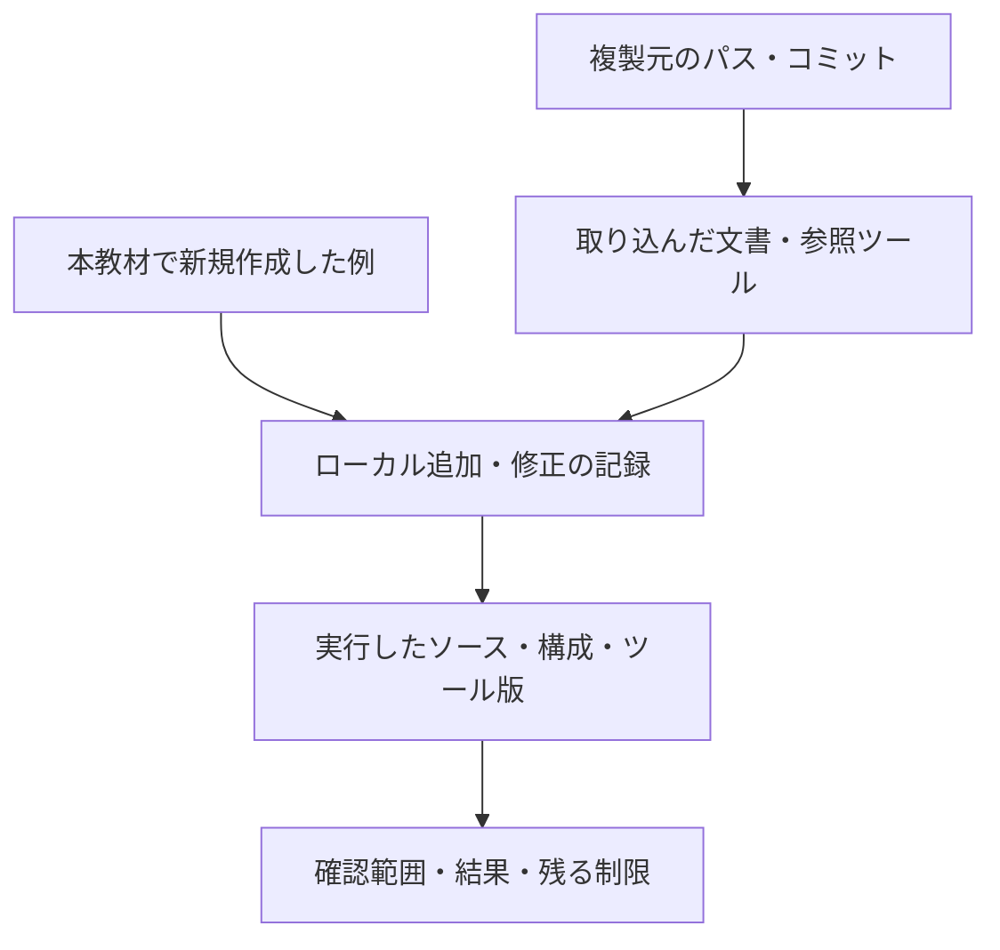

# 由来

このリポジトリの資料とツールの基礎は、[kirimasim-tests](https://github.com/kurochan001/kirimasim-tests)から複製したものです。最初の複製はコミット`c88b0c3`（2026-10-24）からで、その後に元で更新された資料は、表に示すコミットから複製し直しています。
複製時には、Markdownの相対リンクを書き換えました。コピー先にある資料へのリンクは、新しい場所への相対リンクにしました。コピー先に無い資料へのリンクは、元のリポジトリの同じコミットへの固定リンクにしました。
`README.md`、`tools/README.md`、`PROVENANCE.md`、`.gitignore`、`docs/templates/`、`examples/`、`.gitlab-ci.yml`は、このリポジトリで新しく書いたものです。一般化した手順書には、以下の追記・改訂があります。

## 由来と現在の証跡を分ける

複製元の版、ローカルでの追加・修正、実行した版と範囲をそれぞれ記録します。

図は記録の関係です。過去の数値や成功記録は当時の版の結果として読み、現行版の再実行結果へ読み替えません。

## このリポジトリでの追記・改訂

- `docs/method/spec-to-verification-method.md`は、下表のファイルを派生元として維持します。`3142ad7`で、製品開発の設計・検証・製造上の確認項目を14節に追加しました。
- 2026-10-25の全体レビューで、機能カバレッジと正しさの判定、構成ごとの適用と集計、証跡とフォーマル検証の条件、仕様変更の影響確認、開発段階別のサインオフと例外承認を明確にしました。技術的な役割を確認した一次資料は、手順書の付録Cに示しています。これらは半導体仕様への適用実績ではなく、今後検証する運用案です。
- `docs/templates/signoff-record.md`は、改訂した手順に沿って新設した雛形です。`tools/README.md`には、複製元での復元先・依存ファイル・検証方法を追記しています。
- `docs/method/uvm-verification.md`は、このリポジトリで新しく書いたUVMへの適用案です。Accelleraの公式資料・参照実装を参照し、要求IDとの対応、RAL、テスト終了と回帰の判定を整理しました。一般化した手順書の9.7節と、サインオフ記録から参照します。UARTの記録例は説明用であり、実行済みの証跡ではありません。
- `docs/method/feature-interaction-verification.md`は、このリポジトリで新しく書いた機能間クロス検証の運用案です。依存関係からの目標選定、同時・順序・中断の観測、高次の組み合わせ、到達と合格の計測を追記しました。UVMの実装説明とサインオフ記録も対応させています。NISTとAccelleraの一次資料を参考にしましたが、相互作用表と割り込みIPの12目標は本リポジトリの計画例であり、適用済みの実績ではありません。
- `docs/method/constrained-random-verification.md`は、このリポジトリで新しく書いたランダム検証の運用案です。制約と探索方針、生成失敗、seedと再現性、回帰、未達の調整、失敗の縮小と完了条件を整理しました。AccelleraとVerilatorの一次資料を参照し、UVM・クロス検証・サインオフ記録も対応させています。割り込みの9実行は未実施の計画例です。
- `docs/method/sva-verification.md`は、このリポジトリで新しく書いたSVAの運用案です。assert・assume・cover、サンプリング、リセット・vacuous pass、シミュレーション・フォーマル検証の記録と完了条件を整理しました。DVConの著者論文とYosysHQ・Verilatorの一次資料を参照しています。割り込みのチェッカーは本リポジトリで作成した説明用コードで、規格の例の転載や製品IPへの適用実績ではありません。
- `docs/method/functional-coverage.md`は、このリポジトリで新しく書いたcovergroupの運用案です。機能一覧からのbin・crossの設計、サンプリング、除外と閾値、インスタンス・DBの集計、判定との対応を整理しました。Accellera・OpenTitan・Verilatorの一次資料を参照しています。基本動作の16目標を扱うコレクターは本リポジトリで作成した説明用コードです。
- `docs/method/formal-verification.md`は、このリポジトリで新しく書いたフォーマル検証の運用案です。仮定・初期状態、抽象化と証明の分割、安全性・活性、有界検査と非有界の証明、反例・到達性、完了判定を整理しました。YosysHQ・YoWASPの一次資料を参照しています。割り込みの小さなモデル、証明設定と故障注入は本リポジトリで作成し、説明用モデルで動作確認したもので、製品IPへの適用実績ではありません。
- `docs/method/verification-gap-review.md`と`docs/templates/verification-scope.md`は、このリポジトリで新しく書いた検証領域の点検手順と適用範囲の雛形です。既存資料で概要にとどまっていた領域を、lint、リセット・X伝搬、CDC/RDC、転送・異常・復帰、性能、低電力、セキュリティ、コードカバレッジ、等価性・統合などの試験・解析と完了条件へ展開しました。OpenTitan・Verilator・Accelleraの一次資料を参照しています。割り込みの追加試験案は未実施の計画で、製品への適用実績ではありません。
- 同資料のCDC検証に、同期化レイテンシをランダムに変えるDynamic CDC／メタスタビリティ影響注入を追記しました。Siemensの著者解説とsemifyの公開モデルを参照し、クロックジッター・実行ごとのFF段数変更との区別、−1／0／＋1のモデル条件、再収束と観測・判定を整理しています。外部モデルの導入・転載・動作確認を行ったものではありません。
- `docs/method/mutation-verification.md`は、このリポジトリで新しく書いたミューテーション検証の運用案です。YosysHQ MCYの一次資料を参照し、検証環境の検出力と安全機構への故障注入の区別、変異の選定、対照実行、未検出・等価性の分析、分類・集計・証跡を整理しました。割り込みの確認例は、既存のSVA・フォーマル検証資料に記録した説明用モデルの結果を参照しています。MCYの導入や製品での変異キャンペーンの実施を示すものではありません。
- `docs/method/verification-reduction.md`は、このリポジトリで新しく書いた検証規模の縮退の運用案です。ASTQB・NISTの一次資料を参照し、同値分割・境界値、組み合わせの次数、代表構成、回帰・seed・変異の選択、抽象化、削減後の目標・検出力・証跡の確認を整理しました。3因子の例は組の選択を説明するためのもので、DUTの実行結果や既存の割り込み目標の削減を示すものではありません。
- `docs/method/continuous-regression.md`は、このリポジトリで新しく書いた継続的リグレッションの運用案です。Cadence・GitLabの一次資料を参照し、vManager／Verisium ManagerとCIの役割、総費用、回帰の段階、manifestと分散実行、ライセンス・資源、判定・retry・カバレッジ・証跡を整理しました。本文は運用案であり、製品向けランナーや専用検証管理製品の導入・接続・実行実績ではありません。GitLab CI/CDの説明用実行例は次項に分けて記録しています。
- `examples/gitlab-regression/`と`.gitlab-ci.yml`は、本リポジトリで新しく実装した独立した最小例です。架空のIRQ回路、16基本動作・12時間関係・動作中リセット・CDC遅延モデル・ランダム操作列、4変異・X注入、Pythonランナー、8要求・50目標の判定、JUnit・manifest、GitLab設定と実行手順を含みます。GitLab・Icarusの公式資料を参照し、ローカルの動作と異常時の判定を確認しています。2026-10-25にGitLabデモへ例を登録し、Linux RunnerとDebian・Icarus 11で通常回帰・夜間回帰、失敗時のJUnit・artifact保存、MRのマージ禁止と正常復帰を確認しました。検証後、同日にデモをPublicへ変更しました。URLと確認範囲は[例の実行記録](examples/gitlab-regression/README.md#7-確認した範囲)に記載しています。上流のツールの汎用化、製品への適用、毎晩の継続運用の実績を示すものではありません。
- ケーススタディの報告とツールのコードは、上流の履歴を示す資料・参照実装として扱います。一般化した手順書の追加項目が、そのまま現行ツールで検査できるという意味ではありません。
- 2026-10-26のレビュー修正では、照合キットの`propose.py`・`merge.py`へ、このリポジトリ独自の承認時スナップショットを追加しました。照合案・テスト入力・関連要求の変更と、スナップショットのない旧形式の承認を検出し、未統合の承認に不備があれば台帳を書かずに停止します。`test_matching_kit.py`に回帰テストを追加し、README・手順書・Workflowの再レビュー手順も更新しました。過去の上流での承認・集計を、この修正で再検証したという意味ではありません。
- 同日の文書修正では、SVA演算子表のエスケープ、動的配列の`new[3](d)`の復元、設計網羅率と実行確認率の区別、同期基準時点のテスト総数、ランダム検証例の実装状況、IRQ変異の個数を訂正しました。同期基準と下表の複製元コミットは維持し、これらをローカル改訂として記録します。
- 同日に、README・一般化した手順書・GitLab実行例・照合キットの説明へMermaid図と補足表を追加しました。全体の流れ、UVMの接続、SVAの観測時点、到達と合格の分類、ランダム回帰・フォーマル検証・変異検証・縮退・CI・承認時の版照合を図示しています。CDCのタイミング表は、本リポジトリの説明用モデルと受信回路に対応する例です。図表は既存の説明・実装を整理したもので、新しい製品適用実績や未実装機能の追加を示すものではありません。
- 同日に、`docs/glossary.md`と`docs/faq.md`を新規作成しました。既存の手順書・計測規則・実行例を参照し、用語の意味、検証方式の使い分け、指標・完了条件、実装済みの範囲を整理しています。用語の説明にはAccellera・YosysHQ・GitLabの公式資料も参照しています。新しい検証機能や製品での実績の追加ではありません。
- 同日の日本語表現の見直しで、一般化文書・FAQ・用語集・実行例・ケーススタディの説明を推敲しました。検証部品やフォーマル検証の表記を統一し、検証完了、カバレッジ収束、独立レビュー、vacuous passなどの説明を明確にしました。用語表記の参考にしたCadence・Synopsysの日本語資料は用語集から参照できます。コード・実行条件・数値結果は変更していません。

`examples/gitlab-fifo/`は、2026-10-26に本リポジトリで新しく作成したFIFOのランダム検証例です。説明用の同期FIFO、独立した参照キューを使うテストベンチ、seed・全入力列の保存、構成別の要求・カバレッジ判定、3変異の検出、GitLabの6構成matrix回帰とランナー確認を含みます。プロセス実行とログ判定は既存IRQ例の処理を再利用します。GitLabの公式matrix・JUnit資料を参照し、ローカルで全6構成のsmoke・nightlyを確認しました。GitLabの確認用MR !2でもDebian・Icarus 11.0で全6構成のsmokeとランナー確認が成功しています。URLと範囲は[FIFO例の実行記録](examples/gitlab-fifo/README.md#7-保存する証跡と確認範囲)に記載しています。製品FIFOへの適用や非同期FIFOの検証実績を示すものではありません。

`examples/gitlab-formal/`は、2026-10-26に新規作成したオープンソースツールによるFIFOのフォーマル検証例です。既存の同期FIFOを対象に、制御の非有界証明、データの有界検査、6目標の到達性、3変異の反例、過剰なリセット仮定の診断を実装しています。YoWASP・YosysHQの公式資料を参照し、ツール版、実際に読み込んだassert・assume・cover、状態・ログ・トレースを記録します。ローカルとGitLabのMR !3で動作を確認し、ツールの自動準備を含む実行範囲は[確認記録](examples/gitlab-formal/README.md#8-実行確認の記録)に記載しています。幅8・深さ1／3の説明例であり、非有界のデータ整合性証明や製品FIFOへの適用を示すものではありません。

## 最新版との照合

2026-10-25の同期時に上流を取得し、その時点の最新`main`の[`3faf239af2614fd8d65cf31c54b0f297108704dd`](https://github.com/kurochan001/kirimasim-tests/commit/3faf239af2614fd8d65cf31c54b0f297108704dd)に対して、当時の対象32ファイルを照合しました。変更のあったツール4ファイルを更新しました。内容が変わっていないファイルは、従来の複製元コミットを残しています。その後の一般化文書の追記・改訂は上記に分けて記録しています。

今回のツール更新には、指摘番号が付いた保留判定の重複登録防止、テスト作成・独立検証時の注意事項の追加、計測対象シミュレータのLyraへの更新、環境変数`IEEE1800_SOURCE`による規格資料の参照先指定を含みます。
また、`simulator-differences.md`で過去のリンク書き換えが配列の説明とコード例に入り込んでいた2箇所を、上流の記述に戻しました。
2026-10-25の公開前整備では、同資料の6.20.5（module-body specparam）の説明を、このリポジトリ独自の表現へ書き直しました。新規作成物と複製・改訂物のライセンス適用範囲もREADMEに明記しています。

### 文書と集計の更新（2026-10-26）

本リポジトリの`3fb116a`で、kirimasim-testsの[`0da4f2fc`](https://github.com/kurochan001/kirimasim-tests/commit/0da4f2fc247bfcee27fc407b8ef0cd8d8f768dfc)からケーススタディ文書5件を取り込みました。対象は元の手順書、計測規則、照合レビューの累積、シミュレータ差異、未登録テストの照合報告です。下表はその追加を含む33ファイルの由来を示します。参照ツールの同期基準は`3faf239`のままです。

今回の文書更新では、上流の[`b2de3bc5`の集計](https://github.com/kurochan001/kirimasim-tests/blob/b2de3bc5ef17071be53d44c6742700c03b1b12a7/coverage/behavior-summary.json)を読み、READMEの概要値と計測規則のテスト本数を更新しました。本文1〜40章の値は同JSONの章別件数を合計して算出しています。上流の台帳・テスト・ツール一式をこの版へ同期したものではありません。過去の報告は、当時の版・数値の記録として保持します。

GitLabではMR !2・!3のmainへのマージと、mainのCI #2988462019の12ジョブ・JUnit 90件の成功を確認しました。各実行例とREADMEへその状態を反映しています。コード、検証条件、CI設定は今回変更していません。

## ファイルごとの複製元・派生元

| このリポジトリ | kirimasim-tests（複製元のコミット） |
| --- | --- |
| `docs/method/spec-to-verification-method.md` | [`docs/spec-to-verification-method.md`](https://github.com/kurochan001/kirimasim-tests/blob/0ccbd37/docs/spec-to-verification-method.md) |
| `docs/case-study-ieee1800/requirements-to-tests-method.md` | [`docs/requirements-to-tests-method.md`](https://github.com/kurochan001/kirimasim-tests/blob/0da4f2fc/docs/requirements-to-tests-method.md) |
| `docs/case-study-ieee1800/requirement-extraction.md` | [`docs/requirement-extraction.md`](https://github.com/kurochan001/kirimasim-tests/blob/0ccbd37/docs/requirement-extraction.md) |
| `docs/case-study-ieee1800/requirement-extraction-notes.md` | [`docs/requirement-extraction-notes.md`](https://github.com/kurochan001/kirimasim-tests/blob/c88b0c3/docs/requirement-extraction-notes.md) |
| `docs/case-study-ieee1800/coverage-rules.md` | [`coverage/README.md`](https://github.com/kurochan001/kirimasim-tests/blob/0da4f2fc/coverage/README.md) |
| `docs/case-study-ieee1800/existing-test-matching-20percent-20261023.md` | [`docs/existing-test-matching-20percent-20261023.md`](https://github.com/kurochan001/kirimasim-tests/blob/c88b0c3/docs/existing-test-matching-20percent-20261023.md) |
| `docs/case-study-ieee1800/existing-test-matching-review-20261022.md` | [`docs/existing-test-matching-review-20261022.md`](https://github.com/kurochan001/kirimasim-tests/blob/0da4f2fc/docs/existing-test-matching-review-20261022.md) |
| `docs/case-study-ieee1800/header-vpi-tests-and-matching-20261023.md` | [`docs/header-vpi-tests-and-matching-20261023.md`](https://github.com/kurochan001/kirimasim-tests/blob/c88b0c3/docs/header-vpi-tests-and-matching-20261023.md) |
| `docs/case-study-ieee1800/keyword-tests-20261024.md` | [`docs/keyword-tests-20261024.md`](https://github.com/kurochan001/kirimasim-tests/blob/c88b0c3/docs/keyword-tests-20261024.md) |
| `docs/case-study-ieee1800/gap-tests-20261024.md` | [`docs/gap-tests-20261024.md`](https://github.com/kurochan001/kirimasim-tests/blob/b13204c/docs/gap-tests-20261024.md) |
| `docs/case-study-ieee1800/gap-tests-2-20261024.md` | [`docs/gap-tests-2-20261024.md`](https://github.com/kurochan001/kirimasim-tests/blob/0ccbd37/docs/gap-tests-2-20261024.md) |
| `docs/case-study-ieee1800/lyra-disagreement-review-20261025.md` | [`docs/lyra-disagreement-review-20261025.md`](https://github.com/kurochan001/kirimasim-tests/blob/3faf239/docs/lyra-disagreement-review-20261025.md) |
| `docs/case-study-ieee1800/existing-test-matching-unregistered-20261025.md` | [`docs/existing-test-matching-unregistered-20261025.md`](https://github.com/kurochan001/kirimasim-tests/blob/0da4f2fc/docs/existing-test-matching-unregistered-20261025.md) |
| `docs/case-study-ieee1800/simulator-differences.md` | [`docs/simulator-differences.md`](https://github.com/kurochan001/kirimasim-tests/blob/0da4f2fc/docs/simulator-differences.md) |
| `tools/matching_kit/README.md` | [`tools/matching_kit/README.md`](https://github.com/kurochan001/kirimasim-tests/blob/c88b0c3/tools/matching_kit/README.md) |
| `tools/matching_kit/propose.py` | [`tools/matching_kit/propose.py`](https://github.com/kurochan001/kirimasim-tests/blob/c88b0c3/tools/matching_kit/propose.py) |
| `tools/matching_kit/merge.py` | [`tools/matching_kit/merge.py`](https://github.com/kurochan001/kirimasim-tests/blob/3faf239/tools/matching_kit/merge.py) |
| `tools/matching_kit/runsim.py` | [`tools/matching_kit/runsim.py`](https://github.com/kurochan001/kirimasim-tests/blob/c88b0c3/tools/matching_kit/runsim.py) |
| `tools/matching_kit/partition.py` | [`tools/matching_kit/partition.py`](https://github.com/kurochan001/kirimasim-tests/blob/c88b0c3/tools/matching_kit/partition.py) |
| `tools/matching_kit/withdrawn-20261023.json` | [`tools/matching_kit/withdrawn-20261023.json`](https://github.com/kurochan001/kirimasim-tests/blob/c88b0c3/tools/matching_kit/withdrawn-20261023.json) |
| `tools/matching_kit/workflows/match.js` | [`tools/matching_kit/workflows/match.js`](https://github.com/kurochan001/kirimasim-tests/blob/c88b0c3/tools/matching_kit/workflows/match.js) |
| `tools/matching_kit/workflows/gap.js` | [`tools/matching_kit/workflows/gap.js`](https://github.com/kurochan001/kirimasim-tests/blob/3faf239/tools/matching_kit/workflows/gap.js) |
| `tools/matching_kit/workflows/interpretation-review.js` | [`tools/matching_kit/workflows/interpretation-review.js`](https://github.com/kurochan001/kirimasim-tests/blob/c88b0c3/tools/matching_kit/workflows/interpretation-review.js) |
| `tools/matching_kit/test_matching_kit.py` | [`tools/test_matching_kit.py`](https://github.com/kurochan001/kirimasim-tests/blob/c88b0c3/tools/test_matching_kit.py) |
| `tools/generators/common.py` | [`generators/common.py`](https://github.com/kurochan001/kirimasim-tests/blob/c88b0c3/generators/common.py) |
| `tools/generators/generate.py` | [`generators/generate.py`](https://github.com/kurochan001/kirimasim-tests/blob/c88b0c3/generators/generate.py) |
| `tools/generators/keywords.py` | [`generators/keywords.py`](https://github.com/kurochan001/kirimasim-tests/blob/c88b0c3/generators/keywords.py) |
| `tools/reference/behavior_coverage.py` | [`tools/behavior_coverage.py`](https://github.com/kurochan001/kirimasim-tests/blob/3faf239/tools/behavior_coverage.py) |
| `tools/reference/requirement_audit.py` | [`tools/requirement_audit.py`](https://github.com/kurochan001/kirimasim-tests/blob/c88b0c3/tools/requirement_audit.py) |
| `tools/reference/requirement_matching.py` | [`tools/requirement_matching.py`](https://github.com/kurochan001/kirimasim-tests/blob/c88b0c3/tools/requirement_matching.py) |
| `tools/reference/requirement_source.py` | [`tools/requirement_source.py`](https://github.com/kurochan001/kirimasim-tests/blob/3faf239/tools/requirement_source.py) |
| `tools/reference/suite_results.py` | [`tools/suite_results.py`](https://github.com/kurochan001/kirimasim-tests/blob/c88b0c3/tools/suite_results.py) |
| `LICENSE` | [`LICENSE`](https://github.com/kurochan001/kirimasim-tests/blob/c88b0c3/LICENSE) |

## APBレジスタ検証例の追加（2026-10-26）

`examples/gitlab-apb/`は、このリポジトリ向けに新規作成した説明用RTL・テストベンチ・ランナーです。ArmのAPB仕様を参照し、独自のレジスタマップ、W1Cのイベント優先、エラー時の状態保持、同期リセットを定義しました。待ち状態0／1／3の独立判定、seed付き入力、3変異、要求・カバレッジとJUnitを実装し、既存FIFO例のランナー構成とIRQ例のプロセス実行・終了判定処理を再利用しています。APB仕様書の本文・図・コードの転載ではありません。実行範囲と確認結果は[APB例](examples/gitlab-apb/README.md)を参照してください。

APB追加のMR !4はGitLab CI #2988642917で全16ジョブ成功、JUnit 108件・失敗／エラー0件を確認しました。mainへのマージとschedule全例の129件の実行は今回行っていません。

## APBと割込みの結合検証例の追加（2026-10-26）

`examples/gitlab-apb-irq/`は既存APB RTLを再利用し、下位4ビットのマスクとイベント保持状態から割込みを出力する説明用結合回路です。ランナー・チェッカーはAPB例を基に拡張し、IRQ例のプロセス実行・終了判定処理も利用します。4要因×マスク×クリア×イベントの32クロスに、順序・同時動作・複数要因・待ち・エラー・リセットを加えました。構成ごとの44／45目標と3変異を判定し、証跡を保存します。単一要因の`irq_pending`を二重に接続せず、既存APB内のPENDINGを保持状態として使っています。

併せて、APB単体例のMR !4がmainへマージされ、CI #2988663611で全16ジョブ・JUnit 108件が成功した状態を確認しました。今回の結合検証追加後の構成は20ジョブ・通常JUnit 126件、scheduleは153件を予定します。製品割込みシステムや実ソフトウェアへの適用を示すものではありません。

結合検証のMR !5でCI #2988726525の全20ジョブ・JUnit 126件が成功し、保存済み証跡でも各構成の44／45目標と3変異の検出を確認しました。nightly全3構成はローカルで確認し、GitLabのschedule全例153件は今回実行していません。MR !5のmainへのマージは行っていません。

## ready/valid通信のランダム検証例の追加（2026-10-26）

`examples/gitlab-stream/`は、新規の説明用ready/validバッファと、FIFO例を基に拡張したランナー・チェッカーです。IRQ例のプロセス実行・終了判定処理を利用します。LaForestのready/valid設計資料を参照し、データ保持、満杯時の入替え、同期リセットによる破棄をこの回路の仕様として定めました。外部資料のRTLや図の転載ではありません。深さ1／3×幅8／16で必須25／29目標と3変異を判定し、最後の排出、受理数・受信数・リセット破棄数を照合します。

併せて、APBと割込みの結合検証のMR !5がmainへマージされ、CI #2988757915で全20ジョブ・JUnit 126件が成功した状態を確認しました。今回のready/valid追加後は25ジョブ・通常JUnit 150件、scheduleは185件を予定します。AXI全体への適合性や任意の待ち時間に対する活性を証明した結果ではありません。

ready/validのMR !6でCI #2989066110の全25ジョブ・JUnit 150件が成功し、保存済み証跡でも各構成の25／29目標、3変異の検出、転送数の照合を確認しました。nightly全4構成はローカルで確認し、GitLabのschedule全例185件は今回実行していません。MR !6のmainへのマージは行っていません。

## SVAの実行例の追加（2026-10-26）

`examples/gitlab-sva/`は、既存IRQ RTLとプロセス実行・終了判定処理を利用して作成したSVA実行例です。要求6件に対応する並行アサーション6個・カバー12目標を接続し、RTL変異3件とチェッカー入力の違反3件、前件不足の診断を実装しました。Verilatorの公式資料を参照し、カバーログとネイティブカウンター、接続先・ソースを照合します。最後の観測クロックでは新規の1サイクル後件の開始だけを抑止します。本文の説明用SVAコードを基に、使用ツールに合わせた記法へ展開しています。

GitLabのMR !6が未マージのため、SVAのMR !7はそのソースブランチを宛先として追加しました。SVAを含む設定は27ジョブ・通常JUnit 160件、scheduleは197件を予定し、ランナー確認78件は別枠です。2値シミュレーションであり、X/ZやSVA全構文の対応、形式証明を示すものではありません。

SVAのMR !7でCI #2989571313の全27ジョブ・JUnit 160件が成功しました。Verilator 5.006のネイティブDBの形式差に対応し、5.052と同じラベル・ソース・階層・件数の検査を行います。保存済み証跡でも要求6件・12目標、感度確認6件、診断1件、予定ケースの完了を確認しました。nightlyはローカルで実行し、GitLabのschedule全例197件は今回実行していません。MR !6・!7のマージは行っていません。

## 回帰の縮退の比較例の追加（2026-10-26）

`examples/gitlab-reduction/`は、新規の比較ランナー・テストベンチ・履歴依存変異のラッパーです。既存IRQ RTLと3変異、プロセス実行・終了判定処理を再利用します。正常な全候補の観測で貪欲に選択し、全件・目標だけの選択・ストレス保持を新たに実行します。19目標の維持と検査サイクル数、3基本変異、選択に検出結果を使わない追加の履歴依存変異を比較します。縮退の一般的な検出率や製品の妥当性を示す実績ではありません。

併せて、SVAのMR !7がready/validのブランチへ取り込まれ、そのMR !6もmainへマージされたことと、mainのCI #2989619450が全27ジョブ・JUnit 160件で成功したことを確認しました。縮退例追加後は29ジョブ・通常JUnit 178件、scheduleは215件を予定します。ランナー確認89テストは別枠です。

縮退比較のMR !8でCI #2989712015の全29ジョブ・JUnit 178件が成功し、保存済み証跡でも19目標の維持、233／42／47検査サイクル、基本変異3件の検出と履歴依存変異の検出差を確認しました。初回の既存ジョブの失敗はRunner準備時の認証エラーで、検証コードを変更せず再実行しました。nightlyはローカルで確認し、GitLabのschedule全例215件とMR !8のマージは今回行っていません。

## アービタの検証例の追加（2026-10-26）

`examples/gitlab-arbiter/`は新規の説明用ラウンドロビンRTL・テストベンチと、FIFO例を基に拡張したランナーです。IRQ例のプロセス実行・終了判定処理を再利用します。要求元2／3／4で排他制御、受信待ち中の選択保持、受理順序と条件付き公平性を検査し、21／31／49目標を構成ごとに判定します。受理数と待ちの記録、受信停止の診断、3変異、順序比較を無効にした専用構成での独立した公平性モニターの違反検出も実装しました。任意の無限の要求列や製品への適用を実証した結果ではありません。

併せて、縮退比較のMR !8がmainへマージされ、CI #2989744619で全29ジョブ・JUnit 178件が成功したことを確認しました。アービタ追加後は33ジョブ・通常JUnit 199件、scheduleは242件を予定します。ランナー確認102テストは別枠です。

アービタのMR !9でCI #2989838991の全33ジョブ・JUnit 199件が成功しました。保存済み証跡でも構成ごとの21／31／49目標、3変異、停止診断、受理数と待ちの照合を確認しました。nightlyはローカルで実行し、GitLabのschedule全例242件とMR !9のマージは今回行っていません。

## UARTのランダム検証例の追加（2026-10-26）

`examples/gitlab-uart/`のRTLとシリアル刺激・波形比較テストベンチは、この教材用に作成しました。ランナーと自己確認テストはFIFO例を基に拡張し、IRQ例のプロセス実行・終了判定を再利用しています。フレーム形式と受信エラーの基本事項はREADMEに記載したMicrochipの一次資料を参照し、特定製品のRTLや検証IPを転載したものではありません。開始パルス、エラー通知、リセットなどは教材独自の仕様です。

8N1／8E1／8O1と分周数8／16の6構成、独立した送受信照合、代表パターン、エラー注入、偽スタート、転送中リセットと復帰、21／22目標と3／4変異を実装しました。ローカルでsmoke全6構成、13テスト、および各構成3 seed×1000ランダム操作を確認しました。周波数誤差、ノイズ耐性、アナログCDC安全性、製品UARTの規格適合性の実証ではありません。

併せてMR !9のmainへのマージと、CI #2989957235の全33ジョブ・JUnit 199件成功を確認しました。UART追加後は40ジョブ・通常JUnit 239件、scheduleは294件を予定し、ランナー確認115テストは別枠です。

UARTのMR !10で[CI #2990037734](https://gitlab.com/kurochan001/lsi-verification-method-ci-demo/-/pipelines/2990037734)の全40ジョブ・JUnit 239件が成功しました。保存済み証跡でも構成ごとの目標達成、変異検出、完了数、ソースハッシュと実行コミットを照合しました。GitLabのschedule全例294件とMR !10のマージは今回行っていません。

## APB・UART・割込みの結合検証例の追加（2026-10-26）

`examples/gitlab-apb-uart/`は既存UARTをそのまま使い、UART用APBレジスタと割込み保持回路を新規に作成した教材です。APBの待ち・完了処理とマスク・W1Cの考え方は既存例を引き継ぎ、ランナー・自己確認テストはUART例を基に拡張しました。IRQ例のプロセス実行・終了判定を再利用しています。刺激生成と予定受信は独立したPythonで作成し、実装内部のUART出力・イベントを期待値に使いません。

9構成で実際の送受信、エラー、バス応答、割込み、W1C・マスク更新・受信読出しの競合を確認し、60／61／69／70目標と5変異を判定します。OpenTitanのUARTテスト計画・操作例は観点の参考で、コードやレジスタ仕様の転載ではありません。受信保持は1バイト、レジスタと優先順位は教材独自の仕様で、CPU・実ドライバ・異なるクロック間の結合を検証した結果ではありません。

ローカルでランナー14テストとnightly全9構成（seed 17〜19を各128シナリオ）を確認しました。併せてUARTのMR !10がmainへマージされ、CI #2990074629で全40ジョブ・JUnit 239件が成功したことを確認しました。結合例を加えると50ジョブ・通常JUnit 311件、scheduleは384件を予定し、ランナー確認129テストは別枠です。

結合例のMR !11で[CI #2990155891](https://gitlab.com/kurochan001/lsi-verification-method-ci-demo/-/pipelines/2990155891)の全50ジョブ成功とJUnit 311件をGitLab画面で確認しました。保存済みの全9構成のsummary・coverageでも必須目標、5変異、全7ケースの完了と適用除外を照合しました。GitLabのschedule全例384件は今回行っていません。その後MR !11のmainへのマージと、[mainのCI #2990167574](https://gitlab.com/kurochan001/lsi-verification-method-ci-demo/-/pipelines/2990167574)の全50ジョブ成功・JUnit 311件・失敗／エラー0件を確認しました。

## 現行ドキュメントの再照合（2026-10-26）

kirimasim-testsの公開main [`5fb3c45d`](https://github.com/kurochan001/kirimasim-tests/commit/5fb3c45d73e4946d99690389752b82c86eecaa50)を確認し、[同版の集計JSON](https://github.com/kurochan001/kirimasim-tests/blob/5fb3c45d73e4946d99690389752b82c86eecaa50/coverage/behavior-summary.json)と集計文書から、READMEの概要値と計測規則のテスト本数・参照先を更新しました。12,319要求中の対応済み10,209・実行成功5,639、7,144テスト中の対応登録4,730・未登録2,414です。本文1〜40章は章別件数を合計し、9,486要求中7,833対応・3,765実行成功と算出しました。分母が未承認の暫定値で、複数環境の実行成功の和集合です。文書の取り込み基準`0da4f2fc`、参照ツールの同期基準`3faf239`を変更したものではありません。

GitLabでは確認記録のMR !12のmainへの取り込みと、main `ec594de7`の[CI #2990241122](https://gitlab.com/kurochan001/lsi-verification-method-ci-demo/-/pipelines/2990241122)の成功を確認しました。MR !12のCI #2990210417は全50ジョブ・JUnit 311件・失敗／エラー0件です。現行手順に残っていた12ジョブ・90件の記述を50ジョブ・311件へ修正し、過去の実行記録の数値はその時点の値として明記しました。ランナー確認129テストとschedule予定384件も区別しています。RTL、検証条件、CI設定の変更や回帰の再実行は今回行っていません。

## 全体レビューによる修正（2026-10-27）

ドキュメント、実行例、CI設定、参照ツールを照合し、次の2点を修正しました。

- アービタ例で`+WAVE`の引数を受け取っていなかったため、VCDを生成していませんでした。テストベンチへ波形保存を追加し、既存の3構成確認で正常・変異・停止診断の全ケースのVCDファイルとヘッダを検査します。
- SVA例では要求カタログのアサーション名とカバーの対応を検査していませんでした。未実装のアサーション名でも回帰が成功することを再現し、固定した6アサーション・12カバーとの照合と、誤記・重複・対応違い・欠落の確認テストを追加しました。正常カタログのネイティブSVA回帰も再確認しました。

SVAランナー確認は11から12テストとなり、実行例全体の確認は130テストです。ジョブ数と通常／scheduleのJUnit予定件数は50ジョブ・311／384件のままです。今回の修正と確認はローカルで行い、既存のGitLabのCI記録は対象コミットの実行結果として保持します。参照ツールは同期基準`3faf239`の追跡済みファイルを一時ディレクトリへ復元し、本リポジトリの写しを対応先へ重ねた環境で89テストの成功を確認しました。

実行例の確認テストは修正後の合計130件が成功し、アービタは4要求元のnightlyでも49目標と3変異・波形保存を確認しました。SVAはVerilatorで12ネイティブカバーと6種類の違反検出が成功し、不正カタログが終了コード1になることを確認しました。固定版の一時フォーマル環境でFIFOの深さ1・3の計16タスクと、文書から保存したIRQコード例のbmc・prove・coverも成功しました。図20件の構文、ローカル参照先434件と見出し参照も確認しました。これらは記載範囲のローカル確認で、製品への適用やGitLabでの修正後のCI実行を示すものではありません。

## ローカル専用の3例の追加（2026-10-27）

`examples/local-ecc/`、`examples/local-spi/`、`examples/local-timer-watchdog/`のRTL・テストベンチ・刺激生成・要求カタログ・確認テストは、この教材用に作成しました。`examples/local-common/`は新規の共通ランナーで、既存IRQ例のプロセス実行・タイムアウト・終了判定処理を再利用します。3例とも商用IPや製品のRTL・検証IPを転載したものではありません。

ECCは短縮拡張ハミング(13,8)の全256データと0／1／2ビット誤り23,552パターンを、コードブックと最小距離による独立した期待値で照合します。SECDEDの用語はREADME記載のMicrochip一次資料を参照し、符号配置・出力仕様は教材独自です。3ビットの誤訂正と4ビットの無通知誤りの2例は保証範囲外の診断で、正常検証の97目標へ算入しません。

SPIのCPOL／CPHAの対応はREADME記載のMicrochip一次資料を参照しました。4モード×2分周の8構成で、予定時刻から独立に駆動・照合し、各16目標を判定します。開始・完了・CS保持期間は教材独自です。タイマー・ウォッチドッグも独自の同期仕様で、幅4／8の2構成、各20目標を、enableの仮想時刻と満了予定時刻を使う参照モデルで照合します。ウォッチドッグはリセット要求だけを出力し、自動でシステムをリセットするモデルではありません。

全11構成でsmoke／nightly、計44件の構成と変異の組み合わせの検出、ECC診断2件をローカルで確認しました。正常時JUnitは全構成合計smoke 79件／nightly 101件です。追加の確認テストは共通14＋ECC 6＋SPI 4＋タイマー・ウォッチドッグ6＝30件で、既存GitLab例のランナー確認130件とは別枠です。確認環境はPython 3.14.7、Icarus Verilog 14.0開発版です。任意入力列の証明、実デバイスのタイミング・物理特性や製品の安全性の確認ではありません。

ルートのGitLab CI設定と既存例のCI設定は変更せず、GitLabへの追加・CI起動は行っていません。既存のGitLab集計50ジョブ・通常JUnit 311件・schedule予定384件はそのままです。README・FAQと継続回帰・ミューテーション検証の文書へ、ローカル専用であることと実行先のリンクを追加しました。

## 非同期FIFO・I²C・APBタイマー結合例の追加（2026-10-27）

`examples/local-async-fifo/`、`examples/local-i2c/`、`examples/local-apb-timer/`のRTL・テストベンチ・刺激／期待値生成・要求カタログ・確認テストは、この教材用に作成しました。前2例は新規RTL、APB結合例は既存`local-timer-watchdog/rtl/timer_watchdog.sv`を変更せずに接続する新規ラッパーです。既存のローカル共通ランナーを利用し、製品IPや外部の検証コードの転載は行っていません。

非同期FIFOは深さ4／8×同期段数2／3の4構成で、参照キューと遅延させた絶対累計によりデータ・フラグを照合し、各17目標を判定します。送信元Grayポインターの変化も検査します。2種類のクロック比、同周期、離散ジッター−1／0／＋1、共通リセットを含みます。Alteraの一次資料は物理的なCDC制約の必要性の参照先で、物理遅延やメタステーブルを再現するモデルではありません。

I²Cは7ビットアドレスの1バイトターゲットと独立したコントローラーBFMで、2構成・各18目標を判定します。ACK／NACK、Repeated START、ストレッチ、途中リセットを信号線で検査します。バスの基本手順はREADME記載のNXP UM10204 Rev.7.0を参照し、レジスタ・拒否入力・リセット仕様は教材独自です。複数コントローラーの仲裁や電気的タイミングの適合性は対象外です。

APB結合例は幅4／8×待ち状態0／2の4構成・各24目標です。レジスタの受付規則と仮想時刻・満了予定による独立モデルで、バス完了、満了とclear／kick／load、IRQマスク、リセット中断を照合します。バス転送の基本手順はArmのAPB一次資料を参照し、レジスタ構成と優先順位は教材独自です。ウォッチドッグはリセット要求の出力だけで、システムのリセット配線はモデル化していません。

新しい10構成のsmoke／nightly、各4変異（構成との組合せ40件）と確認テスト18件が、Python 3.14.7・Icarus Verilog 14.0開発版でローカル成功しました。追加分のJUnitはsmoke 70件／nightly 90件です。既存3例と合わせたローカル6例は21構成、JUnit合計149／191件、共通を含む確認テスト48件となります。README・FAQ・共通手順・継続回帰・ミューテーション検証のリンクと現行の集計を更新しました。

GitLabへの登録・CI起動と既存CI設定の変更は行っていません。既存GitLab例の50ジョブ・通常JUnit 311件・schedule予定384件・ランナー確認130件へ、ローカル例の数値を合算しません。

## AHB-Lite・AXI4-Liteのローカル例の追加（2026-10-27）

`examples/local-ahb/`と`examples/local-axi/`のRTL・テストベンチ・刺激／期待値生成・要求カタログ・確認テストを、この教材用に作成しました。既存ローカル共通ランナーの実行・判定・証跡保存を利用します。バスの基本事項は各READMEに記載したArm一次資料IHI 0033AとIHI 0022Eを参照し、規格本文や外部のRTL・検証コードの転載は行っていません。

AHB-Liteは32ビットの信号サブセットで、待ち状態0／1／3の3構成・各21目標です。アドレスとデータのパイプライン、3サイズのバイトレーン、SINGLE／INCR4・BUSY、2サイクルのERROR、次アドレスの取消しとリセットを、バイト記憶領域と絶対時刻の完了予定による独立モデルで照合します。非整列・過大HSIZEは不正要求を意図した負のテストです。複数マスターやAHB全体の適合性は対象外です。

AXI4-Liteは32ビット・各方向1件に受付を制限した回路で、応答生成の追加遅延0／2の2構成・各39目標です。AW／Wの別キューと応答予定時刻で、先行順序、全16通りのWSTRB、B／Rの保持、同一エッジの読書き、保留読出し中の更新、半要求・応答のリセットを照合します。全WSTRB反映、AR受理時スナップショット、エラー方針と固定遅延は教材独自の仕様です。AXI4のバースト・ID・アウトオブオーダーやAXI4-Streamの例ではありません。

新しい5構成のsmoke／nightly、各4変異（構成との組合せ20件）、AHB 8＋AXI 8の確認テスト16件がPython 3.14.7・Icarus Verilog 14.0開発版で成功しました。追加分のJUnitはsmoke 35件／nightly 45件です。既存分を含めたローカル8例は26構成、JUnit合計184／236件、共通を含む確認テスト64件となります。README、共通手順、FAQ、継続回帰とミューテーション検証へ導線と適用範囲を追記しました。

GitLabへの登録・CI起動と既存CI設定の変更は行っていません。GitLab例の50ジョブ・通常JUnit 311件・schedule予定384件・ランナー確認130件は、ローカル例と分けて保持します。

## AHB／AXIのランダム拡張とフォーマル例（2026-10-27）

AHB-Liteのランダム生成にSINGLE／INCR4、BUSY、転送中リセットを、AXI4-Liteには長めのチャネル遅延・応答待ちと、AWのみ／Wのみ／B保留／R保留でのリセットを加えました。seedと生成ベクトルを保存する既存の実行・判定方式を維持し、追加2テストを含めてシミュレーション・共通の確認は66件です。回帰のJUnit予定数184／236件は変わりません。

`examples/local-bus-formal/`は新規のローカル専用ハーネス・ランナー・確認テストです。既存IRQ例のプロセス実行処理と既存FIFOフォーマル例の固定版ツール群を利用します。入力の保持・初回リセット以外に公平性やAW／W同時到着を仮定せず、2値・単一クロック・サンプリング時のリセットというモデルで検査します。SBY／Yosysの一次資料とArmの仕様は各READMEへ記載し、外部のコードは転載していません。

AHBでは応答タイミング・ERROR・リセットの3プロパティ、AXIでは受付・応答・保持・因果関係・リセットと補助条件の11プロパティを非有界に証明します。AXI RTLへFORMAL専用のassertを4個加え、参照モデルの補助条件1個と併せて帰納法を強めました。入力を制約するassumeではなく、補助条件も検証対象です。通常シミュレーションの動作は変えません。任意の定数で選んだ1ワードを追跡してデータ比較し、AHB計4・AXI計12プロパティのデータ検査は深さ12のBMCとして扱います。

固定版ツールとPython 3.14.7で、AHB 3構成27タスクとAXI 2構成18タスク、計45タスクが予定どおりに判定されました。正常coverは8×3＋12×2の48目標、変異は4×5の20反例です。全5構成で、常時リセットの過剰な仮定による証明PASSと正常cover未達も確認しました。AHBのdemo-bug 1では、安全性証明がPASSしてもデータBMCでFAILし、回帰全体の終了コードが1になりました。

判定・証跡テスト12件を追加し、ローカル確認は66＋12＝78件です。ランダム拡張後のAHB／AXI全5構成のsmoke／nightlyも成功しました。README・各例の手順・FAQ・継続回帰・フォーマル文書へ実行方法と保証範囲を追記しています。GitLabへの登録・CI起動と既存CI設定の変更は行っていません。既存GitLab例の50ジョブ・311／384件・ランナー確認130件へ合算しません。

## AHB／AXIの追加検査・APBブリッジ・AXI4（2026-10-27）

`examples/local-bus-validation/`に、ポートだけを使う独立チェッカー、ネイティブSVA、明示的なクロス目標、4値X検査、クロック間の短パルスリセット、性能・長時間応答待ち、lint・line／toggle収集を追加しました。既存AHB／AXI-Liteテストベンチの追加計測は`BUS_VALIDATION`定義時だけ有効です。元のRTL・通常回帰・フォーマルの対象は変えません。AHBのクロスは各12、AXI-Liteは各22目標です。

チェッカーには意図した各違反を加え、予定の検出ラベルと異常終了を照合します。Icarusの4値とVerilatorの2値を分け、無効ペイロードのXを誤検出しないこと、クロック間のリセットで保持義務を取り消すことも確認します。ネイティブSVAの取消しには非同期リセット世代の変化も使用します。実DUTへの幅1ns・位相3種類のリセットはデジタル動作の試験であり、RDCやrecovery／removalの物理検証ではありません。

`examples/local-bus-bridge/`は新規のAHB-Lite／AXI4-Lite→APB3ブリッジです。既存のAPBレジスタ・APBタイマー・タイマー／ウォッチドッグRTLを接続し、上位応答とAPB・周辺状態を独立モデルで照合します。2バス×APB待ち0／2の4構成・各18目標・4変異です。部分書込みを対応外、ゼロWSTRBを割当領域内のno-opとする方針を明記しました。既存のPythonタイマー参照モデルも使うため、共通ランナーに任意の`EXTRA_INPUTS`のハッシュ記録を加えました。

`examples/local-axi4/`は、Liteとは別の新規メモリRTLです。32ビット・INCR 1〜4ビート・2ビットID・読書き各2件までの未完了転送に限定し、バイト配列の期待値でBID・RID・RESP・RLAST・データを照合します。同一IDの順序、部分／ゼロストローブ、合法な4KiB境界直前・直後と不正な境界越え、応答保持、W先行、読書きの重なり、リセットを26目標・4変異で確認します。アウトオブオーダーやバースト交互返却は実装せず、全AXI4規則の適合性やフォーマル証明としては扱いません。

バス規則は各READMEに記載したArm IHI 0033A・IHI 0022E、計測はVerilatorの一次資料を参照しました。RTL・チェッカー・期待値・試験・要求カタログは教材用の新規作成または本リポジトリ内の再利用であり、外部IPや規格本文の転載は行っていません。

Python 3.14.7、Icarus Verilog 14.0開発版、Verilator 5.052で追加検査のsmoke／nightlyが成功しました。親JUnitは64件、子はブリッジ28／36件とAXI4 7／9件です。性能ケースは各構成で書込み・読出し各512／4096件を照合しました。lintの既知警告は理由を残し、コードカバレッジは未到達も保存して、100%合格とは扱いません。既存RTLのフォーマル45タスクの結果を新規ブリッジ・AXI4へ拡張しません。

追加の確認テストはブリッジ9・AXI4 6・追加検査6の21件です。既存78件も含む計99件が成功しました。共通ランナーのシミュレーションは10例31構成、JUnitは219／281件となります。追加検査からも同じ子回帰を呼べるため、親判定と子結果を同一の件数として二重計上しません。

README・共通手順・AHB／AXIの手順・FAQ・継続回帰・フォーマル・ミューテーションの文書へ導線と対象範囲を追記しました。GitLabへの登録・CI起動・CI設定変更は行っていません。既存GitLab例の50ジョブ・JUnit 311／384件・ランナー確認130件と分けて管理します。

## 結合・復旧・低電力・等価性の7例（2026-10-27）

`examples/local-dma/`、`local-interconnect/`、`local-cdc-bridge/`、`local-recovery/`、`local-power/`をローカル専用のシミュレーション教材として追加しました。RTL・独立期待値・要求カタログ・変異検出・確認テストを用意し、既存のローカル共通ランナーで実行します。外部IPや検証コードの転載はありません。

DMAはAPB設定とAXI4メモリ間コピー、割込みを実接続し、境界分割・部分的な書込みの残存・中断・エラー・リセットを2構成各12目標で照合します。インターコネクトは2マスター×2 RAMターゲット、各方向の所有者・ID・ラウンドロビン・応答保持を1構成12目標で確認します。いずれも既存`local-axi4/rtl/axi4_ram.sv`を利用します。

非同期APBブリッジは、既存非同期FIFOを基にしたワイドパケットFIFOと既存APBレジスタを接続します。元のFIFOは変更せず、新しいFIFOの幅・ドメイン別リセットを教材内で拡張しました。2つのクロック構成で各7目標を照合し、どちらかのリセットで両方向を破棄する契約を明記しています。

復旧例は4／8クロックの期限と古いtagの排除、上位応答保持、tag枯渇を各10目標で検査します。tagは周回させず、再利用には下位応答も破棄する協調リセットを要求します。低電力例は2構成各10目標で、排出・隔離・保持・復帰を検査し、OFF中の内部Xが外へ漏れないことを確認します。UPFや物理検証の結果としては扱いません。

`examples/local-axi4-formal/`と`local-equivalence/`を追加しました。共通の`local-formal-common/runner.py`で、ソースの写し・ハッシュ、実際のプロパティ／仮定の名前・数、ツール終了・status・エンジン完了、VCD・witnessを照合します。UNKNOWN、TIMEOUT、別のassertだけの違反、証跡欠落を成功にしません。ツールは既存の固定版YoWASP・Z3で、`memory_map`による論理回路への展開を使用します。

AXI4 RTLへメモリ容量パラメーターを追加し、既定8KiBのシミュレーション動作は維持しました。`FORMAL`専用の補助assertと読出し値の過大近似も追加しています。16／32バイト・1／2ビートの制御／件数11条件を非有界に証明し、実メモリを使う直列入力のデータ比較等15条件を深さ12でBMCします。並行受付を含む9到達目標は別タスクで扱います。各構成9タスクで計18件、正常到達18目標・変異8反例です。8KiB・4ビートや任意の並行データ列まで証明したとは扱いません。

等価性例は4ビット・深さ2／4のシフト方式とリング方式をSBY miterで比較します。5条件の非有界証明、各5到達目標、4変異、過剰な仮定の診断で計16タスクです。EQYを起動した結果ではなく、合成後ネットリストの等価性でもありません。参照実装の仕様適合性は別の機能検証・レビューが必要と明記しました。

`examples/local-system-regression/`は全7例を呼ぶ親ランナーです。子の成功・終了コードと予定／結果の件数を確認し、親の7集約ゲートと子の詳細JUnitを分けて保存します。追加シミュレーション9構成のJUnitは63／81件、フォーマルは18＋16件です。既存の回帰と同じ試験を二重集計しません。

Python 3.14.7、Icarus Verilog 14.0開発版、固定版YoWASP・Z3で、全7例の通常回帰・各構成4変異、5例のnightlyが成功しました。元のAXI4のsmoke／nightlyも再確認しました。追加の確認はシミュレーション28、共通フォーマル8、AXI4計画3、等価性計画2、親ランナー3の計44テストで、既存99件を含む143件が成功しました。共通シミュレーションは15例40構成、JUnit 282／362件です。

README、各例・共通手順、FAQ、継続回帰・フォーマル・ミューテーションの導線と保証範囲を更新しました。Arm AXI仕様、YosysHQ SBY・EQY、AMDの仲裁に関する一次資料を参照し、対象・制約・方針は各READMEに記載しています。GitLabへの登録・CI起動・CI設定変更は行っていません。既存GitLab例の50ジョブ・JUnit 311／384件・ランナー確認130件へ合算しません。

## パケット・C・数値演算・差分・完了期限の7例（2026-10-27）

`examples/local-axis/`、`local-dsp/`、`local-memory-order/`、`local-c-driver/`、`local-cocotb/`、`local-differential/`、`local-progress/`を追加しました。いずれもローカル専用で、外部IPや検証コードの転載はありません。既存のRTL・テストベンチ・プロセス実行機構を再利用した範囲は、各READMEに記載しています。

AXI4-Streamは新規の32ビットパケットFIFOです。深さ2／4で、TLAST・TKEEP・停止・同時入出力・途中パケット破棄の各11目標を照合します。固定小数点例は新規の2タップFIRで、FRAC 3／4と待ち時間を組み合わせた2構成・各10目標です。Pythonの商・余りによる丸めとRTLの広い整数演算を照合し、符号・上下限ちょうど・丸め・飽和・履歴・保持を確認します。

同一領域の競合例は、既存インターコネクトとAXI4 RAMを変更せず使います。実際のW受理とRスナップショットの予定時刻に基づくバイト参照メモリを新設し、ターゲットと要求元の両方でデータを照合します。同時エッジの読出しは更新前の値という本RAMの契約です。1構成9目標で、応答先・デコード・WデータのRTL変異3件と、誤った同時エッジ優先順位の期待値側変異1件を実行します。要求元へ戻るRDATAを破損させる確認テストも追加しました。全AXIマスター間の一般的なメモリモデルの証明ではありません。

CドライバはC11としてコンパイルし、オブジェクトをVerilatorの実行ファイルへリンクします。MMIOコールバックがAPB信号を駆動し、既存DMA RTLの設定・コピー・IRQ・エラー・中断後の再実行を照合します。メモリ側はC++のバイトモデルです。CPU命令や実機MMIOの検証ではありません。1構成8目標、ワード数・完了判定・IRQ・エラー判定のCコード側4変異を検出します。

cocotbは2.1.0と依存パッケージを専用の一時仮想環境へ固定しました。既存APB RTLをPythonのコルーチンで駆動し、SETUP／ACCESS・待ち・読出しと更新状態をレジスタ参照モデルで照合します。待ち0／2の各6目標、RTL変異3件と誤った期待IDの診断1件を実行し、生JUnitとFSTも照合します。誤った期待値で正しいRTLも失敗する診断を、RTL変異検出率へ含めません。

差分例はDSP・Streamの全4構成へ同じ入力を与え、IcarusとVerilatorの各参照モデル照合を要求してから、正規化した有効観測を比較します。各3目標です。期待値比較を無効にして片側だけデータを反転する診断と、Icarusだけの有効X入力診断を別に実行します。無効入力のXを誤比較しない正常ケースも含めます。X/Zや欠落・重複・壊れた観測を一致扱いにせず、診断は通常カバーへ加算しません。

完了期限は新規の2要求元サーバーで、READYの連続停止長を制限した受付・完了期限、保持・所有者と補助条件12個を非有界に証明します。安全性だけなら進行条件を外しても証明できることと、READY停止時には完了期限へ違反する反例も別に確認します。2構成各8タスク、正常到達14目標、RTL変異8反例、環境反例2件です。一般のLTL活性やシステム全体のデッドロックの証明ではありません。共有フォーマル判定へ、予定した環境反例の分類を追加しました。

`local-host-common/`はC・cocotb・差分の厳密な終了・件数・要求・証跡を集計し、`local-advanced-regression/`は全7例を起動します。親7件、シミュレーション子72／96件、完了期限16件のJUnitを階層別に保存します。このうち共通シミュレーション3例は35／45件、ホスト3例は37／51件で、同じ試験を二重計上しません。

Python 3.14.7、Icarus Verilog 14.0開発版、Verilator 5.052、固定版cocotb・YoWASP・Z3で、全7例の通常回帰とシミュレーション6例のnightlyが成功しました。追加確認はStream 6・DSP 6・競合6・ホスト共通8・Cドライバ4・cocotb 5・差分5・完了期限3・親3・共有フォーマルへの追加1の47件です。既存143件と合わせ190件が成功しました。共通シミュレーションは18例45構成、JUnit 317／407件になりました。

README・共通手順・FAQ・継続回帰・フォーマル・ミューテーションと既存接続例の導線を更新し、Arm AXI、AMD Stream、cocotb、YosysHQの一次資料を参照しました。GitLab登録・CI起動・CI設定変更は行っていません。既存GitLabの50ジョブ・JUnit 311／384件・ランナー確認130件とは別集計です。

## 失敗の縮小・収束・幅変換・保護・ECCメモリ・クロック・UVM（2026-10-27）

`examples/local-failure-reduction/`、`local-coverage-feedback/`、`local-width-converter/`、`local-access-control/`、`local-ecc-memory/`、`local-clock-reset/`、`local-uvm/`の7例と、共通証跡補助`local-exploration-common/`、集約ランナー`local-workflow-regression/`を追加しました。教材RTL・テストベンチ・参照モデル・探索コードは本リポジトリで新規に作成し、既存Stream、SECDED、APB、共通ランナーを再利用しています。

失敗の縮小はStreamのデータ反転変異を対象に、同じ違反ラベルを維持して操作列を削り、値の単純化、再実行、正常RTLでの合格、単一操作削除の極小性まで確認します。seed 17のsmoke 25操作・nightly 101操作は各1操作へ縮小し、RTL試行は各9／11回でした。固定の初期化・排出条件を含む教材であり、未知の不具合の発見能力や全候補中の最短性の評価ではありません。Hypothesisの一次資料を参考にしましたが、同ツールを起動した例ではありません。

刺激調整はStreamの実観測11目標を使い、未達に対応する操作を次のバッチへ入れます。固定分布のランダム方式も同じ故障・リセット条件を生成可能です。各方式のサイクル予算をsmoke 384、nightly 768×3 seedにそろえました。今回のseed 17／18／19では両方式とも最終的に11目標へ到達し、フィードバックによる次バッチの選択も記録しました。一般的な性能優位を示す結果とは扱いません。

幅変換はAXI4-Lite 64→32ビット・8バイト整列・単一操作の教材で、下位アクセスを独立に照合します。2アクセスの原子性やエラー時のロールバックは提供せず、既に完了した書込みとリセット後の再読出しを確認します。待ち0／2の各15目標と4変異です。Arm AXI仕様を参照し、対応範囲・エラー集約等は教材の方針として定めました。

アクセス保護はAPBのPPROTと設定ロックを使い、許可／拒否の応答、禁止読出しの0応答、拒否書込みの無副作用を照合します。待ち0／2の各14目標・4変異です。OpenTitanのREGWENの一次資料を参考にした独自実装で、外部RTLの転載や上位要求元の認証を行った例ではありません。

ECCメモリは既存の符号回路と独立した符号語集合を使い、読出し修復・巡回訂正・通知・通常書込み優先を照合します。深さ4／8の各11目標・4変異です。単体のECC全数検査と区別し、特定のSRAMマクロ・単一ポート実装・MBIST・機能安全適合の評価ではありません。

クロック・リセットは常時動作側と停止可能側の動作モデルで、排出・実クロックエッジ数・再開・非同期リセットのアサートとワーククロックによる同期解除を確認します。解除2／3段の各10目標・4変異です。物理的なグリッチ・メタステーブル・STA・CDC/RDC・UPFの保証とは区別しています。

UVMは既存APBをSystemVerilogのagent・sequencer・driver・monitor・独立したscoreboard・adapter・RALで駆動します。frontdoorの戻りstatus、auto prediction、ハードウェアイベント後の明示的な予測、実読出しによるミラー照合、DUTとモデルの別々のリセットを扱います。待ち0／2の各9目標、3種類のRTL変異と誤った期待IDの診断を確認します。seed付きデータ列は独自の固定アルゴリズムで、SVの制約付きrandomizeは使いません。ネイティブcovergroup DBや本文のUART UVMの実装ではありません。

AccelleraのUVM 2020-3.2公式アーカイブは外部の一時ディレクトリへダウンロードし、SHA-256を固定しました。配布物は変更せず、LICENSE・NOTICE・DEVIATIONSを保持し、本リポジトリへは転載していません。実行時にはsrc全ファイルのハッシュを保存します。Verilator 5.052、UVM_NO_DPI構成で実行し、既知の2警告を明示、UVM_FATALを非ゼロ終了へ変換し、件数・native summary・VCDを照合します。

Python 3.14.7、Icarus Verilog 14.0開発版、Verilator 5.052で、全7例のsmoke／nightlyが成功しました。親JUnitは各7ゲート、子の合計は83／111件です。4回路・8構成の56／72件、縮小6件、刺激調整8／16件、UVM 13／17件を含みます。探索中の実行数は別記録です。追加確認テスト40件もすべて成功し、各子マニフェストのソースハッシュが現行ソースと一致することを確認しました。既存190件と合わせたローカル確認テストの計画は230件で、今回の実行は追加40件です。

共通シミュレーションの計画は22例・53構成、JUnit 373／479件です。README・共通手順・FAQ・UVM・ランダム・カバレッジ・継続回帰・ミューテーションの導線を更新しました。GitLabの登録・CI起動・CI設定変更は行っていません。既存GitLabの50ジョブ・JUnit 311／384件・ランナー確認130件へ合算しません。

## 全体レビュー：幅変換の判定・観測と停止処理（2026-10-27）

全体の文書・実行例・共通判定・参照ツールを見直し、次の問題を再現して修正しました。製品への適用や全機能の正しさを保証するレビューではなく、本リポジトリの教材・説明・判定の整合性を確認したものです。

- 幅変換のテストベンチは、読出しにB応答を返す誤実装でも終了コード0になりました。要求種別と応答チャネルを照合し、書込みにR応答を返す逆方向の誤りも検出するようにしました。
- 上位半分だけに有効なWSTRBがあり、最初の下位応答後にリセットする正常操作を、期待メモリの更新誤りで失敗させていました。最初に実行する有効ストローブ側を期待メモリへ反映するようにしました。
- AW/Wの先行順を入力の開始予定時刻からカバーしていました。実際のVALID/READYの成立エッジから計測し、Wを先に提示しても受付が後ならW先行へ加算しません。
- リセット復帰のカバーを固定番地への読出しだけで記録していました。先行する途中リセットと、その領域の再読出しの成功を要求するようにしました。
- 共通プロセス停止処理で`os.killpg()`がエラーになると、その例外で集計・JUnit保存前に中断しました。子プロセスへの停止を試み、最終待ちに上限を設け、停止失敗も実行エラーとして保存します。プロセスグループ全体の停止を確認できない場合を、成功や変異検出へ読み替えません。

回帰テストは幅変換4件、共通停止処理2件を追加しました。幅変換の確認は9件、IRQは14件となり、ローカル例234件・GitLab向け132件の計366件がすべて成功しました。スキップはありません。UVMを含む最新7例のsmoke／nightlyも成功し、親JUnit各7件・子83／111件、現行ソースのハッシュ一致を確認しました。既存の回帰JUnit計画や50個のGitLabジョブ数は変更していません。

参照ツールは、同期基準`3faf239`の追跡済みtools・coverage・tests・generators・READMEを一時ディレクトリへ復元し、本リポジトリの写しを対応先へ重ねて89テストの成功を確認しました。元の上流チェックアウトや本リポジトリの参照コードには変更を加えていません。この確認は参照ツールの単体テストであり、上流シミュレータ全スイートの再実行ではありません。

examplesとtoolsのPython 121ファイルの構文、要求カタログのJSON、文書81件のローカルリンク673件、差分の空白を確認しました。README・実行手順・継続回帰の現在のテスト件数を更新し、以前のGitLab上の実行記録は当時の版として保持しています。GitLabへの登録・push・CI起動は行っていません。今回の動作変更は検証・実行管理側で、教材RTLの機能は変更していません。

## UVMランダム化・仕様生成・反例再現・結合検証の7例（2026-10-27）

`examples/local-uvm-random/`、`local-register-spec/`、`local-formal-replay/`、`local-priority-irq/`、`local-descriptor-dma/`、`local-credit-link/`、`local-cache-dma/`と集約ランナー`local-soc-regression/`を追加しました。教材のRTL・テストベンチ・参照モデル・生成器は本リポジトリで作成しています。既存APB・UVM agent／scoreboard、DMAコア、AXI RAM、FIFOペアとフォーマルハーネス、共通ランナー・証跡補助を再利用しています。外部RTLや検証IPの転載はありません。

UVM例では実際のSV制約付きランダム化とネイティブcovergroupを実行します。各待ち構成・各通常実行で24 binを要求し、独立scoreboard、合法性、同一seedの再現、充足不能な制約と収集無効化、3種類のRTL変異を確認します。固定境界操作も含むため、ランダム方式の収束性能を評価した結果ではありません。Accellera UVM 2020-3.2は既存の固定アーカイブを外部一時ディレクトリへ展開したものを使い、変更・転載せずsrcのハッシュを保存します。

レジスタ生成は実SystemRDLコンパイラー1.30.1と依存パッケージを固定し、RTL・Cヘッダー・UVM RAL・メタデータを生成します。手書きの独立契約で全ビューに共通する誤りを検出し、RTLの実行、C11のコンパイルと定数照合、実UVM RALの属性照合を行います。生成RALからRTLへのfrontdoor操作は実装していません。反例再現は既存FIFOの4変異×深さ2／4で新しいwitnessを生成し、トップ入力だけで同じ違反を再現して正常RTLの合格も確認します。内部状態の強制や、証明範囲の拡大は行いません。

4回路はそれぞれ2構成です。優先順位付き割込みはclaim／completeとイベントの競合、リング式DMAは記述子取得・コピー・エラー・中断・IRQ、クレジット通信は2チャネルの受付・送信・返却・保持、小規模キャッシュは1ワードのラインと部分書込み・保守操作・DMAの可視性を検査します。キャッシュ例は直列要求のモデルで、実CPU・OSやハードウェアコヒーレンシの検証ではありません。各回路4変異を確認し、故障注入以外の診断と区別しています。

Python 3.14.7、Icarus Verilog 14.0開発版、Verilator 5.052、固定版SystemRDL・SBY・YoWASP・Z3で、7例のsmoke／nightlyが成功しました。親JUnitは各7件、直下の子は113／137件です。内訳は4回路56／72件、UVM17／21件、生成16／20件、反例再現24件です。反例生成の入れ子BMC 8件を二重計上しません。新しい確認テスト36件もすべて成功しました。既存234件を加えたローカル確認の計画は270件で、今回の実行は新規36件です。

共通シミュレーションの計画は26例・61構成、JUnit429／551件です。一次資料はVerilator、Accellera SystemRDL、SystemRDL Compiler、YosysHQ、OpenTitan、RISC-V PLICの公式資料を参照し、各READMEへ対象範囲と出典を記載しました。GitLabの登録・push・CI起動・CI設定変更は行っていません。既存GitLabの50ジョブ・JUnit311／384件・ランナー確認132件へ合算しません。

最終確認では、SystemRDL生成器が未対応の階層や追加属性を読み飛ばさず拒否することも確認しました。修正後に生成例のsmoke／nightlyと確認5件、空白調整後に4回路のsmoke／nightlyを再実行し、該当する現行ソースのハッシュ一致を確認しています。UVM・反例再現と集約の保存済みハッシュも現行版と一致しました。examples・toolsのPython138ファイルの構文、JSON41件、文書91件のローカルファイル参照754件、追加・変更ファイルの空白を確認しました。

## ドキュメントの図表整備（2026-10-27）

README、手法11資料、用語集・FAQ、適用範囲・サインオフの雛形、ケーススタディの一部、実行例と共通手順、ツール案内の計74文書を更新しました。Mermaid図74件と表47件を追加し、文字だけの構成図やAHBのタイミング表も置き換えています。図表は本リポジトリの本文・実装・確認記録を基に作成し、外部資料の図表は転載していません。

図ではデータ経路と期待値の経路、サンプリングと状態更新、IRQ通知とclaim、キャッシュ保守前後の可視性、証明・BMC・到達性、親ゲートと子回帰の関係を分けました。ケーススタディの数値は当時の版の要約と明記し、概念図の省略や各教材の制約は注記しています。

文書91件すべてに図または表があります。Mermaid 11.17.2で全95図の構文、Markdownの全212表の列数、ローカルリンク782件・見出し参照98件、コードフェンスと空白を確認しました。変更した文書の実行コード・コマンド113ブロックは追記前と同一であることを照合しています。今回の確認は図表・文書構造の検査です。

## 全体レビュー：SystemRDLのイベント仕様・RAL属性・回帰集約（2026-10-27）

文書、図表、実行例、判定・集約処理を見直し、次を修正しました。

- SystemRDLのPENDINGは、原本に保持方式・競合優先順位の指定がなく、生成RTLだけがイベント保持・イベント優先になっていました。原本へ`stickybit; precedence=hw;`を明示し、対応しない方針や省略した定義を生成器で拒否します。SystemRDL 2.0の9.9.1・9.10節と実コンパイラーの解釈を確認し、独立契約にも更新方式・優先順位を加えました。
- 生成RALがハードウェア更新可能なPENDINGまで非volatileにしていました。コンパイラーのアクセス属性からvolatileを生成し、実UVMオブジェクトで照合します。volatile属性だけを破損する負の試験を追加しました。生成RALは引き続き構造・属性の照合で、生成RTLへのfrontdoor操作はありません。
- 4つの集約ランナーで、一覧の結果数が予定数と一致すれば、同じIDの重複結果でも成功できました。修正前の受理を再現し、空でない一意のID、結果の要素型と合否を確認するよう修正しました。保存済みの実際の子結果21件も新しい判定で受理することを確認しました。
- 小規模キャッシュの説明で、キャッシュラインを「ワードライン」と呼んでいました。「1ワードを1ラインとする1／2ライン構成」へ訂正しました。実行手順と集計の件数も更新しました。

回帰確認はSystemRDL1件・4集約ランナー各1件の計5件を追加し、ローカル275件・GitLab向け132件の計407テストが成功しました。原本を最終化した後のSystemRDL確認6件も再実行しています。7例のsmoke／nightlyは親各7ゲート、子114／138件が成功しました。SystemRDL例のvolatile診断追加で子は17／21件となり、他の回帰計画は維持しています。原本の最終化後には生成例の両プロファイルを再実行し、対応する現行ソースのハッシュも確認しました。

Python138ファイル・JSON41件・YAML12件、Mermaid95図・Markdown212表、文書のローカルリンク782件・見出し参照98件、差分の空白を確認しました。過去の確認結果・件数は当時の版の記録として保持しています。GitLabの登録・CI起動は行っていません。

## RAL実接続・AXI応答順序・DMA所有権・Stream DMA・CRC・時刻・MBIST（2026-10-27）

`examples/local-generated-ral/`、`local-axi-reorder/`、`local-dma-ownership/`、`local-stream-dma/`、`local-packet-crc/`、`local-counter-snapshot/`、`local-mbist/`と集約ランナー`local-extension-regression/`を追加しました。新規RTL・テストベンチ・独立モデル・教材の図表は本リポジトリで作成しています。既存のSystemRDL原本・生成器・独立契約、UVM agent・adapter・monitor、AXI4 RAM、リング制御・DMAコア、Stream FIFOと共通ランナーを再利用しました。外部IPや検証コードは転載していません。

生成RALは実APBへfrontdoor接続し、独立scoreboard、UVM_CHECK、W1Cとイベント後の仕様値予測、DUTとモデルの別々のリセットを確認します。各待ち構成の通常実行で9目標、RTL3変異と誤ったミラー値の診断1件です。PENDINGはvolatileのまま使い、既知のミラー警告3件とDPIなしの2警告だけを許可します。Accellera UVMは既存の固定版を外部へ展開したものを変更せず使い、src全ファイルのハッシュを保存しています。

AXI4応答順序は共有RAMへ各方向2／4取引のバッファを追加し、ID内の順序、ID間の入替え、保持を各10目標で確認します。release_enableは教材のスケジューリング入力で、選択済みVALIDを撤回しません。Rはバースト単位で処理し、インターリーブや任意のAXI属性を扱うモデルではありません。

DMA所有権は内部記述子RAMの公開・処理・完了返却・回収と、処理中追加・周回・IRQを、実際の既存DMAコピーと併せて各11目標で確認します。共有DRAM上のCPUキャッシュ・バリアや動的tailを実装したものではありません。Stream DMAは既存RAM・FIFOへつなぎ、0〜32バイトの一方向転送、KEEP・LAST、エラー位置に応じた残存範囲を各12目標で確認します。メモリ側は単一ビート・未完了1件という限定です。

CRCはpoly 0x07、初期値0／0xFF、反転・最終XORなしの8ビットエンジンです。Pythonのメッセージ全体の多項式除算と既知ベクトル、受信CRCの比較、境界・初期化・保持を各8目標で確認します。CRCは別フィールドの出力で、ペイロードへ直列挿入する回路ではありません。64ビットカウンターは32ビットAPBのスナップショット、分割書込みの一括反映、桁上がり、比較とW1Cの競合を各10目標で検査する教材独自の仕様です。

MBISTは8／16個のビットセルでMarch C−の10N操作、最初の失敗位置、固着・遷移・別名化・特定の反転結合モデル、待ち・途中リセットを各9目標で検査します。Pythonの予定操作・独立セルモデルと、SVの実操作・故障モデルを照合します。実SRAM、ワード指向化、製造故障全体の網羅、ATPGや機能安全認証の評価は行っていません。

Python 3.14.7、Icarus Verilog 14.0開発版、Verilator 5.052、SystemRDL Compiler 1.30.1、UVM 2020-3.2で、全7例のsmoke／nightlyが成功しました。親各7ゲート、子99／127件（6回路12構成84／108件＋生成RAL15／19件）で、各構成の変異と通常目標を別判定しています。新規確認テスト36件もすべて成功しました。既存407件は今回再実行した本数へ加算せず、確認計画は全443件（ローカル311＋GitLab向け132）です。実行時マニフェストのソースと、外部UVM srcのハッシュ一致を確認しました。

共通シミュレーションの計画は32例・73構成、JUnit513／659件です。README、各手順と既存例、FAQ、UVM・継続回帰・クロス・検証領域の案内を更新しました。Arm AXI、AMD Stream、CRC RevEng、Microchip March C−の一次資料を参照し、教材の選択方針と対応範囲を明記しています。GitLabへの登録・CI起動・CI設定変更は行っていません。

最終確認ではPython154ファイル・JSON47件、文書99件のMermaid103図・Markdown220表、ローカルリンク833件・見出し参照98件、追加・変更ファイルの空白を確認しました。各実行のVCDと生成物ハッシュも照合しています。
