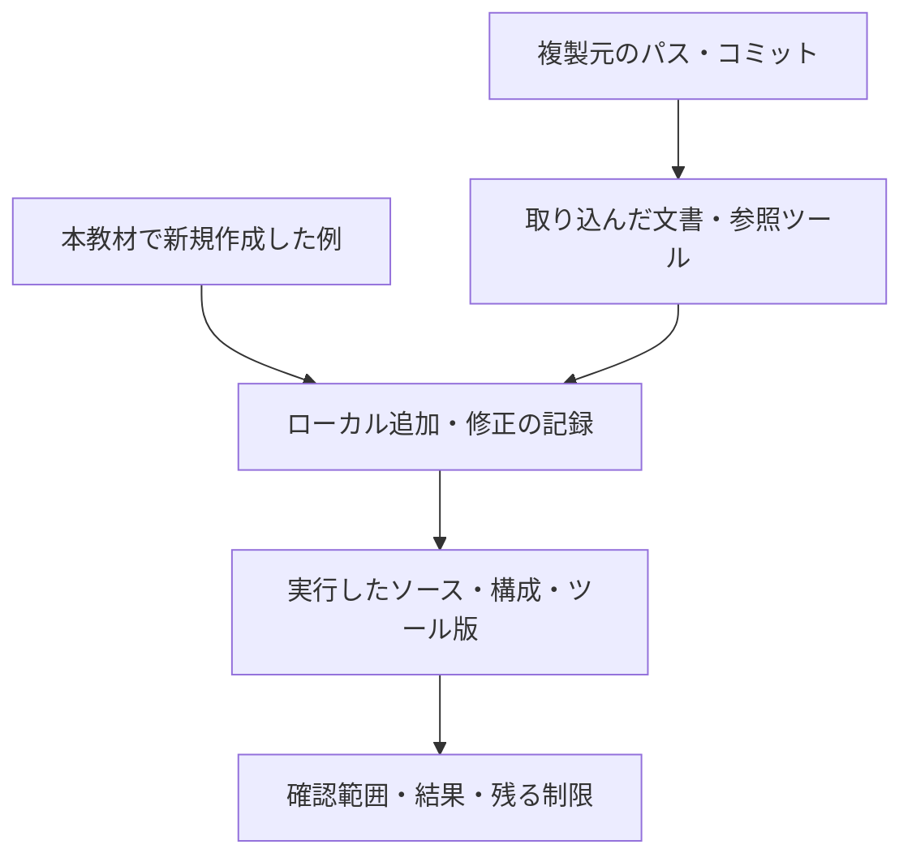

# 由来

このリポジトリの資料とツールの基礎は、[kirimasim-tests](https://github.com/kurochan001/kirimasim-tests)から複製したものです。最初の複製はコミット`c88b0c3`（2026-10-24）からで、その後に元で更新された資料は、表に示すコミットから複製し直しています。
複製時には、Markdownの相対リンクを書き換えました。コピー先にある資料へのリンクは、新しい場所への相対リンクにしました。コピー先に無い資料へのリンクは、元のリポジトリの同じコミットへの固定リンクにしました。
`README.md`、`docs/case-study-ieee1800/README.md`、`tools/README.md`、`PROVENANCE.md`、`.gitignore`、`docs/templates/`、`examples/`、`.gitlab-ci.yml`（2026-10-31に削除）は、このリポジトリで新しく書いたものです（後から収録したSoCLibの外部ソースを除きます）。一般化した手順書には、以下の追記・改訂があります。

## 由来と現在の証跡を分ける

複製元の版、ローカルでの追加・修正、実行した版と範囲をそれぞれ記録します。



図は記録の関係です。過去の数値や成功記録は当時の版の結果として読み、現行版の再実行結果へ読み替えません。

## このリポジトリでの追記・改訂

- `docs/method/spec-to-verification-method.md`は、下表のファイルを派生元として維持します。`3142ad7`で、製品開発の設計・検証・製造上の確認項目を14節に追加しました。
- 2026-10-25の全体レビューで、機能カバレッジと正しさの判定、構成ごとの適用と集計、証跡とフォーマル検証の条件、仕様変更の影響確認、開発段階別のサインオフと例外承認を明確にしました。技術的な役割を確認した一次資料は、手順書の付録Cに示しています。これらは半導体仕様への適用実績ではなく、今後検証する運用案です。
- `docs/templates/signoff-record.md`は、改訂した手順に沿って新設した雛形です。`tools/README.md`には、複製元での復元先・依存ファイル・検証方法を追記しています。
- `docs/method/uvm-verification.md`は、このリポジトリで新しく書いたUVMへの適用案です。Accelleraの公式資料・参照実装を参照し、要求IDとの対応、RAL、テスト終了とリグレッションの判定を整理しました。一般化した手順書の9.7節と、サインオフ記録から参照します。UARTの記録例は説明用であり、実行済みの証跡ではありません。
- `docs/method/feature-interaction-verification.md`は、このリポジトリで新しく書いた機能間クロス検証の運用案です。依存関係からの目標選定、同時・順序・中断の観測、高次の組み合わせ、到達と合格の計測を追記しました。UVMの実装説明とサインオフ記録も対応させています。NISTとAccelleraの一次資料を参考にしましたが、相互作用表と割り込みIPの12目標は本リポジトリの計画例であり、適用済みの実績ではありません。
- `docs/method/constrained-random-verification.md`は、このリポジトリで新しく書いたランダム検証の運用案です。制約と探索方針、生成失敗、seedと再現性、リグレッション、未達の調整、失敗の縮小と完了条件を整理しました。AccelleraとVerilatorの一次資料を参照し、UVM・クロス検証・サインオフ記録も対応させています。割り込みの9実行は未実施の計画例です。
- `docs/method/sva-verification.md`は、このリポジトリで新しく書いたSVAの運用案です。assert・assume・cover、サンプリング、リセット・vacuous pass、シミュレーション・フォーマル検証の記録と完了条件を整理しました。DVConの著者論文とYosysHQ・Verilatorの一次資料を参照しています。割り込みのチェッカーは本リポジトリで作成した説明用コードで、規格の例の転載や製品IPへの適用実績ではありません。
- `docs/method/functional-coverage.md`は、このリポジトリで新しく書いたcovergroupの運用案です。機能一覧からのbin・crossの設計、サンプリング、除外と閾値、インスタンス・DBの集計、判定との対応を整理しました。Accellera・OpenTitan・Verilatorの一次資料を参照しています。基本動作の16目標を扱うコレクターは本リポジトリで作成した説明用コードです。
- `docs/method/formal-verification.md`は、このリポジトリで新しく書いたフォーマル検証の運用案です。仮定・初期状態、抽象化と証明の分割、安全性・活性、有界検査と非有界の証明、反例・到達性、完了判定を整理しました。YosysHQ・YoWASPの一次資料を参照しています。割り込みの小さなモデル、証明設定と故障注入は本リポジトリで作成し、説明用モデルで動作確認したもので、製品IPへの適用実績ではありません。
- `docs/method/verification-gap-review.md`と`docs/templates/verification-scope.md`は、このリポジトリで新しく書いた検証領域の点検手順と適用範囲の雛形です。既存資料で概要にとどまっていた領域を、lint、リセット・X伝搬、CDC/RDC、転送・異常・復帰、性能、低電力、セキュリティ、コードカバレッジ、等価性・統合などの試験・解析と完了条件へ展開しました。OpenTitan・Verilator・Accelleraの一次資料を参照しています。割り込みの追加試験案は未実施の計画で、製品への適用実績ではありません。
- 同資料のCDC検証に、同期化レイテンシをランダムに変えるDynamic CDC／メタスタビリティ影響注入を追記しました。Siemensの著者解説とsemifyの公開モデルを参照し、クロックジッター・実行ごとのFF段数変更との区別、−1／0／＋1のモデル条件、再収束と観測・判定を整理しています。外部モデルの導入・転載・動作確認を行ったものではありません。
- `docs/method/mutation-verification.md`は、このリポジトリで新しく書いたミューテーション検証の運用案です。YosysHQ MCYの一次資料を参照し、検証環境の検出力と安全機構への故障注入の区別、変異の選定、対照実行、未検出・等価性の分析、分類・集計・証跡を整理しました。割り込みの確認例は、既存のSVA・フォーマル検証資料に記録した説明用モデルの結果を参照しています。MCYの導入や製品での変異キャンペーンの実施を示すものではありません。
- `docs/method/verification-reduction.md`は、このリポジトリで新しく書いた検証規模の縮退の運用案です。ASTQB・NISTの一次資料を参照し、同値分割・境界値、組み合わせの次数、代表構成、リグレッション・seed・変異の選択、抽象化、削減後の目標・検出力・証跡の確認を整理しました。3因子の例は組の選択を説明するためのもので、DUTの実行結果や既存の割り込み目標の削減を示すものではありません。
- `docs/method/continuous-regression.md`は、このリポジトリで新しく書いた継続的リグレッションの運用案です。Cadence・GitLabの一次資料を参照し、vManager／Verisium ManagerとCIの役割、総費用、リグレッションの段階、manifestと分散実行、ライセンス・資源、判定・retry・カバレッジ・証跡を整理しました。本文は運用案であり、製品向けランナーや専用検証管理製品の導入・接続・実行実績ではありません。GitLab CI/CDの説明用実行例は次項に分けて記録しています。
- `examples/local-irq-cdc/`と`.gitlab-ci.yml`は、本リポジトリで新しく実装した独立した最小例です。架空のIRQ回路、16基本動作・12時間関係・動作中リセット・CDC遅延モデル・ランダム操作列、4種類の変異・X注入、Pythonランナー、8要求・50目標の判定、JUnit・manifest、GitLab設定と実行手順を含みます。GitLab・Icarusの公式資料を参照し、ローカルの動作と異常時の判定を確認しています。2026-10-25にGitLabデモへ例を登録し、Linux RunnerとDebian・Icarus 11で通常リグレッション・夜間リグレッション、失敗時のJUnit・artifact保存、MRのマージ禁止と正常復帰を確認しました。検証後、同日にデモをPublicへ変更しました。URLと確認範囲は[例の実行記録](examples/local-irq-cdc/README.md#5-確認した範囲)に記載しています。上流のツールの汎用化、製品への適用、毎晩の継続運用の実績を示すものではありません。
- ケーススタディの報告とツールのコードは、上流の履歴を示す資料・参照実装として扱います。一般化した手順書の追加項目が、そのまま現行ツールで検査できるという意味ではありません。
- 2026-10-26のレビュー修正では、照合キットの`propose.py`・`merge.py`へ、このリポジトリ独自の承認時スナップショットを追加しました。照合案・テスト入力・関連要求の変更と、スナップショットのない旧形式の承認を検出し、未統合の承認に不備があれば台帳を書かずに停止します。`test_matching_kit.py`にリグレッションテストを追加し、README・手順書・Workflowの再レビュー手順も更新しました。過去の上流での承認・集計を、この修正で再検証したという意味ではありません。
- 同日の文書修正では、SVA演算子表のエスケープ、動的配列の`new[3](d)`の復元、設計網羅率と実行確認率の区別、同期基準時点のテスト総数、ランダム検証例の実装状況、IRQ変異の個数を訂正しました。同期基準と下表の複製元コミットは維持し、これらをローカル改訂として記録します。
- 同日に、README・一般化した手順書・GitLab実行例・照合キットの説明へMermaid図と補足表を追加しました。全体の流れ、UVMの接続、SVAの観測時点、到達と合格の分類、ランダムリグレッション・フォーマル検証・変異検証・縮退・CI・承認時の版照合を図示しています。CDCのタイミング表は、本リポジトリの説明用モデルと受信回路に対応する例です。図表は既存の説明・実装を整理したもので、新しい製品適用実績や未実装機能の追加を示すものではありません。
- 同日に、`docs/glossary.md`と`docs/faq.md`を新規作成しました。既存の手順書・計測規則・実行例を参照し、用語の意味、検証方式の使い分け、指標・完了条件、実装済みの範囲を整理しています。用語の説明にはAccellera・YosysHQ・GitLabの公式資料も参照しています。新しい検証機能や製品での実績の追加ではありません。
- 同日の日本語表現の見直しで、一般化文書・FAQ・用語集・実行例・ケーススタディの説明を推敲しました。検証部品やフォーマル検証の表記を統一し、検証完了、カバレッジ収束、独立レビュー、vacuous passなどの説明を明確にしました。用語表記の参考にしたCadence・Synopsysの日本語資料は用語集から参照できます。コード・実行条件・数値結果は変更していません。

`examples/local-fifo/`は、2026-10-26に本リポジトリで新しく作成したFIFOのランダム検証例です。説明用の同期FIFO、独立した参照キューを使うテストベンチ、seed・全入力列の保存、構成別の要求・カバレッジ判定、3種類の変異の検出、GitLabの6構成matrixリグレッションとランナーのセルフテストを含みます。プロセス実行とログ判定は既存IRQ例の処理を再利用します。GitLabの公式matrix・JUnit資料を参照し、ローカルで全6構成のsmoke・nightlyを確認しました。GitLabの確認用MR !2でもDebian・Icarus 11.0で全6構成のsmokeとランナーのセルフテストが成功しています。URLと範囲は[FIFO例の実行記録](examples/local-fifo/README.md#7-保存する証跡と確認範囲)に記載しています。製品FIFOへの適用や非同期FIFOの検証実績を示すものではありません。

`examples/local-fifo-formal/`は、2026-10-26に新規作成したオープンソースツールによるFIFOのフォーマル検証例です。既存の同期FIFOを対象に、制御の非有界証明、データの有界検査、6目標の到達性、3種類の変異の反例、過剰なリセット仮定の診断を実装しています。YoWASP・YosysHQの公式資料を参照し、ツール版、実際に読み込んだassert・assume・cover、状態・ログ・トレースを記録します。ローカルとGitLabのMR !3で動作を確認し、ツールの自動準備を含む実行範囲は[確認記録](examples/local-fifo-formal/README.md#7-実行確認の記録)に記載しています。幅8・深さ1／3の説明例であり、非有界のデータ整合性証明や製品FIFOへの適用を示すものではありません。

## 最新版との照合

2026-10-25の同期時に上流を取得し、その時点の最新`main`の[`3faf239af2614fd8d65cf31c54b0f297108704dd`](https://github.com/kurochan001/kirimasim-tests/commit/3faf239af2614fd8d65cf31c54b0f297108704dd)に対して、当時の対象32ファイルを照合しました。変更のあったツール4ファイルを更新しました。内容が変わっていないファイルは、従来の複製元コミットを残しています。その後の一般化文書の追記・改訂は上記に分けて記録しています。

今回のツール更新には、指摘番号が付いた保留判定の重複登録防止、テスト作成・独立検証時の注意事項の追加、計測対象シミュレータのLyraへの更新、環境変数`IEEE1800_SOURCE`による規格資料の参照先指定を含みます。
また、`simulator-differences.md`で過去のリンク書き換えが配列の説明とコード例に入り込んでいた2箇所を、上流の記述に戻しました。
2026-10-25の公開前整備では、同資料の6.20.5（module-body specparam）の説明を、このリポジトリ独自の表現へ書き直しました。新規作成物と複製・改訂物のライセンス適用範囲もREADMEに明記しています。

### 文書と集計の更新（2026-10-26）

本リポジトリの`3fb116a`で、kirimasim-testsの[`0da4f2fc`](https://github.com/kurochan001/kirimasim-tests/commit/0da4f2fc247bfcee27fc407b8ef0cd8d8f768dfc)からケーススタディ文書5件を取り込みました。対象は元の手順書、計測規則、照合レビューの累積、シミュレータ差異、未登録テストの照合報告です。下表はその追加を含む33ファイルの由来を示します。参照ツールの同期基準は`3faf239`のままです。

今回の文書更新では、上流の[`b2de3bc5`の集計](https://github.com/kurochan001/kirimasim-tests/blob/b2de3bc5ef17071be53d44c6742700c03b1b12a7/coverage/behavior-summary.json)を読み、READMEの概要値と計測規則のテスト本数を更新しました。本文1〜40章の値は同JSONの章別件数を合計して算出しています。上流の台帳・テスト・ツール一式をこの版へ同期したものではありません。過去の報告は、当時の版・数値の記録として保持します。

GitLabではMR !2・!3のmainへのマージと、mainのCI #2988462019の12ジョブ・JUnit 90件の成功を確認しました。各実行例とREADMEへその状態を反映しています。コード、検証条件、CI設定は今回変更していません。

## ファイルごとの複製元・派生元

| このリポジトリ | kirimasim-tests（複製元のコミット） |
| --- | --- |
| `docs/method/spec-to-verification-method.md` | [`docs/spec-to-verification-method.md`](https://github.com/kurochan001/kirimasim-tests/blob/0ccbd37/docs/spec-to-verification-method.md) |
| `docs/case-study-ieee1800/requirements-to-tests-method.md` | [`docs/requirements-to-tests-method.md`](https://github.com/kurochan001/kirimasim-tests/blob/0da4f2fc/docs/requirements-to-tests-method.md) |
| `docs/case-study-ieee1800/requirement-extraction.md` | [`docs/requirement-extraction.md`](https://github.com/kurochan001/kirimasim-tests/blob/0ccbd37/docs/requirement-extraction.md) |
| `docs/case-study-ieee1800/requirement-extraction-notes.md` | [`docs/requirement-extraction-notes.md`](https://github.com/kurochan001/kirimasim-tests/blob/c88b0c3/docs/requirement-extraction-notes.md) |
| `docs/case-study-ieee1800/coverage-rules.md` | [`coverage/README.md`](https://github.com/kurochan001/kirimasim-tests/blob/0da4f2fc/coverage/README.md) |
| `docs/case-study-ieee1800/existing-test-matching-20percent-20261023.md` | [`docs/existing-test-matching-20percent-20261023.md`](https://github.com/kurochan001/kirimasim-tests/blob/c88b0c3/docs/existing-test-matching-20percent-20261023.md) |
| `docs/case-study-ieee1800/existing-test-matching-review-20261022.md` | [`docs/existing-test-matching-review-20261022.md`](https://github.com/kurochan001/kirimasim-tests/blob/0da4f2fc/docs/existing-test-matching-review-20261022.md) |
| `docs/case-study-ieee1800/header-vpi-tests-and-matching-20261023.md` | [`docs/header-vpi-tests-and-matching-20261023.md`](https://github.com/kurochan001/kirimasim-tests/blob/c88b0c3/docs/header-vpi-tests-and-matching-20261023.md) |
| `docs/case-study-ieee1800/keyword-tests-20261024.md` | [`docs/keyword-tests-20261024.md`](https://github.com/kurochan001/kirimasim-tests/blob/c88b0c3/docs/keyword-tests-20261024.md) |
| `docs/case-study-ieee1800/gap-tests-20261024.md` | [`docs/gap-tests-20261024.md`](https://github.com/kurochan001/kirimasim-tests/blob/b13204c/docs/gap-tests-20261024.md) |
| `docs/case-study-ieee1800/gap-tests-2-20261024.md` | [`docs/gap-tests-2-20261024.md`](https://github.com/kurochan001/kirimasim-tests/blob/0ccbd37/docs/gap-tests-2-20261024.md) |
| `docs/case-study-ieee1800/lyra-disagreement-review-20261025.md` | [`docs/lyra-disagreement-review-20261025.md`](https://github.com/kurochan001/kirimasim-tests/blob/3faf239/docs/lyra-disagreement-review-20261025.md) |
| `docs/case-study-ieee1800/existing-test-matching-unregistered-20261025.md` | [`docs/existing-test-matching-unregistered-20261025.md`](https://github.com/kurochan001/kirimasim-tests/blob/0da4f2fc/docs/existing-test-matching-unregistered-20261025.md) |
| `docs/case-study-ieee1800/simulator-differences.md` | [`docs/simulator-differences.md`](https://github.com/kurochan001/kirimasim-tests/blob/0da4f2fc/docs/simulator-differences.md) |
| `tools/matching_kit/README.md` | [`tools/matching_kit/README.md`](https://github.com/kurochan001/kirimasim-tests/blob/c88b0c3/tools/matching_kit/README.md) |
| `tools/matching_kit/propose.py` | [`tools/matching_kit/propose.py`](https://github.com/kurochan001/kirimasim-tests/blob/c88b0c3/tools/matching_kit/propose.py) |
| `tools/matching_kit/merge.py` | [`tools/matching_kit/merge.py`](https://github.com/kurochan001/kirimasim-tests/blob/3faf239/tools/matching_kit/merge.py) |
| `tools/matching_kit/runsim.py` | [`tools/matching_kit/runsim.py`](https://github.com/kurochan001/kirimasim-tests/blob/c88b0c3/tools/matching_kit/runsim.py) |
| `tools/matching_kit/partition.py` | [`tools/matching_kit/partition.py`](https://github.com/kurochan001/kirimasim-tests/blob/c88b0c3/tools/matching_kit/partition.py) |
| `tools/matching_kit/withdrawn-20261023.json` | [`tools/matching_kit/withdrawn-20261023.json`](https://github.com/kurochan001/kirimasim-tests/blob/c88b0c3/tools/matching_kit/withdrawn-20261023.json) |
| `tools/matching_kit/workflows/match.js` | [`tools/matching_kit/workflows/match.js`](https://github.com/kurochan001/kirimasim-tests/blob/c88b0c3/tools/matching_kit/workflows/match.js) |
| `tools/matching_kit/workflows/gap.js` | [`tools/matching_kit/workflows/gap.js`](https://github.com/kurochan001/kirimasim-tests/blob/3faf239/tools/matching_kit/workflows/gap.js) |
| `tools/matching_kit/workflows/interpretation-review.js` | [`tools/matching_kit/workflows/interpretation-review.js`](https://github.com/kurochan001/kirimasim-tests/blob/c88b0c3/tools/matching_kit/workflows/interpretation-review.js) |
| `tools/matching_kit/test_matching_kit.py` | [`tools/test_matching_kit.py`](https://github.com/kurochan001/kirimasim-tests/blob/c88b0c3/tools/test_matching_kit.py) |
| `tools/generators/common.py` | [`generators/common.py`](https://github.com/kurochan001/kirimasim-tests/blob/c88b0c3/generators/common.py) |
| `tools/generators/generate.py` | [`generators/generate.py`](https://github.com/kurochan001/kirimasim-tests/blob/c88b0c3/generators/generate.py) |
| `tools/generators/keywords.py` | [`generators/keywords.py`](https://github.com/kurochan001/kirimasim-tests/blob/c88b0c3/generators/keywords.py) |
| `tools/reference/behavior_coverage.py` | [`tools/behavior_coverage.py`](https://github.com/kurochan001/kirimasim-tests/blob/3faf239/tools/behavior_coverage.py) |
| `tools/reference/requirement_audit.py` | [`tools/requirement_audit.py`](https://github.com/kurochan001/kirimasim-tests/blob/c88b0c3/tools/requirement_audit.py) |
| `tools/reference/requirement_matching.py` | [`tools/requirement_matching.py`](https://github.com/kurochan001/kirimasim-tests/blob/c88b0c3/tools/requirement_matching.py) |
| `tools/reference/requirement_source.py` | [`tools/requirement_source.py`](https://github.com/kurochan001/kirimasim-tests/blob/3faf239/tools/requirement_source.py) |
| `tools/reference/suite_results.py` | [`tools/suite_results.py`](https://github.com/kurochan001/kirimasim-tests/blob/c88b0c3/tools/suite_results.py) |
| `LICENSE` | [`LICENSE`](https://github.com/kurochan001/kirimasim-tests/blob/c88b0c3/LICENSE) |

## APBレジスタ検証例の追加（2026-10-26）

`examples/local-apb/`は、このリポジトリ向けに新規作成した説明用RTL・テストベンチ・ランナーです。ArmのAPB仕様を参照し、独自のレジスタマップ、W1Cのイベント優先、エラー時の状態保持、同期リセットを定義しました。待ち状態0／1／3の独立判定、seed付き入力、3種類の変異、要求・カバレッジとJUnitを実装し、既存FIFO例のランナー構成とIRQ例のプロセス実行・終了判定処理を再利用しています。APB仕様書の本文・図・コードの転載ではありません。実行範囲と確認結果は[APB例](examples/local-apb/README.md)を参照してください。

APB追加のMR !4はGitLab CI #2988642917で全16ジョブ成功、JUnit 108件・失敗／エラー0件を確認しました。mainへのマージとschedule全例の129件の実行は今回行っていません。

## APBと割り込みの結合検証例の追加（2026-10-26）

`examples/local-apb-irq/`は既存APB RTLを再利用し、下位4ビットのマスクとイベント保持状態から割り込みを出力する説明用結合回路です。ランナー・チェッカーはAPB例を基に拡張し、IRQ例のプロセス実行・終了判定処理も利用します。4要因×マスク×クリア×イベントの32クロスに、順序・同時動作・複数要因・待ち・エラー・リセットを加えました。構成ごとの44／45目標と3種類の変異を判定し、証跡を保存します。単一要因の`irq_pending`を二重に接続せず、既存APB内のPENDINGを保持状態として使っています。

併せて、APB単体例のMR !4がmainへマージされ、CI #2988663611で全16ジョブ・JUnit 108件が成功した状態を確認しました。今回の結合検証追加後の構成は20ジョブ・通常JUnit 126件、scheduleは153件を予定します。製品割り込みシステムや実ソフトウェアへの適用を示すものではありません。

結合検証のMR !5でCI #2988726525の全20ジョブ・JUnit 126件が成功し、保存済み証跡でも各構成の44／45目標と3種類の変異の検出を確認しました。nightly全3構成はローカルで確認し、GitLabのschedule全例153件は今回実行していません。MR !5のmainへのマージは行っていません。

## ready/valid通信のランダム検証例の追加（2026-10-26）

`examples/local-stream/`は、新規の説明用ready/validバッファと、FIFO例を基に拡張したランナー・チェッカーです。IRQ例のプロセス実行・終了判定処理を利用します。LaForestのready/valid設計資料を参照し、データ保持、満杯時の入替え、同期リセットによる破棄をこの回路の仕様として定めました。外部資料のRTLや図の転載ではありません。深さ1／3×幅8／16で必須25／29目標と3種類の変異を判定し、最後の排出、受理数・受信数・リセット破棄数を照合します。

併せて、APBと割り込みの結合検証のMR !5がmainへマージされ、CI #2988757915で全20ジョブ・JUnit 126件が成功した状態を確認しました。今回のready/valid追加後は25ジョブ・通常JUnit 150件、scheduleは185件を予定します。AXI全体への適合性や任意の待ち時間に対する活性を証明した結果ではありません。

ready/validのMR !6でCI #2989066110の全25ジョブ・JUnit 150件が成功し、保存済み証跡でも各構成の25／29目標、3種類の変異の検出、転送数の照合を確認しました。nightly全4構成はローカルで確認し、GitLabのschedule全例185件は今回実行していません。MR !6のmainへのマージは行っていません。

## SVAの実行例の追加（2026-10-26）

`examples/local-sva/`は、既存IRQ RTLとプロセス実行・終了判定処理を利用して作成したSVA実行例です。要求6件に対応する並行アサーション6個・カバー12目標を接続し、RTL変異3件とチェッカー入力の違反3件、前件不足の診断を実装しました。Verilatorの公式資料を参照し、カバーログとネイティブカウンター、接続先・ソースを照合します。最後の観測クロックでは新規の1サイクル後件の開始だけを抑止します。本文の説明用SVAコードを基に、使用ツールに合わせた記法へ展開しています。

GitLabのMR !6が未マージのため、SVAのMR !7はそのソースブランチを宛先として追加しました。SVAを含む設定は27ジョブ・通常JUnit 160件、scheduleは197件を予定し、ランナーのセルフテスト78件は別枠です。2値シミュレーションであり、X/ZやSVA全構文の対応、形式証明を示すものではありません。

SVAのMR !7でCI #2989571313の全27ジョブ・JUnit 160件が成功しました。Verilator 5.006のネイティブDBの形式差に対応し、5.052と同じラベル・ソース・階層・件数の検査を行います。保存済み証跡でも要求6件・12目標、感度確認6件、診断1件、予定ケースの完了を確認しました。nightlyはローカルで実行し、GitLabのschedule全例197件は今回実行していません。MR !6・!7のマージは行っていません。

## リグレッションの縮退の比較例の追加（2026-10-26）

`examples/local-reduction/`は、新規の比較ランナー・テストベンチ・履歴依存変異のラッパーです。既存IRQ RTLと3種類の変異、プロセス実行・終了判定処理を再利用します。正常な全候補の観測で貪欲に選択し、全件・目標だけの選択・ストレス保持を新たに実行します。19目標の維持と検査サイクル数、3基本変異、選択に検出結果を使わない追加の履歴依存変異を比較します。縮退の一般的な検出率や製品の妥当性を示す実績ではありません。

併せて、SVAのMR !7がready/validのブランチへ取り込まれ、そのMR !6もmainへマージされたことと、mainのCI #2989619450が全27ジョブ・JUnit 160件で成功したことを確認しました。縮退例追加後は29ジョブ・通常JUnit 178件、scheduleは215件を予定します。ランナーのセルフテスト89件は別枠です。

縮退比較のMR !8でCI #2989712015の全29ジョブ・JUnit 178件が成功し、保存済み証跡でも19目標の維持、233／42／47検査サイクル、基本変異3件の検出と履歴依存変異の検出差を確認しました。初回の既存ジョブの失敗はRunner準備時の認証エラーで、検証コードを変更せず再実行しました。nightlyはローカルで確認し、GitLabのschedule全例215件とMR !8のマージは今回行っていません。

## アービタの検証例の追加（2026-10-26）

`examples/local-arbiter/`は新規の説明用ラウンドロビンRTL・テストベンチと、FIFO例を基に拡張したランナーです。IRQ例のプロセス実行・終了判定処理を再利用します。要求元2／3／4で排他制御、受信待ち中の選択保持、受理順序と条件付き公平性を検査し、21／31／49目標を構成ごとに判定します。受理数と待ちの記録、受信停止の診断、3種類の変異、順序比較を無効にした専用構成での独立した公平性モニターの違反検出も実装しました。任意の無限の要求列や製品への適用を実証した結果ではありません。

併せて、縮退比較のMR !8がmainへマージされ、CI #2989744619で全29ジョブ・JUnit 178件が成功したことを確認しました。アービタ追加後は33ジョブ・通常JUnit 199件、scheduleは242件を予定します。ランナーのセルフテスト102件は別枠です。

アービタのMR !9でCI #2989838991の全33ジョブ・JUnit 199件が成功しました。保存済み証跡でも構成ごとの21／31／49目標、3種類の変異、停止診断、受理数と待ちの照合を確認しました。nightlyはローカルで実行し、GitLabのschedule全例242件とMR !9のマージは今回行っていません。

## UARTのランダム検証例の追加（2026-10-26）

`examples/local-uart/`のRTLとシリアル刺激・波形比較テストベンチは、この教材用に作成しました。ランナーと自己セルフテストはFIFO例を基に拡張し、IRQ例のプロセス実行・終了判定を再利用しています。フレーム形式と受信エラーの基本事項はREADMEに記載したMicrochipの一次資料を参照し、特定製品のRTLや検証IPを転載したものではありません。開始パルス、エラー通知、リセットなどは教材独自の仕様です。

8N1／8E1／8O1と分周数8／16の6構成、独立した送受信照合、代表パターン、エラー注入、偽スタート、転送中リセットと復帰、21／22目標と3／4種類の変異を実装しました。ローカルでsmoke全6構成、13テスト、および各構成3 seed×1000ランダム操作を確認しました。周波数誤差、ノイズ耐性、アナログCDC安全性、製品UARTの規格適合性の実証ではありません。

併せてMR !9のmainへのマージと、CI #2989957235の全33ジョブ・JUnit 199件成功を確認しました。UART追加後は40ジョブ・通常JUnit 239件、scheduleは294件を予定し、ランナーのセルフテスト115件は別枠です。

UARTのMR !10で[CI #2990037734](https://gitlab.com/kurochan001/lsi-verification-method-ci-demo/-/pipelines/2990037734)の全40ジョブ・JUnit 239件が成功しました。保存済み証跡でも構成ごとの目標達成、変異検出、完了数、ソースハッシュと実行コミットを照合しました。GitLabのschedule全例294件とMR !10のマージは今回行っていません。

## APB・UART・割り込みの結合検証例の追加（2026-10-26）

`examples/local-apb-uart/`は既存UARTをそのまま使い、UART用APBレジスタと割り込み保持回路を新規に作成した教材です。APBの待ち・完了処理とマスク・W1Cの考え方は既存例を引き継ぎ、ランナー・自己セルフテストはUART例を基に拡張しました。IRQ例のプロセス実行・終了判定を再利用しています。刺激生成と予定受信は独立したPythonで作成し、実装内部のUART出力・イベントを期待値に使いません。

9構成で実際の送受信、エラー、バス応答、割り込み、W1C・マスク更新・受信読出しの競合を確認し、60／61／69／70目標と5種類の変異を判定します。OpenTitanのUARTテスト計画・操作例は観点の参考で、コードやレジスタ仕様の転載ではありません。受信保持は1バイト、レジスタと優先順位は教材独自の仕様で、CPU・実ドライバ・異なるクロック間の結合を検証した結果ではありません。

ローカルでランナー14テストとnightly全9構成（seed 17〜19を各128シナリオ）を確認しました。併せてUARTのMR !10がmainへマージされ、CI #2990074629で全40ジョブ・JUnit 239件が成功したことを確認しました。結合例を加えると50ジョブ・通常JUnit 311件、scheduleは384件を予定し、ランナーのセルフテスト129件は別枠です。

結合例のMR !11で[CI #2990155891](https://gitlab.com/kurochan001/lsi-verification-method-ci-demo/-/pipelines/2990155891)の全50ジョブ成功とJUnit 311件をGitLab画面で確認しました。保存済みの全9構成のsummary・coverageでも必須目標、5種類の変異、全7ケースの完了と適用除外を照合しました。GitLabのschedule全例384件は今回行っていません。その後MR !11のmainへのマージと、[mainのCI #2990167574](https://gitlab.com/kurochan001/lsi-verification-method-ci-demo/-/pipelines/2990167574)の全50ジョブ成功・JUnit 311件・失敗／エラー0件を確認しました。

## 現行ドキュメントの再照合（2026-10-26）

kirimasim-testsの公開main [`5fb3c45d`](https://github.com/kurochan001/kirimasim-tests/commit/5fb3c45d73e4946d99690389752b82c86eecaa50)を確認し、[同版の集計JSON](https://github.com/kurochan001/kirimasim-tests/blob/5fb3c45d73e4946d99690389752b82c86eecaa50/coverage/behavior-summary.json)と集計文書から、READMEの概要値と計測規則のテスト本数・参照先を更新しました。12,319要求中の対応済み10,209・実行成功5,639、7,144テスト中の対応登録4,730・未登録2,414です。本文1〜40章は章別件数を合計し、9,486要求中7,833対応・3,765実行成功と算出しました。分母が未承認の暫定値で、複数環境の実行成功の和集合です。文書の取り込み基準`0da4f2fc`、参照ツールの同期基準`3faf239`を変更したものではありません。

GitLabでは確認記録のMR !12のmainへの取り込みと、main `ec594de7`の[CI #2990241122](https://gitlab.com/kurochan001/lsi-verification-method-ci-demo/-/pipelines/2990241122)の成功を確認しました。MR !12のCI #2990210417は全50ジョブ・JUnit 311件・失敗／エラー0件です。現行手順に残っていた12ジョブ・90件の記述を50ジョブ・311件へ修正し、過去の実行記録の数値はその時点の値として明記しました。ランナーのセルフテスト129件とschedule予定384件も区別しています。RTL、検証条件、CI設定の変更やリグレッションの再実行は今回行っていません。

## 全体レビューによる修正（2026-10-27）

ドキュメント、実行例、CI設定、参照ツールを照合し、次の2点を修正しました。

- アービタ例で`+WAVE`の引数を受け取っていなかったため、VCDを生成していませんでした。テストベンチへ波形保存を追加し、既存の3構成確認で正常・変異・停止診断の全ケースのVCDファイルとヘッダを検査します。
- SVA例では要求カタログのアサーション名とカバーの対応を検査していませんでした。未実装のアサーション名でもリグレッションが成功することを再現し、固定した6アサーション・12カバーとの照合と、誤記・重複・対応違い・欠落のセルフテストを追加しました。正常カタログのネイティブSVAリグレッションも再確認しました。

SVAランナーのセルフテストは11から12テストとなり、実行例全体の確認は130テストです。ジョブ数と通常／scheduleのJUnit予定件数は50ジョブ・311／384件のままです。今回の修正と確認はローカルで行い、既存のGitLabのCI記録は対象コミットの実行結果として保持します。参照ツールは同期基準`3faf239`の追跡済みファイルを一時ディレクトリへ復元し、本リポジトリの写しを対応先へ重ねた環境で89テストの成功を確認しました。

実行例のセルフテストは修正後の合計130件が成功し、アービタは4要求元のnightlyでも49目標と3種類の変異・波形保存を確認しました。SVAはVerilatorで12ネイティブカバーと6種類の違反検出が成功し、不正カタログが終了コード1になることを確認しました。固定版の一時フォーマル環境でFIFOの深さ1・3の計16タスクと、文書から保存したIRQコード例のbmc・prove・coverも成功しました。図20件の構文、ローカル参照先434件と見出し参照も確認しました。これらは記載範囲のローカル確認で、製品への適用やGitLabでの修正後のCI実行を示すものではありません。

## ローカル専用の3例の追加（2026-10-27）

`examples/local-ecc/`、`examples/local-spi/`、`examples/local-timer-watchdog/`のRTL・テストベンチ・刺激生成・要求カタログ・セルフテストは、この教材用に作成しました。`examples/local-common/`は新規の共通ランナーで、既存IRQ例のプロセス実行・タイムアウト・終了判定処理を再利用します。3例とも商用IPや製品のRTL・検証IPを転載したものではありません。

ECCは短縮拡張ハミング(13,8)の全256データと0／1／2ビット誤り23,552パターンを、コードブックと最小距離による独立した期待値で照合します。SECDEDの用語はREADME記載のMicrochip一次資料を参照し、符号配置・出力仕様は教材独自です。3ビットの誤訂正と4ビットの無通知誤りの2例は保証範囲外の診断で、正常検証の97目標へ算入しません。

SPIのCPOL／CPHAの対応はREADME記載のMicrochip一次資料を参照しました。4モード×2分周の8構成で、予定時刻から独立に駆動・照合し、各16目標を判定します。開始・完了・CS保持期間は教材独自です。タイマー・ウォッチドッグも独自の同期仕様で、幅4／8の2構成、各20目標を、enableの仮想時刻と満了予定時刻を使う参照モデルで照合します。ウォッチドッグはリセット要求だけを出力し、自動でシステムをリセットするモデルではありません。

全11構成でsmoke／nightly、計44件の構成と変異の組み合わせの検出、ECC診断2件をローカルで確認しました。正常時JUnitは全構成合計smoke 79件／nightly 101件です。追加のセルフテストは共通14＋ECC 6＋SPI 4＋タイマー・ウォッチドッグ6＝30件で、既存GitLab例のランナーのセルフテスト130件とは別枠です。確認環境はPython 3.14.7、Icarus Verilog 14.0開発版です。任意入力列の証明、実デバイスのタイミング・物理特性や製品の安全性の確認ではありません。

ルートのGitLab CI設定と既存例のCI設定は変更せず、GitLabへの追加・CI起動は行っていません。既存のGitLab集計50ジョブ・通常JUnit 311件・schedule予定384件はそのままです。README・FAQと継続リグレッション・ミューテーション検証の文書へ、ローカル専用であることと実行先のリンクを追加しました。

## 非同期FIFO・I²C・APBタイマー結合例の追加（2026-10-27）

`examples/local-async-fifo/`、`examples/local-i2c/`、`examples/local-apb-timer/`のRTL・テストベンチ・刺激／期待値生成・要求カタログ・セルフテストは、この教材用に作成しました。前2例は新規RTL、APB結合例は既存`local-timer-watchdog/rtl/timer_watchdog.sv`を変更せずに接続する新規ラッパーです。既存のローカル共通ランナーを利用し、製品IPや外部の検証コードの転載は行っていません。

非同期FIFOは深さ4／8×同期段数2／3の4構成で、参照キューと遅延させた絶対累計によりデータ・フラグを照合し、各17目標を判定します。送信元Grayポインターの変化も検査します。2種類のクロック比、同周期、離散ジッター−1／0／＋1、共通リセットを含みます。Alteraの一次資料は物理的なCDC制約の必要性の参照先で、物理遅延やメタステーブルを再現するモデルではありません。

I²Cは7ビットアドレスの1バイトターゲットと独立したコントローラーBFMで、2構成・各18目標を判定します。ACK／NACK、Repeated START、ストレッチ、途中リセットを信号線で検査します。バスの基本手順はREADME記載のNXP UM10204 Rev.7.0を参照し、レジスタ・拒否入力・リセット仕様は教材独自です。複数コントローラーの仲裁や電気的タイミングの適合性は対象外です。

APB結合例は幅4／8×待ち状態0／2の4構成・各24目標です。レジスタの受付規則と仮想時刻・満了予定による独立モデルで、バス完了、満了とclear／kick／load、IRQマスク、リセット中断を照合します。バス転送の基本手順はArmのAPB一次資料を参照し、レジスタ構成と優先順位は教材独自です。ウォッチドッグはリセット要求の出力だけで、システムのリセット配線はモデル化していません。

新しい10構成のsmoke／nightly、各4種類の変異（構成との組合せ40件）とセルフテスト18件が、Python 3.14.7・Icarus Verilog 14.0開発版でローカル成功しました。追加分のJUnitはsmoke 70件／nightly 90件です。既存3例と合わせたローカル6例は21構成、JUnit合計149／191件、共通を含むセルフテスト48件となります。README・FAQ・共通手順・継続リグレッション・ミューテーション検証のリンクと現行の集計を更新しました。

GitLabへの登録・CI起動と既存CI設定の変更は行っていません。既存GitLab例の50ジョブ・通常JUnit 311件・schedule予定384件・ランナーのセルフテスト130件へ、ローカル例の数値を合算しません。

## AHB-Lite・AXI4-Liteのローカル例の追加（2026-10-27）

`examples/local-ahb/`と`examples/local-axi/`のRTL・テストベンチ・刺激／期待値生成・要求カタログ・セルフテストを、この教材用に作成しました。既存ローカル共通ランナーの実行・判定・証跡保存を利用します。バスの基本事項は各READMEに記載したArm一次資料IHI 0033AとIHI 0022Eを参照し、規格本文や外部のRTL・検証コードの転載は行っていません。

AHB-Liteは32ビットの信号サブセットで、待ち状態0／1／3の3構成・各21目標です。アドレスとデータのパイプライン、3サイズのバイトレーン、SINGLE／INCR4・BUSY、2サイクルのERROR、次アドレスの取消しとリセットを、バイト記憶領域と絶対時刻の完了予定による独立モデルで照合します。非整列・過大HSIZEは不正要求を意図した負のテストです。複数マスターやAHB全体の適合性は対象外です。

AXI4-Liteは32ビット・各方向1件に受付を制限した回路で、応答生成の追加遅延0／2の2構成・各39目標です。AW／Wの別キューと応答予定時刻で、先行順序、全16通りのWSTRB、B／Rの保持、同一エッジの読書き、保留読出し中の更新、半要求・応答のリセットを照合します。全WSTRB反映、AR受理時スナップショット、エラー方針と固定遅延は教材独自の仕様です。AXI4のバースト・ID・アウトオブオーダーやAXI4-Streamの例ではありません。

新しい5構成のsmoke／nightly、各4種類の変異（構成との組合せ20件）、AHB 8＋AXI 8のセルフテスト16件がPython 3.14.7・Icarus Verilog 14.0開発版で成功しました。追加分のJUnitはsmoke 35件／nightly 45件です。既存分を含めたローカル8例は26構成、JUnit合計184／236件、共通を含むセルフテスト64件となります。README、共通手順、FAQ、継続リグレッションとミューテーション検証へ導線と適用範囲を追記しました。

GitLabへの登録・CI起動と既存CI設定の変更は行っていません。GitLab例の50ジョブ・通常JUnit 311件・schedule予定384件・ランナーのセルフテスト130件は、ローカル例と分けて保持します。

## AHB／AXIのランダム拡張とフォーマル例（2026-10-27）

AHB-Liteのランダム生成にSINGLE／INCR4、BUSY、転送中リセットを、AXI4-Liteには長めのチャネル遅延・応答待ちと、AWのみ／Wのみ／B保留／R保留でのリセットを加えました。seedと生成ベクトルを保存する既存の実行・判定方式を維持し、追加2テストを含めてシミュレーション・共通の確認は66件です。リグレッションのJUnit予定数184／236件は変わりません。

`examples/local-bus-formal/`は新規のローカル専用ハーネス・ランナー・セルフテストです。既存IRQ例のプロセス実行処理と既存FIFOフォーマル例の固定版ツール群を利用します。入力の保持・初回リセット以外に公平性やAW／W同時到着を仮定せず、2値・単一クロック・サンプリング時のリセットというモデルで検査します。SBY／Yosysの一次資料とArmの仕様は各READMEへ記載し、外部のコードは転載していません。

AHBでは応答タイミング・ERROR・リセットの3プロパティ、AXIでは受付・応答・保持・因果関係・リセットと補助条件の11プロパティを非有界に証明します。AXI RTLへFORMAL専用のassertを4個加え、参照モデルの補助条件1個と併せて帰納法を強めました。入力を制約するassumeではなく、補助条件も検証対象です。通常シミュレーションの動作は変えません。任意の定数で選んだ1ワードを追跡してデータ比較し、AHB計4・AXI計12プロパティのデータ検査は深さ12のBMCとして扱います。

固定版ツールとPython 3.14.7で、AHB 3構成27タスクとAXI 2構成18タスク、計45タスクが予定どおりに判定されました。正常coverは8×3＋12×2の48目標、変異は4×5の20反例です。全5構成で、常時リセットの過剰な仮定による証明PASSと正常cover未達も確認しました。AHBのdemo-bug 1では、安全性証明がPASSしてもデータBMCでFAILし、リグレッション全体の終了コードが1になりました。

判定・証跡テスト12件を追加し、ローカル確認は66＋12＝78件です。ランダム拡張後のAHB／AXI全5構成のsmoke／nightlyも成功しました。README・各例の手順・FAQ・継続リグレッション・フォーマル文書へ実行方法と保証範囲を追記しています。GitLabへの登録・CI起動と既存CI設定の変更は行っていません。既存GitLab例の50ジョブ・311／384件・ランナーのセルフテスト130件へ合算しません。

## AHB／AXIの追加検査・APBブリッジ・AXI4（2026-10-27）

`examples/local-bus-validation/`に、ポートだけを使う独立チェッカー、ネイティブSVA、明示的なクロス目標、4値X検査、クロック間の短パルスリセット、性能・長時間応答待ち、lint・line／toggle収集を追加しました。既存AHB／AXI-Liteテストベンチの追加計測は`BUS_VALIDATION`定義時だけ有効です。元のRTL・通常リグレッション・フォーマルの対象は変えません。AHBのクロスは各12、AXI-Liteは各22目標です。

チェッカーには意図した各違反を加え、予定の検出ラベルと異常終了を照合します。Icarusの4値とVerilatorの2値を分け、無効ペイロードのXを誤検出しないこと、クロック間のリセットで保持義務を取り消すことも確認します。ネイティブSVAの取消しには非同期リセット世代の変化も使用します。実DUTへの幅1ns・位相3種類のリセットはデジタル動作の試験であり、RDCやrecovery／removalの物理検証ではありません。

`examples/local-bus-bridge/`は新規のAHB-Lite／AXI4-Lite→APB3ブリッジです。既存のAPBレジスタ・APBタイマー・タイマー／ウォッチドッグRTLを接続し、上位応答とAPB・周辺状態を独立モデルで照合します。2バス×APB待ち0／2の4構成・各18目標・4種類の変異です。部分書込みを対応外、ゼロWSTRBを割当領域内のno-opとする方針を明記しました。既存のPythonタイマー参照モデルも使うため、共通ランナーに任意の`EXTRA_INPUTS`のハッシュ記録を加えました。

`examples/local-axi4/`は、Liteとは別の新規メモリRTLです。32ビット・INCR 1〜4ビート・2ビットID・読書き各2件までの未完了転送に限定し、バイト配列の期待値でBID・RID・RESP・RLAST・データを照合します。同一IDの順序、部分／ゼロストローブ、合法な4KiB境界直前・直後と不正な境界越え、応答保持、W先行、読書きの重なり、リセットを26目標・4種類の変異で確認します。アウトオブオーダーやバースト交互返却は実装せず、全AXI4規則の適合性やフォーマル証明としては扱いません。

バス規則は各READMEに記載したArm IHI 0033A・IHI 0022E、計測はVerilatorの一次資料を参照しました。RTL・チェッカー・期待値・試験・要求カタログは教材用の新規作成または本リポジトリ内の再利用であり、外部IPや規格本文の転載は行っていません。

Python 3.14.7、Icarus Verilog 14.0開発版、Verilator 5.052で追加検査のsmoke／nightlyが成功しました。親JUnitは64件、子はブリッジ28／36件とAXI4 7／9件です。性能ケースは各構成で書込み・読出し各512／4096件を照合しました。lintの既知警告は理由を残し、コードカバレッジは未到達も保存して、100%合格とは扱いません。既存RTLのフォーマル45タスクの結果を新規ブリッジ・AXI4へ拡張しません。

追加のセルフテストはブリッジ9・AXI4 6・追加検査6の21件です。既存78件も含む計99件が成功しました。共通ランナーのシミュレーションは10例31構成、JUnitは219／281件となります。追加検査からも同じ子リグレッションを呼べるため、親判定と子結果を同一の件数として二重計上しません。

README・共通手順・AHB／AXIの手順・FAQ・継続リグレッション・フォーマル・ミューテーションの文書へ導線と対象範囲を追記しました。GitLabへの登録・CI起動・CI設定変更は行っていません。既存GitLab例の50ジョブ・JUnit 311／384件・ランナーのセルフテスト130件と分けて管理します。

## 結合・復旧・低電力・等価性の7例（2026-10-27）

`examples/local-dma/`、`local-interconnect/`、`local-cdc-bridge/`、`local-recovery/`、`local-power/`をローカル専用のシミュレーション教材として追加しました。RTL・独立期待値・要求カタログ・変異検出・セルフテストを用意し、既存のローカル共通ランナーで実行します。外部IPや検証コードの転載はありません。

DMAはAPB設定とAXI4メモリ間コピー、割り込みを実接続し、境界分割・部分的な書込みの残存・中断・エラー・リセットを2構成各12目標で照合します。インターコネクトは2マスター×2 RAMターゲット、各方向の所有者・ID・ラウンドロビン・応答保持を1構成12目標で確認します。いずれも既存`local-axi4/rtl/axi4_ram.sv`を利用します。

非同期APBブリッジは、既存非同期FIFOを基にしたワイドパケットFIFOと既存APBレジスタを接続します。元のFIFOは変更せず、新しいFIFOの幅・ドメイン別リセットを教材内で拡張しました。2つのクロック構成で各7目標を照合し、どちらかのリセットで両方向を破棄する契約を明記しています。

復旧例は4／8クロックの期限と古いtagの排除、上位応答保持、tag枯渇を各10目標で検査します。tagは周回させず、再利用には下位応答も破棄する協調リセットを要求します。低電力例は2構成各10目標で、排出・隔離・保持・復帰を検査し、OFF中の内部Xが外へ漏れないことを確認します。UPFや物理検証の結果としては扱いません。

`examples/local-axi4-formal/`と`local-equivalence/`を追加しました。共通の`local-formal-common/runner.py`で、ソースの写し・ハッシュ、実際のプロパティ／仮定の名前・数、ツール終了・status・エンジン完了、VCD・witnessを照合します。UNKNOWN、TIMEOUT、別のassertだけの違反、証跡欠落を成功にしません。ツールは既存の固定版YoWASP・Z3で、`memory_map`による論理回路への展開を使用します。

AXI4 RTLへメモリ容量パラメーターを追加し、既定8KiBのシミュレーション動作は維持しました。`FORMAL`専用の補助assertと読出し値の過大近似も追加しています。16／32バイト・1／2ビートの制御／件数11条件を非有界に証明し、実メモリを使う直列入力のデータ比較等15条件を深さ12でBMCします。並行受付を含む9到達目標は別タスクで扱います。各構成9タスクで計18件、正常到達18目標・変異8反例です。8KiB・4ビートや任意の並行データ列まで証明したとは扱いません。

等価性例は4ビット・深さ2／4のシフト方式とリング方式をSBY miterで比較します。5条件の非有界証明、各5到達目標、4種類の変異、過剰な仮定の診断で計16タスクです。EQYを起動した結果ではなく、合成後ネットリストの等価性でもありません。参照実装の仕様適合性は別の機能検証・レビューが必要と明記しました。

`examples/local-system-regression/`は全7例を呼ぶ親ランナーです。子の成功・終了コードと予定／結果の件数を確認し、親の7件の集約判定と子の詳細JUnitを分けて保存します。追加シミュレーション9構成のJUnitは63／81件、フォーマルは18＋16件です。既存のリグレッションと同じ試験を二重集計しません。

Python 3.14.7、Icarus Verilog 14.0開発版、固定版YoWASP・Z3で、全7例の通常リグレッション・各構成4種類の変異、5例のnightlyが成功しました。元のAXI4のsmoke／nightlyも再確認しました。追加の確認はシミュレーション28、共通フォーマル8、AXI4計画3、等価性計画2、親ランナー3の計44テストで、既存99件を含む143件が成功しました。共通シミュレーションは15例40構成、JUnit 282／362件です。

README、各例・共通手順、FAQ、継続リグレッション・フォーマル・ミューテーションの導線と保証範囲を更新しました。Arm AXI仕様、YosysHQ SBY・EQY、AMDの仲裁に関する一次資料を参照し、対象・制約・方針は各READMEに記載しています。GitLabへの登録・CI起動・CI設定変更は行っていません。既存GitLab例の50ジョブ・JUnit 311／384件・ランナーのセルフテスト130件へ合算しません。

## パケット・C・数値演算・差分・完了期限の7例（2026-10-27）

`examples/local-axis/`、`local-dsp/`、`local-memory-order/`、`local-c-driver/`、`local-cocotb/`、`local-differential/`、`local-progress/`を追加しました。いずれもローカル専用で、外部IPや検証コードの転載はありません。既存のRTL・テストベンチ・プロセス実行機構を再利用した範囲は、各READMEに記載しています。

AXI4-Streamは新規の32ビットパケットFIFOです。深さ2／4で、TLAST・TKEEP・停止・同時入出力・途中パケット破棄の各11目標を照合します。固定小数点例は新規の2タップFIRで、FRAC 3／4と待ち時間を組み合わせた2構成・各10目標です。Pythonの商・余りによる丸めとRTLの広い整数演算を照合し、符号・上下限ちょうど・丸め・飽和・履歴・保持を確認します。

同一領域の競合例は、既存インターコネクトとAXI4 RAMを変更せず使います。実際のW受理とRスナップショットの予定時刻に基づくバイト参照メモリを新設し、ターゲットと要求元の両方でデータを照合します。同時エッジの読出しは更新前の値という本RAMの契約です。1構成9目標で、応答先・デコード・WデータのRTL変異3件と、誤った同時エッジ優先順位の期待値側変異1件を実行します。要求元へ戻るRDATAを破損させるセルフテストも追加しました。全AXIマスター間の一般的なメモリモデルの証明ではありません。

CドライバはC11としてコンパイルし、オブジェクトをVerilatorの実行ファイルへリンクします。MMIOコールバックがAPB信号を駆動し、既存DMA RTLの設定・コピー・IRQ・エラー・中断後の再実行を照合します。メモリ側はC++のバイトモデルです。CPU命令や実機MMIOの検証ではありません。1構成8目標、ワード数・完了判定・IRQ・エラー判定のCコード側4種類の変異を検出します。

cocotbは2.1.0と依存パッケージを専用の一時仮想環境へ固定しました。既存APB RTLをPythonのコルーチンで駆動し、SETUP／ACCESS・待ち・読出しと更新状態をレジスタ参照モデルで照合します。待ち0／2の各6目標、RTL変異3件と誤った期待IDの診断1件を実行し、生JUnitとFSTも照合します。誤った期待値で正しいRTLも失敗する診断を、RTL変異検出率へ含めません。

差分例はDSP・Streamの全4構成へ同じ入力を与え、IcarusとVerilatorの各参照モデル照合を要求してから、正規化した有効観測を比較します。各3目標です。期待値比較を無効にして片側だけデータを反転する診断と、Icarusだけの有効X入力診断を別に実行します。無効入力のXを誤比較しない正常ケースも含めます。X/Zや欠落・重複・壊れた観測を一致扱いにせず、診断は通常実行のカバレッジへ加算しません。

完了期限は新規の2要求元サーバーで、READYの連続停止長を制限した受付・完了期限、保持・所有者と補助条件12個を非有界に証明します。安全性だけなら進行条件を外しても証明できることと、READY停止時には完了期限へ違反する反例も別に確認します。2構成各8タスク、正常到達14目標、RTL変異8反例、環境反例2件です。一般のLTL活性やシステム全体のデッドロックの証明ではありません。共有フォーマル判定へ、予定した環境反例の分類を追加しました。

`local-host-common/`はC・cocotb・差分の厳密な終了・件数・要求・証跡を集計し、`local-advanced-regression/`は全7例を起動します。親7件、シミュレーション子72／96件、完了期限16件のJUnitを階層別に保存します。このうち共通シミュレーション3例は35／45件、ホスト3例は37／51件で、同じ試験を二重計上しません。

Python 3.14.7、Icarus Verilog 14.0開発版、Verilator 5.052、固定版cocotb・YoWASP・Z3で、全7例の通常リグレッションとシミュレーション6例のnightlyが成功しました。追加確認はStream 6・DSP 6・競合6・ホスト共通8・Cドライバ4・cocotb 5・差分5・完了期限3・親3・共有フォーマルへの追加1の47件です。既存143件と合わせ190件が成功しました。共通シミュレーションは18例45構成、JUnit 317／407件になりました。

README・共通手順・FAQ・継続リグレッション・フォーマル・ミューテーションと既存接続例の導線を更新し、Arm AXI、AMD Stream、cocotb、YosysHQの一次資料を参照しました。GitLab登録・CI起動・CI設定変更は行っていません。既存GitLabの50ジョブ・JUnit 311／384件・ランナーのセルフテスト130件とは別集計です。

## 失敗の縮小・収束・幅変換・保護・ECCメモリ・クロック・UVM（2026-10-27）

`examples/local-failure-reduction/`、`local-coverage-feedback/`、`local-width-converter/`、`local-access-control/`、`local-ecc-memory/`、`local-clock-reset/`、`local-uvm/`の7例と、共通証跡補助`local-exploration-common/`、集約ランナー`local-workflow-regression/`を追加しました。教材RTL・テストベンチ・参照モデル・探索コードは本リポジトリで新規に作成し、既存Stream、SECDED、APB、共通ランナーを再利用しています。

失敗の縮小はStreamのデータ反転変異を対象に、同じ違反ラベルを維持して操作列を削り、値の単純化、再実行、正常RTLでの合格、単一操作削除の極小性まで確認します。seed 17のsmoke 25操作・nightly 101操作は各1操作へ縮小し、RTL試行は各9／11回でした。固定の初期化・排出条件を含む教材であり、未知の不具合の発見能力や全候補中の最短性の評価ではありません。Hypothesisの一次資料を参考にしましたが、同ツールを起動した例ではありません。

刺激調整はStreamの実観測11目標を使い、未達に対応する操作を次のバッチへ入れます。固定分布のランダム方式も同じ故障・リセット条件を生成可能です。各方式のサイクル予算をsmoke 384、nightly 768×3 seedにそろえました。今回のseed 17／18／19では両方式とも最終的に11目標へ到達し、フィードバックによる次バッチの選択も記録しました。一般的な性能優位を示す結果とは扱いません。

幅変換はAXI4-Lite 64→32ビット・8バイト整列・単一操作の教材で、下位アクセスを独立に照合します。2アクセスの原子性やエラー時のロールバックは提供せず、既に完了した書込みとリセット後の再読出しを確認します。待ち0／2の各15目標と4種類の変異です。Arm AXI仕様を参照し、対応範囲・エラー集約等は教材の方針として定めました。

アクセス保護はAPBのPPROTと設定ロックを使い、許可／拒否の応答、禁止読出しの0応答、拒否書込みの無副作用を照合します。待ち0／2の各14目標・4種類の変異です。OpenTitanのREGWENの一次資料を参考にした独自実装で、外部RTLの転載や上位要求元の認証を行った例ではありません。

ECCメモリは既存の符号回路と独立した符号語集合を使い、読出し修復・巡回訂正・通知・通常書込み優先を照合します。深さ4／8の各11目標・4種類の変異です。単体のECC全数検査と区別し、特定のSRAMマクロ・単一ポート実装・MBIST・機能安全適合の評価ではありません。

クロック・リセットは常時動作側と停止可能側の動作モデルで、排出・実クロックエッジ数・再開・非同期リセットのアサートとワーククロックによる同期解除を確認します。解除2／3段の各10目標・4種類の変異です。物理的なグリッチ・メタステーブル・STA・CDC/RDC・UPFの保証とは区別しています。

UVMは既存APBをSystemVerilogのagent・sequencer・driver・monitor・独立したスコアボード・adapter・RALで駆動します。frontdoorの戻りstatus、auto prediction、ハードウェアイベント後の明示的な予測、実読出しによるミラー照合、DUTとモデルの別々のリセットを扱います。待ち0／2の各9目標、3種類のRTL変異と誤った期待IDの診断を確認します。seed付きデータ列は独自の固定アルゴリズムで、SVの制約付きrandomizeは使いません。ネイティブcovergroup DBや本文のUART UVMの実装ではありません。

AccelleraのUVM 2020-3.2公式アーカイブは外部の一時ディレクトリへダウンロードし、SHA-256を固定しました。配布物は変更せず、LICENSE・NOTICE・DEVIATIONSを保持し、本リポジトリへは転載していません。実行時にはsrc全ファイルのハッシュを保存します。Verilator 5.052、UVM_NO_DPI構成で実行し、既知の2警告を明示、UVM_FATALを非ゼロ終了へ変換し、件数・native summary・VCDを照合します。

Python 3.14.7、Icarus Verilog 14.0開発版、Verilator 5.052で、全7例のsmoke／nightlyが成功しました。親JUnitは各7件の合否判定、子の合計は83／111件です。4回路・8構成の56／72件、縮小6件、刺激調整8／16件、UVM 13／17件を含みます。探索中の実行数は別記録です。追加セルフテスト40件もすべて成功し、各子マニフェストのソースハッシュが現行ソースと一致することを確認しました。既存190件と合わせたローカルセルフテストの計画は230件で、今回の実行は追加40件です。

共通シミュレーションの計画は22例・53構成、JUnit 373／479件です。README・共通手順・FAQ・UVM・ランダム・カバレッジ・継続リグレッション・ミューテーションの導線を更新しました。GitLabの登録・CI起動・CI設定変更は行っていません。既存GitLabの50ジョブ・JUnit 311／384件・ランナーのセルフテスト130件へ合算しません。

## 全体レビュー：幅変換の判定・観測と停止処理（2026-10-27）

全体の文書・実行例・共通判定・参照ツールを見直し、次の問題を再現して修正しました。製品への適用や全機能の正しさを保証するレビューではなく、本リポジトリの教材・説明・判定の整合性を確認したものです。

- 幅変換のテストベンチは、読出しにB応答を返す誤実装でも終了コード0になりました。要求種別と応答チャネルを照合し、書込みにR応答を返す逆方向の誤りも検出するようにしました。
- 上位半分だけに有効なWSTRBがあり、最初の下位応答後にリセットする正常操作を、期待メモリの更新誤りで失敗させていました。最初に実行する有効ストローブ側を期待メモリへ反映するようにしました。
- AW/Wの先行順を入力の開始予定時刻からカバーしていました。実際のVALID/READYの成立エッジから計測し、Wを先に提示しても受付が後ならW先行へ加算しません。
- リセット復帰のカバーを固定番地への読出しだけで記録していました。先行する途中リセットと、その領域の再読出しの成功を要求するようにしました。
- 共通プロセス停止処理で`os.killpg()`がエラーになると、その例外で集計・JUnit保存前に中断しました。子プロセスへの停止を試み、最終待ちに上限を設け、停止失敗も実行エラーとして保存します。プロセスグループ全体の停止を確認できない場合を、成功や変異検出へ読み替えません。

リグレッションテストは幅変換4件、共通停止処理2件を追加しました。幅変換の確認は9件、IRQは14件となり、ローカル例234件・GitLab向け132件の計366件がすべて成功しました。スキップはありません。UVMを含む最新7例のsmoke／nightlyも成功し、親JUnit各7件・子83／111件、現行ソースのハッシュ一致を確認しました。既存のリグレッションJUnit計画や50個のGitLabジョブ数は変更していません。

参照ツールは、同期基準`3faf239`の追跡済みtools・coverage・tests・generators・READMEを一時ディレクトリへ復元し、本リポジトリの写しを対応先へ重ねて89テストの成功を確認しました。元の上流チェックアウトや本リポジトリの参照コードには変更を加えていません。この確認は参照ツールの単体テストであり、上流シミュレータ全スイートの再実行ではありません。

examplesとtoolsのPython 121ファイルの構文、要求カタログのJSON、文書81件のローカルリンク673件、差分の空白を確認しました。README・実行手順・継続リグレッションの現在のテスト件数を更新し、以前のGitLab上の実行記録は当時の版として保持しています。GitLabへの登録・push・CI起動は行っていません。今回の動作変更は検証・実行管理側で、教材RTLの機能は変更していません。

## UVMランダム化・仕様生成・反例再現・結合検証の7例（2026-10-27）

`examples/local-uvm-random/`、`local-register-spec/`、`local-formal-replay/`、`local-priority-irq/`、`local-descriptor-dma/`、`local-credit-link/`、`local-cache-dma/`と集約ランナー`local-soc-regression/`を追加しました。教材のRTL・テストベンチ・参照モデル・生成器は本リポジトリで作成しています。既存APB・UVM agent／scoreboard、DMAコア、AXI RAM、FIFOペアとフォーマルハーネス、共通ランナー・証跡補助を再利用しています。外部RTLや検証IPの転載はありません。

UVM例では実際のSV制約付きランダム化とネイティブcovergroupを実行します。各待ち構成・各通常実行で24 binを要求し、独立したスコアボード、合法性、同一seedの再現、充足不能な制約と収集無効化、3種類のRTL変異を確認します。固定境界操作も含むため、ランダム方式の収束性能を評価した結果ではありません。Accellera UVM 2020-3.2は既存の固定アーカイブを外部一時ディレクトリへ展開したものを使い、変更・転載せずsrcのハッシュを保存します。

レジスタ生成は実SystemRDLコンパイラー1.30.1と依存パッケージを固定し、RTL・Cヘッダー・UVM RAL・メタデータを生成します。手書きの独立契約で全ビューに共通する誤りを検出し、RTLの実行、C11のコンパイルと定数照合、UVM参照実装のRALの属性照合を行います。生成RALからRTLへのフロントドアアクセスは実装していません。反例再現は既存FIFOの4種類の変異×深さ2／4で新しいwitnessを生成し、トップ入力だけで同じ違反を再現して正常RTLの合格も確認します。内部状態の強制や、証明範囲の拡大は行いません。

4回路はそれぞれ2構成です。優先順位付き割り込みはclaim／completeとイベントの競合、リング式DMAは記述子取得・コピー・エラー・中断・IRQ、クレジット通信は2チャネルの受付・送信・返却・保持、小規模キャッシュは1ワードのラインと部分書込み・保守操作・DMAの可視性を検査します。キャッシュ例は直列要求のモデルで、実CPU・OSやハードウェアコヒーレンシの検証ではありません。各回路4種類の変異を確認し、故障注入以外の診断と区別しています。

Python 3.14.7、Icarus Verilog 14.0開発版、Verilator 5.052、固定版SystemRDL・SBY・YoWASP・Z3で、7例のsmoke／nightlyが成功しました。親JUnitは各7件、直下の子は113／137件です。内訳は4回路56／72件、UVM17／21件、生成16／20件、反例再現24件です。反例生成の入れ子BMC 8件を二重計上しません。新しいセルフテスト36件もすべて成功しました。既存234件を加えたローカル確認の計画は270件で、今回の実行は新規36件です。

共通シミュレーションの計画は26例・61構成、JUnit429／551件です。一次資料はVerilator、Accellera SystemRDL、SystemRDL Compiler、YosysHQ、OpenTitan、RISC-V PLICの公式資料を参照し、各READMEへ対象範囲と出典を記載しました。GitLabの登録・push・CI起動・CI設定変更は行っていません。既存GitLabの50ジョブ・JUnit311／384件・ランナーのセルフテスト132件へ合算しません。

最終確認では、SystemRDL生成器が未対応の階層や追加属性を読み飛ばさず拒否することも確認しました。修正後に生成例のsmoke／nightlyと確認5件、空白調整後に4回路のsmoke／nightlyを再実行し、該当する現行ソースのハッシュ一致を確認しています。UVM・反例再現と集約の保存済みハッシュも現行版と一致しました。examples・toolsのPython138ファイルの構文、JSON41件、文書91件のローカルファイル参照754件、追加・変更ファイルの空白を確認しました。

## ドキュメントの図表整備（2026-10-27）

README、手法11資料、用語集・FAQ、適用範囲・サインオフの雛形、ケーススタディの一部、実行例と共通手順、ツール案内の計74文書を更新しました。Mermaid図74件と表47件を追加し、文字だけの構成図やAHBのタイミング表も置き換えています。図表は本リポジトリの本文・実装・確認記録を基に作成し、外部資料の図表は転載していません。

図ではデータ経路と期待値の経路、サンプリングと状態更新、IRQ通知とclaim、キャッシュ保守前後の可視性、証明・BMC・到達性、集約側の合否判定と子リグレッションの関係を分けました。ケーススタディの数値は当時の版の要約と明記し、概念図の省略や各教材の制約は注記しています。

文書91件すべてに図または表があります。Mermaid 11.17.2で全95図の構文、Markdownの全212表の列数、ローカルリンク782件・見出し参照98件、コードフェンスと空白を確認しました。変更した文書の実行コード・コマンド113ブロックは追記前と同一であることを照合しています。今回の確認は図表・文書構造の検査です。

## 全体レビュー：SystemRDLのイベント仕様・RAL属性・リグレッション集約（2026-10-27）

文書、図表、実行例、判定・集約処理を見直し、次を修正しました。

- SystemRDLのPENDINGは、原本に保持方式・競合優先順位の指定がなく、生成RTLだけがイベント保持・イベント優先になっていました。原本へ`stickybit; precedence=hw;`を明示し、対応しない方針や省略した定義を生成器で拒否します。SystemRDL 2.0の9.9.1・9.10節と実コンパイラーの解釈を確認し、独立契約にも更新方式・優先順位を加えました。
- 生成RALがハードウェア更新可能なPENDINGまで非volatileにしていました。コンパイラーのアクセス属性からvolatileを生成し、UVM参照実装のオブジェクトで照合します。volatile属性だけを破損するネガティブテストを追加しました。生成RALは引き続き構造・属性の照合で、生成RTLへのフロントドアアクセスはありません。
- 4つの集約ランナーで、一覧の結果数が予定数と一致すれば、同じIDの重複結果でも成功できました。修正前の受理を再現し、空でない一意のID、結果の要素型と合否を確認するよう修正しました。保存済みの実際の子結果21件も新しい判定で受理することを確認しました。
- 小規模キャッシュの説明で、キャッシュラインを「ワードライン」と呼んでいました。「1ワードを1ラインとする1／2ライン構成」へ訂正しました。実行手順と集計の件数も更新しました。

リグレッション確認はSystemRDL1件・4集約ランナー各1件の計5件を追加し、ローカル275件・GitLab向け132件の計407テストが成功しました。原本を最終化した後のSystemRDL確認6件も再実行しています。7例のsmoke／nightlyは親各7件の合否判定、子114／138件が成功しました。SystemRDL例のvolatile診断追加で子は17／21件となり、他のリグレッション計画は維持しています。原本の最終化後には生成例の両プロファイルを再実行し、対応する現行ソースのハッシュも確認しました。

Python138ファイル・JSON41件・YAML12件、Mermaid95図・Markdown212表、文書のローカルリンク782件・見出し参照98件、差分の空白を確認しました。過去の確認結果・件数は当時の版の記録として保持しています。GitLabの登録・CI起動は行っていません。

## RALとRTLの接続・AXI応答順序・DMA所有権・Stream DMA・CRC・カウンター・MBIST（2026-10-27）

`examples/local-generated-ral/`、`local-axi-reorder/`、`local-dma-ownership/`、`local-stream-dma/`、`local-packet-crc/`、`local-counter-snapshot/`、`local-mbist/`と集約ランナー`local-extension-regression/`を追加しました。新規RTL・テストベンチ・独立モデル・教材の図表は本リポジトリで作成しています。既存のSystemRDL原本・生成器・独立契約、UVM agent・adapter・monitor、AXI4 RAM、リング制御・DMAコア、Stream FIFOと共通ランナーを再利用しました。外部IPや検証コードは転載していません。

生成RALは実APBへフロントドアアクセスで接続し、独立したスコアボード、UVM_CHECK、W1Cとイベント後の仕様値予測、DUTとモデルの別々のリセットを確認します。各待ち構成の通常実行で9目標、RTL3変異と誤ったミラー値の診断1件です。PENDINGはvolatileのまま使い、既知のミラー警告3件とDPIなしの2警告だけを許可します。Accellera UVMは既存の固定版を外部へ展開したものを変更せず使い、src全ファイルのハッシュを保存しています。

AXI4応答順序は共有RAMへ各方向2／4トランザクションのバッファを追加し、ID内の順序、ID間の入替え、保持を各10目標で確認します。release_enableは教材のスケジューリング入力で、選択済みVALIDを撤回しません。Rはバースト単位で処理し、インターリーブや任意のAXI属性を扱うモデルではありません。

DMA所有権は内部記述子RAMの公開・処理・完了返却・回収と、処理中追加・周回・IRQを、実際の既存DMAコピーと併せて各11目標で確認します。共有DRAM上のCPUキャッシュ・バリアや動的tailを実装したものではありません。Stream DMAは既存RAM・FIFOへつなぎ、0〜32バイトの一方向転送、KEEP・LAST、エラー位置に応じた残存範囲を各12目標で確認します。メモリ側は単一ビート・未完了1件という限定です。

CRCはpoly 0x07、初期値0／0xFF、反転・最終XORなしの8ビットエンジンです。Pythonのメッセージ全体の多項式除算と既知ベクトル、受信CRCの比較、境界・初期化・保持を各8目標で確認します。CRCは別フィールドの出力で、ペイロードへ直列挿入する回路ではありません。64ビットカウンターは32ビットAPBのスナップショット、分割書込みの一括反映、桁上がり、比較とW1Cの競合を各10目標で検査する教材独自の仕様です。

MBISTは8／16個のビットセルでMarch C−の10N操作、最初の失敗位置、固着・遷移・別名化・特定の反転結合モデル、待ち・途中リセットを各9目標で検査します。Pythonの予定操作・独立セルモデルと、SVの実操作・故障モデルを照合します。実SRAM、ワード指向化、製造故障全体の網羅、ATPGや機能安全認証の評価は行っていません。

Python 3.14.7、Icarus Verilog 14.0開発版、Verilator 5.052、SystemRDL Compiler 1.30.1、UVM 2020-3.2で、全7例のsmoke／nightlyが成功しました。親各7件の合否判定、子99／127件（6回路12構成84／108件＋生成RAL15／19件）で、各構成の変異と通常実行のカバレッジ目標を別判定しています。新規セルフテスト36件もすべて成功しました。既存407件は今回再実行した本数へ加算せず、確認計画は全443件（ローカル311＋GitLab向け132）です。実行時マニフェストのソースと、外部UVM srcのハッシュ一致を確認しました。

共通シミュレーションの計画は32例・73構成、JUnit513／659件です。README、各手順と既存例、FAQ、UVM・継続リグレッション・クロス・検証領域の案内を更新しました。Arm AXI、AMD Stream、CRC RevEng、Microchip March C−の一次資料を参照し、教材の選択方針と対応範囲を明記しています。GitLabへの登録・CI起動・CI設定変更は行っていません。

最終確認ではPython154ファイル・JSON47件、文書99件のMermaid103図・Markdown220表、ローカルリンク833件・見出し参照98件、追加・変更ファイルの空白を確認しました。各実行のVCDと生成物ハッシュも照合しています。

## 追加7例のレビュー修正（2026-10-28）

追加したRTL・テストベンチ・独立モデル・集約・説明を見直し、次を修正しました。

- DMA所有権の内部記述子読出しと外部データ読出しを、番地だけで振り分けていました。転送元を6144番地からにすると完了しないことを再現し、記述子用ID=0とコピー用ID=1も含めて判定するよう修正しました。深さ2／4の固定ケースとセルフテストへ追加しています。
- 同例の初期メモリは256バイト周期で、コピー元と先が最初から同じデータになる場合がありました。上位アドレスも初期値へ混ぜ、コピーによって最終メモリが変わることを確認しました。返却数は8ビットで256で折り返す点も明記しました。
- AXI応答順序の符号付き通し番号を桁あふれ直前にすると、同一IDのRデータ順序が崩れることを再現しました。未返却バッファ内の相対順位に変更し、返却時に順位を詰めるため、通し番号の桁あふれは発生しません。リセットを挟まない連続バッチのスロット再利用試験も追加しました。
- Stream DMAのAW番地チェッカーがWの受理数を使っており、合法なW先行で誤って失敗しました。AW専用のカウンターへ修正し、1ビートのテスト用バッファでW先行を発生させる固定・ランダム試験を追加しました。各構成の目標は12から13へ更新しています。
- 同例ではB応答を待たずに完了する不良RTLが正常扱いになることを再現しました。終了時のAR・R・AW・W・BおよびStream入出力の件数を照合し、不良RTLを拒否するセルフテストを追加しました。
- カウンターの上位値が変わるだけで桁上がり目標を加算しており、停止中のLOADでも目標へ到達できました。有効な加算による実際の桁上がり・全体折り返しだけを数え、LOADによる変化では加算しない確認を追加しました。

AW／Wの独立性と同一IDの応答順序は、[Arm AXI仕様](https://documentation-service.arm.com/static/602a9df190ee6824a1e02b98)のA3.3・A6章を参照しました。各READMEと共通手順、ルートREADME、継続リグレッションの件数・確認範囲も更新しています。

追加7例の確認は5件増えて41件です。既存例を含む67スイート・全448件（ローカル316＋GitLab向け132）が成功しました。全7例のsmoke／nightlyも再実行し、親各7件の合否判定、子99／127件が成功しました。通常実行のカバレッジとネガティブテストの判定は分けたまま、実行したソース、生成物、外部UVM srcのハッシュを照合しています。

Python154ファイル・JSON48件（examples内47件とtools内1件）・YAML12件、文書99件のMermaid103図・Markdown220表、ローカルリンク833件・見出し参照98件、差分の空白を確認しました。GitLabへの登録・CI起動・CI設定変更は行っていません。上の追加時点の記録は当時の版の結果として保持しています。

## 追加7例と集約手順への図表追加（2026-10-28）

生成RAL・AXI応答順序・DMA所有権・Stream DMA・CRC・カウンター・MBISTの7例と集約手順、計8件のREADMEへ、Mermaid図8点・補足表8点を追加しました。既存の構成図に加え、PENDINGの予測と実読出し、ID別の具体的な返却順、IRQ ACKと回収、5バイト転送とW先行、CRCのバイト順と結果保持、桁上がり前後のスナップショット、故障検出後の全操作継続、親の集約判定と証跡の見方を説明しています。

新しい8図をSVG・PNGへ描画し、日本語ラベルと配置を確認しました。Mermaid 11.17.2で文書全99件・図111点の構文、Markdown全228表の列数、ローカルリンク833件・見出し参照98件、コードフェンスと差分の空白を確認しています。既存の図と実行コマンド、文書以外の管理対象342ファイルは追記前と一致しています。AXIの返却順とCRCの数値例は既存の独立Pythonモデルでも照合しました。今回の確認範囲は図表と文書構造です。

## 検証領域を補う6例（2026-10-28）

`examples/local-secure-lifecycle/`、`local-performance-monitor/`、`local-cdc-handshake/`、`local-jtag-tap/`、`local-address-map/`、`local-lockstep-monitor/`と集約ランナー`local-gap-regression/`を追加しました。教材のRTL・テストベンチ・独立モデル・図表は本リポジトリで作成しています。既存の共通ランナー、証跡補助、Icarus実行の流れを再利用し、外部RTLや検証IPは転載していません。

6例は、検証領域の点検で挙がった次の範囲をデジタル動作の教材として補います。

- セキュリティ・ライフサイクル：セキュア／非セキュア属性、ロック、デバッグ鍵の試行制限、タンパー時の鍵消去、W1CのIRQ。鍵は確認用にセキュア読出しを許す教材で、実製品の鍵管理ではない。
- 性能モニター：タグ付き要求のアウトスタンディング数、完了数、レイテンシ最大値、測定区間の完了数・経過サイクル、不正応答。8ビットの最大値とシミュレーションサイクルに限定。
- CDCハンドシェイク：複数ビットの4相req/ack、toggleによるパルス同期、非同期アサート・同期デアサートのリセット。2／3段の同期と3種類のクロック比、ジッターを扱う。メタスタビリティの物理特性は扱わない。
- JTAG TAP：16状態のTAP、IR/DR、IDCODE、BYPASS、SAMPLE/PRELOAD、EXTEST、8ビット境界走査。IEEE 1149.1の全命令・全必須動作の適合証明ではない。
- アドレスマップ：RAM・タイマー・GPIOのデコード、別名、未割当アクセス、バイトストローブ、2ビットのIRQ集約とW1C。単純なゼロ待ちバスで、実APBや実SoCのアドレス変換ではない。
- ロックステップ監視：2コアの比較、1ビット故障注入、安全状態、復帰時の再同期、不正命令。実CPUのロックステップや安全認証ではない。

各例は2構成・4種類の変異を持ち、通常実行のカバレッジ目標はセキュリティ15、性能13、CDC14、JTAG12、アドレスマップ13、ロックステップ12です。固定シナリオとランダム刺激を別に用意し、ネガティブテストの観測を通常実行のカバレッジへ加算しません。PythonはRTLのビット割当やシフトレジスタを写さず、レジスタ・要求・応答・状態遷移を別に保持します。

2026-10-28にPython 3.14.7、Icarus Verilog 14.0開発版で、6例のsmoke／nightlyが成功しました。親JUnitは各6件、子はsmoke 84件／nightly 108件です。6例のセルフテストは33件（セキュリティ5、性能5、CDC6、JTAG6、アドレスマップ6、ロックステップ5）で、集約ランナーの4件を加えると37件です。既存の316件へ37件を加えたローカル確認の計画は353件、GitLab向け132件を含む全体は485件です。今回実行した確認は新規37件で、既存316件は再実行していません。既存例の実行結果を新規例へ流用していません。

README、共通手順、検証領域の点検へ、各例の対象範囲・一次資料・実行コマンド・限界を追記しました。GitLabの登録・CI設定変更・CI起動は行っていません。

## 追加6例のレビュー・図表・再発防止（2026-10-29）

`bc0aee7`で追加した6例と集約手順を見直し、RTL・期待値・チェッカー・カバレッジの次の点を修正しました。

- 性能モニターはSLOTS=2でもタグ2／3を受理し、アウトスタンディング数に含まれない要求を作れました。有効タグを0〜SLOTS−1へ制限し、範囲外応答は不正応答にします。300サイクルの待ちが下位8ビットへ切り詰められることも再現しました。最大値を255での飽和と明記し、RTLは要求ごとの飽和経過値、Pythonは幅制限のない時刻差から計算します。応答の入替えカバレッジは独立した受付順で判定します。
- CDCはクロックエッジ以外でも受理・パルスの目標を加算し、単一パルスで連続パルス目標を満たせました。送受信の立上りでのみ計数し、実際の待ちエッジと2つのパルスを発生させる刺激へ修正しました。データと送信数・受信数・リセット破棄数、パルスの残数をサイクルモデルと別に照合し、終了前に排出します。RTLとサイクル期待値へ同じデータ破損を入れても、独立照合で拒否することを確認しました。ジッターのprofile3も必須とし、各構成14から15目標へ更新しています。
- JTAGは通常モードのピン値がUpdate-DRまで反映されず、PRELOADの出力保持段もありませんでした。Capture/Shift段と出力保持段を分離し、IRと出力保持段をUpdate状態の立下りで更新します。EXTEST選択時にPRELOAD値を駆動し、シフト中は保持します。未実装IRを1ビットBYPASSへ振り分け、LSB先行のランダムIDCODE命令を訂正しました。偶数の試験IDはLSB=1の0x12345679へ変更し、JEDEC登録された製品IDではないことを明記しています。PythonはLSB先頭のビット列で予測し、TMS=1を5回与える復帰を全16状態から実RTLでも検査します。PRELOADの2目標を追加し、各構成12から14目標です。
- アドレスマップはGPIO出力を直接比較しておらず、出力を常に0にする不良RTLを短い通常ケースが受理しました。ピン値を毎サイクル比較し、最終書込み後にはRAM全64ワードを読み戻します。最後のワード・別名、ゼロストローブ、タイマー／GPIOイベントとW1Cの競合も固定ケースとセルフテストへ追加しました。
- ロックステップはerror_codeの比較を直前のopが不正命令のときに限定し、最終操作後の状態も未観測でした。全サイクルでcodeを比較し、最終操作後に観測を置きます。LOAD結果を常に0にする不良RTLの最終操作を見逃すことを再現し、修正後の拒否を確認しました。復帰と再検出のカバレッジも、recoverの提示時点ではなく実際の状態を確認します。
- セキュリティはタンパー時の鍵消去を更新エッジ直後にも比較し、鍵書込みとの競合を追加しました。非セキュアSCRATCH読出しをセキュア読出しの目標へ加算しないよう修正しています。SCRATCHもタンパー入力中は書けないこと、DEBUGの鍵はwdataでなく専用入力であること、lifecycle=1〜3の違いは未実装であることを説明しました。認証成功履歴はLOCK／タンパーで消去されず、実デバッグポートの認可出力ではないという実装範囲も明記しています。

パルス間隔の説明は[AMDのXPM_CDC_PULSE](https://docs.amd.com/r/en-US/pg382-xpm-cdc-generator/XPM_CDC_PULSE)、JTAGのIDCODEとPRELOAD・立下り更新は[AMD UG570](https://docs.amd.com/r/en-US/ug570-ultrascale-configuration/Device-Identification-IDCODE-Register)と[Intelの境界走査資料](https://cdrdv2-public.intel.com/820039/ug-ag-jtagbst-820038-820039.pdf)を参照しました。外部マクロの間隔・リセット条件や命令番号を、そのまま教材の仕様にしたものではありません。

再発防止を12件追加し、今回の確認は49件（6例45＋親4）で全件成功しました。smoke／nightlyも全6例・12構成が成功し、子JUnitは84／108件、親は各6件の合否判定です。各構成の4種類の変異を予定したチェッカーで検出し、通常実行のカバレッジへ混ぜていません。両プロファイルのソースハッシュ各40項目を現行ファイルと照合しました。全体の確認計画は497件（ローカル365＋GitLab向け132）ですが、今回の確認実行数へ既存448件を加算していません。

各例と集約手順の計7件へMermaid図7点・表7点を追加し、性能モニターの既存構成図も修正しました。新規・修正の8図を描画して確認し、文書106件のMermaid125図・Markdown255表、ローカルリンク875件・見出し参照98件、Python168ファイル・JSON54件、コードフェンスと差分の空白を確認しました。実行コマンドとJUnitの階層を保ち、各例の前提・対象外を更新しました。GitLabの登録・CI設定変更・CI起動は行っていません。

## 日本語表現と用語の見直し（2026-10-29）

日本語文書106件を確認し、92件の本文・見出し・図中ラベルを推敲しました。バス操作の「取引」は「トランザクション」、変更後の再検証は「リグレッション」、「直接テスト」は「ディレクテッドテスト」にそろえています。「負の試験」は「ネガティブテスト」とし、標準RTLで要求動作を確認する通常実行、意図した不具合や不正な検証条件の検出確認、検証環境のセルフテストを用語集で区別しました。通常実行にもDUTの異常応答の検証を含むため、これらを一律に「異常系テスト」へ置き換えてはいません。

集約処理の「ゲート」は「合否判定」と説明し、回路・言語仕様のゲート配列、ゲート付きクロック、クロックのゲート制御は原表記を維持しました。アウトスタンディング数、測定区間、スコアボード、フロントドアアクセスなども、対象や処理が分かる表現へ整理しています。カウンターの「上位の生値読出し」は、保存値ではなく現在値を返す変異だと明記しました。用語集の古いUVM未実装の記述は、現在の実行例への参照へ更新し、ランダム検証手順の未実装の計画例と実装済みのUVM例も区別しています。

表記の参考には、Cadenceの[機能カバレッジ・アサーション・リグレッションの日本語解説](https://www.cadence.com/japan/archive/soconline/vol22/tech/tech_1.html)と[トランザクションを使う性能検証の日本語解説](https://www.cadence.com/ja_JP/home/for-testing-only/newsoc/2021/may/volume34/issue2.html)、Synopsysの[日本語の検証製品説明](https://www.synopsys.com/ja-jp/verification.html)を参照しました。用語集の定義には、本リポジトリ内の実行区分や集計規則も明示しています。

文書以外の管理対象374ファイルのハッシュ、Mermaid以外のコードブロック163個、インラインの識別子・API・コマンドが変更前と一致することを確認しました。従来の仕様値・件数・実行結果を表す数値も維持しています。見出し名を変更した参照先を更新し、文書106件のローカルリンク878件・見出し参照98件、Mermaid125図の構文とMarkdown255表の列数、コードフェンス、差分の空白を確認しました。ラベルを変更した30図はSVG・PNGへ描画して配置も確認しています。今回の確認範囲は文書表現と構造です。

## 機能クロス網羅の提案の取り込み（2026-10-29）

提供された`docs/feature-interaction-coverage-proposal.md`を検討記録として残し、機能間クロス検証・検証規模の縮退・機能カバレッジ・一般化した検証手順へ運用案を反映しました。設定に加えて事前状態・受理・時間関係をモデル化し、必要な次数と重点群をレビューし、既存テストの実観測・判定から未達への追加を選びます。計画上の充足、観測した到達、判定付きの合格を別々に記録します。

`docs/templates/interaction-coverage-plan.md`を新設し、モデル・対象集合・証跡・未達・比較コスト・採用判断の記入欄を設けました。サインオフ・適用範囲・FAQ・用語集・READMEから対応する説明へつなぎます。4因子3水準の9行が54件の2因子目標を覆う数学的な説明と、禁止行の削除だけでは合法な目標を失う例も追加しました。RTLテスト数や製品の削減効果を示す実測値ではありません。

APB＋割り込みの32クロスは、対象ビットの事前PENDINGが1で有効なW1C転送が完了した場合に記録することを既存テストベンチと照合し、試行計画へ明記しました。wait=0の44目標、wait=1／3の45目標と構成別判定を維持し、計画例の12目標と合算しません。比較試行・生成器・自動コレクターの実装、RTL・ランナー・既存カタログ・GitLab CIの変更は行っていません。

参照した一次資料は、提案書にあるAccellera UVM 1.2 User's Guide 4.10.1〜4.10.2、NIST SP 800-142、NIST IR 7878、次数選択と事象列の指針です。手順・雛形は本リポジトリ向けの運用案であり、引用元が本提案やLSIのサインオフ基準を実証したという意味ではありません。

新規の提案書・記録雛形を含む108文書の相対リンク・見出し参照、127個のMermaid構文、274表の列数を検査しました。4因子3水準の表は、81行の全組合せに対し9行で54件の2因子目標を覆うこと、3因子は各27件中9件にとどまること、禁止行の削除で成立可能な目標が失われることを独立した列挙で確認しました。管理対象の非Markdown 374ファイルと、既存の実行コードブロックは変更していません。

## APB＋割り込みへのクロスモデルの適用（2026-10-29）

`examples/local-apb-irq-coverage/`を新設し、機能クロス網羅の提案を既存のAPB＋割り込み教材へ適用しました。要因ごとに事前PENDING・マスク・W1Cクリア・イベントの2因子96目標、事前PENDING=1の重点32目標、イベントとW1Cの-1／0／+1エッジの時間関係48目標を別に計測します。既存カタログの44／45目標を保持し、4因子64目標は診断として別表示します。通常のRTL2ファイルと既存カタログは変更していません。

既存のAPB＋割り込みテストベンチに任意のTRACE出力とREGISTER_MUTATION（既定0）を追加しました。更新前後の実信号とサイクル単位の判定から観測を収集し、計画上の充足と実際の到達、全チェック完了後の合格を分けます。通常のコマンド・COVER・JUnit件数は維持し、既存APB＋割り込みの12テストが成功しました。プロセス実行・終了判定、greedy選択、集約証跡の処理は既存の共通ランナーを再利用します。

候補は、既存の境界・ランダム2／4ケース、状態64ケース、時間関係48ケースの計114／116ケースです。合格した学習実績から、既存ケースを保持して不足を補う候補を選び、全候補と選択後を新しく実行します。マスク中の保存欠落、マスク無視、IRQ保持、クリア優先順位、SETUPでの早期書込み、不正書込みの副作用の6種類を、各方式に含まれる固定順のケースで最初の予定検出まで確認します。変異の観測を通常の合格に加算しません。

Icarus Verilog 14.0開発版でwait=0／1／3のsmoke・nightlyを実行し、各61件の集約判定が成功しました。seed=17・既定操作数で、smokeの全候補114ケースからwait=0／1は36、wait=3は30ケースを選択し、検査サイクル数は1847→1124、2512→1556、3823→2284でした。nightlyは116ケースから6／9／12ケースを選び、15911→14874、22315→20987、35230→33317サイクルでした。各構成・両方式で2因子96・重点32・時間関係48・既存44／45目標と6種類の検出を維持しました。

新規セルフテスト16件が成功し、観測欠落・重複・X・入力不一致、異なる時間窓、通常実行の誤実装、未達目標、追加候補の省略、ビルド失敗、既存出力の上書きを合格にしないことも確認しました。現在のローカルセルフテストの計画は365＋16＝381件（GitLab例132件とは別）で、全件を今回再実行したという意味ではありません。

測定には学習・準備・版取得・ビルド・再実行・変異検出の負担を残します。nightlyのサイクル削減は約5〜7%で、ケース数の削減率をそのまま費用削減へ読み替えません。商用ライセンス使用量、計測の最大メモリ、手作業の解析コストは未測定です。検査サイクルは観測した入力列の数で、計測区間外の初期クロックを含みません。元のAPBリグレッションを短縮したという比較や、製品での削減効果・全プロトコルへの適合性を示すものではありません。

READMEの一覧、提案の状態、機能間クロス・機能カバレッジ・縮退の手順、記録雛形・FAQ・既存APB例から新しい実行例へ案内を追加しました。GitLabのCI設定・ジョブの追加・CI起動は行っていません。実行したソースハッシュをsmoke・nightlyのマニフェストと現行ファイルで照合し、各ケースの波形・観測・合否とともに保存しています。

## 文書全体のレビューと全検証例の動作確認（2026-10-30）

管理対象のMarkdown 109件を確認し、技術説明・集計・実行条件・日本語表現を修正しました。機能検証の実行数を減らす意味の「縮退」は「削減」とし、ATPGの「故障縮退」と区別しました。「優先度付き割り込み」「シミュレータ」などの表記、メモリへの書込みの反映時点、CRCの誤り見逃し、異常系入力と変異検出の説明も整理しています。本書の過去の作業記録は当時の表記を保持します。

技術面では、SVAのPreponedでのサンプリングと、NBA更新後のObservedでの評価を混同した図を訂正しました。UVMの実時間上限による判定不能と、仕様の応答期限違反による失敗を区別し、非有界の等価性証明の説明も明確にしています。SVAの掲載チェッカーをVerilatorでコンパイル・実行し、通常動作の合格・競合後のカバー到達と、クリア優先へ変えた場合の`IRQ_SET_WINS`による検出を確認しました。

IEEE 1800ケーススタディには、記録時点と複製元のディレクトリ構成を前提とすることを明記しました。未登録テスト照合報告は当時の上流コミット・台帳と照合し、45本の内訳、保留512本・803判断・1,198ペア、実行確認4,153行へ訂正しました。要求の解釈保留を解消しても同じ節に別の未解決論点が残る場合は、節が`in_progress`のままであることも修正しています。照合手順の入力digestに関する古い説明は、本リポジトリの承認時スナップショットを照合する実装に合わせました。シミュレータ差異の資料では、URLへの変換で壊れていた動的配列生成など3か所の記述を復元しています。

動作確認はPython 3.13.15、Icarus Verilog 14.0開発版、Verilator 5.052で実行しました。フォーマル検証・SystemRDL・cocotbは各例で固定した依存パッケージを専用の仮想環境に導入し、UVMは既存の準備スクリプトで取得・ハッシュ照合した1800.2-2020.3.2を使っています。

- 全75ディレクトリのセルフテスト513件が成功しました。内訳はGitLab向け132件、ローカル381件です。SystemRDLの6件は、依存パッケージ未導入の初回実行を合格に数えず、専用環境で再実行して成功を確認しました。
- 集約ランナーを含む全71個の`run.py`を、直接または親から実行しました。GitLab向けの全構成とローカル例のsmoke／nightly、フォーマル検証を含む109回の起動がすべて成功しました。生成された211個のJUnitには失敗・エラー・スキップがなく、211個のマニフェストに記録されたソース282ファイルのハッシュも現行ファイルと一致しました。親の合否判定と子のテスト件数は合算していません。
- 参照用照合キットは、上流の配置を一時ディレクトリへ再現し、承認スナップショット9件と節分割1件の計10件が成功しました。複製元の要求台帳・テストスイート・規格資料を必要とする全検査は、このリポジトリ単体の確認には含めていません。
- 文書109件の相対リンク952件・見出し参照139件、Markdown 280表の列数、コードフェンス、Mermaid 128図の構文と`git diff --check`を確認しました。

今回の変更は文書のみです。確認範囲で追加修正が必要なRTL・Python・C/C++の明らかな誤りは見つかりませんでした。GitLab向けジョブもローカルで実行した結果であり、GitLab側のCIは起動していません。コマンド・ログ・JUnit・マニフェストと検査結果は、git管理外の`artifacts/review-20261030/`へ保存しています。

## Qiita・mxfp4の仕様と回路の取り込み（2026-10-30）

ユーザー指定の[Qiita設計仕様記事](https://qiita.com/sukimaengineer/items/ead428dd5487ae3cd7da)と、その後に指定された[mxfp4リポジトリ](https://github.com/kurochan001/mxfp4)から、`examples/local-mxfp4/`を追加しました。取り込み元は`347edbb8e45454e84945a13c1815e08937feff3f`に固定し、仕様書Rev.1.0〜1.3・付録・図・RTL・SV/UVM検証環境・再現ケース・Makefileなど106ファイルを保存しています。元ファイルのSHA-256と取得元は`upstream.json`へ記録しました。取り込み元にLICENSEファイルはなく、元ファイルへ新たなライセンス表記は追加していません。

記事の説明だけから作り始めた試作は採用せず、実装済みのRev.1.3を基準にしました。MXFP4のブロック内積・4×4 GEMM・FP32からの量子化、FIFO、near/far、gradual underflow、3/4スケーリングを実行できます。付録BのFP16/MXFP8拡張は仕様のみで、元のRTLには実装されていません。付録AのUVM環境も取り込みましたが、今回の成功にUVM・sukimasim・商用シミュレータの実行は含めていません。

取り込み時には次を修正・追加しました。

- 参照モデルの`x/y`と`X/Y`の名前を整理し、Verilator 5.052のSIMILARNAME警告を解消しました。クラスの乱数要素配列は同じ要素配置のpacked配列へ変更し、生成される一時配列のUNDRIVEN警告を回避しています。制約とランダム化の成功確認は維持しました。
- 元のSVテストはエラー表示後も終了コード0になり得たため、不一致・シミュレーション時間切れを`$fatal`で非ゼロ終了にしました。Makefileの絶対パスのビルド先と、Verilator実行ファイルの指定も修正しました。
- GEMMのテストを構成変更可能にし、4×4・KBLK=4、4×4・KBLK=1、2×3・KBLK=3で検査しました。全出力、完了サイクル、done前の出力保持、処理中リセットによる取消し、入力バッファを保持した再起動を確認します。KBLK=1を非対応としていた仕様と幅0になり得る骨格の宣言も、実装と確認結果に合わせました。
- 独立したPython有理数モデルとSVテストベンチを追加しました。拡張指数の項を加算前にFP32へ切り詰めず、各累積ステップで丸めます。全256通りの要素積、全7中点と隣接値・正負、特殊値の全入力位置、極端なスケール、順序依存、ランダム列を照合します。誤った期待ビットによる`BDP_DATA`の検出も別に確認します。
- 仕様の「realによる厳密計算」という説明、全列を合計して最後だけ丸める方式との違い、量子化バイアスの向き、確率的丸めを前提とする不偏性とRNEの違い、UVMの実装状況を整理しました。旧版も含むMarkdownの誤リンク化・表内の未エスケープの縦棒を修正しました。演算RTLの機能変更は行っていません。

Python 3.14.7、Verilator 5.052とPATH上のZ3で、smoke・nightlyの各19件の合否判定が成功しました。nightlyの12回のSV実行では合計4,649,535チェック・エラー0です。独立した有理数照合は4構成で各7,259入力サイクル、各BDP 1,548結果・エンコーダ1,144結果を比較しました。親子のJUnitやネイティブcovergroupの達成率へ読み替えていません。新規セルフテスト8件と既存の共通ランナー14件も成功しています。全セルフテストの現在の計画は521件（GitLab向け132件・ローカル389件）ですが、既存全件を今回再実行したという意味ではありません。

根拠・ログ・JUnit・VCD・有理数ベクトルはGit管理外の`artifacts/qiita-gemm-20261030/`に保存しています。READMEの検証例一覧と共通手順から案内し、GitLab CIへの追加・起動や取り込み元への書込みは行っていません。

## FP16／MXFP8拡張の実装（2026-10-30）

上記取り込み後の依頼により、付録Bの案Aを基に`examples/local-mxfp4/rtl/`へFP16・MXFP8（E4M3）・MXFP4の内積、GEMM、FP32からの変換を実装しました。要素配置は136ビットの共通バス、1拍の要素数は8／16／32です。既存のMXFP4回路を保持し、FP32加算器コアを共有します。実装仕様、入出力契約、丸め位置、実行手順は`MULTIPRECISION.md`へ記載しました。E5M2・BF16、UVM環境の3モード対応、合成・STA・PPA評価は実施範囲に含めていません。

実装・仕様レビューで次を修正しました。

- FP16の有限値の積は厳密なFP32値へ変換し、8→4→2→1の平衡加算ツリーの各段と、拍ごとのアキュムレータ加算でRNEします。草案にあった「FP32逐次和」の参照モデル説明を修正し、逐次加算と結果が異なる例を検査しました。
- E4M3は2拍の32項を符号付き42ビットで厳密に積和し、ブロック末のFP32化とアキュムレータ加算を別々の丸め点として実装・照合します。指数補正はsa+sb−272です。
- E4M3エンコーダの「相対指数−10以下なら0」という誤りを修正しました。非正規化域は2^-9刻みでRNEし、半LSBのタイとその直上を区別します。最大指数でNaNコードへ丸まり得る場合も448へ飽和させます。FP16変換は非正規化数、Inf、正規化NaNに対応します。
- MXFP8の前半拍のスケールを受理時に保持し、入力休止を挟んでも後半拍と正しく比較します。不一致時は診断を立て、前半のスケールを採用します。途中mode変更とFP16の非ゼロヘッダも診断し、捕捉したmodeで演算します。予約modeを拒否し、出力停止時にはデータと制御情報を保持します。
- 元の長方形GEMMでも、共通アドレスポートとA/B個別バッファの添字幅が異なる箇所を修正しました。アドレスの範囲を全幅で検査してから幅を絞り、範囲外の書込みを無視します。有効なアドレスの数値演算は変えません。

独立したPython有理数モデルとSVテストベンチで、3モードの積和・変換・GEMM、出力停止、処理中リセットと再起動、誤った期待値での異常終了を確認しました。FP4は既存BDP／GEMMのビット列とサイクル、既存エンコーダの変換結果も直接比較します。GEMMは4×4・KBLK=4、4×4・KBLK=1、2×3・KBLK=3です。

Python 3.14.7、Verilator 5.052、Z3で、既存部分を含むsmoke／nightlyの各26件、要求15群の対応、セルフテスト18件がすべて成功しました。nightlyはE4M3の全65,536要素ペアと全65,536 FP16コードのFP32経由の変換を含み、拡張BDP 67,289結果、エンコーダ2,481入力・9,193出力拍、GEMM各134回を照合しました。NaNの変換は規定の正規化NaNと比較します。全FP16要素ペアや全FP32入力の網羅を示すものではありません。全セルフテストの現在の計画は531件（GitLab向け132件・ローカル399件）で、今回の18件とは区別します。

両プロファイルのマニフェストに記録した96ソースのハッシュは現行版と一致しました。文書125件のローカルリンク1,026件・見出し参照139件、Markdown483表、コードフェンス、Mermaid130図の構文と差分の空白も確認しました。証跡はGit管理外の`artifacts/multiprecision-20261030/`へ保存しています。GitLab CIへの追加・起動や、取り込み元リポジトリへの書込みは行っていません。

## FP16／MXFP8拡張のレビューと検証補強（2026-10-30）

`b3cd107`の追加内容をレビューし、数値規約・パイプライン・入出力制御・独立モデル・合否判定を確認しました。確認範囲で算術・制御RTLの新たな不具合は見つからず、RTLの変更はありません。検証側では次を修正しました。

- 構成変更可能なGEMMテストベンチの期待値が512ビット固定で、16出力を超える構成では切り詰められる問題を修正しました。期待値の幅を32×ROWS×COLSへ変更しています。
- GEMMのランナーが完了回数を照合する一方、比較件数を合格条件に含めていませんでした。完了前の出力保持、最終値、既存回路との比較、リセット取消し、起動拒否を含む予定比較件数との一致を要求するよう修正しました。
- FP16の全コード往復だけでは丸めの中点を検査できないため、nightlyに隣接する非負有限値31,743組すべての中点と前後のFP32値を追加しました。正負を合わせ190,458要素です。期待値は変換モデルを流用せず、隣接FP16コードと仮数の偶奇で決めます。smokeにも各指数の桁上がりと非正規化数／正規数の境界を追加しました。
- MXFP8のブロック末と累積の2段階丸めを省略すると結果が変わる例、全モードの途中mode変更、エンコーダの最初の出力時点を明示的に検査します。FP4の既存回路比較も入力modeの誤変更に引きずられないよう修正しました。
- 長方形GEMMでは表現可能な全範囲外アドレスへ書き込み、後続の行列結果が保たれることを検査します。予約modeの起動拒否についても、既存の非ゼロ結果を保持することを追加しました。

Python 3.14.7、Verilator 5.052、Z3で、既存MXFP4を含むsmoke（seed 42）／nightly（seed 17）の各26件と要求15群、セルフテスト19件が成功しました。nightlyは全65,536 E4M3要素ペアと全FP16コードの変換に加え、上記の中点検査を含みます。エンコーダは8,429入力・32,985出力拍を照合しました。GEMMの追加構成は1×1・KBLK=1、3×2・KBLK=3、5×4・KBLK=1を各22回実行し、すべて成功しました。3×2構成のBバッファの範囲検査を外す変異は、ビルド成功後に`MP_GEMM_DATA`で検出されました。これら追加構成と変異の確認は、既定ランナーの26件とは別のレビュー時の実行です。

両プロファイルの96ソースのハッシュ一致、文書125件のローカルリンク1,026件・見出し139件、Markdown483表、Mermaid130図、Python構文・JSON・差分の空白も確認しました。全セルフテストの現在の計画は532件（GitLab向け132件・ローカル400件）です。コマンド・ログ・JUnit・VCD・追加構成と変異の確認スクリプトは、Git管理外の`artifacts/mp-review-20261030/`へ保存しています。

## 全体レビュー：APBのリセット応答と検証の抜けの補強（2026-10-30）

全検証例のRTL、テストベンチ、ランナー、文書をレビューしました。仕様と異なるRTLは、APBレジスタ2回路のリセット中の応答だけでした。それ以外は、READMEや要求に書かれた動作へ誤実装を入れても合格してしまう、検証側の抜けです。各項目は、作業用コピーへ誤実装を注入して修正前の計画で合格することを再現し、修正後に予定した検査ラベルで失敗することを確認しました。

RTLでは次を修正しました。

- `local-apb/rtl/apb_regs.sv`と`local-apb-uart/rtl/apb_uart.sv`は、リセット中のACCESSでPREADY=1を返し、不正番地ではPSLVERR=1も返していました。「リセット中は転送を受理しない」「PSLVERRは完了サイクルのみ」の仕様に合わせ、後発の`local-access-control`などと同じくPREADYを`rst_n`でゲートしました。APB、APB＋割り込み、APB＋UARTのテストベンチに、リセット中のPREADY・PSLVERRの検査を追加しています。`apb_regs`を再利用する`local-bus-bridge`・`local-cdc-bridge`・`local-apb-irq-coverage`も成功しました。

検証側では次を補強しました。

- UART：低いストップビットの直後にラインをhighへ戻していたため、ライン復帰の待機を省く誤実装が合格していました。2ビット分lowを保つ刺激へ変更しました（APB＋UARTも同様）。パリティ誤りと低いストップビットの同時発生も追加し、パリティ有効時は9要求・23目標です。
- APB＋UART：境界ケースでエラーフレームの受信後にSTATUSを読んでおらず、エラービットの固定故障がパリティなしのsmokeで合格していました。フレーミング誤り（パリティ有効時はパリティ誤りも）の後にSTATUSを読みます。
- APB＋割り込みのクロス網羅：`selected/fresh`は呼出し側が付けた段階名を照合するだけで、`selected/mandatory`は`selection`と同じ条件でした。前者を、学習時のトレースのSHA-256と判定付き目標を再実行で再現することの照合へ変更し、後者を削除しました。JUnitは全3構成で58件、1構成で20件です。
- MXFP4拡張：内積とエンコーダのテストベンチが出力する、出力停止中の保持サイクル数をランナーが照合していませんでした。予定値との一致を合格条件に加えました。
- バス・アドレス：アドレスマップの未割当範囲と上位番地、AHBの0x14〜0x1Fのエラー境界、アクセス保護の下位5ビットだけが既存レジスタと一致する番地を追加しました。AXI4はWLAST受理前のBVALIDと、不正書込み先の読み戻しを検査します。AXI応答順序入れ替えは、RESPのXも失敗にします。
- 受付後の保持：幅変換、複数マスター接続、同一領域のアクセス競合では、AW・W・ARの受付後に上位側の値を反転し、受付時の値を保持して使うことを確認します。幅変換は前回の応答コードが残るだけの誤りも検出するよう、固定操作を36件にしました。
- 時間関係・競合：CDCハンドシェイク（要求中に別の次データを提示）、非同期APBブリッジ（SETUP・待ち数、片側リセットによるレジスタ初期化）、DSP（処理中・出力待ち中の入力VALID）、クレジット方式（満杯のチャネルの送信と同じエッジの返却）、64ビットカウンター（enable中のLOAD_HI・COMPARE_HI）、低電力（sleep_req受付時に取り込むretain）を追加しました。
- DMA・メモリ：DMA（IRQクリア後の状態、拒否した書込み、startとabortの同時指定）、リング式ディスクリプタDMA（完了前のIRQ）、DMAリングの所有権（毎クロックのIRQ）、キャッシュ（DMAが書き換えた番地のcleanな古い行のclean・追い出し）を検査します。
- その他：MBIST（busy中のstart、doneの保持とbusy解除、失敗後の再startによる記録の消去）、優先度付き割り込み（ROレジスタへの書込み）、SPI（アイドル中のMOSI保持）、セキュリティ・ライフサイクル（リセットによる鍵スロットの消去をsmokeで確認）、アクセス保護（`reset/reconfigure`をロック後のリセットだけで達成）を追加しました。
- cocotb：`access/wait-policy`を無条件に出力していたため、設定どおりの待ち数でPREADYを観測した場合だけに変更しました。固定試験に非整列番地を入れ、READMEの「3要求」を2要求へ訂正しました。cocotbが未導入の環境だったため、この例は実行していません。CDCハンドシェイクのREADMEの目標数も15へ訂正しました。

Python 3.14.7、Icarus Verilog 14.0開発版、Verilator 5.052、Z3で、変更した例のsmoke／nightly、共通ランナー38例と差分検証のsmoke（JUnit 613件）、変更したGitLab向け4例（APB、APB＋割り込み、APB＋UART、UART）の全構成、MXFP4の26件、6つの集約ランナーのシミュレーション段階（`core`／`simulation`）が成功しました（`local-advanced-regression`内の`local-cocotb`だけは依存ツールの不足により失敗）。全セルフテスト532件は、systemrdl未導入の`local-register-spec`の3件を除いて成功し、件数は変わりません。共通ランナーのJUnit計画（smoke 597件／nightly 767件）とGitLab CIの予定件数（311件／384件）も変わりません。UVM、cocotb、SBY、systemrdlを使う例は、依存ツールがないため実行していません。GitLab CIへの反映・実行は行っていません。

## 外部ツールを使う例の実行確認（2026-10-30）

前節のレビュー時には依存ツールがなく実行できなかった、UVM、cocotb、SBY、SystemRDLを使う例を確認しました。ツールはシステム全体へ入れず、一時的な作業領域へ用意しています。

- フォーマル：`local-bus-formal/tools-requirements.txt`の固定版（YoWASP Yosys 0.70.0.0.post1259とSBY、wasmtime 47.0.1、z3-solver 4.15.3.0）を仮想環境へ導入しました。
- UVM：`local-uvm/setup_uvm.py`でAccellera UVM 2020-3.2を取得し、アーカイブのSHA-256の一致を確認しました。
- cocotb 2.1.0、systemrdl-compiler 1.30.1：各`tools-requirements.txt`の固定版を、それぞれ別の仮想環境へ導入しました。

Python 3.14.7、Icarus Verilog 14.0開発版、Verilator 5.052で、次がすべて予定どおり成功しました。JUnit件数は各READMEの記載と一致しています。

- フォーマル：FIFO（深さ1／3、各8件）、AHB／AXI-Liteの45タスク、AXI4の18件、FIFO等価性の16件、完了期限の16件、反例再現の24件（smoke／nightly）。
- UVM：APBのUVM・RALの13／17件、UVMの制約付きランダムの17／21件、生成RTL＋UVM RALの15／19件、SystemRDLによる仕様生成の17／21件（smoke／nightly）。
- cocotb：14／18件（smoke／nightly）。前節で変更した`access/wait-policy`の条件付き出力も、実際のcocotb実行で確認しました。
- セルフテスト：SystemRDLの6件と、`COCOTB_PYTHON`を指定したcocotbの5件（実際のcocotb実行2件を含む）が成功しました。これで全セルフテスト532件が成功しています。`tools/matching_kit`はkirimasim-testsの構成が前提のため対象外です。
- 集約ランナー：6つの全段階（smoke）が成功しました。子のJUnitは、system 97件（シミュレーション63件、AXI4 18件、等価性16件）、workflow 83件、soc 114件、extension 99件、gap 84件、advanced 88件（シミュレーション72件、完了期限16件）です。前節で依存ツールの不足により失敗していた、cocotbを含むadvancedも成功しました。

GitLab CIでの実行は行っていません。

## AI用回路の5例と集約手順（2026-10-30）

`examples/local-systolic-array/`、`local-requantize/`、`local-activation/`、`local-conv-window/`、`local-topk/`と集約ランナー`local-ai-regression/`を追加しました。RTL・テストベンチ・独立モデル・図表は本リポジトリで作成しています。外部のRTLや検証IPは転載していません。既存の共通ランナー（Icarus・フォーマル）と証跡補助を再利用しています。ルートREADMEの検証例一覧に「AI用回路」の節を設け、既存のFP16／MXFP8／MXFP4の例をそこへ移しました。

- INT8シストリックアレイ：重み固定方式、N=2／4。入力のずらしとそろえ直し、全体停止、処理中の重み書込みの待機、累算幅。N=2で16ビットを超える和は全要素-128の1通りだけで、乱数（seed 17〜19、96ベクトル）は累算幅の変異を見逃すことをセルフテストで確認。
- 再量子化：INT32→INT8、チャネルごとの倍率・シフト・ゼロ点。丸め規則は[gemmlowpの固定小数点関数](https://github.com/google/gemmlowp/blob/master/fixedpoint/fixedpoint.h)（`SaturatingRoundingDoublingHighMul`と`RoundingDivideByPOT`）の丸め方を書き下した。gemmlowpやTensorFlow Liteのコードは実行・転載していない。Pythonの期待値は有理数の整数演算で、gemmlowpと同じ整数手順との一致をセルフテストで照合。
- 活性化関数：区分線形近似のsigmoid（Q3.8）・tanh（Q2.9）、64区間。表の値は倍精度で計算した定数。期待値は`math.exp`・`math.tanh`による正確な値で、上限1.25 LSBで判定。実測の最大誤差は237/256・272/256 LSB。上限2.5 LSBの診断で、1 LSB程度の変異2種が合格してしまうことを示す。
- 畳み込みのラインバッファ：3×3窓、ゼロパディング、ストライド1／2、W+1回の排出。上端・下端の0埋めを外す変異は、排出とリセットが0を流すこの設計では出力を変えない等価変異であることを、設計の説明とセルフテストで示す。
- Top-K選択：奇偶転置ソートによる安定な上位K個（N=4・K=2、N=8・K=3）。6つのassertをk-induction（深さ4）で証明し、4変異はBMCの反例で検出。別にIcarusとPythonの安定ソートで小規模な全数・同点の多い乱数を照合。

2026-10-30に、Python 3.14.7、Icarus Verilog 14.0開発版、Verilator 5.052、YoWASP版Yosys・SBY・Z3（`local-bus-formal/tools-requirements.txt`の固定版）で確認しました。集約ランナーの全段階のsmoke／nightlyが成功しています。

- 子のJUnitは、smoke 98件（Icarusの4例60件、Top-K 12件、MXFP4 26件）、nightly 114件（同76件・12件・26件）です。親の合否判定は各6件です。
- 通常実行の目標数は、シストリックアレイ18、再量子化19、活性化関数14、ラインバッファ17です。Top-Kのcoverは6目標です。どの例も、両構成とも固定シナリオだけで全目標に達します。
- 新しい確認テストは39件（シストリックアレイ7、再量子化9、活性化関数7、ラインバッファ7、Top-K 4、集約5）で、すべて成功しました。
- 既存の400件へ39件を加えたローカル確認の計画は439件、GitLab向け132件を含む全体は571件です。件数はテストの読み込みで数えました。今回実行した確認は新規の39件で、既存の400件は再実行していません。
- 共通シミュレーションランナーの計画は42例・93構成、JUnitはsmoke 657件／nightly 843件になります。

変更した文書8件について、ローカルリンク・見出し参照・表の列数を確認しました。図10点の構文は、Mermaid 11.17.2（jsdom上の`mermaid.parse`）で確認しています。GitLabの登録・CI設定変更・CI起動は行っていません。

## 補足表の追加（2026-10-30）

文章だけでは追いにくい箇所に、表を7点追加しました。図は追加していません。既存の図表で足りている資料には手を入れていません。

- ケーススタディの手順：段階A〜Gごとの成果物、次へ進める条件、詳細の章を1つの表にしました。
- 要求抽出の未解決事項：46論点を、保留が続く19論点と解消した27論点の表に分けました。各論点の節にある「2026-10-24の再検討」の記載から機械的に作成し、件数が本文の19／27と一致することを確認しています。
- 機能クロスの提案：通常範囲・重点範囲・時間関係の対象、選び方、達成とみなさないことを表にしました。
- AI用回路の3例：
  - シストリックアレイ：1ベクトルを各PEが処理するエッジ（N=2）
  - 再量子化：2段階の丸めと、1回だけ丸めた場合との計算例
  - ラインバッファ：処理の番号ごとに届く画素と、そろう窓の中心
  - 数値は各例のPython期待値モデルで求めました。

変更した6文書のローカルリンク、見出し参照、表の列数、図5点の構文を確認しました。新しい見出しリンク53件は、GitHubが表示している同じ文書の見出しIDとも一致しています。

## 検証手法を補う4例（2026-10-31）

既存の例になかった検証手法を扱う4例を追加しました。RTL・テストベンチ・期待値モデル・生成スクリプトは本リポジトリで作成しています。外部のRTLや検証IPは転載していません。

- SoCの接続性（`examples/local-connectivity/`）：接続表（CSV）とYosysで読み出した端子一覧から検査回路を生成し、8ブロックを端子だけのブラックボックスにした上位配線を証明します。オープンソース版YosysのVerilog読込みは`bind`も階層参照も扱えないため、平坦化したSoCの内部端子を`expose`で取り出します。そのため、[共通フォーマル手順](examples/local-formal-common/README.md)に読込み手順を差し替える`prepare`フックと、パラメーターを照合するモジュールを指定する`PARAMETER_MODULE`を加えました。生成時には、表の漏れ・重複・幅の不一致・未使用の出力を検出します。
- 合成後ネットリストのシミュレーション（`local-gate-sim/`）：同じテストベンチを、RTLと、YoWASP版Yosys 0.70で合成したネットリスト（`simcells.v`のセル、リセットなしのフリップフロップ、初期値なし）で実行します。`translate_off`、`parallel_case`、初期値による起動時リセット、別ブロックのブロッキング代入の4変異は、RTLでは合格し、ネットリストでだけ失敗します。[共通Icarus手順](examples/local-common/README.md)に、構成・変異ごとのソースを準備する`build_sources`フックと、オプションを追加する`add_arguments`フックを加えました。変異4のRTLでの合格がIcarusの実行順に依存することは、ブロックの順序を入れ替えるセルフテストで確認しています。
- 多サイクル除算器（`local-divider/`）：特別な場合の結果は[RISC-VのM拡張](https://github.com/riscv/riscv-isa-manual/blob/main/src/unpriv/m-st-ext.adoc)の定義に合わせました。32・8ビットはシミュレーション、4・8ビットはフォーマルで、Verilogの`/`・`%`との一致を全入力について証明します。補助不変条件がない場合に帰納法が閉じる最小の深さはW+2（W=4で6、W=8で10）、補助不変条件があればW=8で深さ2でした。W=16はどちらの方法でも10分以内に終わりませんでした。
- RISC-VコアとISSの逐次比較（`local-riscv-iss/`）：5段パイプラインのRV32Iコア（ワード単位のロード・ストアと演算・分岐・ジャンプの32命令）の退出を、PythonのISSの記録と1命令ずつ比べます。アセンブラの命令語は、固定の命令列とランダムな命令列2本について、LLVM 23.1.4の`llvm-mc`の出力と一致することをセルフテストで確認しています。データメモリの待ちの間に転送元がWBから退出する場面は、設計時に見つけて対処しました。この対処を外した変異4は、待ちを入れない比較では検出できません。

2026-10-31に、Python 3.14.7、Icarus Verilog 14.0開発版、Verilator 5.052、YoWASP版Yosys・SBY・Z3（`local-bus-formal/tools-requirements.txt`の固定版）で確認しました。

- 接続性：6タスクが成功しました（各約2秒）。証明のタスクに4変異を入れると、どれもFAILになりました。
- 合成後ネットリスト：smoke／nightlyが成功し、JUnitは14／18件、目標は9です。
- 多サイクル除算器：シミュレーションはsmoke／nightlyが成功し、JUnitは14／18件、目標は16です。フォーマルは12タスクが成功しました（約2分）。
- RISC-VコアとISS：smoke／nightlyが成功し、JUnitは7／9件、目標は16です。
- 4例とも、固定シナリオだけで全目標に達し、4変異をすべて予定どおり検出しました。新しいRTLは、Verilatorの`--lint-only -Wall`で確認しました。合成後ネットリストの例だけは、変異の書き方そのものへの警告が残ります（READMEに記載）。
- 新しい確認テストは33件です（接続性9、合成後ネットリスト6、除算器8、RISC-V 8、共通フォーマル手順1、共通Icarus手順1）。すべて成功しました。
- 既存の439件へ33件を加えたローカル確認の計画は472件、GitLab向け132件を含む全体は604件です。件数はテストの読み込みで数えました。既存のテストのうち、変更した2つの共通手順のテスト（15件・10件）は再実行し、ほかは再実行していません。
- 共通Icarus手順の変更後に、この手順を使う45例すべてのsmokeを実行し、成功しました。JUnitは実測で692件・98構成です。nightlyの888件は、既存の843件に新しい3例の実測45件を加えた値です。共通フォーマル手順の変更後には、FIFOの等価性の例を再実行し、成功しました。

GitLabの登録・CI設定変更・CI起動は行っていません。

## GitLabからの撤退と初期の11例の改名（2026-10-31）

GitLab CIでの実行をやめました。各例はもともと、このリポジトリを取得した手元の環境で実行できます。GitLabの無料枠の制約で、READMEの同期だけのMRでも月替わりまでマージできない状態になり、CIを維持する手間に見合わないと判断しました。

- [公開GitLabデモ](https://gitlab.com/kurochan001/lsi-verification-method-ci-demo)は実行をやめ、アーカイブして当時の実行記録を残します。READMEを同期するMR !14は取り込みません。
- ルートの`.gitlab-ci.yml`と、各例の`gitlab-ci.yml`（計12ファイル）を削除しました。各ランナーのマニフェストからは、CI設定ファイルのハッシュとCIの識別子（`CI_COMMIT_SHA`・`CI_PIPELINE_ID`・`CI_JOB_ID`）を外しました。
- `gitlab-*`の11例を次のとおり改名しました。リポジトリ内の参照は、この記録より前の記録も含めて新しい名前に置き換えています。GitLabのデモの中のパスは、デモ側の名前のままです。

| 旧名 | 新しい名前 |
| --- | --- |
| `gitlab-regression` | `local-irq-cdc` |
| `gitlab-fifo` | `local-fifo` |
| `gitlab-formal` | `local-fifo-formal` |
| `gitlab-apb` | `local-apb` |
| `gitlab-apb-irq` | `local-apb-irq` |
| `gitlab-stream` | `local-stream` |
| `gitlab-sva` | `local-sva` |
| `gitlab-reduction` | `local-reduction` |
| `gitlab-arbiter` | `local-arbiter` |
| `gitlab-uart` | `local-uart` |
| `gitlab-apb-uart` | `local-apb-uart` |

- 文書では、GitLabを前提にした手順（CIへの登録、パイプライン変数、schedule、アーティファクトの保持期間、マージ条件）を、手元での実行と、CI一般での注意に置き換えました。ルートREADMEの付録は「初期の11例の構成と過去のCI実行記録」に改めました。各例の日付付きのCI実行記録は残しています。製品としてのGitLab CI/CDに触れる方法論の記述（検証管理ツールとの役割分担、費用、公式資料）も残しています。
- セルフテストの区分「GitLab向け132件」は「初期の11例の132件」と呼びます。件数は変わりません。

2026-10-31に、全86ディレクトリのセルフテスト604件が成功しました。SystemRDLの6件は、専用のPython環境で実行しています。改名した11例のsmoke（フォーマルは深さ1）も成功しました。

## GitLabのプロジェクトの削除（2026-10-31）

前項ではデモのプロジェクトをアーカイブとしていましたが、方針を改め、プロジェクトを削除することにしました。この項より前の記録にあるgitlab.comへのリンク（MR・パイプライン・コミット）は開けなくなります。記録の本文は、当時の経緯としてそのまま残します。

- READMEからはGitLabへの言及をすべて外しました。各例の過去のCI実行記録の段落は削除し、Debian・Icarus Verilog 11.0（SVAはVerilator 5.006、フォーマルはPython 3.11.17）の環境でも成功したという結果だけを、日付とともに残しています。IRQ・CDCの例では、この環境でCDCモデルの`input integer`がコンパイルエラーになり、修正したことも残しました。
- ルートREADMEの付録は「初期の11例の構成」に改めました。
- README以外の文書では、デモと過去の記録への案内を外しました。製品としてのGitLab CI/CDに触れる方法論の記述（検証管理ツールとの役割分担、費用、公式資料へのリンク）と、用語集のMR・PRの説明は残しています。

## 全体レビューと修正（2026-10-31）

この日の3コミット（4例の追加、GitLabからの撤退と改名、READMEからのGitLabの削除）を、観点を分けた3つの独立したレビューで点検しました。観点は、新しい4例の正しさ、共通ランナーと改名の影響、文書の正確さです。指摘は実際に再現してから直しています。

- 多サイクル除算器：受理した除算が結果を出さずに消えても、証明が通る抜けがありました。`ap_latency`は結果が出たときの時点しか見ていなかったためです。取消しもリセットもなければ結果が必ず出ることを表す`ap_completion`と、補助不変条件`ai_pending`を加え、assertは13個になりました。両方とも負の除算の結果を捨てる誤りで、証明がFAILになることを確かめています。補助不変条件がない場合に帰納法が閉じる最小の深さはW+3（W=4で7、W=8で11）に変わり、表を測り直しました。
- 接続性：
  - 表だけを変えて検査回路を再生成し忘れても、証明が通っていました。生成物の先頭に表とRTLのSHA-256を書き込み、`run.py`は一致しなければ証明を始めずに止まるようにしました。
  - 表の検査を強めました。使わない出力の検査はポート単位からビット単位にし、SoCの入力も対象に加えました。`from`・`when`・`reset`には、ブロックの出力とSoCの入力しか書けないようにしています。
  - 証明の深さを2から3にしました。深さ2では、レジスタを通すCPUへの割り込みの行の誤りが、FAILではなくUNKNOWNになっていました。
  - セルフテストは9件から12件に増えました。
- RISC-VコアとISS：
  - 待っているアクセスをはさんだ転送の印が、ジャンプの直後（転送が起きない）や、転送値が古い値と同じ場合（誤りが見えない）にも付いていたので、条件を絞りました。
  - pc+4へ成立した分岐が「不成立」と数えられていたので、ISSが評価した条件で決めるようにしました。
  - `--iterations`の上限で命令列がテストベンチのメモリを超え、正しいコアでも失敗していたので、メモリを16384に広げ、超える場合はベクトルの生成でエラーにしました。
  - セルフテストは8件から10件に増えました。
- 合成後ネットリスト：
  - `builds.json`に、準備（合成）の結果、Yosysの版、使った`simcells.v`の場所、実際にコンパイルしたファイルのSHA-256を残すようにしました。
  - `simcells.v`は、`--yosys`で指定したYosysに付属するものを使います。
  - 準備が失敗したときは、実在するログを案内します。
  - 要求カタログの説明のバースト間隔を正しました（2サイクル）。
  - Verilatorの警告は、変異の書き方への警告のほかに、優先度付き`casez`への`CASEOVERLAP`・`CASEINCOMPLETE`も出ます。どちらも意図した書き方で、この日の前の項の記載を補います。
- 共通手順のテスト：フォーマル手順の`prepare`の手順が実際にSBYの設定へ入ること、準備の失敗時に全ケースの結果がそろうことを確かめるようにしました。
- 文書：
  - FAQなどに残っていた、CIの設定がある前提の記述を直しました。
  - フォーマル手順の既定値の説明に、Top-K・接続性・除算器を加えました。
  - 共通Icarus手順のREADMEでは、題名を改め、テストのコマンド一覧に不足していた14例を加え、セルフテストの総数を「ランナー自体の確認」の節へ移しました。
- セルフテストは、ローカルで472件から478件、全体で604件から610件になりました。

直していない指摘もあります。
- フォーマル手順の`prepare`は、ホスト連携の手順の`prepare`と同じ名前ですが、別のランナーが呼ぶため衝突しません。
- 撤退で`ci`の項目を外したマニフェストの`schema_version`は、読む側がないため上げていません。

修正後に次を確認しました。
- 全86ディレクトリのセルフテスト610件が成功しました。SystemRDLとcocotbは専用の環境で実行し、cocotbの2件は`COCOTB_PYTHON`を設定していないためスキップしています。
- 共通Icarus手順を使う45例のsmokeが成功しました（JUnit 692件・98構成）。
- 除算器のフォーマル12タスク（約1分半）と接続性の6タスクが成功しました。
- RISC-Vのnightlyと`--iterations 10000`のsmokeが成功しました。
- 合成後ネットリストのsmokeが、YoWASP版とHomebrew版のYosysの両方で成功しました。
- 文書のリンク・見出し参照・表の列数と、図の構文に問題はありません。

## プロセッサの例の追加：RISC-Vの命令デコーダ（2026-10-31）

`examples/local-riscv-decoder/`を追加しました。手で書いたRV32Iのデコーダが、公式の命令表から生成した期待値と、全2^32命令語で一致することをフォーマルに証明します。

- 期待値の元は、RISC-V Internationalの[riscv-opcodes](https://github.com/riscv/riscv-opcodes)のコミット`f24ac23ec9fa947011781a09cd6fd25a7c36dc45`の`extensions/rv_i`・`extensions/rv32_i`です。BSD-3-ClauseのLICENSEとともに`upstream/`へ変更せずに取り込み、取り込み元とSHA-256を`upstream.json`に記録しました。RV32Iは、`rv_i`の疑似命令以外の37行と、`rv32_i`がRV32の形で定義するシフト3命令の、計40命令です。
- FENCEの`rs1`・`rd`を無視することと、予約された命令語の動作が規定されていないことは、[ISAマニュアル](https://github.com/riscv/riscv-isa-manual/blob/main/src/unpriv/rv32.adoc)の本文で確かめました。この例のデコーダは、表にない命令語をすべて不正とします。
- 4変異（RV64の形のシフト量、FENCEの予約フィールドの拒否、funct7のビット30だけでの判定、分岐の即値のビット11）は、どれも反例の命令語とともに検出しました。ISSとの比較の例が作る命令列ではどれも見えず、一様な乱数10万語でも変異1を見逃すseedがあることを、Icarus Verilogで確かめています。
- 証明のタスクに`--demo-bug 1`を入れると、帰納ステップの途中の反例（witnessなし）が残り、共通フォーマル手順がFAILではなくERRORにしていました。帰納ステップの反例は到達できない状態から始まることがあり、実際の反例ではありません。そこで共通フォーマル手順では、これを保存はするものの、witnessを要求せず、反例にも数えないようにしました（確認テスト1件を追加）。

2026-10-31に、Python 3.14.7とYoWASP版Yosys・SBY・Z3で6タスク（全体で約16秒）、セルフテスト9件（Icarus Verilog 14.0開発版、LLVM 23.1.4の`llvm-mc`）が成功しました。証明のタスクに4変異を入れると、どれもFAILになりました。共通フォーマル手順の変更後に、FIFOの等価性と接続性の例も再実行し、成功しました。セルフテストは、ローカルで478件から488件、全体で610件から620件になりました。

## プロセッサの例の追加：分岐予測器（2026-10-31）

`examples/local-branch-predictor/`を追加しました。ISSとの比較の例のRV32Iコアに、`PREDICT`パラメーター（0：予測しない、1：JALと後ろへの分岐を成立と予測、2：16個の2ビット飽和カウンター）と、性能カウンター`perf_ctrl`・`perf_flush`を加えています。既定の0では従来と同じ動作で、ISSとの比較の例の回帰とセルフテストは成功のままです。

- テストベンチに、カウンターの期待値の行（種別4、`ISS_PERF`で照合）と、2つの網羅の印（ループの出口、予測外れの2つ後ろでの予測）を加えました。ISSとの比較の例のベクトルには種別4の行がないので、その例ではカウンターを照合しません。
- ランダムな命令列の生成器に、回数を数えるループを作るオプション（既定は無効）を加えました。無効のときの生成結果が変わらないことを、変更前の生成器と比べて確かめています。
- コアの変異5〜8は予測器の誤りです。予測しない構成では何も変えず、動的予測では性能の誤り（変異6・7）が見えないことを、診断として確かめています。固定の命令列の初版は、初期化していないレジスタを読んでいました。コアのレジスタは不定値、ISSは0として扱うため、テストベンチが不一致として検出し、命令列を直しました。

2026-10-31に、Python 3.14.7、Icarus Verilog 14.0開発版で、3構成のsmoke／nightly（JUnit 21／27件）、10目標、変異の検出6件と診断6件、セルフテスト6件が成功しました。Verilator 5.052の`--lint-only -Wall`では、`PREDICT`0〜2と変異0〜8のどの組合せでも警告はありません。共通シミュレーションランナーの計画は46例・101構成、JUnit 713／915件、セルフテストはローカル494件、全体626件になります。

## プロセッサの例の追加：ロード・ストア（2026-10-31）

`examples/local-load-store/`を追加しました。ISSとの比較の例のRV32Iコアに、バイト・ハーフワードのロード・ストア（LB・LH・LBU・LHU・SB・SH）と、データメモリへのバイト単位の書込み許可`dmem_be`を加えています。テストベンチは、書込み許可のあるバイトだけを書き換えます。

- ISSとアセンブラに6命令を加えました。追加した命令の番号は従来の32命令の後で、ISSはサブワードのストアで該当するバイトだけを書き換えます。全命令の目標が求める命令の一覧はベクトルで渡すようにし、ISSとの比較の例は従来の32命令を求めます。ISSとの比較の例の命令列と期待値は変わりません。
- ランダムな命令列の生成器に、ロード・ストアのサイズも選ぶオプション（既定は無効）を加えました。無効のときの生成結果が変わらないことを、変更前の生成器と比べて確かめています。
- コアの変異9〜12は、ロード・ストアの誤り（ゼロ拡張、書込みレーン、読出しレーン、転送路だけの拡張漏れ）です。
- 固定の命令列は、最初はロード・ストアの命令だけで、全命令の目標にランダムな命令列でしか届きませんでした。ISSとの比較の例の固定の命令列を前に置き、固定の命令列だけで全目標に届くようにしました。

2026-10-31に、Python 3.14.7、Icarus Verilog 14.0開発版で、smoke／nightly（JUnit 7／9件）、11目標、4種類の変異、セルフテスト8件が成功しました。6命令の符号化は、LLVM 23.1.4の`llvm-mc`の出力と一致しています。Verilator 5.052の`--lint-only -Wall`では、`PREDICT`0〜2と変異0〜12のどの組合せでも警告はありません。ISSとの比較の例と分岐予測器の例の回帰・セルフテストも成功のままです。共通シミュレーションランナーの計画は47例・102構成、JUnit 720／924件、セルフテストはローカル502件、全体634件になります。

## プロセッサの例の追加：例外と割り込み（2026-10-31）

`examples/local-riscv-traps/`を追加しました。ISSとの比較の例のRV32Iコアに、`TRAPS`パラメーターと割り込み線`irq`を加えています。`TRAPS=1`では、機械モードのCSR（mstatusのMIE・MPIE、mieのMEIE、直接モードのmtvec、mscratch、mepc、mcause、mtval、mip）、4種類の同期例外（不正な命令、ECALL、境界に合わないロード・ストア）、外部割り込み、MRETが動きます。トラップ・CSRの書込み・MRETはMEM段で確定するので、例外は精密です。既定の`TRAPS=0`では従来と同じ動作です。

- 不正な命令の判定には、命令デコーダの例で証明した`rv32i_decoder`をコアに組み込んで使います。そのため、ISSとの比較の例のソースにデコーダのRTLを加えました。ISSも、同じriscv-opcodesの命令表で判定します。
- ISSに、トラップを有効にするオプション（既定は無効）と8つのCSR、ECALL・MRET・CSR命令を加えました。テストベンチは、データメモリの最後のワードへのストアで割り込み線を動かし、トラップを退出の記録の種別3（mcause、mtval）として照合します。割り込みは、線が立って許可された後、最初にMEMへ進む命令の前で受け付けます。ISSも次の命令の前で受け付けるので、退出の列を1命令ずつ比べられます。外から任意の時刻に割り込むコアでは、DUTに合わせる比較が必要なことをREADMEに書きました。
- コアの変異13〜16は、mepcの誤り、MIEを見ない割り込み、境界に合わないロードのrdへの書込み、CSRの値を読んだ直後の待ち忘れです。
- 作成中に次の問題を見つけ、直しました。ランダムな命令列に事象を差し込む処理が、AUIPCとJALRの間に命令を入れ、計算した飛び先がずれて命令列の外へ出ていました（nightlyで発見）。CSRを読んで使う事象が、生成器のレジスタ初期化より前に入り、初期化していないレジスタを読んでいました（コアは不定値、ISSは0として扱うため、テストベンチが不一致として検出）。また、CSRを読んだ直後の命令がその値を使っておらず、変異16をランダムな命令列だけでは300命令で検出できていませんでした。どれも差し込む位置と内容を直し、セルフテストで前提を確かめています。固定の命令列には、ロード直後の使用を加えました。

2026-10-31に、Python 3.14.7、Icarus Verilog 14.0開発版で、2構成のsmoke／nightly（JUnit 14／18件）、10目標、変異の検出8件、セルフテスト9件が成功しました。seed 1〜12と20〜25の2000命令でも合格し、seed 17〜19のランダムな命令列だけで、変異13〜16を300命令ですべて検出しました。Verilator 5.052の`--lint-only -Wall`では、`PREDICT`0〜2、`TRAPS`0〜1、変異0〜16のどの組合せでも警告はありません。ISSとの比較・分岐予測器・ロード・ストアの例の回帰とセルフテスト、命令デコーダの例も成功のままです。共通シミュレーションランナーの計画は48例・104構成、JUnit 734／942件、セルフテストはローカル511件、全体643件になります。

## PMP・キャッシュコヒーレンシ・内部スキャンの追加（2026-10-31）

既存のアクセス保護・キャッシュとDMA・JTAG TAPでは扱っていなかった、次の3例を追加しました。RTL・期待値モデル・テストベンチ・セルフテストは、本リポジトリ向けの新規作成です。

- [`local-riscv-pmp`](examples/local-riscv-pmp/README.md)：[RISC-V特権仕様 v20260120](https://docs.riscv.org/reference/isa/v20260120/priv/machine.html)を参照した、4エントリーの縮小モデルです。TOR／NA4／NAPOT、最小番号の優先順位、アクセス全体の包含、Mモードの権限、設定ロックとTOR下限のロックを、バイト単位の所属を調べるPythonモデルと照合します。仕様上の実装数は0・16・64で、この回路はPMP全体の準拠実装ではありません。16／18ビットの2構成・16目標です。
- [`local-cache-coherence`](examples/local-cache-coherence/README.md)：2クライアントが1ワードずつのキャッシュを持ち、MSIを簡略化した中央の回路が要求を直列に処理します。[gem5の公式教材](https://www.gem5.org/documentation/learning_gem5/part3/cache-intro/)を状態の考え方の参照先とし、応答と全有効ラインを、キャッシュのないメモリモデルの最新値と比較します。無効化、dirtyデータの受渡し、追出し時の書戻し、応答保持を確認します。遅延1／3の2構成・12目標です。
- [`local-scan-atpg`](examples/local-scan-atpg/README.md)：[OpenROADのDFT資料](https://openroad.readthedocs.io/en/latest/main/src/dft/README.html)を参照し、明示的な内部スキャン回路を作りました。4フリップフロップの状態16通りと一次入力4通りの計64入力について、7ノードの計14単一縮退故障を全数調査し、貪欲法で3パターンを選びます。検出可能な13故障をRTLのシリアル出力で観測し、残る1故障は冗長として区別します。両シフト方向の2構成・10目標です。セルフテストでは、64入力×14故障を両構成のRTLで照合します。

作成中に、スキャンの故障注入関数が故障入力だけの変化で再評価されず、sa1のキャプチャ値が期待値と一致しない問題をIcarusで検出しました。故障入力も関数の引数として渡すように直しています。

各例に4変異と7セルフテストを設けました。スキャンの変異4は検証用故障モデルの接続漏れです。3例とも固定シナリオだけで全目標へ到達します。READMEの一覧・共通手順・検証領域の点検資料へ案内を追加し、PMPのコア統合、分散コヒーレンシ、物理DFTなどの対象外も明記しました。

確認結果（Python 3.14.7、Icarus Verilog 14.0開発版）：

- 共通シミュレーション51例・110構成のsmokeが成功しました（JUnit 776件）。追加3例のnightlyも成功しました（JUnit 54件）。全51例のnightly 996件は計画上の件数で、この追記時点で再実行したnightlyは追加3例です。
- 93ディレクトリのセルフテスト664件が、失敗・スキップなく成功しました。SystemRDL・cocotbは既存の専用環境を使い、cocotbの実行環境を明示して確認しました。追加21件により、ローカルの計画は532件、共通シミュレーションとそのランナーは350件です。
- Verilator 5.052の`--lint-only -Wall`で、新規RTLの全6構成×変異0〜4の30組合せが警告なく成功しました。Yosysで全6構成を読み込み、`proc; opt; check -assert`も成功しました。
- 文書142ファイルのリンク・表と、Mermaid図146件の構文に問題はありません。全smoke・追加nightly・下記の命令デコーダの証明の55実行について、マニフェストのソースハッシュ373件が現在のソースと一致しています。

## 命令デコーダ用のオープンソース環境の導入（2026-10-31）

`artifacts/toolchains/formal-venv`へ専用のPython仮想環境を作り、既存の固定requirementsからYoWASP版Yosys・SBY・Z3を導入しました。`/tmp`を使わず、OSの一時ファイル削除の対象にならない場所へ置きます。環境と証跡はGit管理外です。[共通手順](examples/local-formal-common/README.md)と[命令デコーダの手順](examples/local-riscv-decoder/README.md)に、初回準備と次回以降の実行方法を記載しました。

配布物は`yowasp-yosys==0.70.0.0.post1259`、`yowasp-runtime==1.96`、`wasmtime==47.0.1`、`z3-solver==4.15.3.0`です。Yosysは0.70（`28ba3cb92`）、Z3は4.15.3です。SBYの版表示は`unknown SBY version`であり、同梱するYoWASP配布物の固定版で識別します。商用EDAライセンスは使いません。

この環境で命令デコーダの6タスクが成功しました（各SBYタスクの実行時間の合計は約18秒）。全2^32命令語の一致の証明、6個のcoverの到達、4変異の予定したassertの反例と波形・witnessを確認しています。さらに、証明対象へ`--demo-bug 1..4`を入れた4実行はすべて証明FAIL・終了コード1になりました。セルフテスト9件は、上記の664件にも含まれます。

## 仮想記憶・情報の流れ・静的タイミング解析の追加（2026-10-31）

前の3例の追加後も手薄だった領域を見直し、次の3例を新規作成しました。各READMEに実行手順・合格条件・対象外を記載し、ルートREADMEと検証領域の点検資料から案内しています。

- [`local-sv32`](examples/local-sv32/README.md)：[RISC-V特権仕様 v20260120のSv32](https://docs.riscv.org/reference/isa/v20260120/priv/supervisor.html)に基づく、単独の2段ページテーブルウォーカーです。4KiB／4MiBページ、34ビットのPTE読出し先と物理アドレス、U／S・SUM・MXR、PTEの妥当性、Svade方式のA／D不足、アクセスフォルトとページフォルトを、トランザクション単位のPythonモデルと比較します。待ち0／2の2構成・17目標・4変異・7セルフテストです。CPU・OS・TLBへの統合は含みません。
- [`local-constant-time`](examples/local-constant-time/README.md)：秘密値の比較を全バイトにわたり実行する回路です。独立した秘密入力を持つ2回路へ公開入力を共有させ、公開ポートの値とサイクル数が一致することを証明します。比較結果の公開は明示的に許し、各回路の受理時の値と結果が一致することも確認します。2／4バイトの2構成、assert 5個・assume 1個・cover 7個で、証明・cover・4変異を合わせて12タスクです。Icarusのセルフテストは6件です。物理的な電力・電磁放射や実機のサイドチャネルは対象外です。
- [`local-sta`](examples/local-sta/README.md)：OpenSTAへ自作の架空Liberty・ゲートネットリスト・SDCを読み込み、実際にSTAを行います。3経路のsetup／holdの6スラックを別の手計算と照合し、制約漏れと必須経路の消失も判定します。2条件の正常解析と4種類の誤りの10解析、版取得・ソースハッシュの証跡検査1件で、JUnitは11件です。セルフテスト9件には、期待値の配列が空で照合が省略されることの拒否も含みます。実PDK・配線寄生・配線後STA・サインオフは対象外です。

定時間比較の証明では、補助モデルの残りサイクル数の範囲もassertで証明しています。これを環境の仮定へ追加していません。結果保持の性質では、仕様どおりリセットによる取消しを認めます。STAでは、Tclの判定をPython側でも測定値から再判定し、クラッシュ・レポート欠落・NaN・重複・予定外の経路消失を検出成功に数えません。

### OpenSTAの実行環境

オープンソース版の[OpenSTA](https://github.com/parallaxsw/OpenSTA)を`artifacts/toolchains/opensta-build/sta`へビルドしました。ソースは公式リポジトリの`cc365d0914ddd11b61575c4a06cde3ecceeb0d01`、版表示は3.1.0です。CUDDは`f54f533303640afd5dbe47a05ebeabb3066f2a25`（`cudd-3.0.0`）を使い、同じ`artifacts/toolchains/`内へ配置しました。

macOSのビルド依存には、HomebrewのEigen 5.0.1・SWIG 4.5.1・Tcl 8.6.18などを使いました。既存のTcl 9は切り替えず、CMakeでTcl 8のライブラリとヘッダーを指定しています。固定コミット・確認した依存版は`toolchain.json`、初回の構築手順は例のREADMEへ記録しました。外部ツールのソースとバイナリはGit管理外で、元のライセンスを保持します。リポジトリへ追加したLiberty・ネットリスト・Tcl・Pythonは新規作成です。

### 実行確認

Python 3.14.7、Icarus Verilog 14.0開発版、Verilator 5.052、固定版YoWASP Yosys／SBY／Z3、OpenSTA 3.1.0を使いました。

- 全96ディレクトリのセルフテスト686件が、失敗・スキップなく成功しました。今回の追加はSv32 7件・定時間比較6件・STA 9件の計22件です。ローカルの計画は554件、共通シミュレーションとそのランナーは357件です。
- 共通シミュレーション52例・112構成のsmokeが成功しました（JUnit 790件）。Sv32のnightlyも成功しました（JUnit 18件）。全52例のnightly 1014件は計画上の件数で、今回のnightly再実行はSv32です。
- 定時間比較の12タスクが成功しました（各SBYタスクの実行時間の合計は約25秒）。両構成で帰納法が完了し、全coverに到達、全変異に予定したassertの反例・波形・witnessが得られました。さらに`bytes2`の証明対象に`--demo-bug 1..4`を入れた4実行は、すべて証明FAIL・終了コード1になりました。
- OpenSTAの10解析と証跡検査が成功しました。各条件で、setup違反・hold違反・入力遅延制約の欠落・false pathでのレジスタ間経路の消失を検出しました。正常ケースにも4種類の誤りを入れ、どれも終了コード1になることをセルフテストで確認しました。
- 新規RTLの全3構成×変異0〜4の15組合せは、Verilatorの`--lint-only -Wall`で警告なく成功しました。全3構成でYosysの読込み・`proc; opt; check -assert`も成功しました。
- 文書145ファイルのリンク・表と、Mermaid図149件の構文に問題はありません。全smoke・Sv32 nightly・定時間比較・STAの55実行について、マニフェストのソースハッシュ370件が現在のソースと一致しています。

## TLB・ストアバッファ・再送リンクの追加（2026-10-31）

単体例から先の相互作用を補うため、次の3例を追加しました。RTL・モデル・テストベンチ・セルフテストは新規作成で、既存の共通シミュレーション手順から実行します。

- [`local-tlb`](examples/local-tlb/README.md)：既存のSv32ウォーカーへ、2／4エントリーの完全連想方式のTLBを接続しました。4KiB／4MiB、9ビットASID、グローバル変換、ヒット時の権限再判定、選択無効化と保留処理の排出を扱います。参照元は[RISC-V特権仕様 v20260120](https://docs.riscv.org/reference/isa/v20260120/priv/supervisor.html)です。21目標・4変異・7セルフテストで、ASID 1と0x101の違い、非リーフのGビット、スーパーページ内部を指定するフェンス、PTE更新後の再変換も照合します。グローバル変換の保持と補充・置換規則は、この教材の実装方針として固定しています。ISAが認める広い範囲の無効化を、ISA違反とするものではありません。
- [`local-store-buffer`](examples/local-store-buffer/README.md)：2hartそれぞれに深さ2／3のストアFIFOを置き、受理と共有メモリへの反映を分けました。自分の最新ストアからの転送、FIFO順の排出、同サイクルの排出と操作、FENCEの待ちを照合します。[RVWMOの解説](https://docs.riscv.org/reference/isa/v20260120/unpriv/mm-eplan.html)を参照し、Store Bufferingの有限リトマスを全状態探索しました。フェンスなしは34状態・4結果、ありは31状態・3結果で、各結果の代表実行列をRTLへ与えます。RTLの全実行列やRVWMO全体の検査ではありません。18目標・4変異・7セルフテストです。
- [`local-retry-link`](examples/local-retry-link/README.md)：CRC・ACK・再送・重複排除・再送上限を結合しました。[RFC 916](https://www.rfc-editor.org/rfc/rfc916.html)のstop-and-waitとシーケンス番号を参照し、独自の17ビットフレームと4ビットACK符号を使います。再送上限では、データが未配送の場合と、配送済みでACKだけが消えた場合の両方を確認し、両端のリセットまで新規送信を止めます。TIMEOUT／RETRIESの2構成、20目標・4変異・7セルフテストです。全512メッセージのRTL CRCと全17ビット位置の単一誤りも照合します。

TLBとの接続に合わせ、Sv32ウォーカーの成功応答へリーフ属性・ページサイズ・経路中のグローバル属性を追加しました。失敗とBareでは0を返します。単体テストベンチにも照合を加え、非リーフのGビットを引き継ぐセルフテストを1件追加したため、Sv32単体は8件になりました。

最終レビューでは、古いACKの注入値をDUTの現在のシーケンス番号から作っていた箇所を、テストベクトルに値を明示する形へ変更しました。刺激の不要なDUT依存を取り除き、再送リンクのsmoke・nightly・7セルフテストを再実行して成功を確認しました。

Python 3.14.7、Icarus Verilog 14.0開発版、Verilator 5.052、Yosys 0.70+postで次を確認しました。

- 全99ディレクトリのセルフテスト708件が、失敗・スキップなく成功しました。今回の追加は新規3例の21件と、Sv32の1件の計22件です。ローカルの計画は576件、共通シミュレーションとそのランナーは379件です。
- 共通シミュレーション55例・118構成のsmokeが成功しました（JUnit 832件）。新規3例のnightlyはJUnit 54件、メタデータを変更したSv32のnightlyは18件で、すべて成功しました。全55例のnightly 1068件は計画上の件数で、この追記でのnightly再実行はこの4例です。
- 新規3例は、固定シナリオだけで構成ごとの全目標に到達しました。ミューテーション検証の到達を通常ケースのカバレッジへ加えていません。
- 新規RTLと変更したSv32の全8構成×変異0〜4の40組合せは、Verilatorの`--lint-only -Wall`で警告なく成功しました。全8構成でYosysの読込み・`proc; opt; check -assert`も成功しました。
- 全smokeと上記4例のnightlyの59実行について、マニフェストのソースハッシュ400件が現在のソースと一致しています。再送リンクは最終修正後の再実行を採用し、以前の実行と二重集計していません。
- 文書148ファイルのリンク・表と、Mermaid図152件の構文に問題はありません。

各例のREADME、共通手順、ルートの一覧、検証領域の点検資料を更新しました。CPU・OS全体の統合、複数hartのTLB shootdown、メモリモデル全体の準拠性、遅延・再順序化を含む任意の通信路は引き続き対象外です。通常メモリのFENCEと、アドレス変換のSFENCE.VMAの違いも相互リンクから確認できるようにしました。

## DRAM・SHA-256・パケットスイッチの追加（2026-10-31）

データパス、外部メモリの時間制約、パケット単位の制御を補う3例を追加しました。RTL・期待値モデル・テストベンチ・セルフテストは本リポジトリ向けに新規作成し、外部プロジェクトの実装コードは取り込んでいません。

- [`local-dram`](examples/local-dram/README.md)：[LiteDRAMの行・列管理](https://github.com/enjoy-digital/litedram/blob/master/litedram/core/bankmachine.py)と[リフレッシュ制御](https://github.com/enjoy-digital/litedram/blob/master/litedram/core/refresher.py)を参照した、独自のコマンドレベルの教材です。2バンク・32ワードで、tRCD・tRP・tRAS・tWR・tRFC、行競合、応答保持中のリフレッシュを扱います。RTLの減算カウンターに対し、Pythonと実コマンドのモニターは絶対サイクル番号で判定します。メモリモデルは実コマンドで読み書きし、期待データは受理要求から別に求めます。fast／slowの2構成・18目標です。特定のSDRAM／DDRデバイスへの準拠やPHY、初期化シーケンスは対象外です。
- [`local-sha256`](examples/local-sha256/README.md)：[RFC 6234のアルゴリズム](https://www.rfc-editor.org/rfc/rfc6234.html#section-4.1)を参照し、0〜119バイトのメッセージを1／2ブロックにパディングして圧縮します。定数は素数の平方根・立方根の小数部分から求め、RFCのCコードは複製していません。ダイジェストはPython標準ライブラリの`hashlib.sha256`と、空メッセージ・`abc`の既知値で照合します。1／2ラウンド毎サイクルの2構成・15目標です。任意長のストリーム、HMAC、暗号モジュール認証、物理的なサイドチャネルは対象外です。
- [`local-packet-switch`](examples/local-packet-switch/README.md)：[gem5 Garnetの経路選択と仲裁](https://www.gem5.org/documentation/general_docs/ruby/garnet-2/)を分野の参照先とした、独自の2×2スイッチです。ヘッダーの宛先と出力所有者を保持し、末尾の受理で解放します。先頭提示後の競合、入力の空白、本体の宛先変更、出力停滞、両出力の同時転送を照合します。ソフトウェアの占有モデルに加え、受理入力を宛先別に追跡するスコアボードを置きました。8／16ビットの2構成・14目標です。仮想チャネルやネットワーク全体のデッドロック回避は対象外です。

各例は4変異と7セルフテストを持ち、固定シナリオだけで全構成の必須目標へ到達します。通常ケースに変異を適用した場合も失敗することをセルフテストで確認します。作成中のレビューで次を修正・補強しました。

- DRAMの列アドレスの変異を読出しだけに限定しました。書込みと読出しの両方に同じ誤りがある場合、読戻しデータだけではアドレスの置換を見逃すため、受理要求とACT／READ／WRITEのバンク・行・列・書込みデータの対応も検査します。返却データだけを壊す追加のネガティブ実行で、`DRAM_DATA`の検出も確認します。
- SHA-256は終了時の未完了を拒否し、セルフテストで入力途中の終了が失敗することも確認します。
- スイッチには送信元のvalid／ペイロード保持の検査を加え、スコアボードの配列を循環利用して、累積転送数による不要な容量制限を避けました。
- Yosysで1ビットのキャストと反転を組み合わせた式の読込みエラーを検出し、次の優先先を比較式で表すように直しました。

全体のセルフテストとsmokeはPython 3.13.15の既存専用環境、新規3例の個別セルフテストとnightlyはPython 3.14.7でも実行しました。シミュレーターはIcarus Verilog 14.0開発版、静的検査はVerilator 5.052、Yosys 0.70+postです。

- 全102ディレクトリのセルフテスト729件が失敗・スキップなく成功しました。追加は21件です。ローカル例の計画は597件、共通シミュレーションとそのランナーは400件です。
- 共通シミュレーション58例・124構成のsmokeが成功しました（JUnit 874件）。新規3例のnightlyはJUnit 54件で、すべて成功しました。全58例のnightly 1122件は計画上の件数で、今回すべてを再実行したという意味ではありません。
- 新規RTLの6構成×変異0〜4の30組合せで、Verilatorの`--lint-only -Wall`が警告なく成功しました。全6構成のYosysによる読込み・`proc; opt; check -assert`も成功しました。
- 全smokeと新規3例のnightlyの計61実行について、マニフェストのソースハッシュ407件が現在のソースと一致しています。新規3例はチェッカーの最終変更後の実行を採用し、以前の実行と二重に数えていません。
- 文書151ファイルのリンク・表と、Mermaid図155件の構文に問題はありません。ルートの検証例一覧、共通手順、検証領域の点検資料にも案内と対象範囲を追記しました。

## ネイティブ機能カバレッジの補完（2026-10-31）

機能カバレッジの実測を補うため、[`local-functional-coverage`](examples/local-functional-coverage/README.md)を新規作成しました。導入済みのVerilator 5.052が対応する`covergroup`・`coverpoint`・`cross`を使い、DRAM・SHA-256・パケットスイッチの既存RTLとスコアボードを再実行します。UVMや追加のソルバーは必要ありません。[Verilatorの対応範囲](https://verilator.org/guide/latest/languages.html#coverage)と[収集方法](https://verilator.org/guide/latest/simulating.html#covergroup-coverage)を確認しました。

- DRAMは、バンク・コマンドとそのcross、REF時の応答保持、応答readyを18 binで計測します。
- SHA-256は、受理要求の長さ9区分、結果・readyとそのcrossの17 binです。
- スイッチは、出力・末尾・readyと3因子crossの14 binです。両出力で本体・末尾を待たせる固定刺激を加えました。

各2構成を別々に実行し、各通常ケースで全binのヒットを要求します。ネイティブDBのbin集合・ソース・cross属性と、ベクトルから別に数えたbinごとの期待ヒット数を照合します。受理要求・提示サイクル・完了のどこで数えるかもREADMEへ明記しました。要求受理後にリセットで取り消す場合は、入力の長さの到達と、結果の到達を区別します。

各構成に刺激不足とsample無効化の診断を設けました。RTLの機能比較と完了検査は成功し、カバレッジの未達判定では拒否されることを要求します。ビルド失敗・クラッシュ・DB欠落等を診断の成功へ加えず、診断のbinは通常カバレッジへ加算しません。セルフテスト8件には、全binが正の値でも期待ヒット数が異なれば拒否すること、欠落・重複・別ソース・cross属性の誤り、実RTLでの計測と診断も含みます。

既存3テストベンチでVerilatorが指摘した、32ビットのファイルハンドルを論理否定する比較と、7ビット長と整数の比較を明示的な幅に直しました。新規ランナーは警告を一括抑止せず、全6構成を警告なくビルドしています。

[既存UVM例](examples/local-uvm-random/README.md)も再実行し、24 binの収集を確認しました。その際、相対パスで指定したソルバーがシミュレーション用の作業ディレクトリ変更後に見つからなくなる問題を修正しました。Verilatorとソルバーの実行ファイルを起動時に絶対パスへ解決し、空白を含む相対パスと未検出の実行ファイルを確認するセルフテストを1件追加しました。実際のZ3も相対パスで指定し直して確認しました。

Python 3.14.7、Verilator 5.052、Icarus Verilog 14.0開発版、既存のUVM 2020-3.2・Z3 4.15.3での確認結果は次のとおりです。

- 新規ランナーの全6構成でsmoke 36件／nightly 48件のJUnitが成功しました。固定ケースだけでも全binに到達し、各通常ケースの全カウンターが期待件数と一致しました。
- 既存UVM例は両構成のsmoke、JUnit 17件が成功しました。正常収集、同一seedの再現、RTL変異、制約矛盾、収集無効化を含みます。
- 変更した3例のIcarus smoke 42件／nightly 54件と21セルフテスト、新規例の8件、UVM例の5件、計34セルフテストが成功しました。前の全729件に新規8件とUVMの追加1件を加え、全セルフテストの計画は738件、ローカル例は606件です。今回は未変更の全テストを再実行したという意味ではありません。
- 共通シミュレーションの計画58例・124構成、JUnit 874／1122件は変わりません。新規ランナーとUVMのJUnitは別集計です。
- 前の未変更55例のsmokeと、今回の3例のsmoke／nightly、新規ランナー2実行、UVM 1実行の計64実行で、ソースハッシュ457件と外部UVMソース186件が現在の内容と一致しています。最終修正後の実行だけを採用しました。
- 文書152ファイルのリンク・表とMermaid図156件の構文に問題はありません。手法文書、各例、共通手順、ルートの一覧から実行例を案内しています。

手続き的な`COVER`目標も引き続き使います。機能カバレッジはcovergroup構文の利用自体を必須とするものではなく、要求との対応・観測条件・分母と未達判定が明確であることが必要です。今回の追加は3例の選定したbin集合を実測するもので、全58例のネイティブ化、全構文の対応確認、仕様全体の網羅やUCIS互換性を示すものではありません。

## 機能カバレッジの文書導線の整備（2026-10-31）

READMEの冒頭・目的別の案内・準備手順に機能カバレッジを明記し、専用の節から計画、ネイティブ計測、UVM、FAQ、サインオフ記録へ進めるようにしました。手法文書の冒頭にも読む順序を追加しました。

FAQのQ32〜Q35で、機能／コードカバレッジの違い、オープンソースでの実行、COVERログとネイティブDB、計測環境自身の対照確認を説明しています。用語集、一般化手順、ランダム検証、継続リグレッション、検証計画とサインオフの雛形にも、観測条件・bin／cross・構成別の分母・ヒット数・未達と比較結果の記録を追記しました。期待出力との対応表から機能カバレッジを外し、到達の計測と正しさの判定の役割を明確にしています。READMEに残っていた共通ランナーの古い48例の表記も、現行の58例へ修正しました。

変更は文書のみです。全文書152ファイルのローカルリンク・見出し参照・表・コードフェンスと、Mermaid図156件の構文を確認しました。記載した機能カバレッジの実行コマンドのオプションもCLIのhelpと照合しました。シミュレーション結果・セルフテストの件数は前項の記録を引き継ぎ、この文書更新でリグレッションを再実行した実績には加えていません。

## コードカバレッジの手順と実行例の追加（2026-10-31）

[コードカバレッジの手法](docs/method/code-coverage.md)と[`local-code-coverage`](examples/local-code-coverage/README.md)を追加しました。READMEの専用節・目的別案内・例一覧、FAQのQ36〜Q39、用語集、一般化手順、機能カバレッジ、リグレッション、検証領域の点検、検証計画とサインオフの雛形から、計測・未達分析・実行・記録へ辿れます。

実行例の4状態の回路、Pythonの期待値、C++の駆動・比較、計測計画・ランナー・セルフテストは新規作成です。[Verilatorの計測定義](https://verilator.org/guide/latest/simulating.html#coverage-analysis)と[統合・注釈](https://verilator.org/guide/latest/exe_verilator_coverage.html)、[公式のFSMテスト（v5.052）](https://github.com/verilator/verilator/blob/v5.052/test_regress/t/t_cover_fsm_basic.v)で記述形式を確認しました。外部の実装コードは取り込んでいません。

8／16ビットの加算・XOR・許可不足の応答を、受理時の要求から求めた期待値と比較します。基礎試験で残る未達を固定の追加試験とseed付き操作列で補い、同じ構成の合格DBだけを実際の`verilator_coverage --write`で統合します。全カウンターが入力DBの和と一致すること、固定したポイント集合と必須到達、ソース注釈の生成を判定します。データだけを壊した変異は、必須カバレッジが達成されても機能比較で失敗する必要があり、DBを統合へ加えません。計測を無効にしたビルドでは、機能比較が成功してもDB欠落を拒否します。

原本のポイント数は、8ビット構成がline 7・branch 18・expr 16・toggle 108・FSM状態4・FSM遷移6で、16ビット構成はtoggleだけ188です。全4符号を列挙した2ビット状態のdefaultについて、行1項目と合成された遷移1項目を必須判定から分けます。理由を計画へ固定し、元のゼロカウンターと除外前の分母を報告へ残します。単なる総合率や100%表示だけで合格にしていません。

作成中の確認では、直接のLow有効リセットや通常のalwaysによる記述で、FSMの項目が生成されない場合がありました。内部の正論理リセット、状態専用always_ff、メタコメントを使って抽出を確認しています。それでも本回路のIDLEからの条件付き遷移・自己遷移はFSM項目に含まれていません。これらは分岐・式と機能比較で確認し、抽出された項目の率をソース全体のFSM遷移網羅率とは呼ばないことを明記しました。

新規例はPython 3.14.7、Verilator 5.052、Yosys 0.70+postで確認しました。共通シミュレーションは既存のPython 3.13.15の専用環境を使っています。

- 新規例の両構成でsmoke 23件／nightly 27件のJUnitが成功しました。基礎試験の未達、追加試験と統合、全必須項目の達成、ソース注釈、データ変異、計測なしの拒否、実行後のソースハッシュ一致を含みます。
- 新規セルフテスト10件が失敗・スキップなく成功しました。DBの不正・重複・別ソース、統合の不整合、空の必須集合、途中のソース変更、カバレッジ達成時の機能失敗、実ツールでの実行も含みます。全セルフテストの計画は748件、ローカル例は616件で、全748件を今回すべて再実行したという意味ではありません。
- 既存の共通シミュレーション58例・124構成のsmokeも成功しました（JUnit 874件）。共通ランナーの計画とnightly 1122件の予定数は変わりません。新規のコードカバレッジ例は別集計です。
- 新規RTLの2構成×変異0／1の4組合せで、Verilatorの`--lint-only -Wall`が警告なく成功しました。同じ4組合せのYosys読込み・`proc; opt; check -assert`も成功しました。
- 全smokeと新規例のnightlyの計60実行で、マニフェストのソースハッシュ403件が現在の内容と一致しています。新規例は最終修正後の実行を採用しています。
- 文書154ファイルのリンク・見出し参照・表・コードフェンスと、Mermaid図157件の構文に問題はありません。基礎試験の注釈コマンドも実行し、ポイント別の未達を確認しました。

## 目視確認をアサーションによる回帰試験へ移す手順（2026-10-31）

[目視確認を自動判定へ移す手順](docs/method/assertion-based-regression.md)と[移行記録の雛形](docs/templates/assertion-migration.md)を追加しました。確認条件を仕様・要求・クロック・前件・後件・リセットへ分け、チェッカーの正常動作と検出力を確認して、リグレッションの終了判定と証跡へ結び付けます。スコアボードや波形による解析との分担、残る目視確認の記録も扱います。

README、SVAの手順、FAQのQ40〜Q43、用語集、一般化手順、継続リグレッション、検証計画とサインオフの雛形から案内しています。実行例は既存の割り込みSVAを再利用し、目視で確認するなら何を見るかと、既存の6アサーション・12目標・終了コードの対応を説明しました。回路・チェッカー・ランナーのコードや計画件数は変更していません。

Python 3.14.7・Verilator 5.052で、既存例のsmoke（JUnit 10件）とnightly（12件）が成功し、要求6件・12目標と6種類の感度確認を再確認しました。`--checker-off`と`--demo-bug 1..3`の4実行は、すべて意図どおり終了コード1になりました。無効化では全ネイティブカバーが0で検出・到達が不足し、各RTL変異では通常の境界ケースが予定した失敗ラベルを返すことも確認しています。ランナーのセルフテスト12件は失敗・スキップなく成功しました。

6実行のソースハッシュ42件が現在の内容と一致し、文書156ファイルのリンク・見出し参照・表・コードフェンスと、Mermaid図158件の構文に問題はありません。今回の確認を、未変更の全リグレッション・全セルフテストの再実行実績へ加えてはいません。

## READMEと資料索引の再構成（2026-10-31）

ルートREADMEを、目的別の入口、検証の進め方、分野別の検証例案内、準備と実行、リポジトリ情報、ライセンスの順に再構成し、437行から190行へ整理しました。手法の資料は計画・刺激と判定・網羅性と継続実行に分け、機能／コードカバレッジとアサーションの案内も同じ流れに組み込みました。

詳細な全検証例の一覧と初期11例の構成表を[examples/README.md](examples/README.md)へ、取り込み・同期の基準、確認時点の集計値、読む順序、技術ノートを[ケーススタディの索引](docs/case-study-ieee1800/README.md)へ移しました。検証例の詳細行・初期11例の件数・ライセンスの本文を維持し、移動先の相対リンクと継続リグレッション文書からの参照を更新しています。従来のREADMEの見出し28件には、見出しまたは互換アンカーで引き続き到達できます。

変更は文書のみです。文書158ファイルのローカルリンク・見出し参照・表・コードフェンスと、Mermaid図157件の構文を確認しました。移動前のリンク先が新しいREADMEと2つの索引から辿れること、詳細一覧と構成表に欠落がないことも照合しています。今回の文書整理によるシミュレーション・セルフテストの再実行は行っていません。

## READMEの説明と図表の補強（2026-10-31）

前項の章立てを維持し、READMEだけでも検証の全体像と使い始め方を理解できるよう、説明を補いました。手法・実行例・記録の関係図と、刺激・DUT・参照モデル・観測・判定・カバレッジの構成図を追加しています。期待値比較・アサーション、機能カバレッジ、コードカバレッジ、フォーマル検証の役割と確認範囲を表で整理しました。

割り込みの要求を刺激・判定・到達へ分ける例、目的別に試せる6例、FIFOの既定構成・出力例・smoke／nightlyの違い、証跡ファイルと失敗時の調べ方を追記しました。READMEは301行で、図3件・表13件を含みます。詳細一覧とケーススタディの索引への導線、従来の見出し参照を維持しています。

文書158ファイルのリンク・見出し参照・表・コードフェンス、Mermaid図159件の構文を確認しました。READMEの3図と追加説明を含む主要部分は、ローカルでHTMLへ描画して確認し、図の日本語が途中で折り返されるラベルを短くしました。FIFOの深さ3・幅8で、既定のsmoke（JUnit 6件）と、記載したseed 73のnightly（8件）が成功し、どちらも22必須目標と3種類の変異検出を確認しています。RTL・チェッカー・ランナーは変更しておらず、全リグレッションの再実行は行っていません。

## 全体レビューとツールパスの修正（2026-10-31）

README・手法・実行例・証跡の対応、共通処理と主要なRTL・チェッカー、終了コード・件数・カバレッジ・変異検出の判定をレビューしました。相対パスで指定したコンパイラーが、実行用ディレクトリへ移動した後に見つからず失敗することを再現し、CLIを起動したディレクトリで実行ファイルを解決する共通処理を追加しました。共通・単独・ホスト・フォーマル・UVM・集約などのランナーへ適用し、Python仮想環境を保つためシンボリックリンクは解決せず保持します。ツールが見つからない場合は、従来のエラー判定へ渡します。

空白を含む相対ツールパスでの実行と、相対パスで指定した仮想環境のPythonがその環境を保つことを確認する2テストを追加しました。共通ランナーは17件、初期11例以外のセルフテストは618件、初期11例の132件を合わせた全体は750件です。共通シミュレーション58例・124構成、smoke 874件／nightly 1122件の計画は変わりません。

命令デコーダの説明は、全数シミュレーションを不可能と断定する表現を削除し、実装したプロパティの範囲へ合わせました。合法／不正の判定は全2^32命令語で照合し、命令番号・即値・レジスタ使用信号の一致は合法命令に限ります。不正命令時のそれらの出力は証明対象外であることを、READMEと一覧からも分かるようにしています。

修正後の版で、以下の確認が失敗・スキップなく成功しました。

- ローカル例104ディレクトリの全750セルフテスト。
- 共通シミュレーション58例・124構成のsmoke（JUnit 874件）。
- SVA（10件）、ネイティブ機能カバレッジ（36件）、コードカバレッジ（23件）、UVM・RAL（13件）、UVMランダム化（17件）、バス検査のbus段階（29件）、命令デコーダのフォーマル検証（6タスク）。
- 上記65実行のJUnit計1008件、マニフェストの入力ソースハッシュ468件と外部UVMソースハッシュ372件の一致。正常動作と、予定した誤実装・診断の検出を区別して集計しています。
- 文書158ファイルのローカルリンク・見出し参照・表・コードフェンス、Mermaid図159件、Python 241ファイルのPython 3.10文法への適合。

共通シミュレーション・セルフテスト・ネイティブ実行にはPython 3.13.15、Icarus Verilog 14.0開発版、Verilator 5.052を使用しました。命令デコーダは既存の固定版フォーマル環境で実行し、相対パスで指定したツールの起動も確認しています。全例のnightlyや、全フォーマル例の再証明を実施した記録ではありません。

参照ツールは単独実行を前提にしていないため、対応するディレクトリ配置へ復元し、照合キットの承認スナップショットと節の分割に関する10テストを別途確認しました。実台帳・テスト群を必要とする照合テストや、上流テストスイート全体の再実行は含みません。

## 全例のnightlyと全フォーマル例の再実行（2026-10-31）

実行ソースの基準は`2ce30f3080f600b2b01c7a93c4ab78c3c58d7c64`です。実行入口100個（個別93例と集約7本）を棚卸しし、子の重複起動を除く80回のルート起動で、nightly対応83例の記載構成、全集約ランナー、全フォーマル例、OpenSTAを実行しました。各例の既定nightly／formal計画を使い、試験回数・seed集合・構成・探索深さ・判定条件は削減していません。一部の集約実行では、時間上限のみフォーマル1800秒・子実行7200秒へ拡大しました。

FIFOの深さ1／3／8×幅8／16、ready/validの深さ1／3×幅8／16、APB・APB＋割り込みの待ち0／1／3、UARTの分周8／16×パリティ3種、APB・UART結合の待ち3種×パリティ3種、アービタの要求元2／3／4をすべて選択しました。FIFOフォーマルも深さ1／3の両方を実行しています。構成の選択を内部に持つ例は、全構成を実行する既定値を使いました。

nightlyの確認結果は次のとおりです。

- 共通シミュレーション58例・124構成：JUnit 1122件が成功。構成ごとの必須目標と、正常ケース・変異・診断の判定を確認しました。
- 初期11例：39構成のJUnit 384件が成功。この中にはFIFOフォーマル16件とSVA 12件が含まれ、後述のフォーマル・方式別の件数と重なります。
- FP16／MXFP8／MXFP4：`--stage all --profile nightly`の26件が成功。既存12ベンチ、4種類の有理数照合、精度拡張、誤期待値の検出、要求対応を確認しました。
- ネイティブ機能カバレッジ48件、コードカバレッジ27件、UVM・RAL 17件、UVMランダム化21件、SystemRDL 21件、生成RAL 19件も成功しました。
- Cドライバ、cocotb、差分検証、探索・縮小など、残る全nightly対応例と7集約ランナーも成功しました。

フォーマル検証は、次の10例・21構成の全159タスクが成功しました。タスクの成功は、通常のPASSと、予定した反例・未到達の検出を区別しています。

| 対象 | 実行構成 | タスク数 |
| --- | --- | --- |
| FIFO | 深さ1／3、幅8 | 16 |
| AHB-Lite／AXI4-Lite | AHBの待ち0／1／3、AXIの応答遅延0／2 | 45 |
| AXI4 | メモリ16／32バイト | 18 |
| FIFO等価性 | 深さ2／4、幅4 | 16 |
| 進行条件・完了期限 | service1-gap2／service2-gap3 | 16 |
| Top-K | n4-k2／n8-k3 | 12 |
| SoC接続性 | soc | 6 |
| 除算器 | 幅4／8 | 12 |
| RISC-V命令デコーダ | rv32i | 6 |
| 定時間比較 | 2／4バイト | 12 |
| 合計 | 21構成 | 159 |

方式別ではprove 34件、BMC 93件、cover 32件です。proveには過剰な仮定の診断も含みます。結果はPASS 64件、予定した反例・未到達の検出95件で、未知・タイムアウト・意図しない違反を成功には含めていません。証明は各例のモデル・仮定の範囲に限り、データBMCは各設定の有限深さまでの確認です。除算器はnightlyシミュレーションとフォーマルの両方を実行しました。

反例再現の例では、深さ2／4×4変異の新しいBMC 8件を生成し、外部入力だけによる誤実装の再現と正常RTLでの確認を含む24判定が成功しました。手法書の割り込みモデルも本文から抽出し、通常のBMC・証明・cover、クリア優先の変異、競合禁止・常時リセットの仮定の診断を含む8タスクが成功しました。コンパイルされたassert／assume／coverの一覧、到達・未到達・違反名と、VCD・witnessも照合しています。

OpenSTAはnightlyプロファイルを持たないため既定の全構成を実行し、10解析と証跡検査のJUnit 11件が成功しました。

最終照合では、個別93例・122起動分のJUnit 2056件、集約・バス検査の子判定49件、反例再現の子BMCのJUnit 8件、手法書の8件がすべて成功しています。集約や子の判定を独立した検証例へ加算していません。マニフェストの入力ソースハッシュ1019件、外部UVMソースハッシュ744件が現行ファイルと一致し、例・構成・タスクの欠落はありません。ローカルの計画・ログ・波形・DB・反例・集計は`artifacts/nightly-all-20261031/`へ保存しました。

Python 3.13.15／3.14.7、Icarus Verilog 14.0開発版、Verilator 5.052、UVM 2020-3.2、SystemRDL compiler 1.30.1、cocotb 2.1.0、既存の固定版YoWASP環境とOpenSTAを使いました。実行時の版・パッケージ・コマンドは各実行の証跡にあります。実行後の変更は、この記録とREADME・一覧の案内のみです。

## AIを使った検証への導線（2026-10-31）

READMEの「学びたいことから選ぶ」に「AIを使った検証」を追加し、一般化手順書の12節とケーススタディへリンクしました。12節には、要求抽出・照合、テスト・参照モデル・アサーション案の作成、未達・失敗の分析、結果整理について、AIへ提案させる作業とレビュー・実行で確認する点を追記しました。同期FIFOの仕様から検証案を作って既存環境と照合する学習手順も示し、作成とレビューの分担、仕様と実行証跡の確認、人の担当者・承認者による判断へつなげています。

文書158ファイルのローカルリンク・見出し参照・表・コードフェンスを確認しました。手順書の既存コードブロック4件は変更前と一致しています。変更は文書のみで、今回の更新によるシミュレーション・証明の再実行は行っていません。

## 仕様書から検証項目を作る完成例（2026-10-31）

[割り込み回路での完成例](docs/method/spec-to-test-items-walkthrough.md)と[記入用シート](docs/templates/spec-to-test-items.md)を新規作成しました。短い架空仕様の不明点を課題にし、教材上の確認回答を反映した仕様から、要求6件・検証項目8件、通常動作16組、リセット・解除直後・マスク変更・連続操作へ展開しています。刺激・期待値・観測時点・チェッカー・到達目標・実行証跡を対応付け、README、一般化手順書、適用範囲の雛形、既存SVA例からの導線を追加しました。

既存SVA例の12カバーでは、項目表の全組合せ・順序を区別して計測していないことを明記しています。要求数・項目数・展開後の組合せ数・カバー数と、計画・実装・確認済みの状態を分けました。仕様と回答は教材用の新規作成で、外部仕様の転載や製品の承認実績ではありません。

変更は文書のみです。Python 3.14.7・Verilator 5.052で、SVAランナーのセルフテスト12件、smoke（seed 73、JUnit 10件）とnightly（seed 73〜75、JUnit 12件）が成功し、両プロファイルで正常ケースの12目標到達・6種類の予定した違反の検出を確認しました。`--demo-bug 1`と`--checker-off`は期待どおり終了コード1でした。

項目表8件を38シナリオへ展開した入力列と、本文の6エッジの数値例を、既存SVAテストベンチで計39回実行しました。通常動作16組を含む151サンプルの更新後PEND・IRQを、教材仕様から計算した期待値とVCDで照合し、すべて一致しました。これは文書の確認用に行ったローカル実行で、既存ランナーへ新しい項目別の完了ゲートを追加したものではありません。

文書160ファイルのローカルリンク・見出し参照・表・コードフェンス、Mermaid図160件の構文を確認し、新規文書の図表をHTMLへ描画して点検しました。確認用の入力・波形・照合結果・描画結果は、Git対象外の`artifacts/spec-to-items-20261031/`に保存しています。未変更の全例・全フォーマル例の再実行は、今回の確認範囲に含みません。

## クロス検証の条件選定の具体化（2026-10-31）

[クロス検証の条件を選ぶ実例](docs/method/cross-test-selection-walkthrough.md)を新規作成しました。共有状態・要求・故障の影響から、必須の高次条件・時間関係・境界・保持テストを固定し、通常範囲の代表化と、既存実績から未達を埋める追加選択を分けています。README、一般化手順、相互作用・削減の手順、前の項目作成例、APB実行例から導線を追加し、既存のクロスモデル雛形へ選定判断の表を追記しました。

4因子の全16組に対し、通常候補5行が2因子24目標を覆っても重要な4因子条件を欠く例と、PENDING=1の重点8組を追加しても合法な6組が未選択になる例を示しました。本文の表・期待値・標準ライブラリによる検算コードを照合し、5行では重点3/8、追加後の10行では8/8、2因子はいずれも24/24となることを確認しました。仮想の4条件依存の誤りも、数学モデル上で通常候補では見逃し、重点追加後は検出することを確認しています。RTLへ新しい変異を追加した結果ではありません。

選択費用の説明例も既存のgreedy関数で検算し、K3→K1の順序、追加費用12、別の保持テストを外さないことが一致しました。NISTの組み合わせ試験、NIST IR 7878、事象列の試験を一次資料として確認しています。因子・重点の選定理由、行集合と仮の費用は本リポジトリで作成した教材で、必要次数・削減率・製品の検証完了を保証する資料ではありません。

変更は文書のみです。Python 3.14.7・Icarus Verilogで、APBの選択例をseed 73のsmokeとnightly（nightlyはseed 73〜75）、wait=0／1／3で再実行し、各プロファイルのJUnit 58件が成功しました。全候補・選択後の各構成で、2因子96・重点32・時間関係48・既存44／45目標、6種類の誤実装検出を確認しています。削減比較例もseed 73でJUnit 18件が成功し、全方式で19目標を満たしても、目標だけの選択は履歴依存のM4を見逃し、全件・ストレス保持では検出する差を再現しました。両例のセルフテストは16件・11件が成功しています。

実行マニフェストのソースハッシュ30件が現行内容と一致し、文書161ファイルのローカルリンク・見出し参照・表・コードフェンスと、Mermaid図161件の構文を確認しました。新規文書と更新した雛形の図表はHTMLへ描画して点検しています。計画の検算、実行結果、波形・トレース・集計JSON、描画結果はGit対象外の`artifacts/cross-test-selection-20261031/`に保存しました。今回は未変更の全例・全フォーマル例を再実行していません。

## UVMへの段階的移行ガイド（2026-10-31）

[既存環境からのUVM移行ガイド](docs/method/uvm-migration-guide.md)と[移行計画の雛形](docs/templates/uvm-migration-plan.md)を新規作成しました。既存の刺激・観測・参照モデル・チェッカー・SVA・カバレッジ・ランナーを棚卸しし、基準保存、passive観測、判定併走、刺激置換、RAL等の追加、回帰・切替えへ進む計画を示しています。README、一般化手順、UVM手順、非UVM／UVMのAPB例から導線を追加しました。

旧新の比較契約、駆動担当、サンプリング、同じseedでは同じ刺激を保証できないこと、リセット・取消・残件・4値・終了判定の維持を整理しました。旧APBの20／21目標とUVM例の9目標、旧wait=0／1／3と新wait=0／2の差をカタログと実装から照合しています。現行UVM agentはactive専用で、passive併走・旧入力再生・旧新差分の自動ゲートは未実装です。移行段階と提案JSONは計画・説明用であり、移行全体を実装・完了した結果ではありません。

変更は文書のみです。Python 3.14.7、Icarus Verilog、Verilator 5.052、準備済みのAccellera UVM 2020-3.2を使い、seed 73のsmokeを各環境で実行しました。旧APBはwait=0のJUnit 6件が成功し、20目標と3種類のRTL変異検出を確認しました。UVMはwait=0／2を含むJUnit 13件が成功し、各9目標、各3種類のRTL変異と誤期待値の診断を確認しました。両環境の独立実行の確認であり、共通入力の再生・旧新の差分検査は行っていません。関連セルフテスト12件・5件も成功しました。

APBの共有RTLが同じハッシュであること、実行ソースのハッシュ15件と外部UVMソース186件が現行内容と一致することを照合しました。本文のW1C観測JSONを構文解析し、更新前3・クリア3・イベント1から更新後1となる期待値も検算しています。Accelleraの配布情報とagentの参照実装を一次資料として確認しました。

文書163ファイルのローカルリンク・見出し参照・表・コードフェンス、Mermaid図162件の構文を確認し、新規ガイドと雛形の図表をHTMLへ描画して点検しました。記録・ビルド・ログ・波形・照合・描画結果はGit対象外の`artifacts/uvm-migration-20261031/`に保存しています。今回、未変更の全例・全フォーマル例は再実行していません。

## QiitaのUVM連載の整理とpassive移行の実行例（2026-10-31）

sukimaengineer氏の[基礎編](https://qiita.com/sukimaengineer/items/ac92b4ba4830eeb6e18b)、[実践編・前半](https://qiita.com/sukimaengineer/items/1fb074acc63fb61aea91)、[実践編・後半](https://qiita.com/sukimaengineer/items/5bc4af399d766d2a53c3)を参照し、[UVMの基礎と学習案内](docs/method/uvm-basics.md)と[設定・協調・上位再利用の設計](docs/method/uvm-practical-design.md)を新規作成しました。記事の更新日時・本文ハッシュ・参照先は[出典メタデータ](docs/references/qiita-uvm-sources.json)に保存しています。記事への参照、独自の解説・数値例と実行例として整理しています。

item・phase・objection・factory・設定・TLMから、複数agentの協調、設定更新と受理時点の対応、RALモデル・map・予測の所有範囲、SVAの報告、未達の分析へ進む導線を追加しました。上位再利用・virtual sequenceの一体化は設計例として扱い、実装・実行済みの機能と区別しています。独自のGAIN例では、同じエッジの入力と設定更新のcallback順を入れ替えても期待値21・35になることを、飽和・範囲・不明なevent・複数書込みの診断とともに検算しました。

新しい[passive UVM移行例](examples/local-uvm-migration/README.md)は、リポジトリのAPB RTL・入力生成とUVM scoreboard・C++ハーネスを再利用した独自実装です。同じ保存入力をIcarusの旧環境とVerilatorのUVM環境へ与え、更新前後の14項目と旧目標IDを照合します。二つのシミュレーション間の比較であり、同一シミュレーション内で旧新チェッカーを併走させる実装ではありません。基本UVM例の9目標を移行完了とせず、旧wait=0の20目標、wait=1／3の21目標を維持します。設定オブジェクト、passive生成、factory差替え、完了イベント、比較件数、native SVAの報告・到達も確認します。

Python 3.14.7、Icarus Verilog、Verilator 5.052、準備済みのAccellera UVM 2020-3.2で、seed 73のsmoke（wait=1、ランダム操作200件、JUnit 25件）とnightly（wait=0／1／3、seed 73〜75を各ランダム操作2,000件、JUnit 91件）が成功しました。正常ケースはsmoke 3組・768サイクル、nightly 15組・68,003サイクルで14項目が一致しました。名目動作の4/20または5/21から境界追加後の20/20・21/21への到達を構成ごとに確認し、失敗・診断ケースの観測は加算していません。

旧新それぞれで3種類のRTL変異を検出し、UVM側ではmonitor破壊、scoreboard未接続、誤ったactive設定、SVA観測値の破壊の4診断を確認しました。`--demo-bug 1`と`--sva-off`は、予定した判定項目をすべて記録したうえで回帰全体の終了コード1になりました。source・階層・action件数と照合するnative SVA coverは2目標で、旧20／21目標の手続き的な収集とは別です。関連セルフテストは旧APB 12件・基本UVM 5件・新規9件の計26件が成功しました。

独自の[covergroup校正コード](examples/local-uvm-migration/coverage_probe.sv)も実行しました。既知の2サンプルに対してnative DBは11 bin・非0は5 binで、個別のカウンターも期待値と一致しました。Verilator 5.052の`get_inst_coverage()`は45.454545%、`get_coverage()`は0%でした。全bin比率は45.454545%、項目の達成率を等重みで平均すると55.555556%となるため、表示値と集計定義を区別する補足を追加しました。記事の確認結果と今回の校正結果には、それぞれのモデル・ツール版・集計の範囲を明記しました。必須binの判定をAPIの割合だけへ依存させず、既知サンプルと実カウンターで校正します。

Accelleraのsequence・event・analysis port・register関連の参照実装と、Verilator 5.052のcoverage runtimeを一次資料として確認しています。実行ソースのハッシュ56件と外部UVMソース744件が現行内容と一致し、3記事の本文ハッシュも取得した版と一致しました。文書166ファイルのローカルリンク・見出し参照・表・コードフェンス、Mermaid図165件の構文を確認し、新規資料と更新した移行ガイドをHTMLへ描画して点検しました。

取得記事、計画・入力・ソース情報、ビルド・ログ・VCD・native DB、旧新比較、校正と描画の結果は、Git対象外の`artifacts/qiita-integration-20261031/`に保存しています。今回の確認は新規例と関連部分で、未変更の全例・全フォーマル例を再実行したものではありません。

## 全体レビューと集約実行の時間上限（2026-10-31）

`b7ca7937e7a4ec54c63fac5724c2685b8206b865`を起点に、README・手法書・雛形・検証例・参照ツールの構成と導線、要求と目標の対応、共通ランナーと直近のUVM移行例の判定・観測・終了処理をレビューしました。全実行入口101個（個別94例・集約7本）を棚卸しし、重複する子の起動を除いた81回のルート起動を計画しました。

並行実行した初回のnightlyでは、システム集約のDMAの2ケースと、SoC集約のリングDMAの1ケースが、子の各コマンドの既定上限10秒に達しました。集約の子全体の上限を延ばしても、子内部の上限は変更できませんでした。この2本の集約ランナーへ`--simulation-timeout`を追加し、システム側のシミュレーション5例、SoC側のcore 4例の各ビルド・実行へ渡すよう修正しました。省略時は子の既定値を保ち、フォーマルのタスク上限やtoolsの設定は変更しません。指定値はマニフェストにも残します。

子への引数の伝達、未指定時の既定値、フォーマル・toolsとの分離、0・負数・NaN・無限大の拒否を確認する4セルフテストを追加しました。2本の集約は、新しい出力先で`--simulation-timeout 60`を指定して全段階を再実行し、どちらも成功しました。初回のタイムアウトの証跡は別に保持しています。入力件数・seed集合・構成・探索深さ・合格条件は削減せず、タイムアウトした試行を不具合検出成功にはしていません。各READMEへ、子全体・各コマンド・フォーマルの時間上限の違いと指定方法を追記しました。

修正後の版と一致する証跡で、以下を確認しました。

- ローカル例・共通処理105ディレクトリのセルフテスト763件が、失敗・スキップなしで成功しました。
- nightly対応全84例の記載構成と全集約7本が成功しました。共通シミュレーション58例・124構成はJUnit 1122件、初期11例はフォーマル16件を含む384件です。
- passive UVM移行例も、wait=0／1／3、各3 seed・各2,000ランダム操作のnightly（JUnit 91件）が成功しました。旧新14項目の比較、20／21目標、native SVAの2目標、RTL変異と環境診断を確認しました。
- 全10フォーマル例・21構成の159タスクが、通常のPASSと予定した反例・未到達を区別して成功しました。反例再現用の新規BMC 8件、手法書から抽出した割り込みモデルの8タスクも成功しました。証明は各例の仮定・モデルの範囲、BMCは設定した有限深さまでの確認です。
- OpenSTAの既定全構成を含め、個別94例・123起動分のJUnit 2147件が成功しました。集約・バス検査の子判定49件、反例再現の子BMC 8件、手法書8件は別集計です。
- マニフェストの入力ソースハッシュ1033件と外部UVMソースハッシュ930件が現行内容と一致し、例・構成・タスクの欠落がないことを照合しました。

UVM資料のGAIN同時更新モデルとクロス選定の数値例を再検算しました。付属のcovergroup校正コードも再ビルド・実行し、11 binの個別カウンター、非0の5 bin、instance 45.454545%・type 0%・項目の等重み平均55.555556%・全bin比率45.454545%が記載と一致しました。文書の計算モデルの確認と、RTLの証明は分けています。

参照ツールは所定の上流ディレクトリ構成へ復元し、承認スナップショットと節の分割の10テストを別途確認しました。本リポジトリに含まれない実台帳・テスト群に依存する照合テストや、上流スイート全体は確認対象に含めていません。

Python 3.13.15／3.14.7、Icarus Verilog 14.0開発版、Verilator 5.052、固定版のYoWASP・SBY・Z3環境、Accellera UVM 2020-3.2を使用しました。Python 243ファイルのPython 3.10文法への適合、文書166ファイルの内部リンク・見出し参照・表・コードフェンス、Mermaid図165件の構文も確認しました。計画、初回と再実行のログ、入力・波形・DB・反例、ハッシュ照合と集計は、Git対象外の`artifacts/review-complete-20261031/`に保存しています。

<a id="verification-workflow-expansion-20261031"></a>

## 項目照合・統合実行・active UVM移行と複数agentの協調（2026-10-31）

`cd70eb90c80ccaec938bfa6386308108abb16184`を起点に、検証項目表と実績の自動照合、正式な全例ランナー、UVMの駆動置換と追加RAL検査、複数agentの協調例を追加しました。README、例一覧、手法書・移行計画・FAQから各手順へ導線を追加し、実装済みと設計案の範囲を更新しています。

[汎用の項目照合ツール](tools/verification_plan.py)は、出典・要求・項目・構成・テスト・checker・goalを対応付け、予定・完了・正の比較件数、必要な確認回数、計画・ソース・元の証跡のハッシュを検査します。[割り込み例](examples/local-plan-traceability/README.md)は独自の短い仕様から6要求・6項目を作り、既存native SVAの実行とDBをアダプタで正規化します。checkerの回数は対応するcoverから導いた確認回数で、ツール内部のassert評価回数ではありません。アダプタは子の全結果とソース一覧を照合し、実行中の入力変更も拒否します。既存の8項目表の全組合せ・順序を自動判定した結果ではありません。

最終レビューで、別テストのchecker確認とgoal到達を持ち寄る場合も拒否するよう補強しました。その項目の必須checkerがすべて確認された同じテストからだけ実績を集計します。欠落・重複、比較0件、checker・goal不足、異なる構成、未対応要求、古い計画・ソース・証跡、この持寄りを含む11診断を、実際の照合CLIの非0終了で確認しました。対象例の最終nightlyはJUnit 14件が成功しています。対応の意味・要求抽出の抜け・アダプタの妥当性・人の承認までを自動保証するツールではありません。

[統合ランナー](tools/REGRESSION.md)と登録表は、103個の`run.py`と除算器の`formal.py`を明示的に登録します。集約の親子、構成行列、依存ツール・Pythonパッケージ、UVMライブラリを確認し、未登録・不足を省略して成功にしません。並列数・時間上限を守り、子のsummary・JUnit・ソースと外部UVMの版を最終照合します。中断時は別セッションの子も停止し、未完了・非0終了を保持します。ケーススタディの参照ツールとは別の、単独で使える実装です。

[UVM移行例のactiveモード](examples/local-uvm-migration/README.md#active-replay-and-ral)では、保存行をsequence・sequencer・driverで再生し、旧再生器を停止します。SETUP・ACCESS中のリセットも残して、旧環境と14項目・20／21目標・3種類のRTL変異検出を照合します。再生後にCONFIGの書込み・ミラー比較・実読戻し・ID読出しを追加し、status・期待値・3件の完了記録を検査します。RAL省略と誤期待値の診断も実行します。旧新比較は再生区間で、RAL区間は別判定です。全旧要求をRALへ移行した結果ではありません。

[複数agentの協調例](examples/local-uvm-coordination/README.md)は、APB設定、入力データ、受信側readyをvirtual sequenceで並行開始します。設定とデータの2つのmonitorをエッジIDで対応付け、更新前GAINから期待値を確定した後に設定を更新します。2通りのcallback順序、待ち、同期リセットによる取消を、独立したSV scoreboardとPythonモデルで照合します。native covergroupは23 bin、SVA coverは4目標です。3種類のRTL変異と4種類の環境診断を両順序で確認します。単一クロック・1段・同期的な0／1動作の教材です。

最終の動作確認は次のとおりです。

- 全86例のnightlyと集約7本を、既定の試験回数・seed数・構成・探索深さを減らさず、84回のルート起動で実行しました。全体の親JUnitは84ジョブと整合性の85判定で成功しました。
- 全体実行後の項目照合の判定補強については、当該例のnightlyを別の新規出力先で再実行しました。最終照合は、その新しい結果と、ソースが変わっていない他例の結果を採用しています。以前の結果は書き換えていません。
- 個別96例・126起動分のJUnit 2283件、既存の集約・バス検査の子判定49件が成功しました。新しい再実行の親2判定と、子SVAの12判定は別集計です。これらを独立した要求数として合算しません。
- 共通シミュレーション58例・124構成は1122件、UVM移行はpassive 91件・active 97件、複数agentの協調は25件、項目照合は14件が成功しました。
- 全10フォーマル例・21構成の159タスク、反例再現用の新規BMC 8件、手法書の割り込みモデル8タスクが成功しました。通常のPASSと予定した反例・未到達を区別し、証明は各モデル・仮定の範囲、BMCは有限深さの確認です。OpenSTAの既定全構成も成功しました。
- ローカル例・共通処理107ディレクトリと`tools/tests`の全800セルフテストが、失敗・スキップなしで成功しました。最終補強の対象はその後も再実行して照合しています。
- active移行の`--demo-bug 1`（27判定）と協調例の`--sva-off`（19判定）は、ビルドと予定全件の記録を完了した上で、期待どおり全体の終了コード1でした。
- 採用した実行の入力ソースハッシュ1086件と外部UVMソースハッシュ1302件が現行内容と一致し、例・構成・モードの欠落がないことを確認しました。

主実行はPython 3.13.15、フォーマルや一部のセルフテストには3.14.7を使い、Icarus Verilog 14.0開発版、Verilator 5.052、固定版のYoWASP・SBY・Z3、Accellera UVM 2020-3.2を使用しました。新しいPython 3.14.7の仮想環境にも固定したSystemRDL 1.30.1・cocotb 2.1.0・z3-solver 4.15.3.0を導入し、依存確認とcocotbの実リグレッションを確認しています。Python 251ファイルのPython 3.10文法への適合、文書171ファイルの内部リンク・見出し参照・表・コードフェンス、Mermaid図170件の構文、新規・拡張資料の図表の描画も点検しました。

実装見直し前の全体実行はSIGTERMで中断し、未完了・終了コード143として保持しました。最終の全体実行、対象例の再実行、正負の入力・ログ・VCD・native DB・反例・ソース照合・集計・描画と、環境導入の記録はGit対象外の`artifacts/additions-20261031/`に保存しています。

<a id="regression-integrity-review-20261101"></a>

## 全体レビューとリグレッション判定の補強（2026-11-01）

`c9d779112d85f52f1534a52f67c59d2fc93f380c`を起点に、文書・検証環境・回路例をレビューしました。[統合ランナー](tools/REGRESSION.md)では、数値で完了件数を記録する例のJUnit欠落、固定した`check_ids`に対する結果の縮小、未完了・失敗とpassの矛盾、JUnitの集計属性の不整合、外部UVMソース記録の欠落・空の集合を拒否するよう補強しています。途中経過や予定ジョブの欠落・重複も親JUnitの整合性判定へ反映し、同じコマンド引数になる数値・文字列の重複構成を起動前に拒否します。固定計画やUVM記録の欠落等は、修正前に誤った受理を再現しています。

実装済みのローカル統合ランナーや構成別の実績照合を、未実装の運用案と読める説明も修正しました。初期11例の集計、現在の全例、製品向けCI・分散実行・承認の運用案を明示し、日本語の表現とREADME・実行例一覧の確認記録への導線を整えています。

全体実行では103個の`run.py`と除算器の`formal.py`を、全84ジョブで実行しました。初回の完了した全体実行は、[拡張7例の集約](examples/local-extension-regression/README.md)内のDMA所有権4ケースが既定10秒で時間切れになり、終了コード1でした。他の83ジョブは成功しています。この集約にも任意の`--simulation-timeout`を追加し、標準登録表から`--command-timeout 60`を転送できるようにしました。未指定なら従来の子の既定値を保持します。coreの6例だけへ転送し、生成RALのビルド等の上限や、試験回数・構成・seed・探索深さは変更しません。

補強後の登録表を使って当該集約のnightlyを新しい出力先で実行し、親7判定・子127判定、統合ランナーの親2判定が成功しました。coreの全ケース・構成・保存入力が初回と一致し、6例へ60秒が渡ることも確認しています。再実行に使った登録表と同一の内容を標準の配置へ反映しました。

最終照合は、この新しい集約の結果と、入力ソースが変わっていない他83ジョブの結果を採用しています。現在の登録表から全84コマンドを生成し直し、修正した集約の時間上限の追加以外は元の計画と一致することを検査しました。旧集約の子ツリーと旧登録表のハッシュは最終証跡へ採用せず、修正前の失敗・親JUnit・ログはそのまま保存しています。採用した結果は次のとおりです。

- nightly対応86例、集約7本、個別96例・126起動分のJUnit 2283件、既存の集約・バス検査の子判定49件が成功しました。親と子を独立した要求数へ重複加算しません。
- 全10フォーマル例・21構成の159タスク、反例再現用の新規BMC 8件、手法書内の割り込みモデル8タスク、OpenSTAの既定全構成が成功しました。通常のPASSと予定した反例・未到達を区別し、証明と有限深さの検査を各モデル・仮定の範囲で扱っています。
- セルフテストは全108群・808件が失敗・スキップなしで成功しました。変更した統合ツールと拡張集約の2群は最終版で再実行しています。参照ツールの承認・統合・分割処理も、上流配置へ復元した自己完結する10件が成功しました。上流の要求台帳・テスト群を要する試験はこの10件へ含めません。
- 最終版CLIで依存不足とジョブ時間切れを起こす診断は、期待した終了コード1とJUnit失敗を記録しました。中断のセルフテストも未完了・終了コード143を確認しています。判定見直し前の試行をSIGTERMで中断した記録も保存しています。
- 採用した実行の入力ソースハッシュ1085件、外部UVMソースハッシュ1302件が現行内容と一致しました。クロス条件選定の文書内Python例も、2因子24目標・重点8目標・未選択6組の計算結果が表と一致しました。

Python 3.13.15／3.14.7、Icarus Verilog 14.0開発版、Verilator 5.052、固定版YoWASP・SBY・Z3、Accellera UVM 2020-3.2の既存環境を使いました。Python 251ファイルのPython 3.10文法への適合、文書171ファイルの内部リンク・見出し・表・コードフェンス、Mermaid図170件の構文も確認しています。初回の中断・時間切れと、全体実行、対象集約の再実行、自己検査、ソース・計画照合、入力・ログ・波形・DB・反例は、Git対象外の`artifacts/review-20261031-2355/`に保存しています。

<a id="workflow-capstone-and-composition-20261101"></a>

## 総合演習・履歴レポート・上位UVM・分割証明（2026-11-01）

`e3c8a36ffb21304cd628b8982f844ee3dffdd184`を起点に、[APB＋割り込みの総合演習](docs/capstone-apb-irq/README.md)、[実行履歴と採用結果のレポート](tools/REPORTING.md)、[子環境と階層RALの上位再利用](examples/local-uvm-hierarchy/README.md)、[仮定・保証と証明依存の確認](examples/local-compositional-formal/README.md)を追加しました。README、検証例一覧、手法書から導線を追加しています。

総合演習は仕様課題、8要求の計画、実行、未達分析、仕様変更、サインオフ記入例をつなぎます。新しい[仕様変更例](examples/local-spec-change/README.md)は、APB＋割り込みをr1セット優先からr2クリア優先へ変更し、元のファイルを変更せずに、保存先のRTL・独立した参照モデル・真理値表のSVAで検査します。両版へ同じ入力を使い、Icarusは全3wait、ネイティブSVA・行カバレッジはwait=1で実行します。古い手続き的チェッカー・SVA・計画ハッシュと、SVA無効化の診断もあります。変更要求の照合成功と全体サインオフを分け、r2の全カタログ・クロスモデルの再評価と人の承認は残課題として明記しています。

レポートツールは、登録表から再生成できる現在の計画と、古い順に指定した実行履歴を照合します。初回失敗を保持し、各ジョブの最後の試行が失敗・未完了なら、過去の成功へ戻して合格にしません。構成・seed・刺激や境界を変える引数を区別し、時間上限だけの差は記録した上で認めます。親の結果・JUnit、子の固定計画・JUnit・現行ソース・外部UVMを確認し、JSON・HTML・JUnitとハッシュを保存します。`--list`にも実行時と同じ計画メタデータを追加しています。[実行例](examples/local-regression-report/README.md)は、実際のFIFO全6構成の時間切れと同一計画の再実行を使い、正常な採用、失敗だけ、最後が失敗、重複指定を判定します。ジョブの自動再起動や人の承認は行いません。

上位UVM例は、共通のdriver・sequencerを1組だけ持ち、2つの子環境で既存monitor・独立scoreboard・レジスタモデルを再利用します。上位RALへ子submapを登録し、物理ベースアドレスを入れ替えた2配置で同じ子コードを動かします。`start(null)`する上位virtual sequenceが、RALとrawアクセス、リセット・ハードウェアイベントを協調させます。独立した読戻しとミラー、転送・比較・所有数、UVMの報告、7機能目標と3つのnative SVA coverを検査します。3種類のRTL変異と3種類の環境診断を両配置で実行します。対象は単一クロック・共通リセット・1マスターの同期的な0／1動作です。

分割証明例は、送信側の保持保証、受信側の条件付き保証、実配線での保持仮定の成立、結合実装を実際に証明します。小回路の結合実装を直接証明して検算し、仮定を外した受信側の反例と、正しいブロックを誤配線した反例も確認します。依存台帳は4保証のID・構成・mode・分類・ソースを照合し、欠落・重複・未証明・BMCだけの結果・古いソース・循環・孤立を拒否します。通常4証明を含む内部11タスクと、親9判定は別集計です。任意の契約の自動導出や、分割による高速化を保証する実装ではありません。

最終確認では、107個の`run.py`、除算器の`formal.py`、分割証明の内部入口を含む109登録項目を、88回のルート起動から実行しました。全体実行中の最終レビューで、元の親の完了状態とレポートの判定完了を明確に分け、親が中断していても保存済みの完了した子を再照合できることを補強しました。そのため、旧版で完了していた履歴レポート例は、終了時の現行ソースハッシュ照合で拒否され、初回の全体実行は終了コード1のまま保持しています。ほかの87ジョブは成功しました。

対象例のnightlyを最終版で新しい出力先へ再実行し、親6判定と統合ランナーの2判定が成功しました。新しいレポートツール自身を全体実行と対象再実行へ適用し、現在の登録表から全88コマンドを再生成して、全ジョブの採用先・入力版・完了・JUnitを照合しました。初回の失敗を残した全体レポートは終了コード0、JUnit 89判定が成功しました。独立した集計でも同じ採用先とハッシュを確認しています。

- nightly対応89例、集約7本、個別100例・130起動分のJUnit 2366件と、集約・証明依存等の親58判定が成功しました。最上位の89判定や対象再実行の親2判定とは別集計で、独立した要求数として合算しません。
- 上位UVMのnightlyは20件、仕様変更は46件、履歴レポート例は6件が成功しました。仕様変更例の両版では、正常実行の7 native coverすべてに到達し、対象を限定したレジスタRTLの行カウンターも各7／7でした。
- 全11フォーマル例・22構成の170タスク、分割証明の親9判定、反例再現用の新規BMC 8件、手法書の割り込みモデル8タスク、OpenSTAの全構成が成功しました。通常の証明、有限深さの検査、予定した反例・未到達を区別しています。
- セルフテストは111群・836件が失敗・スキップなしで成功しました。全体の835件を実行後、最終補強したツール群43件を再実行して採用しています。
- 採用した実行のマニフェストに列挙された入力ハッシュ1241件と外部UVMソースハッシュ1488件が、現行内容と一致しました。旧版の履歴レポート例の子ツリーは最終証跡へ採用していません。
- 文書181ファイルの内部リンク・見出し・表・コードフェンス、Mermaid図174件の構文、Python 262ファイルのPython 3.10文法への適合を確認しました。総合演習・記入例・上位UVM・分割証明・レポート手順の描画と、生成した全体・再試行・失敗レポートの表示も確認し、横方向のはみ出しはありませんでした。

Python 3.13.15／3.14.7、Icarus Verilog 14.0開発版、Verilator 5.052、固定版YoWASP・SBY・Z3、Accellera UVM 2020-3.2、既存のOpenSTA環境を使用しました。新しい外部依存やCI設定は追加していません。全体実行、対象再実行、採用結果、自己検査、コンパイル後のプロパティ・native DB・入力・波形・反例・ハッシュ照合・描画は、Git対象外の`artifacts/workflow-completion-20261101/`に保存しています。


<a id="verification-quality-20261101"></a>

## 2026-11-01：共通lint・失敗解析・AIレビュー・複数クロックUVM

`3e7db757eac39eb5dc62442dc9f04e0e36821ed5`を起点に、次の四つを追加しました。新しい説明・図・表・記入用の雛形を、READMEの目的別・学習別の入口、検証例一覧、手法書へ対応付けています。

- [共通DUT lintと警告管理](examples/local-lint/README.md)：上流から取り込んだRTLを含む99ファイル・100モジュールを、258個の明示したトップ／パラメーター構成で読み込みます。111個の`run.py`へ自身のDUT・共有DUT・手順やモデルの範囲を対応付け、対象漏れを拒否します。テストベンチ・生成HDL・合成ネットリスト等は各実行例のビルドで確認する範囲です。
- [失敗解析と修正後の再実行](examples/local-failure-triage/README.md)：RTL誤り、期待値誤り、SVAと比較器の停止、実際のツール不足、実際の時間切れを切り分け、同じ入力で修正後に通ることを確認します。[不具合票](docs/templates/verification-issue.md)と実行ごとの記入例を用意しました。
- [AI提案のレビュー演習](examples/local-ai-review/README.md)：要求抜け、誤った`$past`、前件が成立しないSVA、DUTと参照モデルの同じ誤りを、保存した提案と実際のシミュレーション・ネイティブSVA・独立した仕様値で確認します。提案は教材用に作成したサンプルで、特定モデルの実際の応答ではありません。APIキーは不要です。[依頼・採否の記録](docs/templates/ai-verification-request.md)も追加しました。
- [複数クロックと個別リセットの上位UVM](examples/local-uvm-multiclock/README.md)：単一未完了要求のmailboxを使い、2種類のクロック条件と2種類のモニター通知順序で、片側reset、両端の解除順序、取消、古い応答の拒否、復帰後の転送を確認します。時刻とID・リセット世代で期待値を管理し、Pythonでも生の観測から独立に再構成します。

lintの初期整理で、CRCとTop-Kの組合せ処理内の一時変数に初期代入がなく、不要なラッチを推論する指摘を確認して修正しました。Top-Kのインデックス幅も明示しました。アドレスマップでは、割り込みの読出し値のゼロ拡張を32ビットで明示し、到達しないcaseのdefaultも定義しました。これらの修正後に動作試験を再実行し、Top-Kは両構成の証明・cover・4変異の検出も再確認しました。

### lintの判定と未解決指摘

共通入口はVerilator 5.052の`--lint-only --Wall -Wno-fatal`を使い、警告を出力したまま厳密に解析します。この環境ではSARIFのJSON構文エラーを再現したため、テキスト診断を使います。未知の診断書式、ツール起動・終了の異常、新規・解消した警告、ソース・構成・ツール版の差を拒否します。

構成ごとの重複を含む957指摘を台帳へ記録しました。909件は未解決の`known-debt`、48件は明示した範囲の`waived`です。後者は接続性モデルの自由値・未使用入力、複数モジュールとファイル名、合成差分教材の意図的な構造などです。各項目に理由・影響・レビュー担当と方法・失効条件を残しています。初期整理はCodexによる機械支援のレビューであり、人の承認ではありません。

**共通lintの成功は「新規指摘なし・既知指摘から変化なし」で、警告0件ではありません。** 実行結果の`clean=false`を保持します。残った幅・未使用信号・同期／非同期の混在等の指摘は、製品へ適用する際の追加レビュー事項です。未記入の候補台帳は自動採用せず、ソース・構成のハッシュが変われば再レビューを要求します。

### 最終版での全体確認

前節と同じ準備済みのIcarus Verilog、Verilator 5.052、Accellera UVM 2020.3.2、YoWASP版Yosys・SBY・Z3、OpenSTA、SystemRDL、cocotbの環境を使いました。全体ランナーの指定は、並列2、`--command-timeout 60`、`--formal-timeout 1800`、`--build-timeout 600`、`--child-timeout 7200`、`--job-timeout 10800`です。各オプションの適用先と、子が個別に持つ上限は実行マニフェストに残しています。

- 111個の`run.py`、除算器の`formal.py`、分割証明の内部入口、共通lintの内部入口を含む114登録項目を、全92ルートジョブから実行しました。全体は完了し、終了コード0です。nightly対応の個別92例に加え、固定計画のフォーマル・STA・共通lintも実行しています。
- シミュレーション・フォーマル・STAの個別103例・133起動分のJUnit 2431件、共通lintの子261判定、集約・診断・証明依存等の親70判定が成功しました。最上位の93判定や履歴レポートの判定を、独立した要求数として重複加算しません。
- 全11フォーマル例の22構成・170タスク、反例再現用の新規BMC 8件、手法書から抽出した割り込み例8タスクが成功しました。ここでいう成功には、予定した変異の反例・未到達を正しく識別した判定も含みます。証明の仮定・モデルと、BMCの深さの制限は各例に残します。
- 新しい失敗解析例は12判定、AIレビュー例は9判定、複数クロックUVMはnightly 44判定が成功しました。共通lintは子の全258構成とツール・台帳・版の3判定、親の12判定を確認しました。環境不良の診断を回路の誤実装検出とは数えていません。
- セルフテストは113グループ・861件が失敗・スキップなしで成功しました。実行対象を固定した627ファイルは最終内容と一致し、Python 271ファイルは3.10の構文で解析できました。
- 入力ハッシュ1384件と外部UVMのハッシュ1674件を現行内容へ照合しました。全ジョブの完了・JUnit・予定項目・子の結果も再照合しています。
- Markdown 190文書の内部リンク・見出し・表・コードフェンスと、Mermaid 177図の構文を確認しました。ルートREADMEと新しい手法書・UVM例をブラウザーで表示し、図と表の描画および横方向のはみ出しがないことを確認しました。

ローカル証跡はGit管理外の`artifacts/verification-quality-20261101/`に保存しました。全体は`nightly-all/`、セルフテストは`selftests/`、手法書の抽出実行は`formal-document/`、独立した集計は`final-audit.json`です。全体の履歴照合は`effective-report/`に保存しました。[統合実行手順](tools/REGRESSION.md)と各例のREADMEから再実行できます。

複数クロック例は常時動作する2クロック・最大1未完了要求・エッジと重ならないreset刺激の範囲です。物理的なCDC/RDC・メタスタビリティ・タイミング、任意の位相やクロック停止、実製品の検証完了を保証した結果ではありません。

<a id="documentation-refresh-20261101"></a>

## 2026-11-01：文書の整合レビューと用語集・FAQの拡充

`bcbc8ed505459d28fb93e58aecd0496160e7782f`の実装と記録を基準に、README・手法書・検証例一覧をレビューしました。文書のみを更新し、RTL、テストベンチ、ランナー、登録表、警告台帳、外部依存は変更していません。

- [FAQ](docs/faq.md)の「tools全体が別リポジトリを前提とする」という古い説明を修正しました。独立して使える項目照合・全体実行・履歴照合・lintと、ケーススタディ由来の参照ツールを分け、必要な環境と入口を表に整理しました。
- UVMの[基礎](docs/method/uvm-basics.md)、[適用手順](docs/method/uvm-verification.md)、[一般手順の9.7節](docs/method/spec-to-verification-method.md#97-uvmでの実装)で、実装済みの子環境・上位RAL・複数クロック例が設計段階と読める説明を更新しました。説明用UART記録例、実製品への運用案、物理CDC/RDC等の対象外は引き続き区別します。
- [継続的リグレッション](docs/method/continuous-regression.md)の追加当時の全体件数を現在値と混同しないよう、現在の構成・件数の参照先を統一しました。追加当時の実績は本ファイルの履歴へ残しています。失敗解析・不具合票と、lintの既知指摘・除外の見直しも関連付けました。
- [用語集](docs/glossary.md)は、用語表の項目を109から161へ増やしました。静的検査と警告管理、失敗解析、AIの3章を追加し、受理・バックプレッシャー、エラボレーション、RAL、観測時刻と通知時刻、リセット世代、証明依存、採用結果などを補いました。機能カバレッジ（functional coverage）と関数カバレッジ（function coverage）も区別しました。
- FAQは43問から69問へ増やしました。lintの成功と警告0件、RTLと期待値の切り分け、時間切れ、AI提案と相関した誤り、UVM移行・上位再利用・個別reset、仕様変更、証明依存、`complete`と`success`、最後の試行の採用を扱います。既存の見出しを保持し、READMEと手法書からの参照を追加しました。
- AIレビューのSVA説明は、SystemVerilogの予約語`event`を信号名と誤解しないよう、実行例と同じ`event_accept`の表記へそろえました。実行するSVAの変更ではありません。
- 「仕様から独立して期待値を導出する」と読める表現は、「DUTの処理とは独立に、仕様に基づいて導出する」へ修正しました。失敗解析とFAQでも、何から独立させるかを明示しました。

確認では、190 Markdown文書の内部リンク・見出し・661表・コードフェンス、177 Mermaid図の構文と、既存の用語集・FAQの見出しを保持したことを検査しました。README、用語集、FAQ、UVMの基礎・適用手順、継続リグレッションの6文書をブラウザーで描画し、追加した表・質問と章への移動、横方向のはみ出しがないことを確認しました。

全体・フォーマル・シミュレーションの計画一覧を現行登録表から再生成し、nightly全92ルートジョブが前節の計画と一致することを確認しました。前節で保存した全92ジョブの完了・JUnit・予定項目・子の結果・入力ハッシュを現行ソースへ再照合し、実行対象627ファイルが変更されていないことも確認しています。今回、新しいシミュレーション・証明タスクや全セルフテストの再実行は行っていません。

文書レビューと確認はCodexによるものです。ローカル証跡はGit管理外の`artifacts/documentation-refresh-20261101/`へ保存しました。文書の検査は`documentation-check.json`、図は`mermaid-check.json`、描画は`render-check.json`、実装と保存済み結果の照合は`evidence-check.json`です。

<a id="quality-automation-20261101"></a>

## 2026-11-01：文書検査・環境準備・lint整理・定期CI

`b9466b810d9c0806d66681ebab432fc24205df98`を起点に、文書と環境の共通検査、警告の整理、変更時と定期実行のCIを追加しました。改訂とレビューはCodexによるもので、人の承認記録ではありません。

- [文書検査](tools/QUALITY.md)はGitのMarkdown一覧を固定し、内部リンク・見出し・表・コードフェンス、用語の重複、FAQ番号、固定版Mermaidによる構文解析、入力の変更を判定します。必要なパーサーがない場合や図の結果欠落も失敗にします。外部URLの疎通や全コード例の実行・意味の正しさの保証とは範囲を分けます。
- [環境の準備と診断](tools/ENVIRONMENT.md)にはdocs・smoke・fullを用意しました。専用venv・固定Python依存・Mermaid・公式UVMを準備し、ツールの版、import、C++20・C11、図の構文解析、UVMソースとLICENSE・NOTICEを診断します。Icarus・Verilator・CUDD・OpenSTAのソースコミットも登録し、CI用に専用のインストール先へ構築する入口を追加しました。
- 全258構成の幅・符号の警告を解消しました。広げて比較するカウンターとパラメーター、演算前の符号拡張、合法範囲を確認したインデックス、仕様上の切捨てを明示しています。再量子化ではシフト前の拡張幅と符号を保持し、DMAでは加算前の拡張とバースト境界の意味を保持しました。時刻単位・generate名・上位名の隠蔽も整理しました。上流から複製したMXFP4 RTLは変更していません。
- lintの指摘は構成別の重複を含め957件から487件へ減りました。439件の未解決指摘と48件の限定した除外は維持し、理由・影響・レビュー方法を残しています。`clean=false`と製品適用時の追加レビューは継続します。Verilatorは5.052というリリース版を照合し、配布物固有の完全なビルド識別文字列は証跡へ保持します。
- [Quality／Nightly CI](tools/CI.md)を追加しました。変更時は文書・ツール・代表RTL、毎晩と手動実行では全セルフテスト・全例・全フォーマル・STA・lintと履歴照合を行います。読み取り権限、固定SHAのActions、有限の時間上限、失敗時にも行う証跡転送を設定しました。CIの転送対象はログ・判定・入力・DB・反例などに限定し、ローカル出力全体と区別します。

用語集は165項目、FAQは72問になりました。環境診断と回路検証、文書の構造検査と内容・描画のレビュー、リリース版とビルド識別文字列の違いを補いました。

確認では、全セルフテスト113グループ・880件が失敗・スキップなしで成功しました。新しい負例は、不正な図・リンク・FAQ・用語、空の偽パース結果、準備失敗、誤ったソースコミット、実行中のテスト追加、余分なHTML閉じタグの後にあるリンクの見落とし等を含みます。全文書193件・664表・177図・165用語・72問の375判定も成功しました。README・新しい手順・lint手法・FAQ・用語集の7文書をブラウザーで表示し、図・表・章への移動と横方向のはみ出しがないことを確認しました。

専用のdocs／full環境を実際に準備し、最終版のfull診断29判定も成功しました。手法書のフォーマル例は抽出した8タスクを再実行し、成立・反例・未到達と実際のプロパティ一覧を確認しました。Python 278ファイルの3.10構文と、actionlint 1.7.12による2ワークフローの構文も確認しています。全例用パッケージの準備・実行はPython 3.13.15を使いました。

ローカル証跡はGit管理外の`artifacts/quality-automation-20261101/`へ保存します。全例は`nightly-all/`、セルフテストは`selftests-complete/`、環境診断は`environment-final/`、手法書の証明は`formal-document/`、履歴照合は`effective-report/`です。


### 修正後の全体確認

全体ランナーは並列2、コマンド60秒、フォーマル1800秒、ビルド600秒、子全体7200秒、ルートジョブ10800秒の上限で実行し、全92ルートジョブが完了・成功しました。構成行列・seed数・探索深さは減らしていません。

- 114登録項目・111個の`run.py`をすべて確認しました。個別103例・133起動分のJUnit 2431件、共通lintの子261判定、集約等の親70判定が成功しました。最上位の93判定とは別に集計しています。
- 全11フォーマル例・22構成・170タスクと、反例再現用の新規BMC 8件が成功しました。別途確認した手法書の8タスクと合わせ、成立・反例・未到達を予定と照合しました。意図した変異・過剰制約の検出を含む成功であり、変異回路まで正常として証明した意味ではありません。
- 入力ハッシュ1389件・外部UVMのハッシュ1674件を現行内容へ照合しました。ソース・設定等700ファイルの内容も固定して照合しています。文書・環境・セルフテストの入力ハッシュも別に照合しています。
- 履歴レポートで予定・完了・JUnit・入力の版を再照合し、全ジョブを採用できることを確認しました。既知のlint指摘は引き続き`clean=false`で保持します。

各例の仮定・モデル・対象外を維持しています。STAは教材で定義した制約条件の範囲です。製品固有のタイミング条件や物理的なCDC/RDC、メタスタビリティ、任意の構成・操作列まで確認した結果ではありません。


### GitHub Actionsの初回確認

実装版`6b9d7d58aec4ee905bff1746ec70a36a301be7b4`をmainへ反映し、[Qualityの初回実行](https://github.com/kurochan001/lsi-verification-method/actions/runs/41252810351)が成功しました。Ubuntu 24.04で文書用環境の準備・診断、全文書と図、toolsのセルフテスト72件、固定コミットからのIcarus・Verilator構築、smoke環境の診断と代表RTLの構成行列を実行しています。保存された文書・ツールの証跡343ハッシュも、そのコミットの内容と照合しました。

ローカルの追加レビューでは、余分なHTML閉じタグの後もリンク検査を継続するよう補強し、負例を追加しました。この補強後のセルフテストは前述の880件です。実装版と以後の文書・検査ツールの改訂を区別し、Nightlyの結果も実際に実行した版へ対応付けます。


[初回Nightly](https://github.com/kurochan001/lsi-verification-method/actions/runs/41252788211)では、CUDDの生成済みMakefileがAutomake 1.14を参照しており、Ubuntu側の版と合わず構築に失敗しました。失敗ログと証跡を保持し、CUDDで`autoreconf -fi`を実行するよう修正し、Libtoolも準備する構成へ改めました。この変更はRTL・フォーマルのモデルや判定を変更するものではありません。関連するtoolsのセルフテスト73件とワークフロー構文を再確認しています。


[環境構築修正後のNightly](https://github.com/kurochan001/lsi-verification-method/actions/runs/41254542123)では、構築とfull診断は成功しましたが、STAのセルフテスト2件が固定のローカル配置を前提としており、CIのOpenSTAを見つけられずskipになりました。全体のskip拒否がこの不足を検出したため、PATHからOpenSTAを選び、リポジトリ外の配置にも相対パス指定で対応するよう修正しました。外部の配置先をPATHに入れた実機確認では9件すべてがスキップなしで成功しました。

ネイティブツールのキャッシュは、環境診断の成功直後に保存する構成へ変更しました。後段の検証失敗時にも、診断済みの構築結果を再利用できます。CIの保存対象には、セルフテストの`tests.json`、文書・図・lint・履歴レポートのJSONも追加しました。失敗した実行のログと証跡は保持しています。


`91fc54e`の[最初の実行](https://github.com/kurochan001/lsi-verification-method/actions/runs/41256331474/attempts/1)は、UbuntuのAzureミラーへの接続待ちが8分以上続いたため中止し、ログを回収しました。依存取得の停止を検証結果へ混ぜず、CIでは公式HTTPSミラー、通信タイムアウト・再試行上限、OS導入ステップの時間上限と`--error-on=any`を指定する構成へ補強しました。


文書検査の追加レビューでは、Gitで無視される生成ディレクトリが手元に存在すると、そのディレクトリへのリンクを見逃す箇所も修正しました。対象ファイルを含むディレクトリと、無視されるディレクトリを対照確認し、全113グループ・880件のセルフテストと全文書検査を再実行して成功しています。


[全例まで到達したNightly](https://github.com/kurochan001/lsi-verification-method/actions/runs/41258629278)では、環境構築・文書検査・全セルフテスト880件は成功しました。全92ルートジョブは完了しましたが、MXFP4のクラスベース試験が120秒の上限に達したため、AI集約例と全体・履歴照合は失敗になりました。他の91ルートジョブは成功しています。同じ5000系列の試験はmacOSでは約50秒で完了しています。共有CIでの実行時間を確保するため、MXFP4ランナーの各実行の既定上限を600秒へ変更しました。試験量・seed・期待値・合格条件と上流RTLは変更していません。失敗した実行の記録を保持し、変更後に再実行します。


### 修正後のUbuntu Nightlyと最終照合

実装版`d4ebbb466ce69d92860c591ea4a33fd76246f501`で、[Quality](https://github.com/kurochan001/lsi-verification-method/actions/runs/41262111180)と[全例Nightly](https://github.com/kurochan001/lsi-verification-method/actions/runs/41262114477)が成功しました。Ubuntu 24.04・Python 3.13.17・Node.js 24を使用し、診断済みの固定コミット由来のネイティブツールをキャッシュから復元しました。環境診断・全文書検査・全セルフテスト・全例実行・履歴照合・証跡転送が成功したことを確認しています。

- 全セルフテスト113グループ・880件は、失敗・スキップなしでした。
- 全92ルートジョブから114登録項目を確認し、個別103例・133起動分のJUnit 2431件、共通lintの子261判定、集約等の親70判定が成功しました。最上位の判定や親・子の判定を独立した要求数として合算しません。
- 全11フォーマル例・22構成・170タスクは、通常の成立と、意図した変異・過剰制約に対する反例・未到達を予定どおり判定しました。手法書から抽出した8タスクは別途macOSで確認した結果であり、このCI件数に含めていません。
- MXFP4のクラスベース試験は同じ5000系列を約197秒で完了しました。120秒の上限では不足することを確認し、試験量を維持したまま600秒の上限で成功しています。
- 取得した証跡の全実行計画・JUnit・完了状態を再照合しました。全例の入力ハッシュ1384件は実行コミットのファイルまたは同じCIで保存した生成入力と一致し、外部UVMのハッシュ1674件は公式固定版の内容と一致しました。文書・セルフテスト・環境診断の入力ハッシュも実行コミットへ照合しました。絶対パスの対応先だけを移し、保存した証跡は書き換えていません。
- 共通lintは全258構成が成功し、既知指摘487件（未解決439件・限定した除外48件）と`clean=false`を保持しています。

macOS・Python 3.13.15でも、上限変更後のAI集約6例（MXFP4の26判定を含む）と全セルフテスト880件を再実行して成功しました。ローカルのクラスベース試験は約107秒でした。変更のない91ルートジョブと再実行した1ジョブを履歴照合し、全92ジョブの採用結果、入力ハッシュ1389件、外部UVMのハッシュ1674件、ソース・設定等700ファイルを現行内容へ再照合しました。シミュレーションと証明の結果を上書きせず、`nightly-ai-timeout-retry/`、`selftests-timeout-final/`、`effective-report-final/`へ保存しています。

入力ハッシュ件数の5件差は、意図した時間切れを起こす履歴レポート教材で、停止前に子マニフェストが生成されたかどうかによります。正常系と採用結果の構成・予定項目は一致しています。

取得したUbuntu証跡は`ci-nightly-final/`、その独立照合は`ci-nightly-final-audit.json`、ローカルの最終照合は`final-audit.json`です。以後の検証記録の追記は文書のみの変更で、上記実装版からRTL・モデル・ランナー・依存・CI設定を変更していません。

<a id="repository-review-20261101"></a>

## 2026-11-01：全体レビューと実行証跡の検査補強

`f0e1d2170338f0546e70ee22d02e6a652a7ac019`を起点に、実装・共通ランナー・環境準備・CIと、READMEからの文書の導線・説明をレビューしました。Codexによるレビューで、次の2点を負例で再現して修正しています。実装変更は[全体ランナー](tools/run_regression.py)と、その[セルフテスト](tools/tests/test_run_regression.py)です。

- JUnitのルート形式と所属の検査不足：`result`をルートとするXMLでも、予定した名前の`testcase`があれば旧判定は成功しました。`testsuite`／`testsuites`の階層と、各`testcase`の所属を確認するよう修正しました。予定IDが異なる`classname`で重複する場合も、対応が曖昧な証跡として拒否します。個別ランナーが追加するcoverage判定は引き続き許容します。
- 集約の子の証跡の配置検査不足：登録表の配置に絶対パス・`..`・親自身を指定でき、親の外や親自身にある別の結果を照合できました。登録時に空・絶対・親参照・重複した配置を拒否し、実行結果の照合時にもシンボリックリンクを解決して、親の出力より下にあることを要求します。通常の入れ子の配置は許容します。

負例には、JUnit以外のXML、所属しない`testcase`、不正な階層、曖昧な予定ID、親の外や親自身を参照するパス・シンボリックリンクを含めました。正しいグループ形式、通常の入れ子の子出力、追加のcoverage判定が通ることも確認しています。[実行と合格条件](tools/REGRESSION.md)・[品質検査](tools/QUALITY.md)へ反映しました。

### 修正後の確認

全例nightlyはmacOS・Python 3.13.15で、実装版`de55d1fd2bf7895a5db184a4b57f79aed3d64009`と同じ内容を実行しました。並列2、コマンド60秒、フォーマル1800秒、ビルド600秒、子全体7200秒、ルートジョブ10800秒の上限を使い、構成・seed数・探索深さは維持しています。

- 全92ルートジョブが完了・成功しました。114登録項目・111個の`run.py`を確認し、個別103例・133起動分のJUnit 2431件、共通lintの子261判定、集約等の親70判定が成功しました。最上位の93判定と重複して独立した要求数へ合算しません。
- 全11フォーマル例・22構成・170タスクと、反例再現用の新規BMC 8件が成功しました。通常の成立、意図した変異の反例、過剰制約による未到達を予定と照合しています。文書から抽出する別の8タスクは、今回の再実行件数に含めていません。
- 全セルフテスト113グループ・883件が、失敗・スキップなしで成功しました。ツール群は76件です。全体ランナーの新しい3テストを含み、ケース内の複数の負例は別の独立テスト件数として加算していません。
- 入力ハッシュ1384件と外部UVMのハッシュ1674件を現行内容へ照合し、ソース・設定等683ファイルの固定内容も確認しました。履歴レポートで全92ジョブの計画・完了・JUnit・入力の版を再照合し、すべて採用できることを確認しました。
- 全258構成のlintは台帳と一致し、指摘487件（未解決439件・限定した除外48件）と`clean=false`を保持しています。
- full環境診断29判定、Python 278ファイルの3.10構文、Markdown 193文書・664表・177図の構造と構文を確認しました。用語集165項目・FAQ 72問を含む全文書検査は375判定が成功しています。READMEの案内と最新実績も更新しました。

Ubuntuでは[実装版のQuality CI](https://github.com/kurochan001/lsi-verification-method/actions/runs/41266949901)が成功し、文書・ツールのテストと代表RTLの全14ルートジョブを確認しました。今回の全例nightlyの再実行は上記macOS環境の結果です。

ローカル証跡はGit管理外の`artifacts/repository-review-20261101/`に保存しました。全例は`nightly-all/`、セルフテストは`selftests/`、環境診断は`environment/`、文書は`docs-final/`、履歴照合は`effective-report/`、最終の独立照合は`final-audit.json`です。文書検査の範囲は[品質検査の手順](tools/QUALITY.md)に従い、各例の仮定・モデル・適用範囲は維持しています。

<a id="advanced-verification-20261101"></a>

## 複数未完了UVM・変更影響選択・自動変異・期限なし進行の追加（2026-11-01）

起点は`e25c022ba20e6d5634acd023edf745bbda759cc6`です。利用者の依頼に従い、UVMのID付き順不同応答、Git差分からの保守的な選択、MCYによる自動生成候補の検出力比較、公平性を前提とする非有界の最終完了証明を追加しました。既存の例を変更する場合と同じく、検証モデル・比較範囲・負例・証跡を各READMEに記載しています。

外部ツールはYosysHQ OSS CAD Suiteの2026-10-31版を使い、公式配布アーカイブのSHA-256と、展開後の全ファイル・リンク・実行ビットのハッシュを`tools/oss_cad.json`へ固定しました。Linux x64・macOS arm64を対象とし、ツール本体とライセンスは無視対象の導入先へ保存します。上流コードを本リポジトリのライセンスへ読み替えて取り込んでいません。

活性の例は、macOS arm64版にsuproveがないため、両OSで同じ方式を使えるようSBY `live`ではなく、有限状態機械の正確なliveness-to-safety変換とABC PDRを使用します。単純な2要求者の契約に限り、独立した全状態グラフと入力による反例再生でも確認します。方式の参照は[Schuppan・Biereの論文](https://fmv.jku.at/papers/SchuppanBiere-STTT-5-2-3-2004.pdf)、自動変異の分類は[MCYの方法論](https://yosyshq.readthedocs.io/projects/mcy/en/latest/methodology.html)です。

実装コミットは`2b3a309e472e8d90aca6d55b317aaf62e803b74c`です。macOS arm64で新しいfull環境を準備し、準備9チェック・環境診断33チェックが成功しました。ネイティブIcarus 14系・Verilator 5.052・OpenSTA 3.1.0・LLVM、公式UVM 2020.3.2、固定版YoWASPとZ3に加え、上記のOSS CAD Suiteを明示的に使っています。

最終版のローカル確認は次のとおりです。出力先の基点は`artifacts/advanced-verification-20261101/`です。

- `selftests-reviewed/`：全116グループ・919テスト成功、skipなし。toolsの97テストと新3例の計15テストを含みます。
- `docs-final/`：197文書・671表・180 Mermaid図・用語170件・FAQ 76件を検査し成功。説明のレビューと構文検査を分け、最終の記録追記後に実行しました。
- `nightly/`：全117登録項目を95ルートジョブから実行し成功。全12フォーマル例・23構成・175タスク、STA、共通lint、全例の既定nightly計画を含みます。実行終了時の予定・完了・JUnit・現行ソース・外部UVM・OSS CAD Suiteの照合も成功しています。
- `audit/`：同じ実行マニフェストを使う履歴レポートでも、保存済み結果を監査し成功。初期の開発出力や、実行中の入力変更を検出した旧出力は採用していません。
- `affected-focused/`：実装コミットから作った別の作業ツリーで、命令セットシミュレータのランナーへ動作を変えないコメントを追加。依存する検証例とlintを含む5ルートジョブが選ばれ、5ジョブの新規実行・監査が成功し、`hardware_verified: true`となりました。台帳上の6項目から、lintの親子の重複を除いた計画です。

順不同応答UVMのnightlyはseed 17・18・19で成功しました。各seedで受理52・完了48・取消し4・最大同時未完了4・追越し36・ID再利用48・最終未完了0を、UVMとPythonの独立台帳で照合しています。SVAの実カバレッジDBの8目標、4誤実装、受理monitor切断・scoreboard切断の対照ケースも成功しました。

MCYのnightlyは96候補それぞれの3評価が完了し、等価29・非等価67・矛盾0・未完了0でした。非等価候補の検出は弱いテスト31／67、強化したテスト67／67です。比較範囲はpendingとirqで、未規定のdebug出力を含みません。コンパイラー不在を検出成功に変換しない対照ケースも成功しました。ここでの非有界等価性証明96件は、証明専用例の175タスクへ加算していません。

期限なしの最終完了は、正常回路の公平性付きPDR証明と独立グラフ検査が一致しました。公平性なし・固定優先による飢餓・要求消失は、予定assertの反例を検出し、入力からそれぞれ接頭部3／3／4ステップ・閉路1／2／1ステップを再生しました。公平性を必要とする2反例の閉路ではenableの機会も実在します。受理・完了・16サイクル停止のcoverも到達しました。coverの深さ32と、期限を置かない証明を分けています。

共通lintは102 RTLファイル・103モジュール・261構成を実行しました。追加3構成は警告0件です。既存の487件（未解決439・限定した除外48）は増減なく、差分なしの成功を警告0件とは扱っていません。

実行上限は全体2並列、ジョブ10,800秒、一般コマンド60秒、フォーマル1,800秒、子7,200秒、ビルド600秒です。各タスクの上限・深さ・仮定は個別の記録にも残しています。手法書内の既存の説明用コード8タスクは今回の再実行へ含めていません。

公平性・初期reset・2値・単一クロック等の証明条件、UVMの4 IDとtoken周回未確認、自動生成した有限候補に限る検出率、レビュー済み依存台帳に限る差分選択は、各READMEの適用範囲へ記載しています。不明な共通入力・依存変更は全例へ戻し、文書だけで回路0件の場合は回路を検証済みと表示しません。毎晩の全例nightlyも維持しています。

Ubuntu 24.04では、実装コミットに対する[Quality](https://github.com/kurochan001/lsi-verification-method/actions/runs/41274375426)、[Affected verification](https://github.com/kurochan001/lsi-verification-method/actions/runs/41274375359)、[Nightly verification](https://github.com/kurochan001/lsi-verification-method/actions/runs/41274396211)がすべて成功しました。Affectedは共通ツールの変更から全95ジョブのsmokeへ戻し、95ジョブの新規実行・監査と`hardware_verified: true`を確認しました。Nightlyも全セルフテスト、全例のnightly・全フォーマル、保存結果の監査、証跡保存まで成功しています。

この確認後の変更は文書だけです。自動変異の旧「未導入」説明を訂正し、UVMの学習順序、検証領域の点検、変更影響の選択からも新しい実行例へ進めるよう補いました。回路・ツールの実装版と、文書の最終更新を区別して記録しています。

<a id="evidence-review-20261101"></a>

## 全体レビュー：固定版UVM・実行記録・終了処理（2026-11-01）

起点は`bfb89fcb85e7fcc8c0ee44dafdfc4777224cd9e3`です。回路例・共通ランナー・差分選択・CI・文書を点検し、結果の採用と表示に関する次の問題を修正しました。

- UVMの記録と現物のハッシュだけを照合しており、変更済みのライブラリに合わせて記録も更新すると受け入れていました。固定台帳との3者照合、全ソースの集合、LICENSE・NOTICEの照合を、事前確認・終了時・履歴監査へ追加しました。計画には固定台帳自身のハッシュも含めます。
- 差分実行で、正常終了後に入力の変更を検出しても`hardware_verified`がtrueのまま残っていました。終了時の入力照合で失敗した場合はfalseへ戻します。
- 差分実行が未起動の失敗行まで実行件数へ数えていました。各ルートジョブに`started`を記録し、依存不足は0件、起動後の失敗・時間切れ・中断は起動済みとして集計します。中断時にも実行済みの結果を回収して保持します。
- 履歴レポートの入力ハッシュへ、OSS CAD Suiteの記録`oss-source.json`を追加しました。
- macOSで、終了済みのプロセス群へ送るシグナルが権限エラーになる競合を修正しました。生存中のメンバーがいないことを確認できた場合だけ続行し、実際の権限不足や状態確認の失敗は終了処理の失敗として残します。個別例と全体ランナーで同じ処理を使います。

修正前のtools 97テストは成功していました。追加の再現テストで、変更済みUVMと自己整合する記録、一部だけの記録、未起動を含む件数、入力変更後の検証済み表示の問題を再現し、計画に固定台帳のハッシュを含めていないことも確認しました。修正後のtools 109テストは成功しています。

実プロセスを使うテスト用の別リポジトリでも、選択した子の実行・履歴監査は成功し、その途中で選択外の共有入力を追加した場合に、最終判定を失敗・`hardware_verified: false`へ戻すことを確認しました。起動件数は1件のまま保持します。これはランナーの結合テストで、DUTの動作検証とは別集計です。

初回の全例nightlyは94／95ジョブが成功し、履歴レポートの例のタイムアウト試験で上記の終了処理の競合を検出しました。短時間で終了する子プロセス20回すべてで、終了済みのプロセス群へのシグナルが権限エラーになることを再現し、最終実装では20回とも正常に後処理できました。失敗した初回の出力は保存し、最終結果へ採用していません。共通処理を修正してから全95ジョブを新しい出力先へ再実行し、すべて成功しました。

結果の整合性に関する修正は`0ab1f5ee6caa47ee039bff7d5f3fc5ce43627bb2`、終了処理の修正は`5c47f46784a61664d682f11425f14609068b408c`です。関連するtools 114テストとIRQ／共通ランナーの16テスト、および履歴レポートの例の全6判定が成功しました。回路RTLと検証条件・探索深さは変更していません。

最終版をmacOS arm64・Python 3.13.15で確認しました。出力先の基点は`artifacts/review-followup-20261101/`です。

- `nightly-final/`：全117登録項目を95ルートジョブから実行し、すべて成功しました。全95件が起動済み・完了済みで、JUnit・入力ハッシュ・固定UVM・OSS CAD Suiteの終了時照合も成功しています。全12フォーマル例・23構成・175タスク、STA、lintを含みます。説明用コードから抽出する別の8タスクは、今回の再実行へ含めていません。
- `selftests-final/`：全116グループ・938テストが成功しました。失敗・スキップはなく、tools 114件と共通ランナーの追加テストも含みます。
- `environment-final/`：full環境の33判定が成功しました。前節と同じ固定版ツール、公式UVM、Python環境を使い、再ダウンロードはしていません。
- `audit-final/`：同じマニフェストを計画として保存結果を監査し、全95ジョブを採用できることを確認しました。OSS CAD Suiteの記録も入力ハッシュへ含みます。
- `docs-final/`：197文書・671表・180 Mermaid図・用語170件・FAQ 76問を対象に、全文書の382判定が成功しました。文書の構造・構文検査と、説明内容のレビューは区別しています。

共通lintは102 RTLファイル・103モジュール・261構成で台帳と一致しました。指摘487件（未解決439・限定した除外48）は増減なく、`clean: false`を保持しています。今回のレビューを、既存の全lint指摘が解消したという記録にはしていません。

全体の実行上限は2並列、ルートジョブ10,800秒、一般コマンド60秒、フォーマル1,800秒、子7,200秒、ビルド600秒です。試験件数・seed数・構成・探索深さと、各例の仮定・モデルの範囲は維持しました。MCYの96候補は等価29・非等価67・未完了0で、強化版テストは非等価67件すべてを検出し、前節の結果と一致しています。MCYの等価性評価は証明専用例の175タスクへ合算していません。

初回の失敗は`nightly/`へ保存し、短時間プロセスの最終再現試験は`cleanup-probe-final.json`、入力変更の結合テストは`selection-drift-result.json`、実行前の依存不足で起動件数0を確認した結果は`preflight-result.json`に残しました。

Ubuntu 24.04では、終了処理の修正コミットに対する[Quality](https://github.com/kurochan001/lsi-verification-method/actions/runs/41283871865)と[Affected verification](https://github.com/kurochan001/lsi-verification-method/actions/runs/41283871907)が成功しました。後者は共通入力の変更から全95ジョブを選択し、smokeの全95ジョブの新規実行・監査・入力照合を完了して、`hardware_verified: true`となりました。ローカルの全例nightlyと、Linuxの全例smokeは実行範囲を分けて記録しています。この確認後の変更はREADMEと本記録のみです。

<a id="image-soc-20261101"></a>

## 画像処理分野とROM起動SoCの追加（2026-11-01）

起点は`d32004fe37b93cb6495844228defb4c82e4c2c6a`です。利用者の依頼に従い、ラインメモリ付き画像処理IPを独立した分野として収録し、その同じRTLをCPU・ROM・RAM・AHB-Lite／APB／AXI4へ接続する小規模SoCを追加しました。

- `local-image-sobel`：2ライン分の履歴、ゼロパディングした3×3 Sobel、符号付き成分の絶対値和と8ビットへの飽和、待ち・連続フレーム・リセットを確認します。画像配列を直接参照する独立モデルで全画素を比較します。既存の`conv_window`を再利用し、同回路は変更していません。
- `local-image-soc`：既存RV32Iコアとデコーダを再利用し、ROM起動、CPUによるRAM初期化、APB設定、AXI4 DMA、最終B応答後のIRQ、ハンドラー・MRET、CPUの全画素確認を実行します。アダプター、ファブリック、DMA、メモリモデル、ROMプログラムと結合チェッカーを追加しました。既存CPUのRTLは変更していません。

Sobelは2構成・3要求・12観測目標、SoCは2構成・5要求・27観測目標です。双方に4種類の意図的な誤実装を用意し、指定した検査ラベルでの検出を要求します。SoCはRRESP／BRESPエラー、非整列・範囲超過・入力出力の重複、ROM書込み、busy中の設定変更・再開始、読出し中／書込み中の全体リセットも確認します。エラー試験での観測や変異のヒットを、通常結果へ無条件に加算しません。

専用のRISC-VコンパイラーやPythonパッケージは追加せず、既存のRV32Iアセンブラー、Python、Icarus Verilogを使います。各ケースで入力画像・期待画像・ROMの内容をハッシュへ固定し、VCD、退出命令ログ、RAM読戻し、完了・IRQ・CPU比較件数を保存します。独立した画像モデルとPythonで、RAMの全ワードも再照合します。

`artifacts/image-soc-20261101/registered-reviewed/`で、統合ランナーから追加2例のnightlyを実行し成功しました。SobelのJUnitは22件、SoCは32件です。`selftests-all/`の全118グループ・952テストも成功し、追加2例のセルフテスト14件を含みます。失敗・スキップはありません。

共通lintへ6 RTLファイル・6モジュール・17構成を追加しました。全体は108 RTLファイル・109モジュール・278構成です。新17構成は警告0件、既存487件（未解決439・限定した除外48）は増減なしです。Sobelの係数0の中心、入力スロットの未使用パディングは、局所的なunused信号として意図を明示しています。新しい警告を台帳へ免除して合格にしていません。

「画像処理」の分野案内・検証手順、単体とSoCのREADME、用語集の画像処理6項目、FAQ 4問を追加しました。従来の`local-soc-regression`は個別例の集約であることも明記しています。

このSoCの命令フェッチはROM直結、CPUデータアクセスは整列LW／SWです。AXI4は1〜4ビートINCR・各方向1件、単一クロック・キャッシュなしの限定モデルです。ラインメモリはシフト配列、RAMはデジタル動作モデルで、SRAM・FPGAの資源推論や物理特性を確認していません。観測目標はTBログの計測で、ネイティブcovergroup DB、コードカバレッジ、SoC全体のフォーマル証明とは区別します。既存CPUのISS比較や証明専用例のタスクへ、SoCの件数を合算していません。

実装コミットは`1fb9f205509fefd85df3c8e0075a1fb53973ae41`です。macOS arm64・Python 3.13.15で、前節と同じ準備済みの固定ツールを使いました。`artifacts/image-soc-20261101/nightly-all/`で全119登録項目・97ルートジョブのnightlyが成功し、全12フォーマル例・23構成・175タスク、STA、lintも含みます。`audit-all/`で保存結果を再監査し、全97ジョブを採用できることも確認しました。

実行上限は2並列、ルートジョブ10,800秒、一般コマンド60秒、フォーマル1,800秒、子7,200秒、ビルド600秒です。既存例の入力件数・構成・seed数・探索深さ・仮定は変更していません。説明用コードから抽出する別の8タスクは、今回の実行へ含めていません。

`cross-simulator/`では、Verilator 5.052のタイミング付きシミュレーションでも代表構成を確認しました。SoCの`w7h5-wait2`の通常計画10ケースと早期IRQ変異、Sobelの`w7h5`の通常5ケースの計16実行が、Icarusと同じ予定判定になりました。RAM読戻しと完了件数も同じ規則で照合しています。Verilatorの2値実行を、Icarusの4値検査の代わりにはしていません。

CIの保存対象へ、入力・期待画像、ROM、RAM読戻しの`.hex`を追加したコミットは`a86957cead8b26843ad16ffa4435365e2e08cb86`です。Quality・Affected・Nightlyの各保存パターンを、実際のディレクトリ構成のフィクスチャで照合しました。修正前に欠ける4ファイルが、修正後は退出ログとともに対象になる結果を`ci-hex-preservation.json`へ保存しています。この変更でRTL・検証コード・ローカル実行の入力は変わっていません。

`docs-final/`では、200文書・684表・183 Mermaid図・用語176項目・FAQ 80問を対象に、全文書検査388判定が成功しました。図の構文と文書構造の機械検査を、説明内容のレビューと区別しています。

Ubuntu 24.04では、成果物の保存設定を含むコミットに対する[Quality](https://github.com/kurochan001/lsi-verification-method/actions/runs/41293295066)と[Affected verification](https://github.com/kurochan001/lsi-verification-method/actions/runs/41293295016)が成功しました。共通入力の変更から全97ジョブのsmokeを選び、97ジョブの新規実行・監査・入力照合を完了して、`hardware_verified: true`となりました。macOSの全例nightlyと、Linuxの全例smokeを区別しています。

実際に保存されたCI成果物`affected-41293295016-1`（artifact ID `13079255562`）のZIPも取得しました。画像処理2例の38ケース（通常22・変異16）の一覧と判定、生成入力100ハッシュを照合し、保存画像から全期待画像を再計算しました。SoCの通常ケースではRAM読戻し、退出ログ、CPU比較・IRQ・resetの件数も再照合して成功しました。入力・ROM・RAM読戻しが保存対象に入ったことを、パターン確認だけでなく、実際のアップロード済みファイルで確認しています。結果は`ci-image-evidence/summary.json`、取得元とZIPのハッシュは`ci-artifact.json`です。

この確認後の変更はREADME、本記録、CIの保存内容を説明する文書のみです。

<a id="network-20261101"></a>
## 2026-11-01 ネットワーク・パケット処理分野とCPU付きNIC

ユーザーの追加依頼に基づき、既存のCRC・Stream・パケットスイッチ・クレジット・再送・DMAを関連付ける分野案内と検証手順を作成しました。Ethernet FCS・ARP・IPv4／UDPエコーIPと、実CPUが応答を組み立てるネットワークSoCを追加しています。外部の回路ソースは取り込まず、既存のCPU・バス・メモリを再利用して実装しました。

新規例の対応範囲は最小64・最大96／128バイト、ARP要求と固定20バイトヘッダーのIPv4／UDPです。PHY、通常MTU、IPv4オプション・断片、IPv6・TCP・VLAN、実機接続・合成後の性能は対象外です。RXにreadyはなく、容量不足やサイズ超過は全フレームを破棄します。CPU付きSoCは単一クロック・キャッシュなし、AXI4は1ビートINCR・各方向1件の限定構成です。

単体IPは4要求・23観測目標、SoCは4要求・14観測目標を持ち、合格した通常ケースの観測だけを構成別に集計します。返信全バイト・破棄・完了件数、待ち中の保持、DMA応答、CPUのリタイア命令列、生成後のRAM読戻しを照合します。IRQの解除とバッファ返却を分け、RXは最終B応答後、TXは最終リンクバイトの受理後に完了します。各4種類の意図的な誤実装を、指定ラベルでのみ検出として採用します。

全体登録は121項目・99ルートジョブ、共通lintは113 RTLファイル・114モジュール・293構成です。今回の新15構成は警告0件を要求し、既存487件の分類・除外・診断は変更していません。JUnit計画は単体IP 26／30件、SoC 34／38件（smoke／nightly）です。既存のフォーマル計画・仮定・seed・入力件数は削減していません。

実装コミットは`2bdb6f371bf80c00c94f0cb7e0df85475db3ad88`です。実行証跡は`artifacts/network-20261101/`へ保存します。開発途中の失敗実行も残し、最終版の実行・ソースハッシュと区別しています。

macOS arm64・Python 3.13.15で、セルフテスト全120グループ・974件が成功しました。`lint-final/`は全293構成で差分なし、新15構成は警告0件、既存の指摘487件（未解決439・限定した除外48）は増減なしです。`docs-first/`では203文書・697表・186 Mermaid図・用語184項目・FAQ 84問を対象に、文書検査394判定が成功しています。

`cross-simulator/`ではVerilator 5.052のタイミング付きシミュレーションを使い、単体IPの128バイト構成11ケースとSoCの128バイト・WAIT 2構成17ケース、計28ケースがIcarusと同じ判定になりました。通常20件・変異8件で、通常実行は完了件数、SoCではRAM読戻しも照合しています。Verilatorの2値実行をIcarusの4値検査の代わりにはしていません。

`nightly-all/`は全121登録項目・99ルートジョブのnightlyが成功し、`audit-all/`の保存結果監査でも全99ジョブを採用できました。全12フォーマル例・23構成・175タスク、STA、lintを含みます。実行上限は2並列、ルートジョブ10,800秒、一般コマンド60秒、フォーマル1,800秒、子7,200秒、ビルド600秒で、前回の全体確認と同じ準備済み固定ツールを使いました。MCYの各候補の等価性証明や、説明用コードから抽出する別の8タスクは175タスクへ加えていません。

新2例のnightlyは、計60ケース（通常44・変異16）と構成別カバレッジ・ツール・入力ハッシュの判定を含む68判定が成功しました。単体IPは最大96／128バイト、SoCは96バイト・WAIT 0と128バイト・WAIT 2です。単体IPの23目標、SoCの14目標を、それぞれの全構成で達成しています。

Ubuntu 24.04の[Quality](https://github.com/kurochan001/lsi-verification-method/actions/runs/41300530707)と[Affected verification](https://github.com/kurochan001/lsi-verification-method/actions/runs/41300530705)も成功しました。共通入力の変更から全99ジョブのsmokeを選び、99ジョブの新規実行・監査を完了し、`hardware_verified: true`となりました。macOSの全例nightlyと、Linuxの全例smokeは別の実行です。

実際にアップロードされた`affected-41300530705-1`（artifact ID `13082209112`）のZIPを取得しました。新2例の52ケース（通常36・変異16）の一覧と判定、生成入力290ハッシュを照合し、保存したRX駆動列からリンクエラーを含めて入力フレームを再構成し、全期待返信を再計算しました。SoCのROMは現在のファームウェア生成結果と一致し、通常ケースのRAM読戻し・リタイアログ・完了件数・reset数も照合して成功しました。ZIPのSHA-256はGitHubのartifact digestとも一致しています。結果は`ci-network-evidence/summary.json`、取得元とハッシュは`ci-artifact.json`です。

確認後の変更は、README、検証手順・用語の表現、実行記録だけです。RTL・検証コード・要求カタログ・構成・生成入力は実装コミットから変えていません。

<a id="aerospace-20261101"></a>
## 2026-11-01 航空宇宙・高信頼システムとTMR・FDIR

ユーザーの追加依頼に基づき、航空宇宙・高信頼システムの分野案内、TMR制御レジスタ単体、ECC RAM・TMR上限・ウォッチドッグを接続したFDIRサブシステムを追加しました。既存のSECDEDとタイマー／ウォッチドッグを再利用し、上位制御器・保守操作をTBで駆動します。外部IPの回路ソースは取り込んでいません。

TMRは8／16ビット、4要求・11観測目標です。単一系統の反転、多数決・不一致・修復、書込み優先、更新後の注入、resetを確認します。2系統の誤多数決・誤修復、3系統の共通原因による未検出は、保証外の限界を観測するケースです。限界ケースの合格を、故障耐性の保証範囲へ加えません。

FDIRは4／8ワードのSECDED RAM、ウォッチドッグ値5／9、不一致の継続しきい値3／2の2構成で、5要求・22観測目標です。通常commit、訂正可能故障での継続、致命的異常時の取消と出力抑止、同時原因、IRQセット優先、連番折返し、保守修復、設定一致と全ワード走査後の復帰を確認します。新しいメモリ調停は、機能更新後の符号語へ故障を注入し、同時書込みの新しいデータを維持します。以前のECCメモリ例の故障モデルは変更していません。

新2例は単一クロック・同期resetのデジタル教材です。実デバイスの放射線感度・発生率、SET・SEL・SEFI・TID、物理実装、航空機認証やECSSへの適合を確認した結果ではありません。FDIR制御器・多数決回路・共通クロック等の保護範囲を明記しています。航空向けと宇宙向けの公開資料を分け、旧ECSS-Q-ST-60-02Cを置き換えた2023年の工学・製品保証文書にも案内します。

全体登録は123項目・101ルートジョブです。共通lintは116 RTLファイル・117モジュール・302構成で、新9構成は警告0件を要求し、既存487件の台帳は変更していません。JUnit計画はTMR 14／18件、FDIR 44／48件（smoke／nightly）です。手続き的な機能カバレッジの観測で、ネイティブcovergroup DB・コードカバレッジ・新回路のフォーマル証明とは区別します。

初回実装は`aec363e48df62eb24d614dde8356e293783ba520`です。レビューで、8ワード構成のデータ生成に260が混ざり、8ビット比較時の切捨てで見逃す箇所を見つけました。データを明示的な8ビット値へ修正し、モデル・TBで入力と期待値の範囲を検査する変更が`af6dd08eaa2ab0e380a411cd852f4fbfd3aaba30`です。範囲外を拒否する回帰テストも追加しました。DUTのRTLは変更していません。

実行証跡は`artifacts/aerospace-20261101/`へ保存します。開発途中の失敗や、修正前の実行を保持し、最終版のソース・生成入力ハッシュと区別します。macOS arm64・Python 3.13.15で、修正後のセルフテスト全122グループ・998件が成功しました。`lint-all/`は全302構成で差分なし、新9構成は警告0件で、既存487件（未解決439・限定した除外48）は増減なしです。

`cross-final/`はVerilator 5.052のタイミング付き実行で、TMRの16ビット構成7ケース、FDIRの8ワード構成22ケース、計29ケースがIcarusと同じ判定になりました。正実装21・変異8ケースで、正実装の完了件数も照合しています。2値実行をIcarusの4値比較の代わりにはしていません。

Ubuntu 24.04では、修正版に対する[Quality](https://github.com/kurochan001/lsi-verification-method/actions/runs/41309469225)と[Affected verification](https://github.com/kurochan001/lsi-verification-method/actions/runs/41309469218)が成功しました。TMR・FDIR・共通lintの3ジョブを新規実行・監査し、選択範囲に対して`hardware_verified: true`となりました。修正前の全体CIは新しいpushにより取消しとなり、完了した結果としては採用していません。Linuxで全101ジョブを実行した結果とは区別します。

実際の保存成果物`affected-41309469218-1`（artifact ID `13085240426`）のZIPを取得し、新2例の50ケース（正実装34・変異16）、生成入力100ハッシュを照合しました。保存した全刺激列・期待状態を現在の生成器と独立モデルから再計算し、全完了件数・取消数・reset数・指定ラベルによる変異検出も再照合して成功しました。ZIPのSHA-256はGitHubのartifact digestとも一致しています。結果は`ci-reliability-evidence/summary.json`、取得元は`ci-artifact.json`です。

`nightly-all/`では全123登録項目・101ルートジョブのnightlyが成功し、`audit-all/`の保存結果監査でも全101ジョブを採用できました。TMR・FDIRは範囲修正後のソースハッシュと一致しています。全12フォーマル例・23構成・175タスク、STA、lintも含みます。新回路をフォーマルで証明した件数ではなく、既存の証明専用例を再実行した計画です。MCYが候補ごとに行う等価性証明、説明用コードから抽出する別の8タスクは175へ加算していません。

前回と同じ準備済み固定ツールを使い、2並列、ルートジョブ10,800秒、一般コマンド60秒、フォーマル1,800秒、子7,200秒、ビルド600秒を上限としました。既存例の入力件数・seed数・探索深さ・仮定は削減していません。新2例のnightlyは計58ケース（正実装42・変異16）と構成別カバレッジ・ツール・入力ハッシュの判定を含む66判定で、TMRの11目標とFDIRの22目標を各構成で達成しています。

最終文書検査は、206文書・710表・190 Mermaid図・用語195項目・FAQ 88問を対象に401判定で成功しました。範囲修正後の確認結果を記録する後続変更は、README・検証手順・実行記録だけで、RTL・検証コード・要求・構成・生成入力は修正コミットから変更していません。

<a id="robotics-20261101"></a>
## 2026-11-01 ロボティクス・モーション制御と1軸閉ループ

ユーザーの追加依頼に基づき、分野ガイド、相補PWM・フィルター付き直交エンコーダの単体例、固定小数点PIを使う1軸の閉ループ制御サブシステムを追加しました。上位の目標値・操作をTBで与え、実DUTのPWM出力からTBの正規化モーターモデルを更新してA／Bを戻します。外部の製品RTLは取り込んでいません。

モーションI/Oは4要求・15観測目標、閉ループは5要求・22観測目標です。PWM周期16／24、空白2／3、入力フィルター2／3、制御周期64／96、演算レイテンシ3／5等の2構成を固定しています。PIの丸め・飽和・アンチワインドアップ、全状態の比較、追従窓、負荷、停止・期限・進捗、折返し、取消と明示再開を確認します。原点とARMが同時なら速度の基準にも新しい原点を使い、運転中の原点書込みを無視します。再開前に古いshadow指令を中立へ戻します。

単一クロック・同期resetのRTLと簡易プラントの教材です。正規化したQ12の位置・速度を使う離散式で、物理単位のモーター特性や実機の制動・安全性能を評価した結果ではありません。CDC・電気特性、ネイティブcovergroup DB、コードカバレッジ、新回路のフォーマル証明とも範囲を分けています。

全体登録は125項目・103ルートジョブです。共通lintは120 RTLファイル・121モジュール・314構成で、新12構成は警告0件を要求し、既存487件の台帳は変更していません。JUnit計画はI/O 26／30件、閉ループ42／46件（smoke／nightly）です。5種類と4種類の変異は指定した比較ラベルでのみ検出として採用し、通常カバレッジへ加えません。

実行証跡は`artifacts/robotics-20261101/`へ保存しました。開発途中の失敗も保持し、最終版のソース・生成入力ハッシュと区別します。実装コミットは`63aa4094ee44233d8b0e814632faf13269b6aa34`です。

macOS arm64・Python 3.13.15で、セルフテスト全124グループ・1,023件が成功しました。`lint-all/`は全314構成で差分なし、新12構成は警告0件で、既存487件（未解決439・限定した除外48）は増減なしです。単体2例のnightlyはI/O 30件・閉ループ46件のJUnit判定が成功し、全68ケース（通常50・変異18）の完了・指定ラベル・観測目標を確認しました。

`nightly-all/`は全125登録項目・103ルートジョブで成功し、`audit-all/`でも保存結果の全103ジョブを採用できました。既存の全12フォーマル例・23構成・175タスク、STA、lintも含みます。新回路のフォーマル証明を追加した件数ではなく、既存の証明専用例を再実行した計画です。MCYの各候補の等価性証明と、説明用コードから抽出する別の8タスクは175へ加算していません。実行上限は2並列、ルートジョブ10,800秒、一般コマンド60秒、フォーマル1,800秒、子7,200秒、ビルド600秒で、前回と同じ準備済み固定ツールを使いました。

`cross-final/`では、両例の大きい構成をVerilatorでも実行し、34ケース（通常25・変異9）の全サイクル比較・件数・指定ラベルによる検出が成功しました。I/Oはキャリア・フィルター・空白のタイミング、閉ループは実PWMで動くプラントと追従窓を含みます。全構成・全seedを複数シミュレーターで実行した結果とは区別します。

Ubuntu 24.04では、実装版に対する[Quality](https://github.com/kurochan001/lsi-verification-method/actions/runs/41315550099)と[Affected verification](https://github.com/kurochan001/lsi-verification-method/actions/runs/41315550143)が成功しました。共通登録・構成の変更から全103ジョブのsmokeを選択し、103ジョブの新規実行・監査、`hardware_verified: true`と保存完了を確認しました。macOSのnightlyとLinuxのsmokeを区別して記録します。

実際の保存成果物`affected-41315550143-1`（artifact ID `13088403206`）のZIPを取得し、新2例の60ケース（通常42・変異18）、生成入力120ハッシュを照合しました。現在の生成器と独立モデルから全刺激列・期待状態・完了件数を再計算し、予定ケースの一覧・指定ラベルによる変異検出・VCDも確認して成功しました。ZIPのSHA-256はGitHubのartifact digestとも一致しています。結果は`ci-motion-evidence/summary.json`、取得元とハッシュは`ci-artifact.json`です。

最終文書検査は209文書・722表・194 Mermaid図・用語205項目・FAQ 92問を対象に408判定で成功しました。追加4図はローカルで描画し、文字・接続・横方向のはみ出しも確認しました。閉ループの接続図は読みやすい縦配置へ直し、停止中のestopによる異常保持も状態図へ補いました。実行記録と図の調整は文書だけで、RTL・検証コード・要求・構成・生成入力は実装コミットから変更していません。

<a id="final-review-20261102"></a>
## 2026-11-02 全体最終レビューとセルフテストの入力照合

起点は`21c926f9ffaa30b36ca8aafde3fdcaa67da037f6`です。全体の登録・依存関係・結果の採用規則、最近追加した回路と独立モデル、READMEからの文書導線を見直しました。

セルフテストの入力ハッシュがテストコードと共通実行処理に限られ、実行中の参照モデル・RTL・要求データの変更を検出できない問題を修正しました。変更・追加・削除の5条件すべてで、修正前は成功として採用されることを再現しています。修正後はGit管理済み・追加中で無視されていない入力全体のハッシュと一覧を固定し、5条件すべてを非0終了で拒否します。指定した出力先・Gitで無視した生成物は入力一覧へ含めず、通常実行を誤って不合格にしないこともテストしています。ツールのみの実行でも、例の実装・文書を読むため、この入力範囲を維持します。

関連セルフテストは21件で成功しました。FAQの最新集計への参照先を中央の集計案内へ修正し、検証範囲の点検表に画像処理・ネットワーク・航空宇宙・ロボティクスの8例と適用範囲を追記しました。RTL・要求・構成・lint台帳は変更していません。

証跡はGit管理外の`artifacts/final-review-20261102/`へ保存しました。`selftest-drift-before.json`と`selftest-drift-final.json`は修正前後の再現結果、`quality-tools-final.log`は関連テストの結果です。修正コミットは`93135ec09b41722fa0c27eac1ddcb82fdbb0b46e`です。macOS arm64・Python 3.13.15で、`selftests-all/`の全124グループ・1,026件と、`docs-first/`の209文書・723表・194 Mermaid図・用語205項目・FAQ 92問の408判定が成功しました。

`nightly-all/`は全125登録項目・103ルートジョブで成功し、`audit-all/`でも全103ジョブの保存結果を現行入力へ再照合できました。既存の全12フォーマル例・23構成・175タスク、STA、UVM、lintを含みます。MCYの各候補の等価性証明と、説明用コードから抽出する別の8タスクは175へ加算していません。共通lintの全314構成は差分なしで、既知487件（未解決439・限定した除外48）は増減なしです。幅やラッチの指摘はなく、未駆動の指摘は接続性のフォーマル検証で使うブラックボックスに属します。実行条件と時間上限は、前節の全体確認から変更していません。

Ubuntu 24.04では、修正版に対する[Quality](https://github.com/kurochan001/lsi-verification-method/actions/runs/41322627618)と[Affected verification](https://github.com/kurochan001/lsi-verification-method/actions/runs/41322627617)が成功しました。全103ジョブのsmokeを新規実行・監査し、`hardware_verified: true`と保存完了を確認しています。保存成果物`affected-41322627617-1`（artifact ID `13091665587`）を取得し、103ジョブの一覧・合否・監査、リポジトリ内607ソースに対する1,481ハッシュ、全314構成のlint結果を再照合しました。ZIPのSHA-256もGitHubのartifact digestと一致しています。集計は`ci-campaign-evidence.json`、取得元は`ci-campaign-artifact.json`です。外部ツール本体や転送対象外の中間ファイルまで、このZIPで再検証したという意味ではありません。

Qualityの保存成果物`documents-41322627618-1`（artifact ID `13089637784`）でも、ツールの117テストの成功と、セルフテストが記録するリポジトリ入力1,004ファイルを確認しました。全ハッシュが修正コミットの内容と一致し、モデル・RTL・要求・READMEも含まれています。ZIPのdigest照合と入力ハッシュの再照合は`ci-selftest-evidence.json`へ保存しました。

ランダム検証は、Pythonによる操作列生成と、SV・UVMの`rand`・`constraint`・`randomize()`の実行例を既に収録しています。READMEの目的・学習項目に直接の導線を加え、手順書冒頭で実行可能な教材と9節の未実装の計画例を区別しました。UVM例は今回のnightlyでも全21判定で成功し、待ち0／2の各構成で100操作×3 seed、同一seedの別プロセスでの再現、24個のネイティブbin、生成失敗・収集無効化を確認しています。固定12操作を併用するため、全bin到達をランダム刺激だけの収束結果とは扱いません。

最終の文書と、その文書を入力へ含む全セルフテストの確認結果は、それぞれ`docs-final/`と`selftests-final/`へ保存します。以後の変更は文書だけで、RTL・モデル・要求・構成・検証基盤の実装は修正コミットから変更していません。

<a id="final-review-followup-20261102"></a>
## 2026-11-02 文書検査の読取り時と記録時の版を照合

起点は`b26d7c1bcd683b1834e0dc0cd37da79b9c312c1f`です。文書検査で、解析した直後・マニフェスト作成前に文書が保存し直されると、古い内容の検査結果と新しい内容のハッシュで成功できる問題を再現しました。リンク切れを含む内容への変更でも、修正前は成功として採用されていました。

文書を実際に読み取ったバイト列からSHA-256を計算し、記録した入力ハッシュとも照合するよう修正しました。解析後・記録前の変更を`source-freshness`で拒否し、`documentation-check.json`の`document_read_sha256`に解析対象の版を残します。CRLFの文書でも元のバイト列のハッシュが一致することを確認しています。関連23テストが成功し、再現例の終了コードも0から1へ変わりました。RTL・モデル・要求・構成・lint台帳は変更していません。

証跡はGit管理外の`artifacts/final-review-followup-20261102/`へ保存しました。`document-drift-before.json`と`document-drift-after.json`は、読取り時と記録時のハッシュ、変更検出の判定、終了コードを記録した再現結果です。`quality-tools.log`は関連テストの結果です。修正コミットは`0ea9aedc8d6f99e627608e4a8be2e36a5c7e748a`です。macOS arm64・Python 3.13.15で、`selftests-all/`の全124グループ・1,028件と、`docs-first/`の文書検査408判定が成功しました。209文書の読取りハッシュも記録・現物と照合しています。`audit-carried/`では、前節のnightly全103ジョブの計画・完了・JUnit・生成入力・ソース・外部UVM／OSSの記録を現行入力へ再照合して成功しました。回路のnightlyを新しく実行した結果とは区別します。

Ubuntu 24.04では、修正版に対する[Quality](https://github.com/kurochan001/lsi-verification-method/actions/runs/41351097625)と[Affected verification](https://github.com/kurochan001/lsi-verification-method/actions/runs/41351097797)が成功しました。全103ジョブのsmokeを新規実行・監査し、`hardware_verified: true`と保存完了を確認しています。保存成果物`affected-41351097797-1`（artifact ID `13102851449`）を取得し、103ジョブの一覧・合否・監査、リポジトリ内607ソースに対する1,481ハッシュ、全314構成のlint結果を再照合しました。既知のlint指摘487件は増減なしです。ZIPのSHA-256もGitHubのartifact digestと一致しています。再照合の対象は、保存されたジョブの結果とリポジトリ内ソースです。集計は`ci-campaign-evidence.json`、取得元は`ci-campaign-artifact.json`に記録しています。

Qualityの保存成果物`documents-41351097625-1`（artifact ID `13100673100`）でも、209文書の読取りハッシュが、マニフェスト・現行ファイルの両方と一致することを確認しました。ツールの119テストが成功し、セルフテストが記録したリポジトリ入力1,004ファイルのハッシュも一致しています。ZIPのdigest照合とこれらの再照合は`ci-document-read-evidence.json`へ、取得元は`ci-quality-artifact.json`へ保存しました。

最終の文書検査は`docs-final/`、その文書を入力に含む全セルフテストは`selftests-final/`へ保存します。文書の更新後にも`audit-final/`でnightlyの保存結果を再監査します。これらの後続変更は文書だけで、検査器・テスト・RTL・モデル・要求・構成は修正コミットから変更していません。


<a id="vci-soclib-20261102"></a>
## VCIバスとSoCLibのCABAモデル（2026-11-02）

`examples/local-vci-soclib/`に、SoCLibの`VciRam`・`VciTargetFsm`・`VciSignals`を直接使うSystemC例を追加しました。32／64ビット、2つの256バイトRAM領域、連続1／2／4セル、部分書込み、ID、コマンド／応答の保持、未割当エラー、途中リセットを検査します。受付済みの未完了パケットは1件です。CPU・インターコネクトを含むSoC全体や合成可能RTL、VCI規格全体の適合性を確認する例ではありません。

収録元は[公式SoCLib SVN revision 2672](https://www.soclib.fr/svn/!svn/bc/2672/trunk/soclib/)です。`upstream/`には必要な36ソースファイルと`COPYING.lgpl`を収録しました。全対象はLGPL-2.1-onlyで、元の著作権・ライセンス表示を保持します。原版と収録版のSHA-256、変更内容は[upstream.json](examples/local-vci-soclib/upstream.json)にあります。`soclib_endian.h`は同じ公式SVNの通常URLから取得し、取得先を個別に記録しています。モデルの粒度とVCI規則は[公式CABA規則](https://www.soclib.fr/trac/dev/wiki/WritingRules/Caba)・[公式VCI説明](https://www.soclib.fr/trac/dev/wiki/VciProtocol)を参照しました。

ローカル修正は`VciRam::on_write`の一時変数を`unsigned int`からセル型の`ram_t`へ変更したものです。64ビットの部分書込みで上位32ビットが失われる問題を修正し、変更日と理由をソースに記載しました。収録版から変更を戻した実行でも`VCI_DATA`の反例を再現することで、原版の不具合と修正版の正常動作を区別します。上流への修正送付は行っていません。

教材独自のPythonバイト単位モデル・SystemCドライバー／チェッカー・ランナー・要求・文書・テストはApache-2.0 WITH LLVM-exceptionです。外部の[SystemC 2.3.4](https://github.com/accellera-official/systemc/tree/5fc1469339775b54b1fcc2020ac744a58be5b50e)はApache-2.0で、固定コミットから出力先へ静的ビルドします。SoCLibのLGPLコードへルートのライセンスを付け替えていません。生成物はGit管理に含めません。

nightlyの計画は23判定で、幅ごとの13到達目標、固定試験、128操作×3 seed、バイトイネーブル無視・SRCID破壊の検出、64ビット原版の反例を含みます。SystemCの実ライブラリーとヘッダーのハッシュも保存・再照合します。実行コードは`85be465998fb48ae14f539be781eb75e6282c772`です。

macOS arm64では全104ジョブのnightlyを新規実行し、同じ現行計画に対する証跡集約も合格しました。フォーマル12例の175タスクは、通常の証明・到達性・意図した反例を含め、予定結果との一致を確認しています。VCIは23判定、通常14試験、意図した不具合5試験の検出が合格し、32／64ビットそれぞれ13目標を達成しました。全セルフテストは125グループ・1,039テスト、文書は211文書・727表・196図・212用語・95 FAQ・412判定が合格しています。Verilator lintは314対象が合格し、既存の487警告の分類は変更していません。SystemCの実コンパイル・起動を含むfull環境診断も35判定が合格しました。

[Quality 41459926821](https://github.com/kurochan001/lsi-verification-method/actions/runs/41459926821)は文書・ツール122テスト・既定smokeが合格しました。保存されたZIPのダイジェスト、211文書の読込みハッシュ、リポジトリ入力1,051ファイルのハッシュを実際の内容と照合しました。ローカルの完全な証跡は`artifacts/vci-soclib-20261102/`です。


[Affected verification 41459926818](https://github.com/kurochan001/lsi-verification-method/actions/runs/41459926818)では、Ubuntu 24.04上で固定ソースからSystemCを含むネイティブ環境を新規構築し、full環境診断・全104ジョブsmoke・証跡集約が合格しました。保存ZIPのダイジェストと651ソース・延べ1,530ハッシュを照合しています。VCIの19判定、通常10試験と意図した不具合5試験の検出、幅ごとの13目標、原版の64ビット反例を確認しました。SystemCの全8ビルド段階とC++17・静的リンクの構築条件、実ライブラリー・ヘッダー等230ファイルのハッシュ記録が保存され、集約対象にも含まれることを確認しています。

最終の追記は用語・待ち時間・Loaderの寿命・判定件数の説明と確認実績です。RTL・SystemC・Pythonの検証コードは実行コードから変更していません。回路検証の再実行結果と、その後の文書更新を分けて記録しています。


<a id="cpp-spice-20261103"></a>
## C++参照モデルとSPICE協調例（2026-11-03）

`examples/local-cpp-reference/`に、3タップFIRのRTLと独立したC++参照モデルを接続する検証例を追加しました。8／12ビット・提示遅延1／3の2構成、丸め・飽和・受付・待ち・リセットを扱います。モデルはクロックを再現せず、受付したサンプルで更新し、提示予定時刻を別のキューで検査します。モデル単独ではPythonの有理数計算と照合し、RTL4種類とモデル1種類の故障注入を構成ごとに判定します。

`examples/local-spice-cosim/`は、実際のngspice RC解析とVerilator上のヒステリシス制御器を、C++で閉ループ接続する新規例です。ADC8ビット・時定数100µs、ADC10ビット・200µsの2構成を扱います。採用済みの解析点を区間ごとの解析解と比較し、ADC・DAC・制御・時刻・件数を別々に検査します。RTLのリセット中もアナログ状態を継続します。回路定数・ADC・DAC・RTL制御の誤りを注入し、予定した検査での検出を確認します。対象は理想R・Cと理想変換器で、実デバイス・PDK・PVT・雑音・実装タイミングの検証ではありません。

ngspiceは[公式Git](https://git.code.sf.net/p/ngspice/ngspice)の47、コミット`a80f6e3e95d51534905b1f23410a951802666656`へ固定します。公開ヘッダーに従った初期化抑止APIの呼出しで、未初期化の`ft_sim`参照による異常終了を再現しました。[互換パッチ](tools/patches/README.md)はフラグの反映を`SIMinit`後へ遅らせ、Unixのユーザー設定読込みにも抑止条件を加えます。パッチと適用前後のハッシュは[ngspice.json](tools/ngspice.json)に記録しています。上流への送付は行っていません。

ngspice本体とライブラリーは出力先へビルドし、Gitへ収録していません。元コードを含む互換差分と修正はModified BSD（BSD-3-Clause）で、[著作権・利用条件](tools/patches/ngspice-47-LICENSE)を保持します。外部本体は構成要素ごとのライセンスを取得ソースの`COPYING`で確認できます。新規のRTL・C++モデル・接続部・Pythonランナー・文書はApache-2.0 WITH LLVM-exceptionです。

共通処理は`examples/local-native-common/`にまとめ、生成入力・実際の回路・コンパイルコマンド・波形・CSV・数値誤差・JUnitを保存します。外部ライブラリーは実体とヘッダー・版・パッチの記録をスナップショットで再照合します。ngspiceの構築は既存のネイティブツールとは別キャッシュです。環境診断は、API初期化・ユーザー設定抑止・RC解析解との一致も確認します。


macOS arm64では実行コード`e404754926475543addf2eb27db467caa1bbcc1c`と同じRTL・C++・Pythonで、全106ジョブnightlyと現行計画に対する証跡集約が合格しました。C++参照モデルは26判定・通常12試験・意図した不具合10試験の検出、SPICE協調は29判定・通常14試験・意図した不具合10試験の検出が合格しています。構成ごとの13／15目標を全達成し、SPICEの最大電圧誤差は約4.64µVでした。フォーマル12例・175タスクも、通常の証明・到達性・意図した反例を含む予定結果との一致を確認しました。

全セルフテストは128グループ・1,051テストが合格しました。その後リモートmainのREADME表修正を保持して取り込み、検証コードに差分がないことと現行文書の検査を確認しています。文書は217文書・734表・201図・222用語・100 FAQ・423判定が合格しました。lintは318対象が合格し、新規RTLの4対象は警告なし、既存の487警告の分類は変更していません。ngspice導入12判定、実APIを含むfull環境診断37判定も合格しました。

[Quality 41494224882](https://github.com/kurochan001/lsi-verification-method/actions/runs/41494224882)では文書・ツール125テスト・既定smokeが合格しました。保存ZIPのダイジェスト、217文書の読込みハッシュとリポジトリ入力1,079ファイルを実装コミットの内容と照合しています。完全なローカル証跡は`artifacts/cpp-spice-20261103/`です。

Ubuntu 24.04の[Affected verification 41494224761](https://github.com/kurochan001/lsi-verification-method/actions/runs/41494224761)でも、全106ジョブのsmoke・現行計画への監査・`hardware_verified: true`・成果物保存が合格しました。C++参照モデルは22判定（通常8試験・不具合10試験の検出）、SPICE協調は25判定（通常10試験・不具合10試験の検出）です。構成ごとの13／15目標を達成し、SPICEの最大電圧誤差は約4.57µVでした。Linuxでもngspiceの9構築段階・12判定、初期化設定の抑止、実際のRC解析が合格しています。

保存成果物`affected-41494224761-1`（artifact ID `13168888127`）を取得し、ZIPのSHA-256がGitHubのdigestと一致することを確認しました。リポジトリ内667ソースに対する1,558ハッシュ、106ジョブの計画・完了・監査、lint 318対象と既知487警告を再照合しています。新2例では通常・不具合試験の件数と指定ラベル、全目標、CSV、ビルド記録、SPICEの実回路・数値誤差・解析点数を確認しました。外部ライブラリーの8ファイルを記録するスナップショットと固定ソース・パッチの指定、導入診断も保存されています。集計は`ci-campaign-evidence.json`、取得元とダイジェストは`ci-campaign-artifact.json`です。

最終記録の追記後は`docs-final/`と`tool-selftests-final/`で文書検査とツール125テストを実行し、全リポジトリ入力1,079ファイルと文書の読取り版を照合します。`audit-final/`ではローカルのnightly全106ジョブを再実行せず、保存済みの結果を現行入力へ再照合します。実装コミット以後の変更は本記録だけで、RTL・参照モデル・接続部・要求・構成・検証基盤は変更していません。

<a id="automotive-20261103"></a>
## オートモーティブ分野の追加（2026-11-03）

起点は`ea122314f94816c8b9e0e4232b9ec7703af32e0d`です。前回の最終記録に対するQuality（41503432116）とAffected verification（41503432098）も成功を確認しました。

新規の`local-e2e-guard`は、CRC-8/SAE-J1850・16ビットData ID・8ビット番号・16ビット値を扱う48ビットの独自保護形式です。2つのData ID、全48ビット位置の単一ビット破損、ID・番号・折返し、待ち、reset／flushを確認します。CRCはRTLのビット演算とPythonの多項式剰余で分けます。CANコントローラーやAUTOSAR E2Eの特定プロファイルへの適合は対象外です。

新規の`local-automotive-ecu`は同ガードを実際に接続し、窓付きウォッチドッグ、正常指令の反映期限、範囲、故障と反映の競合、取消、出力抑止、ackと復帰の分離を扱います。2つの窓・期限構成を使い、Pythonは絶対時刻で期限を予測します。不正CRC・ID・番号による期限延長を禁止し、早期・遅延・期限・範囲・外部故障を区別して保持します。

両例それぞれ5種類の誤実装を構成ごとに実行し、予定した検査ラベルと非0終了だけを検出として採用します。機能目標は構成ごとに16／22個です。通常の比較完了サイクル、受付、検査通過・破棄、出力受付／反映、通常取消とリセット取消の件数も照合します。共有ベクター実行処理を再利用し、生成入力・期待値・ソースのハッシュ、VCD・CSV、ビルド・実行、JUnitを保存します。

登録表と依存関係を更新し、全130登録項目・108ルートジョブとしました。共通lintは124 RTLファイル・125モジュール・322構成で、新規4構成は警告なし、既存318構成の警告分類は変更していません。READMEの分野別入口、全例一覧、検証手順、抜けの点検表、用語10項目とFAQ 5問も追加し、全例一覧に残っていた旧集計を修正しました。

証跡の保存先はGit管理外の`artifacts/automotive-20261103/`です。停止出力は教材仕様であり、実車の制動・保持、独立クロック、実故障率や診断網羅率、ISO 26262への適合・ASIL達成の確認を主張するものではありません。

macOS arm64ではE2Eガードのsmoke 24判定・nightly 28判定、小規模ECUのsmoke 28判定・nightly 32判定が合格しました。nightlyの通常試験は計32件、不具合注入の予定検出は計20件です。両構成の16／22目標、全通常試験のCSV列数・行数と比較完了数も照合しました。`e2e-final/`・`ecu-final/`はnightly、`e2e-smoke-final/`・`ecu-smoke-final/`は既定smokeの証跡です。

全セルフテストは130グループ・1,071テストが合格しました。文書は220文書・743表・205 Mermaid図・232用語・105 FAQ、430判定が合格し、共通lintは322構成と既知487警告の差分なしを確認しました。全セルフテストの後は本記録と用語集の説明だけを更新し、RTL・モデル・要求・構成・検証コードは変更していません。最終追記後の`docs-complete/`・`tools-complete/`で、文書検査とツール125テストの入力・読取り版を再照合します。

`nightly-all/`の全108ジョブの新規実行と、`audit-all/`の現行計画・ソースに対する保存結果の監査が合格しました。既存のフォーマル例・STA・UVM、C++参照モデル・SystemC・SPICEも含みます。今回の車載2例を含む全体のnightly実行であり、前回の結果を持ち越した集計ではありません。

<a id="automotive-reliability-20261103"></a>
## 車載の信頼性・品質・機能安全の説明を追加（2026-11-03）

起点は`334bd77856f0c6c81c0aaa421f7f6da05e7f93df`です。[車載向けの手順](docs/method/automotive-verification.md#車載で信頼性が重視される理由)に、長期使用・搭載環境・故障の影響、信頼性・品質保証・可用性・機能安全の違い、RTL・実装・部品・環境・寿命の評価の役割分担を追記しました。ISO 26262-5とISO 16750-1の公開概要、半導体メーカーのAEC-Q100の説明を参照し、規格本文は転載していません。

READMEと全例一覧、車載2例からの導線を更新し、用語10項目とFAQ 4問も追加しました。ウォッチドッグ・E2Eの検査や変異の検出率から、物理的な故障率・寿命・診断網羅率を求めたと解釈しないよう、評価範囲を明記しています。

変更はMarkdown文書だけで、RTL・モデル・要求・構成・検証コードは変更していません。証跡はGit管理外の`artifacts/automotive-reliability-20261103/`へ保存します。文書検査・ツールのセルフテストと、前節のnightly全108ジョブの保存結果を現行入力に対して再照合し、回路の再実行と文書更新の確認を区別します。

文書220件・745表・206 Mermaid図・242用語・109 FAQの431判定と、ツール125テストが合格しました。全108ジョブの保存結果の再照合も合格しています。最終記録の追記後の文書・ツール入力は、`docs-final/`・`tools-final/`で再確認します。

<a id="upstream-dv-20261103"></a>
## Ibex DV・CVA6・OpenTitanの参照例（2026-11-03）

起点は`ac7f01112f279445f327969e4473d73dbcb0593c`です。[3環境の案内](docs/method/open-source-dv-environments.md)と、[Ibex DV](examples/reference-ibex-dv/README.md)・[CVA6](examples/reference-cva6-dv/README.md)・[OpenTitan](examples/reference-opentitan-dv/README.md)の読解例を追加しました。計画・設定・agent・RVFI・参照モデル・比較の有効化条件を追う順序と、小規模教材からの対応を記載しています。ソース公開と各経路のツール条件、Verilatorのソフトウェア実行とフルUVM、SV命令生成とCPUのRTL実行を分けて説明しました。

実際に取得した読解対象は、lowRISC/ibexの`f4515520c0045bb8ef1e72d46ed82499a6ac5f18`、openhwfoundation/cva6の`742dc82a0c706e0a3bfb98b709fd3ee06d50d12a`、lowRISC/opentitanの`0f8469f729ce8e84993c9987f90af3589172c79d`です。CVA6は旧openhwgroup URLからの移転を確認し、取得できたmasterを固定しています。この版のREADMEが案内する移行先を実行確認した結果ではありません。OpenTitanは固定版の`pyproject.toml`にあるDVSim 1.52.0の指定と、別の`util/testplantool/`の配置を確認しました。

商用ツールを使わない手動演習として、OpenTitanの実TestplantoolをPython 3.13.15・macOS arm64で起動しました。click 8.4.2・hjson 3.1.0・Mako 1.3.12・MarkupSafe 3.0.3を専用venvへ導入し、取得物のSHA-256も上流`uv.lock`へ照合しました。独自のトップ計画と子計画の3 testpointからCSVを出力し、V1かつDEVの2点の名前・選択フィールドを照合しています。RTL・UVM・ISS・チップは実行せず、計画の点数を試験合格数やカバレッジへ加算していません。

確認版では`query --fields si_stage`が`stage`も返す不具合を再現しました。文字列をそのままリスト用APIへ渡すことが原因で、比較用コピーでリストへ分割する修正を適用し、出力を再照合しました。CLIのSHA-256は原版`10f93df5d698778e86f529ca34ddad34f7dc56c37852b744d2c716136fee51d6`、修正版`c25904043ed05275c458a52ddb1e471b7c5e6c1350f86490fb9794bdd0c07079`です。原版のGitチェックアウトは変更せず、コピーへ著作権表示とApache-2.0のLICENSE・NOTICEを保持しました。上流への修正送付・反映は行っていません。

証跡はGit管理外の`artifacts/upstream-dv-20261103/`です。`exercise/summary.json`はhelp・CSV・条件照会・修正前後・空白付き選択・全フィールドを含む7回のCLI実行、`readme-replay/summary.json`はREADMEの3つのシェルブロックをそのまま抽出した5回のCLI実行の結果です。固定版の取得、3点の出力、条件選択、不具合再現、修正後の結果、原版と修正版のハッシュの一致を確認しました。

README・全例一覧・環境準備・リグレッションからの導線と、用語6項目・FAQ 5問を追加しました。用語集の重複していた章番号と、用語集・FAQの目次に不足していた既存分野の入口も修正しています。変更はMarkdownだけで、上流ソースの複製や新しいHDLランナーはGit管理へ追加しません。参照例3件は130登録項目・108ルートジョブへ加算せず、文書検査・ツールのセルフテスト・前節までの全108ジョブの保存結果の監査で確認します。

`source-reference-audit.json`で固定版3件のクリーンな取得と、案内する30のGitオブジェクトを照合しました。文書検査は224文書・754表・207 Mermaid図・248用語・114 FAQの436判定、ツールのセルフテストは125テストが合格しています。`audit-carried/`では、既存nightly全108ジョブの保存結果を現行計画・入力に照合して合格しました。回路を新しく再実行した結果とは区別します。追加図も描画し、改行と接続を確認しました。最終追記・図調整後も、同じ出力先の文書・ツール検査で入力と読取り版のハッシュを記録し、再照合しています。

<a id="random-search-20261103"></a>
## ランダム探索の重複管理・再現性・失敗ケースの回帰化（2026-11-03）

起点は`a6ed57b30f70a75440b7b3ad0f3be121de8e50e9`です。[管理の解説](docs/method/random-search-management.md)と[既存例を使う演習](docs/method/random-search-management-walkthrough.md)を追加しました。seed・生成条件・入力・振る舞い・bin集合・失敗署名の重複を分け、条件のIDと各試行ID、並列時の二重投入、適応的な選択、元の失敗の保全と再現、固定回帰への登録・終了条件・ケース集の保持を説明しています。

Pythonの公式資料とUVMのseeding実装を確認し、同じ数値のseedだけを再現条件としないようにしました。生成器・制約・構成・ツール・乱数源に加え、保存入力の時刻・環境応答・初期化、忠実なサイクル再生と高水準操作の再生を区別しています。README、ランダム検証・継続実行・失敗解析・検証削減、全例一覧と縮小例からの導線、用語5項目とFAQ 5問も追加しました。

証跡はGit管理外の`artifacts/random-search-20261103/`です。演習の3つのシェルブロックをそのまま抽出して`replay-walkthrough.sh`に保存し、Python 3.13.15・macOS arm64・Icarus Verilog 14系で、別プロセス・別出力先の`replay-a/`・`replay-b/`へ実行しました。FIFOは各回5試行で、seedの数値2種類、生成条件4種類、入力4種類を照合し、両プロセスの全入力・生成条件・ハッシュが一致しました。FIFOのRTL実行や統計的な系列独立性の評価とは区別します。

AXI4-Streamは各回、25操作から1操作へ縮小する9回のRTL実行と、保存した固定入力を新しくビルドした正常RTL・変異3へ与える2回のRTL実行を行いました。各回の縮小6判定と固定再生2判定が合格し、正常RTLの比較・完了と、意図した`AXIS_DATA`違反の検出を確認しています。掲載手順の実行は計22回のRTL実行です。初期の試作確認は別に保存し、この集計には含めません。元の正常RTLと意図した変異の比較であり、未知の不具合を発見・修正した結果ではありません。

変更はMarkdownだけで、入力の生成器・RTL・チェッカー・登録表は変更していません。演習のケース集はGit管理外で、統合nightlyへの自動登録や実運用の分散重複管理は未実装です。130登録項目・108ルートジョブには加算しません。文書検査とツールのセルフテスト、既存nightly全108ジョブの保存結果の監査で確認し、演習で新規実行したRTLと、既存結果の再照合を分けて記録します。

`walkthrough-audit.json`で、掲載ブロックと実行スクリプトの一致、2プロセスの全入力・生成条件・ハッシュ、各回の6＋2判定・JUnit・ソースハッシュ・新規ビルドの結果を再照合しました。固定入力のファイルSHA-256は`924d63bc08d0823337390493a3c512fa147c4cfa861c5946a1e5eaf75ccd9d35`です。文書226件・763表・208 Mermaid図・253用語・119 FAQの439判定と、ツール125テストが合格しました。`audit-carried/`の全108ジョブの監査も合格し、追加図の描画・改行・接続を確認しています。最終追記後の文書・ツール入力は、`docs-final/`・`tools-final/`のハッシュでも照合します。

<a id="regression-retention-20261103"></a>
## 過去のPASSと回帰テストの保持方針（2026-11-03）

起点は`2959dcd36a357fd6eb2784d74269ac434599503b`です。[探索管理](docs/method/random-search-management.md#過去のpassを恒久除外の理由にしない)に、過去のPASSだけを理由に削除・恒久除外しない原則を明記しました。短い回帰での一時的な選択、実行頻度の変更、不安定な試験の一時隔離、仕様変更や代替ケースによる統合・廃止の条件を分けています。最終実行・次回予定・最大未実行期間と、実際の起動・完了を追跡し、別コミットの持ち回り結果を最終版の全件合格へ合算しないようにしました。

正常系の境界・競合・復帰も再実行可能な資産として維持すること、仕様の廃止や代替への統合では元ID・要求・代替先・検出力・根拠を残すこと、大量の探索入力・波形の保持期限と必須回帰資産の保持を区別することも説明しました。README、検証削減・継続リグレッション、削減例と固定入力の演習、用語1項目・FAQ 2問へ反映しています。

証跡はGit管理外の`artifacts/regression-retention-20261103/`です。変更はMarkdownの説明だけで、RTL・生成器・チェッカー・登録表・掲載シェルブロック・図は変更していません。前節で新規実行した演習を今回再実行したとは扱わず、掲載ブロック・保存入力・実行時ソースのハッシュを再照合します。文書・ツール検査と、既存nightly全108ジョブの現行入力に対する保存結果の監査で確認します。

文書226件・764表・208 Mermaid図・254用語・121 FAQの439判定と、`audit-carried/`の全108ジョブの監査が合格しました。`walkthrough-carried.json`でも掲載3ブロック・保存入力・実行時ソースの一致を確認しています。既存nightlyの定期起動・全登録項目を選ぶ設定は維持し、テストの削除や実行頻度の自動変更は行っていません。最終追記後の文書・ツール検査は`docs-final/`・`tools-final/`へ入力ハッシュとともに保存します。

<a id="upstream-dv-expansion-20261103"></a>
## CV32系・CVFPU・HPDcache・Mirafra・PicoRV32の参照例（2026-11-03）

起点は`d6f844573104d39905f66dc5c8f6f53b10ab8e9c`です。[外部DVの案内](docs/method/open-source-dv-environments.md)へ、[CV32系](examples/reference-core-v-verif/README.md)、[CVFPU／cvfpu-uvm](examples/reference-cvfpu-uvm/README.md)、[HPDcache](examples/reference-hpdcache/README.md)、[Mirafra mBits](examples/reference-mirafra-vip/README.md)、[PicoRV32](examples/reference-picorv32/README.md)を追加し、参照例を8件としました。CV32E40P・E40X・E40SはDVの配置と対象を分け、E40Pは`cv32e40p_v1.8.3`タグを読みます。各参照例に固定SHAと実ファイルへのリンク、比較・依存・実行条件・未確認の範囲を記載しています。

新規取得の対象は10リポジトリです。CV32系のDVが3件、CVFPUとTBが2件、HPDcacheとTBが2件、MirafraのAPB・AXI4が2件、PicoRV32が1件です。`artifacts/upstream-dv-expansion-20261103/pins.json`に取得した版を記録し、上流ソースとライセンスはGit管理外へ保持します。CVFPUのTBではREADME・`.gitmodules`・Benderの実際の配置を読み分け、可変ブランチや`--remote`の解決結果を保存する必要を説明しました。HPDcacheのSystemC経路にはSCV等も必要なこと、UVM READMEの制限、Mirafraのb2bと製品DUTへの適用の違いも明記しています。

PicoRV32はGitHub上でarchivedの状態を確認し、固定版の学習例として扱います。Python 3.13.15・macOS arm64・Icarus Verilog 14系で上流の`test_ez`を実行し、TBのコピーに独立した値・順序・件数の監視と失敗する時間上限を追加しました。正常系は8 store・7 loadで成功し、加算を+2へ変えるプログラムは`PICOTOUR_DATA`、メモリー応答停止は`PICOTOUR_TIMEOUT`と非0終了・成功表示なしで検出しました。後者2件は判定を調べる対照で、CPUのRTL変異や未知の不具合の検出として数えません。

PicoRV32のREADMEの3シェルブロックも、そのまま抽出して新しい出力先の`readme-replay/`へ再実行しました。`native-ez.log`は元の表示例、`checked/`は正常1件・負例2件の新規ビルド・実行、`pico-summary.json`はSHA・コマンド・結果の記録です。試作の同じ3判定と、掲載コマンドの3判定を分け、元のGitチェックアウトのクリーンさも確認しました。CPUの全ISA・ISS比較・IRQ・PCPI・別バス・フォーマルは未実行です。

変更はMarkdownだけで、上流ソースやバイナリーをGit管理へ取り込みません。README・全例一覧・UVM学習案内・環境準備・統合実行の導線と、用語5項目・FAQ 5問を更新しました。既存の130登録項目・108ルートジョブは維持します。新しいPicoRV32の手動実行、先行するOpenTitanのメタデータ演習、未実行のフルUVM・HPDcacheのTBを区別し、文書・ツール検査と既存nightlyの保存結果の監査で確認します。

`source-reference-audit.json`では既存分を含む13リポジトリの固定SHA・クリーンな取得・ライセンスと、リンクする78のGitオブジェクトを照合しました。文書231件・773表・208 Mermaid図・259用語・126 FAQの444判定、ツール125テストが合格し、`audit-carried/`の既存nightly全108ジョブの再照合も合格しています。変更した比較図は描画・改行・接続を確認しました。最終追記・整形後の文書・ツール入力は`docs-ready/`・`tools-ready/`で再確認します。

<a id="reference-review-20261103"></a>
## 参照例とランダム探索演習の判定をレビュー（2026-11-03）

起点は`1c487c8c48c1f09e27e3c73407d5b53eed8b2d95`です。直近の参照例と関連する演習の説明・固定版・実行条件・判定を確認し、Pythonの最適化時に合否チェックが消える問題を修正しました。PicoRV32の掲載Pythonへコンパイル失敗を注入したところ、通常実行は非0終了でしたが、`PYTHONOPTIMIZE=1`では全3実行の戻り値が255でも終了コード0・`success: true`になりました。`assert`文が無効になる仕様は[Pythonの公式資料](https://docs.python.org/3.13/reference/simple_stmts.html#the-assert-statement)でも確認しています。

PicoRV32、OpenTitanのメタデータ操作、ランダム探索の掲載コードを、明示的な条件分岐と例外で不一致を拒否する方式へ変更しました。OpenTitanでは、選択結果の名前集合だけでなく件数も照合し、重複レコードを拒否します。インストール記録も4パッケージの一意な集合・固定版・ダウンロードハッシュを要求し、空や欠落を成功へ変えません。FAQとアサーションの運用資料にも、Pythonランナーの判定とSystemVerilogのアサーションを分けて説明しました。

`tools/tests/test_documented_recipes.py`へ5テストを追加しました。掲載コードを直接抽出し、通常・`-O`・`-OO`・`PYTHONOPTIMIZE=1`の4通りで、コンパイル失敗、非再現な生成入力、照会の重複、空の依存記録を拒否し、予定した正常・負例を受け入れる経路も確認します。Git・パーサー・ツール等はテスト用の代替で、外部プロジェクトの実行や暗号ハッシュの検証を代行しません。修正前の掲載コードでは16個のサブテストが失敗し、修正後の全5テストは成功しました。

証跡はGit管理外の`artifacts/reference-review-20261103/`です。`optimization-before.json`は誤PASSの再現、`recipe-regression-before.json`は修正前の回帰テスト結果です。3つの手動演習のシェルブロックを抽出し、Python 3.13.15・macOS arm64で、通常設定と`PYTHONOPTIMIZE=1`の両方を新しい出力先へ再実行しました。PicoRV32の正常1件・負例2件、OpenTitanの実CLIによる抽出・照会・修正前後の比較、ランダム探索の入力分類・縮小・固定再生が成功しました。

回路・生成器・既存チェッカー・登録表・図・上流の固定SHAは変更していません。既存nightlyの全108ジョブは現行入力への保存結果の監査と、新規実行を分けて記録します。ツールのテスト追加は変更影響選択で全例へ戻るため、変更時CIでも全108ジョブのsmokeを対象にします。文書とツールの最終入力・合否、手動演習の通常／最適化の証跡を個別に保存します。

`manual-recipe-audit.json`で、掲載9シェルブロックと実行スクリプトの一致、各演習の合否、PicoRV32の8 store・7 loadと3判定、OpenTitanの3点・選択2点、ランダム探索の全入力の再現と各回8判定を再照合しました。文書231件・773表・208図・259用語・127 FAQの444判定、ツール130テストが合格しています。`audit-carried/`の既存nightly全108ジョブの監査も合格しました。最終追記後の文書・ツール入力は`docs-ready/`・`tools-ready/`で再確認します。

<a id="noncpu-dv-20261103"></a>
## CPU以外の公開DV環境5件を追加（2026-11-03）

起点は`6128571b64179526673ae963da5b6af1136bcb25`です。[PULP AXI](examples/reference-pulp-axi/README.md)、[LiteDRAM](examples/reference-litedram/README.md)、[Corundum](examples/reference-corundum/README.md)、[NVDLA](examples/reference-nvdla/README.md)、[Caliptra](examples/reference-caliptra/README.md)を追加し、参照例を13件としました。上流ソースを固定版で取得し、検証部品・刺激・比較・終了・依存を読みました。ソースをGit管理下へ複製せず、個々のREADMEに固定SHA・実ファイルへのリンク・読解演習・実行条件・確認範囲を記載しています。

PULP AXIでは、汎用scoreboardの初期状態と有効化、クロスバー専用モニター、構成・seed・CI分割を分けています。Corundumはパケットの期待値計算からNIC・PCIe・DMAへ進み、固定版のcocotb等の条件を明記しました。NVDLAは`nvdlav1`のトレースと出力比較を対象に、v2のUVM手順、C++ハーネスと演算Cモデルを混同しません。CaliptraはSHA-512の期待ベクトル・予測器・TLM接続・covergroupを追い、商用VIPとVerilator経路の条件を記録しました。

LiteDRAMはMigen・LiteXも固定版で取得し、Python 3.13.15・macOS arm64の専用venvで、リフレッシュ3テストとECCの正常・1 bit訂正・2 bit誤り検出の3テストを実行しました。テスト内部のパラメーターや注入回数は独立テスト件数へ加算しません。生成Verilogの実行、全テスト、PHY・実DRAM・FPGAの確認とは区別します。Pythonパッケージの解決結果はpipのreportとfreezeへ保存し、全推移依存を固定した環境とは扱いません。

README・全例一覧・公開DVの比較・UVM学習案内・環境準備・リグレッションの導線も更新しました。READMEの従来の8件への見出しリンクは明示アンカーで保持しています。変更は文書のみで、RTL・生成器・チェッカー・登録表は変更せず、参照例13件と手動演習を130登録項目・108ルートジョブへ加算しません。

証跡はGit管理外の`artifacts/noncpu-dv-20261103/`です。固定版のソース照合、掲載シェルブロックの再実行、文書検査、ツールのセルフテストを個別に保存します。PULP AXI・Corundum・NVDLA・CaliptraのRTL／モデルのビルド・シミュレーション、上流フルUVM、カバレッジ収束・セキュリティ評価は未実施です。

`source-reference-audit.json`で、7リポジトリのHEAD・追跡ソースの一致・LICENSE、掲載リンク先の41のGitオブジェクトを照合しました。LiteDRAMの掲載2シェルブロックを`readme-replay.sh`へそのまま抽出し、新しい取得先・venvで再実行しました。`readme-replay.log`の全6テストが成功し、3ソースの固定版・追跡ファイル・インストール記録も照合しています。事前の6テストの成功は別ログで、12種類の試験として合算しません。

文書236件・782表・208図・259用語・127 FAQの449判定、ツール130テストが合格しました。変更影響選択は文書のみ・0ジョブで、今回、既存108ジョブのRTLを再実行した結果ではありません。更新した図とREADMEの13行の表も描画し、文字の重なり・はみ出しがないことを確認しました。最終追記後の文書・ツール入力は`docs-ready/`・`tools-ready/`で再確認します。

<a id="noncpu-review-20261103"></a>
## CPU以外の参照例のレビューとI/O修正例（2026-11-03）

起点は`8a641205094ef950fa77069ab341361c308b2dfa`です。追加5件とREADME・比較ガイド・実行条件をレビューしました。PULP AXIの汎用`axi_scoreboard`を`run()`で起動する説明が誤りで、固定版のAPIは`monitor()`でした。クロスバー専用の`axi_xbar_monitor.run()`と区別し、reset後の検査の再有効化、汎用モデルのINCR／単一beat・非ATOPの前提、未初期化メモリーの扱いも追記しています。

NVDLAの固定版`TraceLoader::axievent()`では、`creat()`の判定が`if (!fd)`で、有効な記述子0では比較を飛ばし、失敗の負値を見逃す問題を確認しました。標準入力を閉じた子プロセスで、データ不一致でも`passed=1 reads=0`となることを再現しています。さらに`write()`・`close()`の結果が合否へ反映されません。原版を保持した比較用コピーで、負値の判定、作成・書込み・closeの失敗を不合格にする修正を適用し、[参照資料に差分](examples/reference-nvdla/README.md#出力ファイル処理の不具合と修正例)を掲載しました。上流への送付・反映は行っていません。

証跡はGit管理外の`artifacts/noncpu-review-20261103/`です。`check_dump_io.py`は原版・修正版のメソッドをそのまま抽出し、C++17・Apple clang 21.0.0でコンパイルしました。バス応答を代替し、正常・値不一致・記述子0の正常／不一致・作成失敗・書込み失敗・0 byte書込み・close失敗の8条件を子プロセスで照合しています。原版の6条件で期待する判定または比較回数と異なり、修正版は全8条件が成功しました。記述子0は実際のファイルで、I/O失敗は代替関数の戻り値を注入しています。原版の著作権表示とLICENSEはコピーに保持しました。

これはファイルI/Oと限定した比較分岐の単体確認です。NVDLAのRTL・演算Cモデル・全トレース、上流フルDV・カバレッジ収束を確認した結果ではありません。参照例13件・登録表・回路・図は変更せず、文書検査とツールのセルフテスト、固定ソース照合、LiteDRAMの掲載演習の再実行で確認します。

`review-audit.json`で、7リポジトリ・41の参照先Gitオブジェクト・LICENSEを再照合し、PULPの起動API、掲載diffと検査した差分の一致、掲載diffを原版へ適用した結果と検査済み修正版の一致を確認しました。`dump-io-results.json`は原版・修正版の全8条件と出力を保存しています。LiteDRAMの掲載テストブロックも既存の固定版ソース・専用venvで新しく実行し、`litedram-tests.log`の全6テストが成功しました。依存環境を今回新しく構築した結果とは区別します。

文書236件・782表・208図・259用語・127 FAQの449判定、ツール130テストが合格しました。既存のRTL全108ジョブは今回再実行していません。最終追記後の文書・ツールの入力と合否は`docs-ready/`・`tools-ready/`で再確認します。

<a id="visual-review-20261103"></a>
## 文書全体の図表構成を点検（2026-11-03）

起点は`af97c8c12ab865456a300e44f89e83a2a49d7970`です。Git管理下の236 Markdown文書について、分野・長さ・見出し・既存の図表を一覧化し、関係する本文とソースを確認して追加箇所を選びました。手法解説34件中31件、ローカル資料135件中126件には既に図があり、短い案内・記入用の雛形・時点付きの報告・上流取り込み資料等へ一律に図を増やすことはしていません。

13資料へMermaid図8件と表5件を追加しました。CVFPUのID管理と参照計算、Caliptraの期待値・実測値のTLM接続、Corundumのhash比較、NVDLAのトレース・メモリー比較を図にしました。コードカバレッジDBの採用と統合、ランダム探索演習の2経路と保存物、lintの差分レビュー、ケーススタディの独立レビュー・統合も図で整理しています。

表は、PULP AXIの2種類の比較器と起動API、PicoRV32の正常・負例の判定、LiteDRAMのECC条件と期待結果、変更影響選択の計画・起動数・検証済み表示、APB仕様変更の1ビットの次状態を対象にしました。既存の説明・固定版・ソース・計測結果を整理したもので、新しい実行実績やフルDVの成功を追加するものではありません。

証跡はGit管理外の`artifacts/visual-review-20261103/`です。`inventory.json`と`decisions.json`に文書の構成と選定理由を保存しています。`prepare_previews.py`は変更前後の非Mermaidコードフェンスを照合し、全13資料の掲載コマンド・Python・C++・差分が未変更であることを確認します。仕様変更の表は、PENDING・event・clearの全8状態を両版の更新式へ照合しました。RTLシミュレーションを新しく実行した結果とは区別します。

追加した図表は、固定版Mermaidとローカルブラウザーを使い、幅1200・760ピクセルで描画しました。日本語の改行と、矢印が他の箱を横切る配置を修正し、26枚の描画で文字・ラベル・表の折返しと、はみ出しがないことを確認しました。RTL・ランナー・チェッカー・登録表・実行用の仕様データは変更していません。

文書236件・787表・216図・259用語・127 FAQの457判定、ツール130テストが合格しました。変更影響選択は文書のみ・0回路ジョブです。今回、既存108ジョブのRTLや上流のDV環境を新しく実行した結果とは扱いません。最終追記後の文書・ツール入力は`docs-publish/`・`tools-publish/`で再確認します。

<a id="svg-review-20261103"></a>
## 時刻・座標・回路を読むSVG図を追加（2026-11-03）

起点は`b11de645f7e056099f492429bd3b62f35c116a64`です。既存236文書の構成と関係する本文・ソースを確認し、固定した位置関係が理解を助ける6題材へSVGを追加しました。図は[一覧と編集方針](docs/figures/README.md)にまとめ、10資料へ埋め込み、ルートREADMEにも入口を追加しています。手順や一般的な構成は既存Mermaid・表を維持し、AXIの具体的な返却順の図だけは、ID別の配置を持つSVGへ置き換えました。

対象は、ready/validの保持波形、3×3窓の座標と画像端のゼロ埋め、観測時刻と通知順、Grayポインターの飛び越し観測、AXIのID別順序、SPICEのRC回路と制御の戻り道です。画像処理は同じSVGを窓生成・Sobel・手法解説へ、時刻の図はUVM例と設計解説へ、RC図はSPICE例と手法解説へ共有しました。数値・波形・順序は説明用の例で、保存した実測波形として扱いません。

SVG自体を編集可能な原本とし、`viewBox`・`title`・`desc`・代替テキストを持たせました。外部フォント・画像・スクリプトへ依存せず、色に加えて文字・線種・番号で意味を示しています。回路図の実線は`plant.cir.in`の接続、破線は理想ADC／DACを含むC++接続部の値の受渡しです。

証跡はGit管理外の`artifacts/svg-review-20261103/`です。`document-review.json`に文書の構成と選定を、`svg-audit.json`に6 SVGのXML・識別子・代替説明・参照資源の確認、SVGと参照ソースのハッシュを保存しました。描いたready／valid波形と受理エッジ、保持、18個の窓要素と角の5個のゼロ、Grayの1／2 bit差、通知時刻と順序、AXIの候補選択を照合しています。非Mermaidの既存コードフェンスが未変更であることも確認します。

ローカルのブラウザーで、SVG単体と本文への埋め込みを幅1200・760ピクセルで描画しました。単体12枚・本文20枚で、図中の文字、枠外へのはみ出し、文字の重なり、画像の読込み、本文の折返しを確認し、Gray図の矢印が見出しを横切る配置を修正しました。SVGは説明図の検査であり、RTLや上流DVの新規実行・物理CDCの保証・アナログ実機評価へ数えません。RTL・ランナー・チェッカー・登録表・実行用の仕様データは変更していません。

文書237件・788表・215 Mermaid図・259用語・127 FAQの457判定と、ツール130テストが合格しました。SVG6件は別にXMLと図の内容・描画を照合しています。変更影響選択は文書のみ・0回路ジョブです。最終追記後の文書・ツール入力は`docs-publish/`・`tools-publish/`で再確認します。

<a id="kirimasim-examples-20261103"></a>
## kirimasimでローカル80例を実測（2026-11-03〜04）

起点は`aabb243ffcc5ae33b3bd06cc387a39840b5c3056`です。[実行記録と再実行手順](docs/case-study-kirimasim/README.md)、[構成別の機械可読記録](docs/case-study-kirimasim/results-20261103.json)、実行アダプター`tools/run_kirimasim_examples.py`とセルフテスト4件を新規作成しました。README、環境・統合実行・ツールの案内、修正した2例のREADMEから辿れます。既定のCIツール・登録表・合格条件は維持しています。

2026-11-03に、kirimasimの公開`main`を`d73d8922dfa20e19ccb9411adbe42a6d258bb49d`と照合し、同じコミットを表示する手元のdev／Debugビルドで実行しました。バイナリーを証跡先へ複製してSHA-256を固定しました。releaseビルドの再構築や性能比較は行っていません。

登録130行のうち、必要ツールがIcarusだけのシミュレーション80例・107構成を選び、既存のsmoke計画とseed 17を使用しました。最初の時間単位未指定の試行は46／107、既定時間単位を`--timescale=1ns/1ps`で補った試行は105／107で、AXI4と幅変換が失敗しました。AXI4ではファイル名を保持するpacked配列を`string`へ変更し、幅変換では同一エッジのカウンター更新と`ready`の観測の競合をノンブロッキング代入で修正しました。DUT、期待値、必要目標、変異と検出ラベルを緩和していません。

修正後の全80例・107構成のsmokeがkirimasim・Icarusの両方で合格しました。追加のFIFO・AXI4・幅変換のnightly計8構成も両方で合格しました。全smokeのkirimasimはlowering 936回・実シミュレーション2,314回で、実行時の終了コード0は1,509回、予定した失敗として既存ランナーが判定した終了コード1は805回です。未実装・クラッシュ・タイムアウトを変異検出へ数えない監査も合格しています。760ファイルの実行関連ソースとバイナリーの実行前後のハッシュを照合しました。AXI4・幅変換の既存セルフテスト6件・9件も合格しました。

両smokeの入力・期待値・実行トレース等の`.txt`・`.hex`・`.mem`計3,609ファイルが同一で、2,314ログの`COVER`・`COUNT`・`RESULT`・`CHECK_FAIL`の内容と出現回数が一致しました。16ログは`COVER`の表示順のみが異なりました。追加nightlyも66ファイル・66ログを照合しました。全信号・全時刻の波形等価性の検査ではありません。

代表SVA例と公式UVM 2020.3.2を使う例は、追加でloweringまで試しました。前者は同時アサーションの未実装、後者はUVMソースの解析エラーで終了コード2となり、実行成功とは扱いません。残る50登録行の全工程、全80例のnightly、ネイティブ機能／コードカバレッジ、全フォーマル例の再証明、C++／DPI、cocotb／VPI、SystemC、SPICE協調、上流DV環境は今回の実行範囲に含めません。

証跡はGit管理外の`artifacts/kirimasim-20261103/`です。`full-smoke/`と`full-smoke-timescale/`に修正前の失敗、`final-smoke/`・`icarus-final/`に最終smoke、`selected-nightly/`・`icarus-nightly/`に追加nightlyを保存し、過去の出力を上書きしていません。実行手順のJSON、実コマンド・終了コードのイベント、入力・ログ・波形、元ランナーのJUnit・カバレッジとハッシュを保存しました。同じGit管理外のディレクトリーにある`publish_results.py`は最終証跡と現行ソースを照合して公開用JSON・結果表を作成します。

文書238件・794表・216 Mermaid図・259用語・127 FAQの459判定と、ツール134テストが合格しました。変更影響選択は保守的に全108ジョブを選びますが、その選択自体を未実行工程の合格とは扱いません。最終追記後の文書・ツール入力は`docs-publish/`・`tools-publish/`で再確認します。

<a id="kirimasim-adapter-fixes-20261106"></a>
## kirimasimアダプターの修正（2026-11-06）

起点は`6e87b32f6513cc7fa1264bc3df435f39c6a2757f`です。コードレビューで見つかった`tools/run_kirimasim_examples.py`の問題を修正し、セルフテストを4件から7件へ増やしました。手順書どおりに`--command-timeout 60`を渡すと`--max-wall-time=60.0`となりkirimasimに拒否される問題、時間超過が実行イベントに残らない問題、中断時にジョブが残り最上位の`summary.json`が保存されない問題、ジョブに属さない異常終了が最上位の合否へ反映されない問題、シンボリックリンク経由の起動と空白を含むインタープリターパスで失敗する問題、`-g2012`の省略と重複ソースを受理する問題、実行ごとのバイナリーの二重ハッシュを修正しました。

`--command-timeout`の値はkirimasimの上限として切り上げて使い、アダプターの監視は5秒、既存ランナー側の上限は10秒長くします。RTL、テストベンチ、期待値、登録表は変更していません。[実測記録のJSON](docs/case-study-kirimasim/results-20261103.json)は書き換えていないため、記録内のアダプターのハッシュは実測時の値です。

2026-11-03と同じkirimasimバイナリーで、修正後のアダプターにより`--command-timeout 60`を明示した全107構成のsmokeを並列4・Python 3.14で1回実行し、107／107 PASS、lowering 936回、実シミュレーション2,314回、終了コード0が2,445回・1が805回で、ソース変更なしを確認しました。Icarusとの出力照合と追加nightlyは再実行していません。この実行の証跡は一時ディレクトリーに置き、リポジトリーの証跡には含めていません。

文書の459判定と、ツール137テストが合格しました。

<a id="repository-review-20261107"></a>
## リポジトリ全体のレビューと検証の穴の修正（2026-11-07）

起点は`6e87b32f6513cc7fa1264bc3df435f39c6a2757f`です。ツールとCI、プロセッサ・メモリ系の17例、画像・ネットワーク・高信頼・制御・車載などの13例、検証手法の16例、文書を分担してレビューしました。仕様や定義に反するRTLの不具合は見つかりませんでした。RTLの変更は、変異を`MUTATION`の裏に追加したものだけです。

見つかった問題の大半は、回帰は合格するのに、READMEが確かめると書いた動作をどの実行でも試していないというものです。RTLを壊しても合格することを確かめてから、壊すと失敗する刺激と検査を加えました。

| 範囲 | 主な問題 | 修正 |
| --- | --- | --- |
| Affected CI | 取り消された、または失敗したpushの変更が次のpushの差分に入らず、RTLの変更を含むHEADが回路0件で成功し得た | pushの比較基準を同じブランチで最後に成功した実行にし、取消しをpull requestだけにした |
| 統合ランナー | 構成行列の値を証跡と照合していなかった。計画のみの実行が`execution`・`audit`を合格と記録していた。`--child-timeout`などでプロセスが残った。macOSで`local-common`のセルフテストが必ず失敗した | `matrix_evidence`で照合し、計画のみでは判定を出さず、プロセス木全体を停止し、パスを解決して比較した。判定の負例を追加した |
| RISC-Vの例 | 分岐予測器のREADMEの表で`static`と`dynamic`が入れ替わり、結論も逆だった。動的予測のカウンターを照合していなかった。トラップ例でMEIE・mip・MPIE・MRET直後の割り込みを試していなかった。トラップの記録が待ちの表を消費していた | 表と結論を実測値に直した。`dynamic`に`counters`を追加した。固定の命令列に各場面を加えた。待ちの表を実アクセスだけに揃えた |
| TLB・PMP・再送・ストアバッファ・定時間比較 | TLBのヒット時の権限、PMPの`hi>lo`・予約ビット・ラップ、受取りと同時の受信、FENCEの待ちを試していなかった。処理中の`match`からの漏えいを証明で検出できなかった | 固定シナリオを追加し、`ap_match_quiet`・`ap_match_idle`を追加した |
| FDIR・ネットワーク・SoC・E2E・ECU・モーション・FIR・Sobel | 書込みの抑止、不正フレーム、途中のDMAエラー、レジスタ仕様、既定外の番地、優先順位、飽和の境界を試していなかった。NICの比較がDUT内部を基準にしていた。リセットの目標が起動時に達成されていた | 刺激と比較を追加し、受信フレームとRAMを基準に照合し、動作中のリセットだけを数えるようにした |
| UVM・フォーマルの手法例 | 順不同応答の例は、応答順が1通りだけで4つの欠陥を通していた。複数クロックの例は通知順序が一度も入れ替わらなかった。分割証明の仮定と保証は別々の式で、配線の証明もproducerの結果を使っていなかった | 投入順の変更と排出中の要求を加えた。誘導シナリオで入れ替わりを起こした。仮定と保証を同じ文から作り、producer→connection→consumerの順に受け渡すようにした。結合実装の証明は独立した検算と明記した |
| MCY・失敗解析・AIレビュー | 無変更の候補が等価候補に数えられていた。分類が証跡でなく注入の設定を見ていた。修正後のSVAの検出力を確かめていなかった | 無変更の候補を対照に分離し、到達と比較件数から分類し、比較器を止めるケースを追加した |
| 文書 | 現在形の古い件数、失敗するコマンド、文書間の矛盾があった | 現在の値へ直し、過去の値は時点を明記した。`tools/tests`が`artifacts/`の存在を前提にしていた問題も直した |

件数は次のとおり変わりました。共通シミュレーションは58例・124構成のまま、JUnitはsmoke 875件／nightly 1123件です。証明専用例は23構成・182タスクです。独立ランナーのJUnitは、smoke／nightlyの順に、画像SoC 40／44件、ネットワークIP 30／34件、NIC SoC 48／52件、FDIR 56／60件、モーションI/O 28／32件、閉ループ制御 48／52件、小規模ECU 30／34件です。統合計画は130登録項目・108ルートジョブのままです。

実行環境はmacOS arm64、Icarus Verilog 14.0開発版、Verilator 5.052で、固定版のUVM・OSS CAD Suite・SystemC・ngspice・OpenSTAを使いました。全例のsmokeとnightlyはどちらも108／108で合格し、全セルフテストは130グループ・1,179件がskipなしで合格しました。kirimasimでは全107構成のsmokeが107／107 PASSで、lowering 936回、実シミュレーション2,367回、終了コード0が2,495回・1が808回です。文書検査は459判定で合格しました。最初の全例smokeは、パッチ追加前のngspiceを誤って指定したため`local-spice-cosim`が固定版の照合で失敗しました。インストール先を直してやり直した結果が上記です。

次の点は未解決、または未確認です。

- GitHub Actions上での比較基準のステップは、実行していません。偽の`gh`と実際のGitの履歴でステップ自体を実行し、同じ照会をGitHub APIへ読取りで実行して確かめました。Linuxでの実行も、この記録の時点ではCIに任せています。
- TLBのフェンスの誤り5種類は、固定シナリオを通過します。ランダムでは検出しますが、両形式でアドレスを無視する誤りはseed 18だけでは検出しません。PMPの`lower_locked`がTORモードを無視する誤りも固定シナリオを通過し、ランダムで検出します。
- 複数クロックの例で、`dst_valid`から`src_seen[1]`を外す誤りと、受信側のチャネル解除を直結する誤りは検出しません。この例の端子から観測できないと考えていますが、等価性は証明していません。
- `VCI_COMMAND_HOLD`はドライバー側の検査で、DUTの保持は応答側の検査だけが確かめます。文書を直しただけで、検査は追加していません。
- NICでDROPのIRQを許可する`IRQ_MASK`のビット3と、画像SoCの`done`・`error`とW1Cの同一エッジの競合は試していません。
- `run_selftests.py`はSIGTERMを受けると実行中のunittestを1プロセス残します。判定には影響しません。OSSスナップショット比較の負例も追加していません。

<a id="wsl-linux-check-20261107"></a>
## WSL2のLinuxで全例を再確認（2026-11-07）

検証したコミットは`b18e36b65f664a98755bb5653e8b994fcadac5c0`です。[ハンドオフ](docs/handoff-wsl-linux.md)を上から実行し、開発ツールの入っていないUbuntu 24.04から全ツールを構築しました。全検査が初回で合格し、再実行はしていません。RTL、テストベンチ、計画、時間上限は変更していません。

| 項目 | 値 |
| --- | --- |
| WSL | 3.0.3.0、WSL2、カーネル6.18.54.1 |
| OS | Ubuntu 24.04.1 LTS、x86-64 |
| CPU・メモリー | 32論理CPU、110GiB、スワップ32GiB |
| コンパイラーなど | GCC 13.3.0、CMake 3.28.3、Ninja 1.11.1 |
| Python・Node.js | Python 3.13.18（uv）、Node.js 24.22.2 |
| 構築したツール | Verilator 5.052、Icarus Verilog 14.0開発版、OpenSTA 3.1.0、SystemC 2.3.4、ngspice 47、固定版のOSS CAD Suite・UVM |
| kirimasim | `d73d8922dfa20e19ccb9411adbe42a6d258bb49d`、GCC 13.3.0で構築 |
| 並列数 | ツールの構築と全例の実行は2。kirimasimの構築だけはプリセットの既定 |

ハンドオフの第6節の出力は次のとおりです。

```text
docs success True complete True 460 / 460
selftests success True complete True 132 / 132
smoke success True complete True 108 / 108
nightly success True complete True 108 / 108
selftests groups 130 tests 1179
kirimasim success True 107 / 107 {'success': True, 'lowering': 936, 'simulations': 2367, 'abnormal': 0} {'1': 808, '0': 2495}
```

件数はハンドオフに載せたmacOSの結果とすべて一致しました。セルフテストのskipは0件です。`regression_report.py`の監査はsmoke、nightlyとも108／108で合格し、kirimasimのソース変更はなく、実行後の作業ツリーも変更なしでした。実行後の`setup_oss_cad.py --check`も合格しました。

macOSと違ったのは、ハンドオフが予告したパス、`libngspice.so`、Linux x64用のOSS CAD Suiteのハッシュと、時間とディスク使用量です。

| 段階 | 時間 | ディスク |
| --- | --- | --- |
| ネイティブツールの構築 | 約10分 | 2.9GB |
| OSS CAD Suiteの準備 | 約1分 | 3.2GB |
| ngspiceの構築 | 約2分 | 213MB |
| full環境の準備 | 約30秒 | 348MB |
| 文書検査 | 2秒 | 604KB |
| セルフテスト | 約2分 | 888KB |
| 全例smoke | 約18分 | 12GB |
| 全例nightly | 約21分 | 15GB |
| kirimasimの構築 | 約3分 | 8.9GB |
| kirimasimのsmoke | 約12分 | 915MB |

終了時のディスク使用量は、OSを含めて47GBでした。smokeとnightlyの出力は、macOSの実測の4.8GB、7.8GBより多くなりました。増えた原因は調べていません。

CIは次のとおりで、どちらのコミットもハンドオフの予想と同じ比較基準でした。ただし、どちらも直前のpushが合格していた場合です。失敗または取り消されたpushを挟む場合は、GitHub Actions上で試していません。

| コミット | Quality | Affected | 比較基準 | 選択 |
| --- | --- | --- | --- | --- |
| `05e957f` | 合格（`42285207933`） | 合格（`42285207844`） | `6e87b32` | `full planned 108 executed 108` |
| `b18e36b` | 合格（`42286800826`） | 合格（`42286800859`） | `05e957f` | `docs-only planned 0 executed 0` |

ハンドオフの手順から変えた点は次のとおりです。

- 新しいdistroは作らず、同じマシンにあった未使用の`Ubuntu-24.04`を使いました。開始時の使用量は1.3GBで、GCCもCMakeも入っていませんでした。既定のdistroは開発に使っていて、GCC 15、CMake 4.2、別版のVerilator、`VERILATOR_ROOT`が入っていたので使いませんでした。
- `/etc/wsl.conf`は既存の`[boot]`を残して`[interop]`を追記し、`wsl --shutdown`の代わりに`wsl --terminate`でこのdistroだけを再起動しました。同じVMで別のビルドが動いていたためです。
- rootの作業は`sudo`ではなく`wsl.exe -u root`で行いました。コマンドは別のdistroから`wsl.exe --exec`で渡し、長い実行はtmuxの中で行いました。各コマンドの引数は変えていません。

失敗した試行は1回で、検査の失敗ではありません。`nvm install 24`を出力を絞るために`tail`へパイプでつないだところ、サブシェルでPATHの変更が失われ、次の`node`が見つかりませんでした。実行する側の誤りで、手順書のとおりならば起きません。`nvm.sh`を読み直して続けました。

実行結果に合わせ、ハンドオフは次の箇所を直しました。

- 冒頭の「WSLではまだ実行していません」という記述。
- 第1節の`wsl.conf`の書き方、再起動の方法、既に同じ名前のdistroがある場合の扱い。
- 第1節のディスクの目安。30GBでは足りないので50GBへ上げ、内訳をWSLの実測へ替えました。
- 第4節と第5節の時間の目安。

直した文書とこの節を含めて、文書検査を別のクローンで再実行し、460判定がすべて合格しました。回路とツールは変更していないので、全例は再実行していません。

次は確かめていません。kirimasimのnightly、Icarusとkirimasimの出力の照合、Arm版のWindows、他のCPU数やメモリー量です。OSのパッケージの更新（`apt-get upgrade`）はしていないので、Ubuntuの版は24.04.1のままです。証跡はGit管理外で、実行したマシンの`artifacts/wsl-check/`に残っています。
