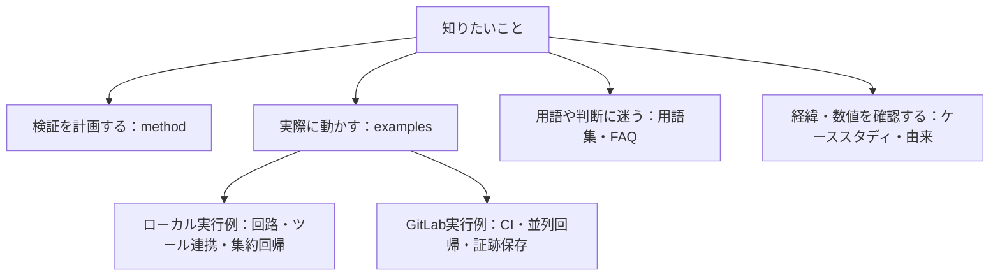
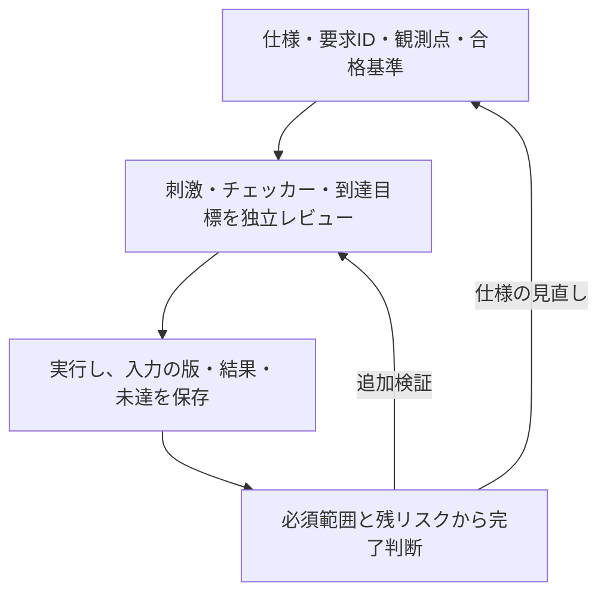

# LSI検証手法

LSIの仕様に基づく検証計画の立案から、要求カバレッジによる検証完了の判断までをまとめたリポジトリです。
仕様を、条件と期待結果を確認できる単位の要求に分け、要求ごとに実装の不具合を検出できるテストとチェッカーを用意します。作成者とは別の担当者が仕様との整合性と不具合の検出力をレビューし、仕様・RTL・検証環境のバージョンに対応した証跡で検証状況を管理します。

初めて読む方は[用語集](docs/glossary.md)で略語・指標の意味を確認できます。[FAQ](docs/faq.md)には、導入、100%の読み方、ランダム検証、SVA・フォーマル、CDC、縮退、CIと完了判断の疑問をまとめています。

## 目的から資料を選ぶ

手法の理解、実行例、用語、過去の記録を分けてたどると、必要な説明へ進めます。



各例は教材ごとに対応範囲を限定しています。図の分類は、実装済み範囲や製品への適用を広げるものではありません。

| 目的 | 入口 | 確認できること |
| --- | --- | --- |
| 全体の進め方 | [仕様から検証へ](docs/method/spec-to-verification-method.md) | 要求・判定・完了条件 |
| まず回路を動かす | [共通ローカル手順](examples/local-common/README.md) | PythonとIcarusの例 |
| UVM・仕様生成・反例再現 | [7例の集約手順](examples/local-soc-regression/README.md) | 必要なツールと実行範囲 |
| 言葉・指標を確認 | [用語集](docs/glossary.md)／[FAQ](docs/faq.md) | 到達・合否・保証範囲の違い |

## 全体像



図は本リポジトリの提案手順の要約です。各段階の成果物は[一般化した手順書](docs/method/spec-to-verification-method.md#3-全体の流れ)、動く教材は[GitLabの実行例](examples/gitlab-regression/README.md)を参照してください。

次の3つを分けると、各資料の役割を追いやすくなります。

| 確認すること | 主な手段 | それだけでは判断できないこと |
| --- | --- | --- |
| 必要な条件が起きたか | モニター、covergroup、SVAのcover | 出力や応答が正しかったか |
| 結果が要求どおりか | スコアボード、SVAのassert、フォーマル検証のプロパティの証明 | 検証目標や仮定に抜けがないか |
| 検証を完了と判断できるか | 要求との対応、必須構成、証跡、未達・例外のレビュー | 計画に含めなかった動作や物理特性までの保証 |

## 現状

ケーススタディ文書の最終取り込みは2026-10-26のkirimasim-tests [`0da4f2fc`](https://github.com/kurochan001/kirimasim-tests/commit/0da4f2fc247bfcee27fc407b8ef0cd8d8f768dfc)、参照ツールの同期基準は2026-10-25の[`3faf239`](https://github.com/kurochan001/kirimasim-tests/commit/3faf239af2614fd8d65cf31c54b0f297108704dd)です。下記の集計値は、2026-10-26に確認した上流[`5fb3c45d`](https://github.com/kurochan001/kirimasim-tests/commit/5fb3c45d73e4946d99690389752b82c86eecaa50)の値へ更新しています。一般化した手順書と実行例には、このリポジトリ独自の追記・改訂があります。由来と更新範囲は[PROVENANCE.md](PROVENANCE.md)を参照してください。

- **手法の一般化文書**：[デジタルLSIの仕様書から検証パターンを作る手順](docs/method/spec-to-verification-method.md)。半導体検証に関する一般的な情報をまとめ、仕様から検証パターンを作る流れを整理した資料です。実際の製品開発で機能検証と併せて必要な、クロック・リセット、低電力、タイミング、DFT・量産テスト、物理設計、信頼性、システム統合、ポストシリコンの項目も14節に整理しています。
- **UVMへの適用**：[UVMで要求と検証資産を結び付ける](docs/method/uvm-verification.md)。基本構成、要求IDとの対応、レジスタモデル（RAL）、UARTの例、回帰の合格条件をまとめています。[APBを使うUVM・RALの実行例](examples/local-uvm/README.md)も用意しています。
- **機能間の検証**：[機能間の相互作用とクロス検証](docs/method/feature-interaction-verification.md)。依存関係の洗い出し、同時動作・順序・中断、クロス目標の選定と合格条件をまとめています。イベントとW1Cクリアの競合を、12目標の例として示しています。
- **ランダム検証**：[制約付きランダム検証の計画・実行・完了判定](docs/method/constrained-random-verification.md)。制約、分布、seed、回帰計画、未達への調整、失敗の再現・縮小をまとめています。クロス検証の12目標を探索する、9実行の計画例も示しています。
- **SVAによる検証**：[SVAのアサーションとカバーによる検証](docs/method/sva-verification.md)。assert・assume・cover、サンプリング、vacuous pass、リセット、シミュレーションとフォーマル検証の完了判定をまとめています。イベントとW1Cの競合を使ったチェッカー例も示しています。
- **SVAの実行例**：[GitLabでSVAのアサーションとカバーを実行する](examples/gitlab-sva/README.md)。既存IRQ回路をVerilatorで検証し、6個のassert・12個のcover、6種類の違反、前件のない診断を実行します。カバーログとネイティブの`coverage.dat`も照合します。
- **covergroupによる機能網羅**：[covergroupで機能を体系的に網羅する](docs/method/functional-coverage.md)。機能一覧からcoverpoint・bin・crossを選ぶ方法、観測と判定、除外とインスタンス別の集計をまとめています。基本動作の16目標を収集するコレクター例も示しています。
- **フォーマル検証**：[フォーマル検証の計画・証明・完了判定](docs/method/formal-verification.md)。仮定・初期状態、抽象化・証明の分割、有界検査と非有界の証明、活性、反例・到達性、サインオフをまとめています。小さな割り込みモデルの証明と、誤実装・過剰な仮定の確認例も示しています。
- **検証環境の検出力**：[ミューテーション検証で検証環境の検出力を確かめる](docs/method/mutation-verification.md)。回路へ意図的な誤りを入れ、刺激・チェッカー・SVAが検出するかを評価します。変異の選び方、未検出の分析、等価な変異、検出率と未完了の集計をまとめています。
- **検証規模の縮退**：[検証の組み合わせ・構成・実行数を縮退する](docs/method/verification-reduction.md)。同値分割・境界値、直交表・t-way、対称性・代表構成、テスト・seedの縮約、変更影響による回帰選択、形式的な抽象化を整理しています。削減の根拠、残す目標、検出力と実行コストの確認も記録します。
- **回帰の縮退の実行例**：[GitLabで回帰の縮退を比較する](examples/gitlab-reduction/README.md)。全件・目標だけの選択・ストレス保持を実際に比較し、19目標の維持、検査サイクル数、3基本変異と履歴依存の追加変異の検出を確認します。目標だけでは見逃す例も含めます。
- **継続的リグレッション**：[継続的リグレッションの計画・実行・結果管理](docs/method/continuous-regression.md)。変更時・定期・サインオフの回帰、マニフェストと分散実行、ライセンス・計算資源、失敗・再実行・カバレッジ・証跡を整理しています。Cadence vManager／Verisium ManagerとGitLab CI/CDの役割分担、併用、総費用での比較も扱います。
- **GitLabの実行例**：[GitLabで割り込みの継続回帰を動かす](examples/gitlab-regression/README.md)。基本動作・時間関係・動作中リセット・CDC遅延モデル、4変異とXの自己確認、8要求・50目標の自動判定、MR・定期回帰、JUnit・証跡保存を実装しています。ローカルと[公開GitLabデモ](https://gitlab.com/kurochan001/lsi-verification-method-ci-demo)で動作確認済みです。通常・夜間回帰、失敗時のJUnit・アーティファクト、MRのマージ制御の実行記録を掲載しています。
- **FIFOのランダム検証例**：[GitLabでFIFOのランダム検証を実行する](examples/gitlab-fifo/README.md)。参照キューによるデータ・占有数の比較、空／満杯・同時要求、動作中リセット、3変異の検出、深さ1／3／8×幅8／16の6構成回帰を実装しています。必須18／22目標を構成ごとに判定し、GitLabのmatrixジョブとJUnit・証跡保存へつなぎます。
- **商用ツール不要のフォーマル検証例**：[GitLabでFIFOをフォーマル検証する](examples/gitlab-formal/README.md)。ジョブ内でYosys・SBY・Z3を準備し、制御の非有界証明、データの有界検査、6目標の到達性、3変異の反例、過剰な仮定の点検を実行します。幅8・深さ1／3を別々に判定し、手元へのツール導入なしで試せます。
- **APBレジスタ検証例**：[GitLabでAPBレジスタを検証する](examples/gitlab-apb/README.md)。読出し・書込み、待ち状態0／1／3、エラー応答、W1Cとイベントの競合、動作中リセットを検証します。3構成で必須20／21目標と3変異の検出を判定します。
- **APBと割込みの結合検証例**：[GitLabでAPBと割込みの結合検証を実行する](examples/gitlab-apb-irq/README.md)。マスク中の保持、W1Cと再発生、マスク更新との競合、複数要因のクリア、待ち・エラー・リセットを3構成で確認します。4要因×マスク×クリア×イベントの32クロスを含め、必須44／45目標と3変異の検出を判定します。
- **ready/valid通信のランダム検証例**：[GitLabでready/valid通信をランダム検証する](examples/gitlab-stream/README.md)。受信待ち、valid・データ保持、満杯時の同時送受信、欠落・重複・順序、リセット破棄を検証します。深さ1／3×幅8／16の4構成で必須25／29目標と3変異を判定し、最後の排出と転送数も照合します。
- **アービタの検証例**：[GitLabでラウンドロビン・アービタを検証する](examples/gitlab-arbiter/README.md)。要求元2／3／4の排他制御、待ち中の選択保持、受理順序、条件付きの公平性を検証します。構成ごとに21／31／49目標と3変異を判定し、受理機会と実サイクルの待ちを分けて記録します。
- **UARTのランダム検証例**：[GitLabでUARTを検証する](examples/gitlab-uart/README.md)。8N1／8E1／8O1と分周数8／16の6構成で、独立した送受信照合、エラー注入、偽スタート、転送中リセットと復帰、21／22目標と3／4変異を確認します。
- **APB・UART・割込みの結合検証例**：[GitLabで3機能を結合検証する](examples/gitlab-apb-uart/README.md)。レジスタ操作から実際の送受信、エラーと割込みまでを9構成で確認します。W1C・MASK更新・受信読出しの競合を含め、60／61／69／70目標と5変異を判定します。
- **検証領域の抜けの点検**：[検証計画の抜けを点検し、試験へ展開する](docs/method/verification-gap-review.md)。lint、リセット・X伝搬、CDC/RDC、プロトコル・データ、異常・故障と復帰、性能、低電力、セキュリティ、コードカバレッジ、等価性・統合などの12領域を整理しました。試験・観測・合格基準と、[適用範囲の記録の雛形](docs/templates/verification-scope.md)を用意しています。
- **実践例（ケーススタディ）**：IEEE 1800-2023（SystemVerilog）の規格を仕様書とみなし、公開のテストスイート[kirimasim-tests](https://github.com/kurochan001/kirimasim-tests)で手法を実践しました。2026-10-26に確認した[上流の集計（`5fb3c45d`）](https://github.com/kurochan001/kirimasim-tests/blob/5fb3c45d73e4946d99690389752b82c86eecaa50/docs/behavior-coverage-summary.md)は次のとおりです。
  - 全1,740節を確認し、要求12,319行を登録した。
  - 対応済みは10,209要求（暫定設計網羅率82.87%）、合格の証跡があるのは5,639要求（暫定実行確認率45.77%）。本文（1〜40章、9,486要求）では、暫定設計網羅率82.57%（7,833要求）、暫定実行確認率39.69%（3,765要求）。分母は未承認のため、いずれも暫定値。
  - 全7,144テストのうち、要求との対応登録があるものは4,730本、未登録は2,414本。登録済みは少なくとも1要求との対応を確認した本数で、各テスト全体のレビュー完了数ではない。
  - 対応するテストのなかった要求に新規テストを書き、作成者とは別の検証者が合格としたものだけを取り込んだ（2026-10-24〜26に区間ごとに実施）。最初の2回では、1,586本のうち1,530本が合格し、1,527本を取り込んだ（56本は欠陥）。
  - 文書取り込み時の`0da4f2fc`では、Icarus Verilog 13.0が期待どおりの結果を再現する、規格だけを根拠にしていたテスト277本に、`:oracle:`を記録した。
  - 比較用のシミュレータとして Lyra を加え、Icarus Verilog・Verilator・kirimasim と並べて毎晩実行している（nvc も試したが、対応が少ないため外した）。期待値が規格と食い違う疑いのあるテストを、除外の候補として記録している。
  - 解釈保留は19論点・要求21行。資料確認の完了と、解釈・分母の確定は区別して管理している。
  - 上記の新規テストと照合案は、作成者とは別の検証者による独立レビューを経て取り込んだ。スイート全体の全テストをレビュー済みという意味ではない。
- **ツール**：ケーススタディで使った照合キット、生成テストの枠組み、台帳と計測の参照実装です。kirimasim-testsのディレクトリ構成を前提にしており、このリポジトリ単独では動きません（[tools/README.md](tools/README.md)）。

## ローカル専用の実行例

GitLabの利用枠を使わずに、共通ランナーで試せるシミュレーション例を26個用意しています。POSIX環境、Python 3.10以上、Icarus Verilogで動き、追加Pythonパッケージは不要です。[準備・実行・証跡の共通手順](examples/local-common/README.md)を参照してください。

- **[ECCの故障注入](examples/local-ecc/README.md)**：8ビットデータのSECDED。全23,552パターンの0／1／2ビット誤り、97目標、4変異、3／4ビット誤りの限界を示す診断2件を実行します。
- **[SPIのランダム検証](examples/local-spi/README.md)**：CPOL／CPHAの4モード×半周期2／4クロックの8構成。独立した予定時刻で送受信を照合し、各16目標と4変異、busy中start、転送中リセットを確認します。
- **[タイマー・ウォッチドッグ](examples/local-timer-watchdog/README.md)**：幅4／8の2構成。単発・周期・停止、IRQクリアと満了、kickと満了の競合、同時満了を照合し、各20目標と4変異を確認します。

- **[非同期FIFO](examples/local-async-fifo/README.md)**：深さ4／8×同期段数2／3の4構成。クロック比・位相・ジッター、参照キュー、同期遅延を含むフラグを照合し、各17目標と4変異を確認します。
- **[I²Cのランダム検証](examples/local-i2c/README.md)**：7ビットアドレスの1バイトターゲット。ACK／NACK、Repeated START、クロックストレッチ、途中リセットを実信号で検査し、2構成・各18目標と4変異を確認します。
- **[APB＋タイマー＋ウォッチドッグ](examples/local-apb-timer/README.md)**：既存コアにAPBレジスタとIRQマスクを接続し、幅4／8×待ち0／2の4構成で各24目標と4変異、バス完了と満了・kick・clearの競合を確認します。

- **[AHB-Lite](examples/local-ahb/README.md)**：待ち状態0／1／3の3構成。アドレス／データのパイプライン、バイトレーン、2サイクルのERROR、次要求の取消しを照合し、各21目標と4変異を確認します。
- **[AXI4-Lite](examples/local-axi/README.md)**：応答遅延0／2の2構成。AW／Wの独立受付、全16通りのWSTRB、B／Rの応答保持、読書き競合とリセットを照合し、各39目標と4変異を確認します。

- **[AHB／AXI-Lite→APB結合](examples/local-bus-bridge/README.md)**：2バス×APB待ち0／2の4構成。既存レジスタ・タイマーへ接続し、応答変換、読書きの重なり、IRQ、リセットを各18目標・4変異で確認します。
- **[AXI4のバースト・ID](examples/local-axi4/README.md)**：INCR 1〜4ビート、2ビットID、各方向2件の未完了転送。ストローブ・RLAST・ID・応答保持・4KiB境界を26目標・4変異で確認します。

- **[DMA](examples/local-dma/README.md)**：APBで設定しAXI4でコピー、割込みで完了。境界分割・中断・エラーを2構成・各12目標で確認します。
- **[複数マスター接続](examples/local-interconnect/README.md)**：2×2 AXI4の応答先・ID・仲裁・競合を12目標で確認します。
- **[非同期APBブリッジ](examples/local-cdc-bridge/README.md)**：要求／応答FIFOとAPBを接続し、2クロック構成・各7目標で片側リセットによる全体破棄も確認します。
- **[タイムアウト復旧](examples/local-recovery/README.md)**：古い応答の排除・期限境界・tag枯渇と協調リセットを2構成・各10目標で確認します。
- **[低電力制御](examples/local-power/README.md)**：排出・隔離・保持・復帰を2構成・各10目標で確認するRTL動作モデルです。

- **[AXI4-Stream](examples/local-axis/README.md)**：深さ2／4。パケット境界・有効バイト・途中リセットを各11目標で確認します。
- **[固定小数点DSP](examples/local-dsp/README.md)**：2タップFIRの符号・丸め・上下限・飽和・履歴を2構成・各10目標で確認します。
- **[同一領域の競合](examples/local-memory-order/README.md)**：既存AXI接続の読書き・書込み同士の競合を、取込み時刻に基づく9目標で確認します。
- **[AXI4-Liteの幅変換](examples/local-width-converter/README.md)**：64→32ビット、部分書込み、応答集約、途中リセットを2構成・各15目標で確認します。
- **[アクセス保護](examples/local-access-control/README.md)**：PPROT、設定ロック、禁止読出しと書込みの無副作用を2構成・各14目標で確認します。
- **[ECC付きメモリ](examples/local-ecc-memory/README.md)**：読出し修復、スクラビング、通常書込みとの競合を2構成・各11目標で確認します。
- **[クロック停止とリセット](examples/local-clock-reset/README.md)**：排出・停止・再開、停止中の非同期リセットと同期解除を2構成・各10目標で確認します。
- **[優先順位付き割込み](examples/local-priority-irq/README.md)**：優先順位・同順位・claim／complete・イベント競合を2構成・各12目標で確認します。
- **[リング式ディスクリプタDMA](examples/local-descriptor-dma/README.md)**：既存DMAにつなぎ、リング巡回・取得エラー・中断・IRQを2構成・各13目標で確認します。
- **[クレジット方式のフロー制御](examples/local-credit-link/README.md)**：2仮想チャネルの受付・送信・返却・保持・リセットを2構成・各10目標で確認します。
- **[小規模キャッシュとDMA](examples/local-cache-dma/README.md)**：write-back、部分書込み、clean／invalidateとDMAの可視性を2構成・各15目標で確認します。

```sh
python3 examples/local-ecc/run.py
python3 examples/local-spi/run.py
python3 examples/local-timer-watchdog/run.py
python3 examples/local-async-fifo/run.py
python3 examples/local-i2c/run.py
python3 examples/local-apb-timer/run.py
python3 examples/local-ahb/run.py
python3 examples/local-axi/run.py
python3 examples/local-bus-bridge/run.py
python3 examples/local-axi4/run.py
python3 examples/local-system-regression/run.py --stage simulation
python3 examples/local-axis/run.py
python3 examples/local-dsp/run.py
python3 examples/local-memory-order/run.py
```

各例はRTL、独立した期待値、要求カタログ、変異検出、JUnit・ログ・VCDの保存を備えています。共通シミュレーションランナーの現在の計画は26例・61構成、回帰JUnitは全構成合計でsmoke 429件、nightly 551件です。今回の4回路・8構成の56／72件は、下記の新しい7例の回帰にも含まれるため重複集計しません。実行した範囲と結果は各集約手順と[由来の記録](PROVENANCE.md)へ残します。GitLab例の50ジョブ・311／384件やランナー確認132件とは別集計です。GitLabのCI設定への追加・CI起動は行っていません。

### 失敗の縮小・カバレッジ収束・結合・UVMの7例

[7例のローカル回帰](examples/local-workflow-regression/README.md)では、上記4回路に加え、[失敗した操作列の自動縮小](examples/local-failure-reduction/README.md)、[未達カバレッジからの刺激調整](examples/local-coverage-feedback/README.md)、[SystemVerilog UVM・RAL](examples/local-uvm/README.md)をまとめて実行します。縮小は同じチェッカーでの再現と単一操作削除の極小性を確認し、刺激調整は同じサイクル予算で固定分布のランダム検証と比較します。

```sh
python3 examples/local-workflow-regression/run.py --stage core
python3 examples/local-uvm/setup_uvm.py --out /tmp/lsi-uvm-library
python3 examples/local-workflow-regression/run.py --uvm-home /tmp/lsi-uvm-library/1800.2-2020.3.2
```

UVMにはVerilator 5.052、C++20ビルド環境、Accellera UVM 2020-3.2を使います。外部ライブラリはリポジトリへ取り込まず、明示的なセットアップで準備します。親JUnitは7件、子は83／111件で、上記4回路の56／72件も含みます。GitLabのCIへは追加しません。

### UVMランダム化・仕様生成・反例再現・結合検証の7例

[新しい7例の実行手順](examples/local-soc-regression/README.md)から、上記4回路に加え、[SVの制約付きランダム化とネイティブcovergroup](examples/local-uvm-random/README.md)、[SystemRDLによるRTL・Cヘッダー・RALの生成と照合](examples/local-register-spec/README.md)、[フォーマル反例のシミュレーション再現](examples/local-formal-replay/README.md)を実行できます。

```sh
python3 examples/local-soc-regression/run.py --stage core
```

全7例の実行にはUVM・SystemRDL・フォーマル環境を準備します。2026-10-27にsmoke／nightlyが成功し、親JUnitは各7件、子は113／137件、追加の確認テストは36件が成功しました。生成RALは構造・属性の照合で、生成RTLへのfrontdoor接続は行いません。キャッシュ例は1ワードのラインと直列要求を扱う教材です。各例の対象範囲を手順書に明記しています。

### AHB／AXIのランダム・フォーマル検証

AHBのランダム刺激にはINCR4・BUSYと転送中リセット、AXIには長めの応答待ちと片側要求・保留応答のリセットを追加しました。[フォーマル検証例](examples/local-bus-formal/README.md)では、同じRTLの5構成に対し、安全性の非有界証明、深さ12のデータBMC、到達性、各4変異と過剰な仮定の診断を実行します。Yosys・SBY・Z3用の一時仮想環境はリンク先の手順で用意します。

```sh
python3 examples/local-bus-formal/run.py --bus ahb
python3 examples/local-bus-formal/run.py --bus axi
```

フォーマルは各9タスク・全45件のJUnitで、シミュレーションの429／551件へ合算しません。通常モデルの到達目標はAHB 8×3構成＋AXI 12×2構成の計48件です。フォーマルの判定テストは12件です。前回の全体レビューではローカル確認テスト234件が成功しました。今回の36件を加えたローカル確認テストの計画は270件です。今回の追加分は全36件を実行しています。証明と有界検査の範囲を区別し、仮定・ソース・証跡を保存します。GitLabへは追加していません。

### AHB／AXIの追加検査をまとめて実行する

[バス検証の追加例](examples/local-bus-validation/README.md)で、独立プロトコルチェッカーとネイティブSVA、構成別クロス、APB結合、4値のX検査と短パルスリセット、性能・長時間待ちからの復帰、lint・line／toggleカバレッジを実行します。AXI4の別例も子回帰として起動します。VerilatorとC++ビルド環境を追加で使います。

```sh
python3 examples/local-bus-validation/run.py
python3 examples/local-bus-validation/run.py --profile nightly
```

親JUnitは64件で、子のブリッジ28／36件とAXI4 7／9件は別ファイルです。子は上記26例にも含まれるため、同じ検証として重複集計しません。AHB／AXI-Liteの45タスクは元の回路に限定されます。AXI4には下記の別計画を用意しています。

### 結合・復旧・低電力・等価性まで進める

[システム検証7例の手順](examples/local-system-regression/README.md)から、DMA、複数マスター接続、非同期APBブリッジ、タイムアウト復旧、低電力制御に加え、[AXI4の制御証明・データBMC](examples/local-axi4-formal/README.md)と[FIFOの等価性証明](examples/local-equivalence/README.md)をまとめて実行できます。

```sh
. /tmp/lsi-bus-formal-venv/bin/activate
python3 examples/local-system-regression/run.py
```

初回のツール準備は[共通フォーマル手順](examples/local-formal-common/README.md)を参照してください。親JUnitは7件、シミュレーション子は63／81件、AXI4フォーマルは18件、等価性は16件です。AXI4のデータBMCは直列入力・深さ12、制御証明と到達性は並行受付も扱います。低電力はUPFの実行例ではなく、等価性はSBYのmiter方式です。各例の仕様と保証範囲を分けて記載しています。

### ソフトウェア・差分検証・完了期限へ広げる

[追加検証7例の手順](examples/local-advanced-regression/README.md)から、パケット・DSP・競合に加え、[Cドライバと実DMA RTL](examples/local-c-driver/README.md)、[cocotbのAPB検証](examples/local-cocotb/README.md)、[Icarus／Verilator差分](examples/local-differential/README.md)、[進行条件と完了期限の証明](examples/local-progress/README.md)を実行できます。cocotbとフォーマルには、それぞれ専用の一時仮想環境を指定します。

```sh
python3 examples/local-advanced-regression/run.py \
  --cocotb-python /tmp/lsi-cocotb-venv/bin/python \
  --formal-python /tmp/lsi-bus-formal-venv/bin/python
```

親JUnitは7件、シミュレーション子は72／96件、完了期限のフォーマルは16件です。Cはホスト上で実行し、差分検証は有効な観測だけを比較します。進行条件の無い完了性を主張せず、その場合の期限違反の反例も確認します。負の試験の注入先と集計を区別し、既存回帰へ二重計上しません。

## GitLab実行例の現在の構成

2026-10-26に、実装の[MR !11](https://gitlab.com/kurochan001/lsi-verification-method-ci-demo/-/merge_requests/11)と確認記録・構成図の[MR !12](https://gitlab.com/kurochan001/lsi-verification-method-ci-demo/-/merge_requests/12)がmainへ取り込まれたことを確認しました。最新mainは`ec594de7`で、[CI #2990241122](https://gitlab.com/kurochan001/lsi-verification-method-ci-demo/-/pipelines/2990241122)は成功しています。[MR !12のCI #2990210417](https://gitlab.com/kurochan001/lsi-verification-method-ci-demo/-/pipelines/2990210417)では全50ジョブ成功、JUnit 311件・失敗／エラー0件を確認済みです。MR !12はドキュメントだけの変更で、その時点のCI設定・実装は同じです。

現行の構成を下表に示します。追加した9構成の目標・変異・完了記録の照合結果は[結合例の実行記録](examples/gitlab-apb-uart/README.md#7-適用範囲と実行確認)に記載しています。

| 実行例 | 回帰ジョブ数・対象 | 通常実行のJUnit件数 | schedule実行の予定件数 |
| --- | --- | --- | --- |
| [IRQ・CDC](examples/gitlab-regression/README.md) | 1ジョブ、要求8件・目標50件 | 38 | 41 |
| [FIFOランダム検証](examples/gitlab-fifo/README.md) | 6ジョブ、深さ1／3／8×幅8／16 | 36（各6） | 48（各8） |
| [FIFOフォーマル検証](examples/gitlab-formal/README.md) | 2ジョブ、幅8・深さ1／3 | 16（各8） | 16（各8） |
| [APBレジスタ検証](examples/gitlab-apb/README.md) | 3ジョブ、待ち状態0／1／3 | 18（各6） | 24（各8） |
| [APB＋割込み結合検証](examples/gitlab-apb-irq/README.md) | 3ジョブ、待ち状態0／1／3 | 18（各6） | 24（各8） |
| [ready/validランダム検証](examples/gitlab-stream/README.md) | 4ジョブ、深さ1／3×幅8／16 | 24（各6） | 32（各8） |
| [SVAのアサーションとカバー](examples/gitlab-sva/README.md) | 1ジョブ、要求6件・カバー12目標 | 10 | 12 |
| [回帰の縮退の比較](examples/gitlab-reduction/README.md) | 1ジョブ、全件／選択／ストレス保持の比較 | 18（集約判定） | 18（集約判定） |
| [ラウンドロビン・アービタ](examples/gitlab-arbiter/README.md) | 3ジョブ、要求元2／3／4 | 21（各7） | 27（各9） |
| [UARTランダム検証](examples/gitlab-uart/README.md) | 6ジョブ、分周数8／16×パリティなし／偶数／奇数 | 40（各6／7） | 52（各8／9） |
| [APB・UART・割込み結合検証](examples/gitlab-apb-uart/README.md) | 9ジョブ、待ち状態0／1／3×パリティなし／偶数／奇数 | 72（各8） | 90（各10） |
| 合計 | 回帰39ジョブ＋ランナー確認11ジョブ | 311 | 384 |

ランナー確認はIRQ 14件、FIFO 10件、フォーマル8件、APB 12件、APB＋割込み12件、ready/valid 13件、SVA 12件、縮退比較11件、アービタ13件、UART 13件、APB・UART・割込み14件の計132テストで、上表のJUnit件数とは別です。132件は2026-10-27の全体レビュー修正後の件数で、上記のGitLab確認記録は修正前の129件です。scheduleではシミュレーションと縮退比較の10例がnightlyとなり、フォーマル検証は通常実行と同じタスクを実行します。384件は設定から算出した予定件数で、GitLabで全例を含むschedule実行は今回行っていません。各例の追加時点の記録と、現行構成の記録を区別します。定期運用にはGitLab側でスケジュールの対象と有効状態を確認してください。

## 構成

```text
docs/method/                    一般化した手順書（この手法の本体）
docs/glossary.md                用語・略語と、この手順での意味
docs/faq.md                     導入・方式の使い分け・運用上のFAQ
docs/case-study-ieee1800/       もとになった実践の資料（IEEE 1800-2023）
docs/templates/                製品開発で使う記録の雛形
examples/gitlab-regression/     このリポジトリ単独で動くGitLab回帰の最小例
examples/gitlab-fifo/           FIFOのスコアボード・ランダム検証と6構成の並列回帰
examples/gitlab-formal/         オープンソースツールによるFIFOの証明・有界検査・到達性
examples/gitlab-apb/            APBレジスタ・W1C・待ち状態の検証と3構成の並列回帰
examples/gitlab-apb-irq/        APBと割込みの結合・クロス検証と3構成の並列回帰
examples/gitlab-stream/         ready/valid・バックプレッシャーと4構成の並列回帰
examples/gitlab-sva/            SVAの実行・ネイティブカバー・前件不足と検出力の確認
examples/gitlab-reduction/      回帰の選択・実行量・目標維持・検出力を比較
examples/gitlab-arbiter/        仲裁の排他・選択保持・順序・条件付き公平性と3構成回帰
examples/gitlab-uart/           UARTの独立した送受信・エラー・リセットと6構成ランダム回帰
examples/gitlab-apb-uart/       APB・UART・割込みの競合・データ経路と9構成結合回帰
examples/local-ecc/             SECDEDの全数故障注入・訂正・検出と保証範囲外の診断
examples/local-spi/             SPIの4モード・2分周と独立した送受信タイミング検証
examples/local-timer-watchdog/  タイマー・ウォッチドッグの境界・優先順位・ランダム検証
examples/local-async-fifo/      非同期FIFO・クロック比・ジッター・同期フラグの検証
examples/local-i2c/             I²CのACK・NACK・Repeated START・ストレッチの検証
examples/local-apb-timer/       APBからタイマー・ウォッチドッグ・IRQまでの結合検証
examples/local-ahb/             AHB-Liteのパイプライン・バイトレーン・ERROR応答の検証
examples/local-axi/             AXI4-Liteの独立チャネル・WSTRB・応答保持の検証
examples/local-common/          ローカル26例の共通ランナーと異常系の確認
examples/local-soc-regression/  UVMランダム化・仕様生成・反例再現・4回路の集約
examples/local-bus-formal/      AHB・AXIの安全性証明・有界データ・到達性と感度確認
.gitlab-ci.yml                 GitLabへ置いた場合のCI設定の入口
tools/matching_kit/             照合案の受付・検査、検証者の判定、統合、シミュレータ実行、Workflowスクリプト
tools/generators/               表形式の要求から検証パターンを生成する枠組みと、その例
tools/reference/                要求台帳の検査・計測・出典監査・照合台帳の参照実装
PROVENANCE.md                   各ファイルの由来（元のリポジトリのパスとコミット）
```

## 読む順序

用語や方式の違いで迷ったときは、[用語集](docs/glossary.md)と[FAQ](docs/faq.md)から該当する手順書へ進めます。

製品へ適用する際は、[検証領域の点検](docs/method/verification-gap-review.md)と[適用範囲の雛形](docs/templates/verification-scope.md)で、必要な領域・構成・担当・判定段階を先に確認します。

1. [一般化した手順書](docs/method/spec-to-verification-method.md)。[機能間のクロス検証](docs/method/feature-interaction-verification.md)、[ランダム検証](docs/method/constrained-random-verification.md)、[SVAによる検証](docs/method/sva-verification.md)、[covergroupによる機能網羅](docs/method/functional-coverage.md)、[フォーマル検証](docs/method/formal-verification.md)、UVMで実装する場合は[UVMへの適用](docs/method/uvm-verification.md)も参照します。
2. [もとになった手順書（IEEE 1800-2023）](docs/case-study-ieee1800/requirements-to-tests-method.md)
3. [要求抽出の結果と台帳見直し](docs/case-study-ieee1800/requirement-extraction.md)と[未解決事項](docs/case-study-ieee1800/requirement-extraction-notes.md)：仕様の曖昧さの扱いの実例
4. [計測規則](docs/case-study-ieee1800/coverage-rules.md)：設計網羅率と実行確認率、証跡と現行バージョンの整合性、AND集合
5. 結果報告の例：
   - [既存テストの照合（20%到達）](docs/case-study-ieee1800/existing-test-matching-20percent-20261023.md)
   - [附属書ヘッダ・VPIテストと照合](docs/case-study-ieee1800/header-vpi-tests-and-matching-20261023.md)
   - [予約語の生成テスト](docs/case-study-ieee1800/keyword-tests-20261024.md)
   - [未対応要求への新規テスト（50%到達）](docs/case-study-ieee1800/gap-tests-20261024.md)
   - [未対応要求への新規テスト、2回目](docs/case-study-ieee1800/gap-tests-2-20261024.md)
   - [未登録テストの照合](docs/case-study-ieee1800/existing-test-matching-unregistered-20261025.md)
6. [検証で見つかった問題の累積](docs/case-study-ieee1800/existing-test-matching-review-20261022.md)と[シミュレータと規格の差異](docs/case-study-ieee1800/simulator-differences.md)：独立検証で何が見つかるかの実例
7. [比較用シミュレータとの不一致の見直し](docs/case-study-ieee1800/lyra-disagreement-review-20261025.md)：oracle に使わない実装を、期待値を見直すきっかけとして使った例
8. [サインオフ記録の雛形](docs/templates/signoff-record.md)：開発段階、構成ごとの判定、証跡、例外承認、変更の影響を記録する

## 今後の計画

1. **手法の改訂**：一般化文書を、ケーススタディで分かったことに合わせて更新し続けます。
2. **ツールの汎用化**：要求台帳の形式を、規格の節構成に依存しない形にします。具体的には、要求ID、出典、種別、観測点、構成、証跡を持つ形式です。照合キットを、kirimasim-testsの構成から切り離します。テストやチェッカー、カバレッジ項目に要求IDを付ける方式に合わせたアダプタを用意します。
3. **パイロット**：小さなIP（レジスタブロックと1つのバスインターフェース）で検証手順を一通り実施し、次の点を評価します。抽出漏れ、照合の採用率、見つかったバグと仕様の課題、故障注入の検出率、工数。
4. **テンプレート**：検証領域の適用範囲とサインオフ記録の雛形を起点に、要求台帳、照合案、検証者のチェックリスト、課題票を整備します。手順書の台帳例と記録の雛形は運用案であり、現行の照合キットが対応済みの汎用形式ではありません。

## 注意

- 規格や仕様書の本文は、このリポジトリに入れません。要求は自分の言葉で書き、版と段落を引用します。
- 機密の仕様書を扱う場合は、AIを使える環境と範囲を先に決めます。
- AIによるレビューは、人の承認ではありません。台帳と報告に、担当者と方法を明記します。

## ライセンス

本リポジトリで新規作成した資料・コード、およびkirimasim-testsから複製・改訂した資料・ツールには、Apache License 2.0 with LLVM Exceptions（`Apache-2.0 WITH LLVM-exception`）を適用します（[LICENSE](LICENSE)）。複製元と改訂の記録は[PROVENANCE.md](PROVENANCE.md)を参照してください。

参照先のIEEE規格、外部の文書・ソフトウェアには、それぞれの権利者の利用条件が適用されます。本リポジトリのライセンスは、それらの転載・再配布の許諾を与えるものではありません。
