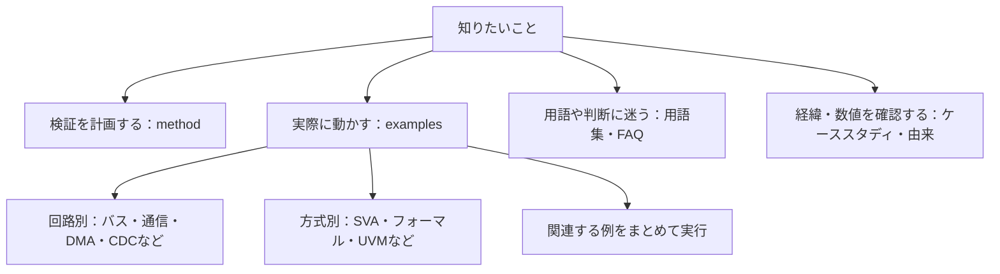
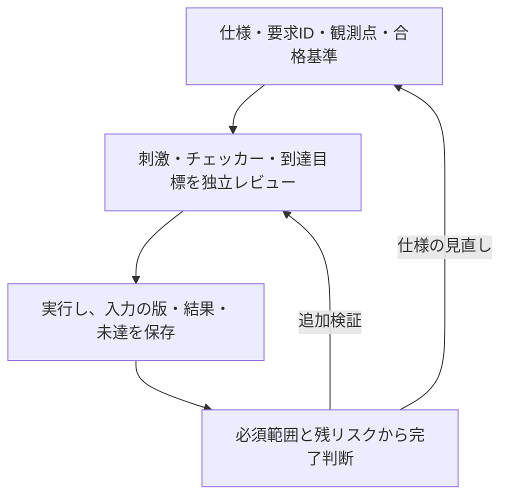

[](LICENSE)
[](examples/)
[](#準備と実行)
[](#手法ケーススタディ参照ツール)

# LSI検証手法

LSIの仕様に基づく検証計画の立案から、要求カバレッジによる検証完了の判断までをまとめたリポジトリです。
仕様を、条件と期待結果を確認できる単位の要求に分け、要求ごとに実装の不具合を検出できるテストとチェッカーを用意します。作成者とは別の担当者が仕様との整合性と不具合の検出力をレビューし、仕様・RTL・検証環境のバージョンに対応した証跡で検証状況を管理します。

初めて読む方は[用語集](docs/glossary.md)で略語・指標の意味を確認できます。[FAQ](docs/faq.md)には、導入、カバレッジ100%の意味、ランダム検証、SVA・フォーマル、CDC、削減、CI運用や検証完了の判断に関する疑問をまとめています。

手法の説明と適用記録は[手法・ケーススタディ・参照ツール](#手法ケーススタディ参照ツール)にまとめています。実行できる検証例を探す場合は、[検証例一覧](#検証例一覧)から対象の回路・検証方式を選んでください。[まとめて実行する手順](#まとめて実行する手順)と[準備と実行](#準備と実行)も用意しています。

## 目的から資料を選ぶ

手法の説明、実行できる検証例、用語、手法の適用記録から、目的に合う資料を選べます。



各検証例の対象範囲は、リンク先の手順書に記載しています。製品に適用する際は、対象の仕様や構成に合わせて検証項目を見直します。

| 目的 | 入口 | 確認できること |
| --- | --- | --- |
| 全体の進め方 | [仕様から検証へ](docs/method/spec-to-verification-method.md) | 要求・判定・完了条件 |
| 回路・検証方式から例を探す | [検証例一覧](#検証例一覧) | 全例の検証内容と主なツール |
| まず回路を動かす | [準備と実行](#準備と実行) | PythonとIcarusで始める例 |
| UVM・仕様生成・反例再現 | [7例の集約手順](examples/local-soc-regression/README.md) | 必要なツールと実行範囲 |
| 言葉・指標を確認 | [用語集](docs/glossary.md)／[FAQ](docs/faq.md) | 到達・合否・保証範囲の違い |

## 全体像



図は本リポジトリの提案手順の要約です。各段階の成果物は[一般化した手順書](docs/method/spec-to-verification-method.md#3-全体の流れ)、実行できる検証例は[検証例一覧](#検証例一覧)を参照してください。

検証状況は、次の3点を分けて確認します。

| 確認すること | 主な手段 | それだけでは判断できないこと |
| --- | --- | --- |
| 必要な検証条件に到達したか | モニター、covergroup、SVAのcover | 出力や応答が正しかったか |
| 結果が要求どおりか | スコアボード、SVAのassert、フォーマル検証のプロパティの証明 | 検証目標や仮定に抜けがないか |
| 検証を完了と判断できるか | 要求との対応、必須構成、証跡、未達・例外のレビュー | 計画に含めなかった動作や物理特性までの保証 |

## 手法・ケーススタディ・参照ツール

ここでは検証の進め方を説明する資料、手法の適用記録、ケーススタディで使った参照ツールを紹介します。回路や検証方式を実際に動かす教材は、後の[検証例一覧](#検証例一覧)にまとめています。

ケーススタディ文書の最終取り込みは2026-10-26のkirimasim-tests [`0da4f2fc`](https://github.com/kurochan001/kirimasim-tests/commit/0da4f2fc247bfcee27fc407b8ef0cd8d8f768dfc)、参照ツールの同期基準は2026-10-25の[`3faf239`](https://github.com/kurochan001/kirimasim-tests/commit/3faf239af2614fd8d65cf31c54b0f297108704dd)です。下記の集計値は、2026-10-26に確認した上流[`5fb3c45d`](https://github.com/kurochan001/kirimasim-tests/commit/5fb3c45d73e4946d99690389752b82c86eecaa50)の値へ更新しています。一般化した手順書と実行例には、このリポジトリ独自の追記・改訂があります。由来と更新範囲は[PROVENANCE.md](PROVENANCE.md)を参照してください。

- **仕様に基づく検証手順**：[デジタルLSIの仕様書から検証パターンを作る手順](docs/method/spec-to-verification-method.md)。半導体検証に関する一般的な情報をまとめ、仕様から検証パターンを作る流れを整理した資料です。実際の製品開発で機能検証と併せて必要な、クロック・リセット、低電力、タイミング、DFT・量産テスト、物理設計、信頼性、システム統合、ポストシリコンの項目も14節に整理しています。
- **UVMへの適用**：[UVMで要求と検証資産を結び付ける](docs/method/uvm-verification.md)。基本構成、要求IDとの対応、レジスタモデル（RAL）、UARTの例、リグレッションの合格条件をまとめています。[APBを使うUVM・RALの実行例](examples/local-uvm/README.md)も用意しています。
- **機能間の検証**：[機能間の相互作用とクロス検証](docs/method/feature-interaction-verification.md)。依存関係の洗い出し、同時動作・順序・中断、クロス目標の選定と合格条件をまとめています。イベントとW1Cクリアの競合を、12目標の例として示しています。[機能クロス網羅の提案](docs/feature-interaction-coverage-proposal.md)を基に、因子・水準・制約・可変次数、既存テストから未達を補う手順、計画・到達・合格の区別も取り込みました。[記録の雛形](docs/templates/interaction-coverage-plan.md)を用意しています。[APB＋割り込みの実行例](examples/local-apb-irq-coverage/README.md)で、既存テストを保持した追加候補の選択、再実行による目標・検出力・コストの比較をローカルで試せます。
- **ランダム検証**：[制約付きランダム検証の計画・実行・完了判定](docs/method/constrained-random-verification.md)。制約、分布、seed、リグレッション計画、未達への調整、失敗の再現・縮小をまとめています。クロス検証の12目標を探索する、9実行の計画例も示しています。
- **SVAによる検証**：[SVAのアサーションとカバーによる検証](docs/method/sva-verification.md)。assert・assume・cover、サンプリング、vacuous pass、リセット、シミュレーションとフォーマル検証の完了判定をまとめています。イベントとW1Cの競合を使ったチェッカー例も示しています。
- **covergroupによる機能網羅**：[covergroupで機能を体系的に網羅する](docs/method/functional-coverage.md)。機能一覧からcoverpoint・bin・crossを選ぶ方法、観測と判定、除外とインスタンス別の集計をまとめています。基本動作の16目標を収集するコレクター例も示しています。
- **フォーマル検証**：[フォーマル検証の計画・証明・完了判定](docs/method/formal-verification.md)。仮定・初期状態、抽象化・証明の分割、有界検査と非有界の証明、活性、反例・到達性、サインオフをまとめています。小さな割り込みモデルの証明と、誤実装・過剰な仮定の確認例も示しています。
- **検証環境の検出力**：[ミューテーション検証で検証環境の検出力を確かめる](docs/method/mutation-verification.md)。回路へ意図的な誤りを入れ、刺激・チェッカー・SVAが検出するかを評価します。変異の選び方、未検出の分析、等価な変異、検出率と未完了の集計をまとめています。
- **検証規模の削減**：[検証の組み合わせ・構成・実行数を削減する](docs/method/verification-reduction.md)。同値分割・境界値、直交表・t-way、対称性・代表構成、テスト・seedの縮約、変更影響によるリグレッション選択、形式的な抽象化を整理しています。削減の根拠、残す目標、検出力と実行コストの確認も記録します。
- **継続的リグレッション**：[継続的リグレッションの計画・実行・結果管理](docs/method/continuous-regression.md)。変更時・定期・サインオフのリグレッション、マニフェストと分散実行、ライセンス・計算資源、失敗・再実行・カバレッジ・証跡を整理しています。Cadence vManager／Verisium ManagerとCIサービスの役割分担、併用、総費用での比較も扱います。
- **検証領域の抜けの点検**：[検証計画の抜けを点検し、試験へ展開する](docs/method/verification-gap-review.md)。lint、リセット・X伝搬、CDC/RDC、プロトコル・データ、異常・故障と復帰、性能、低電力、セキュリティ、コードカバレッジ、等価性・統合などの12領域を整理しました。試験・観測・合格基準と、[適用範囲の記録の雛形](docs/templates/verification-scope.md)を用意しています。
- **手法の適用事例（IEEE 1800-2023）**：SystemVerilogの規格を仕様書とみなし、公開のテストスイート[kirimasim-tests](https://github.com/kurochan001/kirimasim-tests)で、要求の抽出、テストとの対応付け、検証状況の管理に本手法を適用しました。2026-10-26に確認した[上流の集計（`5fb3c45d`）](https://github.com/kurochan001/kirimasim-tests/blob/5fb3c45d73e4946d99690389752b82c86eecaa50/docs/behavior-coverage-summary.md)は次のとおりです。
  - 全1,740節を確認し、要求12,319行を登録した。
  - テストとの対応付けが済んだものは10,209要求（暫定設計網羅率82.87%）、合格の証跡があるのは5,639要求（暫定実行確認率45.77%）。本文（1〜40章、9,486要求）では、暫定設計網羅率82.57%（7,833要求）、暫定実行確認率39.69%（3,765要求）。分母は未承認のため、いずれも暫定値。
  - 全7,144テストのうち、要求との対応登録があるものは4,730本、未登録は2,414本。登録済みの本数は、少なくとも1要求との対応を確認したテストの数で、各テスト全体のレビュー完了数ではない。
  - 対応するテストのなかった要求に新規テストを書き、作成者とは別の検証者が合格としたものだけを取り込んだ（2026-10-24〜26に区間ごとに実施）。最初の2回では、1,586本のうち1,530本が合格し、1,527本を取り込んだ（56本は欠陥）。
  - 文書取り込み時の`0da4f2fc`では、Icarus Verilog 13.0が期待どおりの結果を再現する、規格だけを根拠にしていたテスト277本に、`:oracle:`を記録した。
  - 比較用のシミュレータとして Lyra を加え、Icarus Verilog・Verilator・kirimasim と併せた夜間リグレッションの実行記録がある（nvcも試したが、対応範囲が限られていたため対象から外した）。期待値が規格と食い違う疑いのあるテストは、除外候補として記録した。
  - 解釈保留は19論点・要求21行。資料確認の完了と、解釈・分母の確定は区別して管理している。
  - 上記の新規テストと照合案は、作成者とは別の検証者による独立レビューを経て取り込んだ。スイート全体の全テストをレビュー済みという意味ではない。
- **ケーススタディ用の参照ツール**：ケーススタディで使った照合キット、生成テストの枠組み、台帳と計測の参照実装です。kirimasim-testsのディレクトリ構成を前提にしており、このリポジトリ単独では動きません（[tools/README.md](tools/README.md)）。

### 技術ノート：検証に使う言語を、検証の題材に

SystemVerilogは、LSIの設計や検証に使う言語です。その言語規格を仕様書として読み、言語処理系の振る舞いをテストする題材にしたのが、このケーススタディです。「検証に使う道具の土台を、同じ検証の進め方で確かめる」という、少し入れ子になった面白さがあります。

自分たちで整理した手法を自分たちの開発に使い、そこで見つかった課題を手法の改善へ戻す点では、**ドッグフーディング（dogfooding）**に通じます。これは、自分たちが作った製品や道具を自分たちでも使うことを指す言葉です（[Microsoftによる使用例](https://www.microsoft.com/en-us/copilot/blog/2012/07/25/keep-track-of-your-work/)）。要求の分け方、テストとの対応付け、期待値の根拠、未達の扱いを、実際の作業を通して見直す材料にもなっています。

「道具を作る道具」という意味で、**コンパイラコンパイラ**を連想させるところもあります。用語としてのコンパイラコンパイラは、言語の記述から構文解析器などを生成する道具を指し、[GNU Bison](https://www.gnu.org/software/bison/)のような構文解析器生成系がその例です。このケーススタディでは、仕様から要求・テスト・証跡へつなぐ手順を言語処理系の検証に適用し、その経験を検証手法そのものの見直しにも役立てています。

## 検証例一覧

このリポジトリにある検証例を分野別にまとめています。各リンク先に、対象範囲、実行手順、合格条件、証跡を記載しています。

- [バス・レジスタ・アドレス](#バスレジスタアドレス)
- [FIFO・通信・仲裁](#fifo通信仲裁)
- [割り込み・タイマー・周辺機能の結合](#割り込みタイマー周辺機能の結合)
- [DMA・メモリ・順序制御](#dmaメモリ順序制御)
- [CDC・クロック・リセット・低電力](#cdcクロックリセット低電力)
- [演算・故障注入・保護・性能・DFT](#演算故障注入保護性能dft)
- [AI用回路](#ai用回路)
- [プロセッサ](#プロセッサ)
- [フォーマル検証・等価性・反例再現](#フォーマル検証等価性反例再現)
- [SVA・UVM・仕様生成・ソフトウェア連携・検証効率](#svauvm仕様生成ソフトウェア連携検証効率)

「主なツール」はPythonに加えて必要な環境です。IcarusはIcarus Verilog、フォーマルはYosys・SymbiYosys（SBY）・Z3、UVMはVerilator・C++20環境・外部のAccellera UVMを指します。Verilatorを使う例にはC++コンパイラとmakeも必要です。詳細な版・追加パッケージ・セットアップは各手順を参照してください。

### バス・レジスタ・アドレス

| 検証例 | 主な検証内容 | 主なツール |
| --- | --- | --- |
| [APBレジスタ](examples/local-apb/README.md) | 読出し・書込み、待ち状態、エラー、W1Cとイベントの競合 | Icarus |
| [AHB-Lite](examples/local-ahb/README.md) | アドレス／データのパイプライン、バイトレーン、2サイクルERROR、ランダム転送 | Icarus |
| [AXI4-Lite](examples/local-axi/README.md) | AW／Wの独立受付、WSTRB、応答保持、読書き競合、ランダム転送 | Icarus |
| [AXI4のバースト・ID](examples/local-axi4/README.md) | INCRバースト、複数未完了転送、ID、RLAST、4KiB境界 | Icarus |
| [AHB／AXI-Lite→APB](examples/local-bus-bridge/README.md) | 応答変換、レジスタ・タイマーへの接続、IRQ、リセット | Icarus |
| [AXI4-Liteの幅変換](examples/local-width-converter/README.md) | 64→32ビット、部分書込み、応答集約、途中リセット | Icarus |
| [アドレスマップ](examples/local-address-map/README.md) | RAM・タイマー・GPIOのデコード、別名、未割当、バイトストローブ、IRQ集約 | Icarus |
| [AHB／AXIの方式別検査](examples/local-bus-validation/README.md) | プロトコルチェッカー、SVA、クロス、X・リセット、性能、lint・コードカバレッジ | Icarus＋Verilator |

### FIFO・通信・仲裁

| 検証例 | 主な検証内容 | 主なツール |
| --- | --- | --- |
| [同期FIFOのランダム検証](examples/local-fifo/README.md) | 参照キュー、空／満杯、同時要求、データ順序、深さ・幅の構成変更 | Icarus |
| [ready/validのランダム検証](examples/local-stream/README.md) | バックプレッシャー、valid・データ保持、欠落・重複・順序、排出 | Icarus |
| [ラウンドロビン・アービタ](examples/local-arbiter/README.md) | 排他制御、待ち中の選択保持、受理順序、条件付きの公平性 | Icarus |
| [UARTのランダム検証](examples/local-uart/README.md) | 8N1／8E1／8O1、独立した送受信照合、エラー、偽スタート、リセット復帰 | Icarus |
| [SPIのランダム検証](examples/local-spi/README.md) | CPOL／CPHAの4モード、独立した送受信タイミング、busy中のstart要求 | Icarus |
| [I²Cのランダム検証](examples/local-i2c/README.md) | ACK／NACK、Repeated START、クロックストレッチ、途中リセット | Icarus |
| [AXI4-Stream](examples/local-axis/README.md) | パケット境界、TKEEP・TLAST、データ順序、途中パケットの破棄 | Icarus |
| [クレジット方式のフロー制御](examples/local-credit-link/README.md) | 2仮想チャネルの受付・送信・クレジット返却、保持、リセット | Icarus |

### 割り込み・タイマー・周辺機能の結合

| 検証例 | 主な検証内容 | 主なツール |
| --- | --- | --- |
| [割り込み・CDCと継続的リグレッション](examples/local-irq-cdc/README.md) | イベント保持、W1C、リセット、CDC遅延モデル、要求とカバレッジの判定 | Icarus |
| [APB＋割り込み](examples/local-apb-irq/README.md) | マスク中の保持、W1Cクリアとイベント再発生、マスク更新の競合、機能間クロス | Icarus |
| [APB＋UART＋割り込み](examples/local-apb-uart/README.md) | レジスタ操作から実際の送受信・エラー検出・IRQ通知までの結合、同時操作の競合 | Icarus |
| [タイマー・ウォッチドッグ](examples/local-timer-watchdog/README.md) | 単発・周期・停止、kick・IRQクリアと満了の競合、同時満了 | Icarus |
| [APB＋タイマー＋ウォッチドッグ](examples/local-apb-timer/README.md) | バス完了と満了・kick・clearの競合、IRQマスク、リセット要求 | Icarus |
| [優先度付き割り込み](examples/local-priority-irq/README.md) | 優先順位・同順位、claim／complete、イベントとの競合 | Icarus |
| [64ビットカウンター](examples/local-counter-snapshot/README.md) | 32ビットAPBからの一貫した読出し、スナップショット、桁上がり、一括反映 | Icarus |

### DMA・メモリ・順序制御

| 検証例 | 主な検証内容 | 主なツール |
| --- | --- | --- |
| [APB＋AXI4＋割り込みのDMA](examples/local-dma/README.md) | 設定からコピー・完了通知まで、境界分割、中断、エラー | Icarus |
| [複数マスター接続](examples/local-interconnect/README.md) | 2×2 AXI4の応答先、ID、仲裁、競合 | Icarus |
| [同一領域のアクセス競合](examples/local-memory-order/README.md) | 複数マスターの読書き・書込み同士の競合を、書込み反映と読出しデータ取込みの時刻に基づいて照合 | Icarus |
| [リング式ディスクリプタDMA](examples/local-descriptor-dma/README.md) | 既存DMAへの接続、リング巡回、取得エラー、中断、IRQ | Icarus |
| [DMAリングの所有権](examples/local-dma-ownership/README.md) | 公開・実行・完了返却・回収、処理中の追加、再利用 | Icarus |
| [メモリ⇄Stream DMA](examples/local-stream-dma/README.md) | 有効バイト、パケット終端、待ち、エラー時の残存範囲 | Icarus |
| [小規模キャッシュとDMA](examples/local-cache-dma/README.md) | write-back、部分書込み、clean／invalidateとデータの可視性 | Icarus |
| [AXI4の応答順序入れ替え](examples/local-axi-reorder/README.md) | 異なるID間の応答入れ替え、同じID内の順序、B／Rの保持 | Icarus |

### CDC・クロック・リセット・低電力

| 検証例 | 主な検証内容 | 主なツール |
| --- | --- | --- |
| [非同期FIFO](examples/local-async-fifo/README.md) | クロック比・位相・ジッター、同期段数、参照キュー、同期遅延を含むフラグ | Icarus |
| [非同期APBブリッジ](examples/local-cdc-bridge/README.md) | 要求／応答FIFOとAPBの接続、片側リセット時の全体破棄 | Icarus |
| [CDCハンドシェイク](examples/local-cdc-handshake/README.md) | 複数ビットの4相req/ack、パルス同期、リセットの非同期アサート・同期デアサート | Icarus |
| [クロック停止とリセット](examples/local-clock-reset/README.md) | 処理の排出・停止・再開、停止中のリセット、同期解除 | Icarus |
| [低電力制御](examples/local-power/README.md) | 排出・隔離・状態保持・復帰のRTL動作モデル（UPF実行は対象外） | Icarus |

### 演算・故障注入・保護・性能・DFT

| 検証例 | 主な検証内容 | 主なツール |
| --- | --- | --- |
| [固定小数点DSP](examples/local-dsp/README.md) | 2タップFIRの符号、丸め、上下限、飽和、履歴 | Icarus |
| [ECCの故障注入](examples/local-ecc/README.md) | SECDEDの誤りなし・1ビット誤り・2ビット誤りの全数検査、訂正・検出、保証範囲外の診断 | Icarus |
| [ECC付きメモリ](examples/local-ecc-memory/README.md) | 読出し修復、スクラビング、通常書込みとの競合 | Icarus |
| [パケットCRC](examples/local-packet-crc/README.md) | 独立した多項式除算と既知ベクトルによる生成・受信値検査 | Icarus |
| [MBIST・March C−](examples/local-mbist/README.md) | ビットセルの故障モデル、10N操作、最初の失敗位置、再開 | Icarus |
| [JTAG TAP・境界走査](examples/local-jtag-tap/README.md) | 16状態、IR／DR、IDCODE、BYPASS、SAMPLE/PRELOAD、EXTEST | Icarus |
| [アクセス保護](examples/local-access-control/README.md) | PPROT、設定ロック、禁止アクセスへのエラー応答と状態が更新されないこと | Icarus |
| [セキュリティ・ライフサイクル](examples/local-secure-lifecycle/README.md) | セキュア属性、ロック、デバッグ鍵の試行制限、タンパー時の鍵消去 | Icarus |
| [ロックステップ監視](examples/local-lockstep-monitor/README.md) | 2つの小規模演算コアの比較、故障注入、安全状態、復帰時の再同期、不正命令 | Icarus |
| [性能モニター](examples/local-performance-monitor/README.md) | アウトスタンディング数、最大レイテンシ、測定区間の完了数・経過サイクル、不正応答 | Icarus |
| [タイムアウト復旧](examples/local-recovery/README.md) | 古い応答の破棄、期限と応答の競合、タグ枯渇、下位回路も含むリセット | Icarus |

### AI用回路

推論アクセラレータを構成する回路です。各例は、推論回路で誤りやすい点（時間合わせ、丸め規則、近似誤差、画像の端、選択の正しさ）を1つずつ中心に取り上げます。[まとめて実行する手順](examples/local-ai-regression/README.md)もあります。

| 検証例 | 主な検証内容 | 主なツール |
| --- | --- | --- |
| [INT8シストリックアレイ](examples/local-systolic-array/README.md) | 入力のずらしとそろえ直し、全体停止、重み更新と処理中データの競合、16ビットを超える累算 | Icarus |
| [INT32→INT8の再量子化](examples/local-requantize/README.md) | 出典から書き下した2段階の丸め、全32シフトでのタイ、上下限、設定の取り込み時点、空き段の利用 | Icarus |
| [区分線形の活性化関数](examples/local-activation/README.md) | 誤差の上限による判定、全4096入力、緩い上限で見逃す変異の診断 | Icarus |
| [畳み込みのラインバッファ](examples/local-conv-window/README.md) | 3×3窓の端・角、ストライド、フレーム終わりの排出、連続フレーム、等価変異 | Icarus |
| [Top-K選択](examples/local-topk/README.md) | ソーティングネットワークの安定な上位K個を、すべての入力についてフォーマルに証明 | フォーマル＋Icarus |
| [FP16／MXFP8／MXFP4のGEMM・量子化](examples/local-mxfp4/README.md) | 設計仕様とRTLの取り込み・精度拡張、厳密有理数モデルによるビット照合、RNE・FTZ・NaN、GEMMの完了時点、FIFO・near/far・gradual underflow | Verilator＋Z3 |

### プロセッサ

RISC-Vの命令の定義を期待値に使う2例です。

| 検証例 | 主な検証内容 | 主なツール |
| --- | --- | --- |
| [RISC-VコアとISSの逐次比較](examples/local-riscv-iss/README.md) | 5段パイプラインの退出命令をISSと1命令ずつ照合、転送・ロード直後の使用・分岐の取消し・メモリ待ちとの重なり、固定とランダムの命令列 | Icarus |
| [多サイクル除算器](examples/local-divider/README.md) | 0除算・オーバーフロー・剰余の符号・短い経路の境目・取消しの優先順位、32ビットのシミュレーションと4・8ビットの全入力の証明、補助不変条件と帰納法の深さ | Icarus＋フォーマル |

### フォーマル検証・等価性・反例再現

| 検証例 | 主な検証内容 | 主なツール |
| --- | --- | --- |
| [FIFOのフォーマル検証](examples/local-fifo-formal/README.md) | 制御の非有界証明、データの有界検査、到達性、意図的な誤実装と過剰な仮定の検出 | フォーマル |
| [AHB-Lite／AXI4-Liteのフォーマル検証](examples/local-bus-formal/README.md) | 安全性の非有界証明、深さ12のデータBMC、到達性、変異検出 | フォーマル |
| [AXI4のフォーマル検証](examples/local-axi4-formal/README.md) | 小規模メモリ構成の制御証明、条件を限定したデータBMC、到達性 | フォーマル |
| [FIFOの等価性検証](examples/local-equivalence/README.md) | 最適化前後のmiterによる比較、意図的な誤実装に対する反例、仮定の確認 | フォーマル |
| [進行条件と完了期限](examples/local-progress/README.md) | 環境の進行条件を明示した期限の検証、条件を外した場合の反例 | フォーマル |
| [フォーマル反例の再現](examples/local-formal-replay/README.md) | Yosys Witnessを外部入力へ変換し、内部状態をforceせずシミュレーション再現 | フォーマル＋Icarus |
| [SoCの接続性](examples/local-connectivity/README.md) | 接続表から生成した検査回路で、ブロックをブラックボックスにした上位配線を証明、表の漏れ・幅の検査、割り込み番号・端子の切替え・デバッグ信号の遮断 | フォーマル |

### SVA・UVM・仕様生成・ソフトウェア連携・検証効率

| 検証例 | 主な検証内容 | 主なツール |
| --- | --- | --- |
| [SVAのアサーションとカバー](examples/local-sva/README.md) | assert／cover、前件が成立しない場合の診断、違反注入、ネイティブcoverage.datとの照合 | Verilator |
| [SystemVerilog UVM・RAL](examples/local-uvm/README.md) | APB agent・monitor・独立したスコアボード、RALとレジスタ操作 | UVM |
| [UVMの制約付きランダム検証](examples/local-uvm-random/README.md) | rand・constraint・randomize、ネイティブcovergroup、seedの再現 | UVM＋Z3 |
| [SystemRDLによる仕様生成](examples/local-register-spec/README.md) | RTL・Cヘッダー・RALの生成、生成物の構造・属性・動作を、独立に定めた期待値と照合 | SystemRDL＋Icarus＋UVM＋C |
| [生成RTL＋UVM RALの結合](examples/local-generated-ral/README.md) | フロントドアアクセス、独立したスコアボード、ミラー比較 | SystemRDL＋UVM |
| [Cドライバ＋DMA RTL](examples/local-c-driver/README.md) | ホスト上のCからAPBで起動・監視し、実DMAのIRQ・エラー・復旧を確認 | Verilator＋C |
| [cocotbによるAPB検証](examples/local-cocotb/README.md) | Pythonコルーチンによる刺激・位相モニター・独立したレジスタモデル | Icarus＋cocotb |
| [Icarus／Verilatorの差分検証](examples/local-differential/README.md) | 共通入力の有効な観測を比較し、差分検出とX検査を別々に判定 | Icarus＋Verilator |
| [合成後ネットリストのシミュレーション](examples/local-gate-sim/README.md) | 同じテストベンチをRTLとYosysの合成結果で実行、`translate_off`・`parallel_case`・初期値・ブロッキング代入による食い違い、Xの現れ方 | Icarus＋Yosys |
| [APB＋割り込みのクロス網羅と選択](examples/local-apb-irq-coverage/README.md) | 2因子・重点・時間関係の実観測、既存目標の保持、追加ケースの選択と再実行の比較 | Icarus |
| [リグレッションの削減](examples/local-reduction/README.md) | 全件・目標だけの選択・ストレス保持を比較し、実行量・目標・検出力を評価 | Icarus |
| [失敗した操作列の自動縮小](examples/local-failure-reduction/README.md) | 同じチェッカーで失敗を再現し、単一操作削除に対する極小性を確認 | Icarus |
| [未達カバレッジからの刺激調整](examples/local-coverage-feedback/README.md) | 観測に基づく刺激と固定分布のランダム刺激を同じサイクル予算で比較 | Icarus |

各検証例は、教材として検証対象を限定しています。例えば、AXI4の例は仕様全体への適合性、CDCの論理シミュレーションは物理的なメタスタビリティやMTBFまでを保証するものではありません。要求カタログに定めたカバレッジ目標の達成、結果の正しさ、製品の検証完了は分けて判断します。

## まとめて実行する手順

関連する例を親ランナーから起動できます。個別の検証例と重複するため、検証例の数やJUnit件数を集計する際は、同じ結果を二重に数えないようにします。必要なツールと、実行範囲を選ぶオプション（`--stage`）の指定はリンク先を参照してください。

| 集約手順 | 含まれる検証例 |
| --- | --- |
| [システム検証の7例](examples/local-system-regression/README.md) | DMA、複数マスター、非同期APB、復旧、低電力、AXI4フォーマル、FIFO等価性 |
| [ソフトウェア・差分・完了期限の7例](examples/local-advanced-regression/README.md) | AXI4-Stream、Cドライバ、メモリ競合、DSP、cocotb、差分検証、完了期限 |
| [解析・収束・結合・UVMの7例](examples/local-workflow-regression/README.md) | 幅変換、アクセス保護、ECCメモリ、クロック・リセット、操作列縮小、刺激調整、UVM |
| [UVMランダム化・仕様生成・反例再現の7例](examples/local-soc-regression/README.md) | UVMランダム、SystemRDL、反例再現、優先順位付きIRQ、リングDMA、クレジット通信、キャッシュ |
| [RAL接続・順序制御・DMAなどの7例](examples/local-extension-regression/README.md) | 生成RAL、AXI応答順序、DMA所有権、Stream DMA、CRC、カウンター、MBIST |
| [セキュリティ・性能・CDCなどの6例](examples/local-gap-regression/README.md) | セキュリティ、性能モニター、CDCハンドシェイク、JTAG、アドレスマップ、ロックステップ |
| [AI用回路の6例](examples/local-ai-regression/README.md) | シストリックアレイ、再量子化、活性化関数、ラインバッファ、Top-K、FP16／MXFP8／MXFP4 |

## 準備と実行

リポジトリ全体を取得し、ルートディレクトリから実行します。例同士でRTLや共通ランナーを再利用しているため、個別ディレクトリだけを取り出さずに使ってください。

まず試す場合は、POSIX環境（macOS／Linux）、Python 3.10以上、Icarus Verilog（`iverilog`・`vvp`）を用意します。例えば、次のコマンドで同期FIFOのランダム検証、AHB-Lite、AXI4-Liteを実行できます。

```sh
python3 examples/local-fifo/run.py
python3 examples/local-ahb/run.py
python3 examples/local-axi/run.py
```

フォーマル、UVM、SystemRDL、cocotbなどを使う例は、それぞれの専用環境を準備してください。

| 共通手順 | 確認できること |
| --- | --- |
| [Icarus共通シミュレーション](examples/local-common/README.md) | 45例の共通ランナー、準備、オプション、カバレッジ・JUnit・証跡 |
| [フォーマル環境](examples/local-formal-common/README.md) | Yosys・SBY・Z3の固定版環境、各タスクの実行と判定 |
| [探索・縮小・UVMの共通処理](examples/local-exploration-common/README.md) | 固定計画と実行記録の照合、要求・カバレッジ・証跡の判定 |
| [C・cocotb・差分検証の共通処理](examples/local-host-common/README.md) | 生の実行結果と集約判定、ツール指定、JUnit・証跡 |

実行数や過去の確認結果を調べる場合は、各例の実行記録と[PROVENANCE.md](PROVENANCE.md)を参照してください。共通シミュレーションランナーの計画は45例・98構成、各検証例が出力するJUnit件数の合計はsmoke 692件／nightly 888件です。フォーマル・UVMなどの別ランナー、親の集約判定、ランナー自身のセルフテストは別集計です。

## 構成

```text
docs/method/                    一般化した検証手順書
docs/glossary.md                用語・略語と、この手順での意味
docs/faq.md                     導入・方式の使い分け・運用上のFAQ
docs/case-study-ieee1800/        手法の適用記録（IEEE 1800-2023）
docs/templates/                 製品開発で使う記録の雛形
examples/                       回路別・方式別の検証例、集約ランナー、共通処理
tools/                          ケーススタディの照合・生成・計測の参照実装
PROVENANCE.md                   各ファイルの由来・改訂と実行確認の記録
```

## 読む順序

用語や方式の違いで迷ったときは、[用語集](docs/glossary.md)と[FAQ](docs/faq.md)から該当する手順書へ進めます。

製品へ適用する際は、[検証領域の点検](docs/method/verification-gap-review.md)と[適用範囲の雛形](docs/templates/verification-scope.md)で、必要な領域・構成・担当・判定段階を先に確認します。

1. [一般化した手順書](docs/method/spec-to-verification-method.md)。[機能間のクロス検証](docs/method/feature-interaction-verification.md)、[ランダム検証](docs/method/constrained-random-verification.md)、[SVAによる検証](docs/method/sva-verification.md)、[covergroupによる機能網羅](docs/method/functional-coverage.md)、[フォーマル検証](docs/method/formal-verification.md)、UVMで実装する場合は[UVMへの適用](docs/method/uvm-verification.md)も参照します。
2. [ケーススタディで用いた検証手順（IEEE 1800-2023）](docs/case-study-ieee1800/requirements-to-tests-method.md)
3. [要求抽出の結果と台帳見直し](docs/case-study-ieee1800/requirement-extraction.md)と[未解決事項](docs/case-study-ieee1800/requirement-extraction-notes.md)：仕様の曖昧さの扱いの実例
4. [計測規則](docs/case-study-ieee1800/coverage-rules.md)：設計網羅率と実行確認率、証跡と現行バージョンの整合性、複数テストを組み合わせた要求の判定
5. 結果報告の例：
   - [既存テストの照合（20%到達）](docs/case-study-ieee1800/existing-test-matching-20percent-20261023.md)
   - [附属書ヘッダ・VPIテストと照合](docs/case-study-ieee1800/header-vpi-tests-and-matching-20261023.md)
   - [予約語の生成テスト](docs/case-study-ieee1800/keyword-tests-20261024.md)
   - [未対応要求への新規テスト（50%到達）](docs/case-study-ieee1800/gap-tests-20261024.md)
   - [未対応要求への新規テスト、2回目](docs/case-study-ieee1800/gap-tests-2-20261024.md)
   - [未登録テストの照合](docs/case-study-ieee1800/existing-test-matching-unregistered-20261025.md)
6. [検証で見つかった問題の累積](docs/case-study-ieee1800/existing-test-matching-review-20261022.md)と[シミュレータと規格の差異](docs/case-study-ieee1800/simulator-differences.md)：独立検証で何が見つかるかの実例
7. [比較用シミュレータとの不一致の見直し](docs/case-study-ieee1800/lyra-disagreement-review-20261025.md)：正解を決める根拠には用いない比較用シミュレータを、期待値の見直しに使った例
8. [サインオフ記録の雛形](docs/templates/signoff-record.md)：開発段階、構成ごとの判定、証跡、例外承認、変更の影響を記録する

## 今後の計画

1. **手法の改訂**：検証手順書に、ケーススタディで得た知見を反映し続けます。
2. **ツールの汎用化**：要求台帳の形式を、規格の節構成に依存しない形にします。具体的には、要求ID、出典、種別、観測点、構成、証跡を持つ形式です。照合キットを、kirimasim-testsの構成から切り離します。テストやチェッカー、カバレッジ項目に要求IDを付ける方式に合わせたアダプタを用意します。
3. **実際の開発案件での試行**：小規模なIP（レジスタブロックと1つのバスインターフェース）で検証手順を一通り実施し、要求の抽出漏れ、要求とテストの対応付け案の採用率、検出した不具合、仕様上の課題、故障注入時の検出率、工数を評価します。
4. **テンプレート**：検証領域の適用範囲とサインオフ記録の雛形を起点に、要求台帳、照合案、検証者のチェックリスト、課題票を整備します。手順書の台帳例と記録の雛形は運用案であり、現行の照合キットが対応済みの汎用形式ではありません。

## 注意

- 規格や仕様書の本文は、このリポジトリに入れません。要求は自分の言葉で整理し、出典の版・節・段落を明記します。
- 機密の仕様書を扱う場合は、AIを使える環境と範囲を先に決めます。
- AIによるレビューは、人の承認ではありません。台帳と報告に、担当者と方法を明記します。

## ライセンス

本リポジトリで新規作成した資料・コード、およびkirimasim-testsから複製・改訂した資料・ツールには、Apache License 2.0 with LLVM Exceptions（`Apache-2.0 WITH LLVM-exception`）を適用します（[LICENSE](LICENSE)）。複製元と改訂の記録は[PROVENANCE.md](PROVENANCE.md)を参照してください。

参照先のIEEE規格、外部の文書・ソフトウェアには、それぞれの権利者の利用条件が適用されます。本リポジトリのライセンスは、それらの転載・再配布の許諾を与えるものではありません。

## 初期の11例の構成

最初に作った11例は、共通ランナーができる前の例で、例ごとに独自のランナーを持ちます。ほかの例と同じく、このリポジトリを取得した手元の環境で実行します。

11例の構成と件数を下表に示します。APB・UART・割り込み結合検証の9構成の目標・変異・完了記録の照合結果は[結合例の実行記録](examples/local-apb-uart/README.md#7-適用範囲と実行確認)に記載しています。

| 実行例 | 構成・対象 | smokeのJUnit件数 | nightlyのJUnit件数 |
| --- | --- | --- | --- |
| [IRQ・CDC](examples/local-irq-cdc/README.md) | 1構成、要求8件・目標50件 | 38 | 41 |
| [FIFOランダム検証](examples/local-fifo/README.md) | 6構成、深さ1／3／8×幅8／16 | 36（各6） | 48（各8） |
| [FIFOフォーマル検証](examples/local-fifo-formal/README.md) | 2構成、幅8・深さ1／3 | 16（各8） | 16（各8） |
| [APBレジスタ検証](examples/local-apb/README.md) | 3構成、待ち状態0／1／3 | 18（各6） | 24（各8） |
| [APB＋割り込み結合検証](examples/local-apb-irq/README.md) | 3構成、待ち状態0／1／3 | 18（各6） | 24（各8） |
| [ready/validランダム検証](examples/local-stream/README.md) | 4構成、深さ1／3×幅8／16 | 24（各6） | 32（各8） |
| [SVAのアサーションとカバー](examples/local-sva/README.md) | 1構成、要求6件・カバー12目標 | 10 | 12 |
| [リグレッションの削減の比較](examples/local-reduction/README.md) | 1構成、全件／選択／ストレス保持の比較 | 18（集約判定） | 18（集約判定） |
| [ラウンドロビン・アービタ](examples/local-arbiter/README.md) | 3構成、要求元2／3／4 | 21（各7） | 27（各9） |
| [UARTランダム検証](examples/local-uart/README.md) | 6構成、分周数8／16×パリティなし／偶数／奇数 | 40（各6／7） | 52（各8／9） |
| [APB・UART・割り込み結合検証](examples/local-apb-uart/README.md) | 9構成、待ち状態0／1／3×パリティなし／偶数／奇数 | 72（各8） | 90（各10） |
| 合計 | 39構成 | 311 | 384 |

ランナーのセルフテストはIRQ 14件、FIFO 10件、フォーマル8件、APB 12件、APB＋割り込み12件、ready/valid 13件、SVA 12件、削減比較11件、アービタ13件、UART 13件、APB・UART・割り込み14件の計132テストで、上表のJUnit件数とは別です。nightlyでは、シミュレーションと削減比較の10例がランダム操作を増やし、フォーマル検証は通常実行と同じタスクを実行します。
