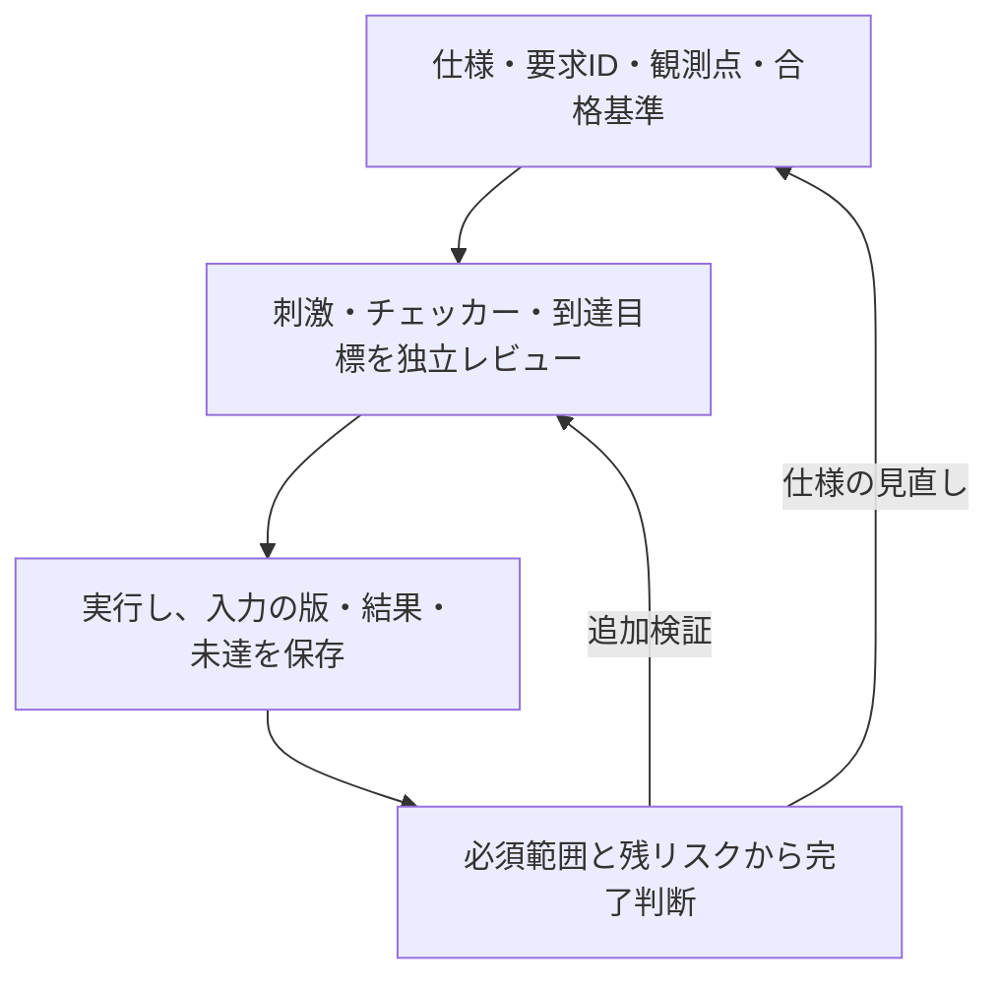

# LSI検証手法

LSIの仕様に基づく検証計画の立案から、要求カバレッジによる検証完了の判断までをまとめたリポジトリです。
仕様を、条件と期待結果を確認できる単位の要求に分け、要求ごとに実装の不具合を検出できるテストとチェッカーを用意します。作成者とは別の担当者が仕様との整合性と不具合の検出力をレビューし、仕様・RTL・検証環境のバージョンに対応した証跡で検証状況を管理します。

初めて読む方は[用語集](docs/glossary.md)で略語・指標の意味を確認できます。[FAQ](docs/faq.md)には、導入、100%の読み方、ランダム検証、SVA・フォーマル、CDC、縮退、CIと完了判断の疑問をまとめています。

## 全体像



図は本リポジトリの提案手順の要約です。各段階の成果物は[一般化した手順書](docs/method/spec-to-verification-method.md#3-全体の流れ)、動く教材は[GitLabの実行例](examples/gitlab-regression/README.md)を参照してください。

次の3つを分けると、各資料の役割を追いやすくなります。

| 確認すること | 主な手段 | それだけでは判断できないこと |
| --- | --- | --- |
| 必要な条件が起きたか | モニター、covergroup、SVAのcover | 出力や応答が正しかったか |
| 結果が要求どおりか | スコアボード、SVAのassert、フォーマル検証のプロパティの証明 | 検証目標や仮定に抜けがないか |
| 検証を完了と判断できるか | 要求との対応、必須構成、証跡、未達・例外のレビュー | 計画に含めなかった動作や物理特性までの保証 |

## 現状

複製資料・ツールの同期基準は、2026-10-25に確認したkirimasim-testsの`main`（[`3faf239`](https://github.com/kurochan001/kirimasim-tests/commit/3faf239af2614fd8d65cf31c54b0f297108704dd)）です。一般化した手順書には、このリポジトリで製品開発向けの追記・改訂をしています。派生元と変更の範囲は[PROVENANCE.md](PROVENANCE.md)に記録しています。

- **手法の一般化文書**：[デジタルLSIの仕様書から検証パターンを作る手順](docs/method/spec-to-verification-method.md)。半導体検証に関する一般的な情報をまとめ、仕様から検証パターンを作る流れを整理した資料です。実際の製品開発で機能検証と併せて必要な、クロック・リセット、低電力、タイミング、DFT・量産テスト、物理設計、信頼性、システム統合、ポストシリコンの項目も14節に整理しています。
- **UVMへの適用**：[UVMで要求と検証資産を結び付ける](docs/method/uvm-verification.md)。基本構成、要求IDとの対応、レジスタモデル（RAL）、UARTの例、回帰の合格条件をまとめています。実行可能なUVMテストベンチは今後の適用で用意します。
- **機能間の検証**：[機能間の相互作用とクロス検証](docs/method/feature-interaction-verification.md)。依存関係の洗い出し、同時動作・順序・中断、クロス目標の選定と合格条件をまとめています。イベントとW1Cクリアの競合を、12目標の例として示しています。
- **ランダム検証**：[制約付きランダム検証の計画・実行・完了判定](docs/method/constrained-random-verification.md)。制約、分布、seed、回帰計画、未達への調整、失敗の再現・縮小をまとめています。クロス検証の12目標を探索する、9実行の計画例も示しています。
- **SVAによる検証**：[SVAのアサーションとカバーによる検証](docs/method/sva-verification.md)。assert・assume・cover、サンプリング、vacuous pass、リセット、シミュレーションとフォーマル検証の完了判定をまとめています。イベントとW1Cの競合を使ったチェッカー例も示しています。
- **covergroupによる機能網羅**：[covergroupで機能を体系的に網羅する](docs/method/functional-coverage.md)。機能一覧からcoverpoint・bin・crossを選ぶ方法、観測と判定、除外とインスタンス別の集計をまとめています。基本動作の16目標を収集するコレクター例も示しています。
- **フォーマル検証**：[フォーマル検証の計画・証明・完了判定](docs/method/formal-verification.md)。仮定・初期状態、抽象化・証明の分割、有界検査と非有界の証明、活性、反例・到達性、サインオフをまとめています。小さな割り込みモデルの証明と、誤実装・過剰な仮定の確認例も示しています。
- **検証環境の検出力**：[ミューテーション検証で検証環境の検出力を確かめる](docs/method/mutation-verification.md)。回路へ意図的な誤りを入れ、刺激・チェッカー・SVAが検出するかを評価します。変異の選び方、未検出の分析、等価な変異、検出率と未完了の集計をまとめています。
- **検証規模の縮退**：[検証の組み合わせ・構成・実行数を縮退する](docs/method/verification-reduction.md)。同値分割・境界値、直交表・t-way、対称性・代表構成、テスト・seedの縮約、変更影響による回帰選択、形式的な抽象化を整理しています。削減の根拠、残す目標、検出力と実行コストの確認も記録します。
- **継続的リグレッション**：[継続的リグレッションの計画・実行・結果管理](docs/method/continuous-regression.md)。変更時・定期・サインオフの回帰、マニフェストと分散実行、ライセンス・計算資源、失敗・再実行・カバレッジ・証跡を整理しています。Cadence vManager／Verisium ManagerとGitLab CI/CDの役割分担、併用、総費用での比較も扱います。
- **GitLabの実行例**：[GitLabで割り込みの継続回帰を動かす](examples/gitlab-regression/README.md)。基本動作・時間関係・動作中リセット・CDC遅延モデル、4変異とXの自己確認、8要求・50目標の自動判定、MR・定期回帰、JUnit・証跡保存を実装しています。ローカルと[公開GitLabデモ](https://gitlab.com/kurochan001/lsi-verification-method-ci-demo)で動作確認済みです。通常・夜間回帰、失敗時のJUnit・アーティファクト、MRのマージ制御の実行記録を掲載しています。
- **FIFOのランダム検証例**：[GitLabでFIFOのランダム検証を実行する](examples/gitlab-fifo/README.md)。参照キューによるデータ・占有数の比較、空／満杯・同時要求、動作中リセット、3変異の検出、深さ1／3／8×幅8／16の6構成回帰を実装しています。必須18／22目標を構成ごとに判定し、GitLabのmatrixジョブとJUnit・証跡保存へつなぎます。
- **商用ツール不要のフォーマル検証例**：[GitLabでFIFOをフォーマル検証する](examples/gitlab-formal/README.md)。ジョブ内でYosys・SBY・Z3を準備し、制御の非有界証明、データの有界検査、6目標の到達性、3変異の反例、過剰な仮定の点検を実行します。幅8・深さ1／3を別々に判定し、手元へのツール導入なしで試せます。
- **検証領域の抜けの点検**：[検証計画の抜けを点検し、試験へ展開する](docs/method/verification-gap-review.md)。lint、リセット・X伝搬、CDC/RDC、プロトコル・データ、異常・故障と復帰、性能、低電力、セキュリティ、コードカバレッジ、等価性・統合などの12領域を整理しました。試験・観測・合格基準と、[適用範囲の記録の雛形](docs/templates/verification-scope.md)を用意しています。
- **実践例（ケーススタディ）**：IEEE 1800-2023（SystemVerilog）の規格を仕様書とみなし、公開のテストスイート[kirimasim-tests](https://github.com/kurochan001/kirimasim-tests)で手法を実践しました。2026-10-26時点の状況は次のとおりです。
  - 全1,740節を確認し、要求12,319行を登録した。
  - 対応済みは9,585要求（暫定設計網羅率77.81%）で、75%の目標を超えた。合格の証跡があるのは5,424要求（暫定実行確認率44.03%）。本文（1〜40章、9,486要求）では、暫定設計網羅率77.46%（7,348要求）、暫定実行確認率37.85%（3,590要求）。
  - 対応するテストのなかった要求に新規テストを書き、作成者とは別の検証者が合格としたものだけを取り込んだ（2026-10-24〜26に区間ごとに実施）。最初の2回では、1,586本のうち1,530本が合格し、1,527本を取り込んだ（56本は欠陥）。
  - Icarus Verilog 13.0 が期待どおりの結果を再現する、規格だけを根拠にしていたテスト277本に、`:oracle:` を記録した。
  - 比較用のシミュレータとして Lyra を加え、Icarus Verilog・Verilator・kirimasim と並べて毎晩実行している（nvc も試したが、対応が少ないため外した）。期待値が規格と食い違う疑いのあるテストを、除外の候補として記録している。
  - 解釈保留は46論点のうち27論点を解消した。
  - 上記の新規テストと照合案は、作成者とは別の検証者による独立レビューを経て取り込んだ。スイート全体の全テストをレビュー済みという意味ではない。
- **ツール**：ケーススタディで使った照合キット、生成テストの枠組み、台帳と計測の参照実装です。kirimasim-testsのディレクトリ構成を前提にしており、このリポジトリ単独では動きません（[tools/README.md](tools/README.md)）。

## 構成

```text
docs/method/                    一般化した手順書（この手法の本体）
docs/glossary.md                用語・略語と、この手順での意味
docs/faq.md                     導入・方式の使い分け・運用上のFAQ
docs/case-study-ieee1800/       もとになった実践の資料（IEEE 1800-2023）
docs/templates/                製品開発で使う記録の雛形
examples/gitlab-regression/     このリポジトリ単独で動くGitLab回帰の最小例
examples/gitlab-fifo/           FIFOのスコアボード・ランダム検証と6構成の並列回帰
examples/gitlab-formal/         オープンソースツールによるFIFOの証明・有界検査・到達性
.gitlab-ci.yml                 GitLabへ置いた場合のCI設定の入口
tools/matching_kit/             照合案の受付・検査、検証者の判定、統合、シミュレータ実行、Workflowスクリプト
tools/generators/               表形式の要求から検証パターンを生成する枠組みと、その例
tools/reference/                要求台帳の検査・計測・出典監査・照合台帳の参照実装
PROVENANCE.md                   各ファイルの由来（元のリポジトリのパスとコミット）
```

## 読む順序

用語や方式の違いで迷ったときは、[用語集](docs/glossary.md)と[FAQ](docs/faq.md)から該当する手順書へ進めます。

製品へ適用する際は、[検証領域の点検](docs/method/verification-gap-review.md)と[適用範囲の雛形](docs/templates/verification-scope.md)で、必要な領域・構成・担当・判定段階を先に確認します。

1. [一般化した手順書](docs/method/spec-to-verification-method.md)。[機能間のクロス検証](docs/method/feature-interaction-verification.md)、[ランダム検証](docs/method/constrained-random-verification.md)、[SVAによる検証](docs/method/sva-verification.md)、[covergroupによる機能網羅](docs/method/functional-coverage.md)、[フォーマル検証](docs/method/formal-verification.md)、UVMで実装する場合は[UVMへの適用](docs/method/uvm-verification.md)も参照します。
2. [もとになった手順書（IEEE 1800-2023）](docs/case-study-ieee1800/requirements-to-tests-method.md)
3. [要求抽出の結果と台帳見直し](docs/case-study-ieee1800/requirement-extraction.md)と[未解決事項](docs/case-study-ieee1800/requirement-extraction-notes.md)：仕様の曖昧さの扱いの実例
4. [計測規則](docs/case-study-ieee1800/coverage-rules.md)：設計網羅率と実行確認率、証跡と現行バージョンの整合性、AND集合
5. 結果報告の例：
   - [既存テストの照合（20%到達）](docs/case-study-ieee1800/existing-test-matching-20percent-20261023.md)
   - [附属書ヘッダ・VPIテストと照合](docs/case-study-ieee1800/header-vpi-tests-and-matching-20261023.md)
   - [予約語の生成テスト](docs/case-study-ieee1800/keyword-tests-20261024.md)
   - [未対応要求への新規テスト（50%到達）](docs/case-study-ieee1800/gap-tests-20261024.md)
   - [未対応要求への新規テスト、2回目](docs/case-study-ieee1800/gap-tests-2-20261024.md)
   - [未登録テストの照合](docs/case-study-ieee1800/existing-test-matching-unregistered-20261025.md)
6. [検証で見つかった問題の累積](docs/case-study-ieee1800/existing-test-matching-review-20261022.md)と[シミュレータと規格の差異](docs/case-study-ieee1800/simulator-differences.md)：独立検証で何が見つかるかの実例
7. [比較用シミュレータとの不一致の見直し](docs/case-study-ieee1800/lyra-disagreement-review-20261025.md)：oracle に使わない実装を、期待値を見直すきっかけとして使った例
8. [サインオフ記録の雛形](docs/templates/signoff-record.md)：開発段階、構成ごとの判定、証跡、例外承認、変更の影響を記録する

## 今後の計画

1. **手法の改訂**：一般化文書を、ケーススタディで分かったことに合わせて更新し続けます。
2. **ツールの汎用化**：要求台帳の形式を、規格の節構成に依存しない形にします。具体的には、要求ID、出典、種別、観測点、構成、証跡を持つ形式です。照合キットを、kirimasim-testsの構成から切り離します。テストやチェッカー、カバレッジ項目に要求IDを付ける方式に合わせたアダプタを用意します。
3. **パイロット**：小さなIP（レジスタブロックと1つのバスインターフェース）で検証手順を一通り実施し、次の点を評価します。抽出漏れ、照合の採用率、見つかったバグと仕様の課題、故障注入の検出率、工数。
4. **テンプレート**：検証領域の適用範囲とサインオフ記録の雛形を起点に、要求台帳、照合案、検証者のチェックリスト、課題票を整備します。手順書の台帳例と記録の雛形は運用案であり、現行の照合キットが対応済みの汎用形式ではありません。

## 注意

- 規格や仕様書の本文は、このリポジトリに入れません。要求は自分の言葉で書き、版と段落を引用します。
- 機密の仕様書を扱う場合は、AIを使える環境と範囲を先に決めます。
- AIによるレビューは、人の承認ではありません。台帳と報告に、担当者と方法を明記します。

## ライセンス

本リポジトリで新規作成した資料・コード、およびkirimasim-testsから複製・改訂した資料・ツールには、Apache License 2.0 with LLVM Exceptions（`Apache-2.0 WITH LLVM-exception`）を適用します（[LICENSE](LICENSE)）。複製元と改訂の記録は[PROVENANCE.md](PROVENANCE.md)を参照してください。

参照先のIEEE規格、外部の文書・ソフトウェアには、それぞれの権利者の利用条件が適用されます。本リポジトリのライセンスは、それらの転載・再配布の許諾を与えるものではありません。
