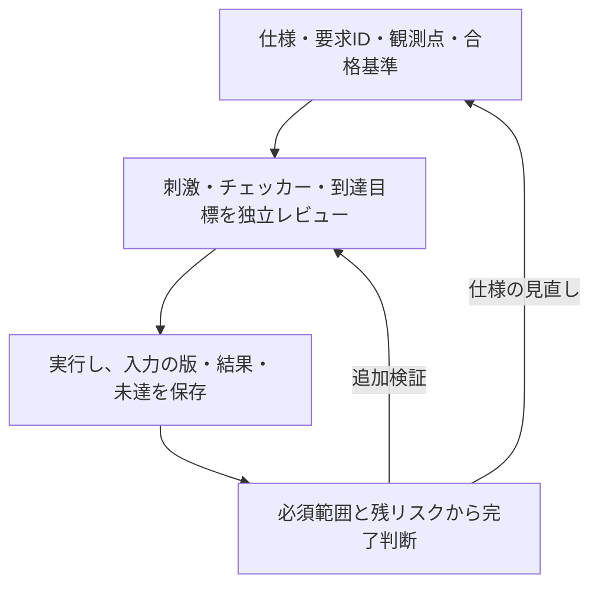

[](LICENSE)
[](examples/README.md)
[](#準備と実行)
[](#検証の進め方)

# LSI検証手法

LSIの仕様から検証を計画し、刺激・観測・期待値の比較・カバレッジ・証跡を対応付けて、検証の完了を判断するためのリポジトリです。検証手順書、ローカルで動くRTLと検証環境、記録の雛形、手法の適用事例を収録しています。

<a id="読む順序"></a>

## 目的から資料を選ぶ

| 目的 | 入口 |
| --- | --- |
| 検証の全体的な進め方を知る | [検証手法の案内](#検証の進め方)／[一般化した手順書](docs/method/spec-to-verification-method.md) |
| 対象の回路や検証方式に合う例を探す | [分野別の案内](#検証例一覧)／[全検証例の一覧](examples/README.md) |
| 手元で実行する | [準備と実行](#準備と実行) |
| 計画と結果を記録する | [適用範囲](docs/templates/verification-scope.md)／[サインオフ記録](docs/templates/signoff-record.md) |
| 用語や結果の読み方を確認する | [用語集](docs/glossary.md)／[FAQ](docs/faq.md) |
| 適用事例と由来を調べる | [IEEE 1800-2023のケーススタディ](docs/case-study-ieee1800/README.md)／[PROVENANCE.md](PROVENANCE.md) |

## 検証の進め方

### 全体像



仕様を、条件と期待結果を確認できる要求へ分け、要求ごとに刺激・観測点・判定を用意します。作成者とは別の担当者が仕様との整合性と検出力をレビューし、対象の版と構成に対応する証跡を残します。

- **到達**：必要な条件・状態・組み合わせを観測したか。機能カバレッジやcoverで確認します。
- **正しさ**：応答や状態が要求どおりか。期待値比較・アサーション・フォーマル検証で判定します。
- **完了判断**：必須の要求・構成・検証領域を確認し、未達・例外・残リスクをレビューしたか。到達率や失敗0だけで判断しません。

### 計画と対象範囲を決める

| 資料 | 主な内容 |
| --- | --- |
| [仕様から検証へ](docs/method/spec-to-verification-method.md) | 要求の抽出、検証方式の選定、独立レビュー、完了条件 |
| [検証領域の抜けを点検する](docs/method/verification-gap-review.md) | lint、リセット・X、CDC/RDC、性能、低電力、保護、統合、物理・製造 |
| [機能間の相互作用とクロス検証](docs/method/feature-interaction-verification.md) | 同時動作・順序・中断と復帰、因子・制約・重点目標。[提案](docs/feature-interaction-coverage-proposal.md)／[記録](docs/templates/interaction-coverage-plan.md)も収録 |
| [検証規模を削減する](docs/method/verification-reduction.md) | 境界・代表構成・組合せ・テストの削減、目標と検出力を維持する根拠 |

### 刺激・チェッカー・証明を用意する

| 資料 | 主な内容 |
| --- | --- |
| [制約付きランダム検証](docs/method/constrained-random-verification.md) | 合法な刺激、分布、seed、再現、未達への調整、失敗の縮小 |
| [SVAのアサーションとカバー](docs/method/sva-verification.md) | assert・assume・cover、サンプリング、履歴、リセット、終了時の扱い |
| <a id="目視確認をアサーションに置き換える"></a>[目視確認から自動判定へ](docs/method/assertion-based-regression.md) | 目視条件を明文化し、検出力を確認してリグレッションへ組み込む。[移行記録](docs/templates/assertion-migration.md)も用意 |
| [UVMへの適用](docs/method/uvm-verification.md) | agent・monitor・スコアボード、RAL、要求との対応、合格条件 |
| [フォーマル検証](docs/method/formal-verification.md) | 仮定・初期状態、抽象化・分割、有界検査と証明、反例・到達性 |

### 網羅性・検出力・継続実行を管理する

| 資料 | 主な内容 |
| --- | --- |
| <a id="機能カバレッジを確認する"></a>[機能カバレッジ](docs/method/functional-coverage.md) | 仕様から機能・状態・境界・crossを選び、必須binの到達と比較結果を対応付ける |
| <a id="コードカバレッジを確認する"></a>[コードカバレッジ](docs/method/code-coverage.md) | 行・分岐・式・toggle・FSMの計測、未達分析、追加試験、DB統合と除外 |
| [ミューテーション検証](docs/method/mutation-verification.md) | 意図的な誤りで検出力を確認し、未検出・等価な変異・未完了を区別する |
| [継続的リグレッション](docs/method/continuous-regression.md) | 変更時・定期・サインオフの計画、予定と結果の照合、資源・再実行・証跡管理 |

## 検証例一覧

分野を選ぶと、対象範囲・主な検証内容・必要なツールを記載した一覧へ進めます。個別の実行手順と合格条件は、各例のREADMEを参照してください。

| 分野 | 主な題材 |
| --- | --- |
| <a id="バスレジスタアドレス"></a>[バス・レジスタ・アドレス](examples/README.md#バスレジスタアドレス) | APB・AHB・AXI、幅変換、アドレスマップ |
| <a id="fifo通信仲裁"></a>[FIFO・通信・仲裁](examples/README.md#fifo通信仲裁) | FIFO、ready/valid、UART・SPI・I²C、再送・パケットスイッチ |
| <a id="割り込みタイマー周辺機能の結合"></a>[割り込み・タイマー・周辺機能の結合](examples/README.md#割り込みタイマー周辺機能の結合) | 割り込み、タイマー、ウォッチドッグ、周辺回路の接続 |
| <a id="dmaメモリ順序制御"></a>[DMA・メモリ・順序制御](examples/README.md#dmaメモリ順序制御) | DMA、DRAM、キャッシュ、コヒーレンシ、可視性と順序 |
| <a id="cdcクロックリセット低電力"></a>[CDC・クロック・リセット・低電力](examples/README.md#cdcクロックリセット低電力) | 非同期転送、クロック停止、リセット、隔離・保持・復帰 |
| <a id="演算故障注入保護性能dft"></a>[演算・故障注入・保護・性能・DFT](examples/README.md#演算故障注入保護性能dft) | DSP、SHA-256、ECC、アクセス保護、MBIST、JTAG・スキャン |
| <a id="ai用回路"></a>[AI用回路](examples/README.md#ai用回路) | シストリックアレイ、再量子化、活性化、畳み込み、Top-K、GEMM |
| <a id="プロセッサ"></a>[プロセッサ](examples/README.md#プロセッサ) | RISC-V、ISS比較、デコーダ、PMP・Sv32・TLB、除算器 |
| <a id="静的タイミング解析"></a>[静的タイミング解析](examples/README.md#静的タイミング解析) | OpenSTA、setup／hold、制約の欠落・経路消失 |
| <a id="フォーマル検証等価性反例再現"></a>[フォーマル検証・等価性・反例再現](examples/README.md#フォーマル検証等価性反例再現) | 証明、到達性、等価性、反例再現、接続性 |
| <a id="svauvm仕様生成ソフトウェア連携検証効率"></a>[SVA・UVM・仕様生成・ソフトウェア連携・検証効率](examples/README.md#svauvm仕様生成ソフトウェア連携検証効率) | アサーション、機能／コードカバレッジ、UVM・RAL、生成、C・cocotb、探索・削減 |

全例の詳細は[検証例一覧](examples/README.md)、構成・実行数・過去の確認結果は[集計と実行記録](examples/README.md#集計と実行記録)にまとめています。

## 準備と実行

リポジトリ全体を取得し、ルートディレクトリから実行します。例同士でRTLや共通ランナーを再利用しています。

### 最初のシミュレーション

POSIX環境（macOS／Linux）、Python 3.10以上、Icarus Verilog（`iverilog`・`vvp`）を用意します。最初は、期待値比較とランダム入力を扱う同期FIFOの例から試せます。

```sh
python3 examples/local-fifo/run.py
```

同じ環境で、[AHB-Lite](examples/local-ahb/README.md)や[AXI4-Lite](examples/local-axi/README.md)なども実行できます。オプション、カバレッジ・JUnit・証跡の形式は[Icarus共通手順](examples/local-common/README.md)を参照してください。

### アサーションとカバレッジを実測する

Verilator 5.052、C++20コンパイラー、makeを使う例です。コードカバレッジには、同じ配布物の`verilator_coverage`も使います。

| 実行例 | コマンドと確認内容 |
| --- | --- |
| [SVAによる自動判定](examples/local-sva/README.md) | `python3 examples/local-sva/run.py` — 正常動作、誤実装検出、前件・完了経路、無効化の拒否 |
| [ネイティブ機能カバレッジ](examples/local-functional-coverage/README.md) | `python3 examples/local-functional-coverage/run.py` — DRAM・SHA-256・スイッチのcoverpoint・crossとbin別件数 |
| [コードカバレッジの未達分析](examples/local-code-coverage/README.md) | `python3 examples/local-code-coverage/run.py` — 追加試験、DB統合、注釈付きソース、計測漏れと機能不正の検出 |

各例は`--profile nightly`で試験を拡張できます。機能カバレッジとコードカバレッジは対象と分母が異なり、到達した動作の正しさは期待値比較と併せて確認します。

### 専用環境を使う例

| 対象 | 準備・共通手順 |
| --- | --- |
| フォーマル検証 | [Yosys・SBY・Z3の固定版環境](examples/local-formal-common/README.md) |
| UVM・RAL・制約付きランダム化 | [UVMの準備](examples/local-uvm/README.md)／[UVMランダム化の準備](examples/local-uvm-random/README.md) |
| SystemRDL・cocotb・C連携 | [仕様生成](examples/local-register-spec/README.md)／[cocotb](examples/local-cocotb/README.md)／[ホスト連携の共通処理](examples/local-host-common/README.md) |
| 探索・縮小・UVMの証跡管理 | [固定計画と実行記録の共通処理](examples/local-exploration-common/README.md) |

上記以外の追加ツール・版・セットアップも、各例のREADMEで確認してください。

### まとめて実行する手順

関連する例を親ランナーから起動できます。個別の検証例と重複するため、検証例の数やJUnit件数を集計する際は、同じ結果を二重に数えないようにします。必要なツールと、実行範囲を選ぶオプション（`--stage`）の指定はリンク先を参照してください。

| 集約手順 | 含まれる検証例 |
| --- | --- |
| [システム検証の7例](examples/local-system-regression/README.md) | DMA、複数マスター、非同期APB、復旧、低電力、AXI4フォーマル、FIFO等価性 |
| [ソフトウェア・差分・完了期限の7例](examples/local-advanced-regression/README.md) | AXI4-Stream、Cドライバ、メモリ競合、DSP、cocotb、差分検証、完了期限 |
| [解析・収束・結合・UVMの7例](examples/local-workflow-regression/README.md) | 幅変換、アクセス保護、ECCメモリ、クロック・リセット、操作列縮小、刺激調整、UVM |
| [UVMランダム化・仕様生成・反例再現の7例](examples/local-soc-regression/README.md) | UVMランダム、SystemRDL、反例再現、優先順位付きIRQ、リングDMA、クレジット通信、キャッシュ |
| [RAL接続・順序制御・DMAなどの7例](examples/local-extension-regression/README.md) | 生成RAL、AXI応答順序、DMA所有権、Stream DMA、CRC、カウンター、MBIST |
| [セキュリティ・性能・CDCなどの6例](examples/local-gap-regression/README.md) | セキュリティ、性能モニター、CDCハンドシェイク、JTAG、アドレスマップ、ロックステップ |
| [AI用回路の6例](examples/local-ai-regression/README.md) | シストリックアレイ、再量子化、活性化関数、ラインバッファ、Top-K、FP16／MXFP8／MXFP4 |

## このリポジトリについて

### 構成

```text
docs/method/                    検証手法の説明
docs/glossary.md・docs/faq.md    用語と、方式・結果の読み方
docs/templates/                 計画・移行・結果・サインオフの記録
docs/case-study-ieee1800/        IEEE 1800-2023への適用記録と索引
examples/README.md              回路別・方式別の全検証例一覧
examples/                       RTL・検証環境・共通処理・集約ランナー
tools/                          ケーススタディで用いた参照ツール
PROVENANCE.md                   複製元・改訂範囲・実行確認の記録
```

<a id="手法ケーススタディ参照ツール"></a>
<a id="技術ノート検証に使う言語を検証の題材に"></a>

### ケーススタディと由来

SystemVerilogの言語規格を仕様書として、要求の抽出、既存テストとの照合、独立検証、証跡管理に本手法を適用した記録を収録しています。[ケーススタディの索引](docs/case-study-ieee1800/README.md)から、取り込み・同期の基準、確認時点の数値、資料の読む順序、技術ノートへ進めます。

[参照ツール](tools/README.md)はkirimasim-testsの構成を前提としており、このリポジトリ単独では動きません。一般化した手順書と実行例には独自の追記があり、由来と確認範囲は[PROVENANCE.md](PROVENANCE.md)へ記録しています。

<a id="初期の11例の構成"></a>

初期の独自ランナー11例の構成・件数は、[検証例一覧の付録](examples/README.md#初期の11例の構成)に保存しています。共通ランナーや親の集約判定とは別に集計します。

### 今後の計画

1. **手法の改訂**：検証手順書に、ケーススタディで得た知見を反映し続けます。
2. **ツールの汎用化**：要求台帳の形式を、規格の節構成に依存しない形にします。具体的には、要求ID、出典、種別、観測点、構成、証跡を持つ形式です。照合キットを、kirimasim-testsの構成から切り離します。テストやチェッカー、カバレッジ項目に要求IDを付ける方式に合わせたアダプタを用意します。
3. **実際の開発案件での試行**：小規模なIP（レジスタブロックと1つのバスインターフェース）で検証手順を一通り実施し、要求の抽出漏れ、要求とテストの対応付け案の採用率、検出した不具合、仕様上の課題、故障注入時の検出率、工数を評価します。
4. **テンプレート**：検証領域の適用範囲とサインオフ記録の雛形を起点に、要求台帳、照合案、検証者のチェックリスト、課題票を整備します。手順書の台帳例と記録の雛形は運用案であり、現行の照合キットが対応済みの汎用形式ではありません。

### 注意

各例は教材として対象を限定しています。例えば、AXIの例で規格全体への適合、論理CDCモデルで物理的なメタスタビリティ、架空LibertyのSTAで実チップのタイミングを確認したとは扱いません。製品へ適用する際は、仕様・構成と必要な解析・試験を追加して判断します。

- 規格や仕様書の本文は、このリポジトリに入れません。要求は自分の言葉で整理し、出典の版・節・段落を明記します。
- 機密の仕様書を扱う場合は、AIを使える環境と範囲を先に決めます。
- AIによるレビューは、人の承認ではありません。台帳と報告に、担当者と方法を明記します。

## ライセンス

本リポジトリで新規作成した資料・コード、およびkirimasim-testsから複製・改訂した資料・ツールには、Apache License 2.0 with LLVM Exceptions（`Apache-2.0 WITH LLVM-exception`）を適用します（[LICENSE](LICENSE)）。複製元と改訂の記録は[PROVENANCE.md](PROVENANCE.md)を参照してください。

参照先のIEEE規格、外部の文書・ソフトウェアには、それぞれの権利者の利用条件が適用されます。本リポジトリのライセンスは、それらの転載・再配布の許諾を与えるものではありません。
