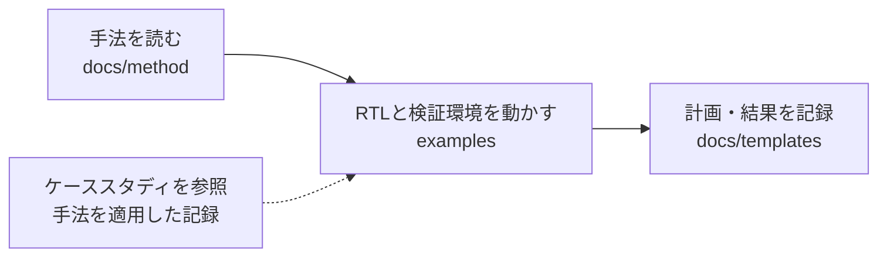
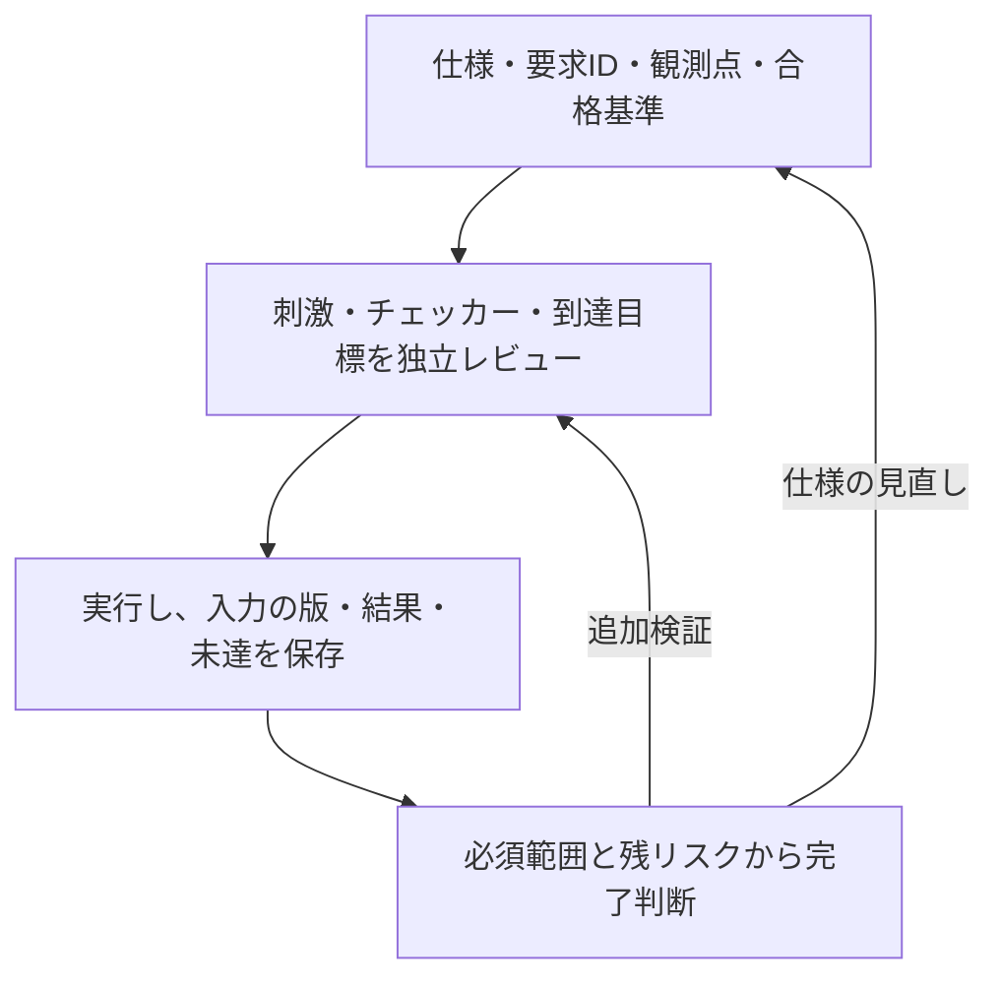
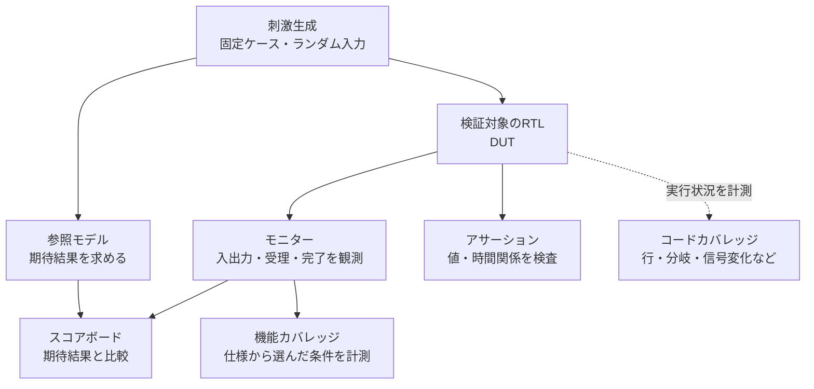

[](LICENSE)
[](https://github.com/kurochan001/lsi-verification-method/actions/workflows/quality.yml)
[](https://github.com/kurochan001/lsi-verification-method/actions/workflows/nightly.yml)
[](examples/README.md)
[](#準備と実行)
[](#検証の進め方)

# LSI検証手法

LSIの仕様から検証を計画し、刺激・観測・期待値の比較・カバレッジ・証跡を対応付けて、検証の完了を判断するためのリポジトリです。検証手順書、ローカルで動くRTLと検証環境、記録の雛形、手法の適用事例を収録しています。

例えば、FIFOなら「空や満杯で同時に読書きを要求したらどうなるか」、割り込み回路なら「イベントとクリアが重なったらどちらを優先するか」を仕様から読み取り、入力・期待結果・確認条件へ落とし込みます。実行例では、正常な動作の確認に加え、意図的な誤実装を検出できるか、必要な条件を試せているかも確認します。

<a id="読む順序"></a>

## 目的から資料を選ぶ

| 目的 | 入口 |
| --- | --- |
| 検証の全体的な進め方を知る | [検証手法の案内](#検証の進め方)／[一般化した手順書](docs/method/spec-to-verification-method.md) |
| 仕様から完了判断までを一通り試す | [APB＋割り込みの総合演習](docs/capstone-apb-irq/README.md)／[サインオフ記入例](docs/capstone-apb-irq/signoff-example.md) |
| 仕様書から検証項目を作る | [一段落から項目表を完成させる実例](docs/method/spec-to-test-items-walkthrough.md)／[記入用シート](docs/templates/spec-to-test-items.md) |
| 項目表と実行結果の対応を自動確認する | [照合の手順](docs/method/verification-plan-automation.md)／[割り込みで動かす例](examples/local-plan-traceability/README.md) |
| 失敗・再実行・採用結果をまとめる | [履歴レポート](tools/REPORTING.md)／[実際の時間切れから再実行する例](examples/local-regression-report/README.md) |
| lintの指摘や失敗を解析する | [警告の扱い](docs/method/lint-and-waivers.md)／[失敗解析](docs/method/failure-analysis.md)／[不具合票](docs/templates/verification-issue.md) |
| AIの検証提案を実行してレビューする | [レビュー手順](docs/method/ai-verification-review.md)／[悪い提案の演習](examples/local-ai-review/README.md) |
| 多すぎるクロス条件から検証項目を選ぶ | [選定理由と数値例](docs/method/cross-test-selection-walkthrough.md)／[判断を記録する雛形](docs/templates/interaction-coverage-plan.md) |
| 複数未完了・順不同応答をUVMで検証する | [ID・token・reset取消しの実行例](examples/local-uvm-outstanding/README.md) |
| 変更に影響する例を選んで実行する | [選択規則と証跡](tools/AFFECTED.md) |
| 自動生成した誤実装でテストを評価する | [MCY・機能等価性・検出率](examples/local-auto-mutation/README.md) |
| 期限のない最終完了を証明する | [公平性と無限待機の反例](examples/local-liveness/README.md) |
| UVMの基礎から実践へ進む | [基礎と学習案内](docs/method/uvm-basics.md)／[設定・協調・再利用](docs/method/uvm-practical-design.md) |
| 既存の検証環境をUVMへ移す | [段階的な移行ガイド](docs/method/uvm-migration-guide.md)／[移行計画の雛形](docs/templates/uvm-migration-plan.md) |
| 対象の回路や検証方式に合う例を探す | [分野別の案内](#検証例一覧)／[全検証例の一覧](examples/README.md) |
| 画像処理IPからCPU付きSoCへ進む | [画像処理の検証手順](docs/method/image-processing-verification.md)／[Sobel単体IP](examples/local-image-sobel/README.md)／[ROM起動SoC](examples/local-image-soc/README.md) |
| ネットワークIPからCPU付きNICへ進む | [ネットワークの検証手順](docs/method/network-verification.md)／[ARP・UDPエコーIP](examples/local-network-echo/README.md)／[ネットワークSoC](examples/local-network-soc/README.md) |
| 航空宇宙・高信頼の故障反応を学ぶ | [検証手順](docs/method/aerospace-verification.md)／[TMRレジスタ](examples/local-tmr/README.md)／[FDIRサブシステム](examples/local-fdir/README.md) |
| ロボティクスの計測・制御・駆動を学ぶ | [検証手順](docs/method/robotics-verification.md)／[PWM・エンコーダ](examples/local-motion-io/README.md)／[1軸の閉ループ](examples/local-motion-control/README.md) |
| 手元で実行する | [準備と実行](#準備と実行)／[環境の一括準備・診断](tools/ENVIRONMENT.md) |
| 文書・図・CIを確認する | [文書とツールの検査](tools/QUALITY.md)／[変更時・毎晩のCI](tools/CI.md) |
| 計画と結果を記録する | [適用範囲](docs/templates/verification-scope.md)／[サインオフ記録](docs/templates/signoff-record.md) |
| 用語や結果の読み方を確認する | [用語集](docs/glossary.md)／[FAQの質問別案内](docs/faq.md#疑問に応じた確認の順序) |
| 適用事例と由来を調べる | [IEEE 1800-2023のケーススタディ](docs/case-study-ieee1800/README.md)／[PROVENANCE.md](PROVENANCE.md) |

資料は、**手法を読む → 小さな回路で試す → 計画と結果を記録する**、という順で使えます。実際の仕様へ適用するときは、例の要求や合格条件を、対象IPの仕様・構成に合わせて見直します。

用語集とFAQには、[lintと警告台帳](docs/faq.md#13-静的検査と警告管理)、[失敗の切り分け](docs/faq.md#14-失敗解析と再現)、[AI提案の採否](docs/faq.md#15-aiを使う検証)、[上位UVMと個別reset](docs/faq.md#16-uvm移行上位再利用複数クロック)、[仕様変更と実行履歴](docs/faq.md#17-仕様変更証明依存実行結果の読み方)もまとめています。用語の定義だけでなく、実行例・合格条件・記録する証跡へ進めます。



## 検証の進め方

### 全体像



仕様を、条件と期待結果を確認できる要求へ分け、要求ごとに刺激・観測点・判定を用意します。作成者とは別の担当者が仕様との整合性と検出力をレビューし、対象の版と構成に対応する証跡を残します。

### 検証環境で何を確認するか

検証対象のRTLを**DUT（Design Under Test）**、入力を与えて結果を調べる側を**テストベンチ**と呼びます。下図はシミュレーション環境の概念図です。仕様と入力から期待結果を求め、RTLの実装とは独立した基準で実際の動作と比較します。各例が備えるチェッカーや計測方式は、それぞれのREADMEに示しています。



例えば、データの値と順序はスコアボード、待ち中の信号保持はアサーション、空・満杯・同時要求の組合せは機能カバレッジで確認できます。それぞれが答える問いを分けると、結果を読み違えにくくなります。

| 手段 | 確認すること | 結果を読むときの注意 |
| --- | --- | --- |
| 期待値比較・アサーション | 実行した動作の値・順序・時間関係が要求どおりか | 違反が0でも、必要な条件を試したとは限らない |
| 機能カバレッジ・cover | 仕様から選んだ機能・状態・境界・組合せに到達したか | 到達率100%でも、出力が正しいとは限らない |
| コードカバレッジ | RTLの行・分岐・式・信号変化・状態遷移をどこまで実行したか | 実装の欠落や、仕様に対する検証項目の抜けは別に点検する |
| フォーマル検証 | 仮定とモデルの範囲で、プロパティが成立するか | 証明対象・仮定・到達性、有界検査と証明の違いを確認する |

**検証の完了判断**では、これらの結果を要求へ対応付け、必須構成・証跡・未達・例外・残リスクをレビューします。到達率や失敗件数だけで、製品の検証完了とは判断しません。

### 計画と対象範囲を決める

| 資料 | 主な内容 |
| --- | --- |
| [仕様から検証へ](docs/method/spec-to-verification-method.md) | 要求の抽出、検証方式の選定、独立レビュー、完了条件 |
| [仕様書から検証項目を作る実例](docs/method/spec-to-test-items-walkthrough.md) | 割り込みの短い仕様から、仕様課題・条件表・検証項目・期待値・観測点へ展開する完成例 |
| [項目表と実行証跡を自動照合する](docs/method/verification-plan-automation.md) | 出典・要求・項目・テスト・構成・checker・目標と結果を結び付け、未対応や古い証跡を拒否する |
| [検証領域の抜けを点検する](docs/method/verification-gap-review.md) | lint、リセット・X、CDC/RDC、性能、低電力、保護、統合、物理・製造 |
| [機能間の相互作用とクロス検証](docs/method/feature-interaction-verification.md) | 同時動作・順序・中断と復帰、因子・制約・重点目標。[提案](docs/feature-interaction-coverage-proposal.md)／[記録](docs/templates/interaction-coverage-plan.md)も収録 |
| [クロス検証の条件を選ぶ実例](docs/method/cross-test-selection-walkthrough.md) | 必須条件の選び方、通常2因子と重点的な高次クロス、未選択条件、実績と費用に基づく追加選択 |
| [検証規模を削減する](docs/method/verification-reduction.md) | 境界・代表構成・組合せ・テストの削減、目標と検出力を維持する根拠 |

例えば[割り込み回路のSVA例](examples/local-sva/README.md)では、「イベントを保持し、W1Cでクリアし、許可中だけIRQを出す」という仕様を、次のように分けます。W1C（Write One to Clear）は、1を書いたビットをクリアする方式です。

| 要求 | 起こす条件 | 判定と到達の確認 |
| --- | --- | --- |
| 同時イベントとクリアではセットを優先する | 同じクロックでイベントとクリアを受理 | 保持状態が1になることをassertし、前件と結果のcoverも確認 |
| 操作がなければ状態を保持する | イベントもクリアもない期間を作る | 保持状態が変わらないことをassertし、保持条件をcover |
| 許可に関係なくイベントを保持する | マスク中にイベントを受理し、後で許可する | マスク中のセットとIRQの論理関係をassertし、マスク中／許可中をcover |

この例では、受理したエッジで状態を更新し、状態更新のSVAは次のクロックのサンプルで結果を確認します。クロック・リセット・観測時点まで要求と合わせることが、再現できる判定につながります。

### 刺激・チェッカー・証明を用意する

| 資料 | 主な内容 |
| --- | --- |
| [制約付きランダム検証](docs/method/constrained-random-verification.md) | 合法な刺激、分布、seed、再現、未達への調整、失敗の縮小 |
| [SVAのアサーションとカバー](docs/method/sva-verification.md) | assert・assume・cover、サンプリング、履歴、リセット、終了時の扱い |
| <a id="目視確認をアサーションに置き換える"></a>[目視確認から自動判定へ](docs/method/assertion-based-regression.md) | 目視条件を明文化し、検出力を確認してリグレッションへ組み込む。[移行記録](docs/templates/assertion-migration.md)も用意 |
| [UVMへの適用](docs/method/uvm-verification.md) | agent・monitor・スコアボード、RAL、要求との対応、合格条件。[基礎](docs/method/uvm-basics.md)／[実践設計](docs/method/uvm-practical-design.md)も参照 |
| [既存環境からUVMへの移行](docs/method/uvm-migration-guide.md) | 資産の棚卸し、passive観測・判定併走、刺激の再生、旧新の目標・検出力・終了条件の比較 |
| [フォーマル検証](docs/method/formal-verification.md) | 仮定・初期状態、抽象化・分割、有界検査と証明、反例・到達性 |

目視で確認していた条件は、「どの入力を、いつ受理したら、何が起こるか」へ分けてアサーションにします。正常時に通ること、既知の誤動作で失敗すること、前件への未到達やチェッカー無効化を見逃さないことを確認し、終了コードと証跡を伴うリグレッションへ残します。波形は、失敗原因の解析や観測条件の検討に使えます。

### 網羅性・検出力・継続実行を管理する

| 資料 | 主な内容 |
| --- | --- |
| <a id="機能カバレッジを確認する"></a>[機能カバレッジ](docs/method/functional-coverage.md) | 仕様から機能・状態・境界・crossを選び、必須binの到達と比較結果を対応付ける |
| <a id="コードカバレッジを確認する"></a>[コードカバレッジ](docs/method/code-coverage.md) | 行・分岐・式・toggle・FSMの計測、未達分析、追加試験、DB統合と除外 |
| [ミューテーション検証](docs/method/mutation-verification.md) | 意図的な誤りで検出力を確認し、未検出・等価な変異・未完了を区別する |
| [継続的リグレッション](docs/method/continuous-regression.md) | 変更時・定期・サインオフの計画、予定と結果の照合、資源・再実行・証跡管理 |
| [静的検査と警告管理](docs/method/lint-and-waivers.md) | 全DUTの構成台帳、新規・解消した警告、既知指摘と除外、入力変更時の再レビュー |
| [失敗解析と回帰試験](docs/method/failure-analysis.md) | 元の証跡の保存、RTL・期待値・検査設定・環境の切分け、同一入力での修正確認 |
| [AI提案のレビュー](docs/method/ai-verification-review.md) | 要求抜け、誤った履歴参照、前件未到達、DUTと参照モデルの相関した誤り |

機能カバレッジの例では、パケットスイッチの「出力ポート×末尾の有無×受信側ready」をcrossで計測し、どの組合せを試したかを確認します。コードカバレッジの例では、基礎試験で残ったXORや拒否応答などの未達を、追加試験とDB統合で補います。未達の原因を調べ、刺激不足、到達不能、計測の問題、要求・実装の不足を分けて扱います。

## 検証例一覧

分野を選ぶと、対象範囲・主な検証内容・必要なツールを記載した一覧へ進めます。個別の実行手順と合格条件は、各例のREADMEを参照してください。

### 学びたいことから選ぶ

最初はFIFOで「刺激を与える・期待値と比べる・必要な条件を確認する・不具合を検出する」を一通り試せます。その後は、目的に合う例へ進んでください。

| 学びたいこと | 入口となる資料・例 | 見るポイント |
| --- | --- | --- |
| 一つのIPで検証全体を実践する | [総合演習](docs/method/verification-capstone.md)／[仕様変更の実行例](examples/local-spec-change/README.md) | 要求・項目・判定・到達・版・変更の影響・完了または保留の判断 |
| 制御演算と時間関係を結合して確認する | [ロボティクスの手順](docs/method/robotics-verification.md)／[単体I/O](examples/local-motion-io/README.md)／[閉ループ制御](examples/local-motion-control/README.md) | 相補PWM、Gray復号、PIの飽和、プラントとの追従、演算期限・取消、停止と再開 |
| 冗長化・故障の封じ込め・復旧を検証する | [航空宇宙の手順](docs/method/aerospace-verification.md)／[TMR](examples/local-tmr/README.md)／[FDIR](examples/local-fdir/README.md) | 故障モデル、単一故障と保証外、異常とcommitの競合、ackと復帰の区別、全メモリ再走査 |
| ネットワーク・パケット処理を検証する | [検証手順](docs/method/network-verification.md)／[Ethernet・ARP・UDP IP](examples/local-network-echo/README.md)／[CPU付きNIC](examples/local-network-soc/README.md) | 停止できないRX、全フレーム破棄、FCS・チェックサム、DMA所有権とIRQ、CPUの返信生成 |
| ラインメモリ付き画像処理を検証する | [画像処理の手順](docs/method/image-processing-verification.md)／[Sobel IP](examples/local-image-sobel/README.md) | 端・角・フレーム境界、符号と飽和、待ち、全画素の独立比較 |
| CPU・メモリ・バス・IPを接続して検証する | [小規模画像処理SoC](examples/local-image-soc/README.md) | ROM起動、AHB-Lite／APB／AXI4、DMA、最終応答とIRQ、CPUによる全画素確認 |
| 仕様書から検証項目を洗い出す | [項目表の完成例](docs/method/spec-to-test-items-walkthrough.md) | 曖昧さの確認、状態・境界・競合・順序、刺激と期待値の書き分け |
| クロス条件の爆発に対処する | [条件の選定例](docs/method/cross-test-selection-walkthrough.md)／[APBでの実行例](examples/local-apb-irq-coverage/README.md) | 必須・代表化・未確定の判断、高次条件・順序・ストレスの保持、未達からの追加 |
| UVMの仕組みと実践設計を学ぶ | [学習案内](docs/method/uvm-basics.md)／[実践設計](docs/method/uvm-practical-design.md) | item・phase・factory・設定、協調、RALの所有範囲、SVAと収束 |
| 既存資産をUVMへ引き継ぐ | [移行ガイド](docs/method/uvm-migration-guide.md)／[passive・activeの同一入力再生](examples/local-uvm-migration/README.md) | 旧要求との対応、driver置換、14項目・20／21目標の維持、追加RAL検査 |
| 複数agentを協調させる | [APB設定＋GAINデータパス](examples/local-uvm-coordination/README.md) | virtual sequence、同時設定と入力の期待値、観測順序、待ち・取消、native bin |
| UVMの子環境を上位で再利用する | [二つのIPと階層RAL](examples/local-uvm-hierarchy/README.md) | 共通driver・子のpassive観測、submap、配置変更、上位virtual sequence |
| 複数クロックと個別リセットを協調させる | [上位UVMの実行例](examples/local-uvm-multiclock/README.md) | 時刻順の観測、リセット世代、片側リセットでの取消、古い応答の拒否、解除順序 |
| 静的検査と警告の差分を管理する | [共通lint](examples/local-lint/README.md) | 全DUT・共有RTLの構成、既知指摘と除外、警告0件と差分なしの違い |
| 失敗ログから原因を切り分ける | [失敗解析の実習](examples/local-failure-triage/README.md) | 同じ比較エラーでもRTLと期待値を仕様へ別々に照合、環境不良と検査無効の識別 |
| RTLの入出力を自動で比較する | [同期FIFO](examples/local-fifo/README.md) | 独立した参照キュー、空／満杯、データ順序、変異検出 |
| 周辺回路を結合して確認する | [APB・UART・割り込み](examples/local-apb-uart/README.md) | バス操作から送受信・IRQまでのつながり、待ち・リセット |
| 波形の目視確認を自動判定にする | [割り込みのSVA](examples/local-sva/README.md) | assertとcover、サンプリング、検出力、終了判定 |
| 仕様から選んだ条件を計測する | [ネイティブ機能カバレッジ](examples/local-functional-coverage/README.md) | DRAM・SHA-256・スイッチのbin・cross、ヒット数と未達 |
| RTLの未実行箇所を調べる | [コードカバレッジ](examples/local-code-coverage/README.md) | 基礎試験と追加試験、DB統合、注釈付きソース |
| 入力空間の広い回路を証明する | [RISC-V命令デコーダ](examples/local-riscv-decoder/README.md) | 全命令語の合法性判定、合法命令の出力、誤実装の反例 |
| 分割証明の仮定と保証を管理する | [送信側・受信側・接続契約](examples/local-compositional-formal/README.md) | 仮定を満たす側の証明、配線、依存する証明の欠落・古い版・循環 |
| AIを使った検証を学ぶ | [使い方と依頼記録](docs/method/ai-verification-review.md)／[保存した提案を動かす演習](examples/local-ai-review/README.md)／[適用事例](docs/case-study-ieee1800/README.md) | 要求抽出・提案・独立レビュー、悪い期待値やSVAを見抜く、実行と検出力の確認 |

AIは、要求の整理、テスト・アサーション案の作成、未達や失敗の分析を支援するために使います。提案は仕様と照合し、独立レビューと実際の実行結果で、妥当性と不具合の検出力を確認します。

### 分野から選ぶ

| 分野 | 主な題材 |
| --- | --- |
| <a id="バスレジスタアドレス"></a>[バス・レジスタ・アドレス](examples/README.md#バスレジスタアドレス) | APB・AHB・AXI、幅変換、アドレスマップ |
| <a id="fifo通信仲裁"></a>[FIFO・通信・仲裁](examples/README.md#fifo通信仲裁) | FIFO、ready/valid、UART・SPI・I²C、再送・パケットスイッチ |
| <a id="割り込みタイマー周辺機能の結合"></a>[割り込み・タイマー・周辺機能の結合](examples/README.md#割り込みタイマー周辺機能の結合) | 割り込み、タイマー、ウォッチドッグ、周辺回路の接続 |
| <a id="dmaメモリ順序制御"></a>[DMA・メモリ・順序制御](examples/README.md#dmaメモリ順序制御) | DMA、DRAM、キャッシュ、コヒーレンシ、可視性と順序 |
| <a id="cdcクロックリセット低電力"></a>[CDC・クロック・リセット・低電力](examples/README.md#cdcクロックリセット低電力) | 非同期転送、クロック停止、リセット、隔離・保持・復帰 |
| <a id="演算故障注入保護性能dft"></a>[演算・故障注入・保護・性能・DFT](examples/README.md#演算故障注入保護性能dft) | DSP、SHA-256、ECC、アクセス保護、MBIST、JTAG・スキャン |
| <a id="ai用回路"></a>[AI用回路](examples/README.md#ai用回路) | シストリックアレイ、再量子化、活性化、畳み込み、Top-K、GEMM |
| <a id="ネットワークパケット処理"></a>[ネットワーク・パケット処理](examples/README.md#ネットワークパケット処理) | Ethernet FCS、ARP、IPv4／UDP、NIC・DMA、スイッチ・クレジット・再送 |
| <a id="航空宇宙高信頼システム"></a>[航空宇宙・高信頼システム](examples/README.md#航空宇宙高信頼システム) | TMR、ECC・スクラブ、故障注入、FDIR、期限監視、保守と復帰 |
| <a id="ロボティクスモーション制御"></a>[ロボティクス・モーション制御](examples/README.md#ロボティクスモーション制御) | PWM、直交エンコーダ、固定小数点PI、閉ループ、期限・進捗監視 |
| <a id="画像処理"></a>[画像処理](examples/README.md#画像処理) | ラインメモリ、3×3窓、Sobelフィルター、CPU付き画像処理SoC |
| <a id="プロセッサ"></a>[プロセッサ](examples/README.md#プロセッサ) | RISC-V、ISS比較、デコーダ、PMP・Sv32・TLB、除算器 |
| <a id="静的タイミング解析"></a>[静的タイミング解析](examples/README.md#静的タイミング解析) | OpenSTA、setup／hold、制約の欠落・経路消失 |
| <a id="フォーマル検証等価性反例再現"></a>[フォーマル検証・等価性・反例再現](examples/README.md#フォーマル検証等価性反例再現) | 証明、到達性、等価性、反例再現、接続性 |
| <a id="svauvm仕様生成ソフトウェア連携検証効率"></a>[SVA・UVM・仕様生成・ソフトウェア連携・検証効率](examples/README.md#svauvm仕様生成ソフトウェア連携検証効率) | アサーション、機能／コードカバレッジ、UVM・RAL、生成、C・cocotb、探索・削減 |

全例の詳細は[検証例一覧](examples/README.md)、構成・実行数・過去の確認結果は[集計と実行記録](examples/README.md#集計と実行記録)にまとめています。

2026-11-01の拡充では、UVMの複数未完了・順不同応答、自動ミューテーションと等価性、公平性を前提とする期限のない進行証明、変更影響によるリグレッション選択を追加しました。環境の一括準備・診断、文書検査、変更時・毎晩のCIも用意しています。実行環境・合格条件・制限は上の各入口、追加時の実績は[追加と再検証の記録](PROVENANCE.md#advanced-verification-20261101)を参照してください。

続く全体レビューでは、固定版UVMの照合、差分実行の起動件数・検証済み表示、外部ツールの証跡、macOSでのプロセス終了処理を修正しました。修正内容は[全体レビュー記録](PROVENANCE.md#evidence-review-20261101)にまとめています。用語集・FAQの整備履歴は[文書レビューの確認記録](PROVENANCE.md#documentation-refresh-20261101)を参照してください。

画像処理分野として、2ライン分の履歴を使うSobel IPと、CPU・ROM・RAM・AHB-Lite／APB／AXI4を実際に接続する小規模SoCを追加しました。単体の演算・境界・待ちと、ROM起動からDMA・IRQ・CPUの結果確認までを分けて学べます。最新の実行条件と確認実績は[画像処理IP・SoCの追加記録](PROVENANCE.md#image-soc-20261101)を参照してください。

ネットワーク分野には、停止できないRXと全フレーム破棄を扱うARP／UDPエコーIPと、CPUが応答を生成するNIC付きSoCを追加しました。既存のスイッチ・クレジット・CRC・再送・DMAとも関連付けています。PHYや規格全体への適合は対象外で、[対応範囲と確認記録](PROVENANCE.md#network-20261101)を明記しています。

航空宇宙・高信頼システム分野には、TMR制御レジスタとECC・ウォッチドッグ付きFDIRサブシステムを追加しました。単一故障の保護、保証外の限界、異常時の取消・出力抑止、検査付き復帰を分けて学べます。航空と宇宙の保証活動、RTLで確認する範囲は[検証手順](docs/method/aerospace-verification.md)、実行条件は[追加記録](PROVENANCE.md#aerospace-20261101)を参照してください。

macOSで全103ジョブのnightly、既存の全12フォーマル例・23構成・175タスク、セルフテスト124グループ・1,023件、保存結果の監査が成功しました。Linuxでも全103ジョブのsmokeと監査が成功しています。追加したモーション制御2例は、Verilatorでも34ケース（通常25・変異9）を照合しました。新12構成のlintは警告0件で、既存の指摘487件は増減なしです。

ロボティクス・モーション制御分野には、相補PWM・直交エンコーダの単体例と、実際のPWM出力で簡易プラントを動かす1軸の閉ループ例を追加しました。固定小数点PI、追従窓、負荷変動、停止・再開、期限超過を自動確認します。正規化モデルと実機の評価範囲は[検証手順](docs/method/robotics-verification.md)、実行条件は[追加記録](PROVENANCE.md#robotics-20261101)を参照してください。

## 準備と実行

リポジトリ全体を取得し、ルートディレクトリから実行します。例同士でRTLや共通ランナーを再利用しています。

文書の編集には`docs`、代表例の実行には`smoke`、全例には`full`の[環境準備・診断](tools/ENVIRONMENT.md)を使えます。全例の準備はPython 3.13以上です。文書の内部リンク・表・Mermaidは[共通検査](tools/QUALITY.md)、変更時のsmokeと毎晩の全例・フォーマルは[GitHub Actions](tools/CI.md)で確認できます。

### 最初のシミュレーション

POSIX環境（macOS／Linux）、Python 3.10以上、Icarus Verilog（`iverilog`・`vvp`）を用意します。最初は、期待値比較とランダム入力を扱う同期FIFOの例から試せます。

```sh
python3 examples/local-fifo/run.py
```

既定では**深さ3・データ幅8の1構成**をsmokeで実行します。境界テスト、ランダム入力、3種類の誤実装の検出、必須目標の判定をまとめて行います。正常に完了したときの代表的な出力は次のとおりです（抜粋）。

```text
PASS     d3-w8-boundaries: 85 checked cycles
DETECTED d3-w8-detect-mutation1: expected mutation detected by FIFO_DATA_ORDER
Coverage: 22/22 required goals
Regression: PASS
```

`DETECTED`は、意図的に入れた誤実装を予定したチェッカーで検出できたことを示します。通常回路の失敗とは別に判定します。`22/22`はこの構成の必須目標の達成数であり、FIFOの全入力・全操作列を網羅したという意味ではありません。

構成を明示し、長めのランダム検証を行う場合は次のように実行します。

```sh
python3 examples/local-fifo/run.py --depth 3 --width 8 --profile nightly --seed 73
```

| プロファイル | 通常回路の刺激 | 共通して判定すること |
| --- | --- | --- |
| smoke | 境界テスト＋1 seed・200ランダムサイクル | 期待値比較、3種類の変異検出、構成別の必須目標 |
| nightly | 境界テスト＋3 seed・各2,000ランダムサイクル | 同じ合格条件で、より長い操作列を確認 |

`nightly`は実行量を選ぶ名前です。定期起動は別の[CI設定](tools/CI.md)で行い、日本時間03:23の予定で全例を実行します。seedは再現の手掛かりとして、実際の入力列・ソース・ツール版と一緒に保存します。

同じ環境で、[AHB-Lite](examples/local-ahb/README.md)や[AXI4-Lite](examples/local-axi/README.md)なども実行できます。オプション、カバレッジ・JUnit・証跡の形式は[Icarus共通手順](examples/local-common/README.md)を参照してください。

### アサーションとカバレッジを実測する

Verilator 5.052、C++20コンパイラー、makeを使う例です。コードカバレッジには、同じ配布物の`verilator_coverage`も使います。

| 実行例 | コマンドと確認内容 |
| --- | --- |
| [SVAによる自動判定](examples/local-sva/README.md) | `python3 examples/local-sva/run.py` — 正常動作、誤実装検出、前件・完了経路、無効化の拒否 |
| [ネイティブ機能カバレッジ](examples/local-functional-coverage/README.md) | `python3 examples/local-functional-coverage/run.py` — DRAM・SHA-256・スイッチのcoverpoint・crossとbin別件数 |
| [コードカバレッジの未達分析](examples/local-code-coverage/README.md) | `python3 examples/local-code-coverage/run.py` — 追加試験、DB統合、注釈付きソース、計測漏れと機能不正の検出 |

各例は`--profile nightly`で試験を拡張できます。機能カバレッジとコードカバレッジは対象と分母が異なり、到達した動作の正しさは期待値比較と併せて確認します。

多くのIcarus例は、テストベンチの`COVER`ログを要求カタログと照合します。上記の機能カバレッジ例は`covergroup`・`coverpoint`・`cross`を、SVA例は`cover property`を使って、ネイティブの`coverage.dat`も照合します。計測方式と必須項目を確認し、異なる分母の率を一つの達成率へ混ぜないようにします。

### 結果と証跡を読む

ランナーは、比較結果に加えて、予定ケースの完了と必要な目標への到達を確認します。正常終了した通常ケースと、誤実装・計測不足を意図的に起こした診断ケースは分けて記録します。無関係なクラッシュやタイムアウトを、不具合の検出成功とは数えません。

FIFO例は既定で`artifacts/fifo-local-日時/`へ結果を保存します。主なファイルは次のとおりです。ほかの例でも同様の情報を保存しますが、詳細なファイル名・構成は各READMEを参照してください。

| 証跡 | 調べること |
| --- | --- |
| `summary.json` | 全体の合否、予定／完了ケース数、通常実行と変異検出の結果 |
| `coverage.json` | 構成ごとの必須目標・達成・未達と、それを観測したケース |
| `manifest.json` | 実行したソースのハッシュ、構成、seed、入力列などの再現条件 |
| `junit.xml` | ケース別の結果を、対応する結果表示ツールやCIへ取り込む |
| ケース別ログ・入力列・VCD波形 | 失敗ラベルから、入力・観測値・時刻を追って原因を調べる |

失敗時は、まず全体の完了状況と失敗ラベルを確認し、該当ケースのログ・波形・未達目標を調べます。仕様と期待値の根拠を確認して修正し、再現ケースと関連する構成を再実行します。既知の不具合は、変更後も自動判定できる固定ケースやアサーションへ残します。

`--out`で出力先を指定する場合は、新しいディレクトリを選びます。既存の証跡は上書きしません。合否の基準と出力形式の詳細は、[FIFO例](examples/local-fifo/README.md)と[Icarus共通手順](examples/local-common/README.md)を参照してください。

### 専用環境を使う例

| 対象 | 準備・共通手順 |
| --- | --- |
| フォーマル検証 | [Yosys・SBY・Z3の固定版環境](examples/local-formal-common/README.md) |
| UVM・RAL・制約付きランダム化 | [UVMの準備](examples/local-uvm/README.md)／[UVMランダム化の準備](examples/local-uvm-random/README.md) |
| SystemRDL・cocotb・C連携 | [仕様生成](examples/local-register-spec/README.md)／[cocotb](examples/local-cocotb/README.md)／[ホスト連携の共通処理](examples/local-host-common/README.md) |
| 探索・縮小・UVMの証跡管理 | [固定計画と実行記録の共通処理](examples/local-exploration-common/README.md) |

上記以外の追加ツール・版・セットアップも、各例のREADMEで確認してください。

### まとめて実行する手順

関連する例を親ランナーから起動できます。個別の検証例と重複するため、検証例の数やJUnit件数を集計する際は、同じ結果を二重に数えないようにします。必要なツール、実行範囲（`--stage`）と各種時間上限の指定は、リンク先を参照してください。

全例の共通入口は[`tools/run_regression.py`](tools/REGRESSION.md)です。smoke・nightly・formalの選択、依存確認、構成行列、並列数・時間上限、結果とソースの最終照合を行います。まず`python3 tools/run_regression.py --list`で計画を確認できます。

| 集約手順 | 含まれる検証例 |
| --- | --- |
| [システム検証の7例](examples/local-system-regression/README.md) | DMA、複数マスター、非同期APB、復旧、低電力、AXI4フォーマル、FIFO等価性 |
| [ソフトウェア・差分・完了期限の7例](examples/local-advanced-regression/README.md) | AXI4-Stream、Cドライバ、メモリ競合、DSP、cocotb、差分検証、完了期限 |
| [解析・収束・結合・UVMの7例](examples/local-workflow-regression/README.md) | 幅変換、アクセス保護、ECCメモリ、クロック・リセット、操作列縮小、刺激調整、UVM |
| [UVMランダム化・仕様生成・反例再現の7例](examples/local-soc-regression/README.md) | UVMランダム、SystemRDL、反例再現、優先順位付きIRQ、リングDMA、クレジット通信、キャッシュ |
| [RAL接続・順序制御・DMAなどの7例](examples/local-extension-regression/README.md) | 生成RAL、AXI応答順序、DMA所有権、Stream DMA、CRC、カウンター、MBIST |
| [セキュリティ・性能・CDCなどの6例](examples/local-gap-regression/README.md) | セキュリティ、性能モニター、CDCハンドシェイク、JTAG、アドレスマップ、ロックステップ |
| [AI用回路の6例](examples/local-ai-regression/README.md) | シストリックアレイ、再量子化、活性化関数、ラインバッファ、Top-K、FP16／MXFP8／MXFP4 |

## このリポジトリについて

### 構成

```text
docs/method/                    検証手法の説明
docs/glossary.md・docs/faq.md    用語と、方式・結果の読み方
docs/templates/                 計画・移行・結果・サインオフの記録
docs/case-study-ieee1800/        IEEE 1800-2023への適用記録と索引
examples/README.md              回路別・方式別の全検証例一覧
examples/                       RTL・検証環境・共通処理・集約ランナー
tools/                          項目表の照合・全体実行と、ケーススタディの参照ツール
PROVENANCE.md                   複製元・改訂範囲・実行確認の記録
```

<a id="手法ケーススタディ参照ツール"></a>
<a id="技術ノート検証に使う言語を検証の題材に"></a>

### ケーススタディと由来

SystemVerilogの言語規格を仕様書として、要求の抽出、既存テストとの照合、独立検証、証跡管理に本手法を適用した記録を収録しています。[ケーススタディの索引](docs/case-study-ieee1800/README.md)から、取り込み・同期の基準、確認時点の数値、資料の読む順序、技術ノートへ進めます。

[ケーススタディ由来の参照ツール](tools/README.md#case-study-reference-tools)はkirimasim-testsの構成を前提としており、このリポジトリ単独では動きません。新しい[項目表の照合・全体実行ツール](tools/README.md)は独立して使えます。由来と確認範囲は[PROVENANCE.md](PROVENANCE.md)へ記録しています。

<a id="初期の11例の構成"></a>

初期の独自ランナー11例の構成・件数は、[検証例一覧の付録](examples/README.md#初期の11例の構成)に保存しています。共通ランナーや親の集約判定とは別に集計します。

### 今後の計画

1. **手法の改訂**：検証手順書に、ケーススタディで得た知見を反映し続けます。
2. **ツールの汎用化**：[項目表と実行結果の照合](docs/method/verification-plan-automation.md)を起点に、要求の抽出・照合案の提案・承認・統合も、規格の節構成やkirimasim-testsの配置から切り離していきます。既存の照合キットと新しい実績照合ツールは、対象と役割を分けて扱います。
3. **実際の開発案件での試行**：小規模なIP（レジスタブロックと1つのバスインターフェース）で検証手順を一通り実施し、要求の抽出漏れ、要求とテストの対応付け案の採用率、検出した不具合、仕様上の課題、故障注入時の検出率、工数を評価します。
4. **テンプレートの実案件への適用**：検証領域の適用範囲、サインオフ、[不具合票](docs/templates/verification-issue.md)、[AIへの依頼・採否](docs/templates/ai-verification-request.md)の雛形を、実際の担当・構成・証跡へ対応付けて見直します。手順書の台帳例と記録の雛形は運用案であり、現行の照合キットが対応済みの汎用形式ではありません。

### 注意

各例は教材として対象を限定しています。例えば、AXIの例で規格全体への適合、論理CDCモデルで物理的なメタスタビリティ、架空LibertyのSTAで実チップのタイミングを確認したとは扱いません。製品へ適用する際は、仕様・構成と必要な解析・試験を追加して判断します。

- 規格や仕様書の本文は、このリポジトリに入れません。要求は自分の言葉で整理し、出典の版・節・段落を明記します。
- 機密の仕様書を扱う場合は、AIを使える環境と範囲を先に決めます。
- AIによるレビューは、人の承認ではありません。台帳と報告に、担当者と方法を明記します。

## ライセンス

本リポジトリで新規作成した資料・コード、およびkirimasim-testsから複製・改訂した資料・ツールには、Apache License 2.0 with LLVM Exceptions（`Apache-2.0 WITH LLVM-exception`）を適用します（[LICENSE](LICENSE)）。複製元と改訂の記録は[PROVENANCE.md](PROVENANCE.md)を参照してください。

参照先のIEEE規格、外部の文書・ソフトウェアには、それぞれの権利者の利用条件が適用されます。本リポジトリのライセンスは、それらの転載・再配布の許諾を与えるものではありません。
