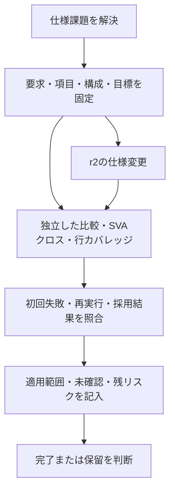

# APB＋割り込み：検証の総合演習

要求の抽出、検証項目、相互作用、比較・SVA・カバレッジ、変更管理、結果の採用、完了判断を一通り行う教材です。[記入済み計画](verification-plan.md)と[サインオフ記入例](signoff-example.md)を使い、自分の判断の根拠を確認できます。

## 1. 対象と仕様課題

対象は[既存のAPB＋割り込み](../../examples/local-apb-irq/README.md)です。32ビットCONFIG、4ビットPENDING、W1C、IRQを扱います。単一クロック・Low有効の同期リセット、wait=0／1／3の教材構成を選びます。APB規格全体や製品のCDC・電源・物理タイミングの完了判断は含めません。

最初に、次を仕様担当者へ確認するつもりで記入します。教材では右欄の仕様を採用します。

| 確認すること | 演習で確定した仕様 |
| --- | --- |
| マスク中にイベントを捨てるか | 捨てずにPENDINGへ保持する。 |
| クリアとイベントが同時ならどちらを優先するか | r1はセット優先。r2では明示的にクリア優先へ変更する。 |
| W1CはSETUP・待ち中・正常完了のいつ行うか | 正常な書込み完了エッジ。エラー時は更新しない。 |
| 読出しと状態更新が重なったらどの値を返すか | 当該エッジの更新前の値を返す。 |
| リセットで何を捨てるか | CONFIG・PENDINGをクリアし、IRQを解除する。 |

これは教材の仕様決定です。担当者の回答・承認が実際にあったとする記録ではありません。[変更演習の仕様](../../examples/local-spec-change/spec.md)は、r1／r2の差と機械照合する範囲を明記しています。

## 2. 固定計画で実行する

Python 3.10以上、POSIX、Icarus Verilog、Verilator 5.052、C++20とmakeを準備します。UVMや商用ライセンスは不要です。

```sh
mkdir -p artifacts
# 3つの入口を選ぶ。APB単体はwait全3構成なので、全体では5ジョブ。
python3 tools/run_regression.py --profile nightly \
  --example local-apb-irq --example local-apb-irq-coverage --example local-spec-change \
  --command-timeout 60 --build-timeout 600 --out artifacts/capstone \
  --list > artifacts/capstone-plan.json
python3 tools/run_regression.py --profile nightly \
  --example local-apb-irq --example local-apb-irq-coverage --example local-spec-change \
  --command-timeout 60 --build-timeout 600 --out artifacts/capstone
python3 tools/regression_report.py --plan artifacts/capstone-plan.json \
  --campaign artifacts/capstone --out artifacts/capstone-report
```

`--list`は実行せず、同じ引数の計画を保存します。失敗した場合は最初の結果を残し、原因・変更範囲を確認して新しい出力先へ再実行します。複数試行の指定は[レポート手順](../../tools/REPORTING.md)を参照してください。



## 3. 実績を読む

元のAPB＋割り込みは、応答・状態・IRQを全サイクルで比較し、既定の変異検出も行います。クロス選択例は、実観測から追加条件を選び、正常に比較を完了したケースの到達だけを採用します。どちらもr1が対象です。

仕様変更例はr1／r2で同じ入力列を使います。Icarusではwait=0／1／3、ネイティブSVAと行カバレッジはwait=1を計測します。4ビットの次状態とIRQをassertし、各ビットの競合、リセット、マスク中・許可中の7 coverを要求します。行カバレッジの分母は、各版でコンパイルしたレジスタRTLのカウンターです。IRQラッパー全体や全wait構成のコード網羅率としては扱いません。

機能クロス、SVA cover、行カバレッジの分母は別に記録します。必要な条件への到達と、その条件での正しい結果の比較を対応付けます。無効なチェッカーや途中の失敗から、正常な実績を補いません。

## 4. 仕様変更を追う

まず[仕様変更の例](../../examples/local-spec-change/README.md)の`r2/wait*/old-checker.log`を読みます。この失敗はr2の新仕様に対する不具合ではなく、古い仕様の期待値との不一致です。仕様を確認し、RTL、独立した期待値、SVA、要求ID、目標、変異の期待結果への影響を検討します。

r2の期待値はビットごとの更新順序、SVAは別の真理値表から変更します。DUTのPENDINGを参照モデルの正解としてコピーしません。反対の版のSVAが`CAP_PRIORITY`を検出することも確認します。

`traceability/report.json`は、変更要求2項目について各版・各waitの8競合目標を照合します。`stale-evidence.json`は古い計画ハッシュを拒否します。元のr1の全要求カタログやクロスモデルを、r2へ自動的に承認し直した結果ではありません。

## 5. 完了を判断する

[サインオフ記入例](signoff-example.md)では、r1の教材範囲の自動確認と、人の承認を分けています。r2は変更要求の再検証を確認できても、既存の全カタログ・クロスモデルの改訂判断が残るため、全体のサインオフを保留します。必要な項目を追加して、判断を完成させてください。

演習の解答をコピーするだけで完了にはしません。出典の版、実行ID、失敗理由、再実行した範囲、未確認と承認者を自分の対象に置き換えます。
