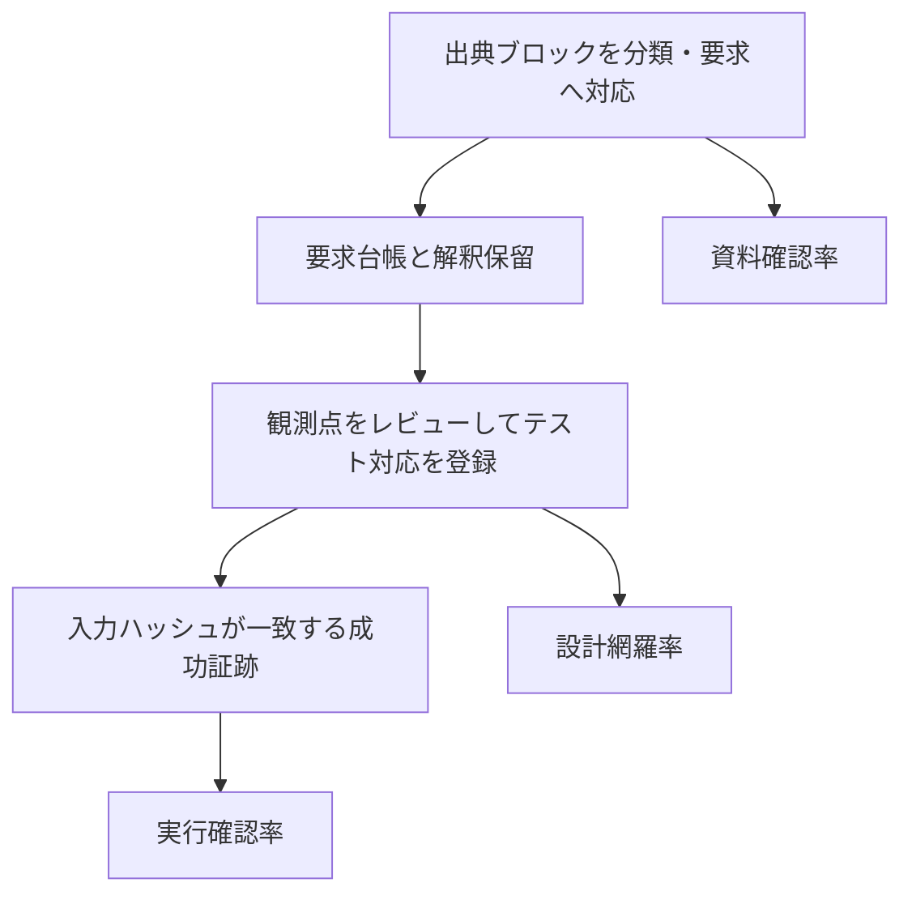

# 規格全動作の網羅率を管理する

[現在の集計概要](https://github.com/kurochan001/kirimasim-tests/blob/5fb3c45d73e4946d99690389752b82c86eecaa50/docs/behavior-coverage-summary.md)と[全項目の詳細](https://github.com/kurochan001/kirimasim-tests/blob/5fb3c45d73e4946d99690389752b82c86eecaa50/docs/behavior-coverage.md)は、
節の引用数とは独立した指標です。全規格の要求台帳に対する**暫定値と確定値を併記**します。
IEEE 1800-2023 の本文1–41章と附属書A–Q、1,740見出しを調査台帳に登録しています。
**全1,740節の資料確認・要求抽出は完了しました。確定値の分母は未承認です。**
[抽出結果](requirement-extraction.md)に確認範囲と残る解釈・分母整理を記録しています。
初期登録の105件は規格全動作の分母ではありません。2026-10-26に確認した[上流`5fb3c45d`の集計](https://github.com/kurochan001/kirimasim-tests/blob/5fb3c45d73e4946d99690389752b82c86eecaa50/docs/behavior-coverage-summary.md)では、全7,144テストのうち要求との対応登録が4,730本、未登録が2,414本です。
全テストの動作との対応確認が完了したことや、登録済みの各テスト全体をレビューしたことを意味しません。この段落の本数は文書取り込み元`0da4f2fc`から更新した値です。

[コンパイラ指令の照合結果](https://github.com/kurochan001/kirimasim-tests/blob/0da4f2fc/docs/existing-test-matching-preprocessor-20261023.md)に、
直近の対応追加、集合証拠、観測不足と要求単位の整理が必要な箇所を記録しています。

## 集計指標の分母と根拠

資料確認、要求への設計対応、現在版の実行成功は、それぞれ異なる対象と証拠で数えます。



図の矢印は証拠の依存関係です。資料確認100%から、全動作の実装・実行成功100%は導けません。

| 指標 | 数える対象 | 読み替えないもの |
| --- | --- | --- |
| 資料確認率 | 確認を終えた節／対象節 | 解釈確定や動作成功の割合ではない |
| 暫定設計網羅率 | 対応済みの要求行／登録要求行 | 意味単位の重複や保留を残す |
| 暫定実行確認率 | 現在入力の成功証跡がある要求行／登録要求行 | ツール別と和集合を区別 |
| 確定値 | 承認済みの分母と集計規則 | 分母未承認の間は確定値を出さない |

## mainの集計とNightlyの集計

`main`の`docs/behavior-coverage-summary.md`は、`coverage/results/`に保存した証跡を使います。
固定版Icarus 13.0／Verilator 5.052の全件実行と、その後の部分再実行を含みます。
各実行回を分けて保持し、現在の入力ハッシュと一致する成功だけを採用します。

Nightlyは各シミュレータの開発版で実行し、`publish`が**その回の結果だけ**を使って
`results`ブランチ直下の`behavior-coverage-summary.md`と関連JSON・履歴へ記録します。
この処理を含むNightlyが初めて公開されるまでは、出力先が存在しない場合があります。
Nightlyの`Match`割合はテスト出力の一致率であり、要求台帳に対する設計網羅率・実行確認率とは別です。
対象コミット・版・実行範囲を確認してから結果を比較してください。

Nightlyの開始予定は毎日04:23 JSTです。公開は全ジョブ終了後で、結果レポートの時刻はUTCです。
[日本時間への換算と更新状況の確認方法](https://github.com/kurochan001/kirimasim-tests/blob/0da4f2fc/docs/nightly-results.md)を参照してください。

## 計測の意味

- 全規格の要求台帳ベースの暫定値: 全資料の確認が終わった場合に限り、
  登録行全体を分母とし、設計対応行数／実行確認行数の割合を表示します。
  解釈保留、未対応、未実装も分母に含めます。要求文の出現箇所・条件・初期観測ケースに
  重複があるため、意味的に一意な要求の割合としては扱いません。
- 規格全体の確定値: 資料確認に加え、解釈保留と要求単位の重複を整理し、
  `behaviors.json`の`denominator_review`を根拠付きで承認するまで確定値の割合を出しません。
  親見出しの導入本文、図表、構文制約、例外、エラー、他節参照も調査対象です。
  ツール依存、未実装、標準のみの期待値は、除外や成功の理由になりません。
- 登録済み動作の設計網羅率: 観測点をレビューしたテスト対応がある動作数 ÷ 登録動作数。
  テストの名前・説明・`:lrm:` 引用だけから対応を推定しません。
- 実行確認率: 現在の入力・ランナーに対応する成功証跡がある動作数 ÷ 登録動作数。
  環境ごとの値と複数環境の和集合を分けて表示します。和集合は単一ツールの適合率ではありません。
- 資料確認率: 全出典ブロックの分類と要求への対応を終えた節数 ÷ 対象節数。
  解釈を保留した要求も抽出して記録します。現在は規定部分・参考部分とも100%です。
- 解釈保留なしの割合: `complete`／`no_behavior`の規定節数 ÷ 規定節数。
  全資料の確認が終わっても、解釈保留の節は`in_progress`のままです。
  どちらもテストの動作網羅率とは別です。

ここでの100%は、調査を完了した要求台帳のすべてに観測可能なテストがあるという意味です。
無限の値・幅・プログラムの全組み合わせを試した証明ではありません。
正常系、境界、エラー、条件分岐、例外は区別して登録してください。

## 台帳と証跡

- `standard-sections.json`: 全見出しの番号、タイトル、PDFの物理ページ番号（1始まり）、
  規定／参考の区別、調査状態。`unreviewed` → `in_progress` → `complete` と進めます。
  `complete` はその見出し自身の本文の要求をすべて分解した時だけです。
  動作を定義しない本文は、根拠・日付を残して `no_behavior` とします。
  参考附属書も台帳に残し、規範要件の分母に混ぜません。
- `behaviors.json`: 安定ID、根拠節、具体的な動作、条件の種類、合格基準、根拠メモ、
  対応テスト、刺激・期待値の観測箇所、レビュー担当・日付・入力SHA-256。
  1件は個別の要求／条件の観測単位です。一つのテストで観測する複数の要求は別IDにします。
  `checks: []` は対応未確認の要求です。既存テストに該当ケースがないとは限りません。
  新規テストを追加する前に、既存テストの刺激と期待結果を照合して対応を登録します。
  集計概要の「既存テストの集計状況」は、対応登録済み本数と未登録本数を表示します。
  対応登録済み本数は、少なくとも一つの要求との対応を確認した本数であり、
  各テスト全体のレビュー完了数やテストスイートの網羅率ではありません。
  複数テストで分担する要求は `check_groups` にグループID・全メンバー・
  まとめて満たす条件・レビュー担当・日付を登録します。指定した場合は全checkが
  いずれかのグループに属する必要があります。グループ内はAND、グループ間はORです。
- `requirement-source-index.json`: 全1,740節の自身の本文の範囲と、全15,846ブロックの
  位置・SHA-256。親節の本文と子節を重複させず、ページ境界をまたぐ本文・脚注も保持します。
  PDFと抽出テキストのハッシュも記録します。規格本文そのものは含みません。
- `requirement-audit.json`: 確認した各節のすべての出典ブロックについて、要求への対応、
  見出し、説明、例、参照先のいずれかを理由付きで記録します。図表の確認方法と範囲も記録します。
  `behaviors.json`の`source_spans`と双方向で照合します。未解決の解釈がある節は`in_progress`です。
- `behavior-baseline.json`: 見出しの集合・規定区分・規格出典、要求ID・合格基準、対応済みID、
  解釈確定見出しと出典確認済み見出しの基準値。削除、対応解除、要求の緩和、
  調査の差し戻し、対象縮小をCIで検出します。
  複合証拠の定義と入力ハッシュも固定し、グループを削除して一部の成功で代替する変更を検出します。
- `test-matching.json`: 全既存テストの入力ハッシュ、引用節、対応登録済みID、未承認候補、
  解釈保留、正常／違法区分の相違、上位節の引用を記録する照合台帳。
  [照合状況](https://github.com/kurochan001/kirimasim-tests/blob/0da4f2fc/docs/test-requirement-matching.md)は章別の登録済み／未登録本数を表示します。
  全件の候補列挙は意味上の照合完了ではなく、候補だけから動作網羅率は増えません。
- `test-matching-reviews.json`: 対応を保留した箇所の、確認範囲・要求ID・理由・刺激／期待値の
  根拠・担当・日付・入力ハッシュ。部分観測、期待値／診断の問題、引用の具体化、
  複合要求の整理を区別します。`requirement_matching.py`が照合台帳へ取り込み、
  古い入力や存在しない根拠を拒否します。この判断記録は対応承認でも、ファイル全体の
  レビュー完了でもなく、動作網羅率の分子には使いません。
- `results/icarus.json`と`results/verilator.json`: 全スイート3,912本の実測結果。
  期待値との照合結果に加え、実行前後の入力一致、ランナーのハッシュ、実行時刻、
  シミュレータの版、設定を各ランナーの `--json` が記録します。
  `results/citation-refinement-*.json`は、引用メタデータを変更した7本の再実行です。
  全スイートの結果を部分実行で上書き・合成せず、別の実行回として保持します。
  更新前の入力ハッシュは古い証跡と判定し、複合証拠も同じ実行回の全成功だけを採用します。
- `results/expression-gaps-20261023-*.json`: 式レビュー後に追加した11本の実行結果。
  Icarus 13.0とVerilator 5.052のseed 1/73をそれぞれ別の実行回として保存します。
  以前の全3,912本の結果を保持し、部分実行を全件実行と扱いません。
- `results/associative-matching-20261023-*.json`: 連想配列の引用修正7本と集合メンバー等を含む40本の再実行。
  Verilator 5.052は37 pass・3 known、Icarus 13.0は40 knownです。knownは実行成功へ含めません。
  [照合結果](https://github.com/kurochan001/kirimasim-tests/blob/0da4f2fc/docs/existing-test-matching-associative-arrays-20261023.md)に、対応範囲と集合証拠の不足を記録しています。
- `results/associative-gaps-20261023-*.json`: 連想配列レビュー後に追加した15本の実行結果。
  その後変更したwildcard/count各1本は、`associative-wildcard-refinement-20261023-*.json`と
  `associative-count-refinement-20261023-*.json`へ別実行として保存しました。
  現在の入力ではVerilator 5.052のseed 1/73とも8 pass・7 known、Icarus 13.0は15 knownです。
  [追加内容と残件](https://github.com/kurochan001/kirimasim-tests/blob/0da4f2fc/docs/associative-gap-tests-20261023.md)を参照してください。
- `results/header-vpi-tests-20261023-*.json`: 附属書I/K/L/MのCヘッダを検証する24本と、37章のVPIテスト24本の実行結果。
  Icarus 13.0（v13_0-dirty）は1 pass・47 known、Verilator 5.052はseed 1/73とも17 pass・31 knownです。
  [追加内容と照合結果](header-vpi-tests-and-matching-20261023.md)を参照してください。
- `results/keyword-tests-20261024-*.json`: `generators/keywords.py`が生成する予約語の違法系テスト496本の実行結果。
  Icarus 13.0は496 pass、Verilator 5.052はseed 1/73とも493 pass・3 knownです。
  [生成内容と対応](keyword-tests-20261024.md)を参照してください。
- `results/gap-tests-20261024-*.json`: 対応するテストがなかった要求に向けて書き、独立検証を終えた新規テスト594本の実行結果。
  Icarus 13.0は239 pass・355 known、Verilator 5.052はseed 1/73とも203 pass・391 knownです。
  取り込み後に3本（ポート宣言1本、`:lrm:`の引用2本）を直し、その再実行を`gap-refinement-20261024-*.json`へ別に保存しました（各3 known）。
  [追加内容と照合結果](gap-tests-20261024.md)を参照してください。
- `results/gap-tests-2-20261024-*.json`: 同じ作業の2回目で独立検証を終えた新規テスト933本と、入力ハッシュが変わった`tests/ch22`の既存4本の実行結果。
  Icarus 13.0は529 pass・408 known、Verilator 5.052はseed 1/73とも504 pass・433 knownです。
  [追加内容と照合結果](gap-tests-2-20261024.md)を参照してください。
- `results/gap4-20261025-*.json`: 保留していた照合案のうち、p01・p05・p07・p12の4区間を独立検証して取り込んだ256本の実行結果。
  Icarus 13.0は132 pass・124 known、Verilator 5.052はseed 1/73とも129 pass・127 knownです。
- `results/gap5-20261026-*.json`: 同じ照合の第2弾としてp09・p10・p13・p15を検証して取り込んだ188本の実行結果。
  Icarus 13.0は62 pass・126 known、Verilator 5.052はseed 1/73とも49 pass・139 knownです。
- `results/ch22-rehash-20261026-*.json`と`results/p10-refinement-20261026-*.json`: ch22のinclude fixture復元で入力ハッシュが変わった既存10本と、`:lrm:`から背景節を外した1本の再実行。
- `results/gap6-20261026-*.json`: wave4のa01〜a05・g05・g08・g09・h01・h02を検証して取り込んだ176本の実行結果。
  Icarus 13.0は49 pass・127 known、Verilator 5.052はseed 1/73とも82 pass・94 knownです。
- `results/ch37-depth-20261026-*.json`: 深さ検査のため37.4.2の2本目として既存VPIテストへ引用を足した再実行。
- `results/gap7-20261026-*.json`: K.2ヘッダ31・I.3 DPI 55・N.2分布7の要求に向けて書いた18本の実行結果。
  Icarus 13.0は3 pass・15 known、Verilator 5.052はseed 1/73とも14 pass・4 knownです。
- `results/gap8-20261026-*.json`: 20.11アサーション制御42・40章カバレッジ20・17章checker 29・36.12.1互換8の要求に向けて書いた30本の実行結果。
  すべて `:oracle: spec` で、Icarus 13.0は0 pass・30 known、Verilator 5.052はseed 1/73とも4 pass・26 knownです。
- `results/gap9-20261026-*.json`: 附属書Aの構文要求に向けて書き、独立検証を終えた93本の実行結果。
  Icarus 13.0は17 pass・76 known、Verilator 5.052はseed 1/73とも44 pass・49 knownです。
- `results/ch5-rehash-20261026-*.json`と`results/ch19-depth-20261026-*.json`: includeディレクトリの入力変化と、深さ検査のため背景節を外した再実行。
- `results/audit-full-20261026-icarus13.json`と`results/audit-spec-20261026-verilator-*.json`: 全6799本のIcarus実行と、spec-only 1645本のVerilator実行（seed 1/73）。
- `results/audit-oracle-20261026-icarus13.json`: spec-onlyのうちIcarus 13.0で一致した277本へ`iverilog@13.0`を追加した後の再実行（277/277 pass）。
- `results/regex-refinement-20261025-*.json`: 判定の正規表現をメッセージの書式に依存しない形に直した`ch16`の2本の再実行。
  Icarus 13.0は2 known、Verilator 5.052はseed 1/73とも1 pass・1 knownです。
  [見直しの記録](lyra-disagreement-review-20261025.md)を参照してください。
- `results/oracle-refinement-20261025-*.json`: `:oracle:`に誤って`iverilog@13.0`とあった取り込みテスト3本（`tests/imported/`）を`spec`に直した後の再実行。
  Icarus 13.0とVerilator 5.052（seed 1/73）とも3 knownです。
- `behavior-summary.json`: 現在の暫定値・確定値、章別の割合、分母SHA-256、
  シミュレータごとの失敗・既知不一致・未対応・未実行・古い証跡などの内訳。
  `--update`で概要Markdownとともに再生成し、`--check`で両方の鮮度を検査します。
- `behavior-history.json`: 計測履歴。分母と計測規則の版を添えて保存します。
  分母が変わった前後の割合は、そのまま改善・悪化として比較しません。

入力ハッシュにはテスト本体、期待値、`:files:`、DPI/VPIのCソース、文字列で指定した
includeとinclude検索ディレクトリ内のファイルを含めます。マクロで選ぶincludeや外部データは
必ず `:files:` に宣言してください。コンパイラのインストール全体やOSの再現性を証明する
ハッシュではありません。include検索ディレクトリは保守的に全ファイルを対象にします。

`pass` だけを実行成功に数えます。`known`、`unsupported`、`fail`、古いランナー、変更前の
入力、来歴のない従来形式の結果は成功に数えません。違法設計は未対応構文のエラーと誤認し得る
ため、メタデータでレビュー済みの固定版Icarus 13.0／Verilator 5.052の結果に限ります。
それでも診断の意味とエラー位置のレビューは必要です。単なる構文未対応を成功扱いしません。

対応付けと要求抽出はAIによるレビューです。独立した人の確認済みとは扱いません。
全資料を確認しましたが、資料内の不整合が残る要求の解釈は保留しています。
登録件数には要求の出現箇所と条件別の観測ケースを含み、意味的な重複を除去した確定要求数ではありません。
[未解決事項と抽出上の注意](requirement-extraction-notes.md)も参照してください。

## 日常の更新

まず対象節の本文と関連する図表・構文・参照先を読み、要求を自分の言葉で分解します。
規格本文やサンプルコードをそのまま転載しないでください。
出典の自身の本文を確認するには次を使います。資料は既定で兄弟ディレクトリの提供資料を参照します。

```sh
python3 tools/requirement_source.py --show 10.9.1 10.9.2
```

キーワードだけの抽出では、定義、表のセル、構文、例外を拾い切れません。
すべての出典ブロックを分類し、要求は`source_spans`に節とブロックIDを登録してください。
`complete`または`no_behavior`にするには全ブロックの監査記録が必要です。
解釈が未解決の要求には`interpretation_issue`を付け、節を`in_progress`のままにします。
この状態では対応テストの承認も禁止しています。推奨事項は`modality: recommendation`で、
必須事項や許可と区別します。機械検査は監査記録の整合性を検査し、意味の正しさを自動承認しません。

既存テストの候補は次のコマンドで列挙できます（列挙だけでは対応済みになりません）。

```sh
python3 tools/behavior_coverage.py --candidates 11.3.5
```

各要求の刺激と観測結果を確認し、`checks` にテストと証拠の文字列を登録します。
テストが根拠節を直接引用し、正常系では期待出力、違法系では意図した診断が照合されることを
確認してください。テスト変更後は対応付けを再レビューしてからハッシュと日付を更新します。

```sh
python3 tools/behavior_coverage.py --test-digest tests/ch11/test_short_circuit_side_effects.sv
python3 tools/run_icarus.py --json /tmp/icarus.json tests/ch11/test_short_circuit_side_effects.sv
python3 tools/behavior_coverage.py --results /tmp/icarus.json \
  --output /tmp/behavior-coverage.md --json /tmp/behavior-coverage.json
```

`--results` は保存済みの初期スナップショットを置き換えて、その引数だけを計測します。
一つのシミュレータの異なる版・異なる回の成功を、単一環境の適合率として合成しません。
`--history /tmp/behavior-history.json` を付けると分母の識別情報と計数を追記できます。
要求台帳の変更前後の割合は分母も確認して比較してください。
分母SHA-256は要求の内容と対象範囲から算出し、対応テストや実行結果の変化だけでは変わりません。
全項目のJSONでは`requirements[].status`と、各実行結果の`outcomes`から残件IDを抽出できます。
複数のレビュー済みテストが同じ要求を独立に検証する場合は、少なくとも一つの有効な成功を採用します。
複数ケースで一つの要求を分担する `check_groups` は、いずれかのグループ内の全テストが
同じシミュレータ・同じ実行回で成功した場合だけ採用します。別の版・実行回の部分成功は合成しません。
この拡張を計測規則の版3に記録しています。版2との数値比較では規則の変更も確認してください。
成功がない場合の環境別表示は、失敗、既知不一致、未対応、違法系の判定根拠未承認、古い証跡、
未実行の順で代表状態を選びます。各登録行は各環境で一つの状態に数えます。

```sh
python3 tools/behavior_coverage.py --update
python3 tools/requirement_matching.py --update
python3 tools/behavior_coverage.py --check --require-source-reviewed
python3 tools/requirement_matching.py --check
python3 -m unittest discover -s tools -p 'test_*.py'
```

計測した状態を履歴にも残す場合:

```sh
python3 tools/behavior_coverage.py --update --json /tmp/behavior-coverage.json \
  --history coverage/behavior-history.json
```

`--summary-output`と`--summary-json`で概要の出力先を指定できます。
既定の詳細レポートを更新／検査する場合は、概要Markdownと`coverage/behavior-summary.json`も対象です。
`--results`なしの再計測は保存済み証跡を使います。新たにシミュレーションを実行したことにはなりません。

チェックは未対応要求があること自体では失敗しません。記録が不正・古い、対応が後退した、
生成レポートが古い場合に失敗します。全規格の設計網羅率と実行確認率の両方で100%を
要求する場合は次を使います。
分母未確定の場合も失敗するため、現在は意図どおり非ゼロ終了します。
`--require-source-reviewed`は全資料の確認を要求し、解釈保留・テスト対応を承認するものではありません。

```sh
python3 tools/behavior_coverage.py --check --require-complete
```

根拠のある要求訂正や対象の修正で基準を変更する場合、差分をレビューし、理由を記録します。
要求・対応・調査完了の単純な追加は `--update` が基準を自動的に引き上げます。
`--check` は追加分が基準に保存されていない場合も失敗し、次回以降の削除を見逃しません。
後退や要求文の訂正は理由付きの明示更新が必要です。単にチェックを通すために
基準を下げないでください。

```sh
python3 tools/behavior_coverage.py --write-baseline --reason '具体的な規格根拠と変更理由' --update
```

## 規格資料の再照合

資料はリポジトリに複製していません。提供資料のPDFハッシュを照合できます。
`--verify-source`は抽出テキストのハッシュも検査します。PDFから新たに`pdftotext -layout`
で抽出したテキストと、提供された抽出済みテキストが一致することも初回に確認しています。

資料のディレクトリは、以下ではリポジトリの隣の`IEEE_1800-2023_SystemVerilog`としています。
`tools/requirement_source.py`の既定値も同じで、環境変数`IEEE1800_SOURCE`で変えられます。

```sh
python3 tools/behavior_coverage.py --check \
  --verify-source ../IEEE_1800-2023_SystemVerilog
python3 tools/import_standard_sections.py ../IEEE_1800-2023_SystemVerilog --check
python3 tools/requirement_source.py --index /tmp/requirement-source-index.json
```

出典索引を再生成した場合は、JSONの内容が保存済み索引と一致することを確認してください。
本文キャッシュが必要なら`--cache /tmp/requirement-source.json`を使います。
本文のリポジトリ内へのキャッシュ出力はツールが拒否します。
出典ブロックの集合は基準値のハッシュでも固定し、索引から本文を落として見かけの完了率を上げる変更を防ぎます。

索引の誤認5件と8.23節の欠落を本文・目次で補正し、本文第41章と小見出しのない附属書も
含めました。附属書Cは概要・目次では参考、本文見出しでは規定と表示されるため、保守的に
本文の規定表示を採用しています。第41章は廃止を述べる本文を確認し、根拠付きで
`no_behavior` としました。従来の引用カバレッジで対象外の227節も、自動除外していません。

## CIとnightly

Checkは台帳・基準・ハッシュ・観測点・レポートの整合性と集計器のリグレッションテストを検証します。
Nightlyはその回の全ランナーのJSONから再計測し、`results` ブランチへ次を保存します。

- `behavior-coverage.md`: その回の動作別・環境別の結果。テストへのリンクは実行時のコミットを指します。
- `behavior-coverage.json`: 集計値、分母識別情報、動作IDごとの対応・実行確認状態。
- `behavior-coverage-summary.md` / `behavior-summary.json`: 暫定値・確定値と章別・環境別の集計。
- `behavior-history.json`: 各回の計数と分母・実行環境の履歴。

履歴には集計を保存し、全登録行の状態はその回の詳細JSONに保存します。
GitHub Actionsの実行概要にも暫定値・確定値と残件数を表示します。

Nightlyを実際に実行するには、この変更がGitHubに反映される必要があります。
