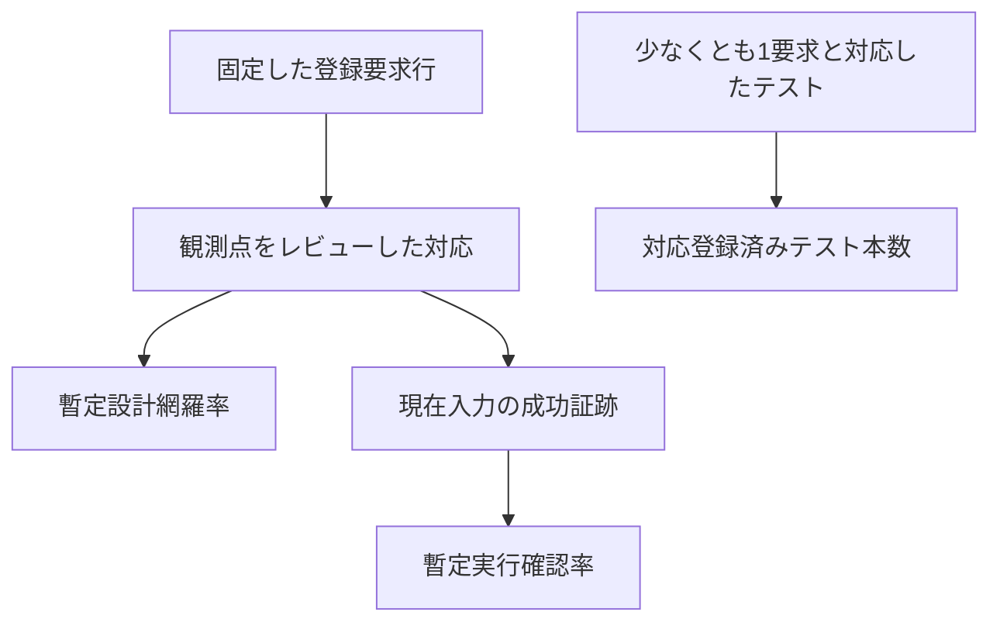

# 既存テストの要求照合：20%超過の結果（2026-10-23）

[現在の集計](https://github.com/kurochan001/kirimasim-tests/blob/c88b0c3/docs/behavior-coverage-summary.md) / [照合台帳](https://github.com/kurochan001/kirimasim-tests/blob/c88b0c3/docs/test-requirement-matching.md) / [累積の進捗・指摘](existing-test-matching-review-20261022.md)

既存テストの照合を繰り返し、**暫定設計網羅率20.009741%（2,465/12,319要求）となりました。20%を超える目標を達成しました。**
固定分母12,319では2,464要求から20%を超えます。現在の2桁表示は20.01%で、正確な増分を確認できるよう6桁でも併記しています。

## 20%到達の指標を分けて読む

2026-10-23の記録を、要求行の対応と実行確認、テスト本数に分けて整理します。

この表は当時の記録の要約です。最新値への更新や、全テストの意味上の照合完了を表しません。

| 2026-10-23の指標 | 本文の記録値 | 意味 |
| --- | --- | --- |
| 対応済み要求行 | 2,465／12,319 | 暫定設計網羅率20.009741% |
| 実行成功証跡のある要求行 | 1,292行 | 上の対応行数とは別 |
| 対応登録済みテスト | 1,386本 | 各テストの全観測を精査した数ではない |

## 集計

- 対応済み要求：開始時1,242 → **2,465（1,223要求追加）**。
- 追加した対応根拠：**1,296件、418本**。各ファイルの確認した観測だけが対象です。
- 一つ以上の対応があるテスト：1,030 → **1,386本**。全3,938本のうち未登録は**2,552本**。
- 暫定設計網羅率：10.081987% → **20.009741%（2桁表示20.01%）**。
- 新鮮な実行成功証跡のある要求：754 → **1,292（538要求追加）**。
- 暫定実行確認率：6.120627% → **10.487864%（1,292/12,319、表示10.49%）**。
- 確定値：**設計・実行とも未確定**。分母承認、意味上の重複整理、既存の解釈保留が残ります。
- AND集合証拠：55 → **126要求**。別実行回の部分成功は合成しません。
- 保留台帳：372本・504件 → **406本・546件（42判断追加）**。

既存テスト、期待出力、C helper、引用メタデータ、要求定義、分母は変更していません。
開始時に存在した未コミットの10%到達作業も保持しています。今回も元テストは再実行せず、保存済み結果の入力・ランナーが現行版と一致するかを照合しています。
担当はCodex（AI）で、独立した人による確認済みではありません。ファイル全体のレビュー完了数や、全入力の組合せを試した割合ではありません。

## 今回確認した範囲

数値・文字列リテラル、生成済みbufif強度テスト、演算子、VPI UDP/値取得/配列API/登録情報、乱数分布、PLA、covergroup、randomize、表示・入力形式、SVA property/sequence、clocking、checker、assertion VPI、coverage API、FSM認識、SDF注釈、specify path、timing check、interface、DPIとAnnex Hの型・配列・context API、整数型、文字列、クラスとweak reference、配列/bit照会、process API、enum/typedef、soft制約、UDP、covergroupの継承とcross選択、subroutineのlifetime、VCD、program終了/exit、config binding、sampled-value functions、assertion制御、短絡/等価演算子、VPIのvariables/net/instance/scope/expression/atomic-statement/process/primitive/assertion model、package初期化・std、generate外部名、interface class、文字列の詰め方、SVA local variable、file positioning/binary fread、net真理値表、VPI handleの生成・解放、interface/modport、statement child、specify path/timing checkの観測を確認しました。
Annex Nの19組の戻り値と更新seedは、LCG・IEEE float変換・各分布変換・丸めを独立に再計算して一致を確認しました。分布の平均や広がりの統計的収束は別の未対応要求です。

例えば、bufifのL/Hは%bのxだけではなく%vのStL/PuHまで比較します。
SVAは異なる時刻の真偽、複数matchの多重性、first_matchの同時最早match、含意の全matchとfollowed-byの存在条件を、具体的な終了時刻・pass/fail queueから確認します。
複合行の一部しか観測しないものは、個別要求への対応、必要な全テストを含むAND集合、理由付き保留に分けます。

## 追加した指摘・保留

- **M65：PLA出力がnet。** `test_pla_sync_snapshot_versus_async_update`は出力引数asynchronousをwireと宣言しています。20.16はvariable lvalueを要求するため、正常なsimulation caseとして保留しました。
- **M66：escapeの内容を未比較。** `test_lexical_strings`の該当ケースは主に長さの比較で、変換後ASCIIが同じ長さの誤値でも通ります。newline/backslash/quoteの値を検証した扱いにはしません。
- **M67：強度競合の刺激がない。** `test_net_resolution_multi`のstrong overrideと説明するケースに競合pull driverがありません。
- **M68：notの空虚性の負側が未観測。** `test_nonvacuous_evaluation_forms`のnotは、常にnonvacuousと誤分類しても同じ出力になり得ます。この継承規則の仮対応は監査で除外しました。
- **M69：set式の構築時点だけでは不十分。** `test_cg_bins_with_set_expr`はwithin-covergroup名の非可視性を確認しません。時点と可視性の複合行全体は保留です。
- **M70：戻り値の符号型を未確認。** `test_urandom_range_bounds`はint unsignedへ代入するため、関数自体のunsigned型を独立には確認しません。default/reverseの個別行だけに対応付けました。
- **M71：1stepの説明と規格が異なる。** `test_clocking_input_step_skew`はObserved/NBA後と説明しますが、規格は直前time stepの値です。刺激が両方式を区別しないため、この説明は期待値の根拠にできません。
- **M72：off-event driveの早過ぎる更新を見逃す。** `test_clocking_drive_between_edges`の最初の読出しは次event後です。RHS captureは確認できますが、次event前の更新を排除できません。
- **M73：cycle driveの定義節を未引用。** `test_clocking_output_skew_cycle_delay`は提供版の14.16を引用していません。14.16.1だけでは異なる要求へ対応付けず、既存入力は保持しました。
- **M74：bin set式がmoduleの可変queueを参照。** `test_cg_bins_with_set_expr`の`bins picked[] = vals`は、19.5のcovergroup expressionで許される変数の制約と整合しません。non-ref covergroup引数を使う等の合法性整理が必要です。

- **M75：coverage種別の受理だけを確認。** `test_coverage_api_minimum_types`はERROR以外を許容するため、未収集のNOCOVでも通ります。各種別の実収集機能の証拠は保留しました。
- **M76：全0でもscope和・reset/stopを満たす。** `test_coverage_scope_sums`と`test_coverage_reset_and_stop`は非零の対照を要求しません。scope集計や制御効果の登録を保留しました。
- **M77：収集開始の未成功時に検査を省略。** `test_vpi_coverage_assertion`と`test_coverage_fsm_pragma_states`は開始がOKでない場合も期待出力となります。無条件のVPI最大値など、実際に比較する範囲に限定します。
- **M78：VPI制御も全0で通る。** `test_vpi_coverage_control`と`test_vpi_coverage_instance_control`はreset/stop前の収集を確認せず、常に0でも通るため制御効果を保留しました。

- **M79：generic interfaceをordered接続。** `test_generic_interface_parameterized_instances`は25.3.3が要求するnamed port connectionを使用していません。幅の期待値にかかわらず正常caseとしての対応は保留しました。
- **M80：DPI export taskのstatusを非零とだけ比較。** `test_dpi_disable_import_task`は`!=0`のため、規格の返値1を2等に誤っても通ります。disable stateは観測できますが、厳密なexport statusの行は保留しました。
- **M81：DPI input formalの変更を使う。** `test_dpi_input_inout_semantics`はC側でinputの数値・pointerを進めます。35.5.1.2のformal変更禁止と変更時のactual保護、H.8.7のconst規定の関係を整理するまで、入力保護の全要求を承認しません。
- **M82：scope APIの複合条件が未観測。** `test_dpi_context_scope`はunknown-name、previous scopeの返値自体、userdata未登録・エラー時の戻り値を比較しません。実際に確認するcurrent scopeとfull nameを登録し、これらを含む全条件は保留しました。

- **M83：scalar logicの次元数に誤った期待値。** `test_array_multidim_query`は`$dimensions(scalar_val)`を0と期待しますが、20.7と6.11.1のsimple bit vectorの定義では1です。このfile全体を新規の対応根拠として使わず、正しい別テストのsize変更を登録しました。
- **M84：3-member tagged unionのtag符号化の根拠が未確認。** `test_tagged_union_packed`は00/01/10を固定して期待します。7.3.2の最小幅と配置、および2-memberの図の0/1から、任意member数のdeclaration-order符号化を要求できるかは未解決です。このfileの新規承認は保留し、タグとpayloadの連動は符号化に依存しないpattern testで照合しました。

また、soft constraintのhandle宣言順はalias条件まで含めた複合行を保留し、`disable soft`はenclosing conditionだけに対象名がある場合と、非矛盾でも破棄する場合を未観測として記録しました。VCDはrawの値と宣言幅・時刻・sectionを比較する範囲に限定し、無検査のheader項目や未刺激の型は登録していません。

- **M85：VPI config名が非空かだけを比較。** `test_vpi_module_binding_properties`はlibrary/cellを具体値と比較しますが、configは非空なら通ります。`vpiConfig`の正しい値を返す要求は保留しました。
- **M86：future値とaction遅延の誤りが相殺し得る。** `test_global_clocking_sampled_functions`はglobal clockとassertion clockが同じで、future関数の評価と遅延したactionを一つのqueue時刻で比較します。futureをpastへ置き換え、同時にaction遅延を省く誤実装を区別できないため、future値と遅延の個別要求には計上しません。別のVPIテストでevent時刻とcallback実行時刻が異なることを比較できる範囲だけは登録しました。
- **M87：正常終了するnegative API harnessを管理側が受け付けない。** `test_vpi_chk_error_callbacks`は不正APIのNULL返値とerror status、合法なcallbackの成功を確認する有効な負例です。ただし現行validatorはerror要求を`should_fail_because`とstderr regexのcaseに限定しており、この形式の登録を拒否します。管理形式を明示的に拡張して検査するまでは計上せず、既存test入力を変更して回避していません。
- **M88：package exportの複合条件が未観測。** `test_package_export_all`と`test_package_export_named_wildcard`の正側の出力だけでは、複数reexport経路の宣言同一性、export-before-import、未参照wildcard候補の非再公開などを判別できません。これらを含む全要求への対応を保留しました。

- **M89：bindを無視しても通り得る。** `test_bind_assertion_basic`はDUTのreadyを比較しますが、bound instanceの存在やpass/cover件数を確認しません。bindの動作要求の根拠は保留しました。
- **M90：pending decayの取消しを実行していない。** `test_trireg_charge_decay`の最初のdecayはt30に満了し、redriveはt40です。満了前に再駆動して取消すというコメントの条件は刺激されていません。開始・満了の個別要求だけを登録しました。
- **M91：生成netテストのX出力とX入力を区別。** `test_gen_strength_tri0_16`は0/1/Zの9組だけを入力します。既知の反対値からStXになっても、入力driverがXの場合の真理値表セルには計上しません。各既知値セルも、その時点のactive strengthが表のstrong条件に合う場合だけに限定しました。
- **M92：非NULLだけの関係検査を再監査で除外。** class object、tagged patternのnested pattern、do-whileのcondition/bodyについて、返handleの正しいtype・値・同一性を比較しない4対応を取り下げました。以前からのM60と同じ基準を適用し、誤った非NULL handleでも通る検査をone-to-one関係の証拠にしません。

- **M93：constraint conditionが非NULLかだけを比較。** `test_vpi_constraint_items`はconditionの正しい値やoperatorを確認しません。group型やiterator件数の観測と区別し、condition relation自体は保留しました。
- **M94：no resolverのNULLを直接確認していない。** `test_vpi_nettype_declarations`の`none`は、返handleが非NULLでもそのnameがNULLなら出ます。`vpiWith == NULL`の証拠としては保留しました。
- **M95：enum lastが最大値とも一致。** `test_enum_first_last_num`の3/1/6は非単調ですが、lastの6はnumeric maximumでもあります。lastを最大値で返す誤実装と区別できません。
- **M96：callback件数だけでは実行前を証明しない。** `test_vpi_statement_callbacks`のnamed begin/whileは、block最初の実行やconditionの副作用より前であることを比較しません。副作用や時刻を比較する別テストの個別要求を登録しています。
- **M97：文字列relational operatorの偽の対照がない。** `test_string_compare`は`<`、`<=`、`>`、`>=`をすべて真になる入力で調べるため、常に1でも通ります。各operatorの全体規則は保留しました。

M84のタグ符号化の保留も再確認し、同じfileの幅・配置に対する仮対応3件を最終集計から除外しました。一方、M92のclass-object関係は、別fixtureの`c.v=7`と別objectの既定値0を区別する観測で対応付けました。保留した元fixtureの判断は変更していません。

## 最終の保留整合監査

既存の保留台帳と、今回追加した全対応を再照合しました。保留理由を解消していなかった仮対応20件・16要求を除外し、別の既存テストから20件・17要求を追加した後の値が、冒頭の2,465要求です。途中集計の2,464要求をそのまま確定させていません。

- string putc/getc：有効indexでの書換えだけでは、範囲外・zeroの無効果やindex formalの型まで確認できません。
- sort/rsort：通常sortの全要素比較と、with sortの端点・先頭だけの比較を合わせても、projected keyによる全要素の整列は確認できません（M38）。
- property初期化・virtual method：new後のdefault確認ではconstructor body前の時点を証明できず、virtual dispatchだけでは非virtualのstatic bindingを確認できません（M33）。
- `test_std_package_access`：try_getの成功値を1へ固定した既存のoracle問題（M04）があるため、このfileを今回の新規根拠に使いません。selfのsignatureは別のthread識別fixtureで確認しました。
- VPIのvirtual initializer/interface parent：表示`none`は返handleのNULLだけでなく、非NULL handleのNULL nameでも出るため、NULLを返す要求の根拠から除外しました。
- VPI vector uses：kind別件数だけでは誤った同kindの対象を排除できません（M60）。case-item関係は、helperが別statementへ不適切なLhs queryを行う既存問題があるため除外しました（M64）。

残る同一テスト・同一要求の保留との重なりは、taskのlocal lifetime overrideです。元のautomatic task内static localだけでは一方向ですが、別fileのstatic task内automatic localとAND集合にすることで両方向を確認しています。元の部分観測の保留判断は保持しました。

最後の追加では部分選択の範囲外read/write、localparamの間接依存、automatic localの再初期化、process::selfの型付き返値、表示formatの具体的変換、write/displayの改行差、sformatf返値を確認しました。hex/octalのgroup規則は両fixtureを必要とするAND集合です。formatの対応は変換動作の具体例であり、大文字aliasや全入力組合せまで検査したという意味ではありません。

判断の対象ID、入力ハッシュ、刺激anchorは`coverage/test-matching-reviews.json`に記録しています。

## 分母・証跡の保全

分母は12,319、分母識別子は`d9e94724b317c8668673f4f4883c4923bf94caad46d79ba7c79e1fd16302e6ac`です。
要求定義、既存checks/AND集合、以前の保留判断を保持し、資料索引・PDF/抽出本文の識別子も変えていません。
解釈保留49行を含む未対応要求を分母から除外していません。

## 検証

管理ツールの74テスト、動作カバレッジと資料ハッシュの検証、照合台帳、suiteの統計・catalog・引用深度（最低2本）、生成テストの再現性、メタデータlint、`git diff --check`を確認しました。
開始時snapshotとの比較で、要求定義、既存checks/AND集合、既存保留判断、履歴の既存部分、固定分母と資料索引を保持していることも検証しました。
元のSystemVerilog/Cテストの再実行や新規テスト追加による到達ではありません。
