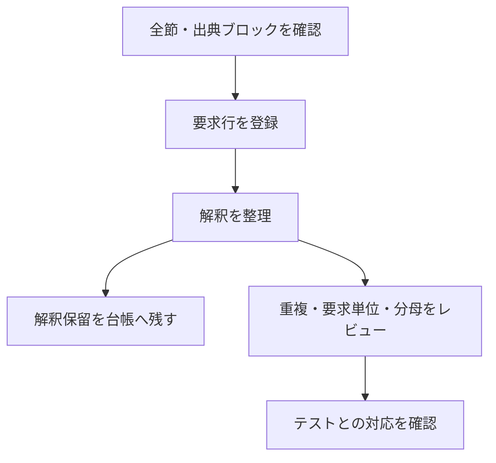

# IEEE 1800-2023 全要求の洗い出し結果

2026-10-22、提供された規格資料について、全節の資料確認と要求の登録を完了しました。
資料内で整合しない記述も抽出し、解釈保留として残しています。
要求の意味の重複整理、保留の解決、全テストへの対応付けは未完了です。

## 資料確認と要求解釈の進捗

全節の資料確認と要求登録を終えた後も、解釈保留・重複整理・テスト対応は別の作業として残ります。



本文の記録時点を要約した表です。現在の上流の集計を新しく取得した数値ではありません。

| 作業 | この文書の記録 | 状態の意味 |
| --- | --- | --- |
| 資料の確認 | 1,740節・15,846ブロックを確認 | 確認済みの範囲 |
| 要求登録 | 12,319行 | 重複を整理した一意な要求数ではない |
| 解釈保留 | 2026-10-24見直し後に19論点・21行 | 解釈確定や分母承認は未完了 |

## 確認範囲と結果

- 本文1–41章と附属書A–Q: **1,740/1,740節（100%）**。
- 規定部分: **1,703/1,703節（100%）**。参考部分37節も確認済み。
- 出典ブロック: **15,846/15,846（100%）**。要求、見出し、説明、例、他節参照に分類。
- 登録: **12,319行**。初期登録105行に、12,214行を追加。
- 解釈保留: **19論点・20節・21行**（当初46論点・42節・49行。2026-10-24に27論点を解消）。[根拠と全台帳ID](requirement-extraction-notes.md)。
- 規定節のうち解釈保留なし: **1,683/1,703節（98.83%）**。

親見出し自身の導入本文、脚注、文法の選択肢・省略条件、表の値、VPI図の関係・多重度、
APIの型・戻り値、数式の境界、Cヘッダ・アルゴリズムも対象です。
数式や図表などテキストだけでは誤読し得る箇所はPDF画像とも照合し、確認方法を監査台帳に記録しました。
第41章は廃止の説明を確認し、現行動作なしとしています。
参考附属書D・E・O・P・Qは規範的な要求の分母に含めていません。
附属書Cは概要と本文の規定／参考表示が異なるため、本文の規定表示を採用しています。

## 2026-10-24の台帳見直し

テストで観測できない形で登録されていた行を、意味を変えずに観測可能な形へ直しました。
要求IDと出典ブロックは変えていないので、登録行数（12,319）は変わりません。
要求文と種別が変わったため、分母の識別子（SHA-256）は更新しました。基準値は理由付きで書き直しています。

- **予約語の503行**：附属書Bの248行、22.14.xの版別の予約行248行、版ごとの集合の7行（VERSION-SET 6行とNOCONFIG-BASE）。
  - 「予約されている」ことは、その綴りをエスケープしない識別子として使うと拒否されることでしか観測できません。
    このため、種別を正常系から違法系（5.6）に変えました。
  - `begin_keywords`を書かないときのキーワード集合は実装依存なので（22.14）、版を明示した範囲での拒否として書いています。
  - 附属書Bの行の後半（版指定とエスケープ識別子の規則）は、5.6.1と22.14の既存の行と重なるので、それぞれの行に任せています。
  - 22.14.9の「1800-2017と1800-2023は新しい予約語を加えない」行は、観測しにくい条件を含むので変更していません。
- **解釈保留46論点**：
  - 27論点は規格の内部に決定的な根拠があると判断し、解消しました。根拠の種類は、規範的なヘッダ（附属書I/K/M）、APIや構文・表の定義、同じ概念を定める本文や他の式と一貫して復元できる数式です。
  - 解消した論点の要求文は採用した解釈で書き直し、22節を完了にしました。
  - 判断は分析用のエージェントが作り、別の検証用エージェントが誤りや検証漏れがないか確認したものです。IEEEの公式な訂正・解釈ではありません。
  - 規範どうしが実質的に衝突する19論点は、保留を続けます。論点ごとの結論は[未解決事項](requirement-extraction-notes.md)に記録しています。


上の100%は、資料の各節・各ブロックの確認と分類が終わった割合です。
規格全動作のテストカバレッジ100%を示すものではありません。

登録行には、同じ要求が別節で繰り返される出現箇所、条件別の検証項目、初期の具体的な観測ケースを含みます。
12,319を、意味的に重複のない確定要求数とは扱いません。
追加抽出の12,214行はすべて出典ブロックと双方向で対応しています。
初期105行のうち92行は従来の節単位の根拠を保持しており、具体例と抽出要求の統合整理が必要です。

`coverage/behaviors.json`の`denominator_review.state`は`pending`です。
全節を読むだけで、全規格の動作網羅率の分母が自動承認される仕組みにはしていません。
解釈保留の行はテスト対応を承認できず、該当節も`in_progress`のままです。
この状態を資料確認100%とは別に表示します。

要求の洗い出し完了時点（既存テストの追加照合前）のテスト対応は94行、新鮮な実行成功証跡は85行でした。
対応未確認は、既存テストにそのケースが存在しないという判定ではありません。
今回の作業ではテストを追加していません。
[暫定値・確定値と動作別・環境別の集計](https://github.com/kurochan001/kirimasim-tests/blob/0ccbd37/docs/behavior-coverage-summary.md)を参照してください。

## 保存先と更新

- [要求台帳](https://github.com/kurochan001/kirimasim-tests/blob/0ccbd37/coverage/behaviors.json): 安定ID、動作、合格基準、性質、出典、テスト対応。
- [出典監査](https://github.com/kurochan001/kirimasim-tests/blob/0ccbd37/coverage/requirement-audit.json): 全節・全ブロックの分類と要求への対応、図表の確認方法。
- [出典索引](https://github.com/kurochan001/kirimasim-tests/blob/0ccbd37/coverage/requirement-source-index.json): 原本・各節・各ブロックのハッシュと物理ページ・行位置。
- [節台帳](https://github.com/kurochan001/kirimasim-tests/blob/0ccbd37/coverage/standard-sections.json): 規定／参考、節の状態と確認根拠。
- [未解決事項](requirement-extraction-notes.md): 46論点の出典と影響、2026-10-24の再検討結果。
- [管理手順](coverage-rules.md): テスト対応付け、証跡更新、分母の管理方法。

原本は、リポジトリの外の資料ディレクトリ（既定はリポジトリの隣の`IEEE_1800-2023_SystemVerilog`、環境変数`IEEE1800_SOURCE`で変更）にある`IEEE_Std_1800-2023_SystemVerilog.pdf`です。
PDFの全1,354ページを位置の基準とし、規格本文そのもののキャッシュはリポジトリに複製していません。

検証コマンド:

```sh
python3 tools/behavior_coverage.py --check --require-source-reviewed \
  --verify-source ../IEEE_1800-2023_SystemVerilog
python3 tools/import_standard_sections.py ../IEEE_1800-2023_SystemVerilog --check
python3 -m unittest discover -s tools -p 'test_behavior_coverage.py'
python3 -m unittest discover -s tools -p 'test_requirement_audit.py'
```

CIも全資料の確認を必須にし、確認済みの節を落とす変更を基準値で検出します。
`--require-complete`は解釈・分母・テスト対応・実行成功のすべてを要求するため、現在は意図どおり失敗します。
監査はAIによる確認であり、機械検査の成功が規格解釈の正しさや独立した人の承認を証明するものではありません。
