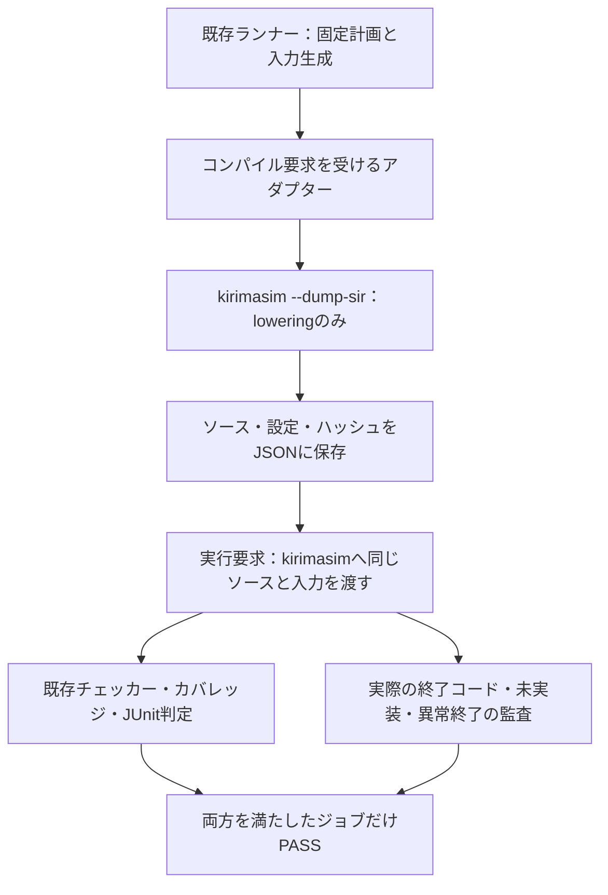

# kirimasimでローカル検証例を実行する

2026-11-03に、このリポジトリのIcarus向け検証例を[kirimasim](https://github.com/kurochan001/kirimasim)で実行し、テストベンチ2件の修正後、80例・107構成のsmokeがすべてPASSしました。対象、実行方法、移植時に見つけた問題、確認できない範囲を記録します。これは教材側の回路とチェッカーを使った互換性確認であり、SystemVerilog全体への適合性評価ではありません。

## 1. 対象と判定方法

[`tools/regressions.json`](../../tools/regressions.json)の130登録行から、`kind=simulation`かつ必要ツールが`iverilog`・`vvp`だけの80例を選びました。構成行列を展開すると107ジョブです。各例の既存smoke計画をそのまま使い、境界条件、固定ケース、seed 17のランダム入力、誤実装の検出、必要な機能カバレッジ、完了数、JUnitとソースハッシュを判定します。例ごとに含まれる項目は異なります。

通常回路の終了コード0だけを合格条件にしていません。意図的な誤実装・不正入力等は、既存ランナーが予定する失敗ラベルで検出される必要があります。未実装、コンパイルエラー、クラッシュ、タイムアウトは検出成功へ数えません。機能カバレッジは各例の`COVER`ログと要求カタログによるもので、ネイティブの`covergroup`やコードカバレッジの実測とは区別します。

### 使用した版

| 項目 | 条件 |
| --- | --- |
| 教材の起点 | [`aabb243ffcc5ae33b3bd06cc387a39840b5c3056`](https://github.com/kurochan001/lsi-verification-method/commit/aabb243ffcc5ae33b3bd06cc387a39840b5c3056)に、後述するテストベンチ2件の修正と実行ツールを追加 |
| kirimasim | [`d73d8922dfa20e19ccb9411adbe42a6d258bb49d`](https://github.com/kurochan001/kirimasim/commit/d73d8922dfa20e19ccb9411adbe42a6d258bb49d)、`0.0.0 (commit d73d8922dfa2)` |
| ビルド | 手元のdevビルド、CMake `Debug`、AppleClang `21.0.0.21000334`。配布release版の計測ではない |
| ホスト・Python | macOS 27.2、arm64、Python 3.13.15 |
| 比較対象 | Icarus Verilog 14.0開発版。kirimasimとは別の出力先で、同じ例・構成・smoke・seedを実行 |
| 設定 | 並列2、1コマンド60秒・1ジョブ900秒、kirimasim内蔵乱数seed 0、`--stop=error`、`--timescale=1ns/1ps` |

kirimasimのコミットは、確認時点の公開`main`とも一致しました。実行中に版が変わらないようバイナリーを出力先へ複製し、SHA-256を実行前後で確認します。今後の版で同じ結果になることや、性能の優劣を示すものではありません。

## 2. 実測結果

テストベンチ2件の修正後、**kirimasim・Icarusの両方で、80例・107構成のsmokeがすべてPASS**しました。追加したFIFO・AXI4・幅変換のnightlyも、両方で8構成すべてPASSしました。全80例のnightlyは今回実行していません。

| 確認 | kirimasim | Icarus | 範囲 |
| --- | --- | --- | --- |
| 修正前のsmoke、時間単位を未指定 | 46／107 PASS | 107／107 PASS | 設定差による失敗を含む初回結果 |
| 時間単位を明示、テストベンチ修正前 | 105／107 PASS | 107／107 PASS | AXI4・幅変換が失敗 |
| 修正後の全対象smoke | **107／107 PASS** | **107／107 PASS** | 80例、登録された全構成、既存の各smoke計画 |
| 修正後の追加nightly | **8／8 PASS** | **8／8 PASS** | FIFOの6構成＋AXI4＋幅変換。各nightlyの3 seedを使用 |

全smokeでは、kirimasimのlowering（内部表現SIRへの変換）936回と実シミュレーション2,314回を記録しました。実シミュレーションは終了コード0が1,509回、予定した失敗として既存ランナーが判定した終了コード1が805回で、未実装・クラッシュ・タイムアウトによる異常終了は0件でした。これらはツール起動数であり、要求数や検証項目数へ合算しません。

両シミュレータのsmoke出力先を照合し、生成した入力・期待値・実行トレース等の`.txt`・`.hex`・`.mem`計3,609ファイルが同一であることを確認しました。2,314個のシミュレーションログでは、`COVER`・`COUNT`・`RESULT`・`CHECK_FAIL`の内容と出現回数が一致しています。16ログは`COVER`の出力順が異なり、`COVER`以外の検査マーカーの順序は一致しました。ログの完全一致や、全信号・全時刻の波形等価性を示す比較ではありません。

[機械可読の実測記録](results-20261103.json)に、構成別の結果、起動数、ソース760件とバイナリーのSHA-256、修正前の試行、追加確認の終了コード、証跡のハッシュを収録しています。生ログ・入力・波形等はGit管理外の`artifacts/kirimasim-20261103/`に保存しました。`final-smoke/`・`icarus-final/`が最終smoke、`selected-nightly/`・`icarus-nightly/`が追加nightlyで、修正前の`full-smoke/`・`full-smoke-timescale/`を上書きしていません。

記録内の`adapter_sha256`と`tools/run_kirimasim_examples.py`のハッシュは、実測時のアダプターの値です。2026-11-06のアダプター修正により、現行ファイルのハッシュとは一致しません。修正後も、同じバイナリーと下記の手順で全107構成のsmokeを1回再実行し、PASSと起動数・終了コードの内訳が上記と同じであることを確認しました。この再実行は並列4・Python 3.14で行い、Icarusとの出力照合と追加nightlyは再実行していません。その後の[全体レビュー](../../PROVENANCE.md#repository-review-20261107)で刺激とテストベンチを増やしたため、起動数は変わりました。レビュー後に同じバイナリーで全107構成のsmokeを並列6で再実行した結果は、107／107 PASS、lowering 936回、実シミュレーション2,367回、終了コード0が2,495回・1が808回です。

### smokeを実行した80例

下表の構成数は統合ランナーが展開するジョブ数です。各ジョブ内でも、元の例が持つ追加構成・通常ケース・変異検出等を実行します。たとえば幅変換は1ジョブの内部で待ち0／2の2構成を扱います。

| 例 | ジョブ数 | kirimasim・Icarus |
| --- | --- | --- |
| [local-access-control](../../examples/local-access-control/README.md) | 1 | PASS |
| [local-activation](../../examples/local-activation/README.md) | 1 | PASS |
| [local-address-map](../../examples/local-address-map/README.md) | 1 | PASS |
| [local-ahb](../../examples/local-ahb/README.md) | 1 | PASS |
| [local-apb](../../examples/local-apb/README.md) | 3 | PASS |
| [local-apb-irq](../../examples/local-apb-irq/README.md) | 3 | PASS |
| [local-apb-irq-coverage](../../examples/local-apb-irq-coverage/README.md) | 1 | PASS |
| [local-apb-timer](../../examples/local-apb-timer/README.md) | 1 | PASS |
| [local-apb-uart](../../examples/local-apb-uart/README.md) | 9 | PASS |
| [local-arbiter](../../examples/local-arbiter/README.md) | 3 | PASS |
| [local-async-fifo](../../examples/local-async-fifo/README.md) | 1 | PASS |
| [local-automotive-ecu](../../examples/local-automotive-ecu/README.md) | 1 | PASS |
| [local-axi](../../examples/local-axi/README.md) | 1 | PASS |
| [local-axi-reorder](../../examples/local-axi-reorder/README.md) | 1 | PASS |
| [local-axi4](../../examples/local-axi4/README.md) | 1 | PASS |
| [local-axis](../../examples/local-axis/README.md) | 1 | PASS |
| [local-branch-predictor](../../examples/local-branch-predictor/README.md) | 1 | PASS |
| [local-bus-bridge](../../examples/local-bus-bridge/README.md) | 1 | PASS |
| [local-cache-coherence](../../examples/local-cache-coherence/README.md) | 1 | PASS |
| [local-cache-dma](../../examples/local-cache-dma/README.md) | 1 | PASS |
| [local-cdc-bridge](../../examples/local-cdc-bridge/README.md) | 1 | PASS |
| [local-cdc-handshake](../../examples/local-cdc-handshake/README.md) | 1 | PASS |
| [local-clock-reset](../../examples/local-clock-reset/README.md) | 1 | PASS |
| [local-conv-window](../../examples/local-conv-window/README.md) | 1 | PASS |
| [local-counter-snapshot](../../examples/local-counter-snapshot/README.md) | 1 | PASS |
| [local-coverage-feedback](../../examples/local-coverage-feedback/README.md) | 1 | PASS |
| [local-credit-link](../../examples/local-credit-link/README.md) | 1 | PASS |
| [local-descriptor-dma](../../examples/local-descriptor-dma/README.md) | 1 | PASS |
| [local-divider](../../examples/local-divider/README.md) | 1 | PASS |
| [local-dma](../../examples/local-dma/README.md) | 1 | PASS |
| [local-dma-ownership](../../examples/local-dma-ownership/README.md) | 1 | PASS |
| [local-dram](../../examples/local-dram/README.md) | 1 | PASS |
| [local-dsp](../../examples/local-dsp/README.md) | 1 | PASS |
| [local-e2e-guard](../../examples/local-e2e-guard/README.md) | 1 | PASS |
| [local-ecc](../../examples/local-ecc/README.md) | 1 | PASS |
| [local-ecc-memory](../../examples/local-ecc-memory/README.md) | 1 | PASS |
| [local-failure-reduction](../../examples/local-failure-reduction/README.md) | 1 | PASS |
| [local-fdir](../../examples/local-fdir/README.md) | 1 | PASS |
| [local-fifo](../../examples/local-fifo/README.md) | 6 | PASS |
| [local-i2c](../../examples/local-i2c/README.md) | 1 | PASS |
| [local-image-sobel](../../examples/local-image-sobel/README.md) | 1 | PASS |
| [local-image-soc](../../examples/local-image-soc/README.md) | 1 | PASS |
| [local-interconnect](../../examples/local-interconnect/README.md) | 1 | PASS |
| [local-irq-cdc](../../examples/local-irq-cdc/README.md) | 1 | PASS |
| [local-jtag-tap](../../examples/local-jtag-tap/README.md) | 1 | PASS |
| [local-load-store](../../examples/local-load-store/README.md) | 1 | PASS |
| [local-lockstep-monitor](../../examples/local-lockstep-monitor/README.md) | 1 | PASS |
| [local-mbist](../../examples/local-mbist/README.md) | 1 | PASS |
| [local-memory-order](../../examples/local-memory-order/README.md) | 1 | PASS |
| [local-motion-control](../../examples/local-motion-control/README.md) | 1 | PASS |
| [local-motion-io](../../examples/local-motion-io/README.md) | 1 | PASS |
| [local-network-echo](../../examples/local-network-echo/README.md) | 1 | PASS |
| [local-network-soc](../../examples/local-network-soc/README.md) | 1 | PASS |
| [local-packet-crc](../../examples/local-packet-crc/README.md) | 1 | PASS |
| [local-packet-switch](../../examples/local-packet-switch/README.md) | 1 | PASS |
| [local-performance-monitor](../../examples/local-performance-monitor/README.md) | 1 | PASS |
| [local-power](../../examples/local-power/README.md) | 1 | PASS |
| [local-priority-irq](../../examples/local-priority-irq/README.md) | 1 | PASS |
| [local-recovery](../../examples/local-recovery/README.md) | 1 | PASS |
| [local-reduction](../../examples/local-reduction/README.md) | 1 | PASS |
| [local-regression-report](../../examples/local-regression-report/README.md) | 1 | PASS |
| [local-requantize](../../examples/local-requantize/README.md) | 1 | PASS |
| [local-retry-link](../../examples/local-retry-link/README.md) | 1 | PASS |
| [local-riscv-iss](../../examples/local-riscv-iss/README.md) | 1 | PASS |
| [local-riscv-pmp](../../examples/local-riscv-pmp/README.md) | 1 | PASS |
| [local-riscv-traps](../../examples/local-riscv-traps/README.md) | 1 | PASS |
| [local-scan-atpg](../../examples/local-scan-atpg/README.md) | 1 | PASS |
| [local-secure-lifecycle](../../examples/local-secure-lifecycle/README.md) | 1 | PASS |
| [local-sha256](../../examples/local-sha256/README.md) | 1 | PASS |
| [local-spi](../../examples/local-spi/README.md) | 1 | PASS |
| [local-store-buffer](../../examples/local-store-buffer/README.md) | 1 | PASS |
| [local-stream](../../examples/local-stream/README.md) | 4 | PASS |
| [local-stream-dma](../../examples/local-stream-dma/README.md) | 1 | PASS |
| [local-sv32](../../examples/local-sv32/README.md) | 1 | PASS |
| [local-systolic-array](../../examples/local-systolic-array/README.md) | 1 | PASS |
| [local-timer-watchdog](../../examples/local-timer-watchdog/README.md) | 1 | PASS |
| [local-tlb](../../examples/local-tlb/README.md) | 1 | PASS |
| [local-tmr](../../examples/local-tmr/README.md) | 1 | PASS |
| [local-uart](../../examples/local-uart/README.md) | 6 | PASS |
| [local-width-converter](../../examples/local-width-converter/README.md) | 1 | PASS |

## 3. 既存ランナーとの接続

[`run_kirimasim_examples.py`](../../tools/run_kirimasim_examples.py)を追加しました。Icarusのコンパイル・実行用インターフェースを受け、実体としてkirimasimを起動します。DUT、入力生成、期待値、チェッカー、カバレッジの合格条件は共通です。



kirimasimは1段階でソースを処理・実行するため、次の違いを明示しています。[固定版のユーザーマニュアル](https://github.com/kurochan001/kirimasim/blob/d73d8922dfa20e19ccb9411adbe42a6d258bb49d/docs/USER_MANUAL.md)も参照してください。

| Icarus向けの操作 | このアダプターで行うこと |
| --- | --- |
| `iverilog -g2012 -s TOP -P... -o ...` | `--dump-sir`でloweringまで確認し、実行手順とハッシュをJSONへ保存する |
| トップのパラメータ指定 | 独立した`kirimasim_parameters`モジュールの`defparam`へ変換し、元のトップとこのモジュールの2つを明示選択する |
| `vvp ... +VECTORS=... +WAVE=...` | 保存したソースと設定を再読込みし、同じplusarg・作業ディレクトリでkirimasimを実行する |
| `iverilog -V`・`vvp -V` | 「kirimasim adapter」と実際のkirimasimの版を返す。Icarusで実行したとは表示しない |

保存する`.vvp`は**JSON形式の実行手順**で、Icarusのバイトコードではありません。`.sir`も実行可能モデルではなく、`--dump-sir`はシミュレーションを実行しません。実行時に元ソースから再処理するため、Icarusとの速度比較にもそのまま使えません。`tools.json`等の`iverilog`・`vvp`というキーは、既存ランナーの入口名として残ります。

パラメータは整数のトップパラメータだけに限定し、不明なオプションや重複指定は拒否します。ソースの書換え、SVAの無効化、期待値の変更、失敗ケースの恒久除外は行いません。2件のテストベンチ修正は次節に明記します。

## 4. 実行で見つかった問題と修正

### 時間単位の省略

最初は、時間単位を省略したRTLと、`timescale`を持つテストベンチの組合せで`design element does not have a time scale defined`が発生しました。アダプターで`--timescale=1ns/1ps`を渡し、時間単位を省略した要素の既定値を指定しました。明示済みの`timescale`はそのままです。RTLファイルへ時間指定を一律追加したものではありません。

### AXI4：ファイル名の型

[`axi4_tb.sv`](../../examples/local-axi4/tb/axi4_tb.sv)は、ファイル名を`reg [2047:0]`へ保持し、`$dumpfile`・`$fopen`へ渡していました。Icarusでは動作していましたが、今回のkirimasimはpacked配列から`string`への暗黙変換を拒否しました。

ファイル名の宣言を`string vectors,wave;`へ変更しました。入力ファイル、波形出力先、回路への刺激、比較内容は同じです。移植時の型の違いとして扱い、Icarusで不正だったと断定しません。

### 幅変換：テストベンチ内の同一エッジの競合

[`width_tb.sv`](../../examples/local-width-converter/tb/width_tb.sv)は、クロック立上りで`ticks=ticks+1`を実行し、そのカウンターから組合せの`ready`を作っていました。同じエッジでDUTと下位スレーブも`ready`を読むため、プロセスの実行順序に依存します。

修正前の通常回路では、kirimasimが最初の64ビット書込みの途中で`WIDTH_SUBDATA`を報告しました。保存した波形では、下位Wデータが二重に受け付けられ、上位32ビットを期待する時点に下位32ビットが残っていました。同じ入力のIcarus実行はPASSしており、シミュレータ間の差からテストベンチの競合を発見できました。

カウンターを`ticks<=ticks+1`へ変更し、同一エッジのサンプリング中はカウンター由来の`ready`を安定させました。DUTの状態機械、データ経路、期待値、15目標、4種類の変異と失敗ラベルは変更していません。修正前の失敗結果も、修正後の再実行とは別に保存しています。

## 5. 再実行する

POSIX環境、Python 3.10以上、実行可能なkirimasimを別途用意します。全例用の[環境準備](../../tools/ENVIRONMENT.md)はkirimasimのインストール・ビルドを行いません。この実測で使ったビルドが必要な場合は、上記コミットと[kirimasim側のビルド手順](https://github.com/kurochan001/kirimasim/blob/d73d8922dfa20e19ccb9411adbe42a6d258bb49d/README.md)を確認してください。

リポジトリのルートから、新しい出力先を指定します。

```sh
# FIFOの全6構成を実行する
python3 tools/run_kirimasim_examples.py \
  --kirimasim /path/to/kirimasim --example local-fifo \
  --out artifacts/kirimasim-fifo

# 対象80例・107構成を、既存smoke計画で実行する
python3 tools/run_kirimasim_examples.py \
  --kirimasim /path/to/kirimasim --profile smoke --seed 17 --jobs 2 \
  --command-timeout 60 --job-timeout 900 \
  --out artifacts/kirimasim-smoke

# 同じ範囲をIcarusで比較するときの例：まず修正した2例
python3 tools/run_regression.py \
  --example local-axi4 --example local-width-converter \
  --profile smoke --seed 17 --jobs 2 --out artifacts/icarus-comparison
```

`--command-timeout`は、kirimasimの`--max-wall-time`へ整数秒に切り上げて渡す上限です。時間超過を`events/`へ記録できるよう、アダプターのプロセス監視はこれより5秒、既存ランナー側の上限は10秒長くしています。

`--example`は繰り返し指定でき、省略時は条件に合う全登録例を選びます。`--profile nightly`も渡せますが、nightlyを指定した実行の範囲と結果を別に確認してください。未対応のシミュレータ用オプションを黙って捨てたり、Icarusへ自動的に切り替えて合格させたりはしません。

| 出力 | 確認すること |
| --- | --- |
| 最上位`summary.json` | 既存ランナーとkirimasimの実行監査を合わせた合否、対象数、ソース変更の有無 |
| `manifest.json`・`adapter.json` | 実行コマンド、選んだ例、ソース・バイナリーのSHA-256、実際の版 |
| `events/*.json` | lowering／実行の実コマンドと作業ディレクトリ、終了コード、未実装・異常終了 |
| `campaign/` | 既存統合ランナーの計画・判定・JUnit・ソース照合 |
| `campaign/runs/` | 構成別ログ、入力列、波形、必要目標、誤実装の検出結果、JSONの実行手順、SIR |

既存ランナーがPASSでも、対応するkirimasimの実行記録が無い場合や、未実装・クラッシュ・タイムアウトがある場合は最上位でPASSにしません。異常終了を拒否するテスト、パラメータ変換、不明なオプションの拒否、保存後のソース・バイナリー変更の検出は[ツールのセルフテスト](../../tools/tests/test_kirimasim_examples.py)で確認します。

### GitHub Actionsで最新版を実行する

[Kirimasim latest](../../.github/workflows/kirimasim.yml)は、kirimasimの`main`の最新コミットをビルドし、同じ80例・107構成のsmokeを毎日実行します。[起動条件と失敗の切り分け](../../tools/CI.md#kirimasimの最新版)はCIの説明にあります。この節の上にある記録は`d73d8922dfa2`の実測のままで、Actionsの結果では更新しません。各実行の結果はSummaryと14日間保存される証跡で確認します。

## 6. 確認範囲の外側

残る50登録行は、Verilatorや外部モデル等を使うシミュレーション27行、`formal`タグ13行、集約9行、STA 1行です。必要ツールが異なるため、今回の80例の実行へ混ぜていません。集約の子として同じ回路を使う場合もありますが、親側の全工程を実行したとは扱いません。[公開DV環境の参照例13件](../method/open-source-dv-environments.md)も、このローカル実行範囲とは別です。

代表的なSVA例とUVM例については、追加で`--dump-sir`までを試しました。以下は**シミュレーションの成功結果ではありません**。

| 追加確認 | 実際に確認した結果 |
| --- | --- |
| [`local-sva`](../../examples/local-sva/README.md)の3 SystemVerilogソース | 終了コード2。`irq_checker.sv`の同時アサーションで`unsupported: statement 'ConcurrentAssertion'`。アサーションを無効化して実行してはいない |
| [`local-uvm`](../../examples/local-uvm/README.md)＋UVM 2020.3.2、`UVM_NO_DPI` | 終了コード2。`uvm_globals.svh:139`等で`expected subroutine port declaration`。この条件ではUVM例を実行できず、UVM全体の対応可否は推測しない |

SVAの追加確認は、次のように再現できます。`--dump-sir`の成功だけでも、アサーションの実行・検出力・カバレッジの確認にはなりません。

```sh
/path/to/kirimasim --dump-sir --top=sva_tb --timescale=1ns/1ps \
  examples/local-irq-cdc/rtl/irq_pending.sv \
  examples/local-sva/irq_checker.sv examples/local-sva/sva_tb.sv
```

UVMの確認は、[固定版ライブラリ](../../tools/uvm-source-sha256.json)を用意し、同じ条件で行いました。

```sh
UVM_HOME=/path/to/1800.2-2020.3.2
/path/to/kirimasim --dump-sir --top=top --timescale=1ns/1ps \
  -I"$UVM_HOME/src" -Iexamples/local-uvm/tb +define+UVM_NO_DPI \
  "$UVM_HOME/src/uvm_pkg.sv" examples/local-uvm/tb/apb_if.sv \
  examples/local-uvm/tb/uvm_apb_pkg.sv examples/local-apb/rtl/apb_regs.sv \
  examples/local-uvm/tb/top.sv
```

この結果を、ネイティブcovergroup／コードカバレッジ、フォーマルの再証明、cocotb・VPI、C++・DPI、SystemC、SPICE協調、上流DV環境の実行成功へ読み替えません。通常のCIと環境診断の既定ツールもIcarus／Verilatorのままです。
