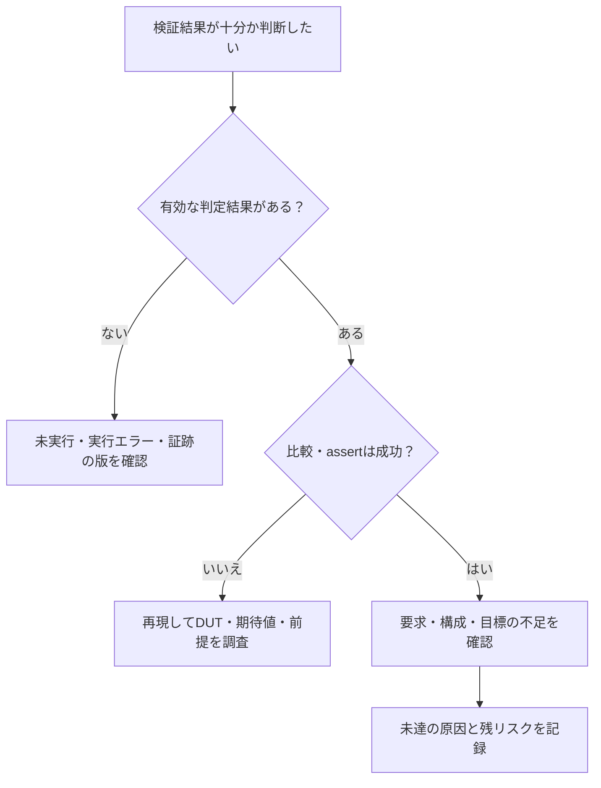

# LSI検証のFAQ

手法の導入、網羅率の読み方、検証方式の使い分け、実行例の利用で迷いやすい点をまとめています。用語の意味は[用語集](glossary.md)、全体像と資料一覧は[README](../README.md)を参照してください。

ここでの完了条件・台帳運用は本リポジトリの提案手順です。ケーススタディの実績、説明用モデルの動作確認、製品への適用を区別します。

## 疑問に応じた確認の順序

未達、失敗、判定不能を分けてから、対応する手順書で原因と次の作業を確認します。

この図は質問を整理する案内です。比較が成功しても、適用範囲や必要な要求が満たされたかは別に確認します。

| 疑問 | 参照先 | 先に確認するもの |
| --- | --- | --- |
| binが未達 | [機能カバレッジ](method/functional-coverage.md) | 刺激・制約・収集時点・適用範囲 |
| 失敗を再現できない | [ランダム検証](method/constrained-random-verification.md) | seedに加え版・構成・実入力 |
| formalがPASS | [フォーマル検証](method/formal-verification.md) | 仮定・証明方式・到達・深さ |
| リグレッションが完了しない | [継続リグレッション](method/continuous-regression.md) | 予定と実績・欠落・期限 |

## 目次

- [導入と適用範囲](#1-導入と適用範囲)
- [要求とカバレッジ](#2-要求とカバレッジ)
- [ランダム検証と検出力](#3-ランダム検証と検出力)
- [SVAとフォーマル検証](#4-svaとフォーマル検証)
- [CDCとリセット](#5-cdc検証)
- [ミューテーションと縮退](#6-ミューテーションと縮退)
- [GitLabと実行例](#7-gitlabと実行例)
- [変更後の再確認と完了判断](#8-変更後の再確認と完了判断)

## 1. 導入と適用範囲

### Q1. どこから読み始めればよいですか

[一般化した検証手順](method/spec-to-verification-method.md)で、仕様→要求→刺激・観測・判定→証跡という対応を確認します。[検証領域の点検](method/verification-gap-review.md)と[適用範囲の雛形](templates/verification-scope.md)で担当・構成・開発段階を決め、小さなIPの少数の要求を対象に検証手順を一通り実施します。動く例から入る場合は[GitLabの実行例](../examples/gitlab-regression/README.md)をローカルで実行してください。

### Q2. この資料はどのような位置付けですか

半導体検証に関する一般的な情報をまとめ、仕様から要求を整理し、検証方式の選定、刺激・観測・判定、証跡の管理、完了判断へつなげる流れを説明した資料です。ケーススタディとして、IEEE 1800-2023を仕様とみなした言語テストとの照合を掲載しています。IRQ・CDC・SVA・covergroup・フォーマルの説明例には、理解を助けるコードや動作確認の記録を添えています。各例の確認範囲は個別の資料に、資料の由来は[由来と改訂範囲](../PROVENANCE.md)に記載しています。

### Q3. 最初に何を記録すればよいですか

少なくとも、仕様の版と出典、要求ID、条件と期待結果、適用構成、刺激、観測点、合格基準、必須の到達目標、実行ID・入力の版・結果、残件を対応付けます。たとえば「イベントとW1Cが同時ならPENDをセット」が要求なら、同時受理を作る刺激、同じ受理エッジの観測、更新後PENDの判定、セット優先を壊したときの検出まで確認します。実行前の計画と実行後の証跡を同じものとして扱わないようにします。[要求台帳と検証計画](method/spec-to-verification-method.md#4-準備)に項目例があります。

### Q4. UVMは必須ですか

必須ではありません。ディレクテッドテスト、手続き的チェッカー、SVA、フォーマルなどでも要求との対応は作れます。UVMは操作や監視部品の再利用、複数インターフェースの協調などに役立ちますが、導入しただけで要求の抜けや期待値の誤りが解消するわけではありません。本リポジトリには[UVM資料](method/uvm-verification.md)に加え、[APBを使うUVM・RALの実行例](../examples/local-uvm/README.md)があります。Verilatorと外部のUVMライブラリを準備して実行します。

## 2. 要求とカバレッジ

### Q5. 要求はどこまで細かく分けますか

条件・観測点・期待結果を個別に確認でき、未達の理由を説明できる単位に分けます。「割り込みが動く」だけでは、セット、保持、W1C、競合優先順位、mask、リセットのどこを検査したかが分かりません。一方、同じ条件を言い換えて登録数を増やすと分母を歪めます。複数テストで条件を分担するならAND集合として定義し、必須の全メンバーを確認します。[要求の抽出](method/spec-to-verification-method.md#6-段階b要求の抽出)と[照合](method/spec-to-verification-method.md#8-段階d既存の検証資産との照合)を参照してください。

### Q6. カバレッジが100%なら検証完了ですか

その数値だけでは完了にできません。covergroupの100%は定義したbin、コードカバレッジの100%は選んだ実装指標の範囲です。必要な機能をモデルへ入れたか、同じケースの結果を正しく判定したか、必須構成・インスタンスで達成したか、未完了・例外・古い証跡がないかも確認します。[機能カバレッジの完了条件](method/functional-coverage.md#7-集計mergeと完了条件)と[サインオフ記録](templates/signoff-record.md)へつなげます。

### Q7. 設計網羅率と実行確認率は何が違いますか

ケーススタディの設計網羅率は、登録要求に対して観測点をレビューしたテスト対応がある割合です。実行確認率は、現在の入力・ランナーに対応する成功証跡がある割合です。対応を登録したが未実行なら前者だけが増えます。分母・入力の版・環境と、暫定値か確定値かを一緒に確認します。複数シミュレータの成功の和集合は、1つのシミュレータの適合率ではありません。[計測規則](case-study-ieee1800/coverage-rules.md#計測の意味)を参照してください。

### Q8. すべての機能をcrossすれば十分ですか

全軸の直積は急増し、意味のない組も含みます。まず共有状態・資源・優先順位・モード・リセットなどの依存を調べ、相互作用がある組を目標にします。同時動作だけでなく、前後の順序、中断・復帰も含めます。個々の機能を単独で検査しても、同じケースの相互作用を確認したことにはなりません。高リスクな組は3機能以上も明示して残します。[機能間クロス検証](method/feature-interaction-verification.md)を参照してください。

### Q9. 到達しないbinは除外してよいですか

未到達だけを理由には除外しません。刺激不足、過剰な制約、収集時点の誤り、適用判断の未確定、仕様上の到達不能を調べます。有限深さのformal cover未達も、直ちに到達不能の証明にはなりません。対象外・到達不能と判断するなら仕様や証明の根拠、適用構成、承認、変更前後の分母を残します。[カバレッジの除外と集計](method/functional-coverage.md)を参照してください。

## 3. ランダム検証と検出力

### Q10. seedは何個回せば十分ですか

一律の個数では決めません。要求、必須構成、境界・相互作用、負荷・時間、到達と判定、既知バグや変異の検出から計画します。未達には重み・シナリオの調整やディレクテッドテストを足します。新しいbinが増えなくなったことや予算を使い切ったことは、バグがない証明ではありません。未実行・残リスクも報告します。[ランダム検証の計画](method/constrained-random-verification.md)を参照してください。

### Q11. seedだけ保存すれば失敗を再現できますか

seedは再現条件の一部です。RTL、テスト、制約、チェッカー・参照モデル、構成、ツール・ライブラリの版、実行引数、外部乱数源も保存します。同じ数値でも環境が変われば同じ刺激になるとは限りません。失敗時には実入力、受理・完了、クロック・リセット、波形・ログも残し、元の環境で再実行して確認します。[再現性の記録](method/constrained-random-verification.md#5-seedと実行を再現できるようにする)を参照してください。

### Q12. チェッカーが弱い、または期待値が間違っていることはどう確かめますか

要求ごとに「どの誤実装なら、どの観測・比較が変わるか」を別の検証者が確認します。期待値をDUTの処理からそのまま作らず、仕様の解釈と参照モデルもレビューします。元の回路の合格を確かめた上で、代表的な誤実装を入れ、意図したチェッカーで検出する対照確認も行います。比較用シミュレータとの多数決だけで仕様の正解を決めません。[独立検証](method/spec-to-verification-method.md#10-段階f独立した検証)と[ミューテーション検証](method/mutation-verification.md)を参照してください。

## 4. SVAとフォーマル検証

### Q13. assert、cover property、covergroupはどう使い分けますか

assertは必要な性質の検査、cover propertyは事象や時間関係の成立・到達の確認、covergroupは値・状態・組み合わせの分類に使います。たとえば同時イベントの発生をcoverし、その後のPENDをassertで確認し、事前状態やIRQ_ENとの組をcovergroupで数えます。到達だけで正しい結果だったとは判断しません。[SVAの役割](method/sva-verification.md#1-assertassumecoverの役割)と[機能網羅](method/functional-coverage.md)を参照してください。

### Q14. assertの失敗が0なのに検証不足になるのはなぜですか

前件が成立せずにパスした（vacuous pass）、リセットで毎回評価が中断した、チェッカーを有効化していない、必要な構成へ適用していない、といった可能性があります。前件と完了経路の到達、評価の有効期間、適用先、X/Zによる回避を確認します。`disable iff`で無効にした期間のリセット動作は、別の検査が必要です。[リセット・X・vacuous pass](method/sva-verification.md#4-リセットxvacuous-passを管理する)を参照してください。

### Q15. SVAの期待値が1サイクルずれたように見えます

通常のクロック付き並行アサーションのサンプル値と、同じエッジのNBA更新後の値を区別します。1サイクルの前件なら`|->`は同じサンプリング時点、`|=>`は次の時点から後件を評価します。前件が複数サイクルなら、その一致の終端が基準です。波形のライブ値だけで判断せず、サンプル値、履歴の有効性、リセットの中断を確認します。[SVAの時間演算](method/sva-verification.md#3-サンプリングと時間演算を合わせる)と同資料の割り込み例の時系列図を参照してください。

### Q16. フォーマルでPASSなら全動作を証明したことになりますか

モードと最終結果を確認します。BMCの反例なしは指定した有限深さまで、非有界の安全性証明は対象プロパティがモデル・仮定・初期状態の下で成立した結果、cover到達は目標へ至る経路を得た結果です。未記述の要求や除いたモードには広げられません。タイムアウト・unknown・errorも証明済みにはしません。[結果の読み分け](method/formal-verification.md#5-実行方式と結果を読み分ける)を参照してください。SBYのモード・depthの意味は[公式設定資料](https://yosyshq.readthedocs.io/projects/sby/en/stable/reference.html)にあります。

### Q17. assumeを付ければランダム入力もその条件に従いますか

assumeを書くだけでシミュレーションの刺激が自動的に制約されるとは扱いません。生成器の制約と、実入力が前提を守るかの検査を用意します。フォーマルではassumeが対象とする振る舞いを制限するので、出典・理由・満たす側を記録します。DUTの正しい出力を仮定して同じ出力を証明したり、合法な競合を禁止して通したりしないようにします。[SVAの役割](method/sva-verification.md#1-assertassumecoverの役割)と[仮定の管理](method/formal-verification.md#3-環境の仮定と初期状態を管理する)を参照してください。

### Q18. フォーマルがあればシミュレーションは不要ですか

要求ごとに分担を決めます。小さな制御の不変条件を証明し、実バス・ソフトウェア・複数IPの長いシナリオをシミュレーションで確認する組み合わせもあります。抽象モデルや単体の証明の仮定は統合先で確認します。どちらでも、扱っていない構成・動作を台帳に残し、相手の方式で確認済みだと推測しません。[フォーマルの対象選定](method/formal-verification.md#1-何をフォーマル検証で確認するか)を参照してください。

商用ツールがない場合も、[GitLabのフォーマル検証例](../examples/gitlab-formal/README.md)で、オープンソースのYosys・SBY・Z3を使えます。GitLabのジョブ内で準備するため、手元へのインストールは不要です。制御の証明とデータの有界検査を分けて結果を読めます。

## 5. CDC検証

### Q19. ±1サイクルの遅延や同期化FF段数の変更は、CDC検証に使えますか

受信時刻の不確定さへの耐性を調べる手段として使えます。クロックエッジのジッター、実行ごとに固定する段数・遅延の変更、転送ごとの観測遅延の変化を分けます。基準遅延Nと−1／0／＋1の単位・捕捉条件・許される出力列を定義し、モデルだけが余分なパルスや過去値の再出力を作らないか確認します。−1は基準より早い観測で、未来の入力の先読みではありません。[Dynamic CDCの説明](method/verification-gap-review.md#4-cdcrdcとクロック制御)を参照してください。

### Q20. そのCDC試験が合格すれば、実回路の同期器も安全ですか

論理遅延モデルの合格だけでは、物理的なメタスタビリティの収束やMTBFは確認できません。CDC/RDCの構造・制約・除外のレビュー、転送方式ごとの欠落・重複・整合性、リセット解除、必要な物理条件をそれぞれ確認します。GitLab例は、送信値を保持するtoggle転送と2経路の再収束を扱う限定モデルです。短パルス、非同期FIFO、全CDCの検証済みとは扱いません。[CDC/RDCの範囲](method/verification-gap-review.md#4-cdcrdcとクロック制御)と[例の対象](../examples/gitlab-regression/README.md#1-実行するもの)を参照してください。

## 6. ミューテーションと縮退

### Q21. 意図的な不具合を検出したら、変異検証と故障注入は同じ評価ですか

目的と合格条件を分けます。ミューテーション検証では、仕様を壊す変異を検証環境が検出するかを見ます。安全機構の故障注入では、仕様どおりの検出・訂正・通知・復帰が合格になる場合があります。どちらもコンパイル失敗や任意のクラッシュだけを検出成功にはしません。元の回路との対照、意図した失敗ラベル、未検出・等価・無効・未完了の分類と分母を残します。[ミューテーション検証](method/mutation-verification.md)を参照してください。

### Q22. 検証が膨大です。pairwiseへ減らせばよいですか

pairwiseは選んだ2軸の合法な組を覆う方法で、3軸以上の依存や操作順序を保証しません。依存の強い組は高次・狙いを定めたシナリオとして残し、同値分割、境界値、代表構成、目標とテストの対応による選択も組み合わせます。削減後は必須目標・チェッカー・既知バグ・代表的な変異の検出を確認し、広い定期リグレッションと再評価条件を残します。[縮退の手順](method/verification-reduction.md)を参照してください。

モデル・必要な次数を定め、既存テストが実際に到達・判定した目標を対応付け、未達へ追加する進め方は[機能間クロス検証](method/feature-interaction-verification.md#43-既存テストの充足状況から追加を選ぶ)にまとめています。生成計画が100%でも実行済みとは限らないため、計画上の充足率・実観測の到達率・判定付きの合格率を分けます。[記録の雛形](templates/interaction-coverage-plan.md)も利用できます。[APB＋割り込みのローカル比較例](../examples/local-apb-irq-coverage/README.md)では、モデルと実観測、既存目標、追加ケースの選択、再実行時の検出力とコストを確認できます。

### Q23. 小さい幅・FIFO深さの合格を、大きい構成へ流用できますか

一般化の根拠が必要です。幅や深さで境界、アドレス折り返し、占有数、仲裁、時間関係が変わる可能性があります。代表構成にできる条件、残す境界・例外、形式的に性質を保存する根拠を記録します。根拠がなければ小さいモデルの結果として扱い、製品の必須構成を合格にしません。[構成・抽象化の縮退](method/verification-reduction.md)と[構成別の判定](method/spec-to-verification-method.md#95-構成とバリアント)を参照してください。

## 7. GitLabと実行例

### Q24. CIが緑なら要求も合格していますか。JUnitだけで失敗させられますか

CIの緑は設定したジョブの合格です。予定ケースの欠落、必須目標、未完了、チェッカーの実行結果をランナーが判定し、異常を非0の終了コードへ反映する必要があります。GitLabのJUnitレポートは結果表示用で、単独ではジョブの状態を変えません。[GitLab公式のJUnit説明](https://docs.gitlab.com/ci/testing/unit_test_reports/)

IRQ・FIFO・APB・APBと割り込み・ready/valid・UART・APBとUARTの結合などの手続き的なシミュレーション例は`requirements-and-coverage`で必須目標を照合し、未達ならリグレッションを失敗させます。フォーマル例は、読み込んだプロパティ・仮定、モード、実際の状態と証跡を照合します。MRのマージ制御にはGitLab側の設定も必要です。手動・未起動・skipしたパイプラインを含む規則も確認してください。[GitLab CIの構成と確認記録](../README.md#gitlab-ciの構成と実行確認記録)と[例のGitLab設定](../examples/gitlab-regression/README.md#3-gitlabへ置いて実行する)を参照してください。

CIが成功していても、MRがDraftならマージはブロックされます。マージ条件の表示で、パイプラインの失敗、Draft、承認待ち、コンフリクトなどを切り分けます。Draftを解除する操作は「Mark as ready」です。2026-10-26に確認したmainは、APB・UART・割り込み結合検証のMR !11と確認記録のMR !12まで取り込み済みです。現行構成は全50ジョブ・通常JUnit 311件で、MR !12のCIの成功と、その後のmainのCIの成功を確認しています。追加例の状態は[GitLab CIの構成と確認記録](../README.md#gitlab-ciの構成と実行確認記録)と各例の確認記録を参照してください。

現行設定ではREADMEだけの変更でも全50ジョブを起動します。MRが開いているブランチの重複したpushパイプラインは抑止しますが、文書だけの変更に対するリグレッションの縮退は実装していません。共有Runnerの計算時間の利用枠も確認してください。

### Q25. このリポジトリだけで何を実行できますか

`examples/gitlab-regression/`の説明用IRQリグレッションは、Python 3.10以上とIcarus Verilogの`iverilog`・`vvp`があればローカルで実行できます。[ローカル手順](../examples/gitlab-regression/README.md#2-まずローカルで実行する)にコマンドがあります。通常回路、変異、X注入、要求・50目標の照合を行い、手続き的チェッカーの観測記録を集計します。UVM、SVAのカバレッジ、covergroup DB、フォーマルをそのジョブで実行する例ではありません。

同じ環境で[同期FIFOのランダム検証](../examples/gitlab-fifo/README.md)も実行できます。参照キューによる比較、境界テストとseed付き操作列、リセット、3種類の変異の検出を行います。深さと幅を変えた6構成をそれぞれ判定するGitLab設定もあります。

[APBレジスタ検証](../examples/gitlab-apb/README.md)も同じ環境で実行できます。3種類の待ち時間、アドレス分類×操作、エラー応答、W1Cとイベントの競合、リセットを比較し、構成ごとの必須目標を判定します。

[APBと割り込みの結合検証](../examples/gitlab-apb-irq/README.md)では、既存のAPB回路を使い、マスク中のイベント保持、W1Cと再発生、マスク更新、複数要因、リセットを組み合わせます。4要因×マスク×クリア×イベントの32クロスを含め、構成ごとに44／45目標を判定します。

[ready/valid通信のランダム検証](../examples/gitlab-stream/README.md)では、受信側の待ちを入れ、validとデータの保持、同時送受信、欠落・重複・順序を確認します。最後まで排出し、受理数・受信数・リセット破棄数も照合します。深さ1／3×幅8／16の4構成で必須25／29目標を判定します。

[SVAの実行例](../examples/gitlab-sva/README.md)はVerilatorとC++コンパイラ・makeを使います。GitLabのジョブ内で準備し、6個のassert、12個のネイティブカバー、6種類の違反、前件不足の診断を実行します。ローカルでは`--checker-off`で無効化を合格にしない確認もできます。2値シミュレーションなので、X/Zの検証は別に行います。

[リグレッションの縮退の比較](../examples/gitlab-reduction/README.md)では、全件、目標だけの選択、ストレス保持を別々に実行します。目標19件を満たしても履歴依存の変異を見逃す例を含め、検査サイクル数と検出力の両方を比較します。比較教材のCI成功を、そのまま縮退方式の製品承認には使いません。

[アービタの検証](../examples/gitlab-arbiter/README.md)では、排他制御、ラウンドロビン順序、待ち中の選択保持、公平性を確認します。受信側が受理できる機会と実クロック数を分け、停止中を飢餓の検査済みに数えません。2／3／4要求元で21／31／49目標を判定し、専用テストで公平性モニター単独の違反検出も確認します。

[UARTのランダム検証](../examples/gitlab-uart/README.md)はIcarus Verilogで8N1／8E1／8O1の送受信を確認します。データと位相の変更、パリティ・フレーミングエラー、偽スタート、転送中リセットを含みます。ビット周期は一致させており、周波数ずれやアナログのCDC安全性を検証したとは扱いません。

[APB・UART・割り込みの結合検証](../examples/gitlab-apb-uart/README.md)では、APBから実際に送信し、受信データを読み、完了・エラーの割り込みを確認します。マスク中の保持、W1Cと新規イベント、RXDATA読出しと新規受信を同時に起こし、9構成と5種類の変異で判定します。受信保持は1バイトで、CPUや実ドライバは実行していません。

GitLabの利用枠を使わずに追加の教材を試す場合は、[ECCの故障注入](../examples/local-ecc/README.md)、[SPIのランダム検証](../examples/local-spi/README.md)、[タイマー・ウォッチドッグ](../examples/local-timer-watchdog/README.md)があります。[共通手順](../examples/local-common/README.md)に従ってIcarus Verilogでローカル実行します。さらに、[非同期FIFO](../examples/local-async-fifo/README.md)、[I²C](../examples/local-i2c/README.md)、[APB＋タイマー＋ウォッチドッグ](../examples/local-apb-timer/README.md)も同じ共通ランナーで動きます。[AHB-Lite](../examples/local-ahb/README.md)と[AXI4-Lite](../examples/local-axi/README.md)では、パイプラインや独立チャネルの受付・応答も確認できます。AHB／AXIのランダム刺激を拡張し、[ローカルのフォーマル例](../examples/local-bus-formal/README.md)も追加しました。仮定付きの安全性証明、深さ12のデータBMC、到達性と不具合検出を別々に判定します。これらはGitLab CIへ組み込んでいません。

AHB／AXIを広く確認する場合は、[プロトコル・クロス・X／リセット・性能・lint／コードカバレッジ](../examples/local-bus-validation/README.md)をまとめて実行できます。[APBブリッジ](../examples/local-bus-bridge/README.md)は4構成、[AXI4のバースト・ID・複数未完了転送](../examples/local-axi4/README.md)は別RTLの1構成です。AHB-Lite／AXI4-Liteの45タスクは元の回路に限定されます。AXI4には別の[小構成の制御証明・データBMC](../examples/local-axi4-formal/README.md)があり、新しいブリッジの証明結果ではありません。

さらに[システム検証の7例](../examples/local-system-regression/README.md)で、DMA、複数マスター、非同期ブリッジ、タイムアウト復旧、低電力制御、AXI4フォーマル、FIFO等価性を実行できます。tagの再利用には下位応答も破棄する協調リセットが必要です。低電力はRTL動作モデル、等価性はSBY方式です。各例の制限を確認してください。

[追加検証の7例](../examples/local-advanced-regression/README.md)には、AXI4-Stream、固定小数点、同一領域の競合、Cドライバ、cocotb、複数シミュレーター差分、進行条件と完了期限があります。Cコードは実際にコンパイルしてRTLへ接続します。差分の一致だけでは正しさとせず、通常実行は各バックエンドの参照モデル照合も要求します。

[FIFOのフォーマル検証](../examples/gitlab-formal/README.md)は、専用のPythonパッケージをGitLabのジョブ内で準備して実行します。ローカルで試す場合の一時仮想環境の手順も用意しています。

`tools/`はケーススタディの台帳・テスト・依存モジュールを前提とする参照実装です。このリポジトリだけでは動きません。一般化したJSON記録例を、そのまま照合キットへ投入できる形式とも扱わないでください。[ツールの復元先と依存](../tools/README.md)を参照してください。

### Q26. リグレッションが失敗したら、何から確認しますか

予定と実行結果の欠落、ビルド、実行環境、DUTの比較失敗、チェッカー・期待値、必須目標の未達を切り分けます。マニフェスト、ツール版、ビルドログ、ケース別ログ・波形、summary、カバレッジ、JUnitを実行IDでたどります。実行例では意図した変異・X検出が成功項目になるので、通常回路の失敗と区別してください。再実行で合格しても最初の失敗は残します。中断時は最終JUnitやsummaryが完成しない場合もあるため、途中の記録から調べます。[保存する証跡](../examples/gitlab-regression/README.md#6-保存するものと判定)と[継続リグレッションの手順](method/continuous-regression.md)を参照してください。

## 8. 変更後の再確認と完了判断

### Q27. 承認後にテストや仕様を少し変えた場合も、再レビューが必要ですか

変更が刺激・期待値・観測・適用条件・要求の意味へ影響するかを確認し、必要な照合と実行をやり直します。照合キットのローカル改訂では、承認時の照合案・テスト入力・関連要求のスナップショットと現在の内容を比較し、古い承認やスナップショットのない承認を停止対象にします。現入力を独立にレビューしてから承認し直します。コマンドでハッシュを記録するだけではレビューになりません。[照合キットの承認・統合](../tools/matching_kit/README.md#workflows)を参照してください。

### Q28. 未達が残っていてもサインオフできますか

開発段階の必須条件と承認権限に従って判断します。例外を認める場合も、未達の状態、影響、代替検証、残リスク、担当・期限、承認者・対象版を残します。例外承認を技術的な合格へ置き換えません。機能検証の完了と、タイミング、DFT・製造、物理・信頼性などの完了も区別し、必要な担当の証跡をそろえます。[サインオフ記録の雛形](templates/signoff-record.md)と[製品開発で併せて必要な項目](method/spec-to-verification-method.md#14-実際の半導体設計で併せて必要な項目)を参照してください。

## 失敗の縮小やカバレッジ収束も試せますか？

[失敗の縮小](../examples/local-failure-reduction/README.md)は、同じチェッカーで不具合を再現する操作列を削り、元の正常RTLでは合格することまで確認します。[カバレッジによる刺激調整](../examples/local-coverage-feedback/README.md)は、実RTLの観測から未達を選び、同じサイクル予算で固定分布のランダム刺激と比較します。到達数と結果の正しさは別々に判定します。

[幅変換・アクセス保護・ECCメモリ・クロック停止／リセット・UVMを含む7例](../examples/local-workflow-regression/README.md)としてまとめて実行できます。GitLabの利用枠は使いません。

## UVMの本物の制約・covergroupや、仕様からのレジスタ生成も試せますか？

[UVMランダム例](../examples/local-uvm-random/README.md)でSVの制約付きランダム化とネイティブcovergroupを、[SystemRDL例](../examples/local-register-spec/README.md)でRTL・Cヘッダー・RALの生成と独立契約による照合を実行できます。[反例再現](../examples/local-formal-replay/README.md)、優先順位付き割り込み・リング式DMA・クレジット通信・小規模キャッシュも含めた[7例の集約手順](../examples/local-soc-regression/README.md)があります。GitLabの利用枠は使いません。

## 既存例をさらに結合した教材はありますか？

[RAL接続・AXI順序・DMA・CRC・カウンター・MBISTの7例](../examples/local-extension-regression/README.md)があります。生成RALの実バス接続、ID別応答順序、DMA所有権、メモリとStreamの結合に加え、CRC・64ビットスナップショット・MBISTを扱います。いずれもローカル実行で、必要な環境と教材の制約を各READMEへ記載しています。
