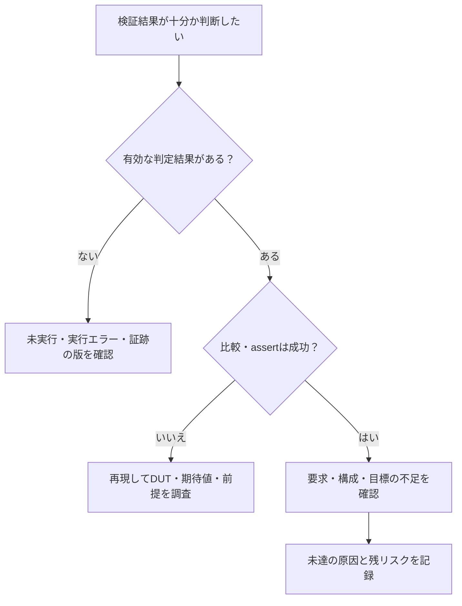

# LSI検証のFAQ

手法の導入、網羅率の読み方、検証方式の使い分け、実行例の利用で迷いやすい点をまとめています。用語の意味は[用語集](glossary.md)、全体像と資料一覧は[README](../README.md)を参照してください。

ここでの完了条件・台帳運用は本リポジトリの提案手順です。ケーススタディの実績、説明用モデルの動作確認、製品への適用を区別します。

## 疑問に応じた確認の順序

未達、失敗、判定不能を分けてから、対応する手順書で原因と次の作業を確認します。



この図は質問を整理する案内です。比較が成功しても、適用範囲や必要な要求が満たされたかは別に確認します。

| 疑問 | 参照先 | 先に確認するもの |
| --- | --- | --- |
| binが未達 | [機能カバレッジ](method/functional-coverage.md) | 刺激・制約・収集時点・適用範囲 |
| 失敗を再現できない | [ランダム検証](method/constrained-random-verification.md) | seedに加え版・構成・実入力 |
| formalがPASS | [フォーマル検証](method/formal-verification.md) | 仮定・証明方式・到達・深さ |
| リグレッションが完了しない | [継続リグレッション](method/continuous-regression.md) | 予定と実績・欠落・期限 |
| lintが通ったのに警告が残る | [静的検査と警告管理](#13-静的検査と警告管理) | `clean`、既知指摘、除外理由、ソースと構成 |
| 同じ比較エラーで原因が分からない | [失敗解析](#14-失敗解析と再現) | 最初の相違、仕様値、実測値、期待値 |
| AIの提案を採用してよいか迷う | [AIを使う検証](#15-aiを使う検証) | 出典、要求抜け、独立した期待値、正常・負例の実行 |
| reset後だけ上位UVMが失敗する | [上位UVMと個別リセット](#16-uvm移行上位再利用複数クロック) | 受理・完了・取消、観測時刻、IDとリセット世代 |
| 再実行の結果をまとめたい | [計画と採用結果](#17-仕様変更証明依存実行結果の読み方) | 固定計画、最後の試行、古い証跡、親子の重複 |
| 環境準備と文書検査の合格範囲を知りたい | [環境・文書・ツール版](#18-環境準備文書検査ツール版) | 選んだプロファイル、診断・構造検査・動作確認の違い |
| 画像処理IPからCPU付きSoCへ進みたい | [画像処理とSoC](#20-画像処理とcpu付きsoc) | 画素の対応、ライン履歴、RAM読戻し、最終応答とIRQ |

## 目次

- [導入と適用範囲](#1-導入と適用範囲)
- [要求とカバレッジ](#2-要求とカバレッジ)
- [ランダム検証と検出力](#3-ランダム検証と検出力)
- [SVAとフォーマル検証](#4-svaとフォーマル検証)
- [CDCとリセット](#5-cdc検証)
- [ミューテーションと削減](#6-ミューテーションと削減)
- [CIと実行例](#7-ciと実行例)
- [変更後の再確認と完了判断](#8-変更後の再確認と完了判断)
- [追加の実行例](#9-追加の実行例)
- [機能カバレッジの計測](#10-機能カバレッジの計測)
- [コードカバレッジの計測](#11-コードカバレッジの計測)
- [目視確認からアサーションへの移行](#12-目視確認からアサーションへの移行)
- [静的検査と警告管理](#13-静的検査と警告管理)
- [失敗解析と再現](#14-失敗解析と再現)
- [AIを使う検証](#15-aiを使う検証)
- [UVM移行・上位再利用・複数クロック](#16-uvm移行上位再利用複数クロック)
- [仕様変更・証明依存・実行結果の読み方](#17-仕様変更証明依存実行結果の読み方)
- [環境準備・文書検査・ツール版](#18-環境準備文書検査ツール版)
- [順不同応答・差分選択・自動変異・期限なしの進行](#19-順不同応答差分選択自動変異期限なしの進行)
- [画像処理とCPU付きSoC](#20-画像処理とcpu付きsoc)
- [ネットワークとNIC](#21-ネットワークとnic)
- [航空宇宙・高信頼システム](#22-航空宇宙高信頼システム)
- [ロボティクス・モーション制御](#23-ロボティクスモーション制御)

## 1. 導入と適用範囲

### Q1. どこから読み始めればよいですか

[一般化した検証手順](method/spec-to-verification-method.md)で、仕様→要求→刺激・観測・判定→証跡という対応を確認します。[検証領域の点検](method/verification-gap-review.md)と[適用範囲の雛形](templates/verification-scope.md)で担当・構成・開発段階を決め、小さなIPの少数の要求を対象に検証手順を一通り実施します。動く例から入る場合は[IRQ・CDCの実行例](../examples/local-irq-cdc/README.md)を実行してください。

仕様課題から計画・実行・仕様変更・完了または保留の判断までを通す場合は、[APB＋割り込みの総合演習](capstone-apb-irq/README.md)を使えます。目的から例を選ぶ入口は[READMEの学習案内](../README.md#学びたいことから選ぶ)です。

### Q2. この資料はどのような位置付けですか

半導体検証に関する一般的な情報をまとめ、仕様から要求を整理し、検証方式の選定、刺激・観測・判定、証跡の管理、完了判断へつなげる流れを説明した資料です。ケーススタディとして、IEEE 1800-2023を仕様とみなした言語テストとの照合を掲載しています。IRQ・CDC・SVA・covergroup・フォーマルの説明例には、理解を助けるコードや動作確認の記録を添えています。各例の確認範囲は個別の資料に、資料の由来は[由来と改訂範囲](../PROVENANCE.md)に記載しています。

### Q3. 最初に何を記録すればよいですか

少なくとも、仕様の版と出典、要求ID、条件と期待結果、適用構成、刺激、観測点、合格基準、必須の到達目標、実行ID・入力の版・結果、残件を対応付けます。たとえば「イベントとW1Cが同時ならPENDをセット」が要求なら、同時受理を作る刺激、同じ受理エッジの観測、更新後PENDの判定、セット優先を壊したときの検出まで確認します。実行前の計画と実行後の証跡を同じものとして扱わないようにします。[要求台帳と検証計画](method/spec-to-verification-method.md#4-準備)に項目例があります。

### Q4. UVMは必須ですか

必須ではありません。ディレクテッドテスト、手続き的チェッカー、SVA、フォーマルなどでも要求との対応は作れます。UVMは操作や監視部品の再利用、複数インターフェースの協調などに役立ちますが、導入しただけで要求の抜けや期待値の誤りが解消するわけではありません。本リポジトリには[UVM資料](method/uvm-verification.md)に加え、[APBを使うUVM・RALの実行例](../examples/local-uvm/README.md)があります。Verilatorと外部のUVMライブラリを準備して実行します。

## 2. 要求とカバレッジ

### Q5. 要求はどこまで細かく分けますか

条件・観測点・期待結果を個別に確認でき、未達の理由を説明できる単位に分けます。「割り込みが動く」だけでは、セット、保持、W1C、競合優先順位、mask、リセットのどこを検査したかが分かりません。一方、同じ条件を言い換えて登録数を増やすと分母を歪めます。複数テストで条件を分担するならAND集合として定義し、必須の全メンバーを確認します。[要求の抽出](method/spec-to-verification-method.md#6-段階b要求の抽出)と[照合](method/spec-to-verification-method.md#8-段階d既存の検証資産との照合)を参照してください。

### Q6. カバレッジが100%なら検証完了ですか

その数値だけでは完了にできません。covergroupの100%は定義したbin、コードカバレッジの100%は選んだ実装指標の範囲です。必要な機能をモデルへ入れたか、同じケースの結果を正しく判定したか、必須構成・インスタンスで達成したか、未完了・例外・古い証跡がないかも確認します。[機能カバレッジの完了条件](method/functional-coverage.md#7-集計mergeと完了条件)と[サインオフ記録](templates/signoff-record.md)へつなげます。

### Q7. 設計網羅率と実行確認率は何が違いますか

ケーススタディの設計網羅率は、登録要求に対して観測点をレビューしたテスト対応がある割合です。実行確認率は、現在の入力・ランナーに対応する成功証跡がある割合です。対応を登録したが未実行なら前者だけが増えます。分母・入力の版・環境と、暫定値か確定値かを一緒に確認します。複数シミュレータの成功の和集合は、1つのシミュレータの適合率ではありません。[計測規則](case-study-ieee1800/coverage-rules.md#計測の意味)を参照してください。

### Q8. すべての機能をcrossすれば十分ですか

全軸の直積は急増し、意味のない組も含みます。まず共有状態・資源・優先順位・モード・リセットなどの依存を調べ、相互作用がある組を目標にします。同時動作だけでなく、前後の順序、中断・復帰も含めます。個々の機能を単独で検査しても、同じケースの相互作用を確認したことにはなりません。高リスクな組は3機能以上も明示して残します。[機能間クロス検証](method/feature-interaction-verification.md)を参照してください。

### Q9. 到達しないbinは除外してよいですか

未到達だけを理由には除外しません。刺激不足、過剰な制約、収集時点の誤り、適用判断の未確定、仕様上の到達不能を調べます。有限深さのformal cover未達も、直ちに到達不能の証明にはなりません。対象外・到達不能と判断するなら仕様や証明の根拠、適用構成、承認、変更前後の分母を残します。[カバレッジの除外と集計](method/functional-coverage.md)を参照してください。

## 3. ランダム検証と検出力

### Q10. seedは何個回せば十分ですか

一律の個数では決めません。要求、必須構成、境界・相互作用、負荷・時間、到達と判定、既知バグや変異の検出から計画します。未達には重み・シナリオの調整やディレクテッドテストを足します。新しいbinが増えなくなったことや予算を使い切ったことは、バグがない証明ではありません。未実行・残リスクも報告します。[ランダム検証の計画](method/constrained-random-verification.md)を参照してください。

### Q11. seedだけ保存すれば失敗を再現できますか

seedは再現条件の一部です。RTL、テスト、制約、チェッカー・参照モデル、構成、ツール・ライブラリの版、実行引数、外部乱数源も保存します。同じ数値でも環境が変われば同じ刺激になるとは限りません。失敗時には実入力、受理・完了、クロック・リセット、波形・ログも残し、元の環境で再実行して確認します。[再現性の記録](method/constrained-random-verification.md#5-seedと実行を再現できるようにする)を参照してください。

### Q12. チェッカーが弱い、または期待値が間違っていることはどう確かめますか

要求ごとに「どの誤実装なら、どの観測・比較が変わるか」を別の検証者が確認します。期待値をDUTの処理からそのまま作らず、仕様の解釈と参照モデルもレビューします。元の回路の合格を確かめた上で、代表的な誤実装を入れ、意図したチェッカーで検出する対照確認も行います。比較用シミュレータとの多数決だけで仕様の正解を決めません。[独立検証](method/spec-to-verification-method.md#10-段階f独立した検証)と[ミューテーション検証](method/mutation-verification.md)を参照してください。

## 4. SVAとフォーマル検証

### Q13. assert、cover property、covergroupはどう使い分けますか

assertは必要な性質の検査、cover propertyは事象や時間関係の成立・到達の確認、covergroupは値・状態・組み合わせの分類に使います。たとえば同時イベントの発生をcoverし、その後のPENDをassertで確認し、事前状態やIRQ_ENとの組をcovergroupで数えます。到達だけで正しい結果だったとは判断しません。[SVAの役割](method/sva-verification.md#1-assertassumecoverの役割)と[機能網羅](method/functional-coverage.md)を参照してください。

### Q14. assertの失敗が0なのに検証不足になるのはなぜですか

前件が成立せずにパスした（vacuous pass）、リセットで毎回評価が中断した、チェッカーを有効化していない、必要な構成へ適用していない、といった可能性があります。前件と完了経路の到達、評価の有効期間、適用先、X/Zによる回避を確認します。`disable iff`で無効にした期間のリセット動作は、別の検査が必要です。[リセット・X・vacuous pass](method/sva-verification.md#4-リセットxvacuous-passを管理する)を参照してください。

### Q15. SVAの期待値が1サイクルずれたように見えます

通常のクロック付き並行アサーションのサンプル値と、同じエッジのNBA更新後の値を区別します。1サイクルの前件なら`|->`は同じサンプリング時点、`|=>`は次の時点から後件を評価します。前件が複数サイクルなら、その一致の終端が基準です。波形のライブ値だけで判断せず、サンプル値、履歴の有効性、リセットの中断を確認します。[SVAの時間演算](method/sva-verification.md#3-サンプリングと時間演算を合わせる)と同資料の割り込み例の時系列図を参照してください。

### Q16. フォーマルでPASSなら全動作を証明したことになりますか

モードと最終結果を確認します。BMCの反例なしは指定した有限深さまで、非有界の安全性証明は対象プロパティがモデル・仮定・初期状態の下で成立した結果、cover到達は目標へ至る経路を得た結果です。未記述の要求や除いたモードには広げられません。タイムアウト・unknown・errorも証明済みにはしません。[結果の読み分け](method/formal-verification.md#5-実行方式と結果を読み分ける)を参照してください。SBYのモード・depthの意味は[公式設定資料](https://yosyshq.readthedocs.io/projects/sby/en/stable/reference.html)にあります。

### Q17. assumeを付ければランダム入力もその条件に従いますか

assumeを書くだけでシミュレーションの刺激が自動的に制約されるとは扱いません。生成器の制約と、実入力が前提を守るかの検査を用意します。フォーマルではassumeが対象とする振る舞いを制限するので、出典・理由・満たす側を記録します。DUTの正しい出力を仮定して同じ出力を証明したり、合法な競合を禁止して通したりしないようにします。[SVAの役割](method/sva-verification.md#1-assertassumecoverの役割)と[仮定の管理](method/formal-verification.md#3-環境の仮定と初期状態を管理する)を参照してください。

### Q18. フォーマルがあればシミュレーションは不要ですか

要求ごとに分担を決めます。小さな制御の不変条件を証明し、実バス・ソフトウェア・複数IPの長いシナリオをシミュレーションで確認する組み合わせもあります。抽象モデルや単体の証明の仮定は統合先で確認します。どちらでも、扱っていない構成・動作を台帳に残し、相手の方式で確認済みだと推測しません。[フォーマルの対象選定](method/formal-verification.md#1-何をフォーマル検証で確認するか)を参照してください。

商用ツールがない場合も、[FIFOのフォーマル検証例](../examples/local-fifo-formal/README.md)で、オープンソースのYosys・SBY・Z3を使えます。Pythonの仮想環境に入れるため、管理権限でのインストールは不要です。制御の証明とデータの有界検査を分けて結果を読めます。

## 5. CDC検証

### Q19. ±1サイクルの遅延や同期化FF段数の変更は、CDC検証に使えますか

受信時刻の不確定さへの耐性を調べる手段として使えます。クロックエッジのジッター、実行ごとに固定する段数・遅延の変更、転送ごとの観測遅延の変化を分けます。基準遅延Nと−1／0／＋1の単位・捕捉条件・許される出力列を定義し、モデルだけが余分なパルスや過去値の再出力を作らないか確認します。−1は基準より早い観測で、未来の入力の先読みではありません。[Dynamic CDCの説明](method/verification-gap-review.md#4-cdcrdcとクロック制御)を参照してください。

### Q20. そのCDC試験が合格すれば、実回路の同期器も安全ですか

論理遅延モデルの合格だけでは、物理的なメタスタビリティの収束やMTBFは確認できません。CDC/RDCの構造・制約・除外のレビュー、転送方式ごとの欠落・重複・整合性、リセット解除、必要な物理条件をそれぞれ確認します。IRQ・CDCの例は、送信値を保持するtoggle転送と2経路の再収束を扱う限定モデルです。短パルス、非同期FIFO、全CDCの検証済みとは扱いません。[CDC/RDCの範囲](method/verification-gap-review.md#4-cdcrdcとクロック制御)と[例の対象](../examples/local-irq-cdc/README.md#1-実行するもの)を参照してください。

## 6. ミューテーションと削減

### Q21. 意図的な不具合を検出したら、変異検証と故障注入は同じ評価ですか

目的と合格条件を分けます。ミューテーション検証では、仕様を壊す変異を検証環境が検出するかを見ます。安全機構の故障注入では、仕様どおりの検出・訂正・通知・復帰が合格になる場合があります。どちらもコンパイル失敗や任意のクラッシュだけを検出成功にはしません。元の回路との対照、意図した失敗ラベル、未検出・等価・無効・未完了の分類と分母を残します。[ミューテーション検証](method/mutation-verification.md)を参照してください。

### Q22. 検証が膨大です。pairwiseへ減らせばよいですか

pairwiseは選んだ2軸の合法な組を覆う方法で、3軸以上の依存や操作順序を保証しません。依存の強い組は高次・狙いを定めたシナリオとして残し、同値分割、境界値、代表構成、目標とテストの対応による選択も組み合わせます。削減後は必須目標・チェッカー・既知バグ・代表的な変異の検出を確認し、広い定期リグレッションと再評価条件を残します。[削減の手順](method/verification-reduction.md)を参照してください。

モデル・必要な次数を定め、既存テストが実際に到達・判定した目標を対応付け、未達へ追加する進め方は[機能間クロス検証](method/feature-interaction-verification.md#43-既存テストの充足状況から追加を選ぶ)にまとめています。生成計画が100%でも実行済みとは限らないため、計画上の充足率・実観測の到達率・判定付きの合格率を分けます。[記録の雛形](templates/interaction-coverage-plan.md)も利用できます。[APB＋割り込みのローカル比較例](../examples/local-apb-irq-coverage/README.md)では、モデルと実観測、既存目標、追加ケースの選択、再実行時の検出力とコストを確認できます。

### Q23. 小さい幅・FIFO深さの合格を、大きい構成へ流用できますか

一般化の根拠が必要です。幅や深さで境界、アドレス折り返し、占有数、仲裁、時間関係が変わる可能性があります。代表構成にできる条件、残す境界・例外、形式的に性質を保存する根拠を記録します。根拠がなければ小さいモデルの結果として扱い、製品の必須構成を合格にしません。[構成・抽象化の削減](method/verification-reduction.md)と[構成別の判定](method/spec-to-verification-method.md#95-構成とバリアント)を参照してください。

## 7. CIと実行例

### Q24. CIが緑なら要求も合格していますか。JUnitだけで失敗させられますか

CIの緑は設定したジョブの合格です。予定ケースの欠落、必須目標、未完了、チェッカーの実行結果をランナーが判定し、異常を非0の終了コードへ反映する必要があります。CIのJUnit表示は結果表示用で、単独ではジョブの状態を変えません。例えばGitLabの[公式のJUnit説明](https://docs.gitlab.com/ci/testing/unit_test_reports/)に、この関係が書かれています。

IRQ・FIFO・APB・APBと割り込み・ready/valid・UART・APBとUARTの結合などの手続き的なシミュレーション例は`requirements-and-coverage`で必須目標を照合し、未達ならリグレッションを失敗させます。フォーマル例は、読み込んだプロパティ・仮定、モード、実際の状態と証跡を照合します。CIの結果でマージを止めるには、CIサービス側のマージ条件の設定も必要です。手動・未起動・skipしたパイプラインの扱いも確認してください。

CIが成功していても、MR（GitHubではPR）がDraftならマージはブロックされます。マージ条件の表示で、パイプラインの失敗、Draft、承認待ち、コンフリクトなどを切り分けます。

このリポジトリの[Quality CI](../tools/CI.md)は、文書変更も含むpush・PRで文書とツール、代表RTLのsmokeを起動します。全例・全フォーマルは毎晩または手動のNightlyで確認します。Qualityだけの成功を、全例の成功と読み替えません。

### Q25. このリポジトリだけで何を実行できますか

元の別リポジトリの台帳・テストを復元せずに、`examples`の実行例と独立した共通ツールを使えます。シミュレーターやライブラリ等は別に準備します。全例の対象・構成・制限は[検証例一覧](../examples/README.md)、準備は[統合手順](../tools/REGRESSION.md)を参照してください。

| 試す内容 | 入口の例 | Python以外の主な準備 |
| --- | --- | --- |
| 刺激・期待値・受理・比較の基本 | [同期FIFO](../examples/local-fifo/README.md)、[APB](../examples/local-apb/README.md)、[IRQ・CDC](../examples/local-irq-cdc/README.md) | Icarus Verilog |
| SVA、機能・コードカバレッジ | [SVA](../examples/local-sva/README.md)、[機能](../examples/local-functional-coverage/README.md)、[コード](../examples/local-code-coverage/README.md) | Verilator、C++コンパイラー、make |
| 静的検査・警告管理 | [共通lint](../examples/local-lint/README.md) | 固定版Verilator。lintだけならC++ビルドは不要 |
| UVM、RAL、上位協調 | [基本](../examples/local-uvm/README.md)、[上位RAL](../examples/local-uvm-hierarchy/README.md)、[複数クロック](../examples/local-uvm-multiclock/README.md) | Verilator、C++20、make、外部のAccellera UVM。SV制約付きランダム例はZ3も使用 |
| フォーマル証明・反例 | [FIFO](../examples/local-fifo-formal/README.md)、[命令デコーダ](../examples/local-riscv-decoder/README.md)、[分割証明](../examples/local-compositional-formal/README.md) | 固定版Yosys・SBY・Z3の環境 |
| 仕様生成・ソフトウェア連携 | [SystemRDL](../examples/local-register-spec/README.md)、[Cドライバー](../examples/local-c-driver/README.md)、[cocotb](../examples/local-cocotb/README.md) | 各例に指定した生成器・コンパイラー・Pythonパッケージと実行系 |
| タイミング制約・解析結果 | [STA](../examples/local-sta/README.md) | OpenSTAと例に含む説明用モデル |
| 失敗解析・AI提案のレビュー | [切り分け実習](../examples/local-failure-triage/README.md)、[保存提案の演習](../examples/local-ai-review/README.md) | Verilator、C++20、make。AI APIは不要 |

`tools/verification_plan.py`、`run_regression.py`、`regression_report.py`、`run_lint.py`は、本リポジトリ単独で使う入口です。これに対して`tools/matching_kit/`・`generators/`・`reference/`は、ケーススタディ由来の台帳・テスト・依存ファイルを前提とする参照ツールです。`tools`全体を同じ扱いにせず、[独立ツールと参照ツールの区分](../tools/README.md)を確認してください。

仕様から完了判断まで通して学ぶ場合は[総合演習](capstone-apb-irq/README.md)、項目と証跡の対応は[自動照合例](../examples/local-plan-traceability/README.md)、実行履歴の採用は[履歴レポート例](../examples/local-regression-report/README.md)から進めます。

### Q26. リグレッションが失敗したら、何から確認しますか

予定と実行結果の欠落、ビルド、実行環境、DUTの比較失敗、チェッカー・期待値、必須目標の未達を切り分けます。マニフェスト、ツール版、ビルドログ、ケース別ログ・波形、summary、カバレッジ、JUnitを実行IDでたどります。実行例では意図した変異・X検出が成功項目になるので、通常回路の失敗と区別してください。再実行で合格しても最初の失敗は残します。中断時は最終JUnitやsummaryが完成しない場合もあるため、途中の記録から調べます。[保存する証跡](../examples/local-irq-cdc/README.md#4-保存するものと判定)と[継続リグレッションの手順](method/continuous-regression.md)を参照してください。

具体的な調査手順は[失敗解析](method/failure-analysis.md)、元の失敗と修正後の記録は[不具合票](templates/verification-issue.md)へつなげます。[実習](../examples/local-failure-triage/README.md)では、5種類の失敗を実際に発生させ、同じ入力で修正後の結果まで確認できます。

## 8. 変更後の再確認と完了判断

### Q27. 承認後にテストや仕様を少し変えた場合も、再レビューが必要ですか

変更が刺激・期待値・観測・適用条件・要求の意味へ影響するかを確認し、必要な照合と実行をやり直します。照合キットのローカル改訂では、承認時の照合案・テスト入力・関連要求のスナップショットと現在の内容を比較し、古い承認やスナップショットのない承認を停止対象にします。現入力を独立にレビューしてから承認し直します。コマンドでハッシュを記録するだけではレビューになりません。[照合キットの承認・統合](../tools/matching_kit/README.md#workflows)を参照してください。

### Q28. 未達が残っていてもサインオフできますか

開発段階の必須条件と承認権限に従って判断します。例外を認める場合も、未達の状態、影響、代替検証、残リスク、担当・期限、承認者・対象版を残します。例外承認を技術的な合格へ置き換えません。機能検証の完了と、タイミング、DFT・製造、物理・信頼性などの完了も区別し、必要な担当の証跡をそろえます。[サインオフ記録の雛形](templates/signoff-record.md)と[製品開発で併せて必要な項目](method/spec-to-verification-method.md#14-実際の半導体設計で併せて必要な項目)を参照してください。

## 9. 追加の実行例

### Q29. 失敗の縮小やカバレッジ収束も試せますか

[失敗の縮小](../examples/local-failure-reduction/README.md)は、同じチェッカーで不具合を再現する操作列を削り、元の正常RTLでは合格することまで確認します。[カバレッジによる刺激調整](../examples/local-coverage-feedback/README.md)は、実RTLの観測から未達を選び、同じサイクル予算で固定分布のランダム刺激と比較します。到達数と結果の正しさは別々に判定します。

[幅変換・アクセス保護・ECCメモリ・クロック停止／リセット・UVMを含む7例](../examples/local-workflow-regression/README.md)としてまとめて実行できます。

### Q30. SystemVerilogの制約付きランダム化・covergroupや、仕様からのレジスタ生成も試せますか

[UVMランダム例](../examples/local-uvm-random/README.md)でSVの制約付きランダム化とネイティブcovergroupを、[SystemRDL例](../examples/local-register-spec/README.md)でRTL・Cヘッダー・RALの生成と独立契約による照合を実行できます。[反例再現](../examples/local-formal-replay/README.md)、優先度付き割り込み・リング式DMA・クレジット通信・小規模キャッシュも含めた[7例の集約手順](../examples/local-soc-regression/README.md)があります。

### Q31. 既存例をさらに結合した教材はありますか

[RAL接続・AXI順序・DMA・CRC・カウンター・MBISTの7例](../examples/local-extension-regression/README.md)があります。生成RALの実バス接続、ID別応答順序、DMA所有権、メモリとStreamの結合に加え、CRC・64ビットスナップショット・MBISTを扱います。いずれもローカル実行で、必要な環境と教材の制約を各READMEへ記載しています。

## 10. 機能カバレッジの計測

### Q32. 機能カバレッジとコードカバレッジは何が違いますか

機能カバレッジは、仕様から選んだ機能・値・状態・遷移・組み合わせへの到達を数えます。コードカバレッジは、行・分岐・toggle・FSMなど実装側の動作を計測します。例えば「出力0／1で、本体／末尾を、受理／待ちの両条件で提示したか」は機能目標です。両方を計測し、期待結果の比較・assertも成功したことを確認します。[機能カバレッジの手法](method/functional-coverage.md)と[コードカバレッジの未達分析](method/verification-gap-review.md#10-コードカバレッジの未達を分析し対応する)を参照してください。

英語ではfunctional coverageです。関数の呼出し等を数えるfunction coverageとは区別します。名称が似ていても、仕様の何を確認したかと、実装のどこを実行したかは同じ指標ではありません。

### Q33. 商用シミュレーターがなくてもcovergroupを計測できますか

本リポジトリでは、Verilator 5.052で`covergroup`・`coverpoint`・`cross`を実行しています。[DRAM・SHA-256・スイッチの計測例](../examples/local-functional-coverage/README.md)はPython・Verilator・C++20コンパイラー・makeで実行でき、UVMやソルバーの導入も不要です。対応する構文・オプションは版ごとに確認します。

```sh
python3 examples/local-functional-coverage/run.py
```

[UVMの計測例](../examples/local-uvm-random/README.md)には外部のAccellera UVMとZ3も必要です。必要な環境は各例の手順を参照してください。

### Q34. COVERログによる目標集計も機能カバレッジですか

要求に対応した目標、観測点、サンプリング条件、分母と未達判定を定めていれば、手続き的な観測も機能カバレッジに使えます。[Icarus共通ランナー](../examples/local-common/README.md)は、合格した通常ケースの`COVER`ログを要求カタログと照合します。ネイティブcovergroup DBは、シミュレーターがbin・crossを計測する別の方式です。集計対象やサンプリング条件が異なるため、両者の率をそのまま比較したり合算したりしません。

### Q35. 機能カバレッジの計測自体はどうテストしますか

既知の刺激に対して、生成されたbinの固定集合とヒット数を別の集計で確認します。刺激を減らす、`sample()`を無効にする、DBのbinや件数を欠落・重複させるなどの対照確認で、誤った合格を防ぎます。[ネイティブ計測例](../examples/local-functional-coverage/README.md)は、全binが正の値でも期待件数と違えば失敗させます。機能比較の失敗・実行未完了・DB欠落を、未達検出の成功へ数えません。診断ケースのヒットも通常ケースの未達を埋めるためには使いません。

## 11. コードカバレッジの計測

### Q36. コードカバレッジは、このリポジトリで実測できますか

[コマンド実行回路の例](../examples/local-code-coverage/README.md)で、Verilator 5.052の行・分岐・式・toggle・FSMを計測できます。基礎試験の未達、追加試験、同一構成のDB統合、注釈付きソース生成を一通り実行します。[バスの既存例](../examples/local-bus-validation/README.md)には行／toggleとプロトコル・性能・X検査を併用した例があります。

```sh
python3 examples/local-code-coverage/run.py
```

### Q37. コードカバレッジが100%なら、機能カバレッジや期待値比較は不要ですか

併用します。実行した計算の値が誤っている場合や、必要な処理が実装自体から抜けた場合にも、計測したコードのポイントは埋まることがあります。本実行例は、下位1ビットの演算結果を壊した回路が必須カバレッジを達成していても、機能比較で失敗することを確認します。仕様の条件は[機能カバレッジ](method/functional-coverage.md)、実装の未達は[コードカバレッジの手法](method/code-coverage.md)で確認します。

### Q38. 行・分岐・条件／式・toggle・FSMの率は合算できますか

指標ごとに分母と意味が異なるため、別々に報告します。物理的なソース行数と生成ポイント数、信号ビットの両方向の変化、FSMの状態と遷移を区別します。式の項の寄与を数えた結果を、そのままMC/DCへ読み替えることもできません。FSMの自動抽出では条件付き遷移等が計測項目に含まれない場合があります。[指標の説明](method/code-coverage.md#1-指標と計測対象を決める)と、使用ツールの版・オプションを確認してください。

### Q39. 未達やDB欠落は、どう扱いますか

刺激不足、機能モデルの抜け、実装の問題、対象外・到達不能、計測の不備を分けて調べます。DB欠落や必要な指標の未生成を、0%の有効な測定値や検証完了へ移しません。除外には根拠と対象構成を付け、除外前の分母・未達も残します。DBは同じソース・構成・計測設定の、機能比較と完了検査に合格した試験から統合します。[未達分析](method/code-coverage.md#3-未達を分析し必要な試験へ戻す)と[記録の雛形](templates/signoff-record.md)を参照してください。

## 12. 目視確認からアサーションへの移行

### Q40. 目視確認のアサーション化は、個別の例に限る話ですか

確認条件を明文化し、変更後も毎回実行できる検証資産として蓄積する運用です。例はその手順と検出力を試す入口になります。[目視確認を自動判定へ移す手順](method/assertion-based-regression.md)で、要求・観測時点・後件を決め、正常と違反の対照確認を経てリグレッションへ組み込む流れを説明しています。[移行記録](templates/assertion-migration.md)には、元の目視手順とアサーション・刺激・実行証跡の対応を残せます。

### Q41. アサーションを追加したら波形を見なくてよくなりますか

明文化し、実装・接続・検出力を確認できた範囲の合否は、自動判定へ移せます。波形は、初期の動作理解、仕様や観測条件の検討、失敗原因の解析に使います。複雑な演算や転送列の比較は参照モデル・スコアボードと分担します。残る目視・別解析、その理由と担当も記録します。

### Q42. assertの失敗が0ならリグレッションを成功にできますか

前件が起きない、リセットで中断される、チェッカーが未接続・無効、最後の後件を観測する前に終了する場合もあります。必須の前件・完了経路への到達、接続・有効化、予定件数、終了状態と証跡も確認します。[割り込み例](../examples/local-sva/README.md)は、`--checker-off`で未検出・未達を拒否し、`--demo-bug 1`で通常リグレッションが失敗することも確認できます。ログへの警告表示だけで成功へ進めず、違反をランナーの終了コードとJUnitへ反映します。

### Q43. どんな目視確認から移すとよいですか

仕様と観測条件を明確にできる局所的な関係から始めます。例えばイベントの優先順位、操作がない間の状態保持、待ち中のvalid・データ保持、排他制御、決めた期限内の応答です。クロック・受理点・履歴・リセット・取消しを先に定めます。たまたま波形に現れた実装遅延を、そのまま仕様として固定しないようにします。[SVAの記述とサンプリング](method/sva-verification.md)を参照してください。

## 13. 静的検査と警告管理

### Q44. 共通lintが成功しても警告が残るのはなぜですか

この入口は、台帳に記録した既知指摘から変化していないことを判定します。警告が残れば`diagnostics.json`は`clean=false`です。`known-debt`は未解決の既知指摘、`waived`は理由と範囲を付けた除外で、どちらも警告0件という意味ではありません。結果には新規・解消・版の変化も残します。[lintの判定](method/lint-and-waivers.md#3-修正既知指摘除外を分ける)を確認してください。

### Q45. 共通lintはテストベンチや任意のパラメーターもすべて確認しますか

[構成台帳](../tools/lint_targets.json)へ登録したDUTのトップ・依存・通常構成が対象です。取り込んだ上流RTLも含みますが、任意のパラメーターやdefineの全組合せを検査した結果ではありません。テストベンチ、フォーマルハーネス、生成HDL、合成後ネットリストは各例のビルド・実行で別に確認します。新しいDUTファイル・モジュール・`run.py`が台帳から漏れると失敗します。[対象範囲](method/lint-and-waivers.md#1-対象を固定する)を参照してください。

### Q46. 候補台帳をそのまま採用したり、警告を一括抑止したりしてよいですか

まず指摘箇所・対象構成・影響を読み、修正するものを先に直します。残す場合は扱い、理由、影響、担当と方法、失効条件を記入します。共通入口は`REVIEW REQUIRED`が残る候補を拒否し、自動更新しません。`-Wno-fatal`は警告を出力したまま処理を続ける設定で、警告を解析せずに成功とするための設定ではありません。[台帳更新の手順](method/lint-and-waivers.md#4-台帳を更新する)を参照してください。

### Q47. 警告を直したのに、台帳との差分で失敗するのはなぜですか

解消した指摘もレビュー対象だからです。不要になった除外を残さず、修正内容と動作への影響を確認して台帳を更新します。ソースや依存、構成のハッシュも照合するため、同じ行番号・同じ件数でも編集後は再レビューが必要です。古い台帳へ件数だけ合わせず、関連する動作試験・証明も選び直します。

### Q48. ツール版や診断書式が変わった場合、警告0件と扱えますか

扱えません。診断を読み取れない状態と、正常に検査して指摘がなかった状態は別です。本入口は固定したVerilatorの版と診断書式を照合します。使用環境の5.052ではSARIFのJSON構文エラーを再現したため、厳密なテキスト解析を使っています。これは同じ版の全配布物に同じ問題があると断定するものではありません。[共通lintの実習](../examples/local-lint/README.md)には、診断書式の不正、ツール不足、実際の時間切れも含めています。

## 14. 失敗解析と再現

### Q49. 失敗したら、どの記録から読みますか

親の結果で失敗したジョブ・構成を特定し、マニフェストとツール情報、ビルドログ、最初のケース別エラーの順に読みます。波形は最初の相違の前後へ絞り、受理時の入力、状態、判定時点を確認します。元の入力・コマンド・版を保存してから修正し、修正後は別の出力先へ再実行します。[失敗解析の手順](method/failure-analysis.md)と[不具合票](templates/verification-issue.md)を使えます。

### Q50. 同じ比較エラーで、RTLと期待値のどちらが間違っているか分かりますか

比較エラーだけでは確定できません。例えば同時イベントとW1Cクリアが競合し、仕様がイベント優先なら、DUTや参照モデルとは別に仕様から求めるpendingは1です。

| 実測pending | テストの期待値 | 切り分ける対象 |
| --- | --- | --- |
| 0 | 1 | RTL、入力の受理・接続・観測時点 |
| 1 | 0 | 参照モデル、仕様の解釈、比較時点 |
| 0 | 0 | 比較は通っても両者に同じ誤りがある可能性 |

実際にはresetやサンプリングも照合して判断します。[失敗解析例](../examples/local-failure-triage/README.md)と[相関した誤りの演習](../examples/local-ai-review/README.md)は、この違いを実行して確認できます。

### Q51. 時間切れやクラッシュで変異が止まれば、検出成功ですか

指定した比較器・アサーションの検出とは分けます。期待した失敗ラベルと終了状態、必要なログや波形を確認し、無関係な起動失敗やクラッシュを変異の検出へ数えません。また、壁時計時間の上限と、仕様で定めたNサイクル以内の応答期限は別です。上限に達した事実だけでは、RTLのデッドロックか、テストベンチや環境の停止かは確定できません。[実習](../examples/local-failure-triage/README.md)では、実際の起動失敗・時間切れを実行の異常として記録し、変異の検出と分けます。

### Q52. 再実行すると通る失敗は、無視してよいですか

最初の失敗を保持し、初期化、競合、未保存の設定、ツール・ライブラリ、資源不足等を調べます。再実行の成功は、同じ原因が解消した証拠とは限りません。隔離する場合も対象要求・期間・担当・代替確認・承認を残し、技術的な合格へ変えません。[不安定な試験の扱い](method/continuous-regression.md#7-失敗の再現分類と不安定な試験)を参照してください。

### Q53. 古い成功記録のハッシュを現在の値へ書き換えれば再利用できますか

書き換えた記録では、元の実行が現在の入力を使ったことを証明できません。変更が刺激・期待値・checker・目標・構成へ及ぼす影響を確認し、必要な再実行を行います。内容に影響しない変更として再利用を認める場合も、対象と根拠を別に残します。本リポジトリの[履歴レポート](../tools/REPORTING.md)は、現行ソースと一致しない証跡を採用しません。

## 15. AIを使う検証

### Q54. AIには、検証のどの作業を依頼できますか

要求候補の整理、仕様課題の抽出、検証項目・刺激・期待値・SVAの提案、未達や失敗の原因候補、結果の整理に使えます。入力の版・範囲と成果物を指定し、出典へ対応付けます。案を作ること、実行で確かめること、採否や残リスクを承認することを分けます。[AIレビューの手順](method/ai-verification-review.md)を参照してください。

### Q55. AIレビュー演習にAPIキーや特定のAI製品が必要ですか

[保存済み提案の演習](../examples/local-ai-review/README.md)には不要です。Python、Verilator、C++20コンパイラー、makeで、4種類の悪い提案と修正版を実行します。サンプルは教材用に作成したもので、特定モデルの実際の応答やモデル間の性能比較ではありません。名前の似た[AI用回路の集約例](../examples/local-ai-regression/README.md)は、演算回路を検証する別の教材です。

### Q56. 別のAIや別の言語で参照モデルを作れば、独立していますか

同じ仕様の誤解やRTLの処理を引き継いでいれば、同じ誤りを共有します。AI同士の結論の一致だけで正解とせず、元の仕様、既知ベクトル、真理値表、別の表現のモデルやアサーションで照合します。[演習](../examples/local-ai-review/README.md)では、DUTと参照モデルが両方クリア優先になると比較が通っても、両者とは別に仕様から求めた値で不一致を検出します。

### Q57. AIが書いたSVAは、構文が通れば使えますか

受理・判定エッジ、`$past`が参照する時点と履歴の有効性、reset・disable、前件と完了経路をレビューします。正常なRTLが通り、代表的な誤実装が指定チェッカーで落ちることも確認します。演習の`event_accept |=> $past(pending)`は新たにセットされた値を確認できず、`event_accept && !event_accept`を前件にした含意は前件が成立しません。[時点と空虚な成立の説明](method/ai-verification-review.md#2-典型的な4つの問題を確かめる)を参照してください。

### Q58. AIへの依頼や提案の採否は、何を記録しますか

仕様の版・出典・要求、対象構成、対象外と未確定、利用ツール、求める成果物、モデルと利用日、入力・提案の識別子を残します。提案原文と修正版を分け、採否の理由、レビュー担当と方法、正常・負例の実行ID、未確認を結び付けます。[依頼・採否の雛形](templates/ai-verification-request.md)を使えます。機密情報は利用環境と共有範囲を先に定めます。

## 16. UVM移行・上位再利用・複数クロック

### Q59. UVMへ移行するときは、旧チェッカーをすぐに置き換えますか

旧要求・構成・入力・目標・既知不具合を基準として残し、passive観測、判定の併走、sequence・driverへの刺激の移行と段階的に進めます。同じ受理・応答・更新前後を照合し、旧新の一致に加えて、共通の期待値誤りも点検します。[移行ガイド](method/uvm-migration-guide.md)と[passive・activeの実行例](../examples/local-uvm-migration/README.md)を参照してください。

### Q60. 子のUVM環境やRALサブマップを上位で再利用する実行例はありますか

[上位再利用例](../examples/local-uvm-hierarchy/README.md)があります。一つの共通driver・sequencerと二つのpassiveな子環境を使い、上位RALへ子のsubmapを配置します。二つのbase addressを入れ替える構成でも、子の観測・独立した期待値比較とバス経由の読戻しを確認します。子と上位の両方で同じ信号を駆動したり、DUTの出力を期待値へコピーしたりしません。

### Q61. RALのresetやpredictを呼べば、実回路の状態も確認できますか

`reset()`はモデル側の状態をリセットする操作で、DUTのreset信号を駆動しません。`predict()`でモデル値を更新しただけでも、実回路がその値になったとは確認できません。DUTへの操作、独立した期待値、実アクセスによる比較を対応付けます。ハードウェアイベントによる更新とバスアクセスの予測をどう扱うかも決めます。[RALと独立した照合](method/uvm-practical-design.md#4-ralとブロック環境を上位で再利用する)を参照してください。

### Q62. 複数モニターのwriteが届いた順に、スコアボードを更新してよいですか

到着順が仕様上の動作順序になる根拠を確認します。同時受理や複数クロックでは、観測時刻・ID・因果関係を記録し、同時刻の処理規則も定めます。[複数クロック例](../examples/local-uvm-multiclock/README.md#2-環境と観測時刻)は、通知遅延の上限2nsより長い3nsを待って時刻順に処理し、通知順序を入れ替えて同じ結果になるかを検査します。任意の遅延へそのまま使える方式ではありません。

### Q63. 片側だけresetしたとき、期待キューを空にすれば十分ですか

まず保持・取消・再送・応答破棄の契約を決めます。キューを消すだけでは、古い応答が復帰後の要求へ対応したり、取消を正常完了へ数えたりする問題が残ります。[実行例](../examples/local-uvm-multiclock/README.md)は、どちらかのresetでチャネル全体を破棄し、IDを再利用せず、リセット世代と`受理数＝完了数＋取消数＋未完了数`を照合します。両端の解除順序と復帰後の転送も確認します。物理CDC/RDCの確認は別に必要です。

## 17. 仕様変更・証明依存・実行結果の読み方

### Q64. 仕様が変わったら、テストの期待値だけを更新すればよいですか

要求・項目・刺激・期待値・SVA・カバレッジ・構成・既存証跡の影響を一緒に見直します。[仕様変更例](../examples/local-spec-change/README.md)は、同時イベントとクリアの優先順位を変更し、同じ入力でr1／r2を比較して、古い期待値・SVA・入力ハッシュを拒否します。この例で変更要求を確認したことと、r2の全カタログ・クロスを再評価して製品を承認することは別です。[総合演習の保留判断](capstone-apb-irq/signoff-example.md)も参照してください。

### Q65. ブロック単位のフォーマルが通れば、接続後も証明済みですか

下位の仮定を上流・配線が満たすことと、証明の構成・版・依存関係を確認します。仮定を循環して保証したり、配線違いを見落としたりしないようにします。[分割証明例](../examples/local-compositional-formal/README.md)では、送信側の保持保証、受信側の条件付き保証、実配線での仮定の成立、結合実装の直接証明を分け、証明の欠落・古い版・循環等を拒否します。

### Q66. 例数、ジョブ数、JUnit件数、要求数が違うのはなぜですか

一つの例を複数構成で起動する場合や、集約ランナーが子をまとめて起動する場合があるからです。親の合否判定、子の詳細テスト、ランナーのセルフテストを区別します。JUnitの1件も要求1件とは限りません。最新の内訳は[集計と実行記録](../examples/README.md#集計と実行記録)、予定コマンドは[登録表から生成する計画](../tools/REGRESSION.md#1-実行範囲を選ぶ)で確認できます。

### Q67. summaryのcompleteがtrueなのに失敗することはありますか

完了と合格は別なので、あります。例えば[履歴レポート](../tools/REPORTING.md#3-採用条件)の`complete`は、計画全ジョブの最後の試行に結果記録がある意味です。最後の結果に失敗があれば`success=false`になります。元の親の`complete`や子の完了も別に保持します。フィールド名だけで解釈せず、使ったランナーの判定規則と拒否理由を読みます。

### Q68. 再実行が失敗した場合、以前の成功を採用できますか

本リポジトリの履歴レポートは、指定順で各ジョブの最後に宣言された試行を照合します。最後が失敗・未完了なら、前の成功へ戻って合格にしません。最後の試行が成功しても、初回の失敗は履歴に残します。部分再実行や時間上限の変更にも条件があるため、計画と全試行を保存して[採用手順](../tools/REPORTING.md)へ従います。[時間切れからの実行例](../examples/local-regression-report/README.md)で試せます。

### Q69. 最新の動作確認は、どこで確認・再現できますか

[由来と確認記録](../PROVENANCE.md)に、起点の版・確認範囲・実行設定・件数・証跡・残リスクを残しています。[統合ランナー](../tools/REGRESSION.md)の`--list`は計画の表示で、実際の検証は行いません。`--check-tools`も依存確認だけです。対象とツールを準備して実行し、予定と結果・JUnit・入力の版が対応することを確認します。nightlyは実行量を選ぶプロファイル名です。このリポジトリでは、別の[CI設定](../tools/CI.md)で毎晩の全例実行を予定しています。環境の不足は[一括準備・診断](../tools/ENVIRONMENT.md)、文書の変更は[文書検査](../tools/QUALITY.md)で確認できます。


## 18. 環境準備・文書検査・ツール版

### Q70. 環境診断に通れば、シミュレーションや証明も合格していますか

診断は、選んだプロファイルで必要なツールの版・Pythonパッケージの読み込み・コンパイル機能・ライブラリを確認するものです。回路の要求やカバレッジは検査していません。[環境準備](../tools/ENVIRONMENT.md)の後に[全体ランナー](../tools/REGRESSION.md)を実行し、予定構成・必須目標・完了・JUnitを照合します。診断で失敗した場合は、環境のログと案内から不足を直し、別の出力先で再試行します。

### Q71. 文書検査が成功したら、説明と図のレビューは不要ですか

[文書検査](../tools/QUALITY.md)は内部リンク・表・見出し・図の構文等の機械的な検査です。仕様の解釈、期待値の独立性、日本語の分かりやすさ、図の文字の重なりはレビュー・描画で確認します。外部URLの疎通や文書中の全コード例の実行も含みません。コードの説明を変えた場合は対応する実行例も確認し、構造検査の合格を動作確認へ読み替えないようにします。

### Q72. 同じVerilator 5.052でも、配布元で版表示が違います。lintは通りますか

共通lintはリリース番号を照合し、配布元ごとのビルド識別文字列は生ログと`tools.json`に保持します。同じリリースでも、診断内容・件数・ソース・構成に違いがあれば失敗します。別リリースや開発版の接尾辞を同じ版と扱うこともありません。失敗理由を[台帳更新の手順](method/lint-and-waivers.md#4-台帳を更新する)で確認し、版チェックを外したり候補台帳をそのまま採用したりしません。

## 19. 順不同応答・差分選択・自動変異・期限なしの進行

### Q73. ID付きの応答をFIFO順に比較してよいですか

仕様がID間の順不同応答を許すなら、IDごとに未完了要求を登録して照合します。再利用された同じIDの旧応答はtokenや世代でも区別し、二重応答・不明なID・resetで取消した要求を拒否します。[UVMの4件同時未完了の例](../examples/local-uvm-outstanding/README.md)では、独立台帳とSVAの実DBも照合します。

### Q74. 変更に関係するテストだけを実行できますか

[差分選択の入口](../tools/AFFECTED.md)があります。所有例と依存する例を選び、未知の入力や依存変更・削除・改名・base不明では全例へ戻します。選択した理由と実際の実行数を保存し、文書のみの0件を回路の合格とは表示しません。毎晩の全例確認も残しています。

### Q75. 自動ミューテーションの未検出は、すべてテスト不足ですか

機能的に等価な変更や、解析が未完了の場合もあります。[MCYの例](../examples/local-auto-mutation/README.md)は、同じ候補について弱いテスト・強いテスト・非有界の機能等価性証明を実行します。仕様で観測する出力を明示し、等価・非等価の未検出・検出・矛盾・未完了を分けます。コンパイル失敗や時間切れは検出に数えません。

### Q76. 「いつか完了する」は何サイクルまで調べれば証明できますか

一般には、有限深さで未完了が見つからないことだけでは証明できません。[公平性と最終完了の例](../examples/local-liveness/README.md)は、無限の未完了経路を有限状態の閉路へ変換して非有界PDRで証明します。enableの停止には上限を置かず、無限回の進行機会だけを前提にします。期限付きの進行、長い停止へのcover、期限なしの証明は別の結果です。

## 20. 画像処理とCPU付きSoC

### Q77. 「SoCリグレッション」は、CPUとIPを実際に接続していますか

[7例の集約](../examples/local-soc-regression/README.md)は各例をまとめて実行する入口です。実際に接続した[画像処理SoC](../examples/local-image-soc/README.md)も別に収録しています。CPUがROMから起動し、共有RAMを初期化し、AHB–APBから画像IPを設定します。IPはAXI4 DMAで画像を処理し、CPUが割り込み解除と結果確認まで行います。

### Q78. ラインメモリのIPなのに、期待値モデルは画像全体を持ってよいですか

持てます。独立モデルは画像配列の座標から近傍の期待値を求め、RTLと同じ履歴や排出処理を写さないようにします。[Sobel例](../examples/local-image-sobel/README.md)のDUTは2ライン分の履歴を使い、フレーム全体は保持しません。モデルの保持領域と、DUTのハードウェア資源を区別します。

### Q79. DMAの最後の書込みデータを送れば、CPUへ完了通知してよいですか

転送の契約で定めた完了条件を満たす必要があります。[画像処理SoC](../examples/local-image-soc/README.md#ファームウェアと完了の順序)は、最終Wビートの受理とB応答を分け、最後のB応答を受理してからdone/errorとIRQを出します。応答を受けずにIRQを出す変異を検出します。この単一クロック・キャッシュなしRAMモデルの結果を、実CPUのキャッシュ保守や一般的なメモリ一貫性の保証へ広げません。

### Q80. このSoC例でAMBA全体やFPGA実装も確認できますか

例の範囲は、AHB-Liteの整列ワード転送、APBの設定、AXI4の1〜4ビートINCRと各方向1件の未完了転送です。規格全体への適合、FPGAのRAM推論やタイミング、カメラ・ディスプレイ、キャッシュ・OS、複数クロックは確認していません。[画像処理の手順](method/image-processing-verification.md#5-実行記録と適用範囲を分ける)から、実製品にある要求を追加します。

## 21. ネットワークとNIC

### Q81. パケットスイッチやCRC例があれば、Ethernetも確認できていますか

それぞれの範囲を確認します。既存CRC例はCRC-8で、スイッチやクレジットはチップ内通信の要素です。[新しい単体IP](../examples/local-network-echo/README.md)はEthernet FCSのCRC-32とARP／IPv4／UDPを扱いますが、PHY、通常MTU、VLAN、TCP等は含みません。[分野の案内](method/network-verification.md)で共通技法と別のプロトコル要求を整理しています。

### Q82. 送信側にバックプレッシャーを掛けたら、ネットワーク受信も停止しますか

今回のRXにはreadyがなく、TXを停止しても入力は到着し続けます。受信枠がなければフレーム全体を破棄し、途中で空いてもそのフレームは採用しません。[単体IPの満杯・回復ケース](../examples/local-network-echo/README.md#満杯と破棄の契約)は、次のフレームの回復まで照合します。実配線上のEthernetをTX readyで途中停止できる、という意味でもありません。

### Q83. NICの受信割り込みを解除したら、そのRAMを再利用してよいですか

所有権の契約に従います。[ネットワークSoC](../examples/local-network-soc/README.md#apbレジスタと所有権)では、STATUSのW1Cは通知の解除で、RX_RELEASEがバッファの返却です。CPUが応答を作っている間は再利用させません。RX_DONEは最後のB応答後、TX_DONEは最後の送信バイト受理後に通知します。DMAが送信RAMを読み終わった時点も、送信完了とは区別します。

### Q84. UDPチェックサム0と0xffffは同じですか

IPv4 UDPの受信0はチェックサム省略を表し、計算したチェックサムが0になった場合は0xffffを送ります。奇数バイトの末尾は計算だけ0で補い、Ethernetパディングをペイロードへ加えません。[単体IP](../examples/local-network-echo/README.md#固定した対応範囲)と[CPUファームウェア](../examples/local-network-soc/firmware.py)に両方の境界例があります。IPv6へこの省略規則をそのまま適用しません。[RFC 768](https://www.rfc-editor.org/rfc/rfc768.html)

## 22. 航空宇宙・高信頼システム

### Q85. 航空と宇宙を同じ基準で検証してよいですか

共通の論理検証技法を使いつつ、適用する要求・保証活動・環境条件は分けます。[分野ガイド](method/aerospace-verification.md#1-航空と宇宙回路の試験と保証活動)では、航空向け開発保証と宇宙向けの工学・製品保証、それぞれの公開資料の入口を整理しています。教材の要求カタログは、規格要求の網羅的な適合表ではありません。

### Q86. TMRなら、どのビットが反転しても正しく動きますか

保護する3系統のうち、1系統だけが故障する等の前提を確認します。[単体例](../examples/local-tmr/README.md#保証範囲と限界)には、2系統の同じ反転で誤多数決になる、誤値へ修復する、3系統同時の反転を検出できない、という限界ケースがあります。多数決回路・共通クロック・リセット等も三重化だけで保護できるとは扱いません。

### Q87. RTLの故障注入に通れば、放射線耐性を確認したことになりますか

RTLで指定した反転箇所・時刻・個数に対する、論理的な反応を確認した結果です。実際の発生率、SET・SEL・SEFI・TID、配置配線やデバイス特性まで確認した結果へ広げません。[故障モデルの定め方](method/aerospace-verification.md#3-先に故障モデルを定める)で、何を注入して何を観測したかを記録します。故障注入と、誤実装を入れるミューテーション検証も目的を分けます。

### Q88. 故障IRQをackしたら、すぐ通常動作へ戻してよいですか

復帰条件を別に定めます。[FDIR例](../examples/local-fdir/README.md#復帰手順)ではackは通知の解除だけで、SAFEと原因は保持します。保守修復後の明示recoverと、TMR一致・全RAM走査の成功で再開します。走査済みの箇所へ後から故障が発生する可能性もあるため、再開後も検査を続けます。

## 23. ロボティクス・モーション制御

### Q89. 実際のロボットがなくても制御回路を検証できますか

対象の入出力と時間関係を決め、環境モデルを接続してRTLの動作を確認できます。[1軸の閉ループ例](../examples/local-motion-control/README.md)では、実DUTのPWMがTBの簡易モーターを動かし、A／Bが戻ります。実モーターの摩擦・共振・電気特性や、機械としての停止性能まで確認した結果とは分けます。

### Q90. PIの値がモデルと一致すれば、追従の確認は十分ですか

演算のビット一致に加えて、遅延を含む閉ループの応答も確認します。[検証手順](method/robotics-verification.md#3-独立した演算期待値とプラント)では、符号・丸め・飽和・積分更新と、目標変更・逆転・負荷変動後の追従窓を分けます。示したモデルと刺激での成功を、任意の実機の安定性証明へ広げません。

### Q91. エンコーダの値が変わらなければ、センサー故障ですか

静止や機械拘束でも変わりません。[閉ループ例](../examples/local-motion-control/README.md#停止と再開)は、一定以上の指令があるのにstepが来ない場合を進捗タイムアウトとして検出し、原因を断定しません。プラントを動かしたままA／Bを止めるケースと、機械を拘束するケースの両方を確認します。

### Q92. PWMを止めれば、機械もその瞬間に止まりますか

端子の出力抑止と、機械の静止・制動・位置保持は別です。[停止の契約](method/robotics-verification.md#5-停止の契約を具体化する)に応じ、慣性や外力、電源・駆動回路、ブレーキ等を考慮します。教材では、停止優先、未処理演算の取消、ackだけでは再開しないこと、ARM後に前回指令を再使用しないことを論理検証します。
