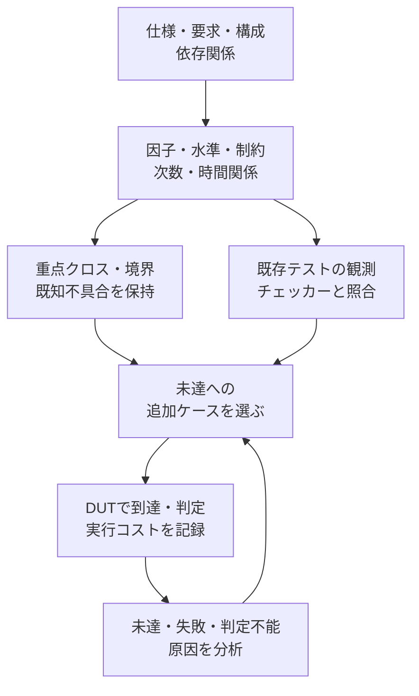

# LSIロジック検証における機能クロスの網羅とテスト数抑制の提案

作成日：2026-10-29。状態：運用案を既存手順へ反映し、APB教材でローカルの比較試行を実施しました。製品への採用、製品でのテスト数の削減効果、シリコンでの検出力は未評価です。

## 既存手順への反映先

提案の背景と試行計画をこの文書に残し、日常の計画・計測・完了判断は次の手順へ統合しました。

- [機能間クロス検証の4.1〜4.3節・6.1節](method/feature-interaction-verification.md#41-因子水準制約と必要な次数をモデルにする)：モデル化、重点範囲、既存テストからの追加、3種類の充足状況。
- [検証規模の縮退の4因子・3水準の例](method/verification-reduction.md#4因子3水準の説明例)：9行で54件の2因子目標を覆う数学的な例。
- [機能カバレッジの計画上の充足と観測を分ける手順](method/functional-coverage.md#組合せモデルの計画上の充足と観測を分ける)：計測の粒度とチェッカーとの対応。
- [クロスモデルと検証結果の記録](templates/interaction-coverage-plan.md)：モデルの版、対象集合、既存の証跡、未達、比較コストを記録する雛形。

以下は提案の背景と設計・試行計画を残した記録です。[APB＋割り込みの比較例](../examples/local-apb-irq-coverage/README.md)では、限定した因子モデルのコレクターと候補選択を実装しました。汎用生成器の実装、既存必須目標の変更、製品のサインオフ基準の承認とは区別します。

## 1. 結論と提案の位置付け

「通常の範囲は制約付きの2因子網羅、重要な相互作用は3因子以上または全組合せで補強する」という方針は、デジタルLSIの機能検証にも適用できます。設定値だけでなく、DUTの事前状態、受理した操作、同時動作、順序、中断・復帰をモデルへ含めることが条件です。

UVMの機能カバレッジ、制約付きランダム刺激、ディレクテッドテスト、SVA、スコアボードへ、対象の選び方と到達・合格の測り方を接続する提案です。AccelleraのUVM 1.2 User's Guideの4.10.1〜4.10.2節にも、単一指標では検証完了を保証できないことと、トランザクションの種類とFIFO状態をクロスする考え方が記載されています。[UVM User's Guide](https://www.accellera.org/images/downloads/standards/uvm/uvm_users_guide_1.2.pdf)

pairwiseをLSIの一般的なサインオフ基準とする提案ではありません。必要な次数・構成・時間関係は仕様とリスクから決めます。NISTも、2因子だけで十分と仮定せず、必要な相互作用の次数を検討するよう示しています。ソフトウェアでの故障検出実績や削減率を、そのままLSIの保証へ読み替えません。[NISTの指針](https://csrc.nist.gov/Projects/automated-combinatorial-testing-for-software/software-testing-methodology/dos-and-don-ts-of-testing)

本リポジトリには既に次の手順があります。

- [機能間の相互作用とクロス検証](method/feature-interaction-verification.md)：共有資源、同時・順序・中断、クロス目標と合格条件。
- [検証規模の縮退](method/verification-reduction.md)：同値分割、t-way、可変次数、代表構成、縮退の根拠。
- [機能カバレッジ](method/functional-coverage.md)：観測からのサンプリング、bin・cross、除外、インスタンス別集計。
- [制約付きランダム検証](method/constrained-random-verification.md)：探索、seed、未達への調整、再現・縮小。

この提案では、それらを一つの運用へつなぎます。追加する中心的な成果物は、版管理したクロスモデル、既存テストの充足状況、未検証の組合せ一覧、実測コストとの比較記録です。既存の必須目標・合格基準を変更するものではありません。

## 2. 機能名から、検証する相互作用へ分解する

まず、仕様とブロック構成から機能の依存関係を洗い出します。共有するレジスタ・メモリ・FIFO・バス・クレジット、制御依存、エラー伝播、クロック・リセット・電源の接点を確認します。機能AとBが別ブロックでも、共通の調停器やリセットがあれば相互作用を検討します。

依存関係がある領域ごとに、次の因子と水準を定義します。

- **設定・構成**：転送長、データ幅、チャネル、モード、許可・禁止、製品オプション。
- **事前状態**：FIFOの空・1要素・満杯直前・満杯、割り込み保留、未完了トランザクションの有無。
- **操作と競合相手**：読出し・書込み、DMAとCPU、イベントとW1C、送受信とバックプレッシャ。
- **時間関係**：A→B、B→A、同じ受理エッジ、受理直前・直後、処理中断、再発、連続回数。
- **異常と復旧**：エラー注入、タイムアウト境界、リセット種別、電源状態、復帰後の最初の処理。

各因子には要求ID、区分の理由、代表値、境界値、観測点を付けます。中間値を代表化しても、アドレスデコード、符号、バイトレーン、ビット位置などの違いは別に検討します。データ整合性を調べる際は、欠落・重複・入替えを識別できるデータやIDも残します。

実行時状態は、設定ファイルへ値を書くだけでは成立しません。たとえば「満杯時の同時読書きの受理」「受理済み・未完了中のリセット」には、そこへ至る操作列と受理・状態の観測が必要です。

### 制約と対象外の扱い

合法性制約は仕様・環境契約に基づいて定義します。2因子の値の組を対象にする条件は、残りの因子と必要な操作列を補えば、モデル全体の条件を満たせることです。生成後に禁止行を取り除く方式でも、必要な組合せが残っているかを再計測します。

- 規格・仕様で禁止される操作は、エラー応答や状態保持などを確認する別の異常系目標へ対応付けます。
- 製品構成に適用されない組は、根拠とレビューを記録して対象外とします。
- 未実装、ツール未対応、単なる未到達、仕様未確定は、それぞれの状態を保持します。
- 仕様上合法な状態へDUTが到達しない場合は、刺激・仮定・DUTの問題を調査します。現在のRTLが到達させないことだけを除外根拠にしません。
- フォーマル検証で到達不能となった場合も、仕様、初期状態、assume、抽象化の範囲を確認してから扱いを決めます。

## 3. 通常範囲・重点範囲・時間関係を分けて選ぶ

### 通常範囲：制約付き2因子網羅

承認したモデルの各2因子について、成立可能な水準の組を覆うケースを選びます。covering arrayなどを使い、一つのケースで複数の2因子目標を満たします。適用対象や高次依存をレビューした領域で使う初期案であり、全ブロックへ一律に適用する基準ではありません。

### 重点範囲：3因子・4因子、または全組合せ

共有状態の更新、データ損失・重複、優先順位、デッドロック、権限逸脱、異常復旧などの領域は、必要な因子群を指定して次数を上げます。因子群ごとに次数を変える可変次数（variable strength）で計画し、小さい重要領域は全組合せを維持します。

例として「W1C×イベント×マスク」「未完了DMA×バックプレッシャ×リセット」「権限状態×デバッグ操作×ライフサイクル遷移」があります。具体的な水準と期待動作は、対象製品の仕様で確定します。

A×B、B×C、A×Cが埋まっても、A×B×Cの達成とは扱いません。既存の必須クロス、既知バグの再現条件、重要な境界は、pairwise生成器の出力へ置き換えず保持します。

### 時間関係：受理・状態遷移を伴う専用シナリオ

値の組合せに加え、順序、時間窓、同時発生、中断、反復を目標化します。NISTの事象列の試験も順序を対象にしますが、順序の網羅から隣接性、サイクル間隔、同時性、繰返しまで自動的に導くことはできません。[Event Sequence Testing](https://csrc.nist.gov/projects/automated-combinatorial-testing-for-software/combinatorial-methods-in-testing/event-sequence-testing)

同一クロックでは受理エッジと前後の観測時点を決めます。異なるクロックでは、どのドメインで受理・完了を定義するか、許容する同期遅延と因果関係を定めます。同じシミュレーション時刻だけで同時動作の達成としません。

## 4. 既存テストを利用し、未検証のクロスから追加する



1. 要求・構成・相互作用ごとにモデルを作り、対象集合と重点目標を固定します。
2. 既存のディレクテッドテスト、ランダム実行、SVA・スコアボードの記録を対応付けます。
3. 同じ機能名が含まれることではなく、対象の相互作用に到達し、期待結果を判定した証拠を確認します。
4. 未検証の目標を列挙し、それを成立させる初期化・操作列・環境応答を設計します。
5. 一つのケースが新たに満たす目標と、実測または推定の実行コストを使って追加順を決めます。
6. 実行後の観測から充足状況を再計算し、未達を次の刺激へ戻します。

選択に重みやgreedy法を使う場合も、必須目標の削除や最小ケース数の保証には使いません。複数の異なる要求を同じbinへまとめる判断には、代表化の根拠が必要です。

既存のテスト集合へ後から組合せの尺度を適用する考え方は、NIST IR 7878も扱っています。生成器を導入したという理由だけで、その到達率を100%にしない運用へつなげます。[Combinatorial Coverage Measurement](https://csrc.nist.gov/pubs/ir/7878/final)

## 5. 生成予定・到達・合格を別に計測する

モデル・次数・構成・インスタンスごとに対象集合を持ち、少なくとも次を分けます。

- **計画上の充足率**：選んだケースと操作列が、対象クロスを成立させる計画になっている割合。
- **観測した到達率**：DUTの受理・状態・時間関係から、実際に到達を確認した目標の割合。
- **判定付きの合格率**：対象へ到達し、対応するチェッカーが有効に動作して合格した証跡のある目標の割合。
- **未完了の内訳**：未到達、失敗、判定不能、未実行、未確定、対象外とその根拠。

ログ欠落、異常終了、古い入力への証跡などで有効な判定を確認できない場合は、合格に用いません。生成設定やドライバーの送信予定だけを到達として数えません。モニターで確認した受理を基準に、事前状態、操作、結果、構成、トランザクションIDを対応付けます。NBA更新前後やclocking blockの観測時点も固定します。判定は仕様に基づく独立した参照モデル・スコアボード・SVAへ接続し、DUTの誤った結果を期待値へ戻さない構成にします。

たとえば、対象100目標のすべてに到達し、2目標で結果が誤り、残り98目標で有効なチェックが合格した場合、到達率100/100、判定付きの合格率98/100です。失敗した2目標を分母から外しません。対象集合が未定義、または0件の場合は、件数と理由を示し、検証済み100%として扱いません。

異なるケースの通常の到達集合は、同じ版のモデルと適用条件の下で重複を除いて集約できます。一方、一つの競合や順序を成立させるための事象・前後状態・判定は、同じシナリオの証跡で結び付けます。異なる実行からAとBを持ち寄って同時動作を達成したことにはしません。複数メンバーを要求するAND集合は、既存の証跡規則を維持します。

2因子、重点の3因子以上、時間関係、構成・インスタンスの内訳を別に表示します。平均値や和集合で、必須構成や特定チャネルの未達を隠しません。モデル・制約・要求・RTL・チェッカーが変わった場合は、対応を再評価して古い証跡を区別します。

covergroupは小さなcrossや明示したbinへ分割し、観測器やソフトウェア側のコレクターで目標IDを記録する方法も検討します。テスト生成を2因子へ抑えても、計測側で全因子の自動crossを作ればbin数が増大するため、生成モデルとカバレッジモデルの粒度を合わせます。

## 6. 件数抑制の数学的な説明例

制約のない4因子A・B・C・Dに各3水準があると、全組合せは3^4＝81行です。a・bを0〜2で動かし、次の9行を使えば、任意の2因子の全水準対を含められます。

```text
A = a
B = b
C = (a + b) mod 3
D = (a + 2*b) mod 3
```

2因子の目標は、因子対6通り×水準対9通り＝54件です。9行でこれを覆っても、3因子以上の全組合せや動的な状態遷移を覆ったことにはなりません。

これは独立した有限モデルの説明です。制約がある場合、水準数が違う場合、成立に複数の操作・構成変更が必要な場合は、行数と実行コストを別に求めます。「9行」を「9本のRTLテスト」や「9クロック」へ読み替えず、製品で同じ削減率が得られるとは主張しません。

## 7. 最初の試行：APBと割り込みの結合例

対象は、既存の[APBと割り込みの結合検証例](../examples/gitlab-apb-irq/README.md)です。以下の計画を具体化した[ローカルの比較例](../examples/local-apb-irq-coverage/README.md)を追加しました。通常RTLと合格基準を維持し、任意の観測出力からモデルへ対応付けます。各要因で計測する2因子96・重点32・時間関係48目標と既存44／45目標を別集計にし、学習とは別の再実行で比較します。

この教材の仕様では、マスクは割り込み出力を制御し、イベント保持を止めません。W1Cとイベントが同じビットで重なればイベント優先です。バスの待ち状態やエラー応答でも、独立したイベントの取り込みを継続します。この規則は教材の仕様であり、実製品では優先順位・受理条件・リセット条件を改めて確認します。

### 既存の必須目標を維持する

- [相互作用の手順書](method/feature-interaction-verification.md)の12目標は、初期PEND 2通り×IRQ_EN 2通り×イベントとW1Cの受理エッジ差3通りです。IRQ_EN一定などの前提も保持します。
- 実行できるAPB教材の32クロスは、4要因×マスク2状態×クリア2状態×イベント2状態です。対象ビットの事前PENDINGが1で、有効なW1C転送が完了した場合に記録する前提も保持します。待ち時間0／1／3の各構成で独立に判定する方針を維持します。
- 両者はモデルと適用範囲が異なるため、同じ目標集合として合算しません。

### 観測と判定を結び付ける例

以下の目標IDは提案上の例であり、既存ランナーに登録済みのIDではありません。

- **目標ID**：`PROP-IRQ-EVENT-W1C-SAME-EDGE`。
- **条件**：リセット非アクティブ期間に、要因kのイベントと、同じ要因を消すW1C転送を同じPCLKエッジで受理する。
- **受理の観測**：APBの実際の転送完了と書込先・データ、イベント入力を対応付ける。SETUPや待ち状態での書込要求をW1Cの受理としない。
- **記録する水準**：要因k、受理前のPEND、マスク、待ち時間、受理エッジと判定時点。
- **判定**：更新後のPENDINGの要因kが1となり、全要因の保持状態とマスクから計算したIRQに一致する。他の要因でIRQが立ち続けることによる見逃しを防ぐため、PENDINGも照合する。
- **期待値の生成**：参照モデルがリセットと受理済み操作から状態を保持し、仕様の更新則を適用する。DUT内部の更新結果を期待値として採用しない。
- **適用**：必要な各待ち時間構成で、到達とチェッカーの有効な合格を確認する。

次に、マスク更新とイベント、待ち・エラー中のイベント、リセット後の新規イベントなど、既存の仕様が定める相互作用を対応付けます。新しい時間関係や復帰条件が必要なら、目標と合格基準をレビューしてから追加します。

### 試行の成果物と評価

1. 因子・水準・制約・重点群・時間関係と、その版を持つモデル。
2. 既存テストと、実際に観測・判定できた目標の対応。
3. 未検証の組合せと、その刺激・観測点・判定を定めた追加候補。
4. 既存方式と提案方式を同じRTL・モデル・必須構成・判定条件で実行した比較記録。
5. 必須目標、既知バグ、意図的な誤実装を引き続き検出できるかの確認。

変異の例はセット／クリアの優先順位反転、マスク中の保持欠落、未完了書込みの副作用です。各変異を予定したチェッカーで検出することを確認し、単なる起動・コンパイル失敗を検出成功へ数えません。すべての不具合を検出できる証明とは区別します。[ミューテーション検証](method/mutation-verification.md)へ接続します。

比較時は、テスト本数・実行数・RTLクロック数、CPU時間、壁時計時間、ライセンス使用量、カバレッジ収集のメモリと失敗解析コストを記録します。必要な検出力を維持した条件で、実測から採用を判断します。本提案時点で削減率や目標テスト本数は設定しません。

## 8. リグレッションと完了判断への組込み

- **変更時の短時間検査**：変更影響に対応するケース、必須の重点クロス、既知バグの再現を選ぶ。
- **Nightly**：選定したモデルの対象集合と必須構成を広く実行し、未達・失敗から追加刺激を選ぶ。
- **節目・サインオフ前**：広い構成、必要な高次相互作用、長時間・高負荷、異常復旧、他方式の結果を含めて判定する。

予算・時間の上限は事前に決め、打ち切り時は未実行・判定不能を保持します。短時間検査の合格で広い範囲を合格にせず、必須目標の低下や除外変更は既存の計画変更手順へ対応付けます。[継続的リグレッション](method/continuous-regression.md)と[サインオフ記録](templates/signoff-record.md)を利用します。

ケース数を減らす選択と、長い失敗シナリオを縮小して原因を探す操作は、目的を分けて扱います。失敗の再現には、seedだけでなく、仕様・RTL・モデル・ツール・構成・刺激と実行条件を保存します。

## 9. 適用限界と採用前の確認事項

- 選んだモデルでの2因子網羅100%は、要求カバレッジ100%、全状態探索、バグ不在、テープアウト可能の証明ではありません。
- 前件が起きないSVAの成功、無効なチェッカー、未完了のスコアボード照合は、判定付きの合格に含めません。
- 必須の高次相互作用、履歴、反復回数、境界、非対称なチャネル接続を維持します。安全・権限・復旧の目標はリスクに応じた独立の方針で選びます。
- CDC/RDCの構造、メタスタビリティの物理特性、STA、電源・アナログ特性、DFT・量産テスト、ソフトウェア・実機での統合は、それぞれ必要な検証・解析へつなぎます。
- フォーマル検証の仮定・抽象化・時間境界、シミュレータの2値／4値やX伝搬方式、無効化した計測は、結果と併せて明示します。
- 新機能、共有資源、パラメータ、クロック・リセット・電源、仕様の優先順位が変わったら、モデル・制約・重点群・既存証跡を再評価します。

まず一つのIPでモデル化と既存テストの充足状況を測り、必須目標と検出力を維持できることを確認します。その後、共通バスやメモリを含む複数IP、SoCの相互作用へ対象を広げる提案です。

## 10. 一次資料と既存手順

- [Accellera UVM 1.2 User's Guide](https://www.accellera.org/images/downloads/standards/uvm/uvm_users_guide_1.2.pdf)、4.10.1〜4.10.2節：機能カバレッジの位置付けとクロスの例。UVMの最新版を指定する引用ではありません。
- [NIST SP 800-142: Practical Combinatorial Testing](https://csrc.nist.gov/pubs/sp/800/142/final)：組合せ試験の方法・適用条件・制約を検討する際の背景資料。
- [NIST: DOs and DON'Ts of Testing](https://csrc.nist.gov/projects/automated-combinatorial-testing-for-software/software-testing-methodology/dos-and-don-ts-of-testing)：要求に基づく因子選定、境界・同値分割、次数選択の注意。
- [NIST: Event Sequence Testing](https://csrc.nist.gov/projects/automated-combinatorial-testing-for-software/combinatorial-methods-in-testing/event-sequence-testing)：値の組合せと事象列の区別。
- [NIST IR 7878: Combinatorial Coverage Measurement](https://csrc.nist.gov/pubs/ir/7878/final)：既存のテスト集合に対する組合せの計測。

資料中の運用フロー、目標の分類、APB教材への導入手順、採用判断は本リポジトリへの提案です。上記資料が、そのまま製品のサインオフ条件や本提案の実証結果を与えるという意味ではありません。
