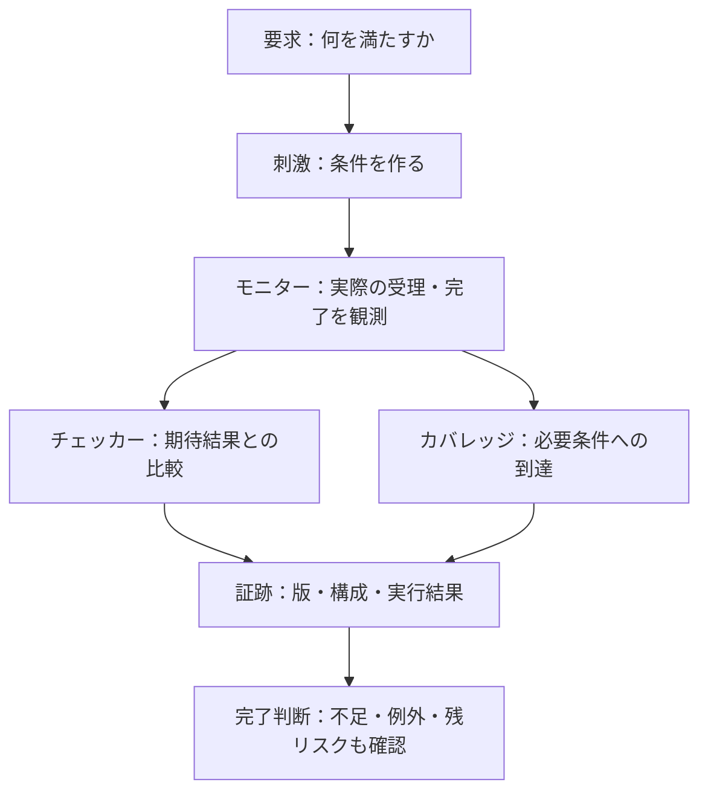

# LSI検証の用語集

このリポジトリの手順書と実行例で使う用語を、役割ごとにまとめています。略語の意味を確認した後は、各節の参照先で適用条件・記録方法・コード例を確認してください。運用上の疑問は[FAQ](faq.md)、全体の入口は[README](../README.md)にあります。

「設計網羅率」「実行確認率」「AND集合」などは、このリポジトリとケーススタディで定めた使い方です。ツールの画面に同じような名前があっても、分母・集計規則が同一とは限りません。

本資料では、検証部品の一般名を「チェッカー」「モニター」「スコアボード」などの日本語で表記します。英語名からも確認できるよう、用語欄には英語表記を併記しています。`covergroup`、`assert property`などの言語キーワードやAPI名、コード中の識別子は原表記を使います。

新しく実行例を読む場合は、[静的検査・警告管理](#12-静的検査と警告管理)、[失敗解析](#13-失敗解析)、[AIを使う検証](#14-aiを使う検証)も参照してください。UVMの上位再利用と複数クロックの用語は、[UVM](#4-uvmと検証環境)と[クロック・リセット](#8-クロックリセットcdc)へまとめています。

## 用語を検証の流れに置く

要求から刺激・観測・合否・到達を対応付け、版と構成のそろった証跡で完了を判断します。

カバレッジ項目への到達とチェッカーの合格は別の情報です。以下の表では、用語ごとの意味と使い分けを確認できます。

## 目次

- [基本用語](#1-基本用語)
- [要求・照合・証跡](#2-要求照合証跡)
- [カバレッジと完了判断](#3-カバレッジと完了判断)
- [UVMと検証環境](#4-uvmと検証環境)
- [ランダム検証](#5-ランダム検証)
- [SVAと観測時点](#6-svaと観測時点)
- [フォーマル検証](#7-フォーマル検証)
- [クロック・リセット・CDC](#8-クロックリセットcdc)
- [検出力と削減](#9-検出力と削減)
- [継続的リグレッション](#10-継続的リグレッション)
- [実装・製造に関わる検証](#11-実装製造に関わる検証)
- [静的検査と警告管理](#12-静的検査と警告管理)
- [失敗解析](#13-失敗解析)
- [AIを使う検証](#14-aiを使う検証)
- [画像処理とラインメモリ](#15-画像処理とラインメモリ)
- [ネットワークとパケット](#16-ネットワークとパケット)
- [航空宇宙・高信頼システム](#17-航空宇宙高信頼システム)
- [表記の参考資料](#表記の参考資料)

## 1. 基本用語

| 用語 | 意味・この資料での使い方 |
| --- | --- |
| LSI（Large Scale Integration） | 多数の回路を集積した半導体。本リポジトリでは主にデジタル論理の検証を扱う |
| RTL（Register Transfer Level） | レジスタの状態更新と、その間の演算・転送を記述する回路表現 |
| FF（Flip-Flop） | クロックエッジなどで値を保持する順序回路の素子。同期化FFの段数と、検証用に与える観測遅延を区別する |
| DUT（Design Under Test） | 今回の検証対象。IP単体、サブシステム、SoCなど、対象境界を明示する |
| testbench／TB（テストベンチ） | DUTへ刺激を与え、動作を観測し、判定・記録する検証環境 |
| IP（Intellectual Property） | 再利用する回路・設計資産。ここではUARTやFIFO、レジスタブロックなどの回路ブロックを指す |
| SoC（System on Chip） | 複数のIPやプロセッサなどを統合したチップ。IP単体とは接続・構成・ソフトウェアの検証範囲が異なる |
| VIP（Verification IP） | バスやプロトコルなどの刺激・監視・検査に使う再利用可能な検証部品。対応機能・版・設定を固定する |
| BFM（Bus Functional Model） | バス操作を信号レベルの手順へ変換するモデル。UVMのdriverから呼ぶ構成も、手続き的なテストベンチから呼ぶ構成もある |
| トップモジュール／構成（configuration） | 解析・実行の起点となるモジュール／パラメーター、define、モード、接続などを固定した対象。別のトップや構成の合格をそのまま流用しない |
| エラボレーション（elaboration） | パラメーターやgenerateなどを解決し、module・interface等の静的な階層・接続を確定する工程。UVMのクラス部品を`build_phase`で生成することや、動作の正しさとは区別する |
| IRQ／PEND／W1C | IRQは割り込み要求、PENDは保留状態を表す本資料の信号名。W1C（Write One to Clear）は1を書いた対象ビットをクリアする方式。同時イベントとの優先順位は個別仕様で決める |
| FIFO（First In First Out） | 先に入れたデータから順に取り出す記憶・転送構造。空・満杯・同時読書き・ポインタ折り返しなどを確認する |
| ready／valid・ハンドシェイク | データの提示と受入れ可否を示す信号／両条件が成立した規定エッジで転送を受理する方式。validの提示回数と実際の受理数を分ける |
| バックプレッシャー | 受信側が受理を待たせる流れ制御。待ち中にvalid・データを保持するか等はプロトコルに従って確認する |
| レイテンシ／スループット | 定めた開始から完了までの遅延／単位時間当たりの転送量・完了数。受理から応答までのサイクル数と、実行環境の壁時計時間を区別する |
| beat／burst／ID・tag | 一回のデータ転送／関連する転送のまとまり／要求と応答を対応付ける識別子。最終beat、同じID内の順序、再利用と取消の契約を確認する |
| FSM（Finite State Machine） | 有限状態機械。状態と入力から遷移・出力を決めるモデル。状態の到達と遷移・出力の正しさを分けて確認する |
| CSR／UART／APB | 制御・状態レジスタ（Control and Status Register）／非同期シリアル送受信器（Universal Asynchronous Receiver/Transmitter）／周辺回路向けバス（Advanced Peripheral Bus）。UARTのレジスタをAPB経由で読む例などで使う |

参照：[一般化した検証手順](method/spec-to-verification-method.md)、[割り込みの実行例](../examples/local-irq-cdc/README.md)。

## 2. 要求・照合・証跡

| 用語 | 意味・この手順で確認すること |
| --- | --- |
| 要求／要求ID | 仕様が求める、条件と結果を観測できる単位／その安定した識別子。仕様の節番号だけで個別の要求を代用しない |
| 検証項目／テストケース | 要求をどの条件・期待結果・観測点で調べるかを定めた項目／それを実行する具体的な入力・手順。一つの要求に複数項目、一つのケースに複数項目が対応する場合もある |
| 仕様課題／変更影響分析 | 曖昧さ・矛盾・未決事項の記録／変更が要求・期待値・刺激・checker・目標・構成・証跡へ及ぼす影響を調べること。仕様の意味を推測で確定しない |
| 観測点 | 受理・状態更新・応答など、要求を検査する値と時点。刺激を送ったという記録だけでは結果の観測にならない |
| 合格基準 | 何を比較・検査し、どの条件なら合格かを事前に定めたもの。値、順序、期限、リセット・取消時の扱いを含む |
| トレーサビリティ（追跡可能性） | 仕様の出典、要求、構成、刺激、チェッカー、目標、実行証跡を双方向にたどれること |
| 照合／照合案 | 要求のどの条件を、既存テストのどの刺激・観測・判定が確認するかを対応付けること／そのレビュー前の提案 |
| AND集合（複合証拠） | 1要求の条件を複数のテストで分担する対応。本手順では同じ実行回で全メンバーの合格が必要。ケーススタディの`check_groups`ではグループ内がAND、代替グループ間がOR |
| 独立検証 | 作成者とは別の検証者が、仕様・刺激・期待値・観測点を読み、誤りや検証漏れがないか確認する工程。別ツールで実行するだけでは代わりにならない |
| 証跡（evidence） | どの入力・版・構成で、何を実行し、どう判定したかを裏付ける記録。ログ、波形、比較結果、証明結果などを実行IDと結ぶ |
| ハッシュ／承認時スナップショット | 入力の同一性を照合する識別値／承認時の照合案・テスト入力・関連要求をハッシュで固定した記録。内容の正しさは別途レビューする |

参照：[照合と独立検証](method/spec-to-verification-method.md)、[照合キット](../tools/matching_kit/README.md)、[ケーススタディの計測規則](case-study-ieee1800/coverage-rules.md)。

## 3. カバレッジと完了判断

| 用語 | 意味・混同しないもの |
| --- | --- |
| 要求カバレッジ | 固定した対象要求に対する対応・合格の状況。必須構成ごとに見る。bin数やテスト本数の割合とは異なる |
| 設計網羅率 | ケーススタディでは、観測点をレビューしたテスト対応がある登録動作数÷登録動作数。RTLのコードカバレッジや、実行済みの割合ではない |
| 実行確認率 | ケーススタディでは、現在の入力・ランナーに対応する成功証跡がある登録動作数÷登録動作数。複数環境の和集合を単一ツールの適合率としない |
| 暫定値／確定値 | ケーススタディで、登録行ベースの集計と、解釈・重複・分母の承認を経た集計を区別する表現。資料の確認完了だけでは分母確定にならない |
| 機能カバレッジ（functional coverage） | 仕様から計画した機能・状態・値・遷移・組み合わせへの到達状況。要求との対応、観測時点、構成、分母を明示する。正しさはチェッカーで別に判定する |
| コードカバレッジ（code coverage） | 行、分岐、条件、toggle、FSMなど実装の動作を計測する指標群。各指標の定義はツール・設定で確認する。仕様への適合とは別に見る |
| 関数カバレッジ（function coverage） | 関数が呼ばれたか等を計測する実装側の指標。仕様上の機能を対象にするfunctional coverageとは異なり、計測単位・対応範囲はツールで確認する |
| 行／分岐カバレッジ | 実装の文・基本ブロックの実行／ifやcase等の選択先の実行。行とカウンターは必ずしも1対1ではなく、生成されたポイントで分母を確認する |
| 条件・式カバレッジ／MC/DC | 論理条件の値や各項の寄与等を計測する指標群／各条件が判定結果へ独立に影響することを確認する基準。ツールの式カバレッジをそのままMC/DCとしない |
| toggleカバレッジ | 信号ビットの変化を計測する。方向別、初期化・リセットの計上、対象外ビット等を確認する。転送や演算の正しさは別に比較する |
| FSM状態／遷移カバレッジ | 抽出した状態への到達／状態間の遷移への到達。自動抽出の範囲、リセット・自己遷移・default経路の扱いを確認する |
| covergroup／coverpoint／bin／cross | 分類・収集の器／観測式／値・遷移などの分類単位／複数coverpointの組み合わせ。個々のcoverpointの100%はcrossの100%を意味しない |
| ヒット数（hit count） | binに分類されたサンプル数。待ち中に毎サイクル数えるモデルでは、同じ転送が複数回ヒットする。受理数・完了数とはサンプリング条件を確認して区別する |
| 手続き的な機能目標／ネイティブ機能カバレッジ | モニターの到達ログなどを集計する方式／シミュレーターがcoverpoint・cross等をDBへ記録する方式。計画と観測条件に応じて選び、方式・分母・証跡を明示する |
| カバレッジ項目への到達／チェッカー合格ケースの到達 | 必要な条件を観測できたこと／同じケースに必要なチェッカーが完了し合格したこと。失敗したケースの到達を要求の合格に混ぜない |
| カバレッジ収束（カバレッジクロージャ） | 未達の原因を分析し、追加検証や根拠付きの適用・除外判断で未達項目への対応を完了する工程。率を上げるためだけに分母を減らさない |
| サインオフ／例外承認 | 必須証跡と残リスクから開発段階の完了を承認すること／未達の影響と残リスクを権限者が受け入れる記録。lint台帳の`waived`という分類が、そのまま人の承認を意味するわけではない |

参照：[コードカバレッジの手法](method/code-coverage.md)／[実行例](../examples/local-code-coverage/README.md)、[covergroupによる機能網羅](method/functional-coverage.md)、[ネイティブ計測の実行例](../examples/local-functional-coverage/README.md)、[機能カバレッジのFAQ](faq.md#10-機能カバレッジの計測)、[計測規則](case-study-ieee1800/coverage-rules.md)、[サインオフ記録](templates/signoff-record.md)。

## 4. UVMと検証環境

| 用語 | 意味・主な役割 |
| --- | --- |
| UVM（Universal Verification Methodology） | SystemVerilogのクラスライブラリと共通構成で検証部品を再利用する方法論。API標準はIEEE 1800.2。規格の版と参照実装のリリースを分けて管理する |
| トランザクション（transaction）／シーケンスアイテム（sequence item） | 読書き・転送などを表す操作データ。信号を各時刻にどう駆動するかとは区別する |
| sequence／sequencer | 操作列を作る手順／シーケンスとドライバーの間でitemの受け渡し・調停を担う部品 |
| driver | itemを信号レベルの駆動へ変換する部品。送信開始とDUTによる受理を区別する |
| monitor | 実際の信号から受理・応答・状態を観測する部品。生成予定のデータを実観測として流さない |
| agent／env | インターフェースの検証部品をまとめる単位／複数エージェントやスコアボードなどを構成する環境。passive エージェントは観測用として使う |
| active／passive agent | 駆動部品を持つエージェント／観測を担当するエージェント。同じ信号を旧環境とactive agentの両方から駆動しない |
| virtual interface | クラス側から静的なSystemVerilog interfaceへアクセスするハンドル。各agentへ渡す対象と駆動担当を確認する |
| virtual sequence／virtual sequencer | 複数の操作列やagentを協調させる上位シーケンス／必要に応じて開始先のsequencer等をまとめる部品。本リポジトリの協調例ではvirtual sequenceを`start(null)`し、専用のvirtual sequencerは使わない |
| analysis port／subscriber | 観測を複数の接続先へ配信する仕組み／その観測を受け取る部品。`write()`の到着順と回路の受理順序を混同しない |
| ハンドル／観測スナップショット | オブジェクトを参照する値／その観測時点の値を保存した記録。ハンドルの受渡しだけでは複製にならないため、再利用による履歴の書換えを防ぐ |
| ID再利用／token | 完了・取消し後に同じ識別子を次の要求へ割り当てること／同じIDの別要求を区別する追加識別子。再利用条件と周回時の扱いを契約にする。[UVMの実行例](../examples/local-uvm-outstanding/README.md)を参照 |
| アウトスタンディング数 | 受け付け済みで、応答・転送がまだ完了していないトランザクションの数。有効なタグや完了の定義はインターフェース仕様に従う |
| 参照モデル／oracle | 仕様から期待結果を求めるモデル／正誤判定の根拠。同じRTLの処理を写して共通の誤りを持たないようにする |
| checker／scoreboard | 条件や結果を検査する仕組みの総称／期待結果と実観測を対応付けて照合する部品。応答ID・順序・未完了も扱う |
| coverage collector | 観測を分類し、カバレッジを収集する部品。到達を数える処理と正誤判定を対応付ける |
| RAL（Register Abstraction Layer） | レジスタ・フィールドをモデル化し、アクセスや期待状態を扱う仕組み。mirror（モデルが保持する値）だけで実回路の正しさを判定しない |
| frontdoor／backdoor | バス等の通常のアクセス経路を通る操作／内部状態へ直接アクセスする操作。後者だけではバスのデコード・待ち・エラー応答を検査できない |
| mirror／prediction／`UVM_CHECK` | RALが保持する予測状態／観測したアクセスや仕様上の更新をモデルへ反映すること／読み出した値を予測値と比較する指定。モデルの`reset()`だけでDUTのreset信号は駆動されない |
| submap／レジスタマップ | 子のアドレスマップを上位へ配置する仕組み／レジスタとアドレス等の対応。子のoffsetと上位のbase address、アクセス幅・属性を確認する |
| phase／objection | 環境構築・接続・実行・確認などの段階／終了の進行を調整する仕組み。objectionがなくなったことだけでは、全応答の照合完了を意味しない |
| factory override／`uvm_config_db` | 検証部品などの型・インスタンスの差し替え／設定の受け渡しに使う仕組み。実際に構築された型と、設定の取得先・成功を確認する |

参照：[UVMへの適用](method/uvm-verification.md)、[基礎と学習案内](method/uvm-basics.md)、[実践設計](method/uvm-practical-design.md)。構成の基礎は[AccelleraのUVM資料](https://www.accellera.org/downloads/standards/uvm)を参照してください。実行例には[APBとRAL](../examples/local-uvm/README.md)、[上位RALの再利用](../examples/local-uvm-hierarchy/README.md)、[複数クロックと個別reset](../examples/local-uvm-multiclock/README.md)があります。

## 5. ランダム検証

| 用語 | 意味・記録すること |
| --- | --- |
| ディレクテッドテスト（directed test） | 狙った条件・操作列を明示して与える試験。境界・既知バグ・確実に必要なシナリオに使う |
| 制約付きランダム検証 | 合法条件や探索目的の制約の下で刺激を生成する方式。生成成功だけで受理・完了・比較の成功にしない |
| constraint／分布・重み | 生成可能な値・関係を定める条件／その範囲内の選ばれやすさ。合法条件と探索上の偏りを分け、生成失敗も記録する |
| seed（シード） | 乱数系列を選ぶ入力の一部。同じ数値でもツール・版・構造が変われば同じ刺激とは限らない |
| カバレッジ駆動の調整 | 未達を分析し、制約・重み・シナリオ・ディレクテッドテストを見直すこと。カバレッジを収集するだけでは刺激は自動で変わらない |
| 再現／失敗の縮小 | 同じ条件で元の失敗を再び起こすこと／その失敗を保ったまま操作数・値・構成を小さくすること。単に別の失敗が出たケースで置き換えない |

参照：[制約付きランダム検証](method/constrained-random-verification.md)。

## 6. SVAと観測時点

| 用語 | 意味・確認すること |
| --- | --- |
| SVA（SystemVerilog Assertions） | 条件や時間関係を記述・検査するSystemVerilogの仕組み。シミュレーションでもフォーマル検証でも使えるが、対応構文・評価方法は採用ツールで確認する |
| アサーションを使う検証（ABV） | 要求する性質を実行可能なアサーションとして記述し、シミュレーションやフォーマルで検査する運用。正常ケースだけでなく、到達・検出力・有効化・終了判定も確認する |
| `assert` | 記述した性質が満たされるかを検査する。シミュレーションで失敗0でも、必要な前件を検査したとは限らない |
| `assume` | フォーマル検証で環境条件などを仮定し、対象とする振る舞いを制限する。DUTが保証すべき結論を仮定へ移さない |
| `cover property` | 事象・時間関係の成立を観測する、または到達経路を探索する。到達したことと、全経路での正しさは異なる |
| 即時／並行アサーション | 手続きの実行時に条件を確認する記述／サンプリングイベントに沿う性質を確認する記述。評価時点を無視して置き換えない |
| 前件・後件／vacuous pass | 含意で検査を開始する条件・要求する結果／前件不成立により後件を検査せずにパスすること。前件・完了経路のcoverも確認する |
| サンプリング／Preponed／NBA | 判定用の値を採ること／通常のクロック付き並行アサーションが設計信号を採る領域／ノンブロッキング代入の更新領域。同じエッジのサンプルとNBA更新後の値を混ぜない |
| `$past`／`$sampled` | 過去のサンプル値／その評価に使うサンプル値を参照する関数。履歴の有効性と現在のライブ値との差を確認する |
| `disable iff` | 条件成立時にプロパティの評価を無効化・中断する指定。通常は非同期に作用し、リセット動作そのものを検証する記述ではない |
| X／Z・2値／4値 | Xは未知値、Zは高インピーダンス。2値と4値では表現・評価できる状態が異なり、X/Zを0/1へ変換した結果で未知値の検査を代用しない |

参照：[SVAによる検証](method/sva-verification.md)、[目視確認からアサーションへの移行](method/assertion-based-regression.md)。

## 7. フォーマル検証

| 用語 | 意味・結果の範囲 |
| --- | --- |
| フォーマル検証／FPV | 数学的なモデルで性質を検査する方式群／Formal Property Verification（プロパティ検証）。モデル・仮定・初期状態・構成を結論と一緒に示す |
| harness（ハーネス） | DUTと、環境の仮定・初期化・検査用ロジックなどを接続する検証用の枠組み |
| BMC（Bounded Model Checking） | 指定した有限深さまで反例を探す有界モデル検査。反例なしでも、その先は未証明 |
| 非有界の安全性証明／k-induction・PDR | 有限深さまでの探索に限定しない安全性の証明／そのために使う帰納法・PDR（Property Directed Reachability）などの手法。k-inductionはベースケースと帰納段階の両方の成立が必要 |
| 公平性（fairness） | 無限の実行で、必要な進行機会が無限回ある等の環境条件。一定周期以内という期限と区別し、DUTの最終完了そのものを仮定へ移さない |
| liveness-to-safety／lasso | 無限の違反を、到達する接頭部と反復できる閉路の有限検査へ変換する方式／その反例の形。状態と公平性を保存する根拠が必要。[非有界証明の例](../examples/local-liveness/README.md)を参照 |
| 安全性（safety）／活性（liveness） | 禁止することが起きない性質／いつか進行・完了する性質。Nサイクル以内の応答は期限付きであり、無期限の「いつか」と分ける |
| 反例（counterexample） | 性質に違反する候補のトレース。実装の不具合、仮定やプロパティの誤り、抽象化による候補を切り分ける |
| 抽象化／assume-guarantee | 証明に必要な性質を保ちながらモデルを簡略化すること／仮定と保証の契約で分割すること。実装との対応と、各仮定を満たす側の証明を残す |
| 等価性検証 | 変更前後やRTLとネットリストなどの振る舞いの対応を検査すること。比較元が仕様どおりかは別の検証課題 |
| 過剰な仮定（overconstraint） | 合法な動作まで仮定で除き、必要な反例やcoverへの経路を消してしまうこと。仮定の出典と必要性、通常動作への到達を確認する |
| 証明の依存関係／契約の成立確認 | ある保証に必要な別の証明との関係／下位で仮定した条件を、上流と実配線が満たすかの確認。個々のブロックのPASSだけで結合結果を証明済みとしない |
| ブラックボックス | 内部動作を対象から外し、ポートと必要な制約で扱うモデル。接続性の証明で内部を自由値にしても、そのIP内部の正しさを確認したことにはならない |

参照：[フォーマル検証](method/formal-verification.md)、[仮定・保証と証明依存の実行例](../examples/local-compositional-formal/README.md)。SBYのモード・depth・結果の意味は[YosysHQの設定資料](https://yosyshq.readthedocs.io/projects/sby/en/stable/reference.html)、assert・assume・coverの扱いは[フォーマル検証構文の説明](https://yosyshq.readthedocs.io/projects/sby/en/stable/verilog.html)も参照してください。

## 8. クロック・リセット・CDC

| 用語 | 意味・検証での区別 |
| --- | --- |
| CDC（Clock Domain Crossing） | クロックドメイン間の信号転送。同期構造と、受信側のプロトコル・欠落・重複などを確認する |
| RDC（Reset Domain Crossing） | 異なるリセット条件を持つ領域間の転送。同じクロックでも問題になる場合があり、CDCとは別に条件を整理する |
| メタスタビリティ | 非同期入力の捕捉などでFFの出力が安定した論理値へ収束するまで不確定になる現象。通常のRTLの0/1遅延モデルで物理現象を再現したとは扱わない |
| 同期化レイテンシ／Dynamic CDC | 転送が受信側で観測可能になるまでの遅延／その不確定さなどを動的にモデル化して受信動作を調べる検証。基準・単位・許される遅延を定める |
| クロックジッター | クロックエッジの時刻の揺らぎ。同期器のモデル遅延やFF段数を変えることとは区別する |
| 再収束（reconvergence） | 分かれた経路が受信側で再び組み合わされること。経路間の遅延差で値の組や順序が変わる条件を確認する |
| MTBF（Mean Time Between Failures） | 平均故障間隔。同期器ではメタスタビリティによる故障の評価に使う。セル特性・条件などに依存し、論理遅延を振る試験から直接求める指標ではない |
| 非同期アサート／同期デアサート | クロックを待たずにresetを有効にすること／対象ドメインのクロックへ同期して解除すること。解除順序と復帰条件を各ドメインで確認する |
| bundled-data転送 | 制御信号を同期し、その間データを安定して保持して渡す方式。制御の論理確認に加え、実装ではデータの到着制約や保持条件も確認する |
| mailbox（本例の回路） | 送信側で保持したデータをreq／ackで受信側へ渡す小さなチャネル。本例は最大1件の未完了要求を扱い、SystemVerilogの`mailbox`クラスとは別の回路名として使う |
| 観測時刻／通知時刻 | 回路で受理・完了等を観測した時刻／モニターが結果を配信した時刻。複数モニターの通知順を、そのまま回路の因果順序としない |
| リセット世代（epoch） | リセット前後の要求・状態を区別するために検証側で管理する区間。本例ではチャネルを破棄するresetのアサートで更新する。RTL上の信号名やSVの言語機能ではない |
| 古い応答（stale response） | 取消済み要求や過去のリセット区間に属する応答。応答IDの再利用方針・破棄の契約と併せて検査する |
| 取消／排出（drain） | 未完了要求を完了対象から外すこと／残った要求を完了させること。未完了キューを空にした事実だけで正常完了と数えない |

参照：[検証領域の点検・CDC/RDC](method/verification-gap-review.md#4-cdcrdcとクロック制御)、[複数クロックUVMの実行例](../examples/local-uvm-multiclock/README.md)。

## 9. 検出力と削減

| 用語 | 意味・残す根拠 |
| --- | --- |
| ミューテーション検証／変異（mutant） | 意図的な誤実装を入れて検証環境の検出力を確かめること／変更後の回路など。元の回路の合格と、意図したチェッカーによる検出を対照する |
| ミューテーション検出率 | 判定が完了した非等価候補のうち、対象テストが不一致を検出した割合。等価・未完了・判定の矛盾を別記し、有限の候補集合を超えて一般化しない。[MCYの実行例](../examples/local-auto-mutation/README.md)を参照 |
| 等価変異 | 記録した条件・観測範囲で動作差がない根拠を持つ変異。未検出だけを理由に等価としない |
| 故障注入 | 故障をモデル化して安全機構の検出・訂正・通知・復帰などを評価する手段。変異による検証環境の評価とは目的・分母・合格条件を分ける |
| 削減／同値分割・境界値 | 目的を保つ根拠を付けて検証の対象・実行を整理すること／入力を区分し代表値と境界を選ぶ手法。ATPGの故障縮退とは対象が異なる |
| pairwise／t-way | 選んだ2軸／t軸の合法な値の組を覆う組み合わせ試験。高次の相互作用や操作順序の網羅を自動で保証しない |
| 因子・水準 | 組合せモデルで変える項目と、その値・状態の区分。設定だけでなく事前状態・操作・時間関係も含め、区分の根拠と観測点を定める |
| 可変次数（variable strength） | 因子群ごとに網羅する次数を変える方式。通常範囲を2因子、重点群を3因子以上などとし、必須の高次目標を保持する |
| 計画上の充足率 | 適用目標のうち、選択ケースと操作列で成立させる計画になっている目標の割合。DUTで観測した到達率・判定付きの合格率と区別する |
| 代表構成／変更影響による選択 | 同等に扱える根拠から構成を選ぶこと／変更に関係する要求・テストを選ぶこと。必須構成の省略や古い証跡の再利用には別途根拠が必要 |

参照：[ミューテーション検証](method/mutation-verification.md)、[検証規模の削減](method/verification-reduction.md)。

## 10. 継続的リグレッション

| 用語 | 意味・運用で確認すること |
| --- | --- |
| 変更影響によるリグレッション選択 | 変更とレビュー済み依存から実行対象を選ぶ運用。不明な入力・依存変更では全例へ戻し、選択理由と実行の有無を保存する。[選択手順](../tools/AFFECTED.md)を参照 |
| リグレッション（回帰テスト） | 修正後も既存の要求を満たすか繰り返し確認すること。変更時、定期実行時、サインオフ前のそれぞれで実行対象のテストを定める |
| 通常実行／ネガティブテスト | 標準RTLと正しい検証設定で要求どおりの動作を確認する実行／不具合や不正な検証条件を意図的に与え、チェッカーが検出・拒否できるかを確認するテスト。通常実行にも、仕様が定める異常応答の検証を含む |
| 検証環境のセルフテスト | ランナー、参照モデル、チェッカー、結果集約などが正しく動作することを確認するテスト。各実行例のセルフテスト件数はこのテスト群を指し、DUTのMBISTとは区別する |
| 集約ランナー（親）／個別ランナー（子） | 複数の個別リグレッションを起動し結果をまとめるランナー／個々の検証環境を実行するランナー。親と子のJUnit件数は重複集計しない |
| 集約時の合否判定 | 個別ランナーの実行結果、完了数、カバレッジなどを照合する処理。回路の論理ゲートやクロックゲーティングとは異なる |
| smoke／nightly | 短い基本リグレッション／定期的に探索範囲を広げるリグレッションの呼び方。この実行例ではプロファイル名で、名前だけで夜間スケジュールは作られない |
| venv（Python仮想環境） | プロジェクトごとにPythonパッケージを分ける環境。本リポジトリではシミュレーション・文書用とフォーマル用を用意し、実際に使うPythonを指定する |
| ロックファイル | パッケージの解決済みの版・取得元・整合性情報を記録するファイル。文書のNode依存はpackage-lock.jsonとnpm ciでそろえる。OSやコンパイラー全体を固定するものではない |
| 依存環境の診断 | 必要な実行ファイル・版・Pythonパッケージの読み込み・コンパイル機能等の事前確認。回路の要求・検出力・必須カバレッジの合格とは分ける。[環境の手順](../tools/ENVIRONMENT.md)を参照 |
| 文書の自動検査 | 内部リンク・見出し・表・図の構文等を機械的に確認すること。説明の正しさ・日本語・描画の見やすさのレビューは別に行う。[検査手順](../tools/QUALITY.md)を参照 |
| CI/CD／pipeline／job／Runner | 継続的インテグレーション・デリバリー等の自動化／処理全体／個別の処理単位／ジョブを実行する基盤 |
| MR（Merge Request）／PR（Pull Request） | 変更のレビュー・統合を依頼する単位。GitLabではMR、GitHubではPRと呼ぶ。パイプラインの結果表示と、マージを許可するプロジェクトの設定を対応付ける |
| manifest（実行計画・入力記録） | 予定ケース、構成、seed、入力の版などを固定する記録。実行結果と照合し、未実行・欠落を検出する |
| JUnit XML／artifact | CIへケース別結果を伝える形式／保存するログ・波形・DB等の成果物。JUnitの表示とジョブの終了コードは別に確認する |
| retry／flaky | 再実行／同条件のつもりでも結果が揺れる試験。最初の失敗を残し、再試行で成功した事実だけで置き換えない |
| timeout／判定不能 | 実行時間の上限到達／結論が得られない状態。ランナーの実時間タイムアウト、仕様上の応答期限違反、形式証明の未完了を分ける |
| キャンペーン／試行（attempt） | 固定した計画に対する一連の実行／同じジョブの個々の実行。部分再実行でも、元の計画・最初の失敗・各試行を対応付ける |
| 採用結果 | 報告に用いる実行結果。本リポジトリの履歴レポートは、指定順で最後に宣言された試行を照合し、失敗・未完了なら以前の成功へ戻さない |
| `complete`／`success` | 記録・予定処理の完了／その処理の合否を表す結果フィールド。履歴レポートの`complete`は全ジョブの最後の試行に結果記録がある意味で、全件合格とは異なる。具体的な定義は各ランナーで確認する |
| 古い証跡（stale evidence） | 現在の対象版・構成・計画に対応しない実行結果。ハッシュを書き換えて現在の証跡にせず、影響を確認して必要な再実行を行う |

参照：[継続的リグレッション](method/continuous-regression.md)、[全例の統合実行](../tools/REGRESSION.md)、[履歴レポート](../tools/REPORTING.md)。CIでのJUnitとジョブ状態の関係は、例えばGitLabの[公式資料](https://docs.gitlab.com/ci/testing/unit_test_reports/)に説明があります。

## 11. 実装・製造に関わる検証

機能検証と併せて担当・証跡を確認する領域です。適用する工程と合格基準は、製品・プロセスごとに決めます。

| 用語 | 意味・機能検証との関係 |
| --- | --- |
| lint | 記述上の問題や疑わしい構造を静的に検査する手法。警告の解消・除外理由を管理し、動作検証と併用する |
| STA（Static Timing Analysis） | クロック・入出力・例外などの制約の下でタイミングを静的に解析する手法。機能シミュレーションの合格だけでは代用できない |
| DFT（Design for Test） | 製造後に回路の故障を検査しやすくする設計。scan、メモリテスト、テストモードなどを含む |
| ATPG／MBIST／ATE | テストパターンの自動生成（Automatic Test Pattern Generation）／メモリの組込み自己テスト（Memory Built-In Self-Test）／自動試験装置（Automatic Test Equipment）。故障モデル・試験条件に基づく網羅を、要求カバレッジと分ける |
| DRC／LVS | 物理レイアウトの設計ルール検査（Design Rule Check）／レイアウトと回路の接続対応の検査（Layout Versus Schematic）。論理の機能合格とは別の確認 |
| ECO（Engineering Change Order） | 設計変更。振る舞いを維持する範囲と仕様を変える範囲を分け、リグレッション・等価性・物理などの影響を確認する |

参照：[製品開発で併せて必要な項目](method/spec-to-verification-method.md#14-実際の半導体設計で併せて必要な項目)、[検証領域の点検](method/verification-gap-review.md)。

## 12. 静的検査と警告管理

本リポジトリの共通lintは、明示したDUTのトップ・構成・依存ソースを解析します。動作の期待値比較や、任意の構成の検査を代用するものではありません。

| 用語 | 意味・扱うときの注意 |
| --- | --- |
| 幅の拡張・切捨て／符号の扱い | 演算や代入でビット幅が変わること／符号付き・符号なしでの解釈。意図した丸めや切捨てか、境界値と演算式から確認する |
| 暗黙ネット（implicit net） | 明示的な宣言なしに作られるネット。信号名の誤記を見逃す原因になるため、宣言・接続を確認する |
| 未接続（unconnected）／未駆動（undriven） | ポート等に接続がない状態／信号へ値を与える駆動元がない状態。意図的な未使用出力や形式モデルの自由値と、接続漏れを分ける |
| 多重駆動（multiple drivers） | 同じ信号へ複数の駆動元があること。解決型ネットで許される接続と、変数への競合した代入などを区別する |
| ラッチ推論（latch inference） | 組合せ処理の代入漏れ等により、前の値を保持する構造が推論されること。意図したラッチか、不要な状態保持かを確認する |
| 警告ベースライン（baseline） | 比較対象として保存した指摘の集合。本入口は規則・場所・メッセージ・件数、対象ソースと構成、ツール版を固定する。無条件に許可する規則一覧ではない |
| `known-debt` | 共通lint台帳の「未解決の既知指摘」という分類。解決済み・安全性確認済みという意味にはしない |
| waiver／`waived` | 根拠と範囲を付けて指摘を除外する記録／共通lint台帳の分類。理由・影響・担当・方法・失効条件を残し、人の承認の有無も区別する |
| 指摘の失効条件 | 元の除外や既知指摘を再評価する条件。本入口ではソース、依存、トップ・構成、ツール版、診断内容・件数の変更等を対象にする |
| `clean`／警告差分の合否 | lintで診断や実行異常がないかを表す結果／台帳から変化していないかの判定。既知警告が残れば`clean=false`でも、差分なしの判定は成功し得る |

参照：[lintと警告の扱い](method/lint-and-waivers.md)、[共通lintの実習](../examples/local-lint/README.md)、[Verilatorの診断規則](https://verilator.org/guide/latest/warnings.html)。

## 13. 失敗解析

| 用語 | 意味・保存する根拠 |
| --- | --- |
| 切り分け（triage） | 環境、RTL、仕様・期待値、checker、観測・計測等へ問題の候補を整理すること。ログの類似だけで根本原因を断定しない |
| 最初の相違（first mismatch） | 期待結果と実測が最初に分かれた観測。後続エラーだけを追う前に、その直前の受理・状態・入力を調べる |
| 原因候補／根本原因（root cause） | 誤りを説明する仮説／再現と支持・反証する観測から特定した原因。失敗した場所が原因の場所とは限らない |
| 再現ケース／修正後の確認 | 元の失敗を維持する入力・構成／修正前は失敗し、修正後は同じ入力で通ることの確認。関連構成の回帰試験も別に選ぶ |
| 失敗ラベル | どの比較や検査で失敗したかを表す識別子。期待した変異の検出では、指定ラベルと終了状態を確認し、任意のクラッシュで代用しない |
| 不具合票 | 現象、仕様、再現条件、版、証跡、原因の確定度、修正、再発防止、残件をつなぐ記録。元の失敗を修正後の成功で上書きしない |

参照：[失敗解析の手順](method/failure-analysis.md)、[実習](../examples/local-failure-triage/README.md)、[不具合票の雛形](templates/verification-issue.md)。

## 14. AIを使う検証

| 用語 | 意味・レビューで確認すること |
| --- | --- |
| AI提案／採用判断 | AIが作る要求・刺激・期待値・SVA等の候補／仕様との照合と実行証跡に基づいて採否を決めること。自然な文章やAI同士の同意だけで採用しない |
| 相関した誤り（correlated error） | DUTと参照モデル等が同じ誤解・実装を共有し、誤っていても一致すること。別の言語や別のAIで作っただけでは独立性を保証しない |
| 保存済み提案の演習 | APIを呼ばず、固定した提案と負例を実行してレビュー手順を試す教材。本例のサンプルは特定モデルの実際の応答や性能評価ではない |
| 未実行／実行済み／承認済み | 案を作った段階／実際の入力とツールで確認した段階／担当の権限と手順に従って採用等を認めた段階。AIの報告だけで段階を進めない |

参照：[AI提案のレビュー](method/ai-verification-review.md)、[実行例](../examples/local-ai-review/README.md)、[依頼・採否の記録](templates/ai-verification-request.md)。

## 15. 画像処理とラインメモリ

| 用語 | 意味・検証で確認すること |
| --- | --- |
| ラスター順（raster order） | 画像を左上から左→右、上→下の順に転送する並び。受理した画素だけを数え、行末・フレーム末尾の対応を確認する |
| ラインメモリ／ラインバッファ（line buffer） | 近傍演算などのために過去の行を保持する領域。必要行数、読書き位置、待ち中の停止、フレームやresetをまたぐ履歴を確認する。教材のシフト配列と実SRAMのポート特性は区別する |
| フレームバッファ（frame buffer） | 画像全体を保持する領域。独立した配列モデルが全画像を持つことと、DUTがフレームバッファを内蔵することは別である |
| ゼロパディング（zero padding） | 画像の外の画素を0として近傍演算する規則。端と角の期待値、出力サイズ、最終入力後の排出を確認する |
| Sobelフィルター | 重み付きの近傍差分から水平・垂直成分を求める処理。教材は3×3の係数、絶対値和、8ビットへの飽和、ゼロパディングを仕様として固定する |
| 画像ピッチ（image pitch） | メモリ上の隣接する行の先頭間のバイト数。画素の密詰め、行末の余白、演算上のストライドによる出力間隔を区別する |

参照：[画像処理の検証手順](method/image-processing-verification.md)、[Sobel単体IP](../examples/local-image-sobel/README.md)、[CPU付きSoC](../examples/local-image-soc/README.md)。

## 16. ネットワークとパケット

| 用語 | 意味・検証で確認すること |
| --- | --- |
| Ethernetフレーム／FCS | MACアドレス等を含むリンク層の単位／誤り検出用のCRC-32。入力端子にプリアンブルやFCSを含むか、計算範囲・初期値・反転・送出順を固定する |
| ARP（Address Resolution Protocol） | 同一リンク上のIPv4アドレスとMACアドレスの対応を求める手順。要求・返信、対象IP、送信元情報、バイト順を確認する |
| IPv4／UDP／疑似ヘッダー | ネットワーク層のパケット／データグラム転送／UDPチェックサムへ加える送受信IP・プロトコル・UDP長。IP全長とUDP長、奇数末尾、チェックサム0の意味を分ける |
| Ethernetパディング | 最小フレーム長に達するための埋め草。IP全長やUDPペイロードへ混ぜない |
| NIC（Network Interface Controller） | 通信インターフェースをCPU・メモリへ接続する回路。RX／TX、DMA、完了通知、バッファの所有権と返却を確認する |
| フレーム単位の破棄（whole-frame drop） | 容量不足・誤り等でフレーム全体を不採用にする契約。途中から採用したり、部分的なフレームを公開したりしない |
| バッファ所有権（buffer ownership） | ハードウェアとソフトウェアのどちらがその領域を変更・再利用できるかという契約。IRQのW1Cと明示返却を区別する |
| NoC（Network on Chip）／仮想チャネル | チップ内のパケット接続網／物理リンクを共有する論理的なチャネル。経路・仲裁・クレジットと、外部Ethernetのプロトコルを区別する |

参照：[ネットワーク検証の手順](method/network-verification.md)、[単体IP](../examples/local-network-echo/README.md)、[CPU付きNIC](../examples/local-network-soc/README.md)。

## 17. 航空宇宙・高信頼システム

| 用語 | 意味・検証で確認すること |
| --- | --- |
| TMR（Triple Modular Redundancy） | 三重化した系統の多数決を使う構成。保護する状態と多数決回路・共通信号を分け、単一系統故障と複数系統故障を区別する |
| 多数決回路（voter）／修復（repair） | 複数系統から出力を選ぶ回路／状態を整合させる処理。誤った多数側へ修復してしまう条件や、修復と通常更新の優先順位も確認する |
| SEE（Single Event Effects） | 単一の粒子等による事象を起点とする影響の総称。RTLのビット反転モデルで全てを再現したとは扱わない |
| SEU／MBU（Single Event Upset／Multiple Bit Upset） | 状態の反転／複数ビットの反転。反転箇所・同一符号語内の個数・複数系統への影響・訂正前の蓄積を定める |
| SET（Single Event Transient） | 一過性の信号変化。パルス幅・伝搬・捕捉条件を持ち、記憶状態への単純なXOR反転と区別する |
| SEL／SEFI | 単一事象によるラッチアップ／機能中断。論理値の訂正だけで復旧するとは限らず、RTL教材の保証範囲と分ける |
| FDIR（Fault Detection, Isolation and Recovery） | 故障検出・分離・復旧。通知だけでなく、副作用の封じ込め、処理取消、原因保持、復帰の条件を確認する |
| セーフモード／縮退運転 | 故障時に要求で定めた動作へ移る状態／機能や性能を限定して継続する運転。教材の出力0・全停止を全製品へ流用しない |
| 共通原因故障（common-cause failure） | 共通の原因が複数系統へ影響する故障。独立した1系統の故障だけの検査から、同時故障への耐性を主張しない |
| 保守修復／復帰走査 | 正しい設定・データへ修復する操作／再開前に対象領域を検査する処理。IRQの解除と再開許可、各走査時点とその後の新しい故障を分ける |

参照：[航空宇宙・高信頼システムの検証](method/aerospace-verification.md)、[TMR単体](../examples/local-tmr/README.md)、[FDIR結合](../examples/local-fdir/README.md)。

## 表記の参考資料

本資料では、バス操作は「トランザクション」、変更後の再検証は「リグレッション」と表記します。用語表記の参考として、Cadenceの[トランザクションと性能検証に関する日本語解説](https://www.cadence.com/ja_JP/home/for-testing-only/newsoc/2021/may/volume34/issue2.html)、Cadenceの[検証環境とリグレッションに関する日本語解説](https://www.cadence.com/ja_JP/home/soc/2020/oct/volume33/issue1.html)と、Synopsysの[検証・デバッグ・カバレッジに関する日本語資料](https://www.synopsys.com/ja-jp/verification/debug.html)も参照しています。
