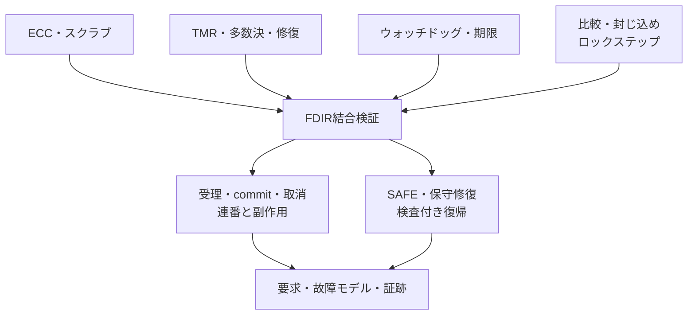

# 航空宇宙・高信頼システムの検証

航空宇宙の題材では、通常機能に加え、故障の検出、影響の封じ込め、処理の継続条件、復旧条件、要求と証跡の追跡を扱います。本資料は、[TMR制御レジスタ](../../examples/local-tmr/README.md)と[FDIRサブシステム](../../examples/local-fdir/README.md)を使って、RTLで観測できる故障反応を学ぶ案内です。

## 1. 航空と宇宙、回路の試験と保証活動

| 観点 | 資料を読むときの区別 |
| --- | --- |
| 共通する論理検証 | ECC、冗長化、不一致検出、期限、出力抑止、復旧。各案件の故障モデルと要求から試験を定める |
| 航空向け電子ハードウェア | 要求、開発・検証活動、構成管理、証跡などの開発保証を、適用する指針・プロジェクト計画に従って整理する |
| 宇宙向けASIC・FPGA | 工学的な開発要求、製品保証、使用環境、放射線対策等をプロジェクトで定める |
| RTLの教材 | 指定箇所・時刻のビット反転に対するデジタルな反応を比較する。認証・実デバイス評価を実施した結果とは区別する |

航空向けでは、FAAの[AC 20-152A](https://www.faa.gov/airports/resources/advisory_circulars/index.cfm/go/document.information/documentID/1041323)がED-80／DO-254を参照しています。同ACはSEEの感受性評価自体を扱うものではありません。航空の開発保証と、放射線に対する物理的な評価を同じ試験結果で代用しません。

宇宙向けでは、[ECSS-E-ST-20-40C](https://ecss.nl/standard/ecss-e-st-20-40c-asic-fpga-and-ip-core-engineering-11-october-2023/)が工学的な開発、[ECSS-Q-ST-60-03C](https://ecss.nl/standard/ecss-q-st-60-03c-asic-fpga-and-ip-core-product-assurance-11-october-2023/)が製品保証を扱います。この2023年の2文書は、従来のECSS-Q-ST-60-02Cを分けて置き換えています。[ESAの開発手法の説明](https://www.esa.int/Enabling_Support/Space_Engineering_Technology/Microelectronics/Microelectronics_Development_Methodology)も参照してください。本リポジトリの要求IDは教材の仕様であり、これらの規格要求を網羅した適合表ではありません。

## 2. 既存の例から進む

| 題材 | 実行例 | 主に確認すること |
| --- | --- | --- |
| 記憶の保護 | [SECDED](../../examples/local-ecc/README.md)／[ECCメモリ](../../examples/local-ecc-memory/README.md) | 訂正・検出・保証外の誤訂正、書戻し、スクラブの競合 |
| 比較と封じ込め | [ロックステップ監視](../../examples/local-lockstep-monitor/README.md) | 不一致、安全出力、復帰後の再同期 |
| 期限監視 | [タイマー・ウォッチドッグ](../../examples/local-timer-watchdog/README.md) | 期限、kickとの競合、通知、リセット要求 |
| 冗長化と修復 | [TMRレジスタ](../../examples/local-tmr/README.md) | 単一系統のマスク、不一致、修復、複数系統・共通原因の限界 |
| 機器制御の結合 | [FDIRサブシステム](../../examples/local-fdir/README.md) | 致命的異常とcommitの競合、取消、原因の保持、保守修復、再走査 |
| 通信とコマンド | [ネットワーク分野](../../examples/README.md#ネットワークパケット処理)／[再送リンク](../../examples/local-retry-link/README.md) | 境界、連番、重複、破棄、取消。宇宙・航空の特定規格への適合は別に計画する |

実際の耐故障プロセッサでもTMRやメモリ保護を組み合わせています。[ESA LEON2-FT](https://www.esa.int/Enabling_Support/Space_Engineering_Technology/Microelectronics/LEON2-FT)はその実例ですが、本教材が同じ故障保証や実装を再現するという意味ではありません。同IPの回路ソースは取り込んでいません。

## 3. 先に故障モデルを定める

「故障に強い」を検証項目にするには、対象・種類・同時数・発生時刻・継続期間・回復条件を分けます。

| 故障モデルの項目 | 教材での指定 | 製品へ展開するときの確認 |
| --- | --- | --- |
| 対象 | TMRの各系統、RAMの符号語 | 制御状態、配線、多数決、クロック、リセット、電源等も含めた保護範囲 |
| 種類 | 更新後の状態へのXOR反転 | SEU、MBU、SET、SEL、SEFI、TID等の違いと、採用するデバイス・環境の根拠 |
| 多重度 | 単一系統、単一／二重ビット、保証外の同時反転 | 1イベントが複数ビット・系統へ及ぶ可能性、共通原因 |
| 時刻 | 書込み、修復、命令処理、期限、復帰走査との同時性 | 実際の観測点と許容遅延、未保護区間 |
| 継続 | 1回の反転、修復後にも繰返す反転 | 一過性・間欠・恒久故障、検出・隔離後の縮退条件 |
| リセット | 全体の同期reset、pendingと走査の取消 | 個別リセット、解除順序、復旧後の古い要求や応答 |

ビット反転注入でSEE全体を再現したとは扱いません。注入位置・時刻の選択分布を、放射線環境における実際の発生率へ変換することもありません。

## 4. 要求と期待結果へ分解する

| 要求の例 | 観測点と判定 |
| --- | --- |
| 単一系統故障をマスクする | 注入後の多数決出力が注入前の正しい値と一致し、不一致も通知される |
| 修復する | 該当エッジで修復を試み、再注入がなければ3系統が正しい値へそろう |
| 訂正可能なRAM故障で継続する | 訂正値を使い、書戻し後は故障が残らず、不要にSAFEへ入らない |
| 訂正不能な値を採用しない | pendingの読出しを取消し、actuatorを0にし、原因とIRQを保持する |
| 期限を超えた命令を完了させない | 満了とcommitが同じエッジなら満了を優先。RAMの命令書込みと連番更新も抑止する |
| 不正命令を実行しない | 不正opcode・連番を検出し、副作用なしでSAFEへ移る |
| IRQ解除だけで復帰しない | ack後もSAFEと原因を保持し、新しい命令を受理しない |
| 修復を確認して復帰する | TMR一致と全RAMワードの走査を確認し、成功時だけRUNへ戻る |
| 同時の原因を失わない | TMR異常と期限超過等をORして保持。ackと競合してもIRQを残す |

保護機構を単体で検査した後、機構の組合せと正常機能への副作用を確認します。安全出力・縮退・復帰条件は案件の要求で定め、本教材の0出力や全停止を全製品の正解として流用しません。

## 5. クロス条件と独立した期待値

重点は、**故障位置×処理段階×機構の競合**です。全信号の直積にする前に、危険な誤完了・誤復帰が生じる条件を選びます。[クロス項目の選択手順](cross-test-selection-walkthrough.md)へ対応付けられます。

| 重点クロス | 固定して確保する例 |
| --- | --- |
| RAM故障×読出し／スクラブ | 13ビット全位置、1／2ビット、最終アドレス、走査の失敗と修復後の成功 |
| 書込み×修復×注入 | 新しい値が修復で消えないこと、更新後の符号語に反転が適用されること |
| TMR不一致×修復の有無×継続 | 単発で修復、修復後の再反転、修復停止、設定書換えと復帰拒否 |
| 期限×kick×commit×ack | kick優先の正常完了、満了優先の取消、同じエッジのIRQセット優先 |
| SAFE×保守×recover | ackだけ、設定不一致、訂正不能ワードの残存、全走査後の再開 |
| reset×pending／CHECK | 古い処理を完了へ数えず、メモリ・連番・出力を初期化 |
| 複数原因×通知 | TMRとウォッチドッグの同時発生で、原因ビットを片方だけにしない |

生成する入力と期待値が端子幅に収まることも検査します。幅に収まらない刺激と、幅には収まるが禁止されたopcode・連番等を区別し、比較時の切捨てで見かけ上一致することを防ぎます。

TMRモデルはビットごとの個数、ECCモデルは符号語とのHamming距離を使います。RTLと同じ多数決式やsyndrome更新を写すだけで独立モデルとしません。既知符号語、最小距離、全単一／二重ビットのモデル検査も行います。

## 6. 検出力・カバレッジ・証跡を分ける

故障注入は、仕様で定めた異常に対するDUTの反応を評価します。変異は、多数決式・修復・異常優先順位・復帰制御等の実装を意図的に誤らせ、自動チェッカーが検出できるかを評価します。両者で分母・期待結果・合否を共用しません。

TMRの複数系統故障では、誤った多数決・誤修復・共通原因の未検出も期待結果として観測します。限界ケースの合格を、耐故障の保証範囲へ加えません。

新2例の機能カバレッジは、合格した通常ケースの`COVER`ログを要求カタログへ照合する方式です。ネイティブcovergroup DB、コードカバレッジ、フォーマル証明とは別です。故障カバレッジや診断網羅率を報告する場合は、故障集合、同値化、注入の成立、検出・誤訂正・未検出・未完了の件数と根拠を別に定めます。

ソース・入力の版、構成、seed、故障箇所・マスク・エッジ、期待値、全状態の比較、受理・commit・取消・reset数、検出・通知・復旧の証跡を残します。[一般化した検証手順](spec-to-verification-method.md)、[機能カバレッジ](functional-coverage.md)、[継続的リグレッション](continuous-regression.md)、[追加記録](../../PROVENANCE.md#aerospace-20261101)へつなげてください。
