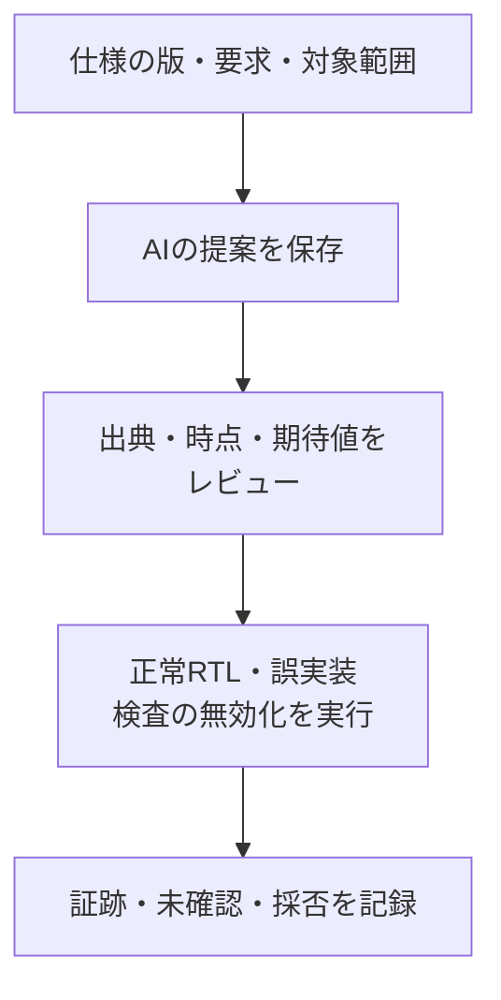

# AIが提案した検証項目・期待値・アサーションをレビューする

AIは、仕様の整理や検証案の作成に使えます。ただし、文章が自然で、テストが通り、複数のAIが同意しても、仕様の抜けや誤った期待値は残り得ます。[保存済みの提案を使う演習](../../examples/local-ai-review/README.md)では、外部APIを呼ばずに、4種類の悪い提案を実際のシミュレーションとネイティブSVAで検査します。

## 1. 依頼の範囲と成果物を決める

[依頼の雛形](../templates/ai-verification-request.md)に、仕様の版・出典・対象外・構成・利用可能なツールを記入します。「十分に検証して」だけではなく、要求ID、条件と期待結果、観測点、テスト、checker、カバレッジ目標、未確認を対応付けて提案させます。曖昧な仕様は推測で確定せず、仕様課題として挙げてもらいます。

RTLを参照して刺激や接続を理解することと、RTLの処理をそのまま期待値へ写すことは別です。期待値は仕様から独立して導出し、既知ベクトル・小さな真理値表・別表現のモデルで確かめます。

## 2. 典型的な4つの問題を確かめる

| 悪い提案 | 一見すると通る理由 | レビューと実行で確認すること |
| --- | --- | --- |
| 同時条件が抜けた項目表 | 通常のsetとclearは試している | 出典と要求一覧を照合し、set＋clearの実観測と誤実装の検出を確認 |
| `$past`の時点を誤ったSVA | 演算子が書かれていて、構文は正しい | 値を採るエッジと判定エッジを図や表へ展開し、正しいRTLが通るか確認 |
| 前件が成立しないSVA | 違反が0件になる | 前件・完了のcoverを置き、故障を入れたときに違反するか確認 |
| DUTと参照モデルに同じ誤り | 比較結果が一致する | 仕様からの独立した期待値や既知ベクトルを使い、両者を別々に検査 |

演習の仕様は、同時受理ではイベント優先の割り込みです。例えば`event |=> $past(pending)`という案は、次のエッジでイベントより前のpendingを参照してしまい、イベントで新たに1になることを確認できません。通常のイベント保持なら、必要なリセット条件と起動条件を付けて`event |=> pending`を検討します。`$past`自体が不要という意味ではありません。使う場合は、参照する履歴がリセット後に有効か、何サイクル前の値かを明示します。

`event && !event`を前件にすれば、含意は違反せずに終わります。刺激のイベントcoverが到達していても、実際の前件coverが0なら検査は働いていません。また、DUTと期待値を両方クリア優先に変えれば比較は通るため、独立した仕様値との相違も確かめます。

## 3. 提案を採用するまでの流れ

1. 提案そのものを保存し、後から修正した内容と区別する。
2. 別の担当が元の仕様と提案を直接照合する。AI同士の結論だけで済ませない。
3. 正常動作が通り、既知の誤実装が指定チェッカーで落ちることを確認する。
4. 前件未到達、checker無効、観測漏れ、途中終了を合格としないことを確認する。
5. 採用・修正・却下の理由と残リスクを、入力の版・実行ID・証跡へ結び付ける。

演習の自動判定は、固定した要求と既知の負例に対する検査です。任意の自然言語仕様を完全に理解して妥当性を保証する機能や、人の承認を代行する機能ではありません。実際にAIを利用した場合は、使用モデル・利用日・プロンプト・入力の識別子・生成物・レビュー方法を記録し、組織の機密情報の取扱いに従います。

関連：[AIを使う全体手順](spec-to-verification-method.md#12-並列化とaiの使い方)、[目視確認からアサーションへ](assertion-based-regression.md)、[仕様から項目を作る実例](spec-to-test-items-walkthrough.md)、[失敗解析](failure-analysis.md)。
