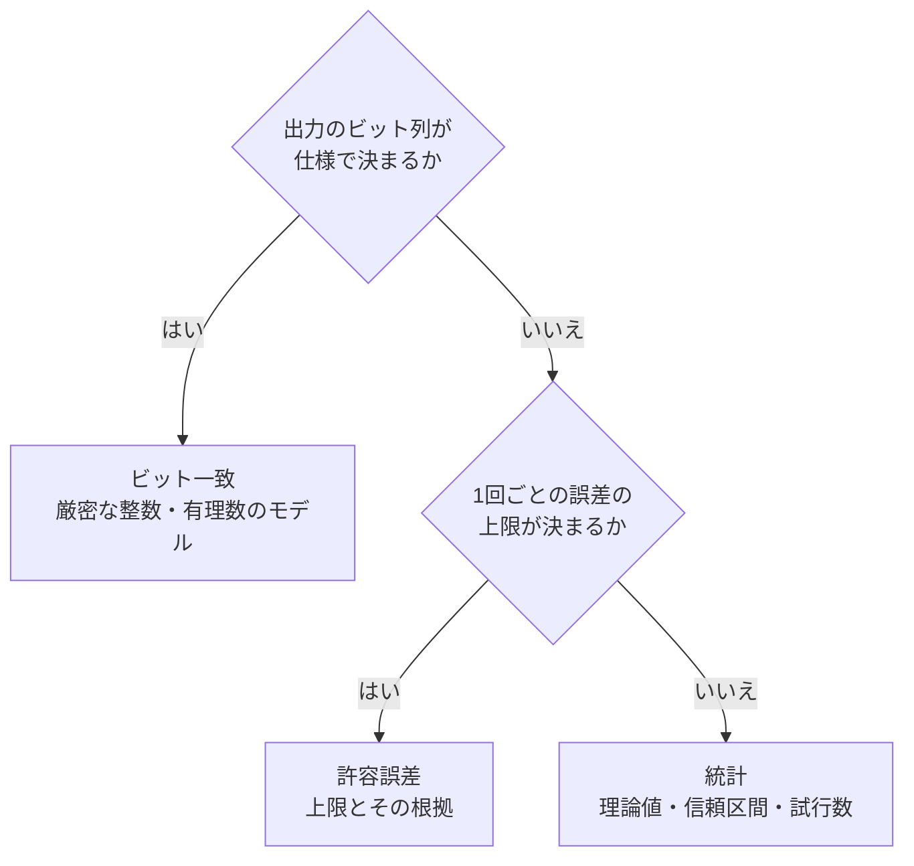

# 演算データパスの検証

乗算・除算・フィルター・量子化・ハッシュ・CRCなどの演算回路の検証を、判定の方法（ビット一致・許容誤差・統計）、固定小数点の丸めと飽和、入力の選び方（全数・境界・ランダム・フォーマル）、独立したモデルの作り方へ分けて整理します。入口は[固定小数点FIR](../../examples/local-dsp/README.md)と[多サイクル除算器](../../examples/local-divider/README.md)です。

演算回路は、制御の回路と違って状態が少なく、仕様を数式で書けます。その代わり、入力の空間が大きく（32ビットの2入力で2の64乗）、誤りは特定の値でだけ現れます。「ランダムに1万件通った」ことは、境界の1点の誤りについて何も言いません。

## 1. 判定の方法を先に決める

演算の仕様は、3つの種類に分かれます。どれに当たるかで、期待値の作り方も合否の書き方も変わります。

| 判定 | 使う場面 | 期待値 | 合否の条件 |
| --- | --- | --- | --- |
| ビット一致 | 仕様が、すべての入力について出力のビット列を決めている（整数演算、丸めの方式まで決めた固定小数点、CRC、ハッシュ） | 仕様と同じ演算を、別の方法で厳密に計算したモデル | 全ビットの一致 |
| 許容誤差 | 仕様が、数学的な関数への近さを決めている（近似の関数、CORDIC、係数を量子化したフィルターの特性） | 数学的に正確な値（有理数または十分な精度の浮動小数点） | 誤差が上限以下。上限の根拠を書く |
| 統計 | 仕様が、多数の試行での性質を決めている（ビット誤り率、信号対雑音比、乱数の偏り） | 理論値と信頼区間 | 測定値が区間に入る。試行の数とseedを決める |

実装では、3つを組み合わせます。例えばフィルターは、「RTLは、ビット単位で定義したモデルとビット一致する」と、「そのモデルの周波数特性は、理想の特性から許容誤差の範囲にある」の2段に分けます。RTLを直接、理想の特性と許容誤差で比べると、丸めの1ビットの誤りが許容の中に隠れます。

### 許容誤差の上限の根拠

許容の値は、合格するまで広げた値にしません。次のどれかから導きます。

- **仕様の要求**：上位の仕様が求める精度。
- **方式の解析**：近似の方式から求まる誤差の上限（区分線形なら区間の幅と2階微分、反復の方式なら反復の回数）と、量子化・丸めによる誤差の上限の和。
- **全数の測定**：入力が小さければ、全入力での最大の誤差を測り、解析の上限以下であることを確かめる。

[活性化関数の例](../../examples/local-activation/README.md)は、正確な関数値と許容の幅をベクトルに入れ、テストベンチが誤差の上限で判定します。比較のときの丸めの幅も、判定に含めて書いています。

## 2. 対象境界を決める

| 対象 | 判定 | このリポジトリの入口 |
| --- | --- | --- |
| フィルター（FIR） | ビット一致 | [固定小数点FIR](../../examples/local-dsp/README.md)、[C++参照モデルとFIR](../../examples/local-cpp-reference/README.md) |
| 除算 | ビット一致（商と余り） | [多サイクル除算器](../../examples/local-divider/README.md) |
| 近似の関数 | 許容誤差 | [活性化関数](../../examples/local-activation/README.md) |
| 量子化 | ビット一致（丸めを2段階で定義） | [再量子化](../../examples/local-requantize/README.md) |
| 浮動小数点に近い形式 | ビット一致（有理数のモデル） | [FP16／MXFP8／MXFP4](../../examples/local-mxfp4/README.md) |
| 積和の配列 | ビット一致 | [シストリックアレイ](../../examples/local-systolic-array/README.md) |
| 選択・整列 | ビット一致（全入力の証明） | [Top-K選択](../../examples/local-topk/README.md) |
| ハッシュ | ビット一致（公開ベクトル） | [SHA-256](../../examples/local-sha256/README.md) |
| 誤り検出・訂正の符号 | ビット一致 | [CRC](../../examples/local-packet-crc/README.md)、[ECC](../../examples/local-ecc/README.md) |
| 制御の演算 | ビット一致（有理数のモデル） | [閉ループ制御](../../examples/local-motion-control/README.md) |
| 画像の演算 | ビット一致 | [Sobelフィルター](../../examples/local-image-sobel/README.md) |

演算の仕様には、次を必ず書きます：入力と出力の幅と符号、小数点の位置、丸めの方式、あふれたときの扱い（飽和か折返しか）、途中の計算の幅、結果が出るまでのサイクル数、途中の取消しの扱い。丸めと飽和を書かずに「8ビットへ変換する」とだけ書いた仕様は、実装とモデルが別々の解釈をします。

## 3. 固定小数点の丸めと飽和

丸めの方式は、ちょうど中間の値と負の値で差が出ます。

| 方式 | 2.5 | −2.5 | 3.5 | 特徴 |
| --- | --- | --- | --- | --- |
| 切捨て（負の無限大へ） | 2 | −3 | 3 | 下位ビットを捨てるだけ。平均が負へずれる |
| 0へ向かう切捨て | 2 | −2 | 3 | 符号で処理が変わる |
| 中間は0から遠い側へ | 3 | −3 | 4 | 0.5を足して切り捨てる形に、負の補正が要る |
| 中間は正の無限大へ | 3 | −2 | 4 | 0.5を足して切り捨てるだけ。負の中間で上の方式と違う |
| 中間は偶数へ | 2 | −2 | 4 | 平均のずれがない。回路は少し増える |

検証では、次の値を固定の試験に入れます。

| 入れる値 | 理由 |
| --- | --- |
| ちょうど中間になる値（正と負の両方） | 丸めの方式の違いは、ここでしか出ない |
| 丸めた結果が、ちょうど最大値・最大値＋1・最小値・最小値−1になる値 | 丸めと飽和の順序の誤り |
| 途中の計算が最大の幅を使う値（全係数と全入力が最大・最小） | 途中のあふれ |
| 0、±1、符号だけが違う値 | 符号拡張の誤り |
| シフト量が0・1・最大の値 | シフト量0での丸めの定数の扱い |

丸めてから飽和させるか、飽和させてから丸めるかで、境界の結果が変わります。仕様で順序を決め、モデルもその順序で書きます。2段階の丸め（[再量子化の例](../../examples/local-requantize/README.md)）では、1回にまとめた丸めと結果が違う入力を、固定の試験に入れます。

## 4. 入力の選び方

| 方法 | 使える範囲 | 得られる保証 | 注意 |
| --- | --- | --- | --- |
| 全数 | 入力の合計が20〜24ビット程度まで | その幅については完全 | 幅を縮めた構成での全数は、実際の幅の保証ではない。幅に依存する回路（桁上げの連鎖）は別に見る |
| 境界 | どの幅でも | 選んだ点だけ | 境界を仕様とモデルの構造の両方から選ぶ（区間の端、桁上げが最長になる値、中間の値） |
| ランダム | どの幅でも | 確率的。まれな値には届かない | 一様な乱数は境界に当たらない。境界の近くを厚くする分布を混ぜる |
| フォーマル | 加算・比較・選択・シフトは広い幅まで。乗算・除算は狭い幅まで | その幅については完全 | 乗算器どうしの比較は、ソルバーが終わらないことが多い。幅を縮めるか、分割する |
| 公開ベクトル | 標準のある演算（ハッシュ、暗号、CRC） | 標準の解釈の一致 | ベクトルの数は少ない。中間の境界（ブロックの境界など）を自分で足す |

実用上は、次のように組み合わせます。

1. 縮めた幅で、全数またはフォーマルによって方式の正しさを確かめる。
2. 実際の幅で、境界の固定の試験と、境界を厚くしたランダムを実行する。
3. 幅に依存する性質（最長の桁上げ、最上位ビットの扱い）は、実際の幅の境界の試験で狙う。

[除算器の例](../../examples/local-divider/README.md)は、32ビットをシミュレーション、4ビットと8ビットをフォーマルで確かめ、16ビット以上の証明が時間内に終わらなかったことも記録しています。[Top-Kの例](../../examples/local-topk/README.md)は、比較と選択だけの回路なので、全入力についての証明が終わります。

## 5. 独立したモデルを作る

RTLと同じ式を同じ順序で書いたモデルは、同じ誤りを持ちます。モデルは、次のように別の考え方で書きます。

| モデルの作り方 | 内容 | 例 |
| --- | --- | --- |
| 任意精度の整数 | 途中の幅を気にせず、数学的な値を計算してから、最後に丸めと飽和を適用する。RTLの途中の幅の誤りを写さない | [FIR](../../examples/local-dsp/README.md)、[シストリックアレイ](../../examples/local-systolic-array/README.md) |
| 有理数（Pythonの`fractions`） | 割り算と中間の値を厳密に扱う。浮動小数点の誤差が判定に入らない | [MXFP4](../../examples/local-mxfp4/README.md)、[閉ループ制御](../../examples/local-motion-control/README.md) |
| 逆演算による検算 | 商×除数＋余り＝被除数、のように結果を逆から確かめる。モデルを持たずに性質で判定できる | [除算器](../../examples/local-divider/README.md) |
| 標準ライブラリ | `hashlib`、`zlib`など、広く使われている実装と比べる | [SHA-256](../../examples/local-sha256/README.md) |
| 別の言語の実装 | C++のモデル。モデル自身は有理数の計算で確かめる | [C++参照モデル](../../examples/local-cpp-reference/README.md) |
| 性質 | 出力が整列している、出力が入力の並べ替えである、など | [Top-K](../../examples/local-topk/README.md) |

倍精度の浮動小数点をモデルに使うときは、その誤差が判定に与える影響を書きます。53ビットの仮数で厳密に表せる範囲の整数演算なら問題ありませんが、ビット一致の判定で中間の値を浮動小数点で丸めると、モデルの方が誤ります。

モデルそのものも検査します。モデルに意図的な誤り（係数の誤りなど）を入れ、RTLとの比較で検出されることを確かめます。これはRTLの変異とは別の分類にします。

## 6. 時間の観点を分ける

演算回路にも、制御の部分があります。値の正しさと分けて検査します。

| 観点 | 要求の例 | 確認方法 |
| --- | --- | --- |
| レイテンシ | 結果は、受付から決めたサイクル数で出る | 受付と完了の時刻の照合 |
| 逆圧 | 出力を待たせている間、結果を保持する。入力を止める | 待ちを入れた構成 |
| 取消し | 途中の取消しの後、古い結果が出ない | 多サイクル演算の途中の取消しと、直後の開始 |
| リセット | 途中のリセットで、内部の状態（フィルターの履歴など）を消す | リセットの後の最初の出力 |
| 連続入力 | 前の入力の影響が、次の結果へ混ざらない | 連続した入力と、間を空けた入力の結果の一致 |
| データに依存しない時間 | 処理のサイクル数が、値によって変わらない（必要な場合） | [定時間の証明](../../examples/local-constant-time/README.md) |

## 7. 検出力を確かめる

| 変異 | 検出に必要な入力 |
| --- | --- |
| 丸めの定数を足さない（切捨てになる） | 小数部が0.5以上の値 |
| 負の値の丸めの補正を落とす | 負の、ちょうど中間の値 |
| 飽和の境界を1ずらす | 丸めた結果が、ちょうど最大値＋1になる値 |
| 飽和を折返しにする | あふれる値 |
| 途中の幅を1ビット削る | 途中の計算が最大になる値 |
| 係数を1つ取り違える | その係数だけが効く入力（インパルス） |
| 符号拡張を落とす | 負の入力 |
| 反復を1回減らす | 最下位ビットが効く値 |

許容誤差の判定では、「誤差が上限を少しだけ超える」変異を入れます。上限を広く取りすぎていると、この変異が合格します。区間を1つずらす、表の値を1 LSB変える、などです。

## 8. 既存の実行例との対応

| 項目 | 実行例 | 判定と入力 |
| --- | --- | --- |
| FIRの符号・丸め・飽和 | [固定小数点FIR](../../examples/local-dsp/README.md) | ビット一致。境界とランダム |
| C++のモデルとの照合 | [C++参照モデル](../../examples/local-cpp-reference/README.md) | ビット一致。モデルは有理数の計算で照合 |
| 除算 | [多サイクル除算器](../../examples/local-divider/README.md) | ビット一致。32ビットはシミュレーション、4・8ビットはフォーマル |
| 近似の関数 | [活性化関数](../../examples/local-activation/README.md) | 許容誤差。上限つき |
| 2段階の丸め | [再量子化](../../examples/local-requantize/README.md) | ビット一致。中間の値 |
| 小さい浮動小数点の形式 | [FP16／MXFP8／MXFP4](../../examples/local-mxfp4/README.md) | ビット一致。有理数のモデル。nightlyで全65,536通りの要素の組 |
| IEEE 754の加算器 | [浮動小数点の加算器](../../examples/local-fp-adder/README.md) | ビット一致。8ビットの形式は全数、8・10ビットの形式は全入力のフォーマル証明、binary32は有理数のモデルで境界値とランダム |
| 積和の時間合わせ | [シストリックアレイ](../../examples/local-systolic-array/README.md) | ビット一致。サイクル単位 |
| 選択 | [Top-K](../../examples/local-topk/README.md) | 全入力のフォーマル証明 |
| ハッシュ | [SHA-256](../../examples/local-sha256/README.md) | ビット一致。`hashlib`と公開ベクトル |
| CRC | [CRC](../../examples/local-packet-crc/README.md)、[E2E通信保護](../../examples/local-e2e-guard/README.md) | ビット一致。既知の値 |
| ECC | [ECC](../../examples/local-ecc/README.md) | ビット一致。1ビット・2ビットの誤りの全数 |
| PIの制御 | [閉ループ制御](../../examples/local-motion-control/README.md) | ビット一致。有理数のモデル |
| 画像のフィルター | [Sobelフィルター](../../examples/local-image-sobel/README.md)、[ラインバッファ](../../examples/local-conv-window/README.md) | ビット一致。端と角 |
| アナログとの比較 | [RC回路とSPICE](../../examples/local-spice-cosim/README.md)、[ADCの変換](../../examples/local-adc-conversion/README.md) | 許容誤差（電圧）、量子化 |

公開プロジェクトでは、[CVFPUの参照例](../../examples/reference-cvfpu-uvm/README.md)（浮動小数点）と[NVDLAの参照例](../../examples/reference-nvdla/README.md)（演算のトレースの比較）が入口です。

### まだ例がない項目

| 項目 | 判定 | 状態 |
| --- | --- | --- |
| IEEE 754の乗算 | ビット一致。小さい形式の全数とフォーマル、binary32は有理数のモデル | 未着手。加算器には[実行例](../../examples/local-fp-adder/README.md)がある |
| CORDIC | 許容誤差。反復ごとの誤差の上限、16ビットの角度の全数 | [実行例あり](../../examples/local-cordic/README.md)。整数モデルとのビット一致と分けて判定する |
| CICデシメーター | ビット一致。ビット成長、途中の段の折返し | [実行例あり](../../examples/local-cic-decimator/README.md)。途中の段を切り詰める構成は未着手 |
| IIR（バイクアッド） | ビット一致と、周波数特性の許容誤差の2段 | [実行例あり](../../examples/local-iir-biquad/README.md)。直接形Iだけ |
| 誤り訂正とビット誤り率 | 統計。理論値と信頼区間、試行の数の決め方 | [実行例あり](../../examples/local-fec-ber/README.md)。統計的な判定の最初の例。通信路は二元対称だけ |
| FFT | 許容誤差 | 未着手 |
| ΔΣ変調器 | 統計（信号対雑音比の下限） | 未着手 |
| AES | ビット一致。公開ベクトル | 未着手 |

## 9. 製品で追加する確認

| 追加する確認 | 内容 |
| --- | --- |
| システムでの精度 | 演算回路の誤差が、システムの性能（画質、認識率、制御の安定性、誤り率）へ与える影響。実際のデータでの評価 |
| 上位のモデルとの対応 | アルゴリズムの検討に使ったモデル（浮動小数点）と、ビット単位のモデルの差の評価 |
| 構成の行列 | 幅、係数、段数、丸めの方式などのパラメーターごとの回帰 |
| 合成後 | 演算器の最適化（乗算器の構成の変更、リタイミング）の後の等価性。演算器は等価性検証が難しく、専用の方法が要ることがある |
| タイミング | 最長の桁上げの経路、マルチサイクルの指定（[ゲートレベルとタイミングの検証](gate-level-and-timing-verification.md)） |
| 標準への適合 | 浮動小数点（IEEE 754）、暗号（公開の試験ベクトル）などの、標準の試験による確認 |

## 10. 参考にした一次資料

- IEEE Std 754（浮動小数点演算）：丸めモード、例外、特別な値の定義。本文は引用していません。
- [Berkeley TestFloat](http://www.jhauser.us/arithmetic/TestFloat.html)：浮動小数点の実装を試験するための公開のベクトル生成器。このリポジトリでは使っていません。
- [FIPS 180-4](https://csrc.nist.gov/pubs/fips/180-4/upd1/final)：SHA-2の定義と例。[CRC RevEngのカタログ](https://reveng.sourceforge.io/crc-catalogue/all.htm)：CRCのパラメーターと既知の値。
- [Pythonの`fractions`](https://docs.python.org/3/library/fractions.html)：有理数のモデルに使う標準ライブラリ。
- [Yosysの文書](https://yosyshq.readthedocs.io/projects/yosys/en/latest/)と[SBYの文書](https://yosyshq.readthedocs.io/projects/sby/en/latest/)：フォーマルの実行環境。
- [フォーマル検証](formal-verification.md)、[C++参照モデルによる検証](cpp-reference-verification.md)：このリポジトリの関連する手順書。
