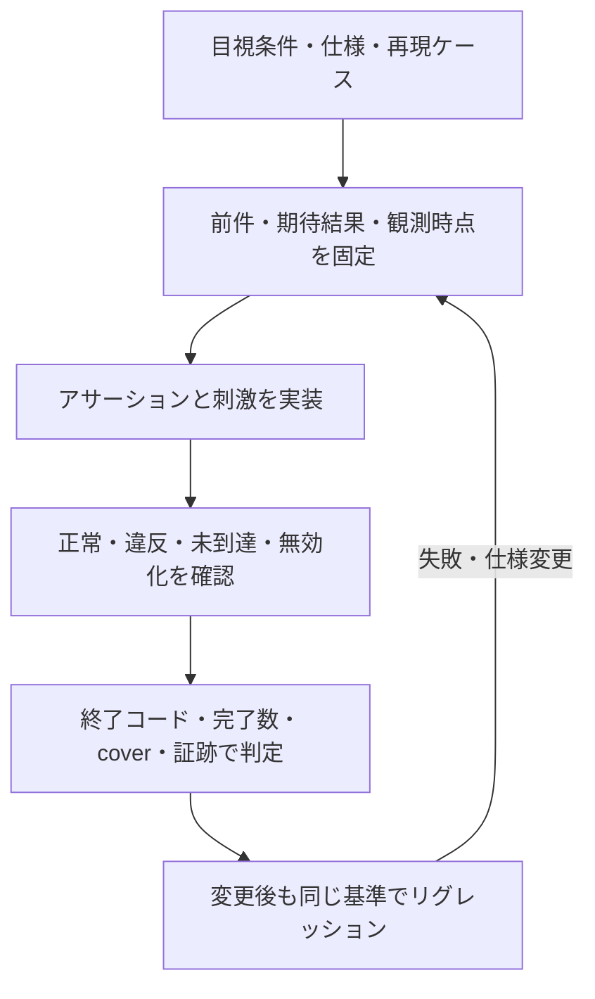

# 目視確認をアサーションに置き換え、リグレッションへ残す

波形を見て合否を判断していた条件を、要求に対応した実行可能なチェッカーへ移す手順です。アサーションを使う検証（assertion-based verification: ABV）の運用として、確認条件・適用範囲・検出力・終了判定を管理します。記述の詳細は[SVAの手順](sva-verification.md)、起動・集約・証跡は[継続リグレッション](continuous-regression.md)へつなぎます。

例だけに閉じた話ではありません。いったん確認した動作や修正した不具合を、変更後の回帰試験でも自動判定できる検証資産として蓄積するための方法です。小さな例は、判定と検出力を試してから対象IPへ展開する入口になります。

## 1. 目視で見ていた条件を言葉にする

「波形が正しい」「待ちが問題ない」では、担当者や実行ごとに判定が変わります。例えば「イベントとW1Cを同じ立上りで受理した場合、イベントを優先して保持状態を1にする」のように、条件と期待結果を分けます。

最初に次を記録します。

- 要求ID・版、元の目視手順・波形・不具合の再現ケース。
- 対象信号・階層・構成、受理・完了の定義、クロックと観測時点。
- 前件、期待する値・保持・時間関係・期限。
- リセット・中断・モード切替・履歴の扱い、環境が保証する条件。
- 条件を起こす刺激、誤実装・観測違反を検出する対照ケース。

仕様の根拠を確認し、たまたま見えていた実装遅延を新しい仕様として固定しないようにします。仕様が未確定なら課題を残し、暫定の判定には根拠と見直し条件を付けます。[移行記録の雛形](../templates/assertion-migration.md)を使えます。

## 2. アサーションとスコアボードを分担する

局所的な値の関係、優先順位、保持、禁止状態、決まった時間内の応答はアサーションの候補です。例えばreadyが低い間のvalid・データ保持や、FIFOの受理条件を確認できます。複数要求のID対応、長いデータ列、複雑な演算結果は、独立した参照モデル・スコアボードと分担します。

波形を調べる作業は、初期の動作理解、仕様・観測点の検討、失敗原因の解析などに残ります。アサーションは明文化した条件を毎回確認するために使います。サンプル間のグリッチや物理タイミングなど、別の観測・解析を必要とする性質も、適切な方式へ対応付けます。

## 3. クロックとリセットをそろえて実装する



クロック付き並行アサーションでは、同じエッジでサンプルする値と、その後のNBA更新を分けます。`|->`と`|=>`の選択、`$past`等の履歴、`disable iff`による中断をレビューします。最後のサンプルで始まった後件を観測しないまま、シミュレーションを終了しないようにします。[サンプリングと時間演算](sva-verification.md#3-サンプリングと時間演算を合わせる)を参照してください。

[割り込みの実行例](../../examples/local-sva/README.md)にあるセット優先のアサーションは次の形です。これは既存チェッカーの抜粋で、ポートと有効化・終了制御は[ソース](../../examples/local-sva/irq_checker.sv)を参照してください。

```systemverilog
ap_set_wins: assert property (@(posedge clk)
  disable iff (!checker_enabled || !rst_n)
  (launch && event_accept && clear_accept) |=> pend)
  else begin $display("CHECK_FAIL IRQ_SET_WINS"); failed = 1; end
```

エッジkで同時受理をサンプルし、kのNBAで更新されるPENDを、次のエッジk+1のサンプルで確認します。「1サイクル遅れて状態を更新する仕様」に変更したものではありません。`launch`はこの教材の終了制御で、最後は新しい1サイクル後件の開始だけを抑止し、開始済みの後件を観測します。同期リセットによるPENDのクリアは、リセットで無効化しない別のアサーションで検査します。

## 4. チェッカーの検出力も確かめる

| 確認 | 必要な結果 |
| --- | --- |
| 正常動作 | 条件に到達し、後件の比較が完了し、違反がない |
| 既知の誤動作 | 予定したアサーション名・失敗ラベルと非ゼロ終了で検出する |
| 前件がない入力 | coverで刺激不足を識別し、必要な動作の検査済みへ加えない |
| リセット・中断 | 仕様上の取消しと、後件まで確認した完了を分ける |
| チェッカー無効化・未接続 | 必要な検出や到達の欠落を、リグレッションが拒否する |
| 終了直前 | 開始した検査の後件を確認し、未完了を隠さない |

assertの失敗が0でも、前件が成立していない、毎回中断される、チェッカーが無効という場合があります。前件と必要な完了経路のcover、接続・有効化の設定、正常終了・予定件数を合わせて確認します。2値での実行結果を4値・X/Zの確認へ読み替えません。

## 5. リグレッションの合否と証跡へ結び付ける

アサーションの違反をログへ表示するだけでは、集約処理が成功扱いにしてしまうことがあります。ランナーは、違反フラグやツールの結果を終了コードとJUnitへ反映し、予定ケースの欠落・途中終了・ビルド失敗・タイムアウトも失敗または判定不能として返します。意図した違反の検出確認では、無関係なクラッシュを成功へ数えません。

要求ID、アサーション名・ソース、失敗ラベル、適用先、構成・テスト・seed、RTLとチェッカーの版、実行IDを対応付けます。波形・入力・サンプル時刻を、失敗箇所から辿れるように保存します。失敗した刺激は固定ケースや固定seedへ残し、修正後も同じ基準で実行します。仕様変更の際は、アサーションと期待値を仕様の根拠に沿ってレビューします。

製品へ展開する場合は、適用するリグレッションの段階、担当、必須条件、実行時間の予算を決めます。自動化した確認と、引き続き目視・別解析が必要な確認を記録し、目視確認を終了した根拠を残します。記録先は[検証計画](../templates/verification-scope.md)と[サインオフ記録](../templates/signoff-record.md)です。

## 6. 既存の実行例で一通り確認する

新しいランナーを増やさず、[SVAの割り込み例](../../examples/local-sva/README.md)で正常判定と検出力を確認できます。6要求・6アサーション・12目標を扱い、通常ケースの到達と、RTL変異・チェッカー観測違反・刺激不足を分けて記録します。

```sh
python3 examples/local-sva/run.py
python3 examples/local-sva/run.py --profile nightly
python3 -m unittest discover -s examples/local-sva/tests -v
```

チェッカーの無効化と、正常ケースへ不具合を入れたデモは次です。いずれもランナーの終了コード1を確認します。

```sh
python3 examples/local-sva/run.py --checker-off
python3 examples/local-sva/run.py --demo-bug 1
```

期待する反例をランナーの診断として判定することと、実際の正常リグレッションが失敗することを区別します。既存例は、両方を確認できる構成です。使うSVAの構文は[Verilatorの対応範囲](https://verilator.org/guide/latest/languages.html#assertions)と[有効化設定](https://verilator.org/guide/latest/exe_verilator.html#cmdoption-assert)を確認し、ツールの版と実行設定も証跡へ含めます。
