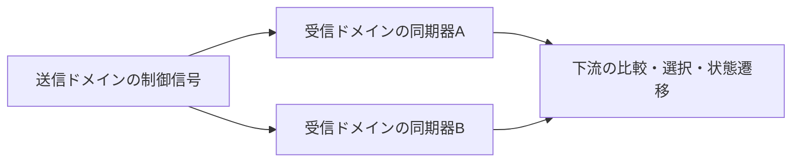
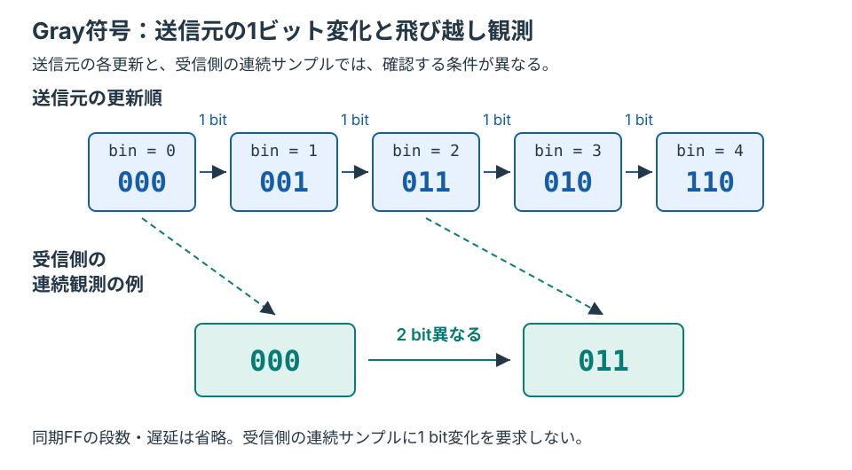

# 非同期検証：CDC・RDC・リコンバージェンス・非同期FIFO

非同期検証では、クロックやリセットの境界を越える信号が、受信側でいつ・どの組合せで見えるかを確認します。同期器の有無に加え、イベントの欠落・重複、データの整合性、リコンバージェンス（再収束）、非同期FIFO、リセットと復帰を独立した検証項目にします。

本資料は、クロックを持つ領域間の非同期境界を対象にした検証計画の手順です。クロックを使わない非同期回路全般の検証や、製品のCDC/RDCサインオフを実施した記録ではありません。[適用範囲の記録](../templates/verification-scope.md)の`SCOPE-CDC-RDC`から、以下の項目を対象IP・SoCへ展開します。

## 1. ドメインと交差を棚卸しする

RTLのクロック名だけで分類せず、生成元・位相関係・モードごとの切替を確認します。同じ周波数でも位相関係が保証されなければ非同期として扱い、生成クロックに同期関係がある場合は、その根拠とタイミング制約を残します。同じクロックで動く回路にも、リセット条件が異なるRDCがあります。

交差ごとに、次を記録します。

- 交差ID、送信元・受信先のレジスタまたは端子、クロックとリセット、電源領域、必須モード。
- 転送の意味：状態レベル、イベント、データ、ポインター、リセット、起動許可など。
- 転送方式、同期器の段数・共有範囲、データ保持期間、最短イベント間隔、許す欠落・合流の有無。
- 再収束する相手の交差IDと下流の観測点、組合せが使われる条件。
- 片側リセット・クロック停止時の保持・排出・取消、復帰条件、要求・解析・試験・証跡の対応。

IPの解析結果をSoCへ持ち上げるときは、実際の結線・クロック・リセット・モードと仮定を再照合します。[AccelleraのCDC/RDC情報交換標準](https://accellera.org/downloads/standards/clock-domain-crossing)は、その意図や解析情報を引き継ぐための参照先です。IP単体の合格を、接続後の交差や新たな再収束の合格として流用しません。

## 2. 検証分野として持つ項目

以下のIDは、本資料で検証項目へ展開するための分類です。実行ランナーへ登録済みの要求IDや、自動判定済みの項目を表すものではありません。

| 項目ID | 分野・対象 | 主に確認すること |
| --- | --- | --- |
| ASYNC-DOMAIN | ドメイン・制約・解析範囲 | 未定義のクロック・リセット、生成クロック、動作／試験モード、未分類の交差、IP境界の仮定 |
| ASYNC-SYNC | 単一ビットの同期構造 | 未同期・同期段の途中からの分岐、同期前の組合せ論理、同期器の複製、セル・属性・段数 |
| ASYNC-EVENT | パルス・toggle転送 | 短パルスの取りこぼし、最短間隔、連続イベント、toggleの二重反転、欠落・重複 |
| ASYNC-DATA | 複数ビット・req/ack | ワードの混在、データ保持、要求とackの往復、受信待ち、次の転送を許す条件 |
| ASYNC-RECONV | リコンバージェンス | 同一信号の多重同期、関連する制御・データの再結合、到着順序の変化と早期受理 |
| ASYNC-FIFO | 非同期FIFO | Grayポインター、full／empty、データ順序、空・満杯・周回、同期遅延、破棄・復帰 |
| ASYNC-RDC | リセットドメイン交差 | 非同期アサート・同期デアサート、同一クロック内の異なるリセット、解除の再収束、片側リセット |
| ASYNC-CLOCK | クロック・電源制御との結合 | 周波数・位相、停止・再開、切替、隔離・保持・復帰、停止中に入る要求とリセット |
| ASYNC-DYNAMIC | 同期化遅延の不確定さ | 固定遅延差と遷移ごとの注入、許す相関・到着順、実際に観測した遅延と下流への影響 |
| ASYNC-PHYSICAL | 実装・信頼性 | 同期器の配置と収束時間、Grayバス等の遅延・スキュー、recovery／removal、対象条件に基づくMTBF |

複数の項目が同じ交差へ適用されます。例えば、FIFOのポインター同期には`ASYNC-SYNC`・`ASYNC-FIFO`・`ASYNC-PHYSICAL`が、片側リセットにも対応するなら`ASYNC-RDC`も必要です。

<a id="reconvergence"></a>

## 3. リコンバージェンスを独立して検証する

リコンバージェンスは、分かれた経路が後段で再び組み合わされることです。各経路が同期器を通っていても、同じ受信サイクルで新しい値になるとは限りません。構造解析で候補を探し、相対遅延が変わったときに、その値の組を下流がどう使うかを確認します。

| 再収束の種類 | 作る条件 | 判定すること |
| --- | --- | --- |
| 同一信号を同じ受信ドメインで別々に同期 | A先着・同時・B先着、両極性、複数回の転送 | 一時的な不一致を誤ったイベント・許可・状態遷移に使わない |
| 関連する複数の制御を別々に同期 | enable／mode、valid／選択、one-hot等の相対到着を変える | 仕様が許さない制御の組を有効として消費しない |
| 制御と複数ビットデータの再結合 | 制御が最も早く見え、データ到着が最も遅い条件、受信待ち | 完全な同一転送のデータだけを受理し、保持期間を守る |
| リセット解除の再収束 | 独立した解除同期器の前後関係、片側が停止している条件 | 活動中の状態とリセット状態の混在で、誤要求・古い応答を作らない |

例えば、同じ制御信号を2か所で同期し、両方を使って判断する構造では、次の相対差が問題になります。



送信信号を0から1へ変えて保持しても、受信側には`(A,B)=(0,0) → (1,0) → (1,1)`と見える場合があります。この間のXORをイベントとして数える回路なら、一時的な不一致を誤ったイベントとして扱います。逆の先着順と1から0への変化も試します。正常なRTLシミュレーションで両経路が常に同時更新されるだけでは、この差を試したことになりません。

設計を見直す場合は、同じ受信ドメインで一度同期した信号を共有できるか、関連する情報を一つのハンドシェイクやFIFOで渡せるかを検討します。再収束が機能上許される構造では、マスク・安定待ち・プロトコルが成立する条件を示します。[AMD UG906のCDC規則](https://docs.amd.com/r/2022.2-English/ug906-vivado-design-analysis/Understanding-the-Clock-Domain-Crossings-Report-Rules)も、同期前のfanoutや複数ビット転送を別の指摘として扱っています。指摘の除外には、その回路で安全に使える根拠を残します。

**同じ同期器の出力を分岐しただけの経路へ、別々の同期化乱数を与えない**ようにします。独立した同期器か、共有した同期結果かを構造と照合します。また、内部の一時的な不一致をすべて不合格にするのではなく、許された期間・マスクと、実際の受理・出力・状態更新を判定します。

既存の[IRQ・CDC例](../../examples/local-irq-cdc/README.md)では、2経路の遅延9組と両極性の18目標を観測し、早期受理・欠落・重複を検査します。[受信サイクルごとの記入例](verification-gap-review.md#44-観測目標と完了判定)も参照してください。これは送信値を保持する限定したデジタルモデルであり、任意の再収束を「両経路の一致待ち」で解決できるという設計指針ではありません。

<a id="async-fifo"></a>

## 4. 非同期FIFOを検証する

非同期FIFOは、書込み側と読出し側が異なるクロックで動く転送方式です。データはFIFOメモリを通し、空・満杯の判断に必要なポインターを相手側へ同期します。データバスの各ビットを独立に同期してワードを作る方式とは区別します。

| 項目 | 刺激・条件 | 期待値・チェッカー |
| --- | --- | --- |
| 受理とデータ整合 | 連続書込み・読出し、同時エッジ、待ちと再開 | 受理したデータを独立キューへ積み、読出しの値・順序・欠落・重複を比較 |
| 空・満杯と近傍 | 空への読出し、最後の空き、満杯への書込み、満杯から1件読む | 禁止操作で状態を進めず、受理条件とvalidが仕様どおり |
| フラグの同期遅延 | 書込み直後のempty、読出し直後のfull、同期段数の違い | 相手ポインターの伝達とフラグ更新に許される遅延を反映して比較 |
| ポインターと周回 | 空／満杯を跨ぐ反復、アドレス・周回ビットの折り返し | 送信元のGray値は通常動作の1ステップ更新で1ビット変化、非受理時は保持 |
| クロック条件 | 書込みが速い／遅い、同周期・位相差、ジッター、許す停止・再開 | データ整合性とフラグを維持し、再開後に排出できる |
| リセットと復帰 | 未読データがある時点、解除順序、仕様が許す片側リセット | 破棄・保持の契約に従い、古いデータの再出現や架空の受理がない |
| 実メモリと実装 | 読出しレイテンシ、read-during-write、ポインター経路の遅延・スキュー | 使用するメモリ仕様・タイミング制約と、検証モデルが一致 |

**full／emptyを、その瞬間の全体占有数と単純に一致させるチェッカーは使いません。** 相手側の進みが届くまで、読めるデータがあってもempty、空きがあってもfullのままという保守的な期間があり得ます。安全側の遅れと、仕様で許される解除期限を分けて検査します。無期限にフラグを保持する不具合まで許さないようにします。

**送信元Grayポインターの隣接更新と、受信側の連続サンプルを分けます。** 送信元が`000 → 001 → 011`と1ビットずつ更新しても、受信側が中間値を飛ばして`000 → 011`と観測することがあります。受信側へ一律の1ビット変化assertを置くと、この合法な観測を誤検出します。



Gray符号を使うだけで、実配線のスキューが無制限でもよいとは判断しません。登録された送信ポインター、同期器、実装上の遅延・スキューの条件を別途確認します。[AMDのGray転送マクロの説明](https://docs.amd.com/r/en-US/pg382-xpm-cdc-generator/XPM_CDC_GRAY)も、適用できる入力変化と使用条件を定めています。そのマクロ固有の条件を、すべての非同期FIFOに共通の条件として流用しません。

リセットでデータを破棄する仕様では、`書込み受理数＝読出し完了数＋破棄数＋残存数`を照合し、最後は仕様どおり排出または取消します。read要求の受理とデータの返却が別サイクルなら、その間の未完了も計上します。片側リセットの安全性は方式に依存するので、共通リセットしかない例の合格を、片側リセット対応の証拠にはしません。

[既存の非同期FIFO例](../../examples/local-async-fifo/README.md)は、深さ4／8×同期段数2／3、クロック比・位相・ジッター、共通リセットを扱います。段数は構成ごとに固定しており、遷移ごとのメタスタビリティ影響注入、片側リセット、実メモリマクロや物理スキューの解析は含みません。

[画像パイプラインの実行例](../../examples/local-video-async/README.md)では、カラーキー、色変換、アルファ合成、表示を4クロックに分け、画素・alpha・背景・SOF/EOLを同じFIFOエントリで渡します。待てるストリーム受信器で転送を確認した後、固定表示でprefill・平均帯域・有効期間の不足量・underflow時の黒表示を確認します。片側だけのリセット継続には対応せず、全体を協調リセットして新しいフレームから再開します。

## 5. 複数ビット・イベント・RDCを区別する

複数ビットのワードを各ビット独立に同期すると、更新前後の値が混ざることがあります。req/ackなどでデータを保持し、受信時点と次の転送を許す時点を確認します。制御が最も早く到着してもデータが安定する条件、受信待ち中の保持、往復が終わる前の次要求を検証項目にします。制御の同期だけで、データの実装上の到着・保持制約まで確認したとは扱いません。

単一ビットのレベル同期は、任意の短パルスの保存を保証しません。pulse伸長、toggle、イベントカウンター、ハンドシェイクなど、仕様のイベント率に合う方式を確認します。toggleが受信までに2回反転すれば、変化を見失う場合があります。欠落を許さないイベントなら最短間隔・送信側の待ち・バッファ容量を契約にします。

RDCでは、解除だけでなく、送信側だけの非同期リセットのアサートでデータが変わる経路も調べます。同一クロックでも、リセットされない受信側がその変化を捕捉する条件があります。また、同じ外部resetを別々に同期解除した経路も、必ず同時に復帰するとは仮定しません。[AlteraのRDC-50002](https://resources.altera.com/quartushelp/21.3/da_rules/rdc_50002.htm)は、複数の解除同期器の先が再収束する構造を扱っています。

reset中のマスク、解除後のready条件、req/ack・FIFOの初期値、古い応答の破棄を確認します。共通初期化、片側だけのリセット、ウォームリセット、クロック停止中のリセットは別条件として記録します。

## 6. 解析・試験を組み合わせる

| 方式 | 確認すること | 完了判断へ残すもの |
| --- | --- | --- |
| 静的CDC/RDC解析 | 全交差の構造、同期器、再収束、クロック・リセット定義、除外 | 対象一覧、構成・制約・ルールの版、未解析・未解決・除外の根拠 |
| 通常のRTLシミュレーション | 周波数・位相、転送の保持と順序、満杯・待ち、リセットと復帰 | 実際の受理・完了・取消、比較結果、必須条件への到達 |
| Dynamic CDC・論理的な遅延注入 | 捕捉の不確定さによる相対到着と下流の機能 | 注入対象・モデル・条件、選択値と観測遅延、再収束の到着順、seed |
| フォーマル検証 | 許された遅延・クロック・環境仮定の範囲での保持、整合、進行性 | モデル・仮定・到達性・反例、有界の深さと非有界証明の区別 |
| 実装・タイミング・信頼性評価 | セル・配置・収束時間、バススキュー、解除タイミング、MTBF | 対象デバイス・条件、実装版、制約と解析結果 |

クロックのジッター、実行ごとに固定した同期段数の変更、遷移ごとの同期化遅延注入は、別の試験です。注入モデルの因果関係・旧値／新値・経路間の相関、モデルが余分な遷移を作らないことは、[Dynamic CDCの手順](verification-gap-review.md#42-同期化遅延のランダム化とメタスタビリティ影響注入)で確認します。通常のRTLシミュレーションや遅延モデルの乱数分布から、物理的な収束やMTBFを求めません。

最低限の重点クロスは、`交差方式×送受信の速度関係×相対到着順×受信側の待ち×リセット／停止の時点`から選びます。例えば、FIFOの満杯直前と読出し側の停止、再収束の片側先着と解除直後を固定ケースにします。仕様上禁止する組合せと、その仮定を確認する側も残します。停止中まで完了を要求せず、再開・受信許可などの進行条件と期限を定義します。

## 7. 既存の実行例から試す

| 入口 | 学べる範囲 | 補うべき範囲 |
| --- | --- | --- |
| [IRQ・CDC](../../examples/local-irq-cdc/README.md) | 2経路の相対遅延と再収束、早期受理・欠落・重複、18目標 | 実同期器の物理特性、一般の関連制御・データの再収束 |
| [非同期FIFO](../../examples/local-async-fifo/README.md) | Grayポインター、同期遅延付きフラグ、周回、クロック条件、共通リセット | 遷移ごとの影響注入、片側リセット、実メモリ・配置配線 |
| [非同期FIFO付き画像処理](../../examples/local-video-async/README.md) | 画素と制御情報の対応、4クロック、固定表示の帯域・蓄積量、周期変更、underflowと協調リセット | メタスタビリティ、Grayバスの実装制約、PLL、物理表示インターフェース |
| [CDCハンドシェイク](../../examples/local-cdc-handshake/README.md) | 複数ビットの4相req/ack、パルス同期、リセットの同期解除 | 網羅的なRDC解析、実装上のデータ保持・到着制約 |
| [非同期APBブリッジ](../../examples/local-cdc-bridge/README.md) | 要求／応答FIFO、APB接続、片側リセット時の全体破棄 | 任意のFIFOでの独立リセット対応、製品バス全体のサインオフ |
| [クロック停止・リセット](../../examples/local-clock-reset/README.md) | 排出・停止・再開、停止中リセット、同期解除 | 実クロックセルのグリッチ・パルス幅、実装タイミング |
| [複数クロックUVM](../../examples/local-uvm-multiclock/README.md) | リセット世代、取消、古い応答の拒否、解除順序、メールボックスの証明 | 物理CDC/RDCと同期器の信頼性評価 |

Icarusで動かす4例の入口は次のとおりです。出力先は毎回新しくします。これは上表の限定した論理検証を動かす手順で、静的CDC/RDCツールの実行ではありません。

```sh
python3 tools/run_regression.py --profile smoke \
  --example local-irq-cdc --example local-async-fifo \
  --example local-cdc-handshake --example local-cdc-bridge \
  --out artifacts/asynchronous-smoke
```

## 8. 完了判断と証跡

交差ごとに、静的な指摘の処置と、機能の要求・チェッカー・到達目標・実績を対応付けます。少なくとも次をレビューします。

1. 必須の構成・モードで交差が分類され、再収束の相手と下流まで追えている。
2. 合法な通常動作が合格し、関連する誤実装を予定ラベルで検出できる。注入や変異の実行回数だけで達成にしない。
3. 必須の相対到着順、FIFO境界と周回、リセット・停止・復帰を実際に観測し、欠落・重複・不整合・残存を判定している。
4. 静的解析・フォーマル・物理評価の対象と仮定、未実施・未解決・除外・残リスクが分かる。
5. 交差一覧、RTL・制約・モデル・ツールの版、構成・クロック・seed、実際の観測、失敗と再実行の履歴が保存されている。

結果は[サインオフ記録](../templates/signoff-record.md)へ結び付けます。同期器が見つかった件数、指摘0件、シミュレーションPASSのどれか一つだけを、非同期検証全体の完了条件にしません。
