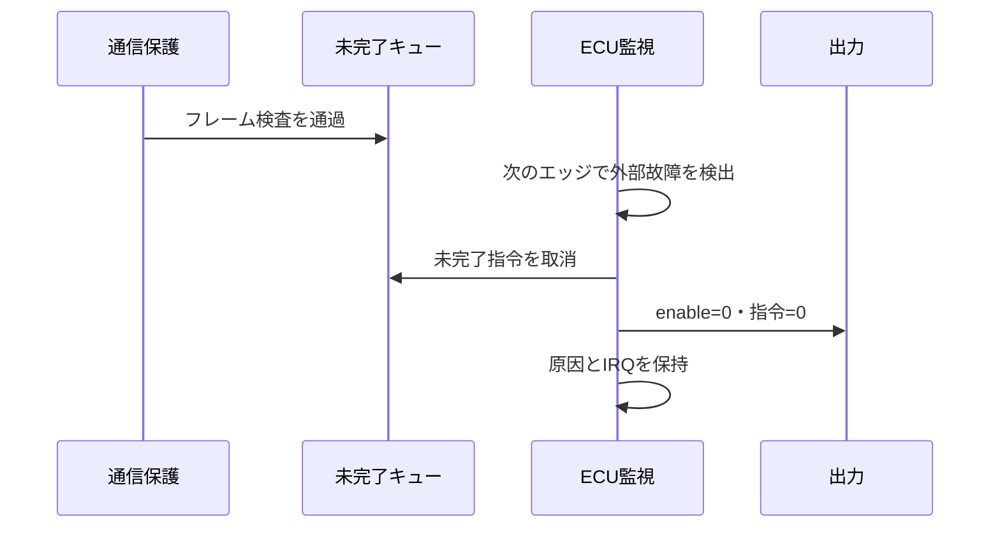

# オートモーティブ分野の検証

車載の通信・実行進捗・故障反応を、要求、観測時点、合格条件へ展開します。[通信保護の単体例](../../examples/local-e2e-guard/README.md)から、保護回路を接続する[小規模ECU](../../examples/local-automotive-ecu/README.md)へ進み、単体の検出が実際の指令抑止まで届くことを確認します。

## 1. 最初に対象境界を決める

| 対象 | 主な確認事項 | このリポジトリの入口 |
| --- | --- | --- |
| ECU間のデータ | CRC、Data ID、番号、重複・欠落、更新期限 | [E2Eガード](../../examples/local-e2e-guard/README.md) |
| ECU内の監視と出力 | 窓付きウォッチドッグ、指令の範囲、取消、故障保持、復帰 | [小規模ECU](../../examples/local-automotive-ecu/README.md) |
| 演算・記憶の故障 | 比較、訂正・検出、封じ込め、再同期・スクラブ | [ロックステップ](../../examples/local-lockstep-monitor/README.md)、[ECCメモリ](../../examples/local-ecc-memory/README.md) |
| センサーとアクチュエータ | 取得、演算期限、PWM、異常停止と再開 | [モーションI/O](../../examples/local-motion-io/README.md)、[閉ループ制御](../../examples/local-motion-control/README.md) |
| 電源・アナログ接続 | 電圧応答、変換、時刻と初期化 | [RC回路とSPICE](../../examples/local-spice-cosim/README.md) |

CAN／CAN FD、LIN、車載Ethernetは、フレーム形式・仲裁・時間・エラー処理が異なります。教材の48ビット保護フレームは通信コントローラーより後を扱い、これらのバス規格への適合を検査するものではありません。既存の[Ethernet例](../../examples/local-network-echo/README.md)も、車載Ethernet・TSNの実装とは区別します。

## 2. 通信の保護を判定へ落とす

[AUTOSARのE2E要求](https://www.autosar.org/fileadmin/standards/R18-10_R4.4.0_R1.5.0/CP/AUTOSAR_SRS_E2E.pdf)では、シーケンス番号・CRC・識別子・受信タイムアウトを組み合わせる考え方が整理されています。本例はその検証観点を学ぶ独自仕様で、AUTOSARの実装コードや規格本文を収録していません。

| 検証項目 | 刺激 | 観測と合格条件 |
| --- | --- | --- |
| データ破損 | 保護範囲の各ビットを反転 | 検査対象のCRC理由で破棄し、出力・期待番号を更新しない |
| 誤配送 | 異なるData IDと正しいCRC | CRCだけで通さず、ID理由で破棄 |
| 重複・順序 | 同じ番号、番号飛び、折返し | 定義した順序規則で判定。誤った番号へ自動で同期しない |
| 更新停止 | 正常フレームを止め、不正フレームだけを継続 | 到着件数で期限を延ばさず、正常指令の反映時刻から期限を判定 |
| 受信と出力の待ち | readyを下げて有効入力を継続 | フレーム保持、出力保持、誤受付なし、解除後の一度だけの完了 |
| 初期化 | 未完了中のreset／flush | 取消と履歴初期化を確認し、再開番号を送受信側で一致させる |

CRC-8/SAE-J1850のパラメーターと既知値は[CRC RevEngのカタログ](https://reveng.sourceforge.io/crc-catalogue/all.htm#crc.cat.crc-8-sae-j1850)で照合しています。CRC多項式が同じでも、初期値・最終XOR・Data IDの入れ方・カウンター範囲が異なれば、同じE2Eプロファイルにはなりません。実製品では採用するプロファイルと版、送受信設定の一致を確認します。

CRCと番号では、悪意ある送信者によるCRCの再計算や、番号の一巡をまたぐ再送まで認証できません。機能安全の故障保護と、SecOC等のセキュリティ保護を同じ検査項目で完了扱いにしません。

## 3. 窓と期限の境界を決める

通常のウォッチドッグでは遅延を監視し、窓付きでは早すぎるサービスも検査します。[TIの窓付きウォッチドッグ解説](https://www.ti.com/document-viewer/lit/html/SSZTAF7/GUID-9341B028-6BC0-4376-BB5D-46222BF57B82)も参照してください。本例は同一クロック上の論理監視で、外部ICの電気特性や独立発振器を再現しません。

| 境界 | 小規模ECUの合格条件 |
| --- | --- |
| MIN−1／MIN | 前者は早期故障、後者のserviceは正常 |
| MAX−1／MAX | MAXちょうどのserviceは正常。MAXまで要求なしならそのエッジで故障 |
| 指令期限の直前／ちょうど | 入力受付と反映を分け、期限ちょうどの正常反映は許可 |
| serviceと不正フレーム | CPUの進捗を示しても、通信の更新期限は延長しない |
| 故障と反映の同時発生 | 故障を優先し、未完了指令を取消す |
| ackと新規故障 | 原因を保持してIRQを再セット。ackだけで出力を再開しない |

RTLの減算・加算カウンターをそのまま期待値へ写さず、Pythonでは最後のサービス・指令反映の絶対時刻から期限を求めます。境界の固定試験を先に置き、ランダム試験を加えます。

## 4. 故障の検出から出力抑止まで追う

故障注入表には、注入点、継続時間、検出ラベル、反応期限、出力、解除条件を記録します。教材では両例それぞれ5種類の誤実装を構成ごとに実行し、指定したチェッカーによる検出を要求します。ビルド失敗、別の例外、単なる停止は予定した検出として採用しません。

検出の合格だけでなく、`検査通過数=反映数+取消数+リセット取消数`を確認します。復帰許可のない要求、故障入力が残る要求、復帰とARMの同時提示も試験し、以前の指令が復帰後に遅れて出ないことを検査します。

## 5. 製品の保証活動へつなぐ

[ISO 26262の概要](https://www.iso.org/publication/PUB200262.html)を入口に、車両側の危険事象と要求、ハードウェアとソフトウェアの責務、採用する安全機構、分析・検証の証跡を対応付けます。HARA・ASIL・FMEDA・FTTIは[用語集](../glossary.md#19-オートモーティブ)へまとめています。

| 計画に残すもの | 教材から製品へ追加する確認 |
| --- | --- |
| 停止・縮退の方針 | 出力0が安全か、制動・保持・継続動作が必要かを車両の状況から決める |
| 時間の配分 | 故障発生、検出、通信、出力抑止、駆動回路・機械の反応までを積み上げる |
| 故障モデル | 単一・複数、共通原因、潜在故障、クロック・電源、監視回路自身を含める |
| 分析と測定 | 故障率・対象集合・診断機構の仮定を明示し、機能目標の到達率と区別する |
| 構成と版 | E2E設定、クロック、監視窓、制御ソフト、通信負荷、環境条件を固定する |

本例の論理シミュレーションと変異検出は、ASIL達成・診断網羅率・規格認証の証明ではありません。UVMへ発展させる場合は[上位環境の再利用](uvm-practical-design.md)と、[要求からの項目展開](spec-to-test-items-walkthrough.md)を使い、通信・サービス・故障を独立した刺激系列として組み合わせます。存在しない組合せを大量に数える前に、[クロス条件の選択](cross-test-selection-walkthrough.md)で同時故障と境界を優先します。
