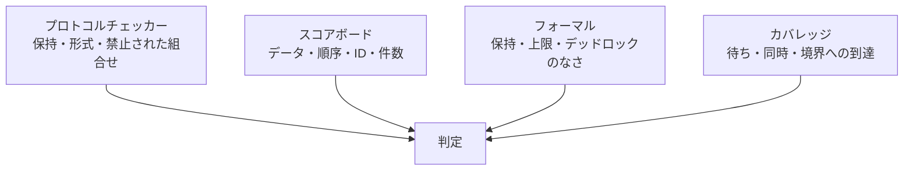

# バスプロトコルの検証

APB、AHB、AXI、AXI4-Stream、VCIなどのバスの検証を、プロトコルによらない共通の観点（受理と完了、待ち中の保持、未完了の管理、バースト、エラー応答）へ分けて整理します。各プロトコルの既存の実行例がどの機能を扱い、どの機能を扱っていないかを、[対応表](#7-プロトコルごとの対応)にまとめます。

入口は[APBレジスタ](../../examples/local-apb/README.md)、[AHB-Lite](../../examples/local-ahb/README.md)、[AXI4-Lite](../../examples/local-axi/README.md)、[AXI4](../../examples/local-axi4/README.md)、[AXI4-Stream](../../examples/local-axis/README.md)です。このリポジトリの例は、各規格の一部を選んで実装した教材で、規格全体への適合を示すものではありません。

## 1. プロトコルによらない観点

バスの名前と信号は違っても、検証する観点は共通です。

| 観点 | 問い | 典型的な誤り |
| --- | --- | --- |
| 受理 | 要求は、いつ相手に渡ったことになるか | 受理の条件の取り違え。待ちの間の二重の受理 |
| 完了 | 応答は、いつ受け取ったことになるか。どの要求の応答か | 完了の前の次の要求の開始。応答の対応の誤り |
| 待ち中の保持 | 相手が待たせている間、要求や応答を変えないか | 待ちの間のアドレス・データの変化、要求の取下げ |
| 依存の向き | validはreadyを待たずに出せるか。readyはvalidを待ってよいか | 互いに相手を待つデッドロック |
| 未完了の管理 | 同時に何件まで受けるか。上限でどう止めるか | 上限を超える受理、件数の数え違い |
| 順序とID | 応答の順序は要求の順か。IDが同じ要求の順序は保つか | 順序の入替えの誤り、IDの取り違え |
| バースト | ビートの数、アドレスの進み方、最後のビートの印 | 最後の印の位置、境界での折返し |
| バイトレーン | どのバイトが有効か。無効なバイトをどう扱うか | ストローブの無視、狭い転送のレーンの位置 |
| エラー応答 | エラーのとき、状態を変えないか。後続の要求をどうするか | エラーなのに書込みが通る。エラーの後の取消しの誤り |
| リセット | 転送の途中のリセットで、未完了の要求をどう扱うか | リセット後に遅れて出る古い応答 |

## 2. 対象境界を決める

| 対象 | 主な確認事項 | このリポジトリの入口 |
| --- | --- | --- |
| ターゲット（スレーブ）単体 | 受理・待ち・応答、レジスタやメモリの結果 | [APB](../../examples/local-apb/README.md)、[AHB-Lite](../../examples/local-ahb/README.md)、[AXI4-Lite](../../examples/local-axi/README.md)、[AXI4](../../examples/local-axi4/README.md) |
| ストリーム | パケットの境界、有効バイト、逆圧 | [ready/valid](../../examples/local-stream/README.md)、[AXI4-Stream](../../examples/local-axis/README.md) |
| ブリッジ | プロトコルの変換、待ちとエラーの伝え方 | [AHB／AXI-Lite→APB](../../examples/local-bus-bridge/README.md)、[非同期APBブリッジ](../../examples/local-cdc-bridge/README.md) |
| 幅の変換 | 分割と結合、ストローブ、エラーのまとめ方 | [AXI4-Liteの幅変換](../../examples/local-width-converter/README.md) |
| インターコネクト | デコード、仲裁、経路の保持、応答の戻し先 | [2マスター×2ターゲット](../../examples/local-interconnect/README.md)、[パケットスイッチ](../../examples/local-packet-switch/README.md) |
| 順序の入替え | ID別の順序の保持、並べ直し | [AXI応答順序](../../examples/local-axi-reorder/README.md)、[UVMの未完了要求](../../examples/local-uvm-outstanding/README.md) |
| アドレスマップ | デコード、別名、未割当 | [アドレスマップ](../../examples/local-address-map/README.md) |
| 性質の証明 | 保持・件数・デッドロックのなさ | [AHB／AXIのフォーマル](../../examples/local-bus-formal/README.md)、[AXI4のフォーマル](../../examples/local-axi4-formal/README.md) |

対象の回路が規格のどの機能を実装し、どの機能を実装しないかを、最初に表へ書きます。実装しない機能は、要求元がその機能を使わないこと（仮定）も合わせて書きます。インターコネクトやブリッジでは、両側のプロトコルそれぞれについてこの表を作ります。

## 3. 要求へ分解する

| 要求の領域 | 要求の例 | 確認方法 |
| --- | --- | --- |
| 受理と完了 | 受理の条件が成立したエッジでだけ、要求を1件受け付ける | 受理の件数と完了の件数の照合。待ちの長さを変えた構成 |
| 待ち中の保持 | 相手が受け取るまで、validと内容を保つ | プロトコルチェッカー（アサーション） |
| 依存の向き | 応答のvalidは、readyを待たずに出す | readyを下げたままの試験。フォーマルでの証明 |
| データの正しさ | 読んだ値は、それまでの書込みの結果 | 参照メモリ（バイト単位）によるスコアボード |
| 未完了の上限 | 上限に達したら次の要求を止める。超えない | 上限ちょうどと、上限＋1を狙う試験。件数のアサーション |
| 順序 | 同じIDの応答は要求の順。違うIDは仕様の範囲で入れ替わってよい | IDごとの待ち行列を持つスコアボード |
| バースト | ビートごとのアドレス、最後のビートの印、途中の待ち | ビートの数と印の位置の検査。長さの最小と最大 |
| ストローブ | 有効なバイトだけを書く | バイトごとのパターン。全0のストローブ |
| エラー応答 | エラーの転送は状態を変えない。応答の形式が規格どおり | エラーの後の読出し。AHBの2サイクルのエラー応答 |
| リセット | 途中のリセットで未完了の要求を捨てる。再開後に古い応答が出ない | 各段でのリセット。リセット後の件数 |
| 進行 | 相手が公平に応答するなら、要求はいつか完了する | 期限つきの完了（シミュレーションの時間切れ、フォーマルの有界の性質）、公平性を仮定した証明 |

## 4. チェッカー・スコアボード・フォーマルの分担

| 手段 | 向くもの | 向かないもの |
| --- | --- | --- |
| プロトコルチェッカー（アサーション） | 1つのインターフェースの信号の規則。待ち中の保持、禁止された値、応答の形式 | データの正しさ。複数のインターフェースにまたがる対応 |
| スコアボード | データの値、欠落・重複・順序、IDの対応、件数 | 信号の途中の変化（受理の前後で正しければ見えない） |
| フォーマル | 制御の性質（保持、件数の上限、デッドロックのなさ）を全入力について | 大きなメモリを通るデータの値。長いバースト |
| カバレッジ | 待ちの長さ、同時の転送、境界の値への到達の記録 | 正しさの判定 |

プロトコルチェッカーは、DUTの出力に対しては検査（assert）、DUTの入力に対しては前提（assume）として使えます。同じ規則を両方の向きで使うと、ブロック単体の証明で置いた前提を、接続先のブロックの検査で確かめられます（[仮定と保証の依存関係](../../examples/local-compositional-formal/README.md)）。

チェッカーが合格しても、データが正しいとは限りません。スコアボードが合格しても、待ちの間に信号が動いていないとは限りません。片方だけにしません。

## 5. 重点にするクロス

| クロス | 見つかる誤り |
| --- | --- |
| 要求側の待ち × 応答側の待ち | 片方の待ちでしか試していない保持 |
| 読出し × 書込みの同時進行 × 同じ番地 | 順序の誤り、古い値の読出し |
| 未完了の件数 × 新しい要求 × 完了の同時発生 | 件数の数え違い、上限での停止の誤り |
| バーストの各ビート × 待ち × リセット | 途中の状態の残り |
| エラー × バーストの位置 × 後続の要求 | エラーの後の取消しの誤り |
| アドレスチャネルとデータチャネルの到着順（AXIの書込み） | データが先に来たときの対応の誤り |
| IDの一致・不一致 × 応答の順序 | 同じIDの順序の入替え |
| ストローブのパターン × アドレスの下位ビット | レーンの位置の誤り |

## 6. 独立した期待値と検出力

期待値は、RTLのFIFOや状態機械を写さず、**バイト単位の参照メモリ**と**受理の事実**から作ります。「受理した書込みを順に参照メモリへ適用し、読出しを受理した時点（または仕様が定める時点）の内容を期待値にする」という形です。待ちの長さを変えても期待値のデータは変わらず、時刻だけが変わります。

| 変異 | 検出する検査 |
| --- | --- |
| 待ちの間にアドレスを取り直す | 保持のチェッカー、スコアボード |
| ストローブを無視する | バイトごとの読出し |
| エラーの転送で書込みを通す | エラー後の読出し |
| 応答のIDを取り違える | IDごとのスコアボード |
| 最後のビートの印を1ビート早く出す | ビートの数と印の位置 |
| 未完了の上限を1件超えて受ける | 件数のアサーション |
| 応答を、readyを待ってから出す | readyを下げたままの試験の時間切れ、フォーマル |

時間切れは、予定した検査ラベルでの検出とは区別します。デッドロックを検出する変異では、「進行の検査」のラベルで止まることを要求し、ランナーの全体の時間切れを検出成功に数えません。

## 7. プロトコルごとの対応

### 実行例が扱う機能

| プロトコル | 実行例 | 扱う機能 |
| --- | --- | --- |
| APB | [APBレジスタ](../../examples/local-apb/README.md)、[APBと割り込み](../../examples/local-apb-irq/README.md)、[アクセス保護](../../examples/local-access-control/README.md) | SETUPとACCESS、PREADYによる待ち、PSLVERR、途中のリセット。アクセス保護の例はPPROT |
| AHB-Lite | [AHB-Lite](../../examples/local-ahb/README.md) | アドレスとデータのパイプライン、待ち、IDLE・BUSY、SINGLEとINCR4、3種類のサイズ、2サイクルのエラー応答 |
| AXI4-Lite | [AXI4-Lite](../../examples/local-axi/README.md) | 独立した5チャネル、WSTRB、応答の保持、読みと書きの並行 |
| AXI4 | [AXI4](../../examples/local-axi4/README.md) | INCRの1〜4ビート、2ビットのID、各方向2件の未完了、受付順の応答 |
| AXI4（順序） | [AXI応答順序](../../examples/local-axi-reorder/README.md) | 応答の順序の入替えと、ID別の順序の保持 |
| AXI4（結合） | [インターコネクト](../../examples/local-interconnect/README.md)、[DMA](../../examples/local-dma/README.md) | デコード、所有者の管理、仲裁 |
| AXI4-Stream | [AXI4-Stream](../../examples/local-axis/README.md)、[CRC](../../examples/local-packet-crc/README.md)、[Stream DMA](../../examples/local-stream-dma/README.md) | TVALID・TREADY、TDATA、TKEEP、TLAST、パケットの境界 |
| ready/valid（一般） | [ready/valid](../../examples/local-stream/README.md)、[クレジット通信](../../examples/local-credit-link/README.md) | 逆圧、クレジットによる流量制御 |
| VCI | [VCI・SoCLib](../../examples/local-vci-soclib/README.md) | コマンドと応答のパケット、待ち中の保持。SystemCのサイクル精度のモデル |
| ブリッジ | [AHB／AXI-Lite→APB](../../examples/local-bus-bridge/README.md)、[非同期APBブリッジ](../../examples/local-cdc-bridge/README.md)、[幅変換](../../examples/local-width-converter/README.md) | 変換、待ちとエラーの伝達、クロックの乗換え、64ビットから32ビット |
| フォーマル | [AHB／AXIのフォーマル](../../examples/local-bus-formal/README.md)、[AXI4のフォーマル](../../examples/local-axi4-formal/README.md) | 制御の性質の証明、データの有界検査、到達 |
| UVM | [UVMとRAL](../../examples/local-uvm/README.md)、[未完了要求と順不同応答](../../examples/local-uvm-outstanding/README.md) | agent、スコアボード、IDごとの対応 |

### 実行例が扱っていない機能

| プロトコル | 扱っていない機能 | 状態 |
| --- | --- | --- |
| APB | PSTRB（部分書込み）、複数スレーブの選択とデコードの結合、PPROTとPSLVERRの全組合せ | PSTRBは未着手。バイトストローブそのものは、APBの2相を持たない簡易バスの[アドレスマップ](../../examples/local-address-map/README.md)が扱う |
| AHB | WRAPのバースト、INCR4以外の長さ、HPROT、ロック（HMASTLOCK）、複数マスター、フルAHBの仲裁 | 未着手 |
| AXI4 | WRAPとFIXEDのバースト、狭い転送（データ幅より小さいAxSIZE）、整列していない開始アドレス、5ビート以上（最大256ビート）、排他アクセス（AxLOCK） | 未着手。まとめて1つの例にする計画 |
| AXI4 | AxCACHE・AxPROT・AxQOS・AxREGION・USER、読出しのデータのインターリーブ | ポートを省略。未着手 |
| AXI4（システム） | 4KiBの境界をまたがない規則の検査、低電力インターフェース、ACE | 未着手 |
| AXI4-Stream | TSTRB、TID・TDEST・TUSER、レーンの詰め替え、幅の変換 | 未着手 |
| VCI | 複数IDの並行、LL／SC、連続しないパケット | 対象外としている |
| そのほかのバス | TileLink、Wishbone、OBI、CHI | 未着手。[CORE-V-VERIFの参照例](../../examples/reference-core-v-verif/README.md)でOBIの環境を読める |
| 共通 | 再利用できるプロパティ集（待ち中の保持、N サイクル以内の応答、タグによるデータの順序）と、その3種類の試験（正例・違反・空虚な成立） | 未着手 |
| 共通 | 任意の1データを追跡するデータの完全性の非有界な証明 | 未着手 |

公開プロジェクトでは、[PULP AXIの参照例](../../examples/reference-pulp-axi/README.md)と[Mirafraの検証用IPの参照例](../../examples/reference-mirafra-vip/README.md)が、広い機能を持つ検証環境の入口です。

## 8. 製品で追加する確認

| 追加する確認 | 内容 |
| --- | --- |
| 検証用IP | 規格の全機能を持つ検証用IP（VIP）とプロトコルチェッカーの適用。使う機能の設定の一致 |
| 構成の行列 | データ幅、アドレス幅、ID幅、未完了の上限、任意の信号の有無 |
| 接続先との整合 | 両側が実装する機能の表の突合せ。片側だけが使う機能がないこと |
| 性能 | 帯域、遅れ、仲裁の公平性、飽和したときの振る舞い（[性能モニター](../../examples/local-performance-monitor/README.md)） |
| システムでの実行 | 実際のマスターとスレーブの組合せ、実際のソフトウェアによるアクセス列 |
| クロックとリセットの境界 | バスがクロック領域やリセット領域をまたぐ箇所（[非同期検証](asynchronous-verification.md)） |
| 低電力とセキュリティ | バスの停止要求、保護属性の伝達（[低電力の検証](low-power-verification.md)、[セキュリティの検証](security-verification.md)） |

## 9. 参考にした一次資料

- Armの AMBA仕様：[APB（IHI 0024）](https://developer.arm.com/documentation/ihi0024/latest)、[AHB（IHI 0033）](https://developer.arm.com/documentation/ihi0033/latest)、[AXI（IHI 0022）](https://developer.arm.com/documentation/ihi0022/latest)、[AXI4-Stream（IHI 0051）](https://developer.arm.com/documentation/ihi0051/latest)。既存の例は、各READMEに参照した版と章を書いています。本文は引用していません。
- [SBYの文書](https://yosyshq.readthedocs.io/projects/sby/en/latest/)：このリポジトリのフォーマルの実行環境。
- [PULPのAXIの部品集](https://github.com/pulp-platform/axi)：公開されているAXIの部品と検証環境。
- [SVAによる検証](sva-verification.md)、[フォーマル検証](formal-verification.md)、[VCI・SoCLibの検証](vci-soclib-verification.md)：このリポジトリの関連する手順書。
