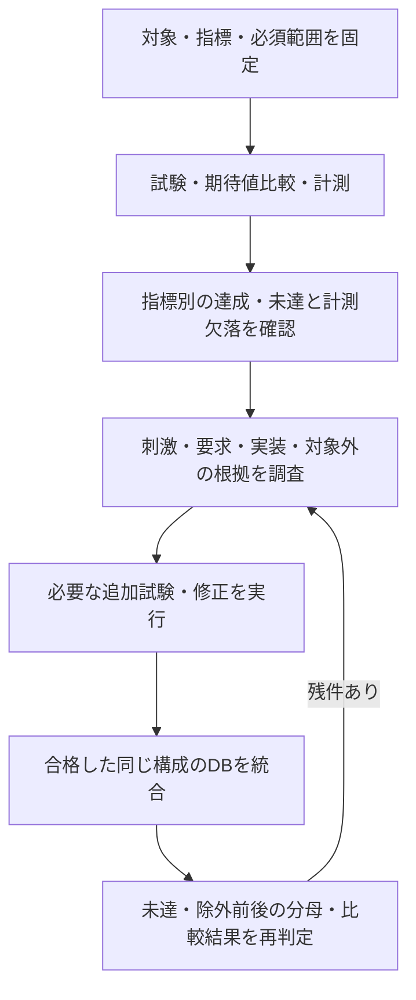

# コードカバレッジを計測し、未達を分析する

コードカバレッジ（code coverage）は、RTLの実装にある処理・分岐・式・信号変化・状態遷移などを、試験でどこまで実行したかを計測します。[機能カバレッジ](functional-coverage.md)で選んだ要求の条件と照合し、機能モデルや刺激に含めていなかった実装経路を見つける材料にします。期待する値や動作は、スコアボード・アサーションで判定します。

まず動かす場合は、[コードカバレッジの実行例](../../examples/local-code-coverage/README.md)を参照してください。Verilatorで計測し、未達のある基礎試験へ追加試験を加え、同じ構成のDBを統合して注釈付きソースを生成できます。[バスの既存例](../../examples/local-bus-validation/README.md)には、プロトコル・性能・X検査と行／toggle計測を併用する例もあります。

## 1. 指標と計測対象を決める

| 指標 | 主に確認するもの | 計測結果を読む際の注意 |
| --- | --- | --- |
| 行・基本ブロック | 文や連続した処理の実行 | 物理的なソース1行とカウンター1個が対応するとは限らない |
| 分岐 | ifの真／偽、caseの選択など | 行を実行していても、分岐先が片方だけという場合がある |
| 条件・式 | 論理条件の値や各項の寄与 | 真理値表、短絡評価、MC/DCとは定義が異なる。ツールの指標を確認する |
| toggle | 信号ビットの0→1／1→0など | 初期化・リセットだけの変化、方向の区別、幅・対象外・クロックの扱いを確認する |
| FSM状態 | 抽出した状態への到達 | ソースにある全FSMをツールが認識したとは限らない |
| FSM遷移 | 抽出した状態間の遷移 | 条件付き遷移、自己遷移、リセット、合成されたdefault経路の扱いを確認する |

各指標の定義は採用ツールと版に依存します。計画には、対象RTL・構成・階層、ソースとツールの版、ビルドオプション、計測期間、指標ごとの必須ポイント・必要ヒット数・除外根拠を記録します。計測されなかった項目と、計測されたが未到達の項目を区別します。

例えばVerilator 5.052の本実行例では、`--coverage-line`で`line`と`branch`、`--coverage-toggle`で方向別のビット変化、`--coverage-expr`で論理式、`--coverage-fsm`で抽出可能なFSM項目を取得しています。生成されたDBの種類・個数・識別子も確認します。式カバレッジは各項の寄与を数える方式で、MC/DCを満たした証跡としては使いません。FSMの自動抽出も一部の記述形式に限られます。[公式の計測説明](https://verilator.org/guide/latest/simulating.html#coverage-analysis)、[オプション](https://verilator.org/guide/latest/exe_verilator.html#cmdoption-coverage-line)

## 2. 基礎試験を計測して不足を確認する

基礎試験の結果が正しくても、別演算、エラー処理、応答待ち、リセットによる中断が未確認の場合があります。合計率だけを見ず、ソース位置・階層・条件・状態や信号ビットごとにゼロの項目を調べます。DBがない、必要な指標が生成されていない、ソースの版が異なる場合は計測不備として失敗させます。

初期化だけでカウンターが増える場合は、計測開始点を定めて初期値をクリアするなどの方法を選びます。除いた初期化・リセット期間に必要な検査は別途残します。本実行例は事前初期化の後にカウンターをクリアし、その後の入力列に含めたリセットは計測します。

## 3. 未達を分析し、必要な試験へ戻す

未達は次の観点で分類します。

1. 仕様上必要な機能が、要求・機能カバレッジ・試験から抜けている。
2. 刺激・制約・順序・負荷・構成の不足で到達していない。
3. 誤条件やデッドコードなど、実装を見直す必要がある。
4. 対象構成では適用しない、または到達不能の根拠を示せる。
5. 計測が無効、抽出対象外、最適化・ツール制約などで項目自体が生成されていない。

必要な動作が抜けていれば要求・機能目標・チェッカーも追加します。率を増やすためだけに刺激を作り、結果を比較しない試験では要求の合格になりません。到達不能を判断するときは、仕様・構造・[フォーマルによる到達性確認](formal-verification.md#8-証明対象の漏れと不具合の検出力を確認する)などの根拠を残します。

除外には、対象箇所・版・指標・構成・理由・根拠・レビュー・失効条件を持たせます。通常入力では到達しなくても、故障注入で確認すべき保護経路があります。除外前の分母とゼロの原記録も保存します。本実行例では、全4符号を列挙した2ビット状態のdefaultに関する2項目を必須判定から分けますが、原本の未達から消していません。

## 4. 互換なDBだけを統合する

RTL・階層・パラメーター・計測設定・ツール・ポイント定義・除外規則が一致する、機能比較と完了検査に合格した通常試験のDBを統合します。構成別に判定し、失敗・未完了・診断・変異ケースを合格の分子へ加えません。元の実行IDとDBを保持し、統合後の各カウンターが入力の和と一致することも確認できます。

[実行例](../../examples/local-code-coverage/README.md)は、基礎試験と追加試験を統合した後にカバレッジを判定します。各通常実行で全binを要求する[機能カバレッジの教材](../../examples/local-functional-coverage/README.md)とは集計条件が異なります。集計単位と基準を実行前に決めます。

DBの確認とソースへの注釈は、[verilator_coverage](https://verilator.org/guide/latest/exe_verilator_coverage.html)等のツールで行えます。注釈の閾値とランナーの必要ヒット数をそろえ、色や総合率だけで判断せず、未達一覧を確認します。

## 5. 完了判断と残す証跡

記録には、入力の版・ハッシュ、構成、オプション、指標別の分母・達成・未達、除外前後の値と根拠、統合元、DB原本と注釈付きソース、同じ実行の比較結果・未照合・完了件数を含めます。[検証計画](../templates/verification-scope.md)と[サインオフ記録](../templates/signoff-record.md)へ対応付けます。

コードカバレッジ100%は、計測した実装経路への到達を表します。仕様に必要な処理が実装自体から抜けている場合や、実行した計算の値が誤っている場合もあります。本実行例は、演算結果を壊した回路が必須カバレッジを満たしていても、期待値比較で失敗することを確認します。要求の合格証跡・機能カバレッジ・コードカバレッジを併せて検証完了を判断します。
