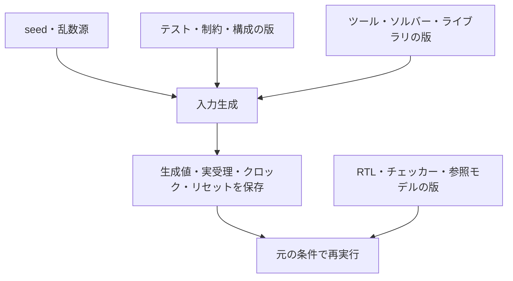
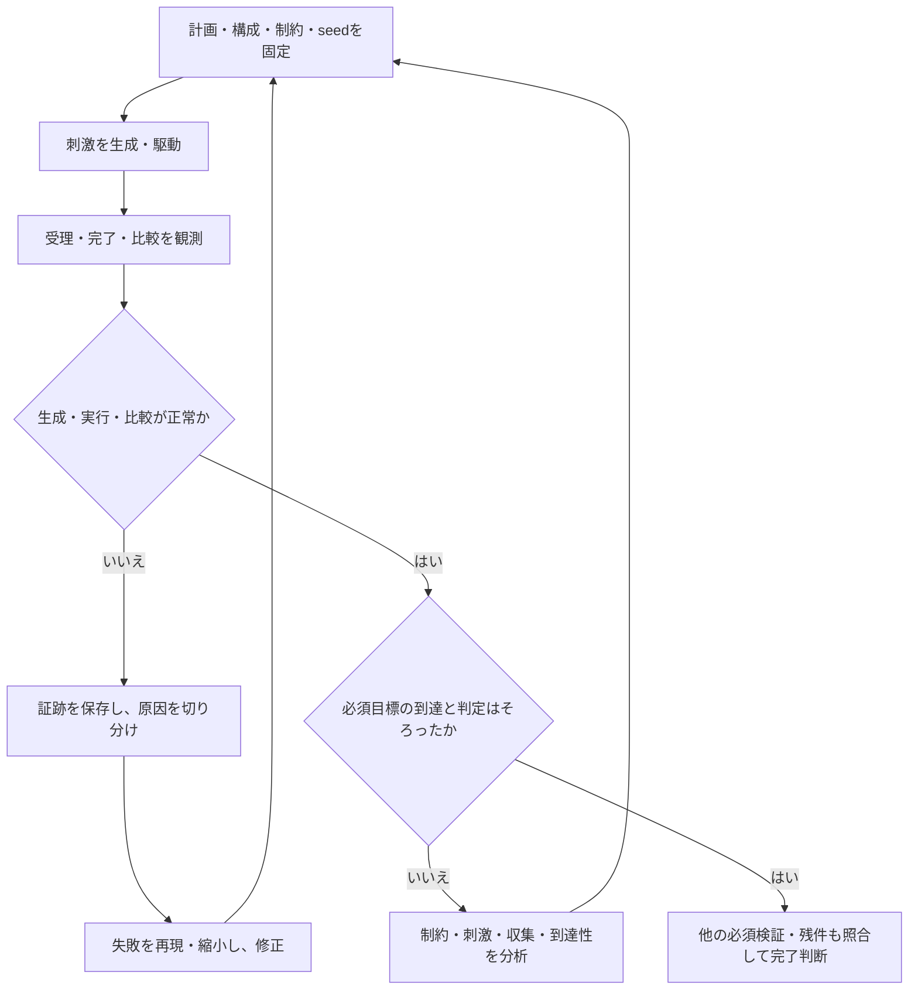

# 制約付きランダム検証の計画・実行・完了判定

[一般化した検証手順](spec-to-verification-method.md)の9.9節を具体化した資料です。要求を満たす合法な入力・操作の範囲を定め、その範囲内で値、順序、タイミング、負荷を変化させて、ディレクテッドテストでは想定しにくい条件を探索します。生成した入力に対して、参照モデル・スコアボード・アサーションで正しさを判定し、観測した状態や相互作用をカバレッジへ記録します。

これは製品へ今後適用する運用案です。[GitLabの実行例](../../examples/gitlab-regression/README.md)には、説明用のIRQ回路・テストベンチ・リグレッションランナーがあり、Pythonで生成したランダム操作列をnightlyで実行します。本資料の9節に示す3シナリオ・9実行は計画例であり、未実装です。SystemVerilogの制約付きランダム化を使うUVM環境は、末尾の実行例で扱います。ランダムに動かした回数や、失敗しなかったseed数だけで要求の検証完了とはしません。

[FIFOの実行例](../../examples/gitlab-fifo/README.md)では、固定の境界テストと、Pythonで生成した書込み・読出し・リセットのランダム操作列を使い、独立した参照キューで比較します。seed・全入力列の保存、複数構成のリグレッション、未達による失敗、意図した不具合の検出を試せます。

[ready/valid通信](../../examples/gitlab-stream/README.md)、[アービタ](../../examples/gitlab-arbiter/README.md)、[UART](../../examples/gitlab-uart/README.md)、[APB・UART・割り込みの結合](../../examples/gitlab-apb-uart/README.md)にも、固定ケースとseed付き操作列を組み合わせた実行例があります。構成ごとの必須目標、変異検出、全入力・完了数の保存まで確認できます。これらはPythonで入力を生成する教材で、UVMやSystemVerilogの`randomize()`による実装ではありません。

## 1. ディレクテッドテスト・クロス検証との役割分担

| 方式 | 主に担う役割 |
| --- | --- |
| ディレクテッドテスト | リセット、境界、既知の競合、エラー回復などの必須条件を確実に起こす |
| 制約付きランダム | 値・順序・タイミング・並行動作を広く変え、想定しにくい組を探索する |
| 目標を絞ったランダム | 未到達の状態やクロスに狙いを定め、周辺条件も変えながら探索する |
| フォーマル検証 | 明示した仮定・モデルの範囲で、性質の成立や到達性を確認する |

[機能間クロスの目標](feature-interaction-verification.md)は、何を確認するかを定めます。ランダム検証は、それらを起こす方式の1つです。重要な同時発生や復帰条件にはディレクテッドテストも用意し、低確率の偶然だけに任せません。

## 2. 制約を設計し、レビューする

制約を次の層に分け、要求・仕様の出典と変更履歴を残します。

1. **仕様上の入力条件**：アドレス範囲、転送の整列、プロトコルの規則、構成による有効機能など。
2. **状態に依存する操作条件**：初期化、アクセス権、操作が許される状態、進行中の処理との関係など。
3. **テストの目的**：境界値、競合、高負荷、長い待ち、特定の順序を多く選ぶための分布・重み・シナリオ設定。
4. **異常入力の条件**：仕様がエラー応答や復帰動作を定める入力を、意図して発生させる条件。

3の刺激生成方針を、1の仕様で禁止された条件と混同しないようにします。たとえば「混雑時に不具合があるのでoutstandingを1以下にする」という制約で、必須の並行動作を検証対象から除外してはいけません。正常系と異常系は、どの制約を変更し、何を期待するかを分けて管理します。

状態に依存する制約は、観測した受理・完了や仕様から作ったモデルに基づいて更新します。DUTが誤った状態を出した場合に、その誤りへ合わせて刺激を狭め、検出を避ける構造にしません。境界で仕様が定める拒否・待機・エラーも検証対象に残します。

初期化や操作がいつまでも終わらない場合の扱いも決めます。環境が応答するまでの上限や公平性を仮定するなら出典を残し、DUTの進行を保証した結果とは区別します。制約の階層化は、[UVM User's Guideの3.1節](https://www.accellera.org/images/downloads/standards/uvm/uvm_users_guide_1.2.pdf)のconstraint layeringと制御パラメータも参考にしています。

## 3. ランダム化する軸と粒度

- **データ**：幅、符号、0・全1・境界値・ビットパターンと、一般の値。
- **操作**：読み書き、転送長、バースト、複数要求、発行順序、応答の並び。
- **時間**：要求間隔、応答待ち、バックプレッシャ、同時受理、クロック間の位相関係。
- **状態遷移**：開始、停止、再設定、割り込み、エラー、リセット、中断・復帰。
- **負荷と環境**：競合するinitiator、FIFO占有率、処理の重なり、モード・権限。

elaboration時に固定するパラメータや製品構成は、実行中に変更できる制御値と分けます。必須構成ごとのリグレッションを用意し、ある構成のランダム試験で別構成も検証したとは扱いません。

値を均等に選んでも、状態やシナリオが均等に発生するとは限りません。生成値の分布に加え、実際の受理数、到達状態、境界・遷移・クロスの分布を見ます。境界値と通常値を混ぜる、特定シナリオを多く選ぶ、といった重みは、理由と版を固定します。

信号を毎サイクル無条件に変えるのではなく、転送中のデータ保持などのプロトコル規則に従って駆動します。値を選ぶ時点、信号を駆動する時点、モニターがサンプリングする時点を定め、テストベンチの競合を作り込まないようにします。

RTL初期値のランダム化や、Xを0/1へ置き換えた試験は、操作列のランダム検証とは区別します。それらを行っても、リセット要求や4値動作の確認を省略しません。

## 4. 生成失敗とチェックの欠落を検出する

`randomize()`の戻り値を必ず確認します。失敗した場合、古いフィールド値のまま送信したり、エラーを報告せずにその操作をスキップしたりせず、制約・状態・対象オブジェクトを記録して試験を失敗または判定不能にします。直接の`start()`と、項目の生成・ランダム化・送信の関係は、[UVMのシーケンス API](https://github.com/accellera-official/uvm-core/blob/main/src/seq/uvm_sequence_base.svh)で確認できます。

本手順では、`if (!item.randomize())`のように明示的に呼び出しと失敗処理を行い、生成処理をassertionの有効・無効設定に依存させません。エラー表示を抑制しても、ランナーがその実行を成功にしないようにします。

ランダム化した要求が、実際にDUTへ駆動され、受理され、必要な結果の比較まで進んだことを確認します。次を分けて計数します。

- 生成を試みた数、生成に成功した数、生成に失敗した数。
- 駆動した数、受理した数、仕様に沿って拒否・中断された数。
- 完了した数、比較した数、不一致数、未応答・未照合の残件。

生成したデータを期待値に使う場合も、受理された操作と仕様上の効果を参照モデルで追跡します。送信予定の値をそのまま「DUTが処理した値」と扱わず、独立したモニターからの観測で照合します。ランダムであっても、比較のマスク、Xの扱い、IDの対応、順序、許容遅延のレビューは必要です。

## 5. seedと実行を再現できるようにする

seedは、乱数系列を選ぶ実行条件の一部です。テスト、RTL、生成器・制約、参照モデル、UVM・VIP・シミュレータ・ソルバーの版、構成、コンパイル条件、並列実行条件とともに保存します。外部のPythonやCなどでも乱数を使う場合、それぞれのseed・乱数器を記録します。

同じ数値のseedでも、異なるツール・版・環境で同じ刺激になるとは扱いません。UVMのオブジェクトごとのseedには型名・インスタンス名も関わるため、差し替えや名前の変更も再現性の確認対象です。[公式のUVM seeding実装](https://github.com/accellera-official/uvm-core/blob/main/src/base/uvm_object.svh)

seedを自動選択する場合も、実際に選ばれた値を実行開始時に保存します。起動引数の「random」「自動」だけでは再現記録になりません。たとえばVerilatorにはseedの指定と、自動選択した値を得る仕組みがありますが、引数や意味は各ツールで確認します。[Verilatorの実行時引数](https://verilator.org/guide/latest/exe_sim.html)

失敗時には、生成要求、実際に駆動した外部入力、受理・完了の観測、クロック・リセット・割り込み、失敗直前の履歴と波形を保存します。受理されたトランザクションだけの保存では、原因になった待ちや未受理入力を再現できない場合があります。

元の環境で同じseedを再実行し、同じ刺激と失敗が再現するかを確認します。再現しない場合は、乱数源の未記録、時刻・ファイル・外部モデルへの依存、スレッド間の競合、未初期化値を調べます。seedを変えて成功した結果で、元の失敗を置き換えません。

### seedを再現条件の一部として保存する

同じseedに加えて入力生成と判定の版・構成・ツールをそろえ、実際の入力列を保存します。



図の依存関係が変われば、同じseedでも同じ刺激や判定になるとは限りません。


## 6. リグレッションの計画と結果を管理する

短い固定seedのリグレッション、探索範囲を広げるリグレッション、目標を絞ったリグレッションを分けます。必要なシナリオ・構成の組ごとに、seedの一覧、操作数、シミュレーション時間、実時間・メモリの上限、終了条件を先に決めます。予算の上限は検証完了の条件とは分けます。

実行数が増えたら、[リグレッション・seedの削減](verification-reduction.md#6-リグレッションテストとseedを縮約する)を検討します。binの重複だけでなく、比較・判定、順序・履歴、負荷、既知バグと変異の検出を確認し、探索用の新しいseedと広いリグレッションも計画に残します。

実行IDは、計画の版・テスト・シナリオ・構成・seedなどから識別できるようにします。同じseedを別シナリオで使っても別の実行ですが、独立した入力系列や独立した裏付けを得たと自動で数えません。

予定、未着手、実行中、合格、失敗、判定不能の台帳を持ち、開始した実行・終了した実行・失敗した実行が欠けていないかを確認します。再実行には新しい実行IDを付け、最初の結果を残します。

変更時・夜間などの起動、ケースごとの分散、ライセンス・資源、CIへの結果伝達、再実行・証跡の保持は、[継続的リグレッション](continuous-regression.md)へ接続します。CIのパイプライン IDとリグレッションの計画・実行IDを結び付け、予定したseedや構成の欠落を検出します。

生成不能やソルバのエラー、実行資源の不足は、DUTの仕様違反と区別します。一方、仕様が定める応答時間の超過をチェックした結果は、DUTの失敗候補です。ランナーの実時間タイムアウトと、仕様上の時間制約への違反を同じ分類にしません。

## 7. カバレッジから次の試験を決める



重みやシナリオを変えるときも、失敗した実行の記録を残し、計画・制約の版を更新します。図の「正常」は、seedの実行が終わったことだけでなく、必要な観測と比較が行われたことを含みます。

1. 要求・クロス目標ごとの未到達と未達、実行数・比較数・失敗を集計する。
2. 未到達の理由を、未実行、低頻度、状態への到達手順不足、過剰な制約、観測・サンプリングの不備、仕様上の到達不能に分けて調べる。
3. 重み・シナリオ・長さ・初期状態を調整するか、ディレクテッドテスト・フォーマル検証へ切り替える。
4. 制約やカバレッジモデルを変えたら版を進め、影響する要求・必須目標・集計の比較条件を再確認する。

カバレッジが増えなくなったことは、調査や方式変更のきっかけです。検証完了や到達不能の証明にはしません。未達のbinを削除する、難しい合法入力を禁止する、失敗するseedをリグレッションから外すことで目標を達成してはいけません。

SVAを使う場合は、[前件・完了経路のcoverとassertの判定](sva-verification.md)も目標へ結び付けます。ランダムリグレッションでassertが失敗しなくても、前件が一度も起きない、毎回リセットで中断される、といった場合は、その条件を検査したことにはしません。

covergroupで見る機能・状態・遷移・crossの定義と、観測したケースとチェッカー合格ケースのカバレッジ収集、DB集計は、[機能網羅の手順](functional-coverage.md)へ対応付けます。個々のcoverpointの率や重み付き総合値だけで、未達の機能や組み合わせを見落とさないようにします。

制約や重みを変えたリグレッションには、その変更内容を保存します。試験途中で適応的に変える場合は、変更の判断・時刻・適用値の列も保存し、同じ探索過程を再生できるようにします。

## 8. 失敗を再現し、縮小してリグレッションへ残す

1. 最初の失敗のログ・環境・seed・刺激を保全し、DUT、期待値、生成器、モニター、チェッカーのどこが原因かを切り分ける。
2. 同じ環境で再現し、失敗の要求ID、チェッカー ID、直前の観測、失敗の分類を記録する。
3. 操作列、値、並行動作、待ち時間を減らし、同じ規則違反を保った小さなケースへ縮小する。
4. 縮小した刺激が仕様上有効で、別の理由で失敗していないかを確認する。テストベンチの競合だけで発生する失敗なら、その競合も直す。
5. 修正後に、元の再現ケース、縮小したディレクテッドテスト、関連するランダムリグレッションを実行する。

縮小ケースと元の失敗を関連付け、既知不具合を再発防止のテストとして残します。同じメッセージの失敗をまとめる場合も、各実行の証跡を残し、異なる原因を取りこぼしていないか確認します。

## 9. 例：割り込みの相互作用を探索する

[機能間クロスの例](feature-interaction-verification.md#7-例イベント発生とw1cクリアの競合)の12目標を使います。架空の仕様で定めたイベント優先の期待値は変えず、初期PEND・イベントとW1Cの時間差・IRQ_ENを選ぶ方法を変えます。

| シナリオ | テストの目的 |
| --- | --- |
| broad | 初期PEND 0/1、受理エッジ差-1/0/+1、IRQ_EN 0/1を広く選ぶ |
| collision | エッジ差0を狙い、他の軸を変えて同時受理の優先順位を検査する |
| masked | IRQ_EN=0を狙い、PENDが保存されることとIRQが抑止されることを検査する |

時間差はシーケンスの開始時刻でなく、モニターが確認した実際の受理エッジ差で記録します。狙った同時受理が起きなければ、同時の目標への到達とは数えません。

次は未実施の計画例です。数値は説明用で、推奨seed数や完了保証を表すものではありません。`3シナリオ × 1構成 × 3 seed = 9実行`を予定し、各実行で最大200ケースを生成します。

```json
{
  "plan_id": "IRQ-INTERACTION-RANDOM-EXAMPLE",
  "plan_revision": 1,
  "requirement_id": "IRQ-PEND-EVENT-W1C-PRIORITY",
  "requirement_revision": 1,
  "configurations": ["irq-base"],
  "seed_list": [17, 73, 109],
  "scenarios": [
    {"id": "broad", "constraint_profile": "legal-interactions-v1"},
    {"id": "collision", "constraint_profile": "same-edge-v1", "focus": {"event_edge_relative_to_clear": [0]}},
    {"id": "masked", "constraint_profile": "irq-disabled-v1", "focus": {"irq_enable": [0]}}
  ],
  "planned_run_count": 9,
  "case_limit_per_run": 200,
  "required_cross_goal_count": 12,
  "checker": "check_irq_pending_priority_and_output",
  "run_ids": [],
  "status": "not_run"
}
```

初期PENDの設定やリセットなどの準備を毎ケース行い、観測期間に余分なイベント・書き込みが入らないようにします。準備の失敗を、ランダムで選んだ目標の実行成功にしません。

9実行がすべて合格しても、必須12目標のすべてを検査したとは限りません。未達があれば直接の12ケースや目標を絞った追加リグレッションで補い、各目標の到達と結果の合格を確認します。記録形式は運用案で、現行の照合キットへ投入できる形式ではありません。

## 10. 完了条件

検証計画で固定した必須要求・構成・クロス目標を満たし、必要な観測と比較の証跡があり、未解決の失敗・未実行・判定不能の扱いが承認されていることを確認します。生成器やチェッカーが無効になっていないことも確認します。

seed数、生成した操作数、総実行時間、カバレッジの増加量は、探索量や偏りの指標として併記します。これらの数から、未発見バグの確率や全入力に対する正しさを、そのまま算出しません。例外承認があっても、未達要求を合格へ変更しません。

計画・seed一覧・制約の版・実行の内訳・未達の対応を[サインオフ記録](../templates/signoff-record.md)へ関連付けます。

## 11. 参考にした一次資料

- [Accellera UVM 1.2 User's Guide](https://www.accellera.org/images/downloads/standards/uvm/uvm_users_guide_1.2.pdf)：3.1節のデータ生成とconstraint layering、4.7・4.10節のシナリオとカバレッジを参考にしました。
- [UVMのシーケンス API](https://github.com/accellera-official/uvm-core/blob/main/src/seq/uvm_sequence_base.svh)と[objectのseeding](https://github.com/accellera-official/uvm-core/blob/main/src/base/uvm_object.svh)：ランダム化・送信の流れと、型名・インスタンス名によるseedの扱いを確認しました。
- [Verilatorの実行時引数](https://verilator.org/guide/latest/exe_sim.html)：seedとソルバログの設定例を確認しました。採用環境では、その版のツールの仕様を確認します。

計画・完了条件・割り込みの9実行の例は、本リポジトリで定めた運用案です。

## ローカルで試す追加例

[失敗した操作列の縮小例](../../examples/local-failure-reduction/README.md)と[観測カバレッジによる刺激調整例](../../examples/local-coverage-feedback/README.md)をローカルで実行できます。前者は同じ違反の再現を保つ削除、後者は固定した比較・合格基準を維持した探索の変更です。

[SV制約付きランダム化の実行例](../../examples/local-uvm-random/README.md)も用意しています。`randomize()`の戻り値、生成値の合法性、独立したスコアボードの比較、24個のネイティブbin、同一seedでの入力再現を確認します。充足不能な制約と収集無効化を別々のネガティブテストで検出し、通常ケースのカバレッジへ加算しません。
