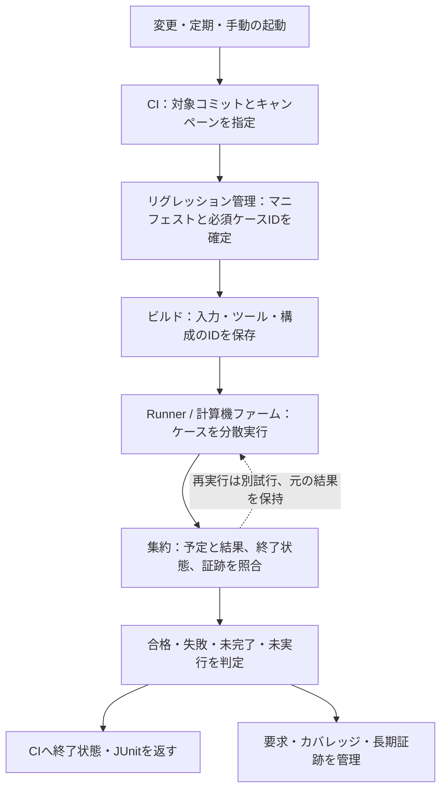
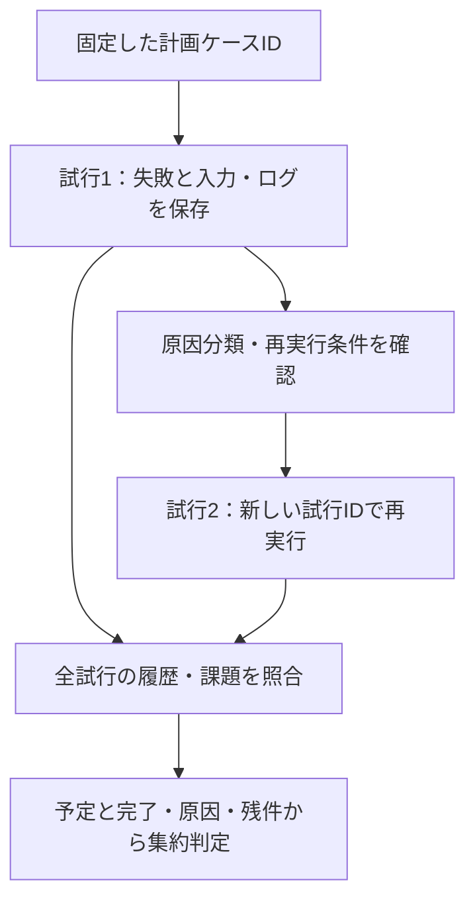

# 継続的リグレッションの計画・実行・結果管理

[一般化した検証手順](spec-to-verification-method.md)の段階Gを具体化した資料です。RTL・検証環境・構成・ツールの変更に対し、繰り返し検証を実行し、失敗・未実行・網羅の変化を追跡します。短い変更時のリグレッションと、探索・サインオフに必要な広いリグレッションを計画として管理します。

以下は本リポジトリの運用案です。製品向けのリグレッションランナー、CIサービス、Cadenceの検証管理ツールを導入・接続したものではありません。既存のケーススタディの実行実績とは分けて扱います。

[実行可能な最小例](../../examples/local-irq-cdc/README.md)を別に用意しています。Icarus Verilogで通常回路・変異を検査し、JUnit・マニフェスト・ログ・波形を保存します。動作確認の記録は、実行例の末尾にあります。

実行例は次の範囲まで実装しています。構成とJUnit件数は、[初期の11例の構成](../../README.md#初期の11例の構成)にまとめています。

- [IRQ・CDC](../../examples/local-irq-cdc/README.md)、[FIFOランダム](../../examples/local-fifo/README.md)、[FIFOフォーマル](../../examples/local-fifo-formal/README.md)：基本的な実行・判定・証跡保存と、方式ごとの合格条件。
- [APBレジスタ](../../examples/local-apb/README.md)、[APBと割り込み](../../examples/local-apb-irq/README.md)、[APB・UART・割り込み](../../examples/local-apb-uart/README.md)：バス操作から状態・通信・通知までの結合と競合。
- [ready/valid通信](../../examples/local-stream/README.md)、[アービタ](../../examples/local-arbiter/README.md)、[UART](../../examples/local-uart/README.md)：転送・受理・待ち・エラーと復帰の構成別判定。
- [SVA](../../examples/local-sva/README.md)、[リグレッションの削減](../../examples/local-reduction/README.md)：アサーション・カバー・前件不足と、目標維持・検出力・実行量の比較。

11例は39構成で、JUnitはsmoke 311件、nightly 384件です。ランナーのセルフテスト132件は別枠です。本文の分散farmや商用ライセンス制御などの製品向け運用案とは、実装範囲を分けて扱います。

実行例では、動作中リセット、CDC遅延の観測、X注入を加え、要求ID・改訂と必須の観測目標を照合します。通常ケースの合格だけでなく、要求・カバレッジの未達も終了コードで失敗として返します。意図した変異検出の途中の観測で正常機能の未達を埋めず、タイムアウト・中断時には実行中のプロセスグループを停止します。

## 1. vManager／Verisium ManagerとGitLabの役割

Cadence vManagerは検証計画・リグレッション・結果・カバレッジを管理する製品です。現在の公開製品情報では[Verisium Manager](https://www.cadence.com/en_US/home/tools/system-design-and-verification/ai-driven-verification/verisium-manager.html)として、検証計画、API、ジョブの実行・スケジューリング、複数エンジンのカバレッジ収束などを説明しています。Cadenceの[技術解説](https://community.cadence.com/cadence_blogs_8/b/fv/posts/enhancing-verification-processes-with-session-composer-a-path-toward-efficiency)でもVerisium Manager（vManager）の名称を使っています。

GitLab CI/CDは、変更・定期実行などからジョブを起動し、Runnerで実行、結果やアーティファクトを集める基盤として使えます。RTLシミュレータや要求台帳・EDAカバレッジの意味付けは、別のツールやアダプタと組み合わせます。CIの成功と、検証要求の完了を対応付ける仕組みはどちらの構成でも必要です。

| 構成 | 担わせるもの | 導入時に確認・用意するもの |
| --- | --- | --- |
| Cadenceの検証管理製品 | 検証計画、リグレッション、EDAの結果・カバレッジ収束の管理 | 使用版・契約・エンジンとの互換性、要求ID、構成・判定・証跡の運用 |
| GitLab CI/CD＋自社管理Runner | 変更・定期実行の起動、ジョブ実行、結果表示とアーティファクト | EDAランナー、状態の正規化、カバレッジ集計、要求との対応、容量・運用管理 |
| CI＋Cadenceの検証管理 | CIからリグレッションを依頼し、専用ツール側で管理、結果をCIへ返す | 外部session ID、完了待ち・取消・失敗の伝達、証跡をどこで管理するか |

二者択一にせず、既存の環境と不足する機能で選びます。CadenceのAPIの有無・対応範囲は採用版で確認し、起動要求を受け付けたことだけでCIを合格にしません。外部リグレッションが完了するまで状態を追い、予定した対象と判定を照合します。

## 2. コストを重視する場合

GitLabと自前の計算資源で運用するRunnerは、有力な開始構成です。GitLabサーバを自社運用する場合と、GitLab.comから自社管理Runnerを使う場合を区別し、ネットワーク・保管場所・管理工数も含めて選びます。[GitLab Runner](https://docs.gitlab.com/runner/)は実行基盤上でジョブを実行するアプリケーションで、計算機の準備・容量・管理は運用側の責務になります。

比較する総費用には、少なくとも次を含めます。

- 検証管理・CIの契約、必要な機能を使えるプラン。
- シミュレータ・フォーマル検証・カバレッジ計測などのライセンスと同時実行枠。
- CPU・メモリ・計算機／クラウド、共有ストレージ、転送・バックアップ。
- CIサーバ・Runner・EDAアダプタの開発、更新・障害対応。
- 失敗の分類・再現、カバレッジ収束、要求と証跡の管理に使う工数。

GitLabのcompute minutesの扱いは、サービス形態・Runnerの種類・設定で確認します。[公式の説明](https://docs.gitlab.com/ci/pipelines/instance_runner_compute_minutes/)では、instance runnerのquotaとproject/group runnerを区別しています。自社Runnerの実行でも、計算資源・EDAライセンス・保存領域が無料になるわけではありません。プランと料金・容量は[料金ページ](https://about.gitlab.com/pricing/)と採用時の契約で確認し、固定の「最安」とは決めません。

すでにGitHubなどで運用している場合は、既存CI＋自社Runnerを続ける費用と移行工数も比較します。このリポジトリ自体には、CIの設定はありません。

## 3. リグレッションを段階に分ける

次は頻度の運用例です。時間・構成・テスト・seed・終了条件は製品の計画として固定し、頻度だけで合格範囲を決めません。

| リグレッション | 起動の例 | 主な対象と確認する結果 |
| --- | --- | --- |
| 変更時の短いリグレッション | MR/PR、変更のpush | lint・読み込み、sanity、変更影響のある試験、既知バグの再現 |
| mainの統合リグレッション | main更新後 | 統合した版の接続・設定・必須の基本機能、短い固定seed |
| 定期的な広いリグレッション | 夜間など | 必須構成の展開、固定＋探索seed、CDC遅延注入、関連するSVA・カバレッジ |
| 資源を使うリグレッション | 週次・計画時など | 長時間・高負荷、広い変異集合、計算負荷の高いフォーマル検証、電源遷移など |
| サインオフリグレッション | 対象版を固定した時点 | 承認した必須計画一式、最終版の結果と未達・例外の照合 |

GitLabでは[スケジュール実行パイプライン](https://docs.gitlab.com/ci/pipelines/schedules/)などを使えます。予定時刻の設定だけでなく、実際に起動したこと、対象コミット、予定ケース、終了と結果収集まで監視します。起動されなかったリグレッションは、失敗が0件でも未実行です。

影響に基づく選択やseedの縮約は、[検証規模の削減](verification-reduction.md#6-リグレッションテストとseedを縮約する)に従います。新しいseedでの探索と、失敗を再現する固定seedの両方を持たせます。変更時の限定的なリグレッションが合格しても、定期実行やサインオフ時に要求されるリグレッションの合格とは扱いません。

## 4. 計画・ビルド・分散実行を同じリグレッションへ結ぶ

図は製品向けの運用案です。リグレッション管理には専用製品や自社ランナーを使えます。下記の最小例は、このうち1回の実行の中での逐次実行を実装したものです。再実行を許す原因・回数は先に定めます。

リグレッションを起動するときに、実行対象の一覧を持つマニフェストを確定します。キャンペーンID、計画版、コミット、構成、テスト・シナリオ、seed、チェッカー、ツールと入力、必要なケースIDを記録します。実行中に対象を追加・削除する場合も、計画の変更として残します。

処理の順序は、次を基本にします。

1. 入力と計画を検査し、必須ケースの一覧を確定する。
2. 構成・ツール・マクロ・パラメータごとにビルドし、そのID・ハッシュを保存する。
3. ケースIDを分割して実行する。各分割ジョブへ担当ケースを渡し、同じケースが欠けたり意図せず重複したりしないようにする。
4. 個別の結果・ログ・証跡を回収し、予定ケースと結果を突き合わせる。
5. 元の結果を保持したうえで必要な再実行・分類を行い、リグレッション全体の判定を出す。
6. 互換なカバレッジDBを集計し、要求・構成・未達・傾向へつなぐ。

Runnerや外部計算機ファームのジョブIDは、キャンペーン・ケース・試行のIDと対応付けます。再実行には別の試行IDを付け、最初の失敗を上書きしません。別のコミットや計画の部分結果を混ぜて、同じリグレッションが合格した記録を作りません。

ビルドキャッシュには、ソース・生成物・ツール・ライブラリ・構成・コンパイル条件など、生成結果に影響する入力を反映します。キャッシュを復元できたことを、正しい版を検証した根拠にはせず、使用したビルドの入力とIDを照合します。

## 5. 資源・ライセンス・待ちを制御する

並列数は、CPU・メモリ・ライセンス・I/O・外部計算機ファームの上限に合わせます。CIのジョブ数だけでは、他プロジェクトや手動実行との合計を制御できない場合があります。共有計算機ファームやライセンスの制御は、必要な範囲全体で上限を守る仕組みへつなぎます。

待ち行列、ライセンス待ち、ビルド、シミュレーション・solver実行、結果収集の時間を分けます。応答モデルが規定のサイクル期限を超えた失敗と、ライセンス不足・Runner停止・計算機の実時間制限を区別します。実時間制限・メモリ超過では、途中までの結果と終了理由を可能な範囲で保存し、未完了として扱います。

古い変更時リグレッションを取り消す運用では、取消を記録し、後続のリグレッションがどの計画を引き継ぐかを確認します。取消が外部計算機ファームのジョブまで伝わったかも追跡します。サインオフリグレッションなど、対象版と完了を維持する必要がある実行は、変更時リグレッションと別の取消方針にします。

## 6. テストの状態とCIの状態を対応付ける

ランナーはツール固有の結果を、合格・失敗・判定不能・未実行・承認された対象外へ対応付けます。少なくとも、次を検査します。

- 終了コード、UVMのerror/fatal、SVA失敗、スコアボードの不一致と未照合、比較件数、予定した正常な終了。
- フォーマル検証のモードと最終状態、必須プロパティとcover、仮定・境界。`unknown`・タイムアウトを合格へ移さない。
- マニフェスト上の必須ケースすべてに結果があり、途中終了・未起動・結果ファイル欠落がないこと。
- 意図した診断や変異検出が合格条件になる試験では、その期待結果が成立したこと。任意のクラッシュを期待失敗の成功としない。

GitLabの[JUnitレポート](https://docs.gitlab.com/ci/testing/unit_test_reports/)は結果表示に使えますが、XMLを登録しただけではジョブの成否は変わりません。必須の失敗・未完了・結果欠落を、集約処理の終了状態へ反映します。`allow_failure`や失敗を無視するシェル処理で必須検査を成功へ変えないよう、ランナー自体も確認します。

JUnitの名前には、テストだけでなく必要な構成・seed・ケースIDを含め、同名結果の欠落を避けます。判定不能を単にskippedへ変換して完了数へ足しません。詳細な状態は元の実行記録へ残し、JUnitは表示用の対応として使います。

小さなランナーのセルフテストでは、正常、チェッカーによる失敗、ビルド不能、タイムアウト、必須結果の欠落、再実行、外部リグレッションの起動後の失敗を意図的に作り、CIが計画どおり判定するかを確かめます。本資料では、そのランナーの実装・実行は行っていません。

## 7. 失敗の再現・分類と不安定な試験

最初の失敗について、コミット・ビルド・テスト・構成・seed・入力・モデル・ログ・波形・実行場所を保存し、同じ条件で再現します。DUT、仕様・期待値、チェッカー、制約、環境・資源・ツールへ原因を分け、代表ログ・失敗ラベルなどでまとめます。似たメッセージだけで同じ原因と断定せず、個別のケースIDを保持します。

再実行で通る不安定な試験は、最初の失敗と再実行の結果を併記して課題化します。成功するまで再実行するだけでは、原因の調査や対応を完了したことにはなりません。環境障害の自動再実行には対象理由と上限を決めます。隔離が必要なら、対象要求・期間・担当・代替検査・承認を記録し、技術的な合格や対象外へ移しません。

検出した不具合は、[失敗の縮小](constrained-random-verification.md#8-失敗を再現し縮小してリグレッションへ残す)と修正後の確認を経て、再現するディレクテッドテストや固定seedをリグレッションへ加えます。連絡・課題登録の担当と期限も運用計画へ含めます。

### 再実行でも最初の結果を保持する

同じ計画ケースに対して試行IDを分け、最初の失敗と再実行結果を併記してリグレッションを判定します。

再実行の成功で試行1を上書きしません。原因・上限・隔離の扱いは本文の運用案に従い、未実装の自動再実行機能を示した図ではありません。

## 8. カバレッジ・証跡・傾向を保存する

各ケースの判定とカバレッジの収集・DB生成を別に確認します。合格しても必要なDBがない、チェッカーが無効、比較件数が0という状態は、その目的の検証完了にしません。失敗実行の到達情報を診断へ使う場合は、合格証跡に使う集計と分けます。

DBを統合するときは、RTL・モデル・ツール・構成・指標・除外の互換性を確認し、元の実行IDを残します。カバレッジの集計・除外は[機能網羅](functional-coverage.md)と[コードカバレッジの未達分析](verification-gap-review.md#10-コードカバレッジの未達を分析し対応する)に従います。テスト結果、カバレッジ、要求の合格、例外承認は別の指標として報告します。

通常の実行で残すものはマニフェスト、個別結果、判定ログ、ツール・入力の版、カバレッジと集計元です。失敗・重要ケースの波形や再現入力、サインオフの証跡は、保存期間と場所を決めます。大きい波形を全実行で無制限に保存せず、再現性・調査・承認に必要なものを残します。

GitLabのアーティファクトを使う場合は、失敗時にも必要な結果を収集する設定と、保持期限を確認します。強制停止やRunner障害で回収できない場合もあるため、必須証跡の欠落を集約処理が検出するようにします。CIの一時アーティファクトだけに、長期保存が必要な承認証跡を依存させません。

傾向には、予定・完了・合格・失敗・判定不能・未実行、構成別の要求・カバレッジの未達、失敗の再発、待ち・実行時間、CPU・メモリ・保存量を表示します。テスト・目標・分母が変わった場合は、共通部分と新規・削除分を分け、単純な合格率の改善と混同しません。

## 9. 最小構成から始める

コストを抑える開始案は、既存のGit管理＋CI、自社管理Runner、CLIで再現可能なEDAランナー、マニフェスト・結果記録、JUnit変換、ログ・カバレッジの保管です。最初に短い固定のリグレッションを成立させ、次に定期リグレッション・探索seed・構成の展開を追加します。

CI設定からツールのコマンド・判定を直接大量に埋め込む前に、同じマニフェストをローカルや計算機ファームで再実行できるインターフェースを定めます。CIや検証管理製品を変えても、要求ID・ケースID・入力と結果の関係を追跡できるようにします。

必要なカバレッジ収束・多数の利用者・構成・拠点を管理する工数が大きくなったら、専用の検証管理製品との統合を比較します。評価には同じ代表リグレッションを使い、設定・失敗解析・カバレッジ対応・運用の工数、待ち時間・実行量・費用を測ります。導入費だけの比較で決めません。

[共通ランナー](../../examples/local-common/README.md)で[ECC](../../examples/local-ecc/README.md)、[SPI](../../examples/local-spi/README.md)、[タイマー・ウォッチドッグ](../../examples/local-timer-watchdog/README.md)を実行できます。構成別のカバレッジ、予定・完了数、変異検出、JUnit・ログ・波形を同様に保存し、実行場所にかかわらず証跡を残します。[非同期FIFO](../../examples/local-async-fifo/README.md)、[I²C](../../examples/local-i2c/README.md)、[APB＋タイマー＋ウォッチドッグ](../../examples/local-apb-timer/README.md)も同じ共通ランナーを使います。[AHB-Lite](../../examples/local-ahb/README.md)と[AXI4-Lite](../../examples/local-axi/README.md)も同じ方式で実行します。AHB／AXIには、証明・有界検査・到達性を区別する[ローカルのフォーマルリグレッション](../../examples/local-bus-formal/README.md)も用意しています。

[バス検証の追加ランナー](../../examples/local-bus-validation/README.md)では、独立SVA・構成別クロス・X／リセット・性能・line／toggleをまとめ、[APBブリッジ](../../examples/local-bus-bridge/README.md)と[AXI4](../../examples/local-axi4/README.md)を子リグレッションとして実行します。親の子リグレッション判定と子の個別JUnitは階層を分け、同じ試験を二重計上しません。コードカバレッジの未到達と警告の扱いも証跡へ保存します。

[システム検証7例](../../examples/local-system-regression/README.md)には、DMA・複数マスター・非同期ブリッジ・復旧・低電力の5例と、AXI4フォーマル・FIFO等価性をまとめる親ランナーがあります。親は子の終了状態と予定／完了の一致を確認し、詳細JUnit・ソース・期待値・反例は子へ保存します。いずれもローカル専用です。

[C・Python・差分・完了期限を含む追加リグレッション](../../examples/local-advanced-regression/README.md)では、子ごとに適切なPython環境を選択します。cocotbが出力するJUnitや2バックエンドの実行は詳細証跡として残し、集約ランナーの合否判定と同じ試験として再合算しません。ツール不在や比較不能なX、欠落ログを差分検出の成功へ変換しません。

## 10. サインオフへ接続する

リグレッションの完了には、固定したマニフェストに対して必須ケースの結果がそろい、判定とカバレッジ・証跡が有効であることが必要です。fail数0だけでなく、未実行・判定不能・結果欠落・チェッカー無効・古い版・未承認の隔離を確認します。

記録には、CIとリグレッション計画の版、キャンペーン・パイプライン・外部session ID、予定と実行の対応、再実行履歴、集約判定、カバレッジの統合元、長期証跡、未達・例外、担当・承認を含めます。既存の同じ実行回で判定するAND集合の規則を維持し、[サインオフ記録](../templates/signoff-record.md)へつなぎます。

## 11. 参考にした一次資料

- [Cadence Verisium Manager](https://www.cadence.com/en_US/home/tools/system-design-and-verification/ai-driven-verification/verisium-manager.html)と[Session Composerの技術解説](https://community.cadence.com/cadence_blogs_8/b/fv/posts/enhancing-verification-processes-with-session-composer-a-path-toward-efficiency)：検証計画・リグレッション・カバレッジ管理とvManagerの名称の参照先です。
- [GitLab Runner](https://docs.gitlab.com/runner/)、[定期パイプライン](https://docs.gitlab.com/ci/pipelines/schedules/)、[JUnitレポート](https://docs.gitlab.com/ci/testing/unit_test_reports/)、[CI設定](https://docs.gitlab.com/ci/yaml/)：起動・実行・結果表示・アーティファクトの参照先です。
- [GitLabのcompute minutes](https://docs.gitlab.com/ci/pipelines/compute_minutes/)、[instance runnerの使用量](https://docs.gitlab.com/ci/pipelines/instance_runner_compute_minutes/)、[料金](https://about.gitlab.com/pricing/)：2026-10-25に確認した費用・quotaの参照先です。採用時に再確認します。

リグレッションの段階、マニフェストと結果の照合、判定・証跡・費用の評価方法は、本リポジトリで定めた運用案です。

## ローカルで試す追加例

[解析・収束・結合・UVMの7例](../../examples/local-workflow-regression/README.md)をローカルで追加実行できます。親7件の合否判定と子83／111件を分け、失敗の縮小、観測による刺激調整、4回路の結合検証、UVM参照実装の結果を保存します。

[UVMランダム化・仕様生成・反例再現・結合検証の7例](../../examples/local-soc-regression/README.md)は、同じローカルの親ランナーから実行できます。親7件の合否判定、子114／138件、反例生成の入れ子BMC 8件を階層別に保存し、二重計上しません。4回路8構成の56／72件は共通シミュレーション全体429／551件にも含まれます。2026-10-27のレビュー修正後に7例のsmoke／nightlyと、同7例の確認38件が成功しました。

[追加の7例](../../examples/local-extension-regression/README.md)は、親7件の合否判定・子99／127件を別に保存します。6回路12構成の84／108件は、共通シミュレーション全体513／659件にも含まれます。生成RALとRTLのバス接続は15／19件。今回のsmoke／nightlyと追加時の36件とレビュー追加5件の計41件が成功しています。
