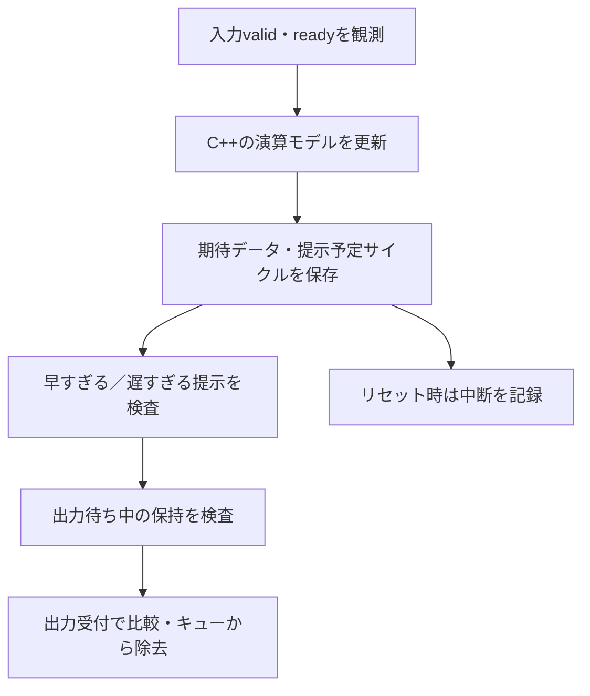

# C++参照モデルを使うRTL検証

C++で期待値を計算し、RTLの入出力と照合する構成を扱います。[ストリーミングFIRの実行例](../../examples/local-cpp-reference/README.md)では、独立したC++参照モデル、Verilator上のRTL、タイミング・保持・完了件数の検査を一緒に動かします。

## 演算モデルとタイミングの検査を分ける

参照モデルの入力は、DUTが受け付けたトランザクションです。入力値が提示されただけでは履歴を進めず、`valid && ready`の観測で更新します。結果をすぐ計算できても、RTLの出力がすぐ有効になるとは限らないため、提示予定時刻は別のキューで管理します。

| 役割 | FIR例での実装 | 確認する点 |
| --- | --- | --- |
| 演算参照 | 64ビット整数の積和、商・余りによる丸め | 符号、桁幅、中間値、丸め、飽和、履歴 |
| スコアボード | 期待値と提示予定サイクルのキュー | 順序、欠落、重複、早期／遅延出力 |
| プロトコル検査 | ready/valid、待ち中の出力保持 | 非受付時の変更、誤った受付可能通知 |
| 完了判定 | 受付・出力受付・中断の計数 | 排出後の残り、リセットで消えた結果、余分な出力 |

リセットで消した結果を「比較済み」と数えず、中断として残します。入力の受付数と出力の受付数が一致しない理由を、リセット仕様と対応付けて説明できるようにします。

## 同じ誤りを共有しにくくする

RTLのレジスターと分岐をC++へそのまま移すと、期待値も同じ誤りを持つ可能性があります。FIR例ではRTLのシフト・符号拡張と、C++の64ビット積和・除算を分けています。C++モデルはさらにPythonの有理数計算で単独検査します。

モデルへの故障注入も行い、正しいRTLと誤った参照モデルの不一致を検出します。これはモデルの全誤りを検出できる証明ではありません。モデルの根拠、単独テスト、RTLとの比較、不具合検出を別々に記録します。[ミューテーション検証](mutation-verification.md)の判定範囲も参照してください。

## 数値とインターフェースを契約にする

入力・係数・積・累積値・出力それぞれの幅と符号、スケール、丸め、飽和を決めます。C++の符号付きオーバーフローや負数の右シフトへ期待値を依存させず、モデルの演算範囲が型に収まることを確認します。

C++からRTLポートへ渡す値は宣言幅へ収め、読出し時はその幅の符号を復元します。モデルには論理的な符号付きサンプルを渡し、シミュレーターの格納型と区別します。

## 証跡と拡張

構成・seed・入力列・コンパイルコマンド・モデルとRTLのハッシュを保存します。比較だけでなく、待ち・リセット・最終排出を含む完了件数も照合してください。複数未完了へ拡張する場合は、IDや並べ替えの規則と、リセット時にどの期待値を取り消すかを追加します。

この例は独立したC++モデルの接続を学ぶ入口です。[Cドライバー](../../examples/local-c-driver/README.md)、[SystemCのSoCLibモデル](../../examples/local-vci-soclib/README.md)、[SPICEとの協調](spice-cosimulation.md)は、実行ソフト・別粒度のモデル・アナログ回路を組み合わせる関連例です。
