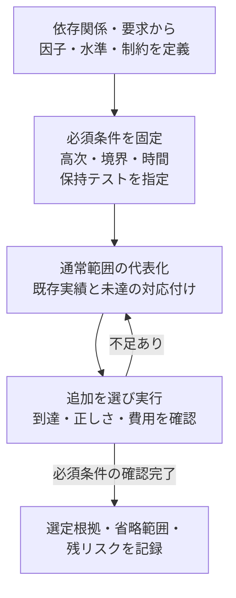

# クロス検証の条件を選び、検証項目にする実例

機能・状態・設定・タイミングをすべて掛け合わせると、項目数が増え、何を残すべきか判断しにくくなります。この文書では、**要求と依存関係から必須条件を決め、通常範囲を代表化し、未達を埋めるテストを選ぶ**手順を示します。条件を選ぶ理由と、選ばなかった範囲を説明できる検証項目表を作ることが目的です。

[仕様書から検証項目を作る実例](spec-to-test-items-walkthrough.md)の次に読める資料です。[相互作用の手順](feature-interaction-verification.md)と[検証規模の削減](verification-reduction.md)を、選定判断と数値例へ具体化しています。記録には[クロスモデルの雛形](../templates/interaction-coverage-plan.md)を使います。

## 1. 「確認する条件」と「実行するテスト」を分けて選ぶ

先に確認すべき条件を決め、その後に、それらを確認するテストを選びます。テストを先に減らして、その残りから必須条件を定義すると、漏れが見えなくなります。

| 選ぶもの | 決めること | 判断の根拠 |
| --- | --- | --- |
| クロスの対象領域 | どの機能・状態・設定に依存関係があるか | 共有状態・資源、制御・データの依存、優先順位、中断と復帰 |
| 必須の検証目標 | 全組、2因子、重点的な高次の組、順序・時間窓のどれを確認するか | 仕様、重大な故障、重要境界、既知不具合、構成差 |
| 実行するテスト集合 | どのケース・操作列・seedで必須目標を満たすか | 実際の到達・有効な判定、新たに満たす目標、実行コスト |

1本のテストで複数目標を確認でき、1目標の確認に複数の操作が必要な場合もあります。目標数、生成した設定行数、テスト本数、実行クロック数を区別します。



## 2. 因子を増やす前に、相互作用の範囲を絞る

制約のない算術例でも、8因子を各4水準に分けると全直積は4の8乗＝65,536行です。同じモデルの2因子目標は因子対28通り×水準対16通り＝448目標になります。複数目標を1行で覆えるため、448目標を448本のテストと数えません。一方、低次へ変えるだけで、重要な高次条件を省略してよいことにはなりません。

まず、機能名の一覧から全直積を作る代わりに、同じ状態・資源へ作用する領域を見つけます。例えば「割り込みの保持・クリア・許可」「FIFOの投入・取出し・満杯」「DMAの所有権・完了・リセット」をそれぞれ整理します。領域をまたぐ共有バスや通知経路は別途結び付けます。

次に、各因子を期待結果が変わる水準へ分けます。FIFO残量なら空・1要素・満杯直前・満杯、時間差なら受理の直前・同時・直後などです。中間値をまとめる根拠がなく、カウンター幅や転送境界で動作が変わるなら、区分を追加します。

| 判断すること | 残す根拠 | 省略・代表化するために必要な根拠 |
| --- | --- | --- |
| 状態・値の区分 | 期待結果が変わる境界、状態遷移、桁あふれ、容量制限 | 同じ振る舞いになる範囲と、その境界を確認する項目 |
| 第三以上の因子 | モードや許可が、競合の優先順位・結果・観測を変える | その因子を変えても性質が保たれる説明と、別の検査 |
| インスタンス・構成 | 配線、幅、優先順位、待ち、ドメインなどの差 | 対称性・等価性の根拠と、非対称部分の検査 |
| 時間方向 | 同時受理、隣接操作、期限の直前／同時／直後、中断・復帰 | 必要な間隔・反復・状態遷移を保持する操作列 |

### 制約で「試したくない条件」を消さない

合法な部分組合せとは、残りの因子と操作列を補うと、仕様・環境契約を満たして成立する組です。現在の刺激生成器が作れないことや、現在のRTLが到達させないことだけで除外しません。

- 「IRQをマスクしているからイベントは来ない」という制約は、マスク中も保持する仕様の重要条件を消します。
- 「処理中にはリセットしない」という制約は、処理中断・復帰の要求があるなら使えません。
- 仕様が禁止する操作は、正常範囲の制約と、拒否・エラー・回復を確認する異常系項目へ分けます。
- 仕様が決まっていない条件は仕様課題にします。到達不能や検証済みへ分類しません。

禁止行を生成後に削除する場合も、残った行が必要な合法の組をすべて覆うか再計測します。制約の追加で隠れた境界・高次条件がないかもレビューします。

## 3. 何を必須にし、どこへ2因子網羅を使うか

### 3.1 必須条件を先に残す

次の質問へ具体的に答えると、次数を選びやすくなります。「A・B・Cは重要」という説明にとどめず、**どの状態で何が失われ、どの因子がその結果を変えるか**を書きます。

| 質問・兆候 | 選定する項目の例 |
| --- | --- |
| 仕様が優先順位・同時動作・復帰結果を指定しているか | 関係する状態・操作・モードを合わせたディレクテッド項目 |
| データ損失、二重処理、権限逸脱、デッドロックにつながるか | 重大な故障を成立させる高次条件、小さい重要領域の全組 |
| 第三の因子で期待値や観測可能性が変わるか | その因子を含む3因子以上のクロス、マスク中の内部状態の観測 |
| 境界・リセット・取消・再試行で状態が切り替わるか | 切替えの直前・同時・直後、復帰後の最初の操作 |
| 既知不具合、修正直後、長い履歴、負荷集中に依存するか | 再現テスト、連続回数の境界、長いストレス試験の保持 |
| 別機能・構成への代表化を支える根拠がないか | 対象を残す、または根拠を確認する項目を追加する |

### 3.2 通常範囲の次数を決める

通常範囲を2因子網羅（pairwise）にすると、選んだ因子の各対について、合法な水準対を少ない行へまとめられます。ただし、低次の網羅だけでは高次の相互作用を確認できません。[NISTの組み合わせ試験](https://csrc.nist.gov/projects/automated-combinatorial-testing-for-software)も次数を定義して試験する手法であり、LSIの必要次数を一律に2へ決める根拠にはしません。

| 範囲 | 採用する方針 | 判断記録に残すこと |
| --- | --- | --- |
| 小さく重要な領域 | 定めた区分の全組を残す | 要求・重大な故障・境界との対応 |
| 通常の広い領域 | 制約付き2因子など、根拠のある次数で代表化 | 因子・水準・対象集合、選ばない高次条件と残リスク |
| 高次の依存がある領域 | 指定因子群の次数を上げる、条件付きで全組を残す | 固定する前提、対象因子群、必要な組の明示 |
| 順序・中断・長い反復 | 操作列・時間窓・反復境界を別の目標にする | 受理の基準、状態、間隔、完了までの観測 |

発生頻度が低くても、仕様上必須の条件や重大な故障へ至る条件は残します。重大度や検出の難しさを点数化する場合も、その点数だけで必須条件を消しません。根拠を持てない領域は、未確定として担当・期限を残します。

## 4. 数値例：2因子を覆っても重要な4因子条件が抜ける

ここからは[APB＋割り込みの選択例](../../examples/local-apb-irq-coverage/README.md)と同じ4因子を使います。まず1要因・1つのwait構成に限定し、リセット解除中に正常完了したW1C転送を観測します。他要因の保留・許可は0に初期化し、対象要因の状態とIRQを確認します。

| 因子 | 水準と観測する時点 |
| --- | --- |
| P | W1C受理エッジの更新前PENDING：0／1 |
| M | 更新前のIRQ許可：0=マスク、1=許可。実行例の因子名は`mask`。この例の観測中は変更しない。 |
| E | 同じエッジで受理するイベント：0／1 |
| C | 正常完了したW1C書込みの対象ビット：0=クリアしない、1=クリアする |

仕様はイベント優先で、更新後の状態は`P_next = E OR (P AND NOT C)`、対象要因だけのIRQは`P_next AND M`です。Mは状態の更新を抑止しません。4因子の全組は2の4乗＝16組、2因子目標は因子対6通り×水準対4通り＝24目標です。

### 4.1 通常範囲の候補を5行へまとめる

以下は説明用に作成した行集合です。初期化・バス転送・観測まで含んだテスト本数ではありません。

| 行ID | P | M | E | C | 期待P_next | 期待IRQ |
| --- | --- | --- | --- | --- | --- | --- |
| C01 | 0 | 0 | 0 | 0 | 0 | 0 |
| C02 | 0 | 1 | 1 | 1 | 1 | 1 |
| C03 | 1 | 0 | 1 | 1 | 1 | 0 |
| C04 | 1 | 1 | 0 | 1 | 0 | 0 |
| C05 | 1 | 1 | 1 | 0 | 1 | 1 |

5行で24個の2因子目標をすべて覆います。しかし、**P=1・M=1・E=1・C=1**はありません。例えば、この4条件がそろったときだけ誤ってクリアを優先する不具合は、この5行では検出できません。C02ではP=0、C03ではM=0のため、同じ条件にはなりません。

### 4.2 重点範囲を追加する

保留中の情報の消失、マスクと保持の取り違え、イベントとクリアの競合を重視し、既存APB例と同じく**P=1を前提に、M×E×Cの全8組**を重点目標にしたとします。C01〜C05が満たす重点目標は3/8なので、次の5行を足します。

| 行ID | P | M | E | C | 期待P_next | 期待IRQ |
| --- | --- | --- | --- | --- | --- | --- |
| C06 | 1 | 0 | 0 | 0 | 1 | 0 |
| C07 | 1 | 0 | 0 | 1 | 0 | 0 |
| C08 | 1 | 0 | 1 | 0 | 1 | 0 |
| C09 | 1 | 1 | 0 | 0 | 1 | 1 |
| C10 | 1 | 1 | 1 | 1 | 1 | 1 |

重点範囲で固定するP=1を省略せず記録します。この方針は条件付きの3因子全組であり、4因子のあらゆる3因子部分集合や、4因子の全16組を網羅する指定とは異なります。

| 計画上の充足 | 通常候補5行 | 重点を足した10行 |
| --- | --- | --- |
| 2因子目標 | 24/24 | 24/24 |
| P=1でのM×E×C | 3/8 | 8/8 |
| 4因子の全組 | 5/16 | 10/16 |

### 4.3 残る条件を明示して判断する

残る6組は、P・M・E・Cの順に`0001`・`0010`・`0011`・`0100`・`0101`・`0110`です。この例ではいずれも合法で、到達不能の除外にはできません。P=0での操作の一部を、4因子の組としては選んでいない状態です。

すでに通常動作16組を必須にした計画なら、この6組も実施対象です。[前の項目作成例](spec-to-test-items-walkthrough.md)は、その全16組を要求した計画です。本書の10行案で置き換えることはできません。16組程度の小さい範囲なら、初期化や選択管理の負担を考えて全組を残す判断もできます。

対象が大きく、通常2因子＋条件付き重点範囲を採用する場合は、残す単体試験・アサーション・証明と、省略する高次条件への対応・不足を記録します。例えば「イベントによるセットのassertがある」だけでは、省略した特定の4因子条件に到達した証拠にはなりません。目標の定義と検出力の確認は、別々にレビューします。

この説明例の判断を、次のように残せます。製品へ転用するときは、対象の仕様・既存計画・故障の影響で各行を見直します。

| 目標群 | 選定判断 | 理由と確認方法 | 残る範囲 |
| --- | --- | --- | --- |
| G-PAIR | 通常範囲は2因子24目標 | 各因子対を基礎として広く確認。選定行が全24目標を覆うか検算。 | 3因子以上の全組を確認する指定にはならない。 |
| G-PRIORITY | P=1でのM×E×C全8組を必須 | 保留情報の消失と、競合・マスクの取り違えを重視。更新前状態と更新後の結果を判定。 | P=0の高次条件は別に判断する。 |
| G-TIME | I×M×イベント位置の12目標を必須 | 同時・直前・直後で結果が変わる。受理と3エッジの状態を観測。 | 長い間隔・反復、マスク変更は別項目。 |
| G-KEEP | リセット・異常・既知不具合・ストレスの既存必須項目を保持 | 基本のクロス目標では表現しない故障と履歴を守る。元の項目IDへ対応付ける。 | 別の目標群・実行結果で確認する。 |
| G-OPEN | 未選択の合法6組を明示 | 既存計画が全16組を必須とするなら追加する。代表化の根拠がなければ未確定のまま残す。 | 除外・合格として処理しない。 |

### 4.4 行集合を手元で検算する

Python 3の標準ライブラリだけで、上の数値と抜けを確認できます。これは**計画上の組合せの検算**で、RTLの実観測やフォーマル証明ではありません。

```sh
python3 - <<'PY'
from itertools import combinations, product

base = ['0000', '0111', '1011', '1101', '1110']
extra = ['1000', '1001', '1010', '1100', '1111']
universe = set(product((0, 1), repeat=4))

def rows(values):
    return {tuple(map(int, value)) for value in values}

def pairs(values):
    return {(a, b, r[a], r[b]) for r in values
            for a, b in combinations(range(4), 2)}

def priority(values):
    return {r[1:] for r in values if r[0] == 1}

for label, values in [('通常候補', base), ('重点追加後', base + extra)]:
    selected = rows(values)
    print(f'{label}: {len(selected)}行, 2因子 {len(pairs(selected))}/24, '
          f'P=1重点 {len(priority(selected))}/8, 全組 {len(selected)}/16')

assert pairs(rows(base)) == pairs(universe)
assert priority(rows(base + extra)) == priority(universe)
missing = universe - rows(base + extra)
assert len(missing) == 6
print('未選択:', ', '.join(''.join(map(str, r)) for r in sorted(missing)))
PY
```

条件を除外したモデルへ変更したら、全16組の代わりに合法な全組を定義し直し、そこから各目標群を再生成します。行数が減ったことだけで網羅を判断しません。

## 5. 時間関係を別の検証項目へ展開する

値の組合せを選んだ後も、同時性や順序を追加します。W1Cを受理したエッジを0とし、唯一のイベントを-1／0／+1へ置きます。時間関係の初期状態Iは、**エッジ-1の更新前**のPENDINGです。前節のPはエッジ0の更新前なので、そのまま同じ因子として集計しません。

I=0／1 × M=0／1 × イベント位置3通り＝12目標を、1要因・1wait構成ごとに確認します。マスクを3エッジで一定にし、前後エッジの追加W1Cや複数イベントを混ぜない条件を固定します。異なる実行のイベントとクリアを持ち寄って、順序の到達に数えません。

| 検証項目の形 | 刺激・成立条件 | 期待値・観測と完了 |
| --- | --- | --- |
| X-STATE：状態クロス | 選定したP・M・E・Cを準備し、正常W1C受理を観測 | 更新前P・Mと受理E・Cを保存。更新後PENDINGとIRQを仕様から比較し、該当組の判定を完了。 |
| X-TIME：時間関係 | I・Mを準備し、W1C受理に対してイベントを-1／0／+1へ配置 | 3エッジの状態更新を比較。最後のイベントの結果まで確認し、同じ時間窓の目標へ計上。 |
| X-RESET：中断・復帰 | 処理中のどこでリセットするか、何を破棄・保持するかを別要求から指定 | リセット前・中・解除後の状態と最初の操作を確認。状態クロスの達成で代用しない。 |
| X-STRESS：反復・負荷 | 連続イベント、待ち、バックプレッシャの回数・境界を指定 | 各操作の結果と保持履歴、終了時の未完了件数を確認。基本クロスと別に保持。 |

全体のIRQだけを見ると、他要因が1のままで対象要因の誤りを隠すことがあります。対象ビットのPENDING・許可・受理・更新結果も観測します。バス要求を提示しただけで受理と扱わず、待ちやエラーの条件も分けます。

## 6. 既存の検証実績から追加ケースを選ぶ

目標集合と保持テストを固定したら、既存テストの判定付き到達を対応付け、未達だけを追加候補で埋めます。既存テストの組合せ網羅を後から計測する考え方は[NIST IR 7878](https://csrc.nist.gov/pubs/ir/7878/final)にも整理されています。

1. 目標群・構成・インスタンスごとに、既存ケースの到達と判定完了を記録する。
2. 未達の目標IDを列挙する。刺激不足、観測不足、チェック不足、実行失敗、仕様課題を分ける。
3. 必須の境界・既知不具合・長い履歴のテストを先に保持する。
4. 残る未達を満たす候補について、新たに満たす目標とコストから追加順を選ぶ。
5. 選択集合を新しく実行し、目標・判定・保持テスト・検出力が維持されているか確認する。

### 6.1 「新しい目標数／コスト」を使う小さな例

同じ優先度の未達目標U1〜U4があるとします。候補ごとの到達は、有効なチェッカーを伴う学習実行で確認済みとした説明例です。費用は仮の相対単位で、APB教材の実測値ではありません。

| 候補 | 確認できる未達目標 | 追加費用 | 最初の新規目標数／費用 |
| --- | --- | --- | --- |
| K1 | U1・U2 | 8 | 2/8=0.25 |
| K2 | U2・U3・U4 | 9 | 3/9≒0.33 |
| K3 | U3・U4 | 4 | 2/4=0.50 |

まずK3を選ぶと、残りはU1・U2です。そこで再計算すると、K1は2/8、K2は1/9なのでK1を追加します。追加分の費用は4+8=12です。保持テストやビルド・学習の費用は別途加算します。

実行優先度が異なる場合は、重大な故障・必須期限などによる順序を先に決め、その同順位内で比率を目安にします。比率が低い必須目標も最後まで残します。greedy法は最適な集合を保証せず、見積コストも実測後に見直します。予算で打ち切った分は未実行・未達として記録します。

### 6.2 カバー目標が同じでも保持するテストがある

長い履歴や既知不具合の再現は、新規カバー数が0でも保持する場合があります。[削減の比較例](../../examples/local-reduction/README.md)では、19目標を満たす選択でも長い連続イベントに依存する誤実装を見逃し、ストレスを保持すると検出できる差を実行します。目標モデル自体に不足があると、目標だけの最適化では検出力を守れません。

## 7. 既存APB例へつなげる

実行例では4つの割り込み要因を混ぜず、wait=0／1／3も独立に判定します。各wait構成の目標は、通常2因子が4要因×24＝96、P=1重点が4×8＝32、時間関係が4×12＝48です。既存の44／45目標も保持します。異なる群の分母を足した一つの達成率へまとめません。

Python 3.10以上とIcarus Verilogの`iverilog`・`vvp`を用意し、リポジトリのルートから実行します。

```sh
python3 examples/local-apb-irq-coverage/run.py --seed 73
python3 examples/local-apb-irq-coverage/run.py --profile nightly --seed 73
python3 examples/local-reduction/run.py --seed 73
```

APB例は、既存の境界・ランダムケースを全件保持し、追加候補を実行して得た実績から不足を選び、全候補と選択集合を再実行します。`selection.json`で選択理由、`coverage.json`で目標群別の計画・到達・合格、`costs.json`で学習・再実行を含む費用を確認できます。詳しい配置は[実行例のREADME](../../examples/local-apb-irq-coverage/README.md)を参照してください。

本書の5行・10行は選定方針を説明するための集合で、APBランナーが実際に選ぶテスト本数ではありません。また、要因間の同時動作、マスク更新との競合、リセット、異常応答、すべての高次条件を、この4因子モデルだけで確認したことにはなりません。既存目標と別の相互作用項目を対応付けます。

本書追加時の組合せの検算と、APB・削減例の再実行結果は、[2026-10-31の確認記録](../../PROVENANCE.md#クロス検証の条件選定の具体化2026-10-31)にまとめています。

## 8. 選定レビューで残す記録

[記録の雛形](../templates/interaction-coverage-plan.md)へ、少なくとも次を残します。

- 因子・水準・制約の版と、要求・共有状態・重大な故障との対応。
- 必須にした全組・高次の組・境界・時間関係と、残す理由。
- 通常範囲の次数と代表化の根拠、選ばない合法な条件・残リスク。
- 既存テストの有効な実績、未達ID、追加候補、保持テスト、選択順と費用。
- 計画上の充足・実観測の到達・判定付きの合格を分けた結果。
- 未実行・失敗・判定不能・仕様課題、対応担当・期限、再評価が必要な変更。

AIには候補の列挙と選定理由の整理を支援させられます。例えば、「共有状態と故障の影響から必須の高次条件を提案し、通常2因子で残る未選択の合法条件を列挙し、制約・代表化・省略の根拠がないものを質問にする」と依頼します。別のレビュー担当者が出典と漏れを確認し、組合せの検算と実行結果で提案を点検します。

## 9. 参考にした一次資料

- [NISTの組み合わせ試験](https://csrc.nist.gov/projects/automated-combinatorial-testing-for-software)：t-wayで確認する入力・構成の組合せを定義する考え方の参照先です。
- [NIST IR 7878：Combinatorial Coverage Measurement](https://csrc.nist.gov/pubs/ir/7878/final)：既存のテスト集合について組合せ網羅を計測する参照先です。
- [NISTの事象列の試験](https://csrc.nist.gov/Projects/automated-combinatorial-testing-for-software/combinatorial-methods-in-testing/event-sequence-testing)：値の組合せに加えて、事象の順序を扱うための参照先です。

LSIでの必須条件の選び方、5行・10行の数値例、仮の費用例は本リポジトリで作成しました。ソフトウェア分野の検出実績を、対象LSIの必要次数や完了保証へそのまま適用する資料ではありません。
