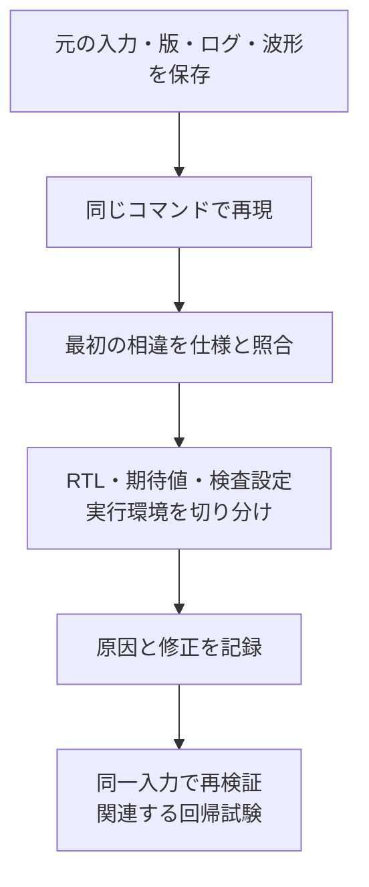

# 失敗を再現し、原因を切り分ける

失敗したら、最初に入力・対象版・構成・実行コマンド・最初のエラーを保存します。修正を先に入れると、元の失敗を再現できなくなることがあります。[実習](../../examples/local-failure-triage/README.md)では、割り込み回路を使って6種類の問題を発生させ、同じ入力で修正後の動作まで確認します。[不具合票の雛形](../templates/verification-issue.md)も利用できます。

## 1. 実行基盤と回路の失敗を分ける

| 現象 | 最初に確認する証跡 | 次の作業 |
| --- | --- | --- |
| ツールを起動できない | コマンド、実行ファイル、PATH、依存パッケージ、起動エラー | 環境を直して再実行。回路の合否は未確認 |
| 制限時間内に終わらない | 壁時計時間、実行上限、最後のログ、シミュレーション時刻 | ビルド遅延・ハング・待ち続け・進行性違反を切り分ける |
| 比較エラー | 受理時の入力、期待値の根拠、実測値、最初の相違 | RTLと参照モデルを仕様へ別々に照合する |
| アサーション違反 | 前件、起動時刻、判定時刻、reset・disable、履歴の有効性 | 回路の違反か、プロパティやサンプリングの誤りかを調べる |
| 終了コード0だが観測不足 | 完了マーカー、ネイティブ計測DB、検査の実効設定 | 必須条件・checker・計測器が動いたかを確認する |

時間切れやクラッシュは、期待したチェッカーが不具合を検出した証拠にはしません。アサーションが無効、前件が一度も成立しない、テストが途中で終わる、といった場合は、違反0件でも合格にできません。

## 2. 最初の相違から調べる

例えば「イベントとW1Cクリアが同時ならイベント優先」という仕様で、`pending`の比較が不一致になったとします。同じ比較エラーでも、次の二つは別の問題です。

- 実測0・期待値1：DUTとは別に仕様から求めた値も1なら、RTL側の誤りを疑う。
- 実測1・期待値0：仕様値が1なら、参照モデルや比較側の誤りを疑う。

DUTと参照モデルの両方をクリア優先にすると比較は通ってしまいます。[AI提案のレビュー演習](ai-verification-review.md)では、この相関した誤りも扱います。複雑な仕様では、波形の一箇所だけから原因を確定せず、仕様課題や追加観測が必要な状態も記録します。

## 3. 再現条件を縮める

まず、同じseed・構成・入力列で再現することを確かめます。再現しない場合は、未保存の設定、未初期化、競合、ツール版、並列実行の影響を調べます。入力列を短くする場合は、同じ失敗ラベル・同じ因果関係を維持していることを確認します。[操作列の自動縮小例](../../examples/local-failure-reduction/README.md)も参照できます。

再現用コマンドは、波形や入力の実際の保存先まで含めます。絶対パスを含むコマンドを別環境で使う場合は、入力ファイルとツールの場所を置き換え、元のハッシュと一致するかを再確認します。

seedによる再生成、保存入力の再生、縮小ケースの再生を分ける方法は、[探索管理](random-search-management.md#4-再現性を3段階で確認する)へまとめています。[演習](random-search-management-walkthrough.md#2-axi4-streamの失敗を保存し固定入力として再生する)では、縮小結果をケース集へ保存し、正常RTLと既知の変異を新しいビルドで確認します。

## 4. 修正を閉じる条件

修正前に失敗し、修正後に同じ入力で通ることを確認します。期待値を実測値に合わせただけにならないよう、修正の根拠を仕様の出典へ結び付けます。周辺の競合条件、リセット復帰、構成違いへの回帰試験も選びます。

不具合票には、原因の確定度、影響範囲、修正差分、再発防止テスト、未確認条件を残します。再実行で上書きせず、元の失敗と修正後の結果を別に保存します。複数の実行から採用結果をまとめる場合は[履歴レポート](../../tools/REPORTING.md)を使い、最初の失敗も追跡できるようにします。

最初の相違・原因候補・再現ケース等の意味は[用語集](../glossary.md#13-失敗解析)、比較エラー・時間切れ・不安定な試験の疑問は[FAQ](../faq.md#14-失敗解析と再現)を参照してください。
