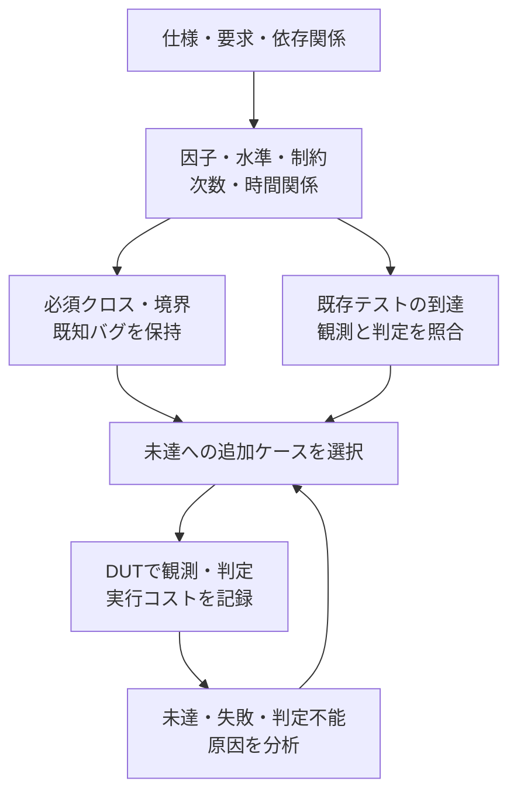
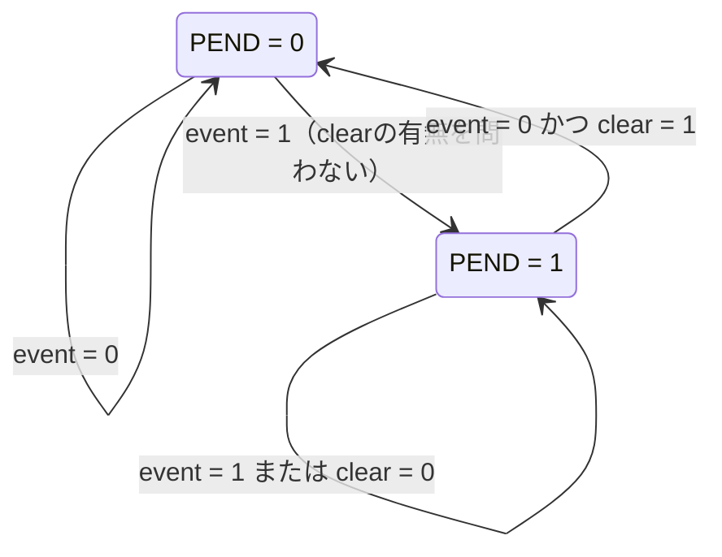
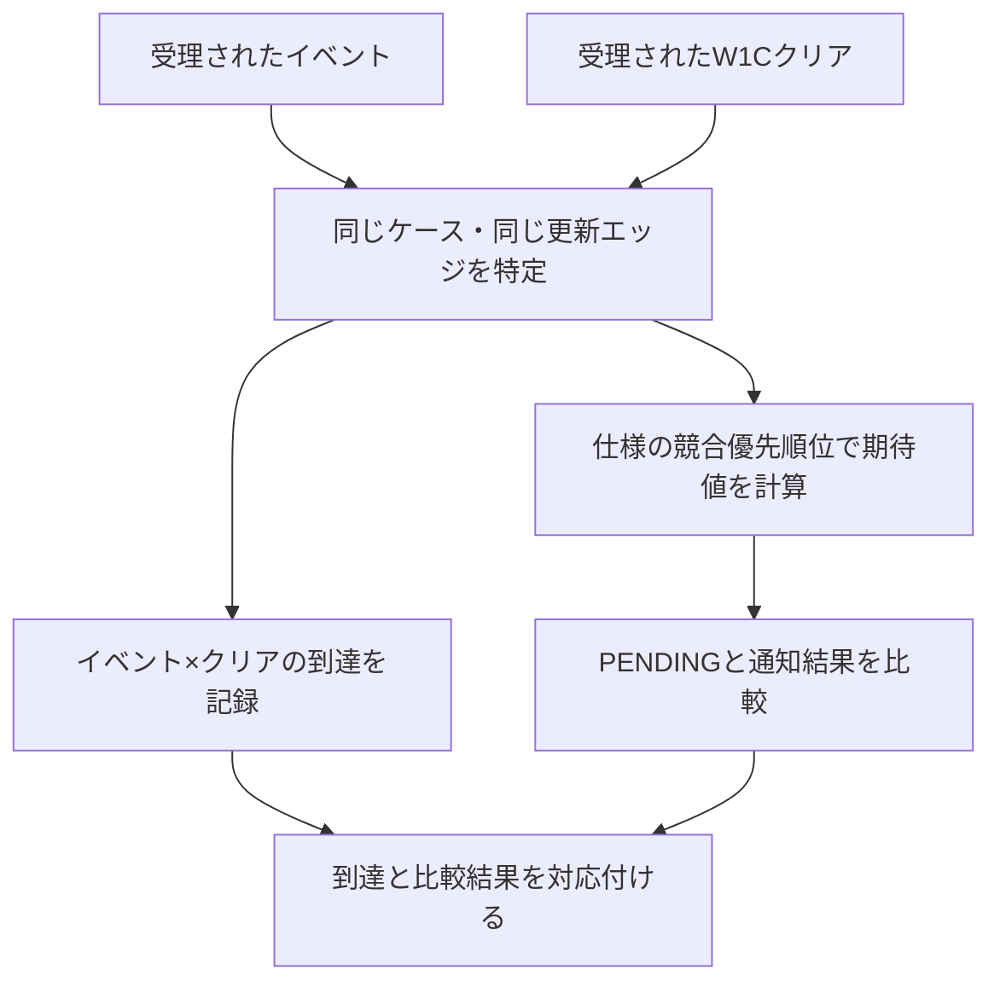

# 機能間の相互作用とクロス検証

[一般化した検証手順](spec-to-verification-method.md)の9.8節を具体化した資料です。機能を個別に確認しても、それらが同じ状態や資源を扱うときの動作は別に確認する必要があります。ここでは、機能間の依存関係から相互作用の要求を抽出し、刺激・観測点・判定条件・クロスカバレッジ目標へ具体化する手順を定めます。半導体IPに適用済みの実績ではなく、今後適用する運用案です。

## 1. 何をクロスとして扱うか

機能Aと機能Bについて、単体の成立条件と、組み合わせたときに追加で必要な規則を分けます。

| 観点 | 確認する関係の例 |
| --- | --- |
| 同時動作 | CPUとDMAが同じメモリやバスを使うときの調停・データ整合性 |
| 状態の競合 | ハードウェアのイベントセットとソフトウェアの状態クリアの優先順位 |
| 順序 | 設定変更の前後で受理した転送に、どの設定が適用されるか |
| 中断と復帰 | 処理途中のリセット・電源断で、何が破棄・保持・再実行されるか |
| 境界と負荷 | FIFOの空／満杯付近で、送信・受信・バックプレッシャが重なる場合 |
| 伝播 | エラー、割り込み、DMA完了、低電力状態の間で通知が失われないか |
| アクセス権 | デバッグ・テスト・通常アクセスが、権限やライフサイクル状態と整合するか |

機能のon/off、パラメータ値、状態、入力値の組み合わせも必要ですが、同じ値の組が出現しただけでは、競合・順序・中断の検証にはなりません。受理した事象、前後の状態、時間関係、期待する応答を定義します。

## 2. 機能間の依存関係を洗い出す

1. 機能一覧と、各機能が読み書きする状態・レジスタ・メモリ・キュー・資源を列挙する。
2. クロック、リセット、電源、モード、権限、割り込み、ソフトウェア操作との接点を加える。
3. 機能を行・列にした相互作用表を作り、各組に「共有状態」「資源競合」「制御依存」「データ依存」「中断・復帰」などの関係を書く。
4. 関係がある組ごとに、Aのみ、Bのみ、Aの後にB、Bの後にA、同時、処理途中への割り込みを検討する。必要なものを検証目標にする。
5. 第三の機能やモードが優先順位・観測結果を変える組を、3機能以上の相互作用として追加する。

「関係なし」とする組にも、構成と判断根拠を残します。たとえば別メモリを使っていても、共通のバスやリセットを持つなら、その接点は検証対象です。ソフトウェアや外部IPを含む接続まで確認し、IP境界で洗い出しを止めません。

## 3. 相互作用の要求を登録する

既存の要求が組み合わせの規則まで定めていれば、その要求にクロス目標を追加します。新しい優先順位や復帰条件を確認する必要があれば、相互作用の要求にIDを付け、関係する単体要求と仕様の出典を結び付けます。同じ意味の要求を、機能の組ごとに重複して増やしません。

少なくとも次を記録します。

- 関係する機能・要求IDと、共有する状態・資源。
- 適用する構成・モードと、事前状態。
- AとBの受理条件、発生順序、同時とみなす基準、観測する時間窓。
- 優先順位、データ・状態・通知の結果、許容遅延、完了または中断後の条件。
- 必須のクロス目標、刺激の方式、観測点、チェッカー、到達の記録。
- 対象外・到達不能とする組の根拠、未解決の仕様課題、レビュー記録。

仕様が同時発生時の優先順位を決めていない場合、RTLの現状から期待値を決めず、仕様課題にします。外部から観測できる規則を合意してから、要求とチェックを承認します。

## 4. 組み合わせの増大を抑える

すべての信号値の直積を検証目標にすると、重要な関係が多数の項目に埋もれます。以下の順に、必要な組と粒度を決めます。

1. 各軸を、仕様上の振る舞いが変わる区分へ分ける。FIFOなら空・境界付近・中間・満杯、時間差なら直前・同時・直後などとする。
2. 共有状態、優先順位、データ損失、デッドロック、復帰失敗に関係する組を必須にする。重要な境界はディレクテッドテストで狙う。
3. 小さい重要領域は、定めた区分の全組を確認する。多い領域は、根拠を付けて代表値やt-wayの組み合わせ試験を使う。
4. 高次の依存がある箇所は、その次数で確認する。A×B、B×C、A×Cの達成だけで、A×B×Cを確認済みにしない。

pairwiseは2軸の組を覆う方式であり、3軸以上の相互作用や、事象の順序・時間差を自動で保証しません。採用する軸、区分、制約、組み合わせの次数と残るリスクを記録します。NISTの[組み合わせ試験](https://csrc.nist.gov/projects/automated-combinatorial-testing-for-software)と[事象列の試験](https://csrc.nist.gov/Projects/automated-combinatorial-testing-for-software/combinatorial-methods-in-testing/event-sequence-testing)を参考にしています。ソフトウェアでの検出実績を、そのままLSIの完了保証へ読み替えることはしません。

同値分割・直交表・可変次数、代表構成、リグレッション選択を組み合わせる場合の条件は、[検証規模の縮退](verification-reduction.md)に従います。合法性制約に違反するケースを除外した後も、必要な合法の組が失われていないかを検査します。既存の必須目標を減らす場合は、代表との対応・根拠を付けて計画を改訂します。

ランダムに組を選ぶ場合の制約・重み・seedの設計、未到達からの調整、失敗の再現は、[制約付きランダム検証](constrained-random-verification.md)で扱います。組を選ぶ方式を変えても、必須目標と期待値は承認なく変えません。

### 4.1 因子・水準・制約と必要な次数をモデルにする

依存関係がある領域ごとに、設定値に加えて、DUTの事前状態、受理した操作、競合相手、時間関係、異常と復旧を因子へ分解します。因子の各区分を水準と呼び、要求ID、区分の理由、代表値・境界値、観測点を対応付けます。FIFOの満杯や未完了DMAなどの状態は、設定値を与えるだけでなく、その状態へ至る操作列と実観測を定義します。

| 因子の種類 | 水準の例 | 観測・区分の注意 |
| --- | --- | --- |
| 設定・構成 | モード、許可・禁止、幅、転送長 | 必須構成を代表構成の結果で補完しない |
| 事前状態 | FIFOの空・1要素・満杯直前・満杯、割り込み保留 | 最小構成で重なる区分は重複計上しない |
| 操作・競合相手 | 読出し・書込み、CPUとDMA、イベントとW1C | 要求の提示と実際の受理を分ける |
| 時間関係 | A→B、B→A、同じ受理エッジ、中断・反復 | 順序だけで間隔・同時性・反復を確認済みにしない |
| 異常・復旧 | タイムアウト境界、リセット、復帰後の最初の処理 | 異常応答と、その後の状態・通知も判定する |

合法な2因子の組とは、残りの因子と必要な操作列を補えば、仕様・環境契約の条件を満たせる組です。仕様上の禁止操作は、エラー応答などを確認する別の異常系目標へ対応付けます。未実装、ツール未対応、未到達、仕様未確定は対象外と区別します。現在のRTLで到達しないという理由だけで、仕様上合法な目標を除外しません。フォーマル検証の到達不能も、初期状態・仮定・抽象化の範囲を確認して扱います。

### 4.2 通常範囲・重点範囲・時間関係を分けて選ぶ

次は、モデルとリスクをレビューした領域で使う運用案です。2因子網羅を、LSI全体の一律のサインオフ基準にはしません。

| 範囲 | 選び方 | 保持する条件 |
| --- | --- | --- |
| 通常範囲 | 制約付きの2因子網羅を初期案とし、複数の水準対を同じケースで確認 | 適用範囲と次数の選定根拠をレビュー |
| 重点範囲 | 指定した因子群を3因子・4因子以上へ上げ、必要なら全組合せ | データ損失、優先順位、権限、デッドロック、復旧、既知バグ、必須境界 |
| 時間関係 | 状態遷移を伴うシナリオで、受理・順序・間隔・中断・反復を確認 | 同じシナリオ内の事象と判定の対応 |

因子群によって次数を変える方式を可変次数（variable strength）と呼びます。「W1C×イベント×マスク」「未完了DMA×バックプレッシャ×リセット」などは、必要な水準・期待動作を仕様から確定して重点群へ登録します。既存の必須クロスや不具合再現を、pairwise生成器の出力だけに置き換えません。NISTも[2因子だけで十分と仮定しない方針](https://csrc.nist.gov/projects/automated-combinatorial-testing-for-software/software-testing-methodology/dos-and-don-ts-of-testing)を示しています。

### 4.3 既存テストの充足状況から追加を選ぶ



1. モデル・対象集合・重点目標と、その版を固定する。
2. 既存のディレクテッドテスト、ランダム実行、モニター、SVA・スコアボードの証跡を目標へ対応付ける。同じ機能名が含まれるだけでは充足としない。
3. 未達の組を列挙し、初期化・操作列・環境応答・観測点・判定を定めた追加候補を作る。
4. 新たに確認できる目標と実行コストから追加順を選び、実行後の観測・合否で再計測する。

重み付けやgreedy法は追加順の選択に使い、必須目標の削除や最小ケース数の保証には使いません。既存テストの組合せ網羅を後から測る考え方は[NIST IR 7878](https://csrc.nist.gov/pubs/ir/7878/final)も扱っています。モデルと証跡の対応、未達、コストの比較は[記録の雛形](../templates/interaction-coverage-plan.md)へ残します。

## 5. 同時・順序・中断を実際に起こす

- **同時**：同じDUTクロックの受理エッジ、同じトランザクションの処理期間など、基準を決める。並列のテストを起動した時刻だけで判断しない。
- **順序**：A→BとB→Aを分ける。必要なら間隔も分け、事象が間に入る場合や、設定が有効になる境界を確認する。
- **中断**：未受理、受理済み・未完了、完了直後などの各段階でリセットや電源遷移を入れる。キャンセル・保持・再開と、その後の正常動作を確認する。
- **負荷と競合**：競合する相手を継続して動かし、データの欠落・重複・順序と、規定された進行条件を確認する。公平性や応答時間を仮定する場合は、その根拠も記録する。

複数クロック間では、どちらのドメインで受理を定義するか、同期による遅延をどこまで許すかを決めます。シミュレーション上の同じ時刻というだけでは、同じ受理条件とは扱いません。

## 6. 到達と正しさを対にして記録する

クロス目標ごとに、必要な相互作用が起きた証拠と、その結果を判定した証拠を保持します。Aのテストが成功した実行と、Bのテストが成功した別の実行を足して、AとBの競合を検証したことにはしません。

同じシナリオ・構成の観測から、次の情報を関連付けます。

- ケースID・実行ID、関連するトランザクションID、クロック・サイクル番号。
- 相互作用の前の状態、AとBの実際の受理、順序・時間差・重なった期間。
- 状態更新後のデータ・状態・通知と、必要な復帰・進行の結果。
- 到達したクロス目標と、対応する比較・アサーションの実行数・合否。

UVMでは、複数エージェントを仮想シーケンスなどで協調させ、モニターの観測を相関させるコレクターとスコアボードを用意します。瞬時の属性はcovergroupのcrossで、順序や時間差は観測履歴やSVAのシーケンス・cover propertyなどで確認します。異なるモニターの古い値を寄せ集めてクロスを成立させないよう、同じケースの情報がそろった時点でサンプリングします。実装上の接続は[UVM資料の8節](uvm-verification.md#8-機能間のクロスをuvmで実装する)に示します。

covergroupのbin・crossの粒度、収集、インスタンスごとの内訳と集計は、[機能網羅の手順](functional-coverage.md)に従います。

### 6.1 計画上の充足・観測した到達・判定付きの合格を分ける

同じ版のモデルについて、次数・因子群・構成・インスタンスごとに対象集合を定め、次の3つを分けます。分子は目標IDで重複を除いた数、分母はその区分の適用目標数です。必要ヒット数を定めた目標は、到達・判定付きの合格のそれぞれで回数条件も確認します。

| 指標 | 分子へ数える条件 |
| --- | --- |
| 計画上の充足率 | 選んだケースと操作列が、その目標を成立させる計画になっている |
| 観測した到達率 | DUTの受理・事前状態・時間関係から到達を実際に確認した |
| 判定付きの合格率 | 到達した同じケースで、対応するチェッカーが有効に動作し、必要な判定を完了して合格した |

たとえば100目標すべてに到達し、2目標で結果が誤り、残り98目標で有効なチェックが合格した場合、到達率は100/100、判定付きの合格率は98/100です。失敗した2目標を分母から外しません。計画段階の100%を、DUTでの到達や検証完了として報告しません。対象集合が未定義、または0件なら件数と理由を示し、検証済み100%にはしません。

ログ欠落、異常終了、チェッカーの無効化、前件が成立しないSVA、未完了の照合、古い入力への証跡は合格に数えません。同じ目標の別実行で失敗もある場合は失敗を残し、成功で相殺しません。未到達・失敗・判定不能・未実行・未確定、対象外とその根拠を別に記録します。

複数の通常ケースの到達集合は、同じモデル版と適用条件の下で集約できます。ただし、一つの競合・順序に必要な事象と判定は同じシナリオで結び付け、異なる実行からAとBを持ち寄りません。2因子、重点の高次クロス、時間関係、必須構成・インスタンスを別に表示し、平均値や和集合で未達を隠さないようにします。

## 7. 例：イベント発生とW1Cクリアの競合

以下は架空の割り込みIPの計画例です。W1C全般の優先順位を定めるものではありません。例の仕様では、次を明記したと仮定します。

- イベントを受理するとstickyな`PEND`を1にする。
- ソフトウェアのW1C書き込みを受理すると`PEND`を0にする。
- 同じクロックエッジでイベントとW1Cを受理した場合は、イベントのセットを優先する。
- `IRQ_EN`はPENDの更新に影響せず、状態更新後の`IRQ`は`PEND && IRQ_EN`とする。

単体の「イベントでセット」と「W1Cでクリア」が合格しても、同時発生の優先順位を誤る実装は残り得ます。そこで、相互作用の要求`IRQ-PEND-EVENT-W1C-PRIORITY`と、そのクロス目標を登録します。

**1回の状態更新で確認する規則**



図はリセットのない期間の更新規則です。IRQ_ENはPENDの遷移条件に入らず、出力`IRQ = PEND && IRQ_EN`を別に判定します。以下の12目標では、この規則を複数エッジにわたって確認します。

W1Cが受理されるエッジを0、唯一のイベントが受理されるエッジを-1・0・+1とし、次を必須にします。初期PENDはエッジ-1の直前の値です。IRQ_ENは観測期間中一定とし、リセット・別のイベント・別の書き込みは入れません。

| 軸 | 区分 |
| --- | --- |
| 初期PEND | 0、1 |
| イベントの受理エッジ | -1（直前）、0（同時）、+1（直後） |
| IRQ_EN | 0、1 |

この例では全組が適用可能と仮定し、`2 × 3 × 2 = 12`目標です。イベントのないW1C、W1Cのないイベントなどの単体・対照テストも別に残します。

期待値は次のとおりです。PENDはbindしたアサーションなどで各エッジの状態更新後に確認し、読み出しでも最終状態を確認します。IRQも各観測点で期待するPENDとIRQ_ENから判定します。IRQ_EN=0でIRQが0のままでも、PENDの検査を省略しません。

クロック付きSVAで同じエッジのNBA更新を確認する場合は、次のサンプリング時点で更新結果を確認するなど、観測時点を合わせます。具体的なassertと、競合への到達・完了を記録するcoverは、[SVAのチェッカー例](sva-verification.md#5-例イベントとw1cの優先順位)に示しています。

| イベントの受理エッジ | エッジ0の更新後のPEND | エッジ+1の更新後のPEND |
| --- | --- | --- |
| -1 | 0 | 0 |
| 0 | 1 | 1 |
| +1 | 0 | 1 |

計画の記録例です。現行の照合キットには、この形式の自動計測機能はありません。

```json
{
  "requirement_id": "IRQ-PEND-EVENT-W1C-PRIORITY",
  "requirement_revision": 1,
  "related_requirements": ["IRQ-PEND-EVENT-SET", "IRQ-PEND-W1C-CLEAR", "IRQ-OUTPUT-ENABLE"],
  "source": {"spec": "Example IRQ IP Spec", "version": "example-1", "section": "4.2"},
  "configurations": ["irq-base"],
  "axes": {
    "pending_initial": [0, 1],
    "event_edge_relative_to_clear": [-1, 0, 1],
    "irq_enable": [0, 1]
  },
  "required_goal_count": 12,
  "checker": "check_irq_pending_priority_and_output",
  "coverage": "pending_x_event_offset_x_irq_enable",
  "run_ids": [],
  "status": "not_run"
}
```

同時発生時にクリアを優先する変異、IRQ_ENでイベントの保存まで止める変異などを入れ、意図したチェックで検出できるかも確かめます。

### 同じ状態への操作を一緒に照合する

イベントとW1Cが同じPENDINGを更新する例では、両操作の受理を同じケースとして観測してから結果を比較します。



別々の試験でイベントとクリアを各1回見ただけでは、競合のクロスを確認したことにしません。


## 8. 完了条件と見直し

相互作用の表と、承認したクロス目標の集合を版管理します。必須の各目標で、相互作用への到達と結果の判定がそろい、適用する必須構成のすべてで合格したことを確認します。要求の合格、クロス目標への到達、クロス目標の合格を別々に集計します。

判定はケースの終了まで追い、後から必要な応答が失われた場合や、タイムアウト・実行エラーで観測期間を完了しなかった場合は、途中の到達だけで合格にしません。

たとえば12目標のうち12件へ到達しても、1件で優先順位の判定が失敗したら、到達率は12/12、目標の合格率は11/12で、相互作用の要求は未達です。単体テストの合格で補いません。

対象外・到達不能は、仕様や構成から根拠を確認して承認します。ランダム試験で未到達だっただけの目標、制約が強すぎて起きない目標を、`ignore_bins`などで集計から消しません。禁止された組み合わせは、その禁止を検出する検査と関連付け、`illegal_bins`の宣言だけを合否判定の代わりにしません。

複数実行を集計する場合は、目標ごとの元の実行IDと、要求・入力・構成の整合を保ちます。その集計を1回の全件リグレッションと呼びません。複数チェックのAND集合を使う場合は、一般化した手順書の11節の規則にも従います。

機能・構成・共有資源・優先順位・リセット条件が変わったら、単体要求だけでなく相互作用表と除外判断も見直します。新機能を加えた際は、既存機能との組み合わせと、関連する3機能以上の目標を再評価します。結果と残件は[サインオフ記録](../templates/signoff-record.md)へ反映します。

### APBと割り込みの結合例で比較する計画と実行例

[提案書の試行計画](../feature-interaction-coverage-proposal.md#7-最初の試行apbと割り込みの結合例)を、既存の[APB＋割り込み](../../examples/gitlab-apb-irq/README.md)へ適用した[ローカルの比較例](../../examples/local-apb-irq-coverage/README.md)を用意しました。通常RTL・合格基準・必須構成を維持し、モデルと証跡を対応付けます。2因子96・重点32・時間関係48目標と元のカタログを別に測り、既存ケースを保持して追加を選び、再実行で目標・6種類の誤実装の検出・コストを比較します。教材での確認と製品の採用判断は区別します。

既存の32クロスは、4要因×マスク2状態×クリア2状態×イベント2状態です。対象ビットの事前PENDINGが1で、有効なW1C転送が完了した場合に記録します。この前提と、待ち0／1／3の構成別判定を維持します。wait=0の44目標、wait=1／3の45目標を減らす計画ではなく、本文7節の12目標とも合算しません。

W1Cとイベントの同時受理は、PCLKでのAPB完了・書込先・データ・イベントを対応付け、更新後のPENDINGとIRQを独立モデルで判定します。要求の提示やSETUP・待ち中の値だけを受理として数えず、他要因のIRQが誤りを隠さないようPENDINGも比較します。事前PENDING=0を対象とする新目標などは、既存32クロスの登録済み目標と区別してレビューします。

比較では、モデル、既存テストとの対応、未達と追加候補、元の方式と提案方式の実測、既知バグ・代表変異の検出結果を保存します。実行数・RTLクロック数、CPU時間・壁時計時間、ライセンス使用量、計測メモリ、準備・解析の負担を分け、必須目標と検出力を維持した条件で採用を判断します。削減率は事前に保証しません。

## 9. 参考にした一次資料

- [Accellera UVM 1.2 User's Guide](https://www.accellera.org/images/downloads/standards/uvm/uvm_users_guide_1.2.pdf)：4.7節の仮想シーケンスと、4.10節の明示的な機能カバレッジを参考にしました。
- [NISTの組み合わせ試験](https://csrc.nist.gov/projects/automated-combinatorial-testing-for-software)と[事象列の試験](https://csrc.nist.gov/Projects/automated-combinatorial-testing-for-software/combinatorial-methods-in-testing/event-sequence-testing)：値の組み合わせと、順序を含む目標の選び方を参考にしました。この資料の相互作用表・完了条件・割り込みIPの例は、本リポジトリで定めた運用案です。

## 実行できる結合検証例

[GitLabでAPBと割り込みの結合検証を実行する](../../examples/gitlab-apb-irq/README.md)では、既存のAPBレジスタ回路を使い、マスク中のイベント保持、W1Cとイベントの競合、マスク更新との同時動作、複数要因のクリア、待ち・エラー・リセットを実行します。4要因×マスク×クリア×イベントの32クロスを含む目標を、待ち時間0／1／3の各構成で独立に判定します。本文の計画例にある12目標とは別に、この回路の仕様に合わせて定義した目標です。


[APB・UART・割り込みの結合検証](../../examples/gitlab-apb-uart/README.md)では、イベント入力の代わりに既存UARTの実際の送受信完了・パリティ／フレーミングエラーを使います。APBからの送信データ、受信データの読出し、マスク・W1C・IRQを一つの実行で照合します。W1Cと実イベント、MASK更新と実イベント、RXDATA読出しと新規受信の競合を起こし、待ち状態3種類×フレーム形式3種類の9構成を判定します。本文の計画例とは独立した説明用レジスタ仕様で、CPUや実ファームウェアは実行しません。

[DMAリングの所有権](../../examples/local-dma-ownership/README.md)では、ホストの公開・処理・完了返却・回収の前後関係を検査します。[メモリ⇄Stream DMA](../../examples/local-stream-dma/README.md)では、長さ・有効バイト・パケット終端と、メモリエラー・受信待ちの組合せを照合します。各単体の成功だけで結合経路を合格にしません。
