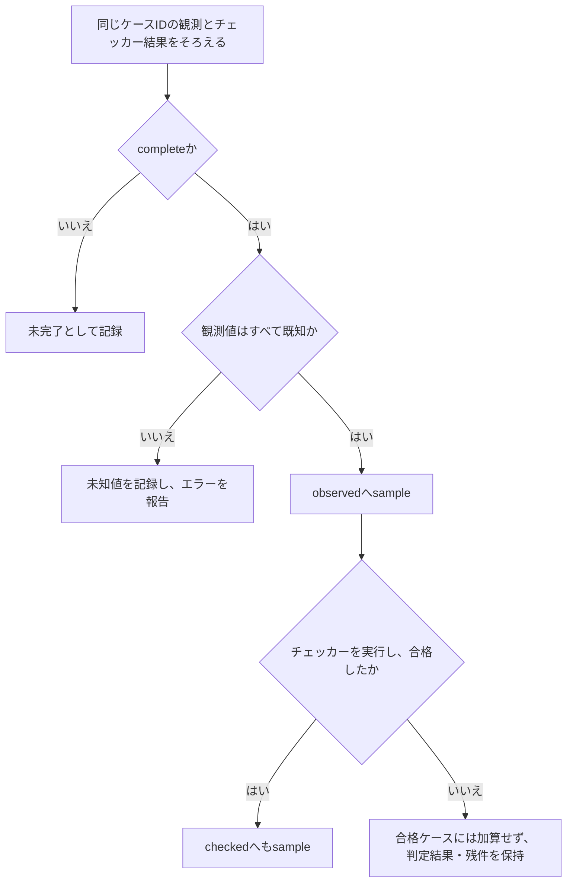

# covergroupで機能を体系的に網羅する

[一般化した検証手順](spec-to-verification-method.md)の9.11節を具体化した資料です。要求と機能一覧を、観測できる操作・状態・遷移・結果・組み合わせの目標へ展開し、SystemVerilogのcovergroupで到達を計測します。カバレッジモデルに何を含めるか自体をレビューし、明示した目標の網羅と、仕様全体を確認したという判断を分けます。

ここでは本リポジトリの運用案と説明用コレクターを示します。covergroupは、用意したbinを観測したかを数える仕組みです。要求どおりの結果かはスコアボード・SVAなどで判定し、その証跡と対応付けます。

## 1. 機能一覧からカバレッジモデルを作る

仕様の節、レジスタ表、状態遷移、ユースケースと照合して、次の観点で確認目標を洗い出します。

| 観点 | bin・目標へ展開するものの例 |
| --- | --- |
| 機能・操作 | 読み出し、書き込み、転送、停止、通知、クリアなどの各機能 |
| 状態・モード | 初期化前後、idle・busy、許可・禁止、電源状態、権限 |
| 値・境界 | 0・最大値・最小値、幅・符号、FIFOの空・満杯・境界付近 |
| 遷移・シナリオ | 開始→完了、中断→復帰、エラー→回復、設定変更の前後 |
| 結果 | 正常応答、規定されたエラー、タイムアウト、割り込み、データ保持 |
| 機能間の関係 | 操作×状態、モード×応答、共有資源の競合、同時発生と優先順位 |
| 構成・適用先 | 必須パラメータ、製品バリアント、チャネル・ポート・IPインスタンス |

目標ごとに、要求ID・改訂、適用構成、観測点、covergroup・coverpoint・bin・crossの識別子、サンプリング条件、合否を判定するチェッカーを対応表に残します。1要求を複数binで分担する場合、どのbinが必須かを明記します。bin名を付けただけで要求に対応済みとはしません。

モデルの項目が仕様のどこを覆うか、逆に各要求がどの目標で観測されるかを双方向にレビューします。自動生成したbinの数を増やすだけでなく、例外・復帰・機能間の抜けがないかを確認します。UVMの[機能カバレッジの説明](https://www.accellera.org/images/downloads/standards/uvm/uvm_users_guide_1.2.pdf)の4.10節と、OpenTitanの[検証計画・カバレッジの運用](https://opentitan.org/book/doc/contributing/dv/methodology/index.html)も参考にしています。

## 2. coverpoint・bin・crossの粒度を決める

- **値のbin**：仕様上の同値クラスや境界を明示する。広い範囲を1つのbinにまとめた場合、その中の1値の到達でbinが埋まるため、全値を検査したとは扱わない。
- **配列のbin・自動bin**：値の分割数と意味を確認する。`auto_bin_max`による自動分割だけに機能の分類を任せず、必須の境界・例外は明示する。
- **遷移のbin**：サンプル列の間の遷移を数える。サンプリングを間引く場合は「連続したクロック」か「連続した完了処理」かを明確にする。別ケースやリセットをまたぐ見かけの遷移に注意する。
- **cross**：必要な軸の組み合わせを定義する。AとBのcoverpointがそれぞれ100%でも、A×Bが埋まるとは限らない。自動で作る全組と、承認した必須の組が一致するかを確認する。

機能的に意味のある粒度で分けます。たとえば「満杯直前」と「中間」を同じbinにすると、境界条件の検証漏れを見落とすおそれがあります。一方、無関係な全ビット値の直積を作っても、有用な目標になるとは限りません。機能間の選び方は[クロス検証](feature-interaction-verification.md)に従います。

## 3. 観測した同じケースからサンプリングする

モニターが確認した受理・完了・状態を使い、生成予定のトランザクションやドライバーの送信開始だけを到達として記録しません。ケースID・トランザクションIDと、受理前の状態・処理結果を関連付けてからサンプリングします。

クロックイベントによるサンプリングと、`sample()`による明示的なサンプリングのどちらを使うかを決めます。DUTのNBA更新前後、clocking block、モニターのサンプリング時点を合わせ、同じエッジの古い値と新しい値を混ぜません。`iff`によるサンプリング条件もレビューします。`iff`はサンプルの採否を制御するもので、binの定義を自動で要求に合わせるものではありません。

UVMではanalysis portからsubscriberなどへ観測情報を渡してカバレッジを収集できます。複数モニターの情報を待つ場合は同じトランザクションの情報を対応付けるコレクターを置き、保持するトランザクションは後で上書きされないようコピーなどで保全します。同一ケースの到達を二重に数えないようにします。

長いシナリオは、SVAのシーケンス・cover propertyや観測履歴で完了を判定し、その結果をcovergroupの属性として数える方式も使えます。値・組み合わせを分割するcovergroupと、時間関係を観測する[SVAのcover](sva-verification.md)を関連付けます。

## 4. 除外と計測オプションを管理する

| 設定・判断 | この手順での扱い |
| --- | --- |
| `ignore_bins`・適用外の組 | 仕様・構成から除く根拠と承認を残す。未到達という理由で除かない |
| `illegal_bins` | 禁止条件の宣言と、合否へ伝えるチェッカー・診断を関連付ける。宣言だけで十分な検査と決めない |
| `option.at_least` | binを達成とするヒット数を事前に固定する。回数を増やしても異なる値・経路の網羅を自動で意味しない |
| `goal`・`weight` | 総合値の表示・重み付けと、必須目標の合格条件を分ける。目標値を下げて未達を解消しない |
| `per_instance`と集計方式 | インスタンスごとの内訳を保存し、型全体の平均・和集合の意味と区別する |

除外を変えると分母が変わります。変更前後のモデル、分母、除外件数と根拠を残し、率だけを比較しません。仕様上の禁止、構成上の対象外、未実装、到達不能、単なる未到達を同じ扱いにしません。

チャネルAが半分、チャネルBが残り半分を観測しても、和集合100%だけでは各チャネルの検証完了にはなりません。`option.per_instance = 1`を設定する場合も、取得するAPI・型の集計・DBのmergeの設定を確認し、必要な適用先ごとの目標を判定します。

## 5. カバレッジの到達状況とチェッカーの合否を分けて管理する

同じケースについて、次の2つを対応付けます。

1. **観測に基づくカバレッジ**：必要な入力・操作・事前状態の組が実際に起き、結果を観測できたか。
2. **チェッカー合格ケースのカバレッジ**：そのケースに必要な比較・assertが実際に完了し、合格したか。

失敗したケースも、未達の原因分析に使う観測情報として保存します。ただし、不正な結果を出した処理でbinが埋まっても、その要求を合格にはしません。チェッカーが未実行・未完了のケースは、合格ケースのカバレッジには加算しません。テスト全体の失敗・実行エラーも別に保持します。

合格ケースのカバレッジは、対象要求のチェッカーが完了し、合格したことを条件に収集します。観測結果の値だけで収集の可否を決めず、対応するチェッカーを明記します。ケースの完了を待ち、後から必要な応答が失われたケースを、先の比較成功だけで合格にしません。ケースIDと実行IDから元の比較・波形・assert結果をたどれるようにします。

## 6. 例：割り込みの基本機能をcovergroupで見る

[クロス検証の割り込みIP](feature-interaction-verification.md#7-例イベント発生とw1cクリアの競合)と同じ架空の仕様を使います。ここでは1回の状態更新をケースとし、イベント／クリアの組を「保持・クリア・セット・同時」の4種類へ分けます。事前PEND 0/1、IRQ_EN 0/1との全組を必須とし、`4 × 2 × 2 = 16`目標です。

さらに、観測したPENDの更新を00・01・10・11の4種類で分類します。これは同じケースの事前・事後値のペアであり、別ケース間の値をつないだ遷移ではありません。リセット・中断・復帰のシナリオは別に計画します。

次は観測とチェッカー結果を受け取るコレクター例です。`record_case()`は、同じケースの受理と状態更新後の観測がそろい、必要なチェッカーの結果が確定した時点で1回呼ぶものとします。

```systemverilog
module irq_function_coverage;
  covergroup irq_cg with function sample (
    input bit [1:0] operation,
    input bit pending_before,
    input bit pending_after,
    input bit irq_enable
  );
    option.per_instance = 1;
    option.at_least = 1;
    type_option.merge_instances = 0;

    cp_operation: coverpoint operation {
      bins hold_state = {2'b00};
      bins clear_only = {2'b01};
      bins set_only = {2'b10};
      bins set_and_clear = {2'b11};
    }
    cp_before: coverpoint pending_before {
      bins zero = {0}; bins one = {1};
    }
    cp_enable: coverpoint irq_enable {
      bins masked = {0}; bins enabled = {1};
    }
    cp_update: coverpoint {pending_before, pending_after} {
      bins stay_zero = {2'b00};
      bins rise = {2'b01};
      bins fall = {2'b10};
      bins stay_one = {2'b11};
    }
    x_atomic: cross cp_operation, cp_before, cp_enable;
  endgroup

  irq_cg observed = new();
  irq_cg checked = new();
  int unsigned incomplete_cases = 0;
  int unsigned unknown_cases = 0;

  function automatic void record_case (
    input bit complete,
    input bit checker_executed,
    input bit checker_passed,
    input logic event_seen,
    input logic clear_seen,
    input logic pending_before,
    input logic pending_after,
    input logic irq_enable,
    input logic irq_after
  );
    if (!complete) begin
      incomplete_cases++;
    end else if ($isunknown({event_seen, clear_seen, pending_before,
                            pending_after, irq_enable, irq_after})) begin
      unknown_cases++;
      $error("IRQ_COVERAGE_UNKNOWN");
    end else begin
      observed.sample({event_seen, clear_seen}, pending_before,
                      pending_after, irq_enable);
      if (checker_executed && checker_passed)
        checked.sample({event_seen, clear_seen}, pending_before,
                       pending_after, irq_enable);
    end
  endfunction
endmodule
```

`observed`と`checked`は同じ型の別インスタンスです。型全体の率を1つ読むのではなく、それぞれの`x_atomic`、coverpoint、binの内訳を確認します。既知値を確認してからbit型へ渡し、X/Zを0/1へ変換して到達したように見せない構成にしています。

**観測したケースと、チェッカーで合格を確認したケースを分けて集計する流れ**



図は6節の`record_case()`の分類を表します。チェッカーの未実行・失敗の詳細やテスト全体の終了状態は、コレクターへ渡す判定の元記録でも管理します。

コレクター自体は期待値を作りません。PENDの更新とIRQの値を、[SVAのチェッカー](sva-verification.md#5-例イベントとw1cの優先順位)やスコアボードが確認し、対応する判定を渡します。`checker_passed`を固定値にしたり、前件が成立していないassertの違反なしを合格として渡したりしないようにします。

この16目標は基本の状態更新を分類するもので、前後のタイミングを扱う既存の12クロス目標とは別です。機能の基本動作と、相互作用の時間関係の両方を検証計画へ登録します。coverpointのbinとcrossのbinを足した総数を、意味の異なる要求数として扱いません。

## 7. 集計・mergeと完了条件

必須bin・cross目標の集合と必要ヒット数を固定し、要求・機能・構成・適用先ごとに、分子／分母、未達の目標、除外と未確定の根拠を表示します。covergroupの総合率だけで、重要なbinの未達や機能の検証漏れが隠れていないかを確認します。

異なるseedのDBをまとめる場合も、カバレッジモデル、要求改訂、DUT・チェッカーの入力、構成、適用先を確認します。異なるモデルや別構成の率を無条件でmergeせず、元の実行IDとDBを保存します。失敗した実行の到達情報を診断に使う場合は、要求の合格を示す証跡と分けて表示します。

完了には、必須の機能・状態・遷移・クロスの各目標へ到達し、そのケースの必要な判定が合格した証跡が必要です。目標自体の抜けは、仕様・要求・相互作用表とのレビューで確認します。covergroupが100%でも、モデルに含めなかった機能や全値・全経路まで検証したとはいえません。

未達は、刺激不足、過剰なサンプリング条件・生成制約、サンプリングの誤り、適用判断の未確定、仕様上の到達不能に分けて調べます。[ランダム回帰](constrained-random-verification.md)の重みやシナリオを見直す、直接テストを足す、[フォーマル検証で到達性を調べる](formal-verification.md#8-証明対象の漏れと不具合の検出力を確認する)などの対応を決めます。有限深さのcover未到達だけを根拠にbinを除外しません。

仕様・機能・構成が変わったら、bin、cross、除外、必要ヒット数、チェッカーとの対応を再レビューします。結果と残件を[サインオフ記録](../templates/signoff-record.md)へ反映します。

機能モデル自体の抜けは、[コードカバレッジの未達分析](verification-gap-review.md#10-コードカバレッジの未達を分析し対応する)からも点検します。行・分岐・toggle・FSMなどの計測は別の指標として扱い、実装にあるが機能目標にない経路や、正常回帰では到達しない保護経路を見直します。

## 8. 記録例

以下は未実施の機能検証計画の例で、現行の照合キットへ投入できる形式ではありません。

```json
{
  "plan_id": "IRQ-FUNCTION-COVERAGE-EXAMPLE",
  "plan_revision": 1,
  "related_requirements": [
    "IRQ-PEND-EVENT-SET", "IRQ-PEND-W1C-CLEAR",
    "IRQ-PEND-EVENT-W1C-PRIORITY", "IRQ-PEND-HOLD", "IRQ-OUTPUT-ENABLE"
  ],
  "configurations": ["irq-base"],
  "collector": "irq_function_coverage",
  "checker": "irq_sva_checker",
  "covergroup_type": "irq_cg",
  "observed_instance": "observed",
  "checked_instance": "checked",
  "mandatory_cross": "x_atomic",
  "required_cross_bin_count": 16,
  "state_update_coverpoint": "cp_update",
  "required_state_update_bin_count": 4,
  "minimum_hits_per_bin": 1,
  "run_ids": [],
  "status": "not_run"
}
```

## 9. コレクター例の確認範囲

2026-10-25に、6節のコレクターを一時ハーネスへ接続し、Verilator 5.052の`--binary --coverage`で実行しました。既知の観測記録とチェッカー結果を入力し、独立に列挙したbin集合と、DBのbin・インスタンス照会の結果を照合しました。

| 入力したケース | 確認した結果 |
| --- | --- |
| 正常な全16組 | 観測カバレッジ・合格ケースのカバレッジとも必須crossは16/16 |
| 保持・事前PEND=0・IRQ_EN=0の1組を抜く | 個々のcoverpointは全bin到達しても、必須crossは15/16 |
| 同時発生時にクリア優先となる観測結果を入力 | 観測カバレッジは16/16でも、チェッカー不合格4件により合格ケースのカバレッジは12/16 |
| チェッカー未実行 | 観測カバレッジは16/16、合格ケースのカバレッジは0/16 |
| 未完了のケース | 観測カバレッジ・合格ケースのカバレッジとも0/16、未完了16件を記録 |
| 同じ1組を16回入力 | 必須crossは1/16であり、全16組の到達にはならない |
| 2インスタンスへ事前PEND=0と1を分配 | 各インスタンスは8/16。DBの和集合16/16だけでは各適用先の完了を判断できない |

この環境では、coverpoint・crossの直接照会APIが未対応で、引数を省略したインスタンス照会にもコード生成上の問題がありました。また、同じ型のインスタンスのbinがDBでまとまったため、そのDBだけでは観測カバレッジ・合格ケースのカバレッジ・適用先を分離して判定できません。確認ではインスタンス照会と既知入力・bin内訳を併用しました。採用するツールでは、必要な内訳が原本とレポートの両方に保持されることを確認します。

これはコレクターの2値の合成観測記録による動作確認です。製品DUTの機能検証、X/Z、すべてのカバレッジオプションやツールが提供する遷移binの対応を確認したものではありません。一時ハーネスも製品の回帰環境ではありません。

## 10. 参考にした一次資料

- [Accellera UVM 1.2 User's Guide](https://www.accellera.org/images/downloads/standards/uvm/uvm_users_guide_1.2.pdf)：4.10節のカバレッジモデル、収集と検証目標の関係を参考にしました。
- [OpenTitanの検証方法論](https://opentitan.org/book/doc/contributing/dv/methodology/index.html)：検証計画、機能・コードカバレッジ、レビューを関連付ける実践例を参照しました。
- [Verilatorのカバレッジ説明](https://verilator.org/guide/latest/simulating.html#covergroup-coverage)、[対応言語](https://verilator.org/guide/latest/languages.html)、[集計ツール](https://verilator.org/guide/latest/exe_verilator_coverage.html)：covergroupの対応範囲、有効化、DBの集計の確認先です。使用する版で未対応・無視された構文がないか確認します。

モデル、コレクター、記録例は本リポジトリで作成した運用案です。規格のコード例を転載したものではありません。

## ローカルで試す追加例

[観測カバレッジによる刺激調整例](../../examples/local-coverage-feedback/README.md)では、実RTLの到達ログから次の操作を選びます。固定分布との比較は同じサイクル予算で行い、失敗した実行の到達を加算しません。教材用の手続き的な目標集計で、ネイティブcovergroup DBの実行例とは区別します。

[ネイティブcovergroupの実行例](../../examples/local-uvm-random/README.md)では、APB完了の実観測からアドレス・読書き・エラーとクロス、イベントとW1Cの競合をsampleします。Verilatorの`coverage.dat`に含まれる24 binの一覧・ヒット数を、各構成・各通常実行で照合します。固定境界操作とランダム刺激を併用し、失敗時や収集無効化時のDBを通常回帰へ足しません。
