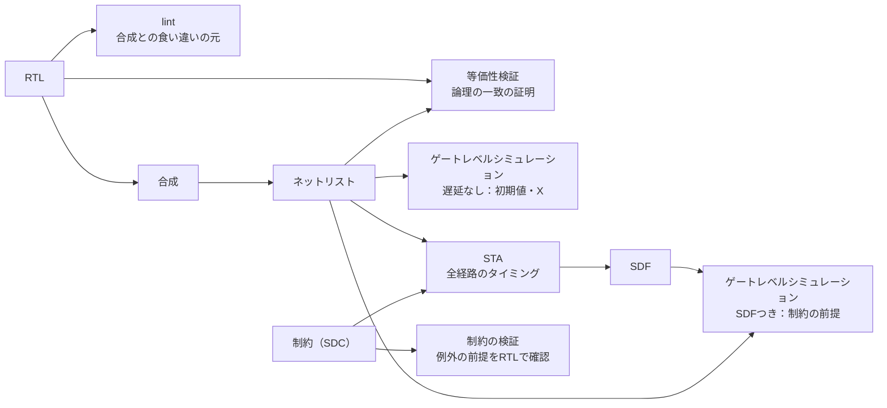

# ゲートレベルとタイミングの検証

RTLの検証が終わった後、合成した回路が同じ動作をし、決めた周波数で動くことを確かめる工程を整理します。lint、合成、等価性検証、ゲートレベルシミュレーション（遅延なし／SDF）、静的タイミング解析（STA）、制約の検証は、それぞれ見るものが違います。1つの手法で他を置き換えることはできません。

入口は[合成後ネットリストのシミュレーション](../../examples/local-gate-sim/README.md)、[遅延つきのゲートレベルシミュレーション](../../examples/local-gate-timing/README.md)、[OpenSTAの実行例](../../examples/local-sta/README.md)、[FIFOの等価性検証](../../examples/local-equivalence/README.md)です。このリポジトリのセルライブラリは教材用の架空のもので、実際の製造プロセスの値ではありません。

## 1. 手法の分担

| 手法 | 見つけるもの | 見つけられないもの |
| --- | --- | --- |
| lint | 合成とシミュレーションで解釈が分かれる書き方（不完全な感度リスト、意図しないラッチ、幅の不一致） | 仕様との食い違い。規則にない書き方 |
| 等価性検証 | RTLとネットリスト、変更前後のネットリストの論理の違い。全入力について | 比較元（RTL）そのものの誤り。タイミング。対応付けから外した部分 |
| ゲートレベルシミュレーション（遅延なし） | 初期値への依存、Xの扱いの違い、リセットされない回路、合成の指示の影響、試験回路の接続 | 与えなかった刺激で起きる違い。タイミング |
| STA | 制約の下での、全経路のセットアップ・ホールド違反。制約のない経路 | 制約そのものの誤り（誤ったフォルスパス・マルチサイクルパス）。非同期の境界の機能 |
| ゲートレベルシミュレーション（SDFつき） | 誤った例外の指定、クロックの扱いの誤り、リセットの解除やクロックの切替えのタイミング、グリッチ | 刺激が通らなかった経路。STAの代わりにはならない |
| 制約の検証 | 例外の前提（イネーブルの間隔、設定値が動かないこと）がRTLで成り立つか | 制約に書かれていない前提 |

## 2. 対象境界を決める

| 対象 | 主な確認事項 | このリポジトリの入口 |
| --- | --- | --- |
| 合成前後の論理 | 全入力での一致、対応付け、除外 | [FIFOの等価性](../../examples/local-equivalence/README.md)（RTLどうしの比較） |
| ネットリストでだけ起きる食い違い | 合成の指示、シミュレーター専用のコード、初期値、実行順への依存 | [合成後ネットリストのシミュレーション](../../examples/local-gate-sim/README.md) |
| タイミング | セットアップ・ホールド、制約の漏れ、消えた経路 | [OpenSTAの実行例](../../examples/local-sta/README.md) |
| 制約の前提 | マルチサイクルパス、フォルスパス、クロックの遅延 | [遅延つきのゲートレベルシミュレーション](../../examples/local-gate-timing/README.md) |
| 静的検査 | 警告の分類と除外の台帳 | [共通lint](../../examples/local-lint/README.md)、[lintと警告管理](lint-and-waivers.md) |
| 試験回路 | スキャンのシフトとキャプチャ、署名 | [内部スキャンとATPG](../../examples/local-scan-atpg/README.md)、[LBIST](../../examples/local-lbist/README.md) |
| 非同期の境界 | 同期器、リセットの解除 | [非同期検証](asynchronous-verification.md) |

比較や解析の対象は、次の項目で固定します：RTLの版、合成スクリプトとツールの版、セルライブラリとコーナー、制約ファイル、動作モード（機能、スキャン、低電力）、パラメーターの構成。どれかが変わったら、結果は引き継げません。

## 3. 要求へ分解する

| 要求の領域 | 要求の例 | 確認方法 |
| --- | --- | --- |
| 論理の一致 | 機能モードで、ネットリストの出力がRTLと全入力・全時刻で一致する | 等価性検証。モードの仮定（スキャンイネーブル＝0など）を明示 |
| 仮定の妥当性 | モードの仮定を外すと反例が出る（仮定が検査を空にしていない） | 仮定なしの実行と、到達の確認 |
| 初期値 | リセットの後、初期値に依存せず決まった状態になる | 初期値を取り除いたネットリストのシミュレーション、Xの検査 |
| Xの扱い | RTLで隠れていたXが、ネットリストで出力へ届かない | ゲートレベルでの全出力のXの検査 |
| タイミング | 全コーナー・全モードでセットアップとホールドを満たす | モードとコーナーごとのSTA |
| 制約の網羅 | 制約のない経路、クロックのない端点がない | STAの制約の点検（`check_setup`など） |
| 例外の根拠 | 各フォルスパス・マルチサイクルパスに、成り立つ理由と確認方法がある | 例外の台帳、RTLのアサーション、SDFつきのシミュレーション |
| 必須の経路 | 重要な経路が、例外や定数の伝搬で消えていない | 経路の存在の検査 |
| 同期器 | 同期器の初段のタイミング違反が、後段へXとして広がらない設定になっている | 検査を外すフリップフロップの一覧と、その根拠 |
| 変更（ECO） | 変える範囲だけが変わり、保つ範囲は一致する | 範囲を分けた等価性検証 |

## 4. Xの楽観と悲観

RTLとゲートレベルでは、Xの伝わり方が違います。どちらも現実の回路とは一致しません。

| 場面 | RTLのシミュレーション | ゲートレベルのシミュレーション | 実際の回路 |
| --- | --- | --- | --- |
| `if (x) a = 1; else a = 0;` | elseを実行して0（楽観：Xが消える） | 選択の論理によってはX | 0か1のどちらか |
| `sel ? d : d`（両方が同じ値） | 式の書き方による | Xになることがある（悲観） | d |
| リセットのないフリップフロップ | 初期値の指定があればその値 | X | 0か1のどちらか |
| セットアップ違反 | 起きない | 検査があればX | メタステーブルの後、0か1 |

- **楽観**（Xが消える）は、RTLで不具合を隠します。リセットされていないレジスタが制御を決めていても、RTLでは動いて見えます。
- **悲観**（消えるはずのXが広がる）は、ゲートレベルで偽の失敗を作ります。実際には値が決まる回路でも、シミュレーターはXを伝え続けます。

対策は、片方だけに頼らないことです。RTLではXの検査（アサーション、X伝搬のオプション、フォーマルでの未定義の初期値）を足します。ゲートレベルでは、リセットで全体が既知の値になることを最初に確かめ、悲観による失敗は原因を個別に調べます。初期値を乱数にする方法もありますが、Xの検査の代わりにはなりません。

### 初期値

合成後のフリップフロップに初期値があるかどうかは、対象によって違います。FPGAでは多くの場合ビットストリームが初期値を与え、ASICでは与えません。RTLの`initial`や宣言時の初期値に頼った回路は、ASICのネットリストで動かなくなります。[合成後ネットリストの例](../../examples/local-gate-sim/README.md)は、ネットリストから初期値を取り除いて実行し、これを検出します。

### 同期器とタイミング検査

非同期の信号を受ける同期器の初段は、必ずセットアップ・ホールド違反を起こします。タイミング検査がここでXを出すと、後段がすべてXになり、シミュレーションが意味を持たなくなります。そこで、同期器の初段だけ検査を外します（ライブラリの専用セルや、シミュレーターの設定）。外す対象は台帳にし、CDCの構造解析の結果と照合します。外しすぎると、本当の違反も見えなくなります。

## 5. 重点にするクロス

| クロス | 見つかる誤り |
| --- | --- |
| 動作モード × コーナー | 機能モードだけ、片方のコーナーだけの解析 |
| セットアップ × slow、ホールド × fast | 片方のコーナーでしか見ていない検査 |
| 例外の指定 × RTLの変更 | RTLを直したのに残った古い例外 |
| リセットの解除 × クロックの位相 | リカバリ・リムーバルの違反 |
| 初期値なし × リセット前の出力 | リセット前に外へ出るX |
| スキャンモード × 機能の経路 | スキャン挿入での機能経路の誤配線 |

## 6. 独立した期待値と検出力

ゲートレベルシミュレーションの期待値は、RTLの検証と同じものを使います。同じテストベンチ・同じ期待値でRTLとネットリストを実行し、ネットリストでだけ失敗するものを探します。テストベンチは、内部の信号や特定のサイクル数に頼らず、ポートだけで判定できる形にしておきます。

STAは期待値を持ちません。代わりに、「違反があれば報告する」ことを負例で確かめます。

| 負例 | 期待する報告 |
| --- | --- |
| 周期を縮める | セットアップ違反 |
| クロックに遅延を入れる | ホールド違反 |
| 制約を1つ消す | 制約のない端点 |
| 過剰なフォルスパスを入れる | 必須の経路の消失 |
| RTLを変えてマルチサイクルパスの前提を崩す | STAは合格。SDFつきのシミュレーションと、正しい制約でのSTAが失敗 |
| ネットリストの1ゲートを変える | 等価性検証の反例 |
| 等価性検証のモードの仮定を外す | 反例（仮定が効いていることの確認） |

[遅延つきの例](../../examples/local-gate-timing/README.md)は、STAが合格し、遅延なしのシミュレーションも合格し、SDFをつけたときだけ失敗する誤りを3種類示します。それぞれについて、正しい制約ならSTAが違反を報告することも確かめています。

## 7. 既存の実行例との対応

| 項目 | 実行例 | 範囲 |
| --- | --- | --- |
| lintと除外の台帳 | [共通lint](../../examples/local-lint/README.md) | Verilatorのlint。全例のRTL |
| RTLどうしの等価性 | [FIFOの等価性](../../examples/local-equivalence/README.md) | SBYのmiter方式。合成後のネットリストは比較していない |
| RTLとネットリストの等価性 | [合成・スキャン挿入・ECO後の比較](../../examples/local-lec-netlist/README.md) | 機能モードの仮定、誤りがあるフリップフロップの特定 |
| ネットリストでだけ見える論理の食い違い | [合成後ネットリストのシミュレーション](../../examples/local-gate-sim/README.md) | 遅延なし。4種類の誤り |
| SDFの遅延とタイミング検査 | [遅延つきのゲートレベルシミュレーション](../../examples/local-gate-timing/README.md) | 1コーナー。検査はセルモデルが行う |
| STA | [OpenSTAの実行例](../../examples/local-sta/README.md) | 架空のLiberty。理想クロック。配線の寄生なし |
| モード・コーナー別のSTA | [機能／スキャンとslow／fastの4通り](../../examples/local-sta-modes/README.md) | モード別の制約とsetup／hold。架空のLiberty |
| スキャンと故障の検出 | [内部スキャンとATPG](../../examples/local-scan-atpg/README.md)、[LBIST](../../examples/local-lbist/README.md) | 手で書いたスキャン回路。縮退故障 |
| 遷移故障 | [launch-on-capture](../../examples/local-transition-fault/README.md) | 実速度と低速の捕捉をSDFつきで比較 |
| CDC／RDCの構造解析 | [交差の列挙と分類](../../examples/local-cdc-structural/README.md) | Yosysネットリストから抽出する限定したルール |
| 活動率からの電力見積り | [VCDとOpenSTA](../../examples/local-power-estimate/README.md) | 架空のライブラリを使い、クロックゲートの効果を比較 |
| 自動生成した変異の等価性 | [MCYによる検出力の比較](../../examples/local-auto-mutation/README.md) | 変異がもとの回路と等価かどうかの判定 |
| 接続の証明 | [接続性のフォーマル検査](../../examples/local-connectivity/README.md) | SoCの配線 |

### まだ例がない項目

| 項目 | 内容 | 状態 |
| --- | --- | --- |
| Libertyの値の出所 | トランジスタレベルの回路から遅延・セットアップ・ホールドを測る | 未着手 |

## 8. 製品で追加する確認

| 追加する確認 | 内容 |
| --- | --- |
| 実際のライブラリとコーナー | プロセス・電圧・温度の全コーナー、ばらつきの扱い（OCVなど） |
| 配置配線後 | 配線の寄生を含むSTA、クロックツリー、信号の品質 |
| 等価性検証の網羅 | 合成、スキャン挿入、クロックゲーティング、低電力要素の挿入、配置配線、ECOの各段。未証明の点を残さない |
| 静的なCDC・RDC | 専用ツールによる構造と制約の整合 |
| ゲートレベルシミュレーションの範囲 | リセットと起動、クロックの切替え、試験モード、非同期の境界、例外を指定した経路。目的ごとに選ぶ |
| 制約の品質 | 例外の台帳とレビュー、制約どうしの矛盾、モード間の整合 |
| 製造試験 | ATPGのパターンのシミュレーション、検出率、実速度の試験（[DFTの検証](dft-verification.md)） |
| 物理検証 | DRC、LVS、電源の解析、信頼性 |

## 9. 参考にした一次資料

- IEEE Std 1800（SystemVerilog）：Xの伝搬の規則、`specify`とタイミング検査。IEEE Std 1497（SDF）：遅延とタイミング検査の受渡しの形式。どちらも本文は引用していません。
- [OpenSTA](https://github.com/parallaxsw/OpenSTA)：このリポジトリで使うSTAのツールと、そのコマンドの説明。
- [Yosysの文書](https://yosyshq.readthedocs.io/projects/yosys/en/latest/)：合成と、等価性検証のコマンド。[EQY](https://yosyshq.readthedocs.io/projects/eqy/en/latest/quickstart.html)：等価性検証の分割と照合。
- [検証計画の抜けの点検](verification-gap-review.md)：等価性（SCOPE-EQUIVALENCE）と物理（SCOPE-PHYSICAL）の位置付け。
- [合成向けRTLの記述](synthesizable-rtl-guidelines.md)：合成とシミュレーションの食い違いを避ける書き方。
