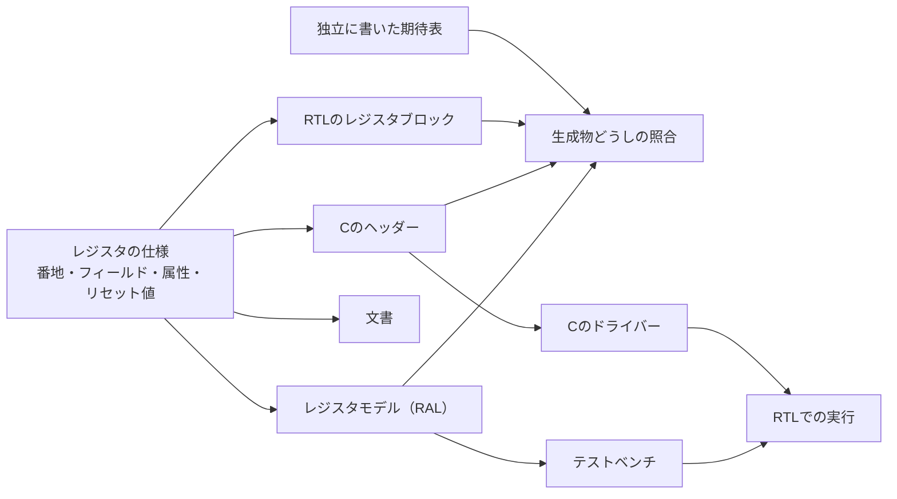

# ハードウェアとソフトウェアの結合の検証

レジスタの仕様から、Cのヘッダー、UVMのレジスタモデル（RAL）、ドライバー、ROMから起動するSoCまでをつなぎ、ハードウェアとソフトウェアが同じ取り決めで動くことを確かめる手順を整理します。入口は[SystemRDLからの生成と照合](../../examples/local-register-spec/README.md)、[CドライバとDMAの結合](../../examples/local-c-driver/README.md)、[cocotbによるAPBの検証](../../examples/local-cocotb/README.md)です。

ブロック単体の検証は、テストベンチが理想的な手順でレジスタを操作します。実際のソフトウェアは、仕様書を読んだ別の人が書き、別の順序で操作します。結合の検証は、その食い違いを早く見つけるためのものです。

## 1. 食い違いが起きる場所

| 場所 | 食い違いの例 |
| --- | --- |
| レジスタの番地とビット位置 | 仕様書・RTL・ヘッダーが別々に手で書かれ、1か所だけ古い |
| フィールドの属性 | ソフトウェアはRWと思っているが、RTLは書込み1でクリア（W1C） |
| 操作の順序 | 有効化の前に設定が必要、割り込みのクリアは要因の除去の後、など |
| 時間 | ソフトウェアが待たない完了、ポーリングの間隔より短いパルス |
| 割り込み | 許可・保留・クリアの順序、ハンドラーの実行中に来た次の要因 |
| メモリの見え方 | DMAが書いた領域をキャッシュ越しに読む、エンディアン、整列 |
| エラー | ハードウェアが返すエラーを、ソフトウェアが見ていない |
| リセットと起動 | ソフトウェアが仮定する初期値と、実際のリセット値 |

## 2. 対象境界を決める

| 対象 | 主な確認事項 | このリポジトリの入口 |
| --- | --- | --- |
| レジスタの仕様と生成物 | 1つの仕様からRTL・ヘッダー・RALを作り、互いに一致する | [SystemRDLからの生成](../../examples/local-register-spec/README.md) |
| 生成したRALとRTL | フロントドアのアクセスで読み書きが一致する | [生成RALの接続](../../examples/local-generated-ral/README.md)、[UVMとRAL](../../examples/local-uvm/README.md) |
| Cのドライバーとブロック | 実際のCのコードがRTLを操作し、処理が完了する | [CドライバとDMA](../../examples/local-c-driver/README.md) |
| Pythonのテストベンチ | cocotbからバスを操作する | [cocotb](../../examples/local-cocotb/README.md) |
| C++の参照モデル | 同じ入力でRTLとモデルを比べる | [C++参照モデルとFIR](../../examples/local-cpp-reference/README.md) |
| ROMから起動するSoC | CPU・バス・周辺回路・割り込みハンドラー | [画像処理SoC](../../examples/local-image-soc/README.md)、[ネットワークSoC](../../examples/local-network-soc/README.md) |
| アドレスマップと配線 | デコード、別名、未割当、割り込みの集約、接続 | [アドレスマップ](../../examples/local-address-map/README.md)、[接続性の証明](../../examples/local-connectivity/README.md) |
| DMAとメモリの見え方 | 所有権、完了の返却、キャッシュとの関係 | [DMA所有権](../../examples/local-dma-ownership/README.md)、[キャッシュとDMA](../../examples/local-cache-dma/README.md) |
| 幅のあるカウンターの読出し | 64ビットの値を32ビットのバスから一貫して読む | [64ビットカウンター](../../examples/local-counter-snapshot/README.md) |

## 3. レジスタの仕様を1つにする

レジスタの定義を1つの機械可読な仕様（SystemRDLなど）に置き、次のものを同じ仕様から生成します。

生成を使っても、次は別に確かめます。

- **生成器そのもの**：生成器が属性を読み違えると、すべての生成物が同じ向きに誤ります。生成物どうしを比べても見つかりません。仕様と別に手で書いた小さな期待表（番地、マスク、リセット値、属性ごとの読み書きの結果）と照合します。
- **未対応の属性**：生成器が扱えない属性を黙って読み飛ばさず、エラーにします。
- **ハードウェア側の接続**：レジスタブロックと本体の回路の間（ハードウェアからの書込み、割り込みの要因）は、仕様の外にあることが多く、別の試験が要ります。

## 4. 要求へ分解する

| 要求の領域 | 要求の例 | 確認方法 |
| --- | --- | --- |
| レジスタの一致 | 番地・マスク・リセット値・属性が、仕様・RTL・ヘッダー・RALで同じ | 生成物の照合、リセット値の読出し、ビットごとの書込み |
| 属性ごとの動作 | RO、RW、W1C、読出しでクリア、予約ビット | 属性ごとの読み書きの試験。副作用のあるものは個別に |
| アドレスマップ | 各ブロックへ届く。未割当はエラー。別名がない | 全域の走査、接続性の証明 |
| ドライバーの手順 | 初期化、開始、完了の待ち、エラーの処理 | 実際のCのコードをRTLに対して実行する |
| 割り込み | 要因の発生からハンドラーの実行、クリア、再発生まで | ハンドラーの実行中に次の要因を入れる。取りこぼしと二重処理を数える |
| DMA | バッファの所有権、完了の通知、長さとアドレスの境界 | メモリの最終状態の照合、所有権の違反の検出 |
| 起動 | リセットからROMの実行、初期化、最初の処理まで | ROMのプログラムと退出の記録の照合 |
| エラーの経路 | バスのエラー、タイムアウト、不正な設定 | ハードウェアが通知し、ソフトウェアが回復する |
| 並行する操作 | メインの処理とハンドラーが同じレジスタを操作する | 読んで書く操作の間に割り込みを入れる |

## 5. 重点にするクロス

| クロス | 見つかる誤り |
| --- | --- |
| ドライバーの各手順 × 割り込みの到着 | 設定の途中で来た割り込みの処理 |
| 割り込みのクリア × 同時の新しい要因 | 要因の取りこぼし（W1Cとハードウェアのセットの競合） |
| DMAの完了 × 次の開始 × 停止 | 古い完了の通知、再利用したバッファへの書込み |
| バスの待ち × ドライバーのタイムアウト | 短すぎる待ち、無限の待ち |
| リセット × 処理の途中 | ソフトウェアが知らない間のハードウェアの初期化 |
| 読出しの幅 × カウンターの桁上げ | 上位と下位を別の時刻に読んだ値 |
| エンディアン・整列 × バッファの境界 | バイトの並びの取り違え |

## 6. 実行する環境の段階

同じソフトウェアを、速さと見え方の違う環境で順に動かします。

| 環境 | 速さの目安 | 見えるもの | 向くこと | 向かないこと |
| --- | --- | --- | --- | --- |
| ホスト上のCと、バスを操作する関数 | 速い | レジスタアクセスの列 | ドライバーの手順の早期の確認 | CPUの命令、割り込みの正確な時刻 |
| RTLシミュレーション（CPUを含むSoC） | 遅い | すべての信号 | 起動、割り込み、バスの詳細、不具合の原因の調査 | 長いソフトウェア |
| 仮想プラットフォーム（トランザクションレベルのモデル） | 速い | レジスタと機能 | ハードウェアより先にソフトウェアを書く | サイクル単位の競合、RTLの不具合 |
| エミュレーション | 中 | 内部の信号（採取の設定による） | OSの起動、長い試験 | 準備とコンパイルの時間 |
| FPGAの試作 | 実機に近い | 限られた観測点 | 実際の外部機器との接続、長時間の実行 | 内部の観測、ASIC固有の回路 |
| シリコンの評価 | 実機 | 端子と、組み込んだ観測回路 | 実際の速度、電気的な特性 | 原因の調査 |

段階を移るときは、次の2つを決めておきます。

- **持ち回るもの**：同じドライバーのソース、同じ試験のシナリオ、同じ合否の判定。環境ごとに書き直すと、食い違いが環境の差なのか書き直しの差なのか分かりません。
- **戻す手順**：速い環境で見つけた失敗を、見える環境で再現する方法。入力の記録（バスのアクセス列、割り込みの時刻、外部の入力）を採り、シミュレーションの固定の試験にします。

このリポジトリが実行するのは、上の2段（ホスト上のCとRTLシミュレーション）です。SystemCのサイクル精度のモデルは[VCI・SoCLibの例](../../examples/local-vci-soclib/README.md)で扱います。トランザクションレベルの仮想プラットフォーム、エミュレーション、FPGA、シリコンは実行していません。

## 7. 独立した期待値と検出力

- ドライバーの試験の期待値は、ドライバーの戻り値ではなく、**ハードウェアの最終状態**（メモリの内容、出力、レジスタ）から独立に求めます。ドライバーが「成功」を返しても、メモリの内容が違えば不合格です。
- レジスタアクセスの**列**も記録して照合します。結果が同じでも、禁止された順序で操作していれば不具合です。
- 割り込みは、発生した要因の数と、ハンドラーが処理した数を別々に数えて照合します。

| 変異 | 検出する検査 |
| --- | --- |
| ヘッダーの番地を1つずらす | ドライバーの実行結果、生成物の照合 |
| W1Cを通常の書込みにする | 割り込みのクリアの試験 |
| ドライバーが完了を待たない | メモリの最終状態、アクセスの列 |
| ハンドラーがクリアを要因の除去の前に行う | 割り込みの件数の照合 |
| RTLのリセット値を変える | リセット値の読出し、起動の試験 |
| DMAが長さを1つ多く書く | バッファの外側の番人の値 |

## 8. 既存の実行例との対応

| 項目 | 実行例 | 範囲 |
| --- | --- | --- |
| 仕様からの生成と照合 | [SystemRDLからの生成](../../examples/local-register-spec/README.md) | 3レジスタ、限定した属性。汎用の生成器ではない |
| 生成RALとRTL | [生成RALの接続](../../examples/local-generated-ral/README.md) | フロントドアのアクセス |
| RALによる検証 | [UVMとRAL](../../examples/local-uvm/README.md)、[階層RAL](../../examples/local-uvm-hierarchy/README.md) | 手で書いたRAL、上位での再利用 |
| Cのドライバー | [CドライバとDMA](../../examples/local-c-driver/README.md) | ホスト上のCからRTLを操作 |
| cocotb | [cocotb](../../examples/local-cocotb/README.md) | APBのレジスタ |
| C++の参照モデル | [C++参照モデル](../../examples/local-cpp-reference/README.md) | ストリーミングFIR |
| シミュレーターの差 | [IcarusとVerilatorの比較](../../examples/local-differential/README.md) | 同じ入力の2つの実行 |
| ROMから起動するSoC | [画像処理SoC](../../examples/local-image-soc/README.md)、[ネットワークSoC](../../examples/local-network-soc/README.md) | CPU・3種類のバス・DMA・割り込みハンドラー |
| 割り込みの結合 | [APBと割り込み](../../examples/local-apb-irq/README.md)、[優先度付き割り込み](../../examples/local-priority-irq/README.md) | 要因・許可・クリア、claimとcomplete |
| DMA | [DMA](../../examples/local-dma/README.md)、[リング式DMA](../../examples/local-descriptor-dma/README.md)、[DMA所有権](../../examples/local-dma-ownership/README.md)、[Stream DMA](../../examples/local-stream-dma/README.md) | 単体の結合から所有権まで |
| SystemCのモデル | [VCI・SoCLib](../../examples/local-vci-soclib/README.md) | サイクル精度のモデル |

### まだ例がない項目

| 項目 | 内容 | 状態 |
| --- | --- | --- |
| DPI-Cによる参照モデルの接続 | Cのモデルを SystemVerilogのテストベンチへ直接つなぐ | [実行例あり](../../examples/local-dpi-model/README.md)。4値のシミュレーターでのXの受渡しは未実行 |
| レジスタのフォーマル検査 | 仕様からフィールド属性ごとの性質を生成して証明 | 未着手 |
| RALの組込みシーケンス | リセット値、ビットごとの書込み、アクセスの試験と、その除外 | 未着手 |
| トランザクションレベルの仮想プラットフォーム | 同じドライバーをTLMのモデルとRTLで実行して比べる | 未着手 |
| シナリオの再利用 | 1つのシナリオのモデルから、ブロック単体の刺激とSoC上のCの試験を生成 | 未着手 |
| セキュアブート | ROMによるイメージの検証 | 未着手 |
| 試作・シリコンからの持ち帰り | オンチップのトレースと、入力を固定の試験にする流れ | 未着手 |

## 9. 製品で追加する確認

| 追加する確認 | 内容 |
| --- | --- |
| 実際のソフトウェア | 製品のドライバー、ブートローダー、OS。試験用のコードとは別に実行する |
| 長時間の実行 | エミュレーションやFPGAでの起動、負荷、連続運転 |
| 割り込みと時間 | 最悪の応答時間、入れ子、負荷が高いときの取りこぼし |
| 電源の管理 | ソフトウェアによる保存・復元と、低電力への出入り（[低電力の検証](low-power-verification.md)） |
| エラーからの回復 | ハードウェアのエラーを注入し、ソフトウェアが回復することを確かめる |
| 版の整合 | ハードウェアの版、レジスタの仕様の版、ソフトウェアの版の対応表 |
| デバッグの手段 | トレース、デバッガーの接続、失敗したときに採れる情報 |

## 10. 参考にした一次資料

- [SystemRDL 2.0](https://www.accellera.org/downloads/standards/systemrdl)：レジスタの記述言語。[PeakRDL-regblock](https://peakrdl-regblock.readthedocs.io/)：SystemRDLからRTLを作る公開の生成器。
- [cocotbの文書](https://docs.cocotb.org/)：Pythonによるテストベンチ。
- IEEE Std 1800.2（UVM）：レジスタ層の定義。本文は引用していません。
- IEEE Std 1666（SystemC）：TLM-2.0を含むSystemCの定義。本文は引用していません。
- [OpenTitanのレジスタ生成ツール](https://opentitan.org/book/util/reggen/)：1つの記述からRTL・ヘッダー・文書・RALを作る公開の実例。
- [検証計画の抜けの点検](verification-gap-review.md)：システム・ソフトウェア統合（SCOPE-SYSTEM-SW）の位置付け。
