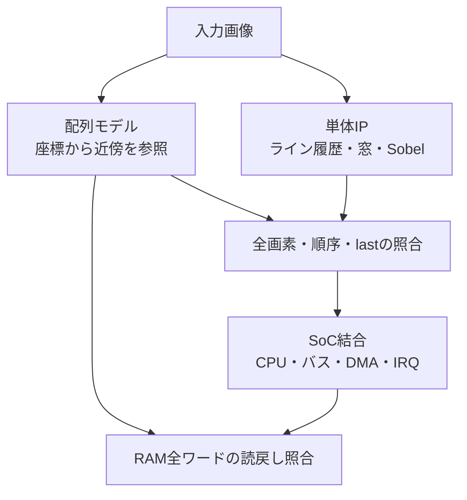

# ラインメモリを使う画像処理の検証

画像処理では、演算式だけでなく、画素の位置、行とフレームの境界、保持している履歴、転送と完了の時点を仕様へ分けます。この資料は、[Sobel単体IP](../../examples/local-image-sobel/README.md)から[CPU付き小規模SoC](../../examples/local-image-soc/README.md)へ進むための案内です。

## 1. 画像とストリームの契約を定める

最初に、次の条件を要求と期待値へ対応付けます。データ幅やパディングが違えば同じ「Sobel」でも出力は変わります。

| 契約 | この教材で固定する条件 |
| --- | --- |
| 画素 | 符号なし8ビットのグレースケール |
| 順序 | 左上から左→右、上→下のラスター順 |
| 画像外 | ゼロパディング。端と角を含むW×H画素を出力 |
| 演算 | 3×3 Sobelの`min(255, abs(Gx)+abs(Gy))`。正規化なし |
| 受理 | validとreadyが両方1のエッジ |
| 待ち | 未受理の入力と未受理の出力は保持。待ちを画素の進行へ数えない |
| フレーム | 最終画素のlastと出力数が一致。排出と次フレームの受付を区別 |
| リセット | 未完了の画像を破棄し、履歴を初期化して左上から再開 |

「画像サイズが同じ」と「画素の対応が正しい」は別に検査します。画素数だけが一致しても、行の入替え、1画素ずれ、前フレームの混入を見逃すからです。

## 2. ラインメモリと独立した期待値を用意する

3×3の窓には過去2行が必要です。Sobel例は2ライン分の履歴と列の保持で窓を作り、IP内にフレーム全体を置きません。これはデジタルな履歴・転送モデルで、SRAMマクロのポートやFPGAのRAM推論を確認するものではありません。

期待値は画像配列の座標から求めます。RTLのシフト配列や排出制御を同じように書くと、行境界の誤りを共有しかねません。手計算できる一様画像・傾斜・インパルスでもモデルを確認します。

Sobelの絶対値和は飽和しやすいため、0／255だけの試験へ偏らせません。低コントラストの傾斜や乱数を含め、符号付き計算、係数、飽和前の値の誤りも見えるようにします。

## 3. 単体で境界と待ちを確認する

[窓生成だけの例](../../examples/local-conv-window/README.md)では、窓の9画素、ストライド、排出を学べます。[Sobel例](../../examples/local-image-sobel/README.md)では、その同じ窓生成へ演算段を接続し、入力とは独立した出力待ちを加えます。

観測目標は、角・端・内部、ゼロ・非飽和・飽和、入力の空き、出力保持、連続フレーム、処理中リセットへ分けます。待ち中の保持は毎クロック判定し、最後まで出なかった画素をタイムアウトや件数不足として失敗にします。

係数、ゼロパディング、last、待ち中の保持を誤らせた変異を使い、正しい画像が通ることと、誤った回路を検出できることの両方を確認します。変異試験のヒットは通常回路の観測目標へ加算しません。

## 4. SoCでは転送とソフトウェアまで追跡する

[画像処理SoC](../../examples/local-image-soc/README.md)は、CPUがROMの命令を実行してRAMを初期化し、AHB–APB経由で設定します。AXI4 DMAが同じRAMの画像を処理し、CPUが割り込み解除と結果比較を行います。各例を並べて起動する集約とは別の検証です。

| 確認する段階 | 主な判定 |
| --- | --- |
| 起動・設定 | ROM命令と退出の対応、アドレスマップ、APBの受理、変更禁止中の副作用 |
| 読出し | ARの範囲・長さ、Rのデータ・ID・LAST・応答、入力の受理数 |
| 書込み | AWとWの対応、部分書込み、短い末尾バースト、B応答と未解決数 |
| 画像 | 独立モデルとの全画素比較、フレームをまたぐ履歴の初期化 |
| 通知 | 最終W受理と最終B応答を区別し、B応答後のdone/error・IRQを確認 |
| CPU側 | 実ハンドラーとMRET、正常時の全画素比較、出力の上位バイトの保持 |
| 失敗・復帰 | 不正設定のDMA開始拒否、バスエラー、SLVERR時の成功通知禁止、全体リセット後の再起動 |

処理回路が正しくても、出力先を誤る、上位バイトを壊す、早すぎるIRQで未完了データをCPUが読む、といった結合の不具合があります。SoC例はバスの観測、フレームごとのRAM読戻し、CPUの比較件数をそろえ、CPUの停止や成功署名だけでは合格にしません。

## 5. 実行記録と適用範囲を分ける

入力画像、期待画像、ROM、RTLの版、構成、seed、注入したエラーとreset、観測目標、未解決転送、全画素の結果を保存します。生成した画像とROMのハッシュも固定し、古い結果へ差し替えません。[統合ランナー](../../tools/REGRESSION.md)では単体IPとSoCを別の例として選択でき、依存するRTLの変更は[変更影響選択](../../tools/AFFECTED.md)へ反映します。

この教材の機能目標はテストベンチのログ計測です。[ネイティブ機能カバレッジ](functional-coverage.md)や[コードカバレッジ](code-coverage.md)のDBと混同しません。全画素の合格も、画像サイズ・画素形式・演算・転送契約を固定した結果です。

実案件では、密詰め画素のバイト順、RGB／複数プレーン、ピッチ、クロップ、可変サイズ、SRAMのポート、カメラ／表示の時刻条件、キャッシュ保守、異なるクロックや片側resetなど、対象仕様にある要求を追加します。学習用SoCの成功を、それらまで確認した結果へ広げません。
