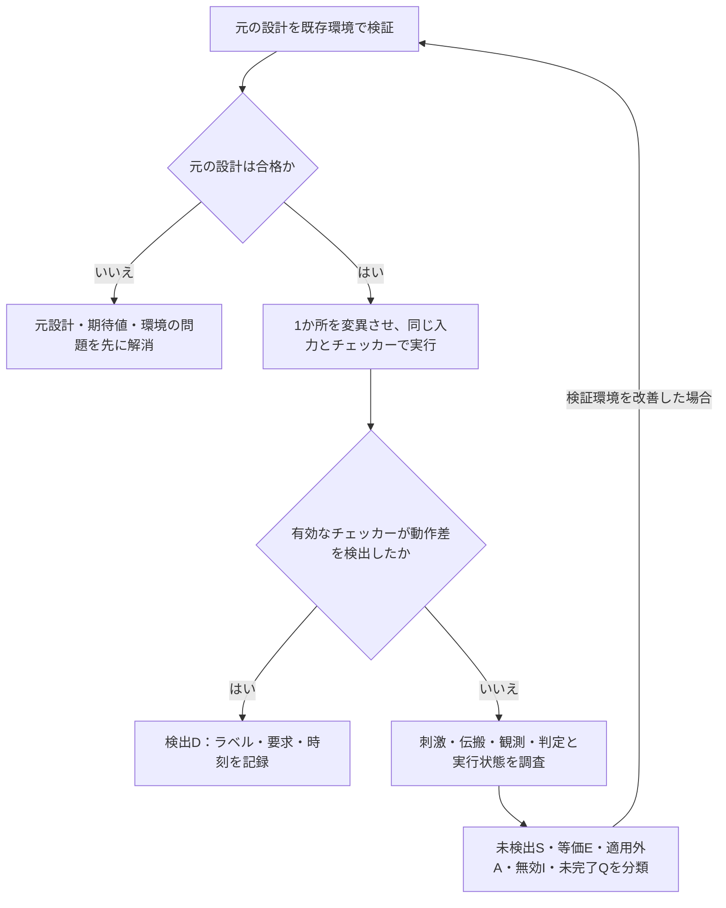

# ミューテーション検証で検証環境の検出力を確かめる

[一般化した検証手順](spec-to-verification-method.md)の段階Fを具体化した資料です。回路へ小さな誤りを意図的に入れた変異（mutant）を作り、既存の刺激・スコアボード・SVA・フォーマル検証のプロパティが、その誤りを検出できるかを調べます。ミューテーションテスト、変異テスト、ミューテーションカバレッジなどと呼ばれる手法です。[YosysHQ MCY](https://yosyshq.readthedocs.io/projects/mcy/en/latest/index.html)にも、検証環境の評価に使う実装があります。

以下は本リポジトリで定めた運用案です。製品での実施結果ではなく、既存の説明用モデルの確認例と、今後の計画・記録方法をまとめます。自動変異ツールを本リポジトリへ導入したものではありません。

## 1. 何を評価するか

| 手法・目的 | 意図的に変えるもの | 評価するもの |
| --- | --- | --- |
| ミューテーション検証 | RTL・ネットリストの条件、定数、接続、状態更新など | 誤実装を既存の検証環境が検出できるか |
| 安全・セキュリティ機構の故障注入 | ビット反転、stuck-at、一時的な信号異常など | 回路の検出・訂正・封じ込め・復帰が要求どおりか |
| Dynamic CDCの影響注入 | 同期化後に値が見える時刻など | 不確定な遅延に転送・受信処理が耐えるか |

同じ注入機構を使う場合も、目的、故障・変異モデル、分母、合格条件を分けます。ミューテーションでは、変異による仕様違反をチェッカーが検出し、テストが不合格になれば検出と判定します。安全機構の故障注入では、回路が仕様どおりに訂正・通知・復帰し、そのチェックが合格する場合もあります。どちらも「異常が起きたらシミュレーションが止まればよい」という判定にはしません。

コード・機能カバレッジが到達を測るのに対し、この検証では意図した誤りが判定へ届くかを調べます。到達率100%でも、比較がない、マスクが広すぎる、assertの前件が成立しない、といった検証環境の不備を見つけるために併用します。

## 2. 要求と想定する誤実装から変異を選ぶ

まず、重要要求と、レビューで見落としやすい誤りを結び付けて少数の変異を作ります。原則として一つの変異に一つの変更を入れます。複数の変更を同時に入れる場合は、打ち消しや原因の混同があり得るため、別の計画として扱います。

- 比較の境界を変える：`<`と`<=`、FIFOのfull/empty、最小・最大値。
- 優先順位を変える：イベントとclear、resetと更新、複数要求の仲裁。
- マスクや条件を変える：enable、権限、バイトイネーブル、エラー検出条件。
- データを変える：上位ビットを落とす、レーン・ID・アドレスを交換する。
- 状態更新を変える：リセット値、保持の欠落、カウンタの増減、取りこぼし・重複。
- 時間・順序を変える：応答を1サイクルずらす、待ち中のデータ保持を壊す。

仕様が許すレイテンシや無効期間のデータを変えただけなら、誤実装ではない場合があります。変異ID、変更前後の差分、対象構成・要求、想定する動作差、その差を起こす入力、期待する検出点を登録します。無差別に変異数を増やすだけでなく、要求・階層・種類ごとの偏りも確認します。

## 3. 元の回路との比較を基準に実行する

1. 仕様・RTL・検証環境・構成・仮定・ツールの版を固定する。元の回路で予定するテスト・証明が合格し、チェッカーが有効であることを確認する。
2. 元の回路を保持し、変異ごとに分離した作業場所・ビルド・出力を使う。意図した変更が実行するモデルへ入ったことを、差分とビルド入力で確認する。
3. 元の回路と同じ入力条件・チェッカーで実行する。検証側の期待値を、変異した出力に合わせて変えない。ランダム試験ならseed・制約・実際の入力も保存する。
4. 失敗したチェッカー・要求・時刻・比較値・波形を確認し、想定した誤りを検出したかを分類する。別のチェッカーが検出した場合も対応を記録する。
5. 未検出なら、到達・伝搬・観測・判定を調べ、刺激、観測点、比較、assert、仮定を改善する。
6. 改善後は元の回路と変異の両方を再実行する。元の回路を誤って失敗させるようになっていないか、通常回帰も確認する。

最初の評価と、未検出を見て改善した後の評価は別の版・実行として残します。変異に合わせてテストを追加した後の検出を、追加前から検出できていたように報告しません。

検出Dへ進めるのは、予定した検証で仕様違反を検出したと確認できる場合です。ビルド失敗や実時間タイムアウトは、図の調査・分類側へ残します。

通常のエラー比較やassertで誤りを検出したことと、コンパイル失敗、シミュレータのクラッシュ、ランナーの時間制限を区別します。仕様で決めた応答期限のチェッカーが違反を検出した場合は検出ですが、単なる実行時間切れを検出へ足しません。フォーマル検証の`unknown`や帰納段階だけの候補も、到達可能な反例を確認せず検出にはしません。

## 4. 未検出を分析し、動作を変えない変異を区別する

未検出の変異では、次を順に調べます。

1. **変更が適用されたか**：別構成やキャッシュされたモデルを実行していないか。
2. **活性化されたか**：誤った条件・境界へ刺激が到達したか。過剰なassumeや制約で禁止されていないか。
3. **差が伝搬したか**：出力・状態・通知へ差が出たか。後の更新で上書きされたり、マスクで隠れたりしないか。
4. **観測したか**：モニター・チェッカーの対象と時間窓に差が入ったか。幅や型の変換で差を失っていないか。
5. **判定したか**：比較の欠落、広すぎる許容、無効なassert、失敗をランナーへ返さない経路がないか。

変異が対象構成で元の回路と同じ振る舞いになることもあります。未使用ビット、無効なデータ期間などが例です。ただし、テストを通っただけでは等価と判断できません。仕様が区別する観測点・入力・初期状態・構成を定義し、必要に応じて等価性検証や独立した解析で根拠を示します。[MCYの方法論](https://yosyshq.readthedocs.io/projects/mcy/en/latest/methodology.html)も、動作を変える変異と変えない変異の区別を扱っています。

等価性の判定範囲が狭すぎると、検出すべき差を除外できます。有限深さで差が見つからなかった結果を、非有界の等価性証明として扱いません。また、等価と判断した変異をtestbenchが失敗させたら、等価性の前提・観測点と、testbenchの許容範囲の両方を見直します。

## 5. 検出率と未完了を集計する

キャンペーンの版と変異一覧を固定し、次を別々に数えます。

| 分類 | 判定 |
| --- | --- |
| 検出D | 合法な条件で仕様違反を起こす変異を、有効なチェッカーが検出した |
| 未検出S | 仕様上の動作差を確認した変異が、予定する検証を完了しても検出されなかった |
| 等価E | 記録した条件・観測範囲で動作差がない根拠がある |
| 適用外A | 対象構成・変異計画に適用しない理由がレビューされた |
| 無効I | 変異を構築できない、構文・エラボレーションが成立しないなど |
| 未完了Q | 未実行、タイムアウト、ツールエラー、動作差・等価性の未確定、原因を確認できない失敗など |

総数を`C = D + S + E + A + I + Q`として照合します。未検出を安易にEへ移さず、動作差も等価性も未確定ならQとして調査を続けます。Dも、元の回路の既存の失敗や、仕様に反する入力による失敗を混ぜません。

判定済みの非等価変異に対する検出率を`D / (D + S)`とする場合は、判定済みの範囲の率だと明記します。未完了を含む対象全体の進捗として、`D / (C - E - A - I)`とQの内訳も併記します。分母が0なら率は未定義として件数を示します。この集計式は本手順の運用案で、外部ツールに共通の定義ではありません。

たとえばC=20、D=12、S=3、E=2、A=0、I=1、Q=2なら、判定済みの検出率は12/15=80%、未完了を含む対象に対する検出済み割合は12/17です。これは説明用の算術例で、実行実績ではありません。両方の分母と除外の根拠を表示し、未完了を集計から除外して検出率を高く見せないようにします。

種類・要求・階層・構成別にも集計し、重要な要求の未検出を、多数の簡単な変異の検出で埋め合わせません。検出率100%でも、選ばなかった誤実装、変異モデルにない不具合、仕様やチェッカーの共通の誤りまで除去した証明ではありません。ATPGの故障網羅率や安全機構の診断網羅率とは分けます。

## 6. 割り込みの例

既存の説明用モデルでは、次の確認を行っています。セット優先などの期待値は、この例の仮の仕様です。

| 変異 | 差を起こす条件 | 検出するチェッカー |
| --- | --- | --- |
| イベントとW1Cの同時受理で、クリアを優先する | イベントとクリアが同時に受理される | `ap_set_wins`／`IRQ_SET_WINS` |
| IRQ_ENが無効ならPENDへのイベント保存も止める | mask中にイベントが受理される | `ap_set_only`／`IRQ_SET_ONLY` |
| 無操作時のPEND保持を壊す | イベントもクリアもない | `ap_hold`／`IRQ_HOLD` |

[SVA資料の確認記録](sva-verification.md#10-コード例の確認範囲)に、Verilatorを使った結果があります。[フォーマル検証の確認例](formal-verification.md#8-証明対象の漏れと不具合の検出力を確認する)では、クリア優先の変異を検出した一方、競合を禁止するassumeを加えると証明が通り、必要なcoverが未達になる例も示しています。

これらは製品DUTの評価でも、自動生成した大量の変異を使うキャンペーンでもありません。本資料の追加で再実行したものではなく、既存の説明用コードの確認結果への参照です。

[ローカルECC例](../../examples/local-ecc/README.md)では、入力符号語へのビット誤り注入と、訂正回路そのものの変異を区別して実行します。正常回路への1／2ビット誤りは仕様上の訂正・検出を確認する刺激で、回路のミューテーションではありません。3／4ビット誤りによる誤訂正・見逃しは、保証範囲外の診断として別に記録します。[SPI例](../../examples/local-spi/README.md)と[タイマー・ウォッチドッグ例](../../examples/local-timer-watchdog/README.md)も、それぞれ4種類の誤実装を予定したチェッカーで検出します。[非同期FIFO](../../examples/local-async-fifo/README.md)、[I²C](../../examples/local-i2c/README.md)、[APB＋タイマー＋ウォッチドッグ](../../examples/local-apb-timer/README.md)にも、それぞれ4種類の変異検出を用意しています。[AHB-Lite](../../examples/local-ahb/README.md)はアドレス／データの誤対応や1サイクルERROR、[AXI4-Lite](../../examples/local-axi/README.md)は受理後のバス値への依存や応答保持の違反も検出します。これらはローカルで動作する教材です。

## 7. 証跡と完了判定

変異ごとに、少なくとも次を記録します。

- キャンペーンID・版、変異ID、対象要求・改訂・構成・階層。
- 元の回路と変異の版・差分・ハッシュ、変異生成器と設定の版。
- 想定する動作差、期待する検出点、動作差・等価性の根拠と適用条件。
- 元の回路の合格証跡、テスト・seed・制約・入力、チェッカー・仮定・ツールの版。
- 実行ID、分類、最初の失敗・時刻・比較値、ログ・波形・反例。
- 未検出の原因・対策、改善前後の検証環境の版と結果、レビュー。

完了は、計画した変異の分類・証跡がそろい、必須要求の未検出・未完了へ対応があり、改善後に元の回路も合格することを確認して判断します。残す未検出には、理由・影響・代替検証・担当と期限を付けます。対象変異を削ったり分母から外したりする場合は、計画の変更として根拠を残します。

結果は[サインオフ記録](../templates/signoff-record.md)へつなぎます。CIで行うなら、短時間の代表変異を変更時に確認し、広い変異集合は定期実行するなど、対象・資源制限・計画版を明示します。通常の製品回帰と、意図した失敗が検出結果になる実行を取り違えないようにします。

[APBブリッジ](../../examples/local-bus-bridge/README.md)はデコード・エラー返却・書込みデータ・APBフェーズの4変異、[AXI4](../../examples/local-axi4/README.md)はデータ・ID・RLAST・ストローブの4変異を実行します。AXI4では、部分書込み前後のデータが同じだとストローブ無視を検出できないため、異なるデータで固定刺激を構成します。[独立プロトコルチェッカー](../../examples/local-bus-validation/README.md)自体にも意図した違反を与え、予定の検出点が動くことを確認します。

[システム教材](../../examples/local-system-regression/README.md)では、DMAの境界分割・IRQ、接続先・応答先、クロック跨ぎの破棄漏れ、タイムアウト後の古い応答、低電力の隔離・保持などへ変異を入れます。等価性例では内部補助条件を外した変異BMCで、外部インターフェースの不一致を確認し、内部状態の違いだけを不具合と誤認しないようにします。

[追加検証7例](../../examples/local-advanced-regression/README.md)には、RTL変異だけでなく、Cドライバの単位・状態判定・IRQ処理の誤り、意図的な期待値破損、バックエンド間の不一致、進行条件を外した期限違反があります。正常なRTLを誤った期待値で失敗させる診断を、RTL不具合の検出率へ含めません。ケースごとの注入先・予定ラベル・分類を確認します。

## 8. 参考にした一次資料

- [YosysHQ MCY](https://yosyshq.readthedocs.io/projects/mcy/en/latest/index.html)：テストベンチを変異で評価するツールの実例です。
- [YosysHQ MCYの方法論](https://yosyshq.readthedocs.io/projects/mcy/en/latest/methodology.html)：元の回路の合格、動作差・等価性、検証環境との不一致を扱う考え方の参照先です。

変異の選定手順、分類・集計、記録形式は、このリポジトリで定めた運用案です。

## ローカルで試す追加例

[失敗の縮小例](../../examples/local-failure-reduction/README.md)では、変異の検出ラベルを維持して操作列を短くします。[新しい結合・UVMの例](../../examples/local-workflow-regression/README.md)でも予定ラベルと非ゼロ終了を要求し、誤った期待値の診断はRTL変異の検出率と分けて記録します。
