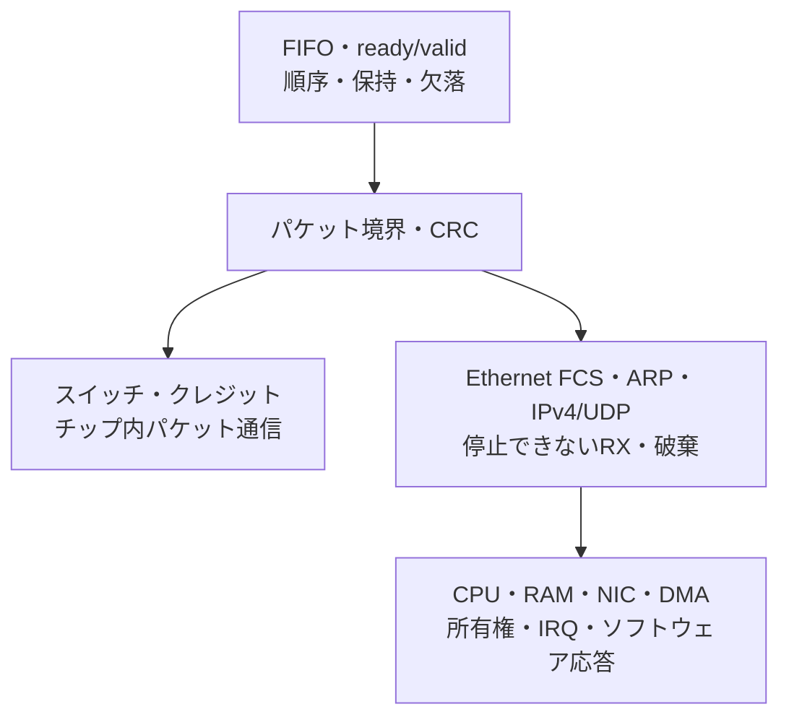

# ネットワーク・パケット処理の検証

ネットワーク回路では、フレームの中身に加え、境界、破棄、バッファの所有権、流れ制御、完了の時点を仕様にします。この分野には、外部ネットワークにつながるEthernet／ARP／IP／UDPと、チップ内のパケットスイッチ・NoCの両方があります。共通の検証技法は使えますが、プロトコルや「停止できる場所」は個別に定めます。

## 1. 学ぶ順序と検証の境界

| 段階 | 既存・新規の実行例 | 中心に確認すること |
| --- | --- | --- |
| 転送の基礎 | [FIFO](../../examples/local-fifo/README.md)／[ready/valid](../../examples/local-stream/README.md) | 順序、空／満杯、待ち中の保持 |
| パケット境界 | [AXI4-Stream](../../examples/local-axis/README.md)／[CRC](../../examples/local-packet-crc/README.md) | TLAST／TKEEP、終端、計算対象、既知ベクトル |
| 経路と流れ制御 | [パケットスイッチ](../../examples/local-packet-switch/README.md)／[クレジットリンク](../../examples/local-credit-link/README.md) | パケット単位の占有、仮想チャネル、クレジット返却 |
| 再送 | [CRC・ACK・再送リンク](../../examples/local-retry-link/README.md) | 消失、重複、タイムアウト、配送結果が確定しない場合 |
| 外部ネットワーク | [Ethernet／ARP／UDP単体IP](../../examples/local-network-echo/README.md) | FCS、階層ごとの長さとチェックサム、対象外の破棄 |
| ソフトウェア結合 | [ネットワークSoC](../../examples/local-network-soc/README.md)／[Stream DMA](../../examples/local-stream-dma/README.md)／[DMA所有権](../../examples/local-dma-ownership/README.md) | RAMへの可視化、RX／TX完了、IRQと返却、CPUでの応答生成 |

既存のパケットCRC例はCRC-8、再送リンクは教材固有のCRC-8・連番・ACKです。Ethernet FCSのCRC-32や、TCP・特定の標準再送プロトコルへ読み替えません。スイッチとクレジットの例もNoCの要素技術で、NoC全体のデッドロック自由性や到達性を証明する例ではありません。

## 2. フレームを要求へ分解する

先に、端子で何を受け渡すかを固定します。今回のEthernet例は、DAからFCSまでのバイト列で、最小64バイト・最大96／128バイトです。プリアンブル・SFD・IFG・PHYや通常MTUを含む規格全体の適合は対象外です。

ARPのフィールドとバイト順は[RFC 826](https://www.rfc-editor.org/rfc/rfc826.html)、IPv4のヘッダーは[RFC 791](https://www.rfc-editor.org/rfc/rfc791.html)、UDPの長さ・疑似ヘッダー・チェックサムは[RFC 768](https://www.rfc-editor.org/rfc/rfc768.html)を参照します。Ethernetの最小長を満たすパディングはIP全長に含めません。[RFC 894](https://www.rfc-editor.org/rfc/rfc894.html)

| 層・契約 | 別々に持つ検証項目 | 期待する観測 |
| --- | --- | --- |
| バイト入出力 | 有効、空白、末尾、リンクエラー、停止可能か | 到着バイト数とフレーム境界、停止中の保持 |
| Ethernet | 宛先、EtherType、最小／最大長、FCS | 正常な完全フレームだけを次段へ公開 |
| ARP | ハードウェア／プロトコル種別、長さ、opcode、対象IP、送信元MAC | 自IP宛て要求へ正しい返信、その他は破棄 |
| IPv4 | IHL、全長、TTL、断片、プロトコル、宛先、ヘッダーチェックサム | 対応範囲と形式の区別、不正なパケットの非送信 |
| UDP | UDP長とIP全長、ポート、奇数末尾、疑似ヘッダー、0／0xffff | ペイロードを正確に維持し、正しいチェックサムを生成 |
| バッファ | 満杯、途中で空く、サイズ超過、所有権、リセット | 全フレームの破棄、部分公開なし、明示返却まで保護 |
| SoC | APB設定、AXIの応答、IRQ、CPU処理 | RX最終B後の通知、TX最終バイト後の通知、RAMとリタイア命令列の一致 |

FCSとIP／UDPチェックサムは対象範囲もアルゴリズムも異なります。FCSが正常でもヘッダーチェックサムが不正な入力を作り、各チェッカーが働くか調べます。UDP計算結果0の送信表現`0xffff`と、IPv4 UDPのチェックサム省略を表す受信0も別項目です。

## 3. 止められる転送と、止められない受信を分ける

TX・バスはreadyで待たせられます。一方、この例のRXにはreadyがありません。送信を停止しても受信側の刺激を止めず、空き容量と全体破棄を確認します。実Ethernetの受信側FIFOでも、満杯時に到着中フレームを破棄する構成があります。[AMD AXI Ethernetの受信FIFO説明](https://docs.amd.com/r/en-US/pg138-axi-ethernet/rx_client_fifo)

| 時点 | 入力条件 | 必要な確認 |
| --- | --- | --- |
| フレーム先頭 | スロットなし | そのフレーム全体を破棄する |
| 破棄の途中 | 空きスロット発生 | 途中から採用しない |
| 次の先頭 | スロットあり | 次フレームは正常に取り込める |
| 取り込みの途中 | 最大長超過 | 不完全なフレームを公開しない |
| TX待ち | readyが0 | valid・data・last、未送信バイト数を保持する |
| リセット | RX／DMA／TXが途中 | 古い処理を取消し、新しい実行の件数へ混ぜない |

全体破棄と、途中で送ったパケットを取り消す方式は異なります。単体IPもSoCも完全フレームを検査・保持してから送信し、不正な入力やTX DMAエラーで途中までの返信が出ない構成です。キューやフレーム全体の組合せ処理は教材向けで、ラインレート・物理実装の確認は別途必要です。

## 4. クロス条件の選択

全フィールドの直積ではなく、要求ごとに、故障が現れる組合せを選びます。[クロス検証項目の選び方](cross-test-selection-walkthrough.md)と同じく、無効な組合せの理由も残します。

| 重点クロス | 先に確保するケース | 判定 |
| --- | --- | --- |
| 長さ×UDPチェックサム | 空・奇数・最大、チェックサム0、計算結果0 | 正しい長さ、末尾、チェックサム、パディング |
| FCS×上位ヘッダー | FCS不正、FCSのみ修復してIP／UDP不正 | 検査の抜けと、破棄理由の優先順位 |
| RX到着×TX停止×キュー満杯 | 5件連続、4件目の途中で空く | 生き残るフレームのID・全バイトと破棄数 |
| W1C×未返却RX×次の受信 | IRQだけ解除し次を待たせる | CPUが読んでいるRAMを上書きしない |
| DMA応答×IRQ | 最終WとBを分離、Rエラーを注入 | RXの早期通知なし、TXの部分送信なし |
| リセット×処理段階 | RX蓄積、RX DMA、TX DMA、TX停止 | 取消・再起動・新しい期待列との一致 |

ランダムなペイロードだけで満杯や所有権の競合が発生するとは限りません。必須境界と順序を固定ケースで確保し、ランダムは長さ・データ・ID・ポート・待ちへ加えます。未対応のIPv4オプション等は、正常処理の成功率を上げるために刺激から除くだけでなく、対象外として破棄されることも確認します。

## 5. 独立モデル・アサーション・実行証跡

モデルは完成したフレームを構文解析し、返信を組み直します。RTLと同じキュー、フレーム位置カウンター、CRCの状態遷移を写しません。既知FCSとチェックサムベクトルを使い、モデル自体も確認します。

自動チェッカーでは、待ち中のTXとバスの保持、末尾、全バイト、破棄数、正常完了数、未完了0件を検査します。SoCではIRQの解除と所有権返却、RX最終Bと通知、TX最終バイトと通知も別々に観測します。SVAへ進める場合も同じ観測契約から作れます。[目視確認をアサーションへ置き換える手順](assertion-based-regression.md)を参照してください。

今回の観測目標は、合格した通常実行の`COVER`ログを[要求カタログ](../../examples/local-network-echo/requirements.json)と照合する機能カバレッジです。変異のヒットは未達を埋めません。ネイティブcovergroup DBやコードカバレッジの結果とは区別します。[機能カバレッジ](functional-coverage.md)と[コードカバレッジ](code-coverage.md)から、製品環境に必要な計測を追加してください。

保存するものは、ソース・生成入力・期待値・ROMのハッシュ、構成・seed、全フレームと長さ、RX駆動列、全送信比較、要求別観測、波形、ログ、CPUのリタイア命令列、RAM読戻しです。終了署名だけに頼らず、完了件数と未処理の取引がないことを照合します。[統合リグレッション](../../tools/REGRESSION.md)と[追加記録](../../PROVENANCE.md#network-20261101)から実行範囲を確認できます。
