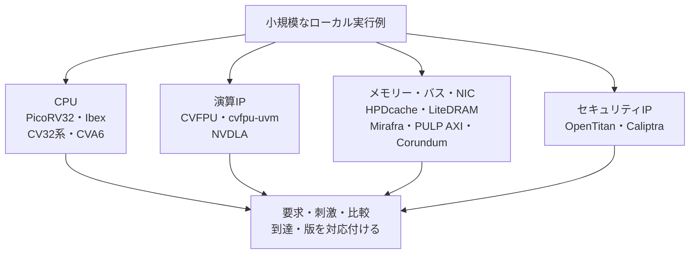

# 実プロジェクトのオープンソースDV環境を読む

小さな回路で刺激・観測・比較・カバレッジを学んだ後に、実際のCPU・演算IP・メモリー・バス・NIC・セキュリティIPのDV環境へ進むための案内です。既存8件に、PULP AXI、LiteDRAM、Corundum、NVDLA、Caliptraを加えた**参照例13件**を紹介します。上流の版を固定して読み、手動演習とフルDVの実行範囲を分けます。これらの参照例は統合nightlyの登録数へ加算しません。

## 1. 何を学ぶかで選ぶ

| 参照例 | 読む対象 | 主な学習内容 | 最初の入口 |
| --- | --- | --- | --- |
| [Ibex DV](../../examples/reference-ibex-dv/README.md) | CPU単体のSV/UVM環境 | 命令生成、命令・データメモリー応答、IRQ、RVFI、Spikeとのコシミュレーション | testlist→環境クラス→cosimスコアボード |
| [CVA6](../../examples/reference-cva6-dv/README.md) | 構成可能なCPUの検証 | XLEN・ISAの構成、Verilator／Spikeの経路、UVM環境、比較を有効にする設定 | 実行設定→UVM構成→RVFIの接続 |
| [OpenTitan](../../examples/reference-opentitan-dv/README.md) | 共通基盤を使うIP・SoCのDV | Hjson計画、共通環境、エージェント、RAL、スコアボード、カバレッジ、DVSim | UARTの計画→実行設定→環境・比較 |
| [CV32系／CORE-V-VERIF](../../examples/reference-core-v-verif/README.md) | CV32E40Pと、専用DVを持つE40X・E40S | コア別の仕様・構成、OBI、IRQ・debug、RVFI／RVVI、ISS有効化 | E40Pのテスト→依存設定→環境・TBトップ |
| [CVFPU／cvfpu-uvm](../../examples/reference-cvfpu-uvm/README.md) | 浮動小数点IPとC++モデルを使うUVM | 形式・丸め・例外フラグ、ID、flush、独立した数値比較と完了 | IPの構成→ラッパー→スコアボード・参照モデル |
| [HPDcache](../../examples/reference-hpdcache/README.md) | キャッシュ単体のSystemC・UVM環境 | miss・置換・部分書込み、メモリー応答、未完了要求、待ち・順序 | SystemCの単体TBとUVMのサブシステムを読み分ける |
| [Mirafra mBits](../../examples/reference-mirafra-vip/README.md) | APB・AXI4の公開AVIP | HDL／HVL分離、BFM、master／slave、b2bとDUTへの適用、独立比較 | APBの1テスト→AXI4のMODEと比較経路 |
| [PicoRV32](../../examples/reference-picorv32/README.md) | 小さなCPUとメモリー応答 | 簡易TBの表示から受付・値・件数・時間上限の自動判定へ進む | 外部ツールチェーン不要のIcarus演習 |
| [PULP AXI](../../examples/reference-pulp-axi/README.md) | AXI接続IPとSVの検証部品 | ランダムmaster／slave、クロスバー・ID・未完了要求、比較の有効化、構成・seedの回帰 | `axi_test.sv`→クロスバーTB・専用モニター→回帰スクリプト |
| [LiteDRAM](../../examples/reference-litedram/README.md) | DRAM制御のPython／Migen環境 | リフレッシュの時系列、ECC訂正・検出、フロントエンドの待ちとデータ比較 | リフレッシュ・ECCの6テストを動かし、AXI・PHYへ読む範囲を広げる |
| [Corundum](../../examples/reference-corundum/README.md) | NIC・PCIe・DMAのcocotb環境 | パケットの期待値、キューと完了、ソフトウェア側モデルとの結合、構成行列とCI分割 | `rx_hash`の期待計算・比較→NIC全体のTB |
| [NVDLA](../../examples/reference-nvdla/README.md) | AIアクセラレーターのトレース環境 | 入力・重み・設定・割り込み待ち、出力メモリー比較、C++ハーネスとCモデルの役割 | `nvdlav1`のINT16トレース→Verilatorハーネス→終了コード |
| [Caliptra](../../examples/reference-caliptra/README.md) | 暗号・鍵管理IPの単体・上位DV | 期待ベクトル、predictorとscoreboardの接続、zeroize、機能カバレッジと商用VIPの依存 | SHA-512の予測器→環境の接続→covergroup→実行条件 |

CPUの入口は[小規模RISC-Vの検証例](../../examples/local-riscv-iss/README.md)、UVMの入口は[移行ガイド](uvm-migration-guide.md)と[実践設計](uvm-practical-design.md)です。大きな環境でも、どの入力を受け付け、何を観測し、何を期待値と比較するかを先に特定します。

## 2. ソース公開と実行時の依存を分ける

DV環境のソースが公開されていても、その全経路をオープンソースのツールだけで実行できるとは限りません。次の表は、確認した固定版のソース・資料にある経路の整理で、フルDVの動作保証表ではありません。

| 環境・経路 | 依存や確認事項 | このリポジトリでの確認 |
| --- | --- | --- |
| Ibexのcore DV | UVM対応シミュレーター、lowRISCのSpike fork、RISC-Vツールチェーン、命令生成環境。固定版のREADMEはXcelium、シミュレーター設定はVCS／Xceliumを含む | ソース・構成・接続を確認。フルUVMは未実行 |
| CVA6のVerilator／Spike経路 | 対象構成、RISC-Vツールチェーン、指定版Verilator、CORE-V側のSpikeと依存ソース。指向性プログラム実行とSV命令生成を区別 | 設定とスクリプトを確認。RTL／ISSの実行は未確認 |
| CVA6のUVM・生成・カバレッジ経路 | 選択したシミュレーター、参照モデル、submodule、機能の有効化条件を確認。固定版には商用ツール向け設定もある | 環境と条件付きの比較接続を確認。フルUVMは未実行 |
| OpenTitanのIP UVM DV | 上流のDV手順に沿うシミュレーター、DVSim、生成器、共通ライブラリー、IPごとの設定 | UARTの計画・コード・設定を確認。IP／SoCのUVMは未実行 |
| OpenTitanのVerilatorによるソフトウェア実行 | 別のシミュレーション対象・ビルド・ソフトウェア・ツールチェーン | 上流の案内を参照。UVM DVの実行結果へ読み替えない |
| OpenTitanの計画メタデータ操作 | Pythonと少数のPythonパッケージ。HDLシミュレーターは使わない | 実際の上流TestplantoolでCSV出力・照会・出力照合を実行 |
| CV32系のUVM・ISS経路 | コア別のUVMシミュレーター、RISC-Vツールチェーン、生成器・ISS等。E40Pの固定版にはImperasDVへの接続がある | P・X・SのDV配置・設定・ソースを確認。RTL／ISS・フルUVMは未実行 |
| CVFPU／cvfpu-uvm | Questa・Xcelium・VCS向け設定、C++・GMP・MPFR・Bender等。IPとTBが解決する版を別に確認 | 構成と比較・ID・flushの経路を確認。モデル構築・フルUVMは未実行 |
| HPDcacheのSystemC経路 | Verilator・SystemCに加えSCVとPerl等。CPU未接続の単体TB | オープンソースの実行経路と前提を確認。構築・実行は未確認 |
| HPDcacheのUVM経路 | 上流のQuesta等の案内、構成・メモリーモデル・外部依存と既知の制限 | ソース・設定を確認。フルUVMは未実行 |
| MirafraのAPB・AXI4 AVIP | 商用シミュレーター向けMakefile等。VIP同士のb2bと、DUT接続時の役割・機能比較を区別 | ソース・回帰リスト・構成を確認。UVM・Verilator・加速は未実行 |
| PicoRV32の簡易TBと自動判定演習 | Icarus・make・Git・Python。RISC-VコンパイラーやISSを使わない | 上流の簡易TBと、受付・値・件数・終了を検査する正常1件・負例2件を実行 |
| PULP AXIのSVクラス・TB | Benderと依存ライブラリー、Questa等。固定版のVerilatorスクリプトはlintの経路 | ソース・比較の有効化・CI行列を確認。TBの構築・シミュレーションは未実行 |
| LiteDRAMのPython／Migen単体試験 | Python・Migen・LiteX等。生成Verilog・PHY・全体試験は別の依存を確認 | 固定版3ソースを使い、リフレッシュ・ECCの6テストを実行 |
| Corundumのcocotb経路 | 固定版CIはPython 3.10・Icarus・cocotb 1.7.2等。AXI・PCIe・Ethernetのモデル | ソース・比較・構成を確認。RTL実行・FPGA・実機は未確認 |
| NVDLA `nvdlav1`のトレース経路 | 生成RTL・Verilator・C++・Perl・make等。別世代のUVM手順と混在させない | 固定版を読解し、I/O修正を代替バスモデルのC++単体8条件で確認。RTL・演算Cモデルは未実行 |
| Caliptraの暗号IP・上位DV | UVM・UVMF・QVIP・Avery等の商用VIPを含む経路と、別のVerilator経路 | SHA-512の期待値・TLM接続・covergroup等を確認。RTL・UVM・セキュリティ評価は未実施 |

[OpenTitanの導入案内](https://opentitan.org/book/doc/getting_started/index.html)も、Verilatorでのソフトウェア実行とDVの経路を分けています。本リポジトリの小規模UVMがVerilatorで動いた結果は、上流の大規模環境をそのまま実行できる根拠とは別に扱います。

RISCV-DVでは、Pythonの実行制御と、SVによる命令生成を区別します。RTL側がVerilatorでも、選んだ命令生成モードまで同じツールで動くとは限りません。CPU・ISSの設定、生成器の設定、シミュレーターの設定を個別に確認します。

## 3. 読解する版とパスを固定する

2026-11-03の読解対象は次のコミットです。上流資料の導入条件や移行先は、実行する版で改めて確認してください。

| プロジェクト | 固定コミット | 版に関する注意 |
| --- | --- | --- |
| lowRISC/ibex | [`f4515520c0045bb8ef1e72d46ed82499a6ac5f18`](https://github.com/lowRISC/ibex/tree/f4515520c0045bb8ef1e72d46ed82499a6ac5f18) | `dv/uvm/core_ibex/`を読む |
| openhwfoundation/cva6 | [`742dc82a0c706e0a3bfb98b709fd3ee06d50d12a`](https://github.com/openhwfoundation/cva6/tree/742dc82a0c706e0a3bfb98b709fd3ee06d50d12a) | 旧openhwgroup URLから移転。取得できたmasterの固定版で、READMEはmasterのread-only化と移行を案内 |
| lowRISC/opentitan | [`0f8469f729ce8e84993c9987f90af3589172c79d`](https://github.com/lowRISC/opentitan/tree/0f8469f729ce8e84993c9987f90af3589172c79d) | DVSimは`pyproject.toml`で1.52.0を指定。計画操作CLIは`util/testplantool/` |
| openhwfoundation/core-v-verif | [`33917ee5db9ede3779cc658a5004d672320f164c`](https://github.com/openhwfoundation/core-v-verif/tree/33917ee5db9ede3779cc658a5004d672320f164c) | CV32E40Pの`cv32e40p_v1.8.3`タグを読む |
| openhwfoundation/cv32e40x-dv | [`93ce70f1ae2ab2e66716e0c5648d27e67e161c2f`](https://github.com/openhwfoundation/cv32e40x-dv/tree/93ce70f1ae2ab2e66716e0c5648d27e67e161c2f) | E40Xの専用DV |
| openhwfoundation/cv32e40s-dv | [`8b27b963ef08badfa350b4207a45e2c2cadb3001`](https://github.com/openhwfoundation/cv32e40s-dv/tree/8b27b963ef08badfa350b4207a45e2c2cadb3001) | E40Sの専用DV |
| openhwfoundation/cvfpu | [`7093289d00ec842c94ca973e2d5ba9301fb11363`](https://github.com/openhwfoundation/cvfpu/tree/7093289d00ec842c94ca973e2d5ba9301fb11363) | 演算IPの読解版 |
| openhwfoundation/cvfpu-uvm | [`2f787402256b76d00e397d72a00b57120db455cf`](https://github.com/openhwfoundation/cvfpu-uvm/tree/2f787402256b76d00e397d72a00b57120db455cf) | TB側のDUT・依存の解決結果も記録する |
| openhwfoundation/cv-hpdcache | [`9b065ccb7c61c37c0bc36b7bed7eab653bff00b8`](https://github.com/openhwfoundation/cv-hpdcache/tree/9b065ccb7c61c37c0bc36b7bed7eab653bff00b8) | RTL・SystemC単体TB |
| openhwfoundation/cv-hpdcache-verif | [`f46150dd0b68f300255c8dddcec73e0c2c4f961e`](https://github.com/openhwfoundation/cv-hpdcache-verif/tree/f46150dd0b68f300255c8dddcec73e0c2c4f961e) | UVM・prefetcher等と既知の制限を読む |
| mbits-mirafra/apb_avip | [`b9e0f885b85d7425d665fe544afa2f75b07a728d`](https://github.com/mbits-mirafra/apb_avip/tree/b9e0f885b85d7425d665fe544afa2f75b07a728d) | APBの公開VIP |
| mbits-mirafra/axi4_avip | [`86b46171c534dfa5521ecfe9329184d7b0d72898`](https://github.com/mbits-mirafra/axi4_avip/tree/86b46171c534dfa5521ecfe9329184d7b0d72898) | AXI4のb2b・master・slaveモード |
| YosysHQ/picorv32 | [`ef203c2b0a3fb793280f5114941416c425c5b461`](https://github.com/YosysHQ/picorv32/tree/ef203c2b0a3fb793280f5114941416c425c5b461) | 確認時点でarchived。固定版の小演習に使う |
| pulp-platform/axi | [`d436bd4936ba1c49cd87521df54580c5159114d3`](https://github.com/pulp-platform/axi/tree/d436bd4936ba1c49cd87521df54580c5159114d3) | SV検証クラス・接続IP・比較・回帰条件を読む |
| enjoy-digital/litedram | [`c048f40e4aa305527b50dee0d96f88d7d20a5cc6`](https://github.com/enjoy-digital/litedram/tree/c048f40e4aa305527b50dee0d96f88d7d20a5cc6) | Python／Migenの単体試験。生成RTL・PHY・実機の評価と分ける |
| enjoy-digital/litex | [`4cfda8a561d2878331ba14b37c09d4f7601c77de`](https://github.com/enjoy-digital/litex/tree/4cfda8a561d2878331ba14b37c09d4f7601c77de) | LiteDRAMの小演習で使う依存ソース |
| m-labs/migen | [`e19524c963a8342952840983047557707fbe0b6a`](https://github.com/m-labs/migen/tree/e19524c963a8342952840983047557707fbe0b6a) | LiteDRAMの小演習で使うシミュレーション基盤 |
| corundum/corundum | [`1ca0151b97af85aa5dd306d74b6bcec65904d2ce`](https://github.com/corundum/corundum/tree/1ca0151b97af85aa5dd306d74b6bcec65904d2ce) | 固定版の古いcocotb等と、現在の共通環境を混同しない |
| nvdla/hw | [`8e06b1b9d85aab65b40d43d08eec5ea4681ff715`](https://github.com/nvdla/hw/tree/8e06b1b9d85aab65b40d43d08eec5ea4681ff715) | `nvdlav1`。構成固定の1.0のトレース環境 |
| chipsalliance/caliptra-rtl | [`bcd1a0c2dd897c2f378ad068c28a3452342111d2`](https://github.com/chipsalliance/caliptra-rtl/tree/bcd1a0c2dd897c2f378ad068c28a3452342111d2) | 読解版。製品適用時はRTL・ROM・firmwareとsubmoduleの対応を別に確認 |

固定版OpenTitanでは、従来の`util/dvsim/dvsim.py`を前提にせず、[依存の指定](https://github.com/lowRISC/opentitan/blob/0f8469f729ce8e84993c9987f90af3589172c79d/pyproject.toml)を確認します。DVSimによるEDAフローの実行・結果集計と、Testplantoolによる計画の抽出・照会は別の役割です。後者の正常終了は、RTLの試験成功を意味しません。

上流ソース全体をGit管理下へ複製せず、リンク・手動演習・必要な修正差分で参照します。取得したソースのLICENSE・NOTICE・個別ファイルのSPDXを保持してください。特にCVA6はrootのLICENSEと各ファイルの条件が一様ではありません。本リポジトリのLLVM例外を上流ファイルへ追加する扱いにはしません。

IPの読解版と、別のTBの読解版を並べたことは、互換性を確認した組という意味ではありません。submoduleのgitlinkに加え、Bender等が取得する実際のコミットを保存します。上流のsetupに`--remote`や可変のブランチ名がある場合も、実行時の解決結果を再現記録へ残します。

## 4. 大きな環境を読む順序

1. **構成と計画**：コア／IP、ISA・パラメーター、testlist／testplan、要求と対応テストを確認する。
2. **刺激**：生成プログラムと、メモリー応答・割り込み・リセットなど外部から与える刺激を分ける。
3. **観測**：モニターのサンプリング時点、受付と完了、RVFIやバスの分析ポートを追う。
4. **期待値と比較**：ISS・予測器・RALなどの役割、比較の粒度、比較を有効にする設定と接続を確認する。
5. **到達と終了**：機能・コードカバレッジ、計画との対応、残りの要求・未完了処理、エラー・時間切れの採用規則を確認する。
6. **再現**：テスト名・seedに、ソース、vendor／submodule、ツール、設定、入力と生成物の版を添える。

スコアボードのクラスが存在することと、今回の構成でその比較が有効なことは別です。CVA6の`tandem_enabled`、OpenTitan UARTの`en_scb`などを、生成・接続・実行の各箇所と対応付けて読みます。

ISSとの比較では、ISA・XLEN・特権・CSR・例外・割り込み・メモリーの扱いをそろえます。Ibexが使うlowRISC forkと、CVA6が参照するSpikeを、名前だけで交換しません。命令退役時の比較と、サイクルや実装タイミングの一致も区別します。

## 5. 小規模教材から持ち込める読み方

| 本リポジトリの題材 | 上流で確認する点 |
| --- | --- |
| [仕様からの項目展開](spec-to-test-items-walkthrough.md) | testpointの記述と、実際に選ばれるテスト・構成の対応 |
| [独立した参照モデル](cpp-reference-verification.md) | ISS・予測器の根拠、DUTとの独立性、比較対象と同期条件 |
| [UVM移行](uvm-migration-guide.md) | 既存チェッカーの再利用、モニター・スコアボードの責務、設定とTLM接続 |
| [機能カバレッジ](functional-coverage.md) | 検証計画上の項目、実行済みテスト、bin到達を別々に追う |
| [故障と復帰](automotive-verification.md) | 検出・取消・出力・原因保持・復帰の観測時点と合否条件 |

上流のISA・バス・セキュリティ機能を追加していく前に、正常な最小ケースを1件選び、入力から比較・完了まで追います。共通のRISCV-DVやISS、vendorライブラリーを共有している場合は、複数環境の実行を独立した複数の期待値と数える前に、共有する実装と前提を整理します。

## 6. 実行確認の範囲

13件は、案内する固定ソース・設定を確認した参照例です。[OpenTitanの計画ツール](../../examples/reference-opentitan-dv/README.md#商用ツールを使わない小演習)では、独自の3 testpointからCSVを出力し、条件に合う2点を照会して内容を照合しました。

その過程で、確認版のCLIの`--fields si_stage`が`stage`まで返す不具合を再現しました。引数の文字列をリストへ分割してからライブラリーへ渡す修正例と、修正前後の出力照合も記載しています。上流へ修正を送付・反映したという意味ではありません。

[PicoRV32の演習](../../examples/reference-picorv32/README.md#小演習表示を自動判定へつなぐ)では、上流の簡易TBを実行し、コピーへ自動判定と時間上限を加えました。正常な8 store・7 loadと、+2のプログラム・メモリー応答停止の負例を照合しています。負例は検査の対照で、未知のCPU不具合やRTL変異の検出として数えません。

[LiteDRAMの演習](../../examples/reference-litedram/README.md#外部hdlシミュレーターを使わない小演習)では、リフレッシュ3テストと、ECCの正常・1 bit訂正・2 bit誤り検出の3テストを実行しました。Migenシミュレーションの6件で、全テスト・生成Verilog・PHY・実DRAM・実機の評価は含みません。PULP AXI・Corundum・Caliptraは固定ソース・比較経路・条件の読解です。

[NVDLAのI/O修正例](../../examples/reference-nvdla/README.md#出力ファイル処理の不具合と修正例)では、C++ハーネスの出力ファイル処理による比較の見逃しと、I/O失敗を見逃す問題を再現しました。メソッドを抽出し、代替バス応答とI/O失敗の注入を使う8条件が修正後に成功しました。RTL・演算Cモデルや上流全体のビルド・実行ではなく、修正差分と単体確認の範囲を記録しています。

上流のフルUVM、CPUのISS比較、HPDcacheのTB構築・実行、OpenTitanのチップシミュレーション、カバレッジ収束・サインオフは未確認です。参照例13件は統合ランナーの130登録項目・108ルートジョブへ加算せず、ローカル実行例と実プロジェクトの読解・手動演習を分けます。

固定版の取得・演習・文書検査・既存リグレッションの監査は、[実行記録](../../PROVENANCE.md#upstream-dv-20261103)へまとめています。

CV32系・CVFPU・HPDcache・Mirafra・PicoRV32の追加分は、[拡張の記録](../../PROVENANCE.md#upstream-dv-expansion-20261103)を参照してください。

CPU以外の5件とLiteDRAMの演習は、[追加・確認の記録](../../PROVENANCE.md#noncpu-dv-20261103)を参照してください。
