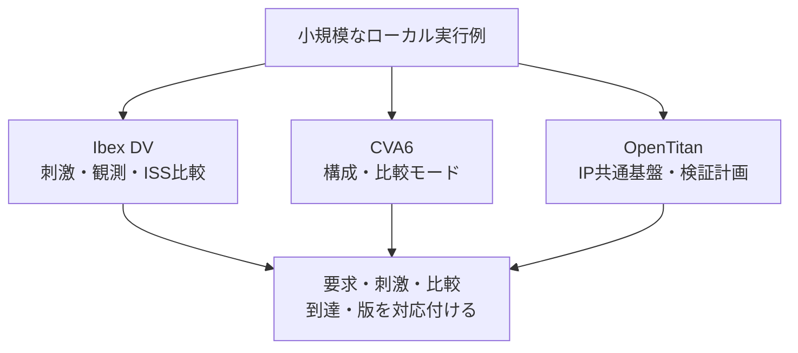

# 実プロジェクトのオープンソースDV環境を読む

小さな回路で刺激・観測・比較・カバレッジを学んだ後に、実際のCPU・IPのDV環境へ進むための案内です。Ibex DV、CVA6、OpenTitanの3件を、上流の固定コミットを読む**参照例**として紹介します。これらのフルDVは、本リポジトリの統合nightlyの実行数には含めません。

## 1. 何を学ぶかで選ぶ

| 参照例 | 読む対象 | 主な学習内容 | 最初の入口 |
| --- | --- | --- | --- |
| [Ibex DV](../../examples/reference-ibex-dv/README.md) | CPU単体のSV/UVM環境 | 命令生成、命令・データメモリー応答、IRQ、RVFI、Spikeとのコシミュレーション | testlist→環境クラス→cosimスコアボード |
| [CVA6](../../examples/reference-cva6-dv/README.md) | 構成可能なCPUの検証 | XLEN・ISAの構成、Verilator／Spikeの経路、UVM環境、比較を有効にする設定 | 実行設定→UVM構成→RVFIの接続 |
| [OpenTitan](../../examples/reference-opentitan-dv/README.md) | 共通基盤を使うIP・SoCのDV | Hjson計画、共通環境、エージェント、RAL、スコアボード、カバレッジ、DVSim | UARTの計画→実行設定→環境・比較 |

CPUの入口は[小規模RISC-Vの検証例](../../examples/local-riscv-iss/README.md)、UVMの入口は[移行ガイド](uvm-migration-guide.md)と[実践設計](uvm-practical-design.md)です。大きな環境でも、どの入力を受け付け、何を観測し、何を期待値と比較するかを先に特定します。

## 2. ソース公開と実行時の依存を分ける

DV環境のソースが公開されていても、その全経路をオープンソースのツールだけで実行できるとは限りません。次の表は、確認した固定版のソース・資料にある経路の整理で、フルDVの動作保証表ではありません。

| 環境・経路 | 依存や確認事項 | このリポジトリでの確認 |
| --- | --- | --- |
| Ibexのcore DV | UVM対応シミュレーター、lowRISCのSpike fork、RISC-Vツールチェーン、命令生成環境。固定版のREADMEはXcelium、シミュレーター設定はVCS／Xceliumを含む | ソース・構成・接続を確認。フルUVMは未実行 |
| CVA6のVerilator／Spike経路 | 対象構成、RISC-Vツールチェーン、指定版Verilator、CORE-V側のSpikeと依存ソース。指向性プログラム実行とSV命令生成を区別 | 設定とスクリプトを確認。RTL／ISSの実行は未確認 |
| CVA6のUVM・生成・カバレッジ経路 | 選択したシミュレーター、参照モデル、submodule、機能の有効化条件を確認。固定版には商用ツール向け設定もある | 環境と条件付きの比較接続を確認。フルUVMは未実行 |
| OpenTitanのIP UVM DV | 上流のDV手順に沿うシミュレーター、DVSim、生成器、共通ライブラリー、IPごとの設定 | UARTの計画・コード・設定を確認。IP／SoCのUVMは未実行 |
| OpenTitanのVerilatorによるソフトウェア実行 | 別のシミュレーション対象・ビルド・ソフトウェア・ツールチェーン | 上流の案内を参照。UVM DVの実行結果へ読み替えない |
| OpenTitanの計画メタデータ操作 | Pythonと少数のPythonパッケージ。HDLシミュレーターは使わない | 実際の上流TestplantoolでCSV出力・照会・出力照合を実行 |

[OpenTitanの導入案内](https://opentitan.org/book/doc/getting_started/index.html)も、Verilatorでのソフトウェア実行とDVの経路を分けています。本リポジトリの小規模UVMがVerilatorで動いた結果は、上流の大規模環境をそのまま実行できる根拠とは別に扱います。

RISCV-DVでは、Pythonの実行制御と、SVによる命令生成を区別します。RTL側がVerilatorでも、選んだ命令生成モードまで同じツールで動くとは限りません。CPU・ISSの設定、生成器の設定、シミュレーターの設定を個別に確認します。

## 3. 読解する版とパスを固定する

2026-11-03の読解対象は次のコミットです。上流資料の導入条件や移行先は、実行する版で改めて確認してください。

| プロジェクト | 固定コミット | 版に関する注意 |
| --- | --- | --- |
| lowRISC/ibex | [`f4515520c0045bb8ef1e72d46ed82499a6ac5f18`](https://github.com/lowRISC/ibex/tree/f4515520c0045bb8ef1e72d46ed82499a6ac5f18) | `dv/uvm/core_ibex/`を読む |
| openhwfoundation/cva6 | [`742dc82a0c706e0a3bfb98b709fd3ee06d50d12a`](https://github.com/openhwfoundation/cva6/tree/742dc82a0c706e0a3bfb98b709fd3ee06d50d12a) | 旧openhwgroup URLから移転。取得できたmasterの固定版で、READMEはmasterのread-only化と移行を案内 |
| lowRISC/opentitan | [`0f8469f729ce8e84993c9987f90af3589172c79d`](https://github.com/lowRISC/opentitan/tree/0f8469f729ce8e84993c9987f90af3589172c79d) | DVSimは`pyproject.toml`で1.52.0を指定。計画操作CLIは`util/testplantool/` |

固定版OpenTitanでは、従来の`util/dvsim/dvsim.py`を前提にせず、[依存の指定](https://github.com/lowRISC/opentitan/blob/0f8469f729ce8e84993c9987f90af3589172c79d/pyproject.toml)を確認します。DVSimによるEDAフローの実行・結果集計と、Testplantoolによる計画の抽出・照会は別の役割です。後者の正常終了は、RTLの試験成功を意味しません。

上流のソースはGit管理下へ取り込まず、リンクと手動演習で参照します。取得したソースのLICENSE・NOTICE・個別ファイルのSPDXを保持してください。特にCVA6はrootのLICENSEと各ファイルの条件が一様ではありません。本リポジトリのLLVM例外を上流ファイルへ追加する扱いにはしません。

## 4. 大きな環境を読む順序

1. **構成と計画**：コア／IP、ISA・パラメーター、testlist／testplan、要求と対応テストを確認する。
2. **刺激**：生成プログラムと、メモリー応答・割り込み・リセットなど外部から与える刺激を分ける。
3. **観測**：モニターのサンプリング時点、受付と完了、RVFIやバスの分析ポートを追う。
4. **期待値と比較**：ISS・予測器・RALなどの役割、比較の粒度、比較を有効にする設定と接続を確認する。
5. **到達と終了**：機能・コードカバレッジ、計画との対応、残りの要求・未完了処理、エラー・時間切れの採用規則を確認する。
6. **再現**：テスト名・seedに、ソース、vendor／submodule、ツール、設定、入力と生成物の版を添える。

スコアボードのクラスが存在することと、今回の構成でその比較が有効なことは別です。CVA6の`tandem_enabled`、OpenTitan UARTの`en_scb`などを、生成・接続・実行の各箇所と対応付けて読みます。

ISSとの比較では、ISA・XLEN・特権・CSR・例外・割り込み・メモリーの扱いをそろえます。Ibexが使うlowRISC forkと、CVA6が参照するSpikeを、名前だけで交換しません。命令退役時の比較と、サイクルや実装タイミングの一致も区別します。

## 5. 小規模教材から持ち込める読み方

| 本リポジトリの題材 | 上流で確認する点 |
| --- | --- |
| [仕様からの項目展開](spec-to-test-items-walkthrough.md) | testpointの記述と、実際に選ばれるテスト・構成の対応 |
| [独立した参照モデル](cpp-reference-verification.md) | ISS・予測器の根拠、DUTとの独立性、比較対象と同期条件 |
| [UVM移行](uvm-migration-guide.md) | 既存チェッカーの再利用、モニター・スコアボードの責務、設定とTLM接続 |
| [機能カバレッジ](functional-coverage.md) | 検証計画上の項目、実行済みテスト、bin到達を別々に追う |
| [故障と復帰](automotive-verification.md) | 検出・取消・出力・原因保持・復帰の観測時点と合否条件 |

上流のISA・バス・セキュリティ機能を追加していく前に、正常な最小ケースを1件選び、入力から比較・完了まで追います。共通のRISCV-DVやISS、vendorライブラリーを共有している場合は、複数環境の実行を独立した複数の期待値と数える前に、共有する実装と前提を整理します。

## 6. 実行確認の範囲

3件とも、固定コミットの取得と、案内するソース・設定の存在を確認しています。実行した小演習は[OpenTitanの計画ツール](../../examples/reference-opentitan-dv/README.md#商用ツールを使わない小演習)です。独自の3 testpointからCSVを出力し、条件に合う2点を照会して内容を照合しました。

その過程で、確認版のCLIの`--fields si_stage`が`stage`まで返す不具合を再現しました。引数の文字列をリストへ分割してからライブラリーへ渡す修正例と、修正前後の出力照合も記載しています。上流へ修正を送付・反映したという意味ではありません。

上流のフルUVM、CPUのRTL／ISS実行、OpenTitanのチップシミュレーション、実際のカバレッジ収束・サインオフは、今回の実行確認に含めていません。参照例3件は統合ランナーの130登録項目・108ルートジョブへ加算せず、ローカル実行例と実プロジェクトの読解・手動演習を分けます。

固定版の取得・演習・文書検査・既存リグレッションの監査は、[実行記録](../../PROVENANCE.md#upstream-dv-20261103)へまとめています。
