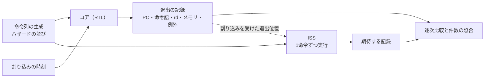

# プロセッサの検証

プロセッサの検証を、命令の意味、パイプラインの制御、例外と割り込み、特権と保護、メモリの順序、デバッグ、性能の観測へ分け、それぞれの期待値と検出力の作り方を整理します。入口は[RISC-VコアとISSの比較](../../examples/local-riscv-iss/README.md)で、同じコアとテストベンチを[分岐予測](../../examples/local-branch-predictor/README.md)、[ロード・ストア](../../examples/local-load-store/README.md)、[例外・割り込み](../../examples/local-riscv-traps/README.md)へ広げていきます。

このリポジトリのコアは、教材として書いたRV32Iの小さなパイプラインです。この資料は検証の組み立て方を説明するもので、RISC-Vの互換性の認定や、特定の製品コアのサインオフ手順ではありません。

## プロセッサの検証が難しい理由

バスや周辺回路は、インターフェースの規則と数十個のレジスタで仕様を書けます。プロセッサは、命令の列がそのまま入力です。入力の空間はプログラムの数だけあり、同じ命令でも前後の命令、パイプラインの詰まり方、割り込みの時刻によって通る回路が変わります。

| 難しさ | 起きること | 対策の方向 |
| --- | --- | --- |
| 入力が命令列 | 1命令ずつは正しくても、並び方で誤る（転送、ロード直後の使用、分岐の取消し） | 命令列の生成でハザードの並びを作り、到達を数える |
| 内部の時刻が外から見えない | 何サイクル目に結果が出るかは実装で違う | 退出（retire）した命令の単位で比べる |
| 仕様が大きい | 例外の優先順位、CSRの各ビット、特権の組合せ | 仕様の節ごとに要求へ分け、命令セットシミュレーター（ISS）を期待値にする |
| 期待値と実装が同じ誤解を共有する | 自作のISSとコアを同じ人が書くと、同じ読み違いをする | 外部の試験プログラムや別のISSとも照合する |

## 1. 最初に対象境界を決める

| 対象 | 主な確認事項 | このリポジトリの入口 |
| --- | --- | --- |
| 命令の解読 | 全命令語に対する解読結果、不正な命令の判定 | [命令デコーダのフォーマル証明](../../examples/local-riscv-decoder/README.md) |
| 命令の実行とパイプライン | レジスタ・PC・メモリの変化、転送、ストール、フラッシュ | [コアとISSの比較](../../examples/local-riscv-iss/README.md)、[ロード・ストア](../../examples/local-load-store/README.md) |
| 分岐予測 | 予測が結果を変えないこと、予測外れからの復帰、性能カウンター | [分岐予測器](../../examples/local-branch-predictor/README.md) |
| 例外と割り込み | 原因・戻り番地・退避するCSR、取消す命令、MRET | [例外・割り込み](../../examples/local-riscv-traps/README.md) |
| 保護とアドレス変換 | PMPの判定、ページテーブルウォーク、TLBと無効化 | [PMP判定](../../examples/local-riscv-pmp/README.md)、[Sv32ウォーク](../../examples/local-sv32/README.md)、[TLB](../../examples/local-tlb/README.md) |
| メモリの順序 | ストアバッファの可視性、FENCE、キャッシュの一貫性 | [ストアバッファ](../../examples/local-store-buffer/README.md)、[キャッシュコヒーレンシ](../../examples/local-cache-coherence/README.md) |
| 演算器 | 多サイクル演算の開始・完了・取消し | [多サイクル除算器](../../examples/local-divider/README.md) |
| SoCへの組込み | ROMからの起動、バス、割り込みハンドラー | [画像処理SoC](../../examples/local-image-soc/README.md)、[ネットワークSoC](../../examples/local-network-soc/README.md) |
| 冗長化 | 2コアの比較と安全状態 | [ロックステップ監視](../../examples/local-lockstep-monitor/README.md) |

対象の命令セット（基本命令、拡張、特権モード）と、実装が選べる項目（リセット時の値、未実装のCSRの扱い、境界に合わないアクセスの扱い）を、最初に表へ書き出します。仕様が実装へ選択を任せている箇所は、ISSとコアの設定を同じにしないと、正しい実装どうしでも食い違います。

## 2. 退出の単位で比べる

パイプラインの中では、複数の命令が同時に進みます。途中の信号を比べると、実装を変えるたびにテストベンチも直すことになります。そこで、命令が結果を確定させた時点（退出）の情報だけを取り出して比べます。

退出の記録に入れる項目は、次のとおりです。[riscv-formal](https://github.com/YosysHQ/riscv-formal)が定めるRVFI（RISC-V Formal Interface）が、この考え方の公開された形です。

| 項目 | 目的 |
| --- | --- |
| 退出の有効、通し番号 | 欠落と重複、順序を検出する |
| PCと次のPC | 分岐・ジャンプ・例外の行き先、連続する退出のつながり |
| 命令語 | フェッチした命令が正しいこと、取消した命令が退出しないこと |
| 読んだレジスタの番号と値 | 転送の誤りを、結果の値とは別に検出する |
| 書くレジスタの番号と値 | 命令の結果。x0へは書かない |
| メモリのアドレス・バイト有効・読み書きの値 | ロード・ストアの幅と符号拡張 |
| 例外・割り込みの有無と原因 | 精密な例外。原因と戻り番地 |

割り込みは、コアのどの命令の境界で受けるかが実装とタイミングで決まります。ISSへは「この退出の直前で割り込みを受けた」という事実をコアの記録から渡し、その後のCSRと行き先を比べます。[例外・割り込みの例](../../examples/local-riscv-traps/README.md)がこの方式です。受ける位置そのものの妥当性（禁止中に受けていない、待たせすぎていない）は、別のチェッカーで見ます。

## 3. 要求へ分解する

仕様の節と、検査の方法を対応させます。

| 仕様の領域 | 要求の例 | 確認方法 |
| --- | --- | --- |
| 解読 | 各命令語が1つの操作に決まる。未定義の命令語は不正と判定する | 全命令語のフォーマル証明、または全数のシミュレーション |
| 演算・分岐 | rdの値と次のPCが命令の定義どおり | ISSとの逐次比較、境界値（最大・最小・シフト量31） |
| ロード・ストア | 幅、符号拡張、バイト有効、境界に合わないアクセス | ISSとの比較とメモリの最終状態の照合 |
| パイプライン | 転送、ロード直後の使用、分岐の取消し、ストール中の保持 | ハザードの並びを目標にした命令列と、退出の件数 |
| 例外 | 原因の優先順位、mepc・mcause・mtval、後続の命令が状態を変えない | 例外を起こす命令の前後に副作用のある命令を置く |
| 割り込み | 許可と保留、受ける境界、MRETでの復帰 | 割り込みの時刻を命令の各段へずらす |
| CSR | 各ビットの読み書き属性、読み書きの副作用、未実装の番号 | ビットごとの書込みと読出し、特権ごとの許可 |
| 特権と保護 | モードの遷移、PMP・ページングの判定、MPRV | 判定回路の単体と、コアへ組み込んだ例外の両方 |
| メモリの順序 | 自分のストアが見えること、他hartへの可視性、FENCE | リトマス試験の結果集合と抽象モデルの全探索 |
| デバッグ | [停止・再開・1命令実行](../../examples/local-riscv-debug/README.md)、抽象コマンド、dcsr・dpc、JTAG経由のアクセス | 実行例あり。教材用の部分実装で、実装した範囲はDebug Specification 1.0と照合済み。外部のデバッガーとの接続は未実施 |
| 性能の観測 | 退出数、予測外れ数、サイクル数 | カウンターの値を独立に数えた件数と照合 |

## 4. 重点にするクロス

すべての組合せは実行できません。次の重なりを先に固定の試験にします。

| クロス | 見つかる誤り |
| --- | --- |
| 直前・2つ前の命令の書くレジスタ × 今の命令の読むレジスタ（rs1・rs2） | 転送の経路の抜け、x0の転送 |
| ロード × 直後の使用 × ストール | ロードの値が届く前の使用 |
| 分岐の成立・不成立 × 予測 × 分岐直後の命令の種類（ストア、CSR書込み、例外を起こす命令） | 取消したはずの命令の副作用 |
| 例外を起こす命令 × パイプラインの各段にいる後続の命令 | 精密でない例外 |
| 割り込みの到着 × 各命令の種類（分岐、ロード待ち、多サイクル演算、MRET） | 戻り番地の誤り、命令の二重実行 |
| 割り込み × 例外の同時発生 | 優先順位、原因の取り違え |
| メモリの待ち × フラッシュ | 取消した後に届く応答の扱い |
| 多サイクル演算 × 取消し × 次の開始 | 古い結果の混入 |

[クロス条件の選び方](cross-test-selection-walkthrough.md)と同じく、起こりえない組合せ（x0への転送など）は理由を付けて除外します。

## 5. 独立した期待値を用意する

| 方法 | 使いどころ | 注意 |
| --- | --- | --- |
| 自作のISS（Python） | 命令の意味。1命令ずつ進められ、割り込みの位置を外から与えられる | コアと同じ人が書くと、同じ誤解を共有する。仕様の節番号を付けて別の構造で書く |
| 外部のISS（Spike、Sailモデル） | 自作ISSの誤解の検出、広い命令セット | 実装依存の項目と起動時の状態を合わせる必要がある |
| 公開の試験プログラム（riscv-tests、riscv-arch-test） | 命令ごとの基本動作。自己判定または署名の比較 | 単一命令の確認が中心で、パイプラインの重なりや割り込みの時刻は狙っていない |
| 性質のフォーマル証明（riscv-formalの方式） | 命令ごとの意味、レジスタの一貫性、PCのつながり | 有界検査は深さまで。メモリと割り込みはモデルの仮定に依存する |
| 抽象モデルの全探索 | メモリの順序の結果集合 | 小さなプログラムと小さな状態に限る |

このリポジトリのISSは自作です。[命令デコーダ](../../examples/local-riscv-decoder/README.md)だけは、ISSと別に書いた表から全命令語を証明しています。公開の試験プログラム（riscv-tests）との照合は[別の例](../../examples/local-riscv-official-tests/README.md)で行っています。外部のISS（Spike、Sail）との実行記録の比較は、まだ行っていません（[下の表](#2026-11-21に加えた例とまだ例がない項目)）。

## 6. 検出力を確かめる

既存のコアには、番号を付けた意図的な誤り（変異）があります。変異は、通る試験と検出する検査ラベルを予定しておき、そのとおりになることを要求します。

| 変異の種類 | 例 | 検出に必要なもの |
| --- | --- | --- |
| 転送の誤り | 2つ前の命令からの転送を落とす | その距離の依存がある命令列 |
| ロード直後の使用 | ストールを入れない | ロードと使用が隣り合う並び |
| 分岐の取消し | 取消すべき命令のストアを通す | 分岐直後のストアと、メモリの最終状態の照合 |
| 予測に依存する誤り | 予測ありの構成だけで起きる | 構成を分けた実行。予測なしでは合格することを診断として記録 |
| 例外の精密さ | 例外の後続命令がレジスタを書く | 例外の直後に副作用のある命令 |
| CSRの退避 | mepcに次の命令の番地を入れる | 戻った後の命令列の比較 |

ISSとの比較で見つからない変異もあります。結果を変えない性能上の誤り（予測器が学習しない）は、[性能カウンターの照合](../../examples/local-branch-predictor/README.md)でないと見つかりません。試験プログラムが通らない並びにある誤りは、命令列の生成の目標を足すか、フォーマルで探します。

## 7. 既存の実行例との対応

| 項目 | 実行例 | 範囲 |
| --- | --- | --- |
| 命令の解読 | [命令デコーダ](../../examples/local-riscv-decoder/README.md) | RV32Iの全命令語をフォーマルに証明 |
| ISSとの逐次比較 | [コアとISS](../../examples/local-riscv-iss/README.md) | 演算・分岐・ジャンプ・ワード単位のロードとストア |
| 幅のあるメモリアクセス | [ロード・ストア](../../examples/local-load-store/README.md) | バイト・ハーフワード、符号拡張、バイト有効 |
| 分岐予測 | [分岐予測器](../../examples/local-branch-predictor/README.md) | 方向の予測。飛び先の予測は対象外 |
| 例外と割り込み | [例外・割り込み](../../examples/local-riscv-traps/README.md) | 機械モードの同期例外4種類と外部割り込み1本 |
| PMP | [PMP判定](../../examples/local-riscv-pmp/README.md) | 4エントリーの判定回路の単体。コアへの統合は[下の表](#2026-11-21に加えた例とまだ例がない項目)の特権モードの例 |
| ページング | [Sv32ウォーク](../../examples/local-sv32/README.md)、[TLB](../../examples/local-tlb/README.md) | ウォーカーとTLBの単体・結合。コアへは未統合 |
| メモリの順序 | [ストアバッファ](../../examples/local-store-buffer/README.md) | 2 hartのリトマス試験。命令は実行しない |
| キャッシュ | [キャッシュコヒーレンシ](../../examples/local-cache-coherence/README.md)、[キャッシュとDMA](../../examples/local-cache-dma/README.md) | 2クライアントの一貫性、DMAとの見え方 |
| 除算器 | [多サイクル除算器](../../examples/local-divider/README.md) | 32ビットはシミュレーション、4・8ビットはフォーマル |
| SoCでの実行 | [画像処理SoC](../../examples/local-image-soc/README.md)、[ネットワークSoC](../../examples/local-network-soc/README.md) | ROMのプログラム、割り込みハンドラー。SoC用ISSとの逐次比較はしない |

公開プロジェクトの検証環境は、次の参照例で読めます。どれも上流のフルの検証は実行していません。

| 参照例 | 読むところ |
| --- | --- |
| [Ibex DV](../../examples/reference-ibex-dv/README.md) | 命令列の生成（riscv-dv）、メモリ応答、割り込み、RVFI、Spikeとの同時実行 |
| [CVA6](../../examples/reference-cva6-dv/README.md) | 構成ごとの経路、Spikeとの比較、生成器とRTLの設定の対応 |
| [CORE-V-VERIF](../../examples/reference-core-v-verif/README.md) | OBI・割り込み・デバッグ、RVFI／RVVI、ISSの設定 |
| [PicoRV32](../../examples/reference-picorv32/README.md) | 小さなCPUの簡易テストベンチに自動判定を足す演習 |

### 2026-11-21に加えた例と、まだ例がない項目

| 項目 | 内容 | 状態 |
| --- | --- | --- |
| 退出の性質のフォーマル検査 | [RVFI相当の信号での検査](../../examples/local-riscv-formal/README.md)。命令ごとの結果・メモリアクセス・レジスタの一貫性・PCのつながり | 実行例あり。すべて有界検査で、帰納法の証明はない。`TRAPS=0`の構成だけ |
| 外部の基準との照合 | [riscv-testsのrv32ui 40本](../../examples/local-riscv-official-tests/README.md)を、コアと自作ISSで実行 | 実行例あり。環境ヘッダーは最小版（コアに`mhartid`がなく、ISSがFENCEを実行できないため）。arch-test、Spike・Sailとの実行記録の比較は未着手 |
| 特権と保護の統合 | [M／UモードとPMPの統合](../../examples/local-riscv-priv/README.md)。アクセスフォルト、タイマー・ソフトウェア割り込み、ベクター式のmtvec、割り込みの入れ子、WFI | 実行例あり。Sモード、ページングの統合、Smepmpは未着手 |
| デバッグ | [停止・再開・1命令実行](../../examples/local-riscv-debug/README.md)、抽象コマンド、dcsr・dpc、JTAG経由のアクセス | 実行例あり。教材用の部分実装で、実装した範囲はDebug Specification 1.0と照合済み。外部のデバッガーとの接続は未実施 |
| アトミック命令 | [LR／SCとAMO](../../examples/local-riscv-atomic/README.md)、予約の無効化、リトマス試験 | 実行例あり。操作ポートを持つ回路で、コアへは未統合 |
| アウトオブオーダーの資源管理 | [リネーム表・フリーリスト・ROB](../../examples/local-rename-rob/README.md)の保存則 | 実行例あり。証明はROB 4エントリーまで。発行キューとロード・ストアキューは未着手 |
| 浮動小数点 | [加算器](../../examples/local-fp-adder/README.md)の丸めモード、例外フラグ、subnormal、NaN | 実行例あり。乗除算・FMA・変換は未着手。[CVFPUの参照例](../../examples/reference-cvfpu-uvm/README.md)は読解のみ |
| 圧縮命令・M拡張・飛び先の予測 | 16ビット命令の境界、乗除算の命令、BTBと戻り番地スタック | 未着手 |

## 8. 製品で追加する確認

| 追加する確認 | 内容 |
| --- | --- |
| 互換性 | RISC-V Architectural Test Suiteなど、公開された基準での確認。対象のプロファイルと拡張を明記する |
| 大きなプログラム | OSの起動、コンパイラーの試験、ベンチマーク。エミュレーションやFPGAでの実行と、失敗したときにシミュレーションへ戻す手順 |
| 命令列の生成の収束 | カバレッジ（命令×オペランド×ハザード×特権×例外）の到達と、seedごとの新規到達の推移 |
| フォーマルの適用範囲 | 証明した性質、深さ、メモリと割り込みの仮定、ブラックボックスにした部分 |
| 構成の行列 | 拡張の有無、キャッシュ・予測器・PMPエントリー数などのパラメーターごとの回帰 |
| デバッグと試験 | デバッグモジュール、トレース、スキャン・MBISTと機能モードの切替え |
| 低電力 | WFI、クロックゲーティング、状態保持からの復帰（[低電力の検証](low-power-verification.md)） |
| セキュリティ | 特権の昇格、投機実行による情報の流れ、デバッグ経由のアクセス（[セキュリティの検証](security-verification.md)） |

## 9. 参考にした一次資料

- [The RISC-V Instruction Set Manual](https://docs.riscv.org/reference/isa/)：命令の意味（Volume I）と、特権・CSR・例外・PMP・ページング（Volume II）。既存の例は、各READMEに参照した版と節を書いています。
- [riscv-formal](https://github.com/YosysHQ/riscv-formal)：RVFIの定義と、命令ごとの検査・レジスタの一貫性・PCのつながりの検査の構成。
- [riscv-dv](https://github.com/chipsalliance/riscv-dv)：命令列の生成器。ハザードや割り込みを狙う並びの作り方。
- [riscv-arch-test](https://github.com/riscv-non-isa/riscv-arch-test)と[riscv-tests](https://github.com/riscv-software-src/riscv-tests)：公開の試験プログラム。
- [Spike](https://github.com/riscv-software-src/riscv-isa-sim)と[Sail RISC-Vモデル](https://github.com/riscv/sail-riscv)：外部のISSと、仕様を実行できる形で書いたモデル。
- [RISC-V Debug Specification](https://github.com/riscv/riscv-debug-spec)：デバッグモジュールとデバッグモードの定義。
- [Ibexの検証の説明](https://ibex-core.readthedocs.io/en/latest/03_reference/verification.html)：生成器・同時実行・カバレッジを組み合わせた公開の実例。
