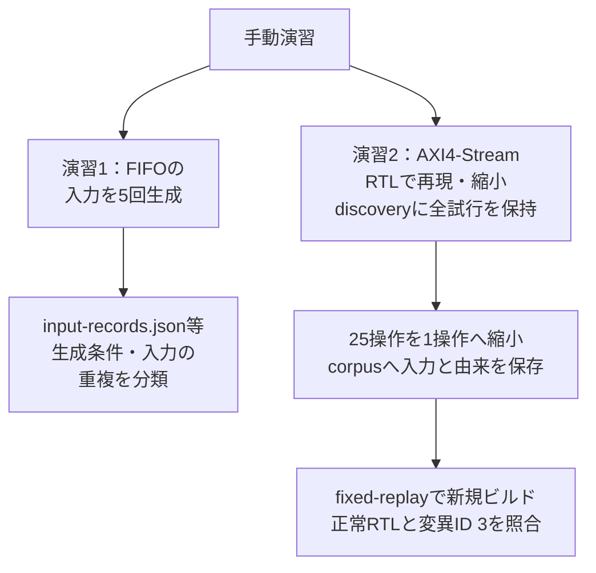

# 演習：ランダム入力の重複を調べ、失敗ケースを固定して再生する

[探索管理の解説](random-search-management.md)を、既存のFIFO生成器とAXI4-Streamの縮小例で試します。新しい探索サービスやCI登録を実装する演習ではありません。生成条件と実入力の分類、失敗の保存、固定入力からの新しいRTL実行を確認します。

リポジトリのルートから同じシェルで順に実行します。Python 3.10以上を使い、演習2にはIcarusの`iverilog`と`vvp`をPATHへ用意します。Pythonの追加パッケージは不要です。掲載手順はPython 3.13.15・macOS arm64・Icarus Verilog 14系で確認しています。



2本の枝は別々の題材です。FIFOは入力生成の分類、AXI4-StreamはRTL実行と固定入力の再生を確認します。変異ID 3は1種類の誤実装で、正常RTLとの2判定を行います。下の手順と、末尾の保存物一覧を対応付けてください。

## 1. FIFOの入力生成で重複を分類する

既存の[`random_vectors()`](../../examples/local-fifo/run.py)から入力を生成します。この節は入力の分類だけで、RTLシミュレーションやカバレッジ計測は行いません。

`RANDOM_TOUR_PYTHON`でPython、`RANDOM_TOUR_DIR`で新しい出力先を指定できます。出力先は既存ディレクトリを指定せず、初回と再試行も別に保持します。

```sh
set -e
search_py="${RANDOM_TOUR_PYTHON:-python3}"
search_out="${RANDOM_TOUR_DIR:-$PWD/artifacts/random-search-tour}"
test ! -e "$search_out"
mkdir -p "$search_out"
"$search_py" - "$search_out" <<'PY'
import hashlib
import importlib.util
import json
import sys
from pathlib import Path

def require(condition, message):
    if not condition:
        raise RuntimeError(message)

def digest(value):
    encoded = json.dumps(value, sort_keys=True, separators=(',', ':'),
                         ensure_ascii=True, allow_nan=False).encode('utf-8')
    return hashlib.sha256(encoded).hexdigest()

out = Path(sys.argv[1])
source = Path('examples/local-fifo/run.py').resolve()
spec = importlib.util.spec_from_file_location('fifo_duplicate_tour', source)
fifo = importlib.util.module_from_spec(spec)
spec.loader.exec_module(fifo)
generator = dict(source_sha256=hashlib.sha256(source.read_bytes()).hexdigest(),
                 python=sys.version, rng='random.Random')
requests = [('A1', 17, 3, 16), ('A2', 17, 3, 16), ('B1', 18, 3, 16),
            ('C1', 17, 8, 16), ('D1', 17, 3, 17)]
records, seen = [], {}
for attempt, seed, depth, cycles in requests:
    config = dict(depth=depth, width=8)
    generation = dict(schema='fifo-generation-v1', generator=generator,
                      config=config, seed=seed, cycles=cycles)
    key = digest(generation)
    vectors = fifo.random_vectors(depth, 8, seed, cycles)
    payload = dict(schema='fifo-cycle-v1', config=config,
                   fields=['rst_n', 'wr_en', 'rd_en', 'wr_data'],
                   timing='one row per fifo_tb cycle, including reset and drain',
                   vectors=vectors)
    records.append(dict(attempt_id=attempt, generation=generation,
                        generation_key=key, input_key=digest(payload),
                        duplicate_of=seen.get(key), input=payload))
    seen.setdefault(key, attempt)

require(len(records) == 5, 'attempt count differs')
require(len({r['generation']['seed'] for r in records}) == 2, 'seed count differs')
require(len({r['generation_key'] for r in records}) == 4, 'generation uniqueness differs')
require(len({r['input_key'] for r in records}) == 4, 'input uniqueness differs')
require(records[1]['duplicate_of'] == 'A1', 'duplicate origin differs')
require(records[0]['input'] == records[1]['input'], 'same request generated different inputs')
require(all(r['duplicate_of'] is None for r in records[2:]), 'unexpected duplicate')
summary = dict(success=True, attempts=5, seed_values=2,
               generation_conditions=4, inputs=4, rtl_executed=False)
(out / 'input-records.json').write_text(json.dumps(records, indent=2) + '\n')
(out / 'input-summary.json').write_text(json.dumps(summary, indent=2) + '\n')
for r in records:
    print(r['attempt_id'], r['generation_key'][:12], r['input_key'][:12],
          'duplicate_of=' + str(r['duplicate_of']))
print(json.dumps(summary))
PY
```

A1とA2は生成条件・入力が一致し、他の3件は異なります。seedの数値だけで数えると2種類ですが、構成・長さを含む生成条件と入力は4種類です。A2の試行記録も残し、意図した再生成を削除しません。ハッシュの表示は先頭12桁ですが、照合と保存には全桁を使います。

この`generation_key`は、本例の生成器を分類するためのものです。DUT・チェッカー・シミュレーターの実行条件を含まないため、過去のRTL合格結果の再利用には使えません。入力のJSONには全サイクルを保存し、resetや末尾の排出を除いて同一視しません。

別プロセスでの再現を確認する場合は、別の`RANDOM_TOUR_DIR`で掲載手順を実行し、両方の`input-records.json`の生成条件・入力・全桁ハッシュを比較します。Pythonや生成器の版が変われば、一致しない場合があります。ハッシュを新しい値へ書き換えて一致したことにはしません。

## 2. AXI4-Streamの失敗を保存し固定入力として再生する

### 失敗を縮小する

既存の[縮小例](../../examples/local-failure-reduction/README.md)を起動します。正常なRTLと、出力データのbit 0を反転する変異3を使います。未知のバグ探索の性能を測る例ではなく、不具合を確実に再現する操作を含む教材です。

```sh
"$search_py" examples/local-failure-reduction/run.py --seed 17 \
  --out "$search_out/discovery"
```

元の25操作、縮小後の`reproducer.json`、全試行のベクトル・ログ・VCD・ソースハッシュを保存します。seed 17での確認では9回のRTL実行を行い、次の1操作へ縮小しました。これはこの版・構成での結果で、全候補中の最短性を保証しません。

```json
[{"op": "beat", "data": 0, "keep": 1, "last": 0}]
```

TKEEPのbit 0が1なので、反転したbitは有効なバイトに属し、`AXIS_DATA`の比較対象です。`rows()`はこの操作に加えて初期resetと排出を作ります。保存した1操作だけを、初期化なしでDUTへ投入する再現条件ではありません。

### 入力をケース集へ保存し、新しいビルドで再生する

縮小結果を`corpus/AXIS-DATA-001.json`へコピーし、元の証跡との対応を`case.json`へ残します。ランダム列の生成を呼ばず、保存した操作を[`rows()`](../../examples/local-failure-reduction/run.py)でベクトルへ変換します。[共通の実行・判定処理](../../examples/local-exploration-common/evidence.py)で、現在のソースを新しくビルドします。

```sh
"$search_py" - "$search_out" <<'PY'
import hashlib
import importlib.util
import json
import shutil
import sys
from pathlib import Path

def require(condition, message):
    if not condition:
        raise RuntimeError(message)

base = Path(sys.argv[1]).resolve()
discovery = base / 'discovery'
original_summary = json.loads((discovery / 'summary.json').read_text())
require(original_summary['success'] and original_summary['complete'], 'discovery did not succeed')
require(original_summary['planned'] == 6, 'discovery plan differs')
corpus = base / 'corpus'
corpus.mkdir()
fixture = corpus / 'AXIS-DATA-001.json'
shutil.copyfile(discovery / 'reproducer.json', fixture)
shutil.copyfile(discovery / 'manifest.json', corpus / 'source-manifest.json')
def sha(path):
    return hashlib.sha256(path.read_bytes()).hexdigest()
meta = dict(schema='axis-fixed-case-v1', case_id='AXIS-DATA-001',
            depth=2, data_width=32, keep_width=4, checker='AXIS_DATA',
            input_mode='saved actions; initial reset and drain supplied by rows()',
            fixture_sha256=sha(fixture), original_actions_sha256=sha(discovery / 'original.json'),
            origin_manifest_sha256=sha(corpus / 'source-manifest.json'),
            normal_expected='pass', mutation3_expected='detected')
metadata = corpus / 'case.json'
metadata.write_text(json.dumps(meta, indent=2) + '\n')
require(sha(fixture) == json.loads(metadata.read_text())['fixture_sha256'], 'fixture hash differs')
actions = json.loads(fixture.read_text())
require(actions, 'empty saved actions')

source = Path('examples/local-failure-reduction/run.py').resolve()
spec = importlib.util.spec_from_file_location('fixed_axis_tour', source)
reducer = importlib.util.module_from_spec(spec)
spec.loader.exec_module(reducer)
parser = reducer.E.parser('Replay a saved case', 'fixed-axis-tour')
args = parser.parse_args(['--seed', '0', '--out', str(base / 'fixed-replay')])
reducer.E.validate(parser, args)
evidence = reducer.E.Evidence('fixed-axis-tour', args,
    [source, fixture, metadata, corpus / 'source-manifest.json', *reducer.E.axis_inputs()],
    meta, ['normal-rtl', 'known-bad-rtl'])
sim = reducer.E.AxisSimulator(evidence)
vectors = reducer.rows(sim.plugin, actions)
normal = sim.execute('normal-rtl', vectors)
bad = sim.execute('known-bad-rtl', vectors, 3, 'AXIS_DATA')
evidence.check('normal-rtl', normal['status'] == 'pass', normal['message'])
evidence.check('known-bad-rtl', bad['status'] == 'detected', bad['message'])
sim.save()
raise SystemExit(evidence.finish())
PY
```

既存パーサーのseed欄は0で記録しますが、この再生は乱数を使いません。通常RTLでは独立比較・予定件数・正常完了・波形が必要です。変異では、非0終了・予定した唯一の`AXIS_DATA`・正常完了記録なしを確認します。ビルド不能、時間切れ、別ラベル、波形の欠落を検出成功にしません。

この比較は、既存の意図した変異と元の正常RTLに対するものです。製品のバグ修正では、不具合のある実コミットと修正コミットをそれぞれ指定し、同じ固定入力に加えて元の長い列・周辺構成も再確認します。

### 恒久的な回帰テストへ移すとき

ここで作った`corpus/`はGit管理外の演習出力です。自動的に統合CIへ登録した結果ではありません。恒久化するときは次を行います。

1. 入力とメタデータを、プロジェクトの版管理するテスト資産へ移す。大きな証跡は保持期間のある保存先へ結び付ける。
2. 固定ケースID `AXIS-DATA-001`をランナーの予定一覧へ登録し、正常RTLでの比較・完了を通常の合格条件にする。
3. 元の要求・不具合票・修正前後の実行IDと対応付け、CIで未起動・結果欠落を検出する。
4. 必須回帰ケースをbin重複だけで選択対象から外さず、関連構成と新しいseedの探索も維持する。
5. PASS後も固定入力と判定処理を保持する。短い回帰で一時的に選ばない場合も、定期計画・最終実行・最大未実行期間を追跡し、過去のPASSだけで恒久除外しない。

| 保存物 | 読む内容 |
| --- | --- |
| `input-records.json` | 5試行の生成条件、完全な入力、ハッシュ、重複先 |
| `input-summary.json` | 生成条件4種類・入力4種類の照合。RTLの合格数ではない |
| `discovery/` | 元の25操作、縮小後の列、探索の採否、全実行・ソース・ツールの記録 |
| `corpus/` | 固定入力、元の版・入力への対応、期待結果とハッシュ |
| `fixed-replay/` | 新規ビルド、正常RTLと変異の2判定、各入力・ログ・波形・JUnit |

`discovery/`のログ・入力に加え、対応するソース・ツール・外部依存も保持してください。`case.json`やハッシュ一覧だけで、元の実行を復元できるわけではありません。[管理上の集計と保持方針](random-search-management.md#6-集計とケース集を維持する)へ戻り、探索の試行数、原因の分かった不具合数、実際にCI登録した固定ケース数を分けて報告します。

掲載手順の別プロセスでの再現、入力ハッシュ、新規RTL実行と文書・ツール検査の結果は、[2026-11-03の実行記録](../../PROVENANCE.md#random-search-20261103)を参照してください。

記録の合否は、最適化で無効になるPythonの`assert`文に依存させず、明示的な条件分岐で不一致を拒否します。
