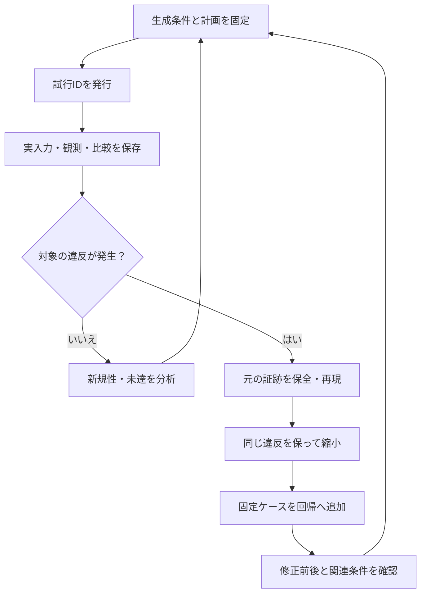

# ランダム検証の探索を管理する：重複・再現性・失敗ケースの回帰化

ランダム検証を長く回すと、「同じことを何度も試している」「見つけた失敗が再現しない」「修正後に同じバグをまた見逃す」という問題が起こります。探索で得た入力と結果を管理し、失敗を再発防止の回帰テストへ残す手順を説明します。

[制約付きランダム検証](constrained-random-verification.md)の運用を具体化した資料です。[実行する演習](random-search-management-walkthrough.md)では、FIFOの入力列の重複を調べ、AXI4-Streamの失敗列を縮小し、保存した入力を新しいビルドへ再生します。ここで示す台帳・分散実行・保持方針は設計例で、リポジトリの統合ランナーに自動重複排除やコーパス登録を追加したものではありません。

## 1. 探索・再現・回帰テストの役割を分ける

| 目的 | 主に残すもの | 合否・進捗の見方 |
| --- | --- | --- |
| 新しい条件を探索する | 生成条件、実入力、到達した状態・順序、比較結果、未達への変更 | 必須目標と検出力を維持し、探索の偏りや追加効果を調べる |
| 見つけた失敗を再現する | 元の入力・版・構成・ログ・波形、最初の相違、全試行 | 同じ原因による規則違反が再び起きるかを確かめる |
| 再発を防ぐ | 安定したケースID、固定入力・初期化・期待結果、対応要求と不具合ID | 修正前には対象違反を検出し、修正後には同じ入力で正常完了する |

探索用seedを増やすことと、既知バグの固定テストを維持することは両方必要です。バグを起こしたseedだけを保存すると、生成器や制約の変更で必要な条件が消えることがあります。

ビルド不能、生成不能、実時間のタイムアウトは、図の対象違反へ無条件にまとめません。[失敗解析](failure-analysis.md)で分類し、判定できなかった探索として記録します。

## 2. 「何が重複したか」を先に定義する

| 重複を比べる単位 | 例 | 扱い |
| --- | --- | --- |
| seedの数値 | 別構成でどちらもseed 17 | これだけでは同じ探索と判断できない |
| 生成条件 | 同じ生成器・制約・構成・長さ・全乱数源のseed | 誤った二重投入の検出に使う。意図した再試行は残す |
| 実入力列 | 同じ構成・初期条件・時刻規則で、全入力が一致 | 入力の重複として分類できる。別版DUTの確認まで省略しない |
| 観測した振る舞い | 同じ状態遷移や操作順序 | 定義した抽象化の下での類似性。捨てた情報も記録する |
| カバレッジのbin集合 | 異なるデータ・履歴でも同じbinへ到達 | 探索の追加効果を調べる情報。入力や検出力の同一性を示さない |
| 失敗の署名 | 同じチェッカーID・インスタンス・エラー分類 | 原因を調べるための仮のグループ。根本原因の一致は別に確認する |

たとえば、FIFOの「満杯」「読出し」binが同じでも、満杯になる前のデータ順序や、リセット直前の待ちが違えば、別の不具合を検出できます。[UVMランダム例](../../examples/local-uvm-random/README.md)は固定12操作で必須binを確保するため、その後のランダム履歴が異なっても全24 binという集合は同じになり得ます。

### 条件のIDと試行IDを別々に持つ

以下の名前は、本資料の管理例です。既存ランナーの共通API名ではありません。

| 記録 | IDを作る根拠・保存内容 |
| --- | --- |
| `generation_key` | 生成器と制約・重みの版、テスト・構成・初期条件、全乱数源とseed、操作数・探索予算、適応的な選択に使った状態 |
| `input_key` | 入力形式の版、構成、初期化・時刻の意味、実際の全入力列のハッシュ。元ファイルのバイト列のSHA-256も別に保存する |
| `verification_key` | 入力とその再生条件、DUT・テストベンチ・チェッカー・モデル・仕様の版、ビルド・ツール・外部依存・終了条件など、判定に影響する条件 |
| `attempt_id` | 実際の試行ごとに発行する一意なID。計画ケース、前の試行、開始・終了・状態・証跡と結び付ける |

同じ`generation_key`の二重投入を防いでも、失敗の再現や資源障害からの再試行には新しい`attempt_id`を付けます。初回の失敗と再試行の成功を、同じファイルへ上書きしません。

ハッシュの前にJSONのキー順、数値・文字列の型、既定値の展開、入力形式の版を決めます。操作の順序は保持します。Pythonの組込み`hash()`を永続台帳の識別子にはせず、正規化した内容のSHA-256等を使います。乱数を生成する前に作れるIDと、実入力を得てから作るIDも区別します。

### 同じ入力でも実行が必要な場面

- DUT、チェッカー、仕様、ビルド条件やツールが変わったとき。
- 初回失敗の再現、修正前後の比較、不安定な試験の調査を行うとき。
- 同じ入力を別構成・別実装へ与えるときや、必須の固定回帰テストを実行するとき。

過去の結果を再利用するなら、上記の判定条件と入力・完了証跡まで照合する別の仕組みが必要です。本資料の入力ハッシュだけを、過去の合格を使い回すキャッシュにはしません。[保存結果の監査](../../tools/REPORTING.md)も、現在の計画とソースに対して照合します。

## 3. 重複を減らしても、必要な探索を残す

### 例：5件の入力生成を分類する

| 試行 | seed | FIFO深さ／幅 | ランダム区間 | 分類 |
| --- | --- | --- | --- | --- |
| A1 | 17 | 3／8 | 16サイクル | 最初の生成 |
| A2 | 17 | 3／8 | 16サイクル | A1と同じ条件の再生成。試行記録は別に残す |
| B1 | 18 | 3／8 | 16サイクル | seedが異なる条件 |
| C1 | 17 | 8／8 | 16サイクル | 同じseedでも構成が異なる |
| D1 | 17 | 3／8 | 17サイクル | 同じseedでも探索長が異なる |

[演習1](random-search-management-walkthrough.md#1-fifoの入力生成で重複を分類する)では、既存生成器を呼び、5試行・seedの数値2種類・生成条件4種類・入力4種類を照合します。これは分類の例で、独立な乱数系列が4本あるという統計的な主張ではありません。

### 並列実行と適応的な探索

分散実行では「未実行か確認してから登録する」間に別workerも登録できます。設計時には、生成条件の一意制約と仕事の取得をトランザクションで扱い、実行中・完了・失敗・中断を残します。workerが停止したときの再取得には新しい試行IDを付け、遅れて戻った旧workerの結果が新しい結果を上書きしないようにします。

seedはworker番号や投入時刻だけに依存させず、計画に固定した論理ジョブIDと対応付けます。マスターseedから導出する方式でも、対象ツールのseed範囲への写像と衝突を確認し、最終的に渡した値を保存します。worker数が変わるたびに入力まで変わる割当てを避けます。異なるseedを割り当てたことだけで、系列の統計的な独立性を保証しません。

未達に応じて刺激を変える場合は、seedに加え、選択時点のカバレッジ、生成器の状態、重み、同順位の選び方、次に選んだ操作を保存します。並列ジョブの完了順で選択が変わる方式では、その順序やチェックポイントも再現条件です。[フィードバック例](../../examples/local-coverage-feedback/README.md)の選択履歴も参考になります。

### 残す試験を選ぶ基準

1. 必須の構成・要求、境界・時間関係、既知バグの再現ケースを固定して残す。
2. 同じ入力やbin集合を分類し、状態・順序・負荷・エラー復帰・実行コストも比較する。
3. 似た試験を減らす場合は、保持する目標と既知バグ・変異の検出力を再確認する。
4. 新しいseedの探索枠と、広い定期リグレッションを残す。未達や検出漏れがあれば選択を見直す。

「新しいbinが0件」は刺激・モデルを見直すきっかけです。合法な入力を禁止したり、失敗ケースを除外したりする理由にはしません。[検証削減](verification-reduction.md)で、目標と検出力を保つ条件を確認します。

### 過去のPASSを恒久除外の理由にしない

**一度PASSしたことだけを理由に、回帰テストを削除・恒久除外しません。** PASSは、その時点のDUT・構成・入力・チェッカー・ツール・終了条件での結果です。後の変更で以前の動作が壊れないかを調べるために、合格したケースも実行可能な資産として維持します。正常系の境界・競合・復帰のテストも、既知バグの再発防止テストと同様に対象です。

| 変更するもの | 運用の条件 |
| --- | --- |
| 今回の短い回帰での実行対象 | 変更影響や予算から選ぶ。元のケース・入力・検査は残し、選択理由と今回未実行のケースを記録する |
| 実行頻度 | 長い試験を夜間・週次・持ち回り等へ移す。次回の予定、最終実行、最大未実行期間を管理し、実際の起動・完了を照合する |
| 不安定な試験の一時隔離 | 理由・担当・期限・解除条件・代替検査を記録する。隔離中は未解決・未検査の範囲を残し、合格へ移さない |
| ケースの統合・廃止 | 仕様上の要求の廃止や、同じ検査を維持する代替ケースへの統合等をレビューする。元ID、対象要求、代替IDと検出力の確認、変更理由、判断した版・担当を残す |

短い回帰で選ばなかったケースが、以後どの計画からも実行されなくなれば、実質的な恒久除外です。版管理にファイルが残っているだけで安心せず、定期実行の対象一覧・期限・実績まで確認します。持ち回りの結果が異なるコミットのものなら、同じ最終版の全件PASSとして合算しません。サインオフでは対象版と必須計画を固定して照合します。

たとえば`AXIS-DATA-001`が正常RTLでPASSした後も、データパスの変更で同じ破損が再発する可能性があります。過去のPASSでケースを消さず、変更時または計画した定期回帰で、現在の版に固定入力を与えて比較・完了を再確認します。これは[保存入力の演習](random-search-management-walkthrough.md#2-axi4-streamの失敗を保存し固定入力として再生する)を使う運用例で、自動的なCI登録・頻度管理を実装した結果ではありません。

大量の探索入力や波形には保持期限を設けられます。必須回帰の入力・初期化・再生規則・判定処理と、元の要求・不具合・版への対応は、継続して再実行できる形で残します。過去結果を監査・再利用した場合も、今回新しく実行したケースとは分けて報告します。

## 4. 再現性を3段階で確認する

| 段階 | 確認すること | 注意点 |
| --- | --- | --- |
| 同じseedで再生成 | 元の版・構成・ツールで、実入力と失敗が一致するか | seedが同じでも、生成順・制約・ライブラリーが変われば一致するとは限らない |
| 保存した入力を再生 | 生成器を通さず、同じ条件・入力で対象の違反が起こるか | 入力のタイミング、環境応答、初期化、観測条件も必要 |
| 縮小した入力を再生 | 小さくしても同じ原因の違反で、正常RTLでは通るか | 同じラベルだけで因果関係まで同じと断定しない |

乱数源は、SV、Python、C++、ISS、メモリー応答・IRQ・resetなどを個別に洗い出します。実行ファイル・起動引数、ツール・ソルバー・UVM／VIP、ファイルの読み込み順、オブジェクトの型・階層名、並列度も記録します。Pythonの[再現性に関する注意](https://docs.python.org/3.13/library/random.html#notes-on-reproducibility)は、すべての生成APIについて版をまたいだ同一列を保証していません。UVMも[型名・階層名に基づくseeding](https://github.com/accellera-official/uvm-core/blob/main/src/base/uvm_object.svh)を使うため、テストベンチの変更を再現条件へ含めます。

### 入力の保存で落としやすい情報

受理済みトランザクションだけでは、待ち中の保持違反や時間切れを再現できない場合があります。クロック・reset・IRQ・ready、要求を提示した時点、未受理の要求、環境の応答、バイト有効・パケット末尾等を残します。待ちサイクルやresetを一律に除いたハッシュを「同じ実入力」の判定には使いません。4値が必要な試験ではX／Zを保存し、0へ丸めません。

サイクル単位の忠実な再生と、ハンドシェイクに従う高水準操作の再生は区別します。修正で受付時刻が変わるDUTへ、古い時刻の応答をそのまま押し込むと、別のプロトコル違反を作ることがあります。再生の粒度と依存関係を明示し、どちらでも元の要求を検査するチェッカーを有効にします。

| 保存単位 | 最低限残す内容 |
| --- | --- |
| 計画 | 計画ID、要求・構成、生成条件、全seed、予定ケース・長さ・上限 |
| 実行環境 | ソースのコミットと未コミット差分、ビルド・ツール・外部依存の実体とハッシュ |
| 入力と観測 | 元の生成列、外部入力・時刻、受理・完了・取消・未完了、入力形式の版とハッシュ |
| 失敗 | 最初の相違、要求・チェッカー・インスタンス、ログ・波形、終了状態、全試行ID |
| 派生ケース | 元ケースID、縮小・変換の方法、親子の入力ハッシュ、再生結果、不具合ID |

ハッシュ一覧だけでは、入力やソースを復元できません。元の内容・外部依存を保持し、別の作業ディレクトリやプロセスから読み出して再生できることも確認します。乱数器の内部状態を保存する場合も、その形式と互換な環境を記録します。

## 5. 失敗ケースを固定の回帰テストへ残す

失敗した入力を保存する集合を、ここでは**再現ケース集（コーパス）**と呼びます。探索中の全試行の台帳と、毎回実行する固定の回帰テスト一覧は別に持ちます。

1. **保全**：元の失敗・入力・版を保存し、不具合IDと結び付ける。
2. **分類と再現**：仕様、期待値、DUT、チェッカー、環境のどこに原因があるか調べ、同じ条件で再現する。
3. **縮小**：操作・データ・待ち・並行動作を削るたびに再実行する。同じ対象違反を保ち、ビルド不能や別の違反を採用しない。
4. **固定**：初期化、構成、入力、期待結果、終了条件、要求と不具合IDを固定ケースへ記録する。必要な条件を再びランダムに引く構造にしない。
5. **修正前後**：不具合のある版で対象違反を検出し、修正した版では同じ入力で比較・完了まで成功することを確認する。
6. **回帰へ登録**：安定したケースIDでランナーから選べるようにし、CIの予定ID・JUnit・欠落検出へ接続する。登録しただけでなく実際に起動したことを確認する。
7. **周辺を探索**：元の長い履歴、関連構成、競合・reset・待ちの変形、新しいseedも実行する。

通常の回帰テストが期待するのは**修正後の正常完了**です。「失敗したら既知バグを再現できたので合格」という判定は、意図した変異の検出確認など、別枠のネガティブテストへ限定します。

[演習2](random-search-management-walkthrough.md#2-axi4-streamの失敗を保存し固定入力として再生する)では、25操作から縮小した入力を保存し、新しいビルドで正常RTLとデータ反転変異へ与えます。これは意図した変異を使う教材で、未知の実不具合を発見・修正した実績ではありません。単一操作削除での極小性も、全候補中の最短列とは区別します。

### 固定ケースの記入例

| 項目 | AXI4-Streamの例 |
| --- | --- |
| ケースID・対象 | `AXIS-DATA-001`、深さ2、データ幅32、TKEEP幅4 |
| 要求・判定 | 受理済み有効バイトのデータを順序どおり出力する。`AXIS_DATA`で比較 |
| 元の発見 | 元の版・seed 17・25操作の証跡と、元入力のハッシュを参照 |
| 固定入力 | 保存した`beat(data=0, keep=1, last=0)`。最初のresetと最後の排出も再生規則に含める |
| 修正前／正常RTL | データ反転変異3では対象違反、元の正常RTLでは比較・完了成功 |
| 毎回の終了条件 | 必須の比較と件数の一致、未照合なし、予定ケースの欠落なし |
| 周辺の回帰 | 他の有効バイト、TLAST、連続beat、backpressure、途中reset、別の深さ |

この表は教材の記入例です。実運用では[不具合票](../templates/verification-issue.md)へ実際の要求ID・原因・修正コミット・実行ID・証跡の保存先を記入します。期待値の誤りが原因なら、その根拠を仕様から直し、RTLを都合よく変更して通しません。

## 6. 集計とケース集を維持する

| 指標 | 分けて記録する内容 |
| --- | --- |
| 実行量 | 計画要求数、一意な生成条件数、試行数、再試行数、未実行・失敗・判定不能 |
| 入力の重複 | 同じ形式・構成・再生条件で一致した入力数。必須回帰の意図した再実行は別に表示 |
| 探索の追加効果 | 構成・モデル版ごとの新規目標、状態・順序・負荷の多様性。使用した抽象化も記録 |
| 不具合 | 失敗した試行数、仮の署名グループ数、原因を確認した不具合数を区別 |
| 回帰化 | 固定ケース候補数、修正前後の確認済み数、CIへ登録・実行済みの数 |
| コスト | チェックした操作・サイクル、CPU時間、実時間、資源待ち、保存量、再現・解析の負担 |

失敗例だけを保存すると、成功側の分布や探索の偏りが分からなくなります。全試行のメタデータと到達・比較結果を残し、大きな波形等には保持方針を設けます。未解決の失敗と回帰ケースの入力・再生に必要な環境は、期限切れで失わないようにします。

ケース集が増えたら、要求・原因・構成・時間関係の対応をレビューして整理します。過去のPASS、同じエラーメッセージやbin集合だけで削除しません。[実行頻度の変更と統合・廃止の条件](#過去のpassを恒久除外の理由にしない)を区別し、ケースごとの実行予定・最終実行・未実行期間も追跡します。不安定な試験は担当と期限を持って調査し、再試行の成功で最初の失敗を隠しません。

完了判断には、探索予算を使い切ったことに加え、必須要求・構成・比較・到達・既知バグの回帰・未解決事項をそろえます。[継続リグレッション](continuous-regression.md)と[サインオフ記録](../templates/signoff-record.md)へ、探索台帳と採用結果を結び付けてください。
