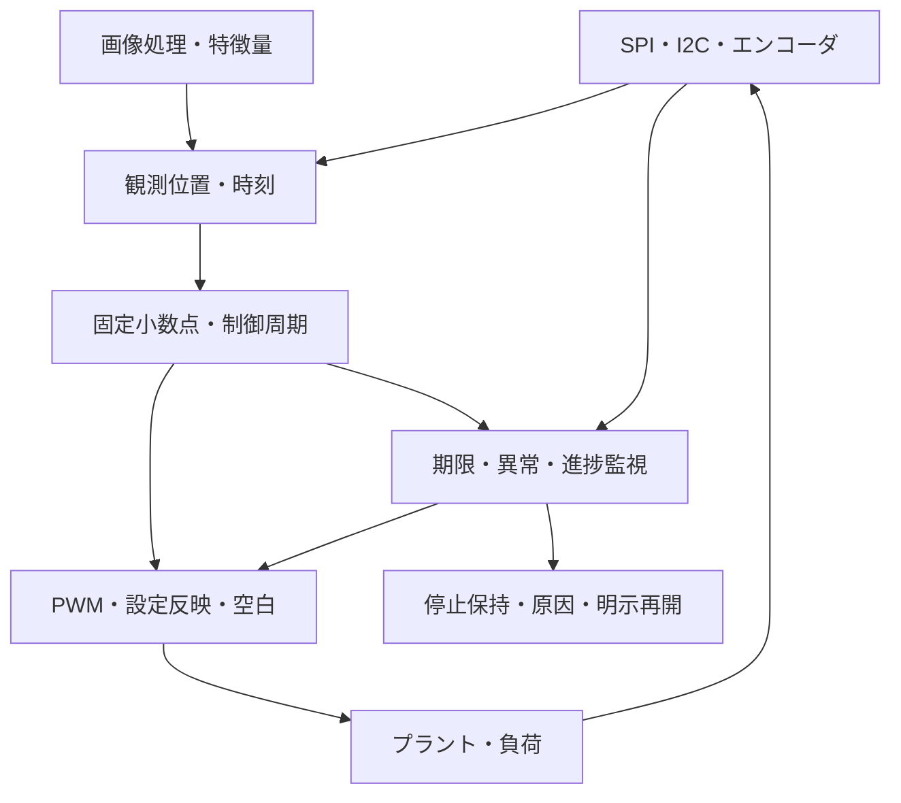

# ロボティクス・モーション制御の検証

ロボティクスでは、センサー入力・制御演算・出力の正しさと、周期・遅延・設定反映・停止の順序を結び付けます。本資料は、[PWM／エンコーダ単体](../../examples/local-motion-io/README.md)から、[1軸の閉ループ制御](../../examples/local-motion-control/README.md)へ進むための案内です。

## 1. 既存の題材とつなぐ

| 学習の段階 | 題材 | 検証の中心 |
| --- | --- | --- |
| センサー通信 | [SPI](../../examples/local-spi/README.md)／[I²C](../../examples/local-i2c/README.md) | モード、応答、データと時刻の対応、通信異常 |
| 計測I/O | [PWM／エンコーダ](../../examples/local-motion-io/README.md) | 相補出力、デッドタイム、原子更新、方向、ノイズ、不正遷移 |
| 演算 | [固定小数点DSP](../../examples/local-dsp/README.md)／閉ループ例のPI | 符号、丸め、飽和、状態、係数と更新時点 |
| 視覚 | [画像処理分野](../../examples/README.md#画像処理) | 画素位置、境界、特徴量と結果が届く時刻 |
| 結合 | [1軸の閉ループ](../../examples/local-motion-control/README.md) | プラントを接続した追従、逆転、負荷、周期・遅延 |
| 監視と復旧 | [ウォッチドッグ](../../examples/local-timer-watchdog/README.md)／[FDIR](../../examples/local-fdir/README.md) | 期限、取消、原因保持、再開条件 |

QEIが位置・方向・速度を扱い、入力フィルターを備える実例は[Microchipの解説](https://developerhelp.microchip.com/xwiki/bin/view/products/mcu-mpu/dspic/33a/hardware/peripherals/qei/)にあります。相補PWM・デッドタイム・break等は[STのタイマー説明](https://wiki.st.com/stm32mpu/wiki/TIM_internal_peripheral)、停止入力の利用は[ST AN4277](https://www.st.com/content/st_com/en/technical-documents/an4277-how-to-use-pwm-shutdown-for-motor-control-and-digital-power-conversion-on-stm32-mcus-stmicroelectronics.html)が参考になります。本教材は、それらの製品のレジスタ・全機能を再現する実装ではありません。

## 2. 時間の契約を先に決める

| 時点 | 別々に定める内容 |
| --- | --- |
| センサー端子 | 位相・極性、有効な最小状態保持時間、ノイズ、不正な同時変化 |
| サンプリング・復号 | 同期段数、フィルター、位置・速度の計数、折返し、原点 |
| 制御サンプル | 更新周期、どの位置と目標値を使うか、同時の原点変更 |
| 制御演算 | 符号・幅・丸め・飽和、レイテンシ、停止や取消 |
| 出力設定 | shadowへの受理、キャリア境界の反映、境界と同時の書込み |
| 出力端子 | 実際のパルス、デッドタイム、停止入力による抑止 |
| プラント | どの出力時刻を使って状態を更新するか、モデルの単位と限界 |

「演算が終わった」と「PWM端子へ反映された」は同じ時点ではありません。入力のサンプリングとフィルターも遅延を持ちます。遅延を含めた閉ループで確認し、演算結果の比較だけから制御全体の正しさを判断しません。

今回の例は単一クロックです。多クロック、タイムスタンプ、センサーデータの更新停止・古さを扱う実システムでは、データの値と取得時刻、同期後の可視化、欠落・順序・有効期限を追加要求にします。

## 3. 独立した演算期待値とプラント

制御器の数値検証では、偏差、積分、ゲイン、中間積、丸め、飽和の順序を明示します。単に浮動小数点の値へ近いことと、定めた固定小数点ビット列に一致することを分けます。

| 項目 | 今回の例での扱い |
| --- | --- |
| PIの期待値 | 有理数でQ4ゲインの値を表し、対称な最近丸めと出力制限を計算 |
| アンチワインドアップ | 上限を超える側へさらに押す積分更新を取り消す。飽和中と飽和解除後を確認 |
| PWMの期待値 | 切替え許可時刻とキャリア境界から作る。空白カウンターをそのまま写さない |
| エンコーダの期待値 | Gray環上の隣接関係から方向を求める |
| プラント | 仕様を固定した正規化離散モデル。実際のDUTのPWMでTBの状態を更新 |
| 閉ループの判定 | 全状態比較に加え、指定した追従窓の偏差、運転継続、異常なしを確認 |

TBのモーターへ期待値側のPWMを入力すると、DUTの出力の誤りがフィードバックへ伝わりません。実際の出力でプラントを動かし、その状態も別の期待値と比較します。

プラントは検証用の環境モデルです。簡易式での追従を、実機の摩擦・共振・バックラッシュ・電流制限・遅延等を含む安定性の証明へ広げません。物理的な特性や要求に合わせてモデルと試験を拡張します。

## 4. 重点クロスと異常

[クロス項目の選び方](cross-test-selection-walkthrough.md)に沿って、誤駆動・期限超過・誤再開が起きる組合せを固定ケースで確保します。

| 重点クロス | 確認する条件 |
| --- | --- |
| duty×反映時点×デッドタイム | 0／中間／100%、周期途中、境界同時、極性変更、狭いパルス |
| エンコーダ×入力間隔×原点 | 正逆方向、短い変化、2ビット遷移、折返し、原点とARM同時、運転中の書込み |
| 偏差×積分×飽和 | 正負、丸めのタイ、上限近傍、飽和後に目標を戻す、逆転 |
| 演算×制御周期 | 正常レイテンシ、hold、期限の直前完了、期限エッジの未完了、古い結果の取消 |
| 停止×ARM×ack×更新 | 停止優先、通知解除だけでは再開しない、明示再開で前回指令を破棄 |
| 指令×位置変化 | 停止指令中の無変化は正常。大きな指令中の進捗なしは期限で検出 |
| 目標・負荷×閉ループ | ステップ、正逆転、外力、負荷変動と追従窓 |
| reset×演算・出力 | 未処理ジョブを取消し、積分・指令・出力を初期化 |

エンコーダが変化しない理由は、機械が静止している、拘束されている、センサーや配線に異常がある等、複数あります。この例は一定以上の指令での「進捗なし」を検出し、それだけで原因を一意に断定しません。端子・機構・ソフトウェアをまたぐ診断は別に計画します。

## 5. 停止の契約を具体化する

PWMの双方0は、この例では「駆動しない」という論理状態です。機械の瞬時停止を意味せず、慣性や外力による移動はプラントに残します。制動・トルク遮断・位置保持など、実機の要求に合う動作を選びます。

停止検出、端子抑止、演算取消、原因とIRQ、ack、再開許可、再開後の最初の指令を、それぞれ観測します。今回の例は明示ARMまで停止を保持し、新しい計算結果が出るまでは中立指令を使います。前回のshadow設定だけが再び出力される状態もチェッカーで拒否します。

## 6. 自動判定と証跡

通常実行では、全サイクルの設定・状態・端子・プラントを比較し、同時出力禁止とデッドタイム、追従窓、制御ジョブの受理・更新・取消・resetを別にも確認します。入力と期待値の幅を検査し、符号付き値を符号拡張して照合します。

変異では、同時出力、原子更新の破壊、方向・不正遷移の誤り、アンチワインドアップ省略、期限無視、停止よりARMを優先する誤実装を検出します。コンパイル失敗・時間切れ・別ラベルの失敗を検出へ数えず、変異で通常カバレッジの未達を埋めません。

保存するものは、ソース・入力・期待値のハッシュ、構成・seed、全刺激・全期待状態、VCD、ログ、制御ジョブの件数と追従窓の判定です。観測ログによる機能カバレッジ、ネイティブcovergroup DB、コードカバレッジ、フォーマル証明を区別します。[全体リグレッション](../../tools/REGRESSION.md)、[機能カバレッジ](functional-coverage.md)、[追加記録](../../PROVENANCE.md#robotics-20261101)へつなげてください。
