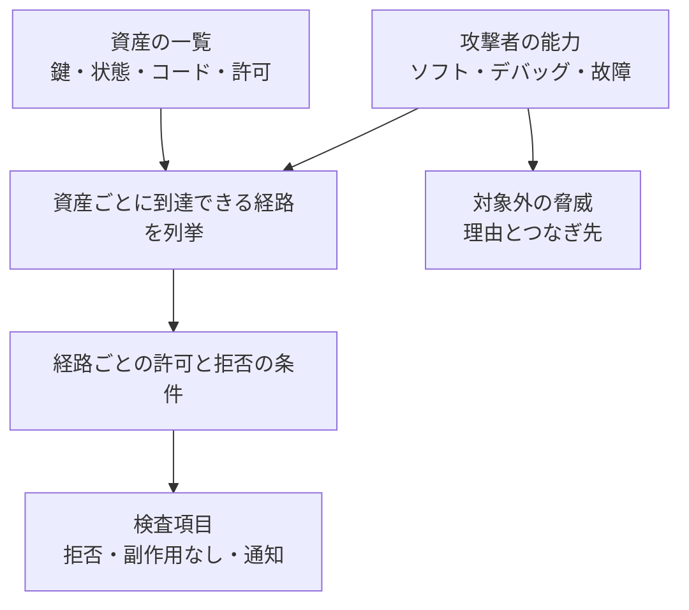

# セキュリティの検証

ハードウェアのセキュリティの検証を、守る資産と想定する攻撃者から始め、アクセス制御、ライフサイクル、定時間、情報の流れ、故障攻撃への対策、乱数、鍵の消去、デバッグ・スキャン経由の漏えいへ展開します。入口は[APBのアクセス保護](../../examples/local-access-control/README.md)と[セキュリティ・ライフサイクル](../../examples/local-secure-lifecycle/README.md)です。

機能の検証は「してよいことができる」を主に確かめます。セキュリティの検証は「してはいけないことが、どの経路からもできない」を確かめます。この資料とリポジトリの例は、RTLのデジタルな動作の範囲を扱います。消費電力や電磁放射によるサイドチャネル、実デバイスへの故障注入、セキュリティ認証の評価は対象外です。

## 機能の検証と違うところ

| 観点 | 機能の検証 | セキュリティの検証 |
| --- | --- | --- |
| 入力 | 仕様が認める使い方 | 仕様が禁じる使い方、想定しない順序、仕様に書かれていない入力 |
| 合格条件 | 期待した結果が出る | 禁じた結果が出ない。拒否の応答だけでなく、副作用がない |
| 経路 | 設計した経路 | 別名アドレス、デバッグ、スキャン、エラー情報、リセットの途中など、すべての経路 |
| 網羅 | 機能の組合せ | 資産ごとの「到達できる経路」の全部。1つ残れば破られる |
| 故障 | 偶発的な故障 | 意図的に起こす故障（電圧・クロックのグリッチ、レーザー） |

## 1. 資産と脅威のモデルを先に作る

検証項目は、資産の表と攻撃者の表から導きます。この2つがないと、何を拒否すれば合格なのかが決まりません。

| 決めること | 例 |
| --- | --- |
| 資産 | 鍵、乱数の内部状態、ライフサイクルの状態、ブートコード、デバッグの許可、ユーザーのデータ |
| 資産ごとの性質 | 機密性（読めない）、完全性（書き換えられない）、可用性（使えなくされない） |
| 攻撃者の能力 | ソフトウェアだけ（非特権・特権）、デバッグ端子への接続、基板への物理的な接近、故障の注入 |
| 信頼する範囲 | ROM、常時動作のセキュリティ回路、製造時の書込み設備 |
| 対象外 | 例：物理的な侵襲、消費電力の解析。理由と、別の評価へのつなぎ先を書く |

## 2. 対象境界を決める

| 対象 | 主な確認事項 | このリポジトリの入口 |
| --- | --- | --- |
| バスのアクセス制御 | 特権・セキュア属性による許可と拒否、設定のロック | [APBのアクセス保護](../../examples/local-access-control/README.md) |
| メモリの保護 | 領域・優先順位・ロック、アクセス全体の包含 | [PMP判定](../../examples/local-riscv-pmp/README.md)、[特権モードとPMPの統合](../../examples/local-riscv-priv/README.md) |
| ライフサイクルとデバッグの許可 | 状態の遷移、認証、試行の制限、タンパー時の消去 | [セキュリティ・ライフサイクル](../../examples/local-secure-lifecycle/README.md) |
| 処理時間 | 秘密の値によってサイクル数や公開の信号が変わらない | [定時間比較](../../examples/local-constant-time/README.md) |
| 暗号の演算 | 公開ベクトルとの一致、パディング、ブロックの連鎖 | [SHA-256](../../examples/local-sha256/README.md) |
| 仮想記憶の権限 | U／S、SUM・MXR、ページフォルト | [Sv32ウォーク](../../examples/local-sv32/README.md)、[TLB](../../examples/local-tlb/README.md) |
| 冗長化による検出 | 2系統の比較、安全状態 | [ロックステップ監視](../../examples/local-lockstep-monitor/README.md) |

## 3. 要求へ分解する

| 要求の領域 | 要求の例 | 確認方法 |
| --- | --- | --- |
| アクセス制御 | 許可のない属性の読出しは資産の値を返さない。書込みは状態を変えない | 属性を1つずつ変えた拒否の試験と、拒否後の状態の読出し |
| 回避の経路 | 別名アドレス、幅の違うアクセス、バイト有効の一部、別のバスから届かない | アドレスマップの全域の走査、接続性の証明 |
| ロック | ロック後は次のリセットまで設定を変えられない。ロックそのものも解除できない | ロック後の全レジスタへの書込み、部分リセットとの組合せ |
| ライフサイクル | 遷移は決めた向きだけ。前の状態へ戻れない。不正な符号は最も制限された扱い | 全状態×全遷移要求。状態の符号を1ビット変えた故障注入 |
| デバッグの許可 | 認証の前は停止・読出し・書込みができない。失敗の回数を数えて封鎖する | 認証の前後での全デバッグ操作、試行回数の境界 |
| 定時間 | 秘密の値を変えても、完了までのサイクル数と公開の信号の列が同じ | 2実行を並べたフォーマル証明 |
| 情報の流れ | 鍵から、スキャン出力・デバッグの読出し・エラー情報・未使用の出力へ流れない | 鍵だけが違う2実行で、観測点が一致することの証明 |
| 故障への対策 | 状態や制御の1ビットが反転しても、権限のある状態へ移らず、エラーの状態へ入る | 全状態×全ビットの反転（フォーマルまたは全数の注入） |
| 乱数 | 健全性の試験が異常を検出する。異常時は出力を止める | しきい値の境界、偏った源・固着した源のモデル |
| 鍵の消去 | 消去の要求から決めた期限内に、すべてのコピーが消える | 中間レジスタ・パイプライン・バッファを含めた値の検査 |
| リセットと電源 | リセットの途中や低電力からの復帰で、保護が外れた時間がない | リセットの解除順と、解除直後の最初のアクセス |

拒否の検査では、応答（エラー、0の読出し値）だけを見ても足りません。次の4つをそろえます。

1. 許可された操作は成功する（対照）。
2. 条件を1つ変えた操作は拒否される。
3. 拒否された後、資産と関連する状態が変わっていない。
4. 通知（割り込み、エラーの記録）が仕様どおりで、その通知に資産の値が含まれていない。

## 4. 重点にするクロス

| クロス | 見つかる誤り |
| --- | --- |
| 特権 × セキュア属性 × 読み書き × レジスタの種類 | 属性の1ビットだけを見ている判定 |
| ロックの状態 × 書込み先 × リセットの種類 | 部分リセットでのロックの解除 |
| ライフサイクルの状態 × デバッグ操作 × 認証の状態 | 状態の一部でだけ開いているデバッグ |
| 試験モード（スキャン）× 鍵のレジスタ | スキャンチェーンからの鍵のシフトアウト |
| 消去の要求 × 処理の各段 | 中間状態に残る鍵 |
| エラーの発生 × エラー情報の内容 | 拒否したアクセスのデータや鍵の一部がエラー情報に出る |
| 故障の位置 × 状態 × 次の遷移 | 1ビットの反転で権限のある状態へ入る |

## 5. 独立した期待値を用意する

- **許可の表から**：属性・状態・アドレスに対する許可と拒否を、RTLの条件式と別の形（表）で書き、全組合せを走査します。
- **影のモデルで副作用を見る**：拒否された操作を無視する参照モデルを持ち、拒否の後の全レジスタの読出しと比べます。
- **2実行の比較**：秘密の値だけが違う2つの実行を並べ、公開の観測点が毎サイクル一致することを証明します。期待値を数値で作る必要がなく、「依存しない」という性質そのものを検査できます。[定時間比較の例](../../examples/local-constant-time/README.md)がこの形です。
- **公開ベクトル**：暗号の演算は、標準に載っている既知のベクトルと、標準ライブラリによる別実装の両方で照合します。
- **故障の全数**：状態の符号化が小さいときは、全状態×全ビットの反転をフォーマルまたは全数の注入で確かめます。

2実行の比較では、公開してよい情報を先に決めます。比較の結果（一致・不一致）は公開されるので、それに依存する信号は「漏えい」ではありません。許す依存を仮定として明示し、強すぎる仮定で証明が空虚になっていないことを、到達の確認で確かめます。

## 6. 検出力を確かめる

| 変異 | 検出する検査 |
| --- | --- |
| 属性の判定を1ビット落とす | 属性を1つ変えた拒否の試験 |
| 拒否のときも書込みを通す（応答だけエラー） | 拒否後の読出しの比較 |
| ロックを部分リセットで解く | ロック×リセットのクロス |
| ライフサイクルを戻れるようにする | 逆向きの遷移の拒否 |
| 一致した桁で比較を打ち切る | 2実行のサイクル数の一致の証明 |
| 鍵の消去で中間レジスタを残す | 消去後の全レジスタの検査 |
| 試験モードで鍵のレジスタをチェーンに残す | 2実行のスキャン出力の一致の証明 |

機能の試験だけで合格してしまう変異（応答はエラーだが書込みは通る、など）を必ず入れます。これらが検出されることで、副作用の検査が働いていることが分かります。

## 7. 既存の実行例との対応

| 項目 | 実行例 | 範囲 |
| --- | --- | --- |
| バスのアクセス制御とロック | [APBのアクセス保護](../../examples/local-access-control/README.md) | PPROTによる許可、設定のロック。属性は信頼された上位から来る前提 |
| ライフサイクル・デバッグ認証・鍵の消去 | [セキュリティ・ライフサイクル](../../examples/local-secure-lifecycle/README.md) | 権限の判定と状態遷移。鍵は確認用に読出しを許している |
| 定時間 | [定時間比較](../../examples/local-constant-time/README.md) | 公開ポートの値とサイクル数。比較結果の公開は許す |
| ハッシュ演算 | [SHA-256](../../examples/local-sha256/README.md) | 最大2ブロック。`hashlib`との照合。サイドチャネルは対象外 |
| メモリの保護 | [PMP判定](../../examples/local-riscv-pmp/README.md)、[特権モードとPMPの統合](../../examples/local-riscv-priv/README.md) | 4エントリーの判定回路の単体と、コアへ統合したときのM／Uモードとアクセスフォルト |
| 仮想記憶の権限 | [Sv32ウォーク](../../examples/local-sv32/README.md)、[TLB](../../examples/local-tlb/README.md) | U／S・SUM・MXR・A／D |
| アドレスの別名 | [アドレスマップ](../../examples/local-address-map/README.md)、[接続性の証明](../../examples/local-connectivity/README.md) | デコードと配線。保護の回避の観点では未整理 |
| 2系統の比較 | [ロックステップ監視](../../examples/local-lockstep-monitor/README.md)、[TMR](../../examples/local-tmr/README.md) | 偶発的な故障のモデル |
| デバッグの入口 | [JTAG TAP](../../examples/local-jtag-tap/README.md)、[デバッグモジュール](../../examples/local-riscv-debug/README.md) | TAPの動作と、JTAG経由の停止・再開・レジスタアクセス。認証は実装しておらず、ライフサイクルとの結合はない |

公開プロジェクトでは、[OpenTitanの参照例](../../examples/reference-opentitan-dv/README.md)と[Caliptraの参照例](../../examples/reference-caliptra/README.md)が、セキュリティIPの検証環境の入口です。

### まだ例がない項目

| 項目 | 内容 | 状態 |
| --- | --- | --- |
| 故障に強い状態機械 | 冗長な符号化のFSMとカウンター。全状態×全1ビット反転でエラー状態へ入ることの証明 | [実行例あり](../../examples/local-fsm-hardening/README.md)。保持ビットの一時的な反転だけ |
| 情報の流れ | 鍵からスキャン出力・デバッグ読出し・エラー情報への流れがないことの2実行の証明 | [実行例あり](../../examples/local-secret-flow/README.md)。ポートのデジタルの値だけ |
| 故障注入キャンペーン | 故障リスト、注入時刻の抽出、結果の分類、分母を明示した検出率 | [実行例あり](../../examples/local-fault-campaign/README.md)。FFの反転と固着だけ。ISO 26262の指標ではない |
| 乱数の健全性試験 | 連続同値・適応比率の試験、起動時の試験、異常時の出力抑止 | [実行例あり](../../examples/local-trng-health/README.md)。2値の雑音源だけ |
| ブロック暗号 | AES-128。公開ベクトル、処理サイクル数の非依存、中断時の消去 | [実行例あり](../../examples/local-aes/README.md)。暗号化だけ。サイドチャネルは対象外 |
| セキュアブート | ROMによるイメージのハッシュの検証、改ざん・巻戻しの拒否 | [実行例あり](../../examples/local-secure-boot/README.md)。署名ではなくOTPのハッシュ値との照合 |
| 一度だけ書ける記憶 | 書込み後のロック、多数決、書込み中の電源断 | [実行例あり](../../examples/local-otp-fuse/README.md)。書込みのパルスは全か無か |

## 8. 製品で追加する確認

| 追加する確認 | 内容 |
| --- | --- |
| 脅威分析のレビュー | 資産・攻撃者・対象外の妥当性。検証項目との対応表 |
| 対策の一覧と検証の対応 | 対策（冗長な符号化、二重化、整合性の検査）ごとに、故障注入の試験と結果を対応させる |
| 情報の流れの解析 | SoC全体での、資産から観測点への経路の解析（専用のツールや形式的な方法） |
| サイドチャネルの評価 | 消費電力・電磁放射・時間の測定。マスキングなどの対策の評価 |
| 故障注入の評価 | 実デバイスへの電圧・クロックのグリッチ、レーザーなど |
| 暗号の適合性 | 標準の試験ベクトルによる検証と、必要な認証 |
| 製造と運用 | 鍵の書込み、ライフサイクルの進め方、返品解析時のデバッグの扱い |
| ソフトウェアとの境界 | ROM・ファームウェアが前提にするハードウェアの保証と、その逆 |

## 9. 参考にした一次資料

- [CWEのハードウェア設計のビュー（CWE-1194）](https://cwe.mitre.org/data/definitions/1194.html)：ハードウェアの弱点の分類。アクセス制御、デバッグと試験、電源・クロック・リセット、鍵の管理などの観点の洗い出しに使えます。
- [OpenTitanのセキュアなハードウェア設計の指針](https://opentitan.org/book/doc/security/implementation_guidelines/hardware/index.html)：冗長な符号化、定時間、故障への対策の設計上の考え方。
- [OpenTitanの対策の検証の枠組み](https://opentitan.org/book/doc/contributing/dv/sec_cm_dv_framework/index.html)：共通の部品に故障を注入し、警報を確かめる検証の実例。
- [NIST SP 800-90B](https://csrc.nist.gov/pubs/sp/800/90/b/final)：乱数源の健全性試験。
- [FIPS 180-4](https://csrc.nist.gov/pubs/fips/180-4/upd1/final)と[FIPS 197](https://csrc.nist.gov/pubs/fips/197/final)：SHA-2とAESの定義と例。
- [The RISC-V Instruction Set Manual, Volume II](https://docs.riscv.org/reference/isa/)：PMPと特権モード。
- [検証計画の抜けの点検 9節](verification-gap-review.md#9-権限セキュリティ安全機構)：このリポジトリの計画上の位置付け。
