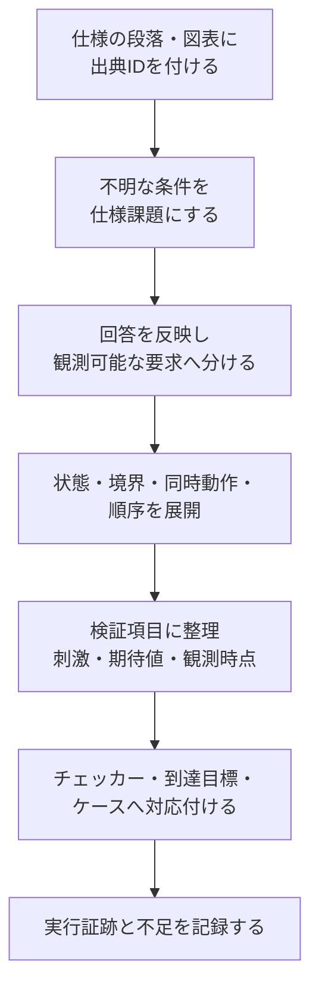

# 仕様書から検証項目を作る実例

仕様書を読んでも、「何を何通り試せばよいか」「どこまで書けば検証項目になるか」で迷うことがあります。この文書では、割り込み回路の短い仕様を、**仕様課題 → 要求6件 → 検証項目8件 → 刺激・期待値・観測点 → 実行証跡**へ展開します。

題材は本リポジトリの[割り込みSVA例](../../examples/local-sva/README.md)に合わせた架空の仕様です。仕様の確認回答も教材用に定めたもので、製品の仕様承認記録ではありません。検証項目表は記入例として完成させ、既存の実行例で確認する範囲と、追加の計測が必要な範囲を後半に示します。自分の仕様へ展開するときは[記入用の雛形](../templates/spec-to-test-items.md)を使えます。



## 1. 最初の仕様を読む

仕様書の一段落が次だったとします。

> イベントが発生すると割り込み保留ビットPENDをセットする。ソフトウェアはW1CでPENDをクリアできる。IRQ_ENが1のときに割り込みIRQを出力する。リセットでPENDをクリアする。

W1C（Write One to Clear）は、1を書いたビットをクリアする方式です。この段落から、イベント・クリア・許可・リセットという機能は拾えます。一方、同時動作の優先順位、受理の条件、リセット方式、観測時点はまだ決まりません。

まず、出典を`IRQ-SPEC draft §1`として保存し、次の課題を起こします。「多くの回路ではこうする」「現在のRTLがそう動く」だけでは期待値を確定しません。

| 課題ID | 確認すること | 未確定だと困る判定 |
| --- | --- | --- |
| Q01 | イベントとW1Cを同時に受理したとき、どちらを優先するか | 競合後のPENDを0とするか1とするか |
| Q02 | IRQ_EN=0でもイベントを保持するか | マスク中のPENDと、許可した後のIRQ |
| Q03 | リセットの極性・同期／非同期・他操作との優先順位は何か | リセット中・解除直後に何をいつ確認するか |
| Q04 | 「発生」「W1C」は生の要求か、受理済みの操作か | 待ちや拒否を含むバス要求を状態更新へ数えてよいか |
| Q05 | 状態の更新エッジとIRQの関係は何か | 更新前後のどの値を比較するか |

課題は要求候補に関連付け、未解決の項目は「仕様確認待ち」にします。確定済みの独立した項目は検証設計を進められます。回答者・回答日・適用版・改訂箇所を記録し、解決した項目から合格基準を確定します。

## 2. 確認結果を仕様へ反映する

教材ではQ01〜Q05を次のように解決し、仕様を`IRQ-SPEC r1`へ改訂したとします。実際の仕事では、仕様担当者の回答と改訂記録への参照を残します。

| 出典ID | 確定した仕様 |
| --- | --- |
| S01 | 入力・状態は1ビット。`event_accept`と`clear_accept`は、クロック立上りで取り込む受理済み操作を表す。検証では立上り前に入力を安定させる。バスからの受理パルス生成は対象外。 |
| S02 | `rst_n`はLow有効の同期リセット。立上りで0なら、イベント・クリア・許可にかかわらずPENDを0へ更新する。初期値は仮定せず、最初にリセットを取り込む。 |
| S03 | リセット解除中、イベントを受理した立上りでPENDを1へ更新する。同時にクリアを受理してもイベントを優先する。 |
| S04 | リセット解除中、イベントを受理せずクリアだけを受理した立上りでPENDを0へ更新する。 |
| S05 | リセット解除中、イベントもクリアも受理しなければPENDを保持する。 |
| S06 | IRQ_ENはPENDの更新を抑止しない。IRQはPENDとIRQ_ENの論理積で、組合せ回路として出力する。 |

この優先順位は**この例の仕様**です。W1Cという名称だけからセット優先を導くことはできません。0書込み、書込みストローブ、アクセス拒否、複数ビットの副作用などは、バス・レジスタ側の仕様から別の検証項目を作ります。

## 3. 観測可能な要求へ分ける

要求は機能名だけで終わらせず、「どの条件で、何を取り込み、どの結果になるか」を書きます。共通の入力条件はS01、状態更新の最優先条件はS02です。次のIDは実行例の[要求カタログ](../../examples/local-sva/requirements.json)と一致させています。

| 要求ID | 出典 | 条件と合格基準 |
| --- | --- | --- |
| SVA-SET-WINS | S03・S06 | リセット解除中にイベントとクリアを同時受理すると、更新後のPEND=1。IRQ_ENに依存しない。 |
| SVA-SET-ONLY | S03・S06 | リセット解除中にイベントだけを受理すると、更新後のPEND=1。IRQ_ENに依存しない。 |
| SVA-CLEAR-ONLY | S04・S06 | リセット解除中にクリアだけを受理すると、更新後のPEND=0。IRQ_ENに依存しない。 |
| SVA-HOLD | S05・S06 | リセット解除中に両操作がなければ、更新後のPENDは更新前と同じ。IRQ_ENに依存しない。 |
| SVA-RESET | S02 | リセットを取り込むと、他の入力によらず更新後のPEND=0。 |
| SVA-IRQ | S06 | 入出力が安定した観測時点で、IRQ=PEND AND IRQ_EN。 |

要求と検証項目は1対1でなくても構いません。例えば、マスク中のイベント保持と、その後の許可によるIRQ出力を一続きで確かめる項目は、SET-ONLY・HOLD・IRQの複数要求に対応します。要求数をテストケース数やカバレッジ目標数へ読み替えないよう、IDを分けます。

## 4. 条件表から抜けを探す

### 4.1 まず1回の状態更新を展開する

リセット解除中の1回の更新について、4種類の操作を分けます。`P`は更新前、`P_next`は更新後のPENDです。

| event_accept | clear_accept | P_next | 確認したい誤り |
| --- | --- | --- | --- |
| 0 | 0 | P | 保持漏れ・意図しないクリア |
| 1 | 0 | 1 | イベントの取りこぼし・マスクによる保持抑止 |
| 0 | 1 | 0 | クリア漏れ |
| 1 | 1 | 1 | クリアを優先する誤実装 |

各行を、**更新前PEND=0／1 × IRQ_EN=0／1**へ展開すると、通常動作は4×2×2＝**16組**です。1ビットなので0と1が状態の両端になります。PEND=0からのイベントだけを試すと再セットを、PEND=1からのクリアだけを試すと空状態へのクリアを見落とします。

到達可能性も確認します。この例では、リセットでPEND=0、イベントでPEND=1を準備でき、16組はいずれも到達可能です。内部信号を強制して初期状態を作ると、通常の到達経路を確認できないため、ここでは入力操作で準備します。

### 4.2 時間方向とリセットを足す

1回の更新表だけでは、マスク解除・連続操作・初期化の抜けが残ります。次を追加します。

| 観点 | この回路で足す条件 | その条件を選ぶ理由 |
| --- | --- | --- |
| マスクの変更 | PEND=0／1のそれぞれでIRQ_ENを0→1→0、イベント・クリアなし | 出力の許可と状態の保持を分けて確認する |
| リセット優先 | PEND=1で、イベント0／1×クリア0／1×IRQ_EN 0／1の8組にリセットを重ねる | 0から0へのリセットだけではクリア漏れが見えない |
| 解除直後 | リセットを取り込んだ次の立上りで、4種類の操作×IRQ_EN 0／1 | 最初の操作の取りこぼしを調べる |
| 順序 | 隣接する立上りでイベント→クリア、クリア→イベント | 同時操作との違いと、後の操作の反映を調べる |

この例では小さいため組合せを列挙できます。実際のIPで数が大きい場合は、[相互作用の選び方](feature-interaction-verification.md)と[削減の根拠](verification-reduction.md)を記録します。仕様が値を決めていない異常入力は、期待値を想像して項目へ追加せず、仕様課題または環境制約として扱います。

## 5. 検証項目表を完成させる

共通条件は`IRQ-SPEC r1`、1ビット構成、リセット後の2値シミュレーションです。入力は立下りで設定し、次の立上りで取り込みます。PENDの更新結果は、その次の立上りのSVAサンプルで確認します。入力を設定した行と、結果を観測する行を分けて記録します。

表の「0／1」は両方を実施する指定です。例えばTI01はPEND×IRQ_ENの4組へ展開します。表の1行を1回だけ実行すれば完了、という意味ではありません。

| 項目ID・要求 | 事前条件と刺激 | 期待値・観測 | 到達目標 |
| --- | --- | --- | --- |
| TI01：SET-ONLY・IRQ | PEND=0／1、IRQ_EN=0／1を準備。イベント=1・クリア=0を1回取り込む。 | 更新後PEND=1。安定した観測時点でIRQ=IRQ_EN。 | 4組すべてで入力受理と結果を確認。 |
| TI02：CLEAR-ONLY・IRQ | PEND=0／1、IRQ_EN=0／1を準備。イベント=0・クリア=1を1回取り込む。 | 更新後PEND=0、IRQ=0。 | 4組すべてで入力受理と結果を確認。 |
| TI03：SET-WINS・IRQ | PEND=0／1、IRQ_EN=0／1を準備。両操作を同じ立上りで受理。 | 更新後PEND=1。安定した観測時点でIRQ=IRQ_EN。 | 4組すべてで同時受理と結果を確認。 |
| TI04：HOLD・IRQ | PEND=0／1、IRQ_EN=0／1を準備。両操作を0のまま2クロック以上保持。 | 各更新でPEND不変。安定した観測時点でIRQ=PEND AND IRQ_EN。 | 4組すべてで連続した保持を確認。 |
| TI05：SET-ONLY・HOLD・IRQ | IRQ_EN=0でイベントを受理してPEND=1を作る。両操作を止め、IRQ_ENを0→1→0。PEND=0でも許可を同じ順に変更。 | PEND=1ならIRQは0→1→0、PENDは1を保持。PEND=0ならIRQもPENDも0。 | 両PENDで、マスク・許可・再マスクの順序を確認。 |
| TI06：RESET | PEND=1を作り、rst_n=0と、イベント0／1×クリア0／1×IRQ_EN 0／1を取り込む。各組の前にPEND=1を準備し直す。 | リセットを取り込んだ後のPEND=0。リセット前のPEND=1も観測する。 | 8組すべてで保持中のリセットと結果を確認。 |
| TI07：RESET・通常動作4要求・IRQ | リセットでPEND=0にした後、rst_nを1へ戻し、直後の立上りで4種類の操作×IRQ_EN 0／1を受理。 | イベントがあればPEND=1、それ以外は0。通常のIRQ関係も確認。 | 8組すべてで解除直後の最初の操作と結果を確認。 |
| TI08：SET-ONLY・CLEAR-ONLY・IRQ | PEND=0からイベント→クリア、PEND=1からクリア→イベントを隣接エッジで受理。IRQ_EN=0／1で実施。 | 前者はPENDが1→0、後者は0→1。途中の結果も、対応する次サンプルで確認する。 | 2順序×2許可状態。最後の操作にも観測クロックを置く。 |

要求欄のSET-ONLYなどは`SVA-`を省略した表記です。TI07はRESETとSET-WINS・SET-ONLY・CLEAR-ONLY・HOLD・IRQに対応します。要求台帳から項目へ、項目から出典へ、両方向に追えるかをレビューします。

担当・期限・実行ID・合否・証跡は、この項目表へ運用時に追加します。「仕様確認待ち」「未実装」「未実行」「合格」「失敗」「判定不能」を分け、項目を作った時点では合格にしません。

## 6. 期待値と観測時点を具体化する

### 6.1 波形を見る前に期待値を書く

例えばTI05のPEND=1を確認する刺激は、次のように書けます。ここでのIRQ欄は各立上りの状態更新と組合せ出力が安定した後の値です。

| 立上り | rst_n・イベント・クリア・IRQ_EN | 更新後PEND | 更新後IRQ | 意図 |
| --- | --- | --- | --- | --- |
| k0 | 0・0・0・0 | 0 | 0 | 同期リセットを取り込む |
| k1 | 1・1・0・0 | 1 | 0 | マスク中でもイベントを保持 |
| k2 | 1・0・0・0 | 1 | 0 | 保持と、k1のSVA後件を確認 |
| k3 | 1・0・0・1 | 1 | 1 | 新しいイベントなしでIRQを出す |
| k4 | 1・0・0・0 | 1 | 0 | 再マスクでもPENDを消さない |
| k5 | 1・0・0・0 | 1 | 0 | 最後のSVA後件を観測して終了 |

実行例の状態更新アサーションは`|=>`を使います。立上りk1のサンプルでイベントを読み、k1のNBA領域で更新されたPENDをk2のサンプルで判定します。これはRTLの状態更新が1クロック遅れることを意味しません。IRQのアサーションは、同じサンプルのPEND・IRQ_EN・IRQの関係を検査します。上表の「更新後」の値と、同じ立上りの更新前サンプルを混ぜないようにします。

最後のk5では新たな1サイクル後件を開始せず、開始済みの検査を完了させます。実行例では`launch`で前件の開始を制御し、チェッカー全体は最後まで有効にしています。

### 6.2 判定と到達を別に対応付ける

| 要求 | 既存のアサーション | 既存のカバー |
| --- | --- | --- |
| SET-WINS | `ap_set_wins` | `cp_set_wins_seen`・`cp_set_wins_done` |
| SET-ONLY | `ap_set_only` | `cp_set_only_seen`・`cp_set_only_done` |
| CLEAR-ONLY | `ap_clear_only` | `cp_clear_only_seen`・`cp_clear_only_done` |
| HOLD | `ap_hold` | `cp_hold_seen`・`cp_hold_done` |
| RESET | `ap_reset` | `cp_reset_pending_seen`・`cp_reset_done` |
| IRQ | `ap_irq` | `cp_masked_pending`・`cp_unmasked_pending` |

通常の状態更新は前件への到達と次サンプルの結果を別に数え、IRQはマスク中／許可中の保持状態を数えます。アサーション違反0件に加え、必要な条件が生じて結果まで観測されたかを確認します。リセットで中断した通常動作の検査は、通常の完了へ数えません。リセット自身のアサーションはリセットで無効化しません。

**6要求・8検証項目・通常動作16組・既存カバー12目標は、それぞれ別の数です。** 既存12目標には、更新前PEND×IRQ_ENの16組を区別するカウンターや、TI05〜TI08の全順序・組合せを識別するカウンターはありません。項目表全体を自動で完了判定するには、各組と順序を識別する刺激・観測・カバレッジを追加します。既存の境界列・ランダム列が一部の条件を実行していても、12/12だけでその追加計画まで合格にしません。

組合せを計測するときは、取り込み時の更新前PEND・操作・IRQ_ENと、対応する更新後の結果を結び付けます。入力を生成しただけの回数と、判定まで完了した組を分けて残します。[機能カバレッジの手順](functional-coverage.md)には、この通常動作16組を計測する説明用コレクターもあります。

[相互作用の手順](feature-interaction-verification.md#7-例イベント発生とw1cクリアの競合)にある前後のタイミング12目標も、ここでのSVAカバー12目標とは別の集合です。目標数が同じでも、何を区別して計測するかを確認します。

## 7. 既存の実行例で確かめる

Python 3.10以上、Verilator、C++20対応コンパイラ、makeを用意し、リポジトリのルートから実行します。既存の実装と証跡形式は[local-svaのREADME](../../examples/local-sva/README.md)を参照してください。

```sh
python3 examples/local-sva/run.py --seed 73
python3 examples/local-sva/run.py --profile nightly --seed 73
```

正常な機能ケースのassertに違反がなく、12個のネイティブカバーへ到達し、チェッカーの感度確認と刺激不足の診断も予定どおり完了すると成功します。smokeはJUnit 10件、nightlyは12件です。変異を検出したケースは期待どおりの検出として扱い、正常機能のカバー集計には加えません。

| 証跡 | 確認すること |
| --- | --- |
| `manifest.json`・`requirements.json`・`tools.json` | 仕様に対応する要求、ソースハッシュ、seed・入力列、ツール版を特定できるか |
| ケースごとの`vectors.txt`・`simulation.log`・`wave.vcd` | 何を取り込み、どのラベルで判定し、最後の後件まで観測したか |
| ケースごとの`coverage.dat`・`result.json` | 必須カウンターが存在し、ログ件数と一致するか。通常実行と診断を区別しているか |
| `coverage.json`・`summary.json`・`junit.xml` | 予定ケースの欠落、未達、失敗、実行異常がないか。要求ごとの到達が分かるか |

出力は既定で`artifacts/sva-local-日時/`へ保存します。仕様`IRQ-SPEC r1`は本書内の教材上の定義なので、製品へ転用する際は仕様版・出典・判断記録も保存対象に加えます。

検証環境が誤りを検出することも確かめます。

```sh
python3 examples/local-sva/run.py --demo-bug 1
python3 examples/local-sva/run.py --checker-off
```

両方とも終了コード1が期待結果です。前者はクリア優先の誤実装を通常ケースで検出します。後者は検出・到達不足で失敗します。エラーやタイムアウトを、予定した違反の検出へ読み替えません。

この実行例の確認範囲は2値のクロック同期観測です。リセット中のIRQの全観測点、X/Z、サンプル間のグリッチ、物理タイミング、バスの受理パルス生成は、この6アサーション・12目標による合格の範囲に含みません。必要な検証は[領域の点検](verification-gap-review.md)で別項目にします。

本書追加時のsmoke・nightlyと、項目表から展開した入力列の照合結果は、[2026-10-31の確認記録](../../PROVENANCE.md#仕様書から検証項目を作る完成例2026-10-31)にまとめています。

## 8. 自分の仕様へ適用する

最初から巨大な検証項目表を埋めようとせず、レジスタ1個、FIFOの1境界、割り込み1要因など、共有状態が分かる単位で次を繰り返します。

1. **出典を固定する。** 仕様版・節・段落・図表を特定する。
2. **判断できない条件を課題にする。** 優先順位・受理・時間・リセットを確認し、回答を仕様へ戻す。
3. **要求へ分ける。** 条件と観測可能な合格基準をそろえる。
4. **条件を展開する。** 状態・値の境界、正常／異常、同時動作、前後関係、中断と復帰を調べる。
5. **検証項目にする。** 事前条件・刺激・期待値・観測時点・判定・到達目標を書く。
6. **実装と結果へつなぐ。** ケース・チェッカー・カウンター・実行IDを対応付け、不足を記録する。

レビューでは、仕様の各要求から「対応する検証項目があるか」をたどり、項目表からは「期待値の出典は何か」を戻って確認します。条件の全組合せを減らしたなら、その根拠と残した重点条件も確認します。

AIを使う場合も、出典と未確定事項を渡して提案を作らせます。例えば次の依頼を使えます。

```text
添付した仕様の指定版だけを根拠に、要求候補と仕様課題を分けてください。
各要求に出典ID、前提条件、受理する事象、観測可能な合格基準を付けてください。
確定した要求について、状態・境界・同時動作・順序・リセットから検証項目を展開し、
事前条件、刺激、期待値、観測時点、判定方法、到達目標を表にしてください。
仕様にない優先順位・応答・時間制限は補わず、確認が必要な質問にしてください。
作成した表の行数と、展開後の組合せ数、実装済み・確認済みの数は分けてください。
```

別のレビュー担当者が元の仕様から抜けと過剰な期待値を点検し、その後に実装・実行結果を確認します。AI同士の一致やテスト案の生成だけでは合格にしません。運用全体は[一般化した手順書](spec-to-verification-method.md)、記録は[検証項目作成の雛形](../templates/spec-to-test-items.md)と[適用範囲の記録](../templates/verification-scope.md)へつなげます。
