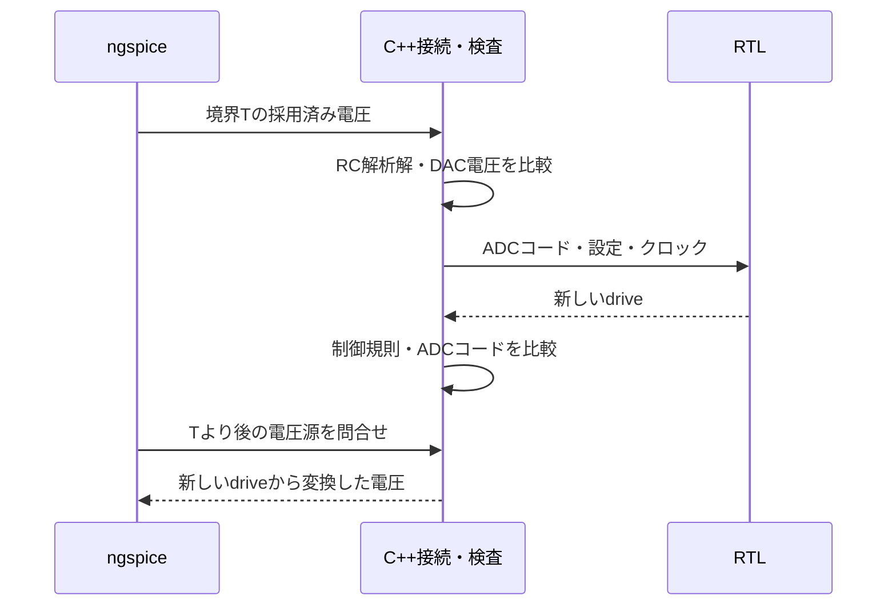

# SPICEとRTLのコシミュレーション

アナログ回路の応答とデジタル制御の関係を、互いの結果を戻しながら検証します。[RC電圧制御の実行例](../../examples/local-spice-cosim/README.md)は、ngspice共有ライブラリー、C++接続部、Verilator上のRTLを同じホストプログラムで動かします。

[ngspiceの共有ライブラリーAPI](https://ngspice.sourceforge.io/shared.html)では、呼出し元が回路を渡し、解析を制御し、結果を受け取れます。本例はその外部電圧源と解析点のコールバックを使います。回路方程式はngspiceが解き、C++のRC解析解は結果の照合に使います。

## 最初に境界を決める

| 境界 | 本例の契約 | 実案件で追加する観点 |
| --- | --- | --- |
| 時刻 | 制御周期10µs、SPICEの採用済み解析点で境界を検出 | クロック位相、遅延、ジッター、異なるレート |
| デジタル→アナログ | 0Vまたは指定電源電圧の理想DAC、境界直後から保持 | 出力抵抗、立上り、飽和、レベル変換 |
| アナログ→デジタル | 3.3V基準の理想ADC、最近接丸めと範囲クランプ | サンプル窓、比較器、雑音、メタステーブル |
| リセット | RTLの状態を消し、R・Cの状態は継続 | 電源断、放電経路、リセット伝搬 |
| 数値誤差 | Gear・最大刻み0.5µs、絶対誤差0.2mV以内 | 収束性、刻み幅変更、PDK、PVT、AC・雑音解析 |

デジタルのクロック境界は`ngSpice_SetBkpt`で登録します。`SendData`で採用済みの解析点だけを受け取り、`GetVSRCData`でRTL由来の駆動値を返します。Newton反復中の問合せや不採用の解析点でRTLのクロックを進めません。

この順序により、時刻Tの観測値から作った制御をTより後へ反映します。アナログ側の刻みは制御周期より細かく、時刻・単位・更新順序をそろえることが重要です。

## 期待値を接続不具合から独立させる

RC回路では、入力を一定に保持する区間の終点電圧を、`Vnext = Vin + (Vprev - Vin) * exp(-dt/(R*C))`で計算できます。本例はこの解析解と、SPICEから返った全採用点を比較します。参照モデルのR・Cは仕様の設定値を使い、検査対象のネットリストから読み戻して期待値を合わせることはしません。

ADCの変換規則、ヒステリシス制御、DACの実電圧も別々に照合します。RTL制御の誤り、回路定数の誤り、ADC・DACの接続断を注入し、それぞれ予定した検査で失敗することを確認します。数値不一致と接続不一致、解析エンジンの起動失敗を区別します。

## リセットと終了条件

RTLをリセットしても、コンデンサーの電荷が直ちに消えるとは限りません。本例は同じ過渡解析を続け、電圧を保持した状態から制御を再開します。アナログ回路の初期化を繰り返して、リセット時の不具合を隠さないようにします。

予定した全クロック境界への到達、最後の解析時刻、アナログ解析点数、外部電圧源の問合せ数を確認します。波形の目視だけで完了にせず、許容誤差・予定件数・制御規則を自動判定へ置きます。

## 適用範囲と導入

この例は線形RC回路と理想変換器を使う教材です。トランジスターレベルの回路動作、実デバイスの非線形性やPVTまで検証した結果としては扱いません。デバイスを追加する際は、モデルの利用条件、解析の収束性、参照データ、数値誤差の許容値を見直してください。

導入は[固定版ngspiceの手順](../../tools/ENVIRONMENT.md#ngspiceとspice協調例)、版と初期化互換修正は[パッチの説明](../../tools/patches/README.md)を参照してください。ユーザー設定を読み込まない起動方法も実際のAPIで検査しています。
