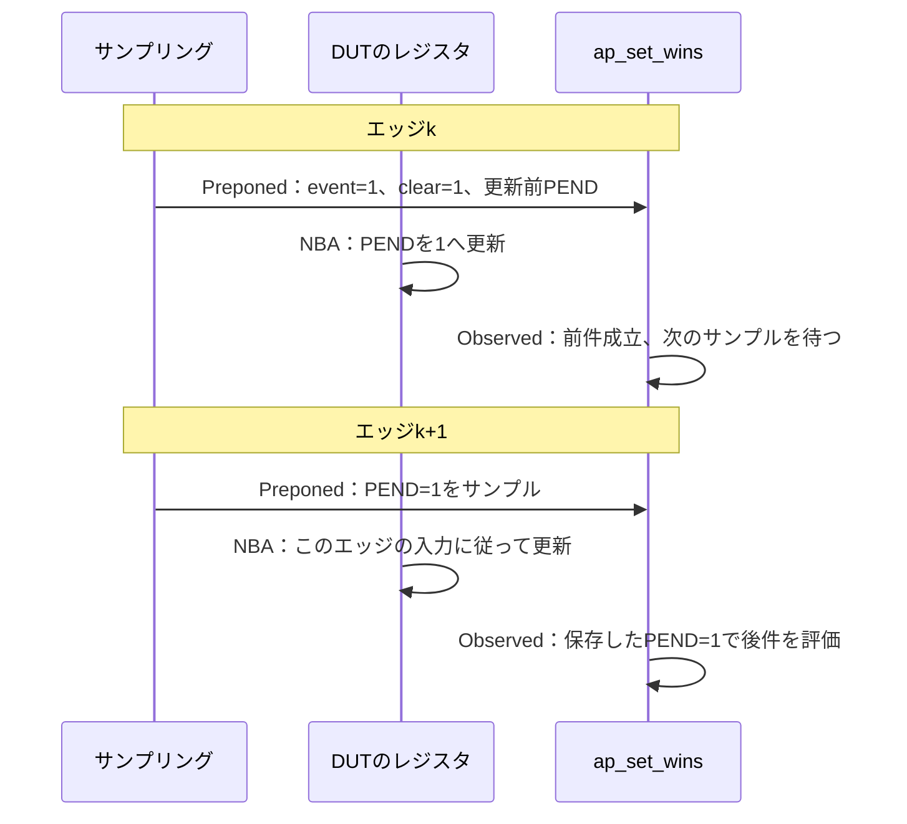

# SVAのアサーションとカバーによる検証

[一般化した検証手順](spec-to-verification-method.md)の9.10節を具体化した資料です。SVA（SystemVerilog Assertions）で要求をクロック・条件・時間関係・観測結果に落とし、シミュレーションと形式検証で確認します。以下は本リポジトリで定める運用案です。コードは説明用のcheckerであり、製品IPへの適用実績や形式証明済みの成果物ではありません。

## 1. assert・assume・coverの役割

| 記述 | この手順での使い方 | 結果を読むときの注意 |
| --- | --- | --- |
| `assert property` | DUTが満たすべき条件・時間関係を検査する | シミュレーションで失敗しないことと、必要な条件が検査されたことを分ける |
| `assume property` | 形式検証で環境の入力条件・前提を制限する | 仮定の下での証明である。DUTが保証すべき結果を仮定へ移さない |
| `cover property` | 必要な事象や時間関係の成立を観測する、または形式検証で到達する経路を探す | 到達した1経路だけでは、すべての経路の正しさを示さない |
| covergroupのcoverpoint・cross | 値・状態・組み合わせを分類して計測する | 時間窓や同じケースへの対応は、サンプリング側で定義する |

形式検証ではassumeが探索範囲を制限し、assertとcoverがそれぞれ反例・到達の探索に使われます。[YosysHQのassert・assume・coverの説明](https://yosyshq.readthedocs.io/projects/sby/en/stable/verilog.html)

assumeを書いただけで、シミュレーションのランダム入力が自動でその条件に従うとは扱いません。生成器側の制約と、実際の入力が前提を守ったかの検査を別に用意します。IP単体で置いた仮定は、SoC統合時に外部環境が保証しているかを確認します。

即時アサーションは手続きの実行時の条件確認に、並行アサーションはサンプリングイベントに沿う時間関係の確認に使います。即時アサーションをクロック付きの時間関係の代わりに置いたり、評価時点の違いを無視して移し替えたりしません。

機能一覧をcoverpoint・bin・crossへ展開する方法は、[covergroupによる機能網羅](functional-coverage.md)で扱います。SVAで時間関係の成立を観測し、同じケースの属性をcovergroupで分類する形でも連携できます。

## 2. 要求からプロパティを作る

要求ごとに、少なくとも次を定めます。

1. **対象と適用条件**：要求ID・改訂、構成、checkerの適用先、入力と出力の責任範囲。
2. **サンプリング**：クロック、観測する信号、各値をいつ採るか。
3. **前件**：処理の受理、状態、イベントなど、いつ義務が生じるか。
4. **後件**：期待する値・保持・応答・禁止条件と、その期限。
5. **無効化と履歴**：リセットやモード切替で中断してよいか、`$past`などに必要な履歴。
6. **到達目標**：前件の成立、必要な完了経路、境界・クロスをどう観測するか。

同じ要求に、前件の到達を数えるcoverと、要求する動作の完了を観測するcoverを結び付けます。coverは必要なシナリオを起こす刺激とセットで計画します。プロパティを書いただけでは刺激を生成したことにはなりません。

明示的な前件がない不変条件は、その検査が有効になる状態・モードへの到達と、実際に評価された期間を確認します。

たとえば「受理から1〜3サイクル以内に応答」は、何を受理とするか、期限の起点、複数要求の対応ID、リセット時の中断を決めてから書きます。1つの応答で複数の要求を満たしたと誤認しないようにします。データやIDの対応が複雑な場合は、scoreboardと分担します。

## 3. サンプリングと時間演算を合わせる

クロック付き並行アサーションでは、通常の設計信号はそのクロックイベントのPreponed領域でサンプルされます。同じエッジのNBAで更新するレジスタの新しい値を、そのエッジのサンプル値と取り違えません。非同期制御とサンプリングの注意点は、[DVConのSVA論文](https://dvcon-proceedings.org/wp-content/uploads/asynchronous-behaviors-meet-their-match-with-systemverilog-assertions.pdf)も参考にしています。

| 書き方 | 前件が1サイクルの条件の場合の意味 |
| --- | --- |
| `A \|-> B` | Aを観測した同じサンプリング時点からBを確認する |
| `A \|=> B` | Aを観測した次のサンプリング時点からBを確認する |
| `A ##1 B` | Aの次のサンプリング時点でBが成立するシーケンス |
| `A \|-> ##[1:3] B` | Aの1〜3サイクル後の範囲でBの成立を要求する |

前件が複数サイクルのsequenceなら、後件の起点はその一致の終端から決まります。信号の立ち上がりだけを起点にするか、highの各サイクルに新しい義務を作るかも決めます。

`$past`・`$stable`・`$rose`などがどのサンプルを参照するかを確認します。履歴が不足する起動直後や、リセット前の履歴を使ってよいかを明示し、必要なら有効な履歴を蓄積したことを示す状態でガードします。エラーメッセージに判定時の値を出す場合は、現在値と`$sampled`の値の違いにも注意します。

シミュレーション時間の遅延と、クロックのサンプル数は区別します。多クロックの関係は、各イベントの定義とツールの対応を確認して設計し、単一クロックの`##1`へ機械的に置き換えません。

## 4. リセット・X・空成立を管理する

`disable iff`は、条件が成立したときの評価を無効化し、進行中の評価も中断します。通常の信号サンプリングと異なり、その無効化条件は非同期に作用します。前件に「リセット中でない」を足すだけでは、開始済みの評価の中断とは同じになりません。

中断された評価は、正常に後件まで確認した記録と分けます。`disable iff`を付けたことは、リセット中の出力・保持・復帰を検証したことではありません。それらは別の要求・プロパティ・テストで確認します。リセット解除とクロックの関係、モード切替、clock gating中の評価も確認します。

前件が一度も成立しない含意は、失敗しないまま空成立になり得ます。assertのpass数やfail数0だけを到達の根拠にせず、前件のcover、完了経路のcover、評価の有効期間を確認します。前件は発生していても、リセットで毎回中断されるケースを見落とさないようにします。

X/Zによって前件が成立しなくなり、検査を回避していないかも確認します。仕様が既知値を要求する期間には`$isunknown`などの検査を併用し、リセット自身の不定値を無条件に見逃しません。2値シミュレーションや2値の形式モデルの結果だけでは、4値の要求を検証済みにしません。

## 5. 例：イベントとW1Cの優先順位

[機能間クロスの例](feature-interaction-verification.md#7-例イベント発生とw1cクリアの競合)と同じ架空の仕様を使います。イベントとW1Cが同じエッジで受理されたらセット優先、イベントのみならセット、W1Cのみならクリア、どちらもなければ保持とします。`IRQ_EN`はPENDの更新に影響せず、IRQはPENDとIRQ_ENの論理積です。

以下は受理済みの事象を入力とするchecker例です。リセットはactive lowで既知とし、各クロックでDUTの状態がNBA更新される設計を前提にします。

```systemverilog
module irq_sva_checker (
  input logic clk,
  input logic rst_n,
  input logic event_accept,
  input logic clear_accept,
  input logic pend,
  input logic irq_en,
  input logic irq
);
  ap_known: assert property (@(posedge clk) disable iff (!rst_n)
    !$isunknown({event_accept, clear_accept, pend, irq_en, irq}))
    else $error("IRQ_SIGNALS_UNKNOWN");

  ap_set_wins: assert property (@(posedge clk) disable iff (!rst_n)
    (event_accept && clear_accept) |=> pend)
    else $error("IRQ_SET_WINS");

  ap_set_only: assert property (@(posedge clk) disable iff (!rst_n)
    (event_accept && !clear_accept) |=> pend)
    else $error("IRQ_SET_ONLY");

  ap_clear_only: assert property (@(posedge clk) disable iff (!rst_n)
    (!event_accept && clear_accept) |=> !pend)
    else $error("IRQ_CLEAR_ONLY");

  ap_hold: assert property (@(posedge clk) disable iff (!rst_n)
    (!event_accept && !clear_accept) |=> $stable(pend))
    else $error("IRQ_HOLD");

  ap_irq: assert property (@(posedge clk) disable iff (!rst_n)
    irq == (pend && irq_en))
    else $error("IRQ_OUTPUT");

  cp_collision: cover property (@(posedge clk) disable iff (!rst_n)
    event_accept && clear_accept)
    $display("COVER_COLLISION");

  cp_collision_result: cover property (@(posedge clk) disable iff (!rst_n)
    (event_accept && clear_accept) ##1 pend)
    $display("COVER_COLLISION_RESULT");
endmodule
```

エッジkで競合をサンプルすると、同じエッジのNBAでPENDが更新され、その値を次のエッジk+1のサンプルで確認します。そのため、状態更新のassertには`|=>`を使っています。k+1のNBAでさらに値が変わっても、k+1のアサーションが確認するのはその更新より前のサンプルです。IRQの式は、その時点のPEND・IRQ_ENとの組み合わせ関係を確認するため同じサンプルで比較します。

**競合を検査するときの観測時点**



図はリセットによる中断がない正常な競合の例で、サンプリングと更新の主要部分だけを示します。Observedでの判定に、その時点の信号を読み直した値を使うという意味ではありません。

`cp_collision`は競合への到達、`cp_collision_result`はセットされた状態までの経路を記録します。完了のcoverが1回当たっても、他の競合ケースの失敗を取り消しません。初期PEND・時間差・IRQ_ENの必須12目標は、別途case IDとcrossへ対応付けます。これら2つのcoverだけで12目標すべてを確認したとは扱いません。

リセットで競合直後の評価が中断される場合は、要求が許すキャンセルかを別に判定します。このコードにはリセットそのものの出力検査は含めていません。

この例はクロックでサンプルした論理値を検査します。サンプル間のグリッチや物理タイミングまで確認したという意味ではありません。

## 6. checkerを適用し、意図どおり動くか確かめる

checkerはmodule・interfaceなどへ配置するか、`bind`で接続します。DUTのインスタンス、パラメータ、クロック、リセット極性、信号幅、受理信号の意味を確認します。bindの対象が0件、想定外のインスタンスへ接続、内部信号の改名で無効化、といった状態を検出し、適用先の一覧を保存します。

コンパイルオプション、`ifdef`、assertion制御タスク、checkerのenable、coverageの有効化設定を記録します。構文が受理されても、サポートされない記述やblackbox化によって検査が欠けていないかを確認します。[Verilatorのassertion設定](https://verilator.org/guide/latest/exe_verilator.html#cmdoption-no-assert)や、[SBYのSVA対応範囲](https://yosyshq.readthedocs.io/projects/sby/en/stable/verific.html)など、使用する版とフロントエンドの資料で確認します。後者はVerificを含む商用構成の説明で、すべてのYosys環境で同じ機能を使えるという意味ではありません。

checkerには、少なくとも次の確認を行います。

- 正しい動作、境界の時刻、連続した要求で、意図したassertとcoverが動く。
- 意図的な違反を入れると、対応するassertのラベル・メッセージで失敗する。
- 前件が発生しない場合に、刺激不足として区別できる。
- 評価途中のリセット・終了で、完了として数えない。
- checkerの無効化やbind漏れで、合格扱いにならない。

例では、クリア優先にした変異、IRQ_ENでPENDのセットまで止める変異、保持を壊す変異などを入れます。Xの検査は4値環境で別に確認します。

## 7. シミュレーションでの完了判定

要求・構成・適用インスタンスごとに、assertとcoverのラベル、必要なシナリオ、実行IDを結び付けます。ツールのattempt数と、前件が成立した数を同じ意味と決め付けず、取得可能なレポートと専用coverを使って読み分けます。

少なくとも、失敗数、有効な評価期間、前件の到達、必要な後件・経路の成立、リセットによる中断、終了時の未完了を確認します。未完了をツールが明示しない場合は、発行済み処理の台帳や、必要な応答期間まで観測した記録で補います。リセットを含むため単純にcoverの件数が一致しない場合も、ケースごとの終了理由を残します。

期限のない後件を、シミュレーションが終了するまで失敗しなかったという理由だけで完了としません。仕様に応答期限があるなら有界の検査へ落とし、ないならlivenessの仮定・検証方式と、実行終了時の判定を別に定めます。strong／weakと、シミュレーション終端でのツールの扱いも確認します。

クロック停止中は、サイクル数で定義した期限も進まない場合があります。クロックが再開する前提、実時間のタイムアウト、停止・復帰の要求を別に確認します。

失敗をランナーへ伝える経路を検査します。UVMのレポート件数にSVA失敗が必ず含まれるとは扱わず、シミュレータの終了状態・assertionログ・coverageの原本も確認します。

## 8. 形式検証でのassumeとcover

シミュレーションでのプロパティを形式検証へ使う場合も、初期状態、リセット、仮定、抽象化、ブラックボックス、対象クロック・モデルの変更をレビューします。DUTの出力が正しいという仮定を置いて、その出力の正しさを証明する循環を作りません。

前件や必要な状態へのcoverが、同じ仮定・構成で到達するかも確認します。常時リセット、両立しないassume、強すぎる制約で問題を除いていないかを調べます。ただし一部のcoverが到達するだけで、仮定の妥当性がすべて確認できたとは扱いません。仮定の出典と、環境が実際に満たす根拠のレビューも必要です。

| 結果 | 記録する意味 |
| --- | --- |
| 有界検査で反例なし | 指定した深さ・モデル・仮定の範囲で反例がない |
| 非有界の証明完了 | 記録したモデル・仮定の下で対象の性質が証明された |
| coverの到達 | その仮定の下で、目標へ到達する経路がある |
| 指定深さでcover未到達 | その深さでは見つからない。到達不能の証明とは区別する |
| unknown・タイムアウト・エラー | 未完了。証明・到達不能・要求の合格へ読み替えない |

使用したmode、深さ、エンジン、仮定とプロパティの版、実行コマンド、結果・反例・到達トレースを保存します。[SBYのbmc・prove・coverの区別](https://yosyshq.readthedocs.io/projects/sby/en/stable/reference.html)

仮定台帳と統合時の責務、初期状態、抽象化・証明分割、安全性と活性、帰納段階の反例、完了判定は、[フォーマル検証の手順](formal-verification.md)に従います。小さな同期モデルを使い、非有界の証明と、過剰な仮定で誤実装が通ってしまう例も示しています。

## 9. 要求台帳とサインオフへの接続

以下は未実施の計画例です。既存の照合キットへ投入できる形式ではありません。

```json
{
  "requirement_id": "IRQ-PEND-EVENT-W1C-PRIORITY",
  "requirement_revision": 1,
  "configurations": ["irq-base"],
  "checker": "irq_sva_checker",
  "assertion": "ap_set_wins",
  "trigger_cover": "cp_collision",
  "completion_cover": "cp_collision_result",
  "clock": "posedge clk",
  "disable_condition": "!rst_n",
  "observation_delay_cycles": 1,
  "required_cross_goal_count": 12,
  "run_ids": [],
  "status": "not_run"
}
```

要求の合格は、必要なassertの成立と必須シナリオ・構成の検証から判断します。前件が0回、checkerが無効、coverが未到達、評価が未完了、といった状態を合格にしません。形式証明はその仮定と証明範囲を添えて記録します。例外承認を受けても技術的な未達は残します。

UVMとの接続は[UVM資料](uvm-verification.md)、刺激と時間関係は[クロス検証](feature-interaction-verification.md)、探索と失敗の再現は[ランダム検証](constrained-random-verification.md)と関連付けます。結果は[サインオフ記録](../templates/signoff-record.md)へまとめます。

## 10. コード例の確認範囲

2026-10-25に、5節のコードを一時的な動作モデル・刺激ハーネスへ接続し、Verilator 5.052で`--binary --timing --coverage`を使って確認しました。結果は次のとおりです。coverの件数は、例のメッセージを数えたものです。

| 確認したケース | 結果 |
| --- | --- |
| クロスの正常12通り | assert失敗なし。競合への到達4件、競合後の状態のcover4件 |
| クリア優先へ変異 | `IRQ_SET_WINS`で失敗 |
| IRQ_ENでイベントの保存まで止める変異 | `IRQ_SET_ONLY`で失敗 |
| アイドル中の保持を壊す変異 | `IRQ_HOLD`で失敗 |
| イベントもクリアもない | assert失敗なし。競合・完了のcoverはともに0件 |
| 競合の後、次の評価前にリセット | assert失敗なし。競合cover1件、完了cover0件 |
| 競合の後、次の評価前にシミュレーション終了 | assert失敗なし。競合cover1件、完了cover0件 |

最後の3ケースは、SVAのfail数0だけで要求の合格を判定できないことの確認です。ハーネスは確認用の一時ファイルで、製品DUT・正式な回帰環境ではありません。2値シミュレーションでの記述例の確認であり、X/Zの検査、すべてのSVA構文・実行環境の検証、形式証明は行っていません。

## 11. 参考にした一次資料

- [DVCon 2010：Asynchronous Behaviors Meet Their Match with SystemVerilog Assertions](https://dvcon-proceedings.org/wp-content/uploads/asynchronous-behaviors-meet-their-match-with-systemverilog-assertions.pdf)：サンプリング、NBA更新、非同期のdisable条件の注意点を参照しました。旧版規格に基づく論文であり、採用する規格・ツールの仕様も確認します。
- [YosysHQの形式検証の構文](https://yosyshq.readthedocs.io/projects/sby/en/stable/verilog.html)、[設定形式](https://yosyshq.readthedocs.io/projects/sby/en/stable/reference.html)、[SVA対応範囲](https://yosyshq.readthedocs.io/projects/sby/en/stable/verific.html)：assert・assume・cover、実行方式とフロントエンドの対応を確認しました。
- [Verilatorの引数](https://verilator.org/guide/latest/exe_verilator.html)と[対応言語](https://verilator.org/guide/latest/languages.html)：assertion・coverageの有効化と対応範囲の確認先です。

checkerと記録例は本リポジトリで作成したもので、規格のコード例を転載したものではありません。
