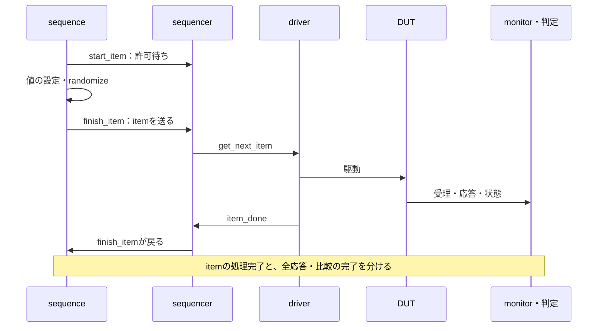

# UVMの基礎と学習の進め方

UVMを読むときは、クラス名を覚えるだけでなく、**誰が入力を駆動し、何を受理として観測し、どこで期待値と比較するか**を追うと全体が見えてきます。この文書は、下記のQiita連載を入口に、既存の手順書とローカルの実行例へ進むための案内です。

## 1. 参考記事とこのリポジトリで学ぶ範囲

| 参考記事 | 主に読む観点 | リポジトリ側の入口 |
| --- | --- | --- |
| [基礎編](https://qiita.com/sukimaengineer/items/ac92b4ba4830eeb6e18b) | 部品、itemの受渡し、phase、factory、設定、TLM | 本書と[UVM・RALの実行例](../../examples/local-uvm/README.md) |
| [実践編・前半](https://qiita.com/sukimaengineer/items/1fb074acc63fb61aea91) | 設定、複数agentの協調、RAL、設定変更と期待値 | [UVM環境の設計と再利用](uvm-practical-design.md) |
| [実践編・後半](https://qiita.com/sukimaengineer/items/5bc4af399d766d2a53c3) | SVA、上位再利用、機能カバレッジと未達への追加 | [設計・再利用の後半](uvm-practical-design.md#5-アサーションをuvmの判定へ接続する)と[passive移行例](../../examples/local-uvm-migration/README.md) |

公開記事を参照し、独自の解説・数値例と、既存資産を使った実行例へ整理しています。記事の確認環境と、このリポジトリで実際に確認する構成・範囲は分けます。参照した記事の更新日時と本文ハッシュは[出典メタデータ](../references/qiita-uvm-sources.json)に記録しています。

## 2. 最初に追う二つの流れ

刺激はtestからsequence・sequencer・driverを通ってDUTへ届きます。判定とカバレッジは、monitorが観測した受理・応答・状態を起点にします。生成した値だけを見て、受理・合格へ数えないようにします。

| 役割 | 追うもの | 最初に確認する箇所 |
| --- | --- | --- |
| test・env | 構成、部品の生成、接続、実行条件 | `build_phase`・`connect_phase`と設定の受渡し |
| sequence・sequencer | 操作の手順、送信順の調停 | itemの生成、`start_item`・`finish_item`、開始先 |
| driver | 操作から信号への変換 | 駆動エッジ、受理・応答、待ち中の保持、`item_done` |
| monitor | 実際の動作 | 受理条件、更新前後の観測、独立したスナップショット |
| scoreboard | 仕様からの期待値と照合 | 状態・順序・時間・取消、比較件数と未照合 |
| coverage・SVA | 必要条件への到達、値や時間関係 | 観測時点、必須目標、チェッカーの有効化と失敗経路 |

[基本のUVM例](../../examples/local-uvm/tb/uvm_apb_pkg.sv)なら、`apb_test`から`apb_env`、`apb_agent`、`apb_driver`を追い、戻り側は`apb_monitor`から`apb_scoreboard`へ進みます。静的なmodule・interfaceと、動的なクラスの間をvirtual interfaceで結ぶ点も確認します。

## 3. itemの受渡しと完了の意味

基本の`get_next_item`／`item_done`方式では、受け取ったitemの終了を一度だけ通知します。`item_done`の時点は、driverが受理まで扱うのか、応答まで扱うのかに合わせて定義します。後段に応答・比較が残る構成では、sequenceが戻った後も残件を確認します。[公式のsequence実装](https://github.com/accellera-official/uvm-core/blob/main/src/seq/uvm_sequence_base.svh)

次のitemを待つ間に前のvalidを残すと、同じデータが再受理されることがあります。`get_next_item`で待つ前にアイドルへ戻す方法や、`try_next_item`を使う方法を、プロトコルと連続転送の要求に合わせて選びます。待ち中は要求を保持し、monitorはvalidとreadyなどの受理条件が成立したエッジを数えます。

driverの通知、DUTの受理、結果の出力、scoreboardの比較は別の件数です。1 itemが複数beatになる場合も、照合単位とIDを決めておきます。

## 4. phaseとobjectionで何を守るか

`build_phase`で構成・生成、`connect_phase`で接続し、時間を進める処理は`run_phase`などで実行します。終了後の残件は`check_phase`、集計は`report_phase`などへ置きます。構築は親から子、接続は子から親へ進む基本の構造を意識すると、設定を渡す場所を追いやすくなります。[公式の共通phase](https://github.com/accellera-official/uvm-core/blob/main/src/base/uvm_common_phases.svh)

objectionは必要な実行期間を保つために使います。上げ忘れによる早期終了、下げ忘れによる停止待ちに加え、最後の応答やSVAの後件の前に終了しないことを確認します。objectionを下げたことを、検証の合格にはしません。

[passive移行例](../../examples/local-uvm-migration/tb/migration_pkg.sv)は、旧入力の再生が終わるまでobjectionを保持し、観測数・比較数と予定数が一致することを別に要求します。完了通知には`uvm_event.wait_on()`を使います。これは通知がすでに発生していても戻れますが、イベントを再利用するときは状態のリセットと実行区間を設計します。[公式のevent実装](https://github.com/accellera-official/uvm-core/blob/main/src/base/uvm_event.svh)

## 5. factoryと設定の役割を分ける

| 仕組み | 変えるもの | 確認すること |
| --- | --- | --- |
| factoryのtype override | 生成するクラスの型 | 対象の`type_id::create`より前に登録し、影響する生成箇所を確認する。 |
| factoryのinstance override | 指定した生成先で使う型 | 階層・インスタンス名が対象と一致し、他のインスタンスを変えない。 |
| `uvm_config_db` | 値、設定オブジェクト、virtual interfaceなどのハンドル | set/getの型・名前・対象範囲、取得時点と失敗時の停止を確認する。 |

差し替えたい部品はfactoryを経由して生成します。port・impなど、差し替え対象でないオブジェクトを`new`で生成する箇所とは区別します。overrideが効いたかは、設定したことだけでなく、実際の型と動作で確認します。

設定が増えたらagentごとの設定オブジェクトへまとめます。virtual interface、active／passive、チェックの有効化、待ちの条件などを、どの部品が所有するか決めます。広い`*`で同じ設定を複数agentへ配ると、別のインターフェースやハンドルを共有する誤りを起こしやすくなります。[設定と協調の設計](uvm-practical-design.md#1-設定オブジェクトとagentの所有範囲)

実行例では`corrupt_monitor`をfactoryで差し替え、観測値の誤りをscoreboardが検出することを確認します。DUTの変異と、検証環境へ加えた診断用の誤りは、別に記録します。

## 6. analysis portと観測オブジェクト

analysis portの`write()`は、同じ観測を複数の接続先へ渡すfunctionです。時間を消費する処理は直接入れず、必要ならFIFOなどを介したtask側の処理へ分けます。接続先が0でも配信できる構造なので、scoreboard未接続を合格にしない件数検査が必要です。[公式のanalysis port実装](https://github.com/accellera-official/uvm-core/blob/main/src/tlm1/uvm_analysis_port.svh)

クラスのハンドルを渡しただけでは、観測値の複製になりません。次の観測で同じオブジェクトを書き換えると、照合キューや別subscriberの履歴も変わります。観測ごとに新規オブジェクトを作るか、保存対象の複製を実装します。`clone()`を使う場合も、独自フィールドを含むcopyの実装を確認します。

複数のmonitorが同じエッジに観測を送る場合、callbackの到着順をDUTの動作順序にしません。設定値とデータを同じ受理エッジへ対応付ける方法は、[期待値の作り方](uvm-practical-design.md#3-設定変更とデータ受理が同じエッジに重なる場合)を参照してください。

## 7. 学ぶ順番と実行できる範囲

| 順番 | 資料・例 | 自分で確認すること |
| --- | --- | --- |
| 1 | [UVM・RAL](../../examples/local-uvm/README.md) | 部品、frontdoor、monitorからの比較、予定件数、誤実装検出。 |
| 2 | [passive移行・同一入力再生](../../examples/local-uvm-migration/README.md) | 設定、駆動担当、factory差替え、旧新の14項目の観測と20／21目標の一致。 |
| 3 | [UVMランダム](../../examples/local-uvm-random/README.md) | SVの制約、randomizeの成否、実受理によるnative bin、seed再現。 |
| 4 | [UVMの設計と再利用](uvm-practical-design.md) | 複数agentの協調、設定の採用時点、上位の所有範囲、SVAと収束判断。 |
| 5 | [移行ガイド](uvm-migration-guide.md)と[適用手順](uvm-verification.md) | 手元の要求・旧資産へ対応付け、必須構成・検出力・未確認を記録。 |

virtual sequenceによる複数データ経路の協調や、複数IPのRALサブマップを使う上位UVM環境は、設計資料として説明しています。現行例で実行した機能と、これから実装する構成を区別して使ってください。

## 8. 症状から戻る確認点

| 症状 | 最初に確認すること |
| --- | --- |
| 時刻0付近で終了する | 実行するtest、objection、観測・比較件数、唯一の完了記録。 |
| item送信から戻らない | driverの起動、itemの受渡し、`item_done`、受理・応答条件、実時間の上限。 |
| 設定を取得できない | set/getの型、対象パス、設定名、実際の階層、取得前の登録。 |
| overrideしても動作が同じ | `create`を使った生成か、登録時点と適用先、実際の生成型、診断用の入力。 |
| reportにエラー0だが検査したか不明 | analysis接続、比較件数、未照合、必須目標、チェッカー無効化時の失敗。 |
| SVAが失敗してもUVM件数が0 | SVAのactionとUVM reportの接続、外側の終了コード・失敗ラベルの判定。 |
| カバレッジの割合が合わない | 対象bin、インスタンス、集計方法、ツール版と[校正結果](uvm-practical-design.md#6-未達を埋めることと割合を表示することを分ける)。 |

UVMを採用するかどうかは、再利用の範囲と運用上の効果から判断します。自動比較、SVA、機能カバレッジ、制約付きランダムは、UVM以外の環境でも使えます。導入そのものと、要求に対する検証の完了は分けて扱います。
