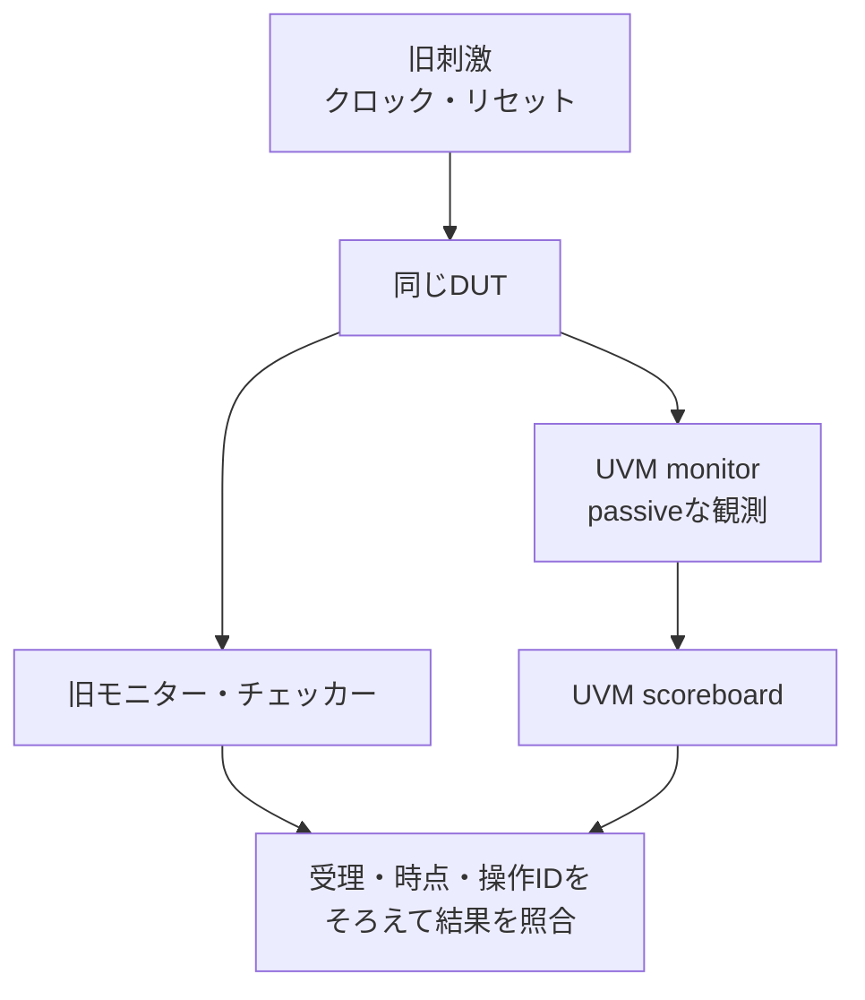

# 既存の検証環境をUVMへ段階的に移行する

既存環境には、仕様から作った期待値、境界・異常・競合のテスト、過去の不具合を検出するチェッカーが蓄積しています。UVMへ移行するときは、これらを対応付けて引き継ぎ、**受理・観測・判定・カバレッジ・終了条件の意味を保てているか**を確認します。

このガイドは、手続き的なSystemVerilogテストベンチやPythonなどの既存環境から移すときの計画です。UVMの部品とAPIの説明は[UVMの適用手順](uvm-verification.md)、記録は[移行計画の雛形](../templates/uvm-migration-plan.md)を参照してください。後半では、同じAPB RTLを使う既存環境とUVM環境から、移行時の対応と不足を具体化します。

## 1. 移行する目的と範囲を決める

複数IPでバス操作を再利用する、複数インターフェースを協調させる、シーケンスを共有する、RALを導入する、といった改善対象を決めます。小さな固定テストが十分に役立っているなら、そのまま保持し、共通化したい部分から着手できます。

開始時に、仕様・RTL・旧環境の版、必須要求・構成、既知不具合、UVMライブラリ・シミュレータ・VIPの版を固定します。SystemVerilogクラス、SVA、covergroup、DPI、4値の扱いなど、必要な機能を採用ツールで確認します。[Accelleraの配布情報](https://www.accellera.org/downloads/standards/uvm)では、ライブラリのリリースと規格の版を区別できます。

移行と同時に、仕様変更、DUTの大幅変更、期待値の変更、カバレッジの削減をまとめると差分の原因が増えます。最初は同じ仕様・RTL・構成を使い、移行による変更をレビューできる単位に分けます。

## 2. 既存資産をUVMの役割へ対応付ける

クラス名の置換だけでは、既存の検出力は引き継げません。要求IDを起点に、刺激・観測・期待値・判定・到達・終了の対応表を作ります。

| 既存の資産 | UVM側での配置候補 | 引き継ぐ契約・注意点 |
| --- | --- | --- |
| テストケース・入力ファイル・操作タスク | test、sequence、sequence item、再生アダプター | 操作の値、順序、受理前後の間隔、同時イベント、違法入力を保持する。 |
| 信号を駆動するBFM・タスク | driverとvirtual interface | SETUP・待ち・応答・バックプレッシャの扱いと、各信号の駆動担当を固定する。 |
| 受理・応答・状態を読む処理 | monitor、analysis port | 予定値から実観測へ切り替える。更新前／更新後と、検査すべき非受理サイクルも保持する。 |
| 仕様に基づく参照モデル | 独立モデルとscoreboardの接続 | 状態更新の順序、リセット、取消、幅・符号・エンディアンを維持する。 |
| 期待値比較・照合キュー | scoreboard、check phaseの残件検査 | ID・順序・比較マスク・許容遅延を対応付け、比較省略を検出する。 |
| SVA・プロトコルチェッカー | interface・module・bindなどで継続利用 | 接続階層、クロック、サンプリング、リセット条件、最後の後件までの観測を確認する。 |
| カバレッジ目標・収集処理 | coverage subscriber、covergroup、既存コレクター | 旧目標IDと新bin・crossの意味を対応付け、構成・インスタンス別の分母を保持する。 |
| 起動スクリプト・結果判定 | 外側のランナーとUVMの完了・報告処理 | 終了コード、件数、未照合、タイムアウト、異常検出、証跡保存を引き継ぐ。 |

PythonやC/C++のモデルは、言語境界・状態の同期・ツール対応を確認し、既存モデルの呼出し、入出力ファイルによる照合、SystemVerilogへの移植などを選びます。UVMを採用しただけで既存言語のコードを直接呼べるわけではありません。接続方法と遅延、リセット時の状態初期化も検証対象にします。

参照モデルを再利用すると移行差分を減らせますが、旧環境と同じモデルの誤りも共有します。元の仕様との照合、既知不具合・変異の検出、独立したアサーションなどで点検します。

## 3. 旧環境を残して段階的に置き換える

| 段階 | 実施すること | 次へ進む前に確認すること |
| --- | --- | --- |
| M0：基準を保存 | 旧環境の必須ケース・構成・入力・期待結果・目標・不具合再現を固定する。 | 全件合格だけでなく、受理・比較の件数、未達、意図した違反の検出を保存した。 |
| M1：観測を接続 | 旧ドライバーを使い、UVM側はpassiveな観測から始める。 | 旧・新モニターが同じ受理・応答・更新前後を観測する。UVM側が入力を駆動しない。 |
| M2：判定を併走 | 同じ観測を新scoreboardへ渡し、旧チェッカーも残す。 | ケース・操作IDごとの結果と比較対象が対応し、0比較・観測欠落を合格にしない。 |
| M3：刺激を置換 | 旧刺激を再生するsequenceとdriverへ切り替える。 | 駆動担当を一つに切り替え、同時性・順序・待ち・リセットを再現した。 |
| M4：機能を拡張 | 必要に応じてRAL、ネイティブcovergroup、ランダムシーケンスを追加する。 | 元の異常入力・境界・クロスが失われず、新しい期待値と目標は別にレビューした。 |
| M5：回帰と切替え | 必須範囲を新環境で実行し、検出力・費用・残る差分を評価する。 | 移行完了条件を満たした範囲を特定し、残す旧ケース・別解析を決めた。 |



図はM1〜M2で採る構成案です。UVM側からの駆動へ切り替える前に、観測と判定を確認します。後述のAPB例でこの併走を実行するには、追加実装が必要です。

### M1：passive設定と駆動停止を確認する

passive agentでは観測を行い、driver・sequencerによる駆動を行わない構成にします。派生agent側で、active／passiveに応じた部品の生成と接続を実装する必要があります。`UVM_PASSIVE`を設定するだけで、独自に作ったdriverや旧タスクが自動停止するとは限りません。[Accelleraのagent参照実装](https://github.com/accellera-official/uvm-core/blob/main/src/comps/uvm_agent.svh)

バス入力、クロック、リセット、外部イベント、受信側readyなどについて、各段階の駆動担当を記録します。旧タスクとUVM driverの二重駆動、リセットだけ旧タスクが駆動し続ける状態、開始順による競合を確認します。

### M2：受理と状態更新の時点をそろえる

完了したトランザクションだけをUVM monitorへ送ると、旧環境が検査していたSETUP・待ち中の状態変化を見落とすことがあります。転送の観測に加え、必要なサイクル単位の観測やSVAを保持します。

入力と受理条件は更新前に、更新結果は仕様に合った時点に観測します。APBで読出し値と更新後のレジスタを同じ時点の値として扱わないようにします。clocking blockやスケジューリングを決め、特定の`#delay`を全環境へ機械的に移しません。

monitorが公開したオブジェクトを後から書き換えると、subscriberが保持した履歴まで変わる場合があります。観測ごとに独立したスナップショットを渡すか、保存側で複製し、ハンドルの再利用も点検します。

### M3：刺激の置換とランダム化を分ける

最初は保存した入力列・操作列を再生し、driverの変換と判定の差分を確認します。その後にUVMのランダム化へ広げます。同じseedでも、乱数生成器、制約、呼出し順が違えば同じ入力にはなりません。seedだけでなく、実際の入力・操作列と観測を保存します。

リセットで要求が中断されたときは、仕様に基づく取消、再送、参照モデルの初期化、照合キューの処理をそろえます。単にキューを消して残件0にすると、取消対象でない要求の消失を隠すため、操作IDごとの扱いを記録します。

### M4：RALとカバレッジを追加しても元の検査を保持する

RALでは、DUTのリセット駆動とモデルの`reset()`、ミラーの予測と実データの比較を分けます。auto predictionとmonitor経由のpredictionを設計し、同じアクセスの二重更新を避けます。W1Cとハードウェアイベントの競合、volatileな値、エラー応答は、独立した期待値でも判定します。詳細は[RALの扱い](uvm-verification.md#4-レジスタモデルralの扱い)を参照してください。

RAL経由の正規アクセスへ置き換えた結果、未割当・非整列・禁止書込みや、処理途中のリセットを試せなくなる場合があります。必要なraw sequenceや別のドライバー操作を残します。

カバレッジは旧目標から新bin・crossへ、成立条件・観測時点・必要ヒット数を対応付けます。同じ名前や同じ100%でも、対象集合が異なれば移行の確認にはなりません。旧環境にあった時間関係や高次クロスを、単純な値のcrossだけへ縮めないようにします。

## 4. 移行前後をどの粒度で比較するか

### 4.1 比較契約を先に決める

| 比較の粒度 | そろえるもの | 比較するもの |
| --- | --- | --- |
| 信号・サイクル単位 | クロック、リセット、各入力の駆動エッジ、外部応答、同時イベント | 同じエッジの受理・応答、更新前後の状態、チェッカー結果。競合・待ち・中断の移行に使う。 |
| トランザクション単位 | 操作ID、要求と応答、仕様が定める順序・許容遅延、構成 | 受理した操作と結果。アイドル長など許容する差を明示し、時間依存の要求は別に検査する。 |
| 要求・シナリオ単位 | 要求ID、事前状態、必須境界・クロス、期待値、完了条件 | 必要な条件への到達と有効な判定。入力が異なるランダム実行の評価にも使う。 |

同じドライバー出力ファイルでも、時刻やリセットの起点が変われば同時イベントを再現できない場合があります。厳密な再生には、バス操作の値に加えて、イベント・応答・リセットの時間関係も保存します。

構成・clock domain・リセット区間・ケース・操作IDなどで記録を対応付けます。複数クロックでは各ドメインの時点と因果関係を定義し、単一のサイクル番号だけで並べ替えません。並べ替えやマスクで差を消す前に、仕様上許される差かを確認します。

### 4.2 差分を見るための記録例

APBのW1Cを受理したエッジの例です。PENDINGは更新前3、書込み値3、イベント1なので、イベント優先の仕様では更新後1が期待値になります。次は移行計画で使える**提案形式**で、既存ランナーの入出力形式ではありません。

```json
{
  "case_id": "APB-MIG-W1C-001",
  "reset_epoch": 1,
  "clock_domain": "pclk",
  "edge": 12,
  "operation_id": "write-pending-1",
  "bus_done": true,
  "write": true,
  "address": 8,
  "write_data": 3,
  "error": false,
  "events": 1,
  "pending_before": 3,
  "pending_after": 1
}
```

旧・新環境の実観測をこのような共通形式へ変換し、観測の欠落・重複・順序・値を比較します。4値を扱う場合はX/Zを保存できる値表現も定義します。期待値1は別途仕様から計算して判定します。二つの環境の出力が一致するだけでは、両方が同じ誤りを持つ場合を識別できません。

### 4.3 4値・終了・異常検出を引き継ぐ

X/Zの検査が必要なら、シミュレータだけでなく、transactionの型・変換・比較も4値を保存するか確認します。`logic`を`bit`へ代入して未知値を失うような変更は、旧環境の検査を減らす可能性があります。2値での合格と4値での確認範囲を分けて記録します。

sequenceの終了やobjectionの解放は、応答・比較・カバー後件の完了を自動で保証しません。受理済み操作IDの完了または仕様に基づく取消、未応答・未照合0、必要な比較件数と目標到達を確認して終了します。実時間の上限と仕様の応答期限も区別します。

既知のRTL変異、誤った期待値、観測の欠落、チェッカーの無効化などで、予定した検査が失敗することを確認します。失敗ラベルは旧・新で異なっても、同じ故障・要求を検出したかを対応付けます。コンパイル失敗やタイムアウトを不具合検出成功にはしません。外側のランナーでは終了コードとUVM reportの両方を確認します。

## 5. APBの二つの環境から移行計画を作る

[非UVMのAPB例](../../examples/local-apb/README.md)と[UVM・RAL例](../../examples/local-uvm/README.md)は、同じ[APB RTL](../../examples/local-apb/rtl/apb_regs.sv)を使います。ただし、現行の二つの環境は、ケース・待ち構成・カバー目標が一致していません。独立した正常実行の成功を、そのまま移行完了とは扱いません。

### 5.1 要求の対応と不足を確認する

| 旧環境の要求・目標 | 現行UVM例の対応候補 | 移行時に確認・追加すること |
| --- | --- | --- |
| APB-ACCESS：5アドレス分類×読書きの10目標 | UVM-ACCESSのID・エラー・CONFIG書込み／読戻し4目標 | 未割当・非整列・ROなどの分類と操作ごとの到達・判定を対応付ける。合算した`access/error`だけで全分類を充足としない。 |
| APB-DATA：0・全1・交互の3目標 | CONFIGの書込み・読戻し | 代表データごとの成立条件と観測を追加する。任意データの書込み成功だけでは3目標を確認済みにしない。 |
| APB-W1C：ゼロ書込み・全クリア・イベント優先の3目標 | UVM-PENDINGのイベント・優先・クリア3目標 | 目標数が同じでも集合は異なる。ゼロ書込みや全クリアの事前状態・書込み値・結果を対応付ける。 |
| APB-RESET：IDLE・SETUP・ACCESS中の3目標 | UVM-RALの`reset/mirror` | 現行のリセット後のmirror確認に加え、SETUP・ACCESS途中のリセットと復帰を移す。 |
| APB-CONTINUOUS：PSEL保持の連続転送 | 通常のUVM driverは転送後PSELを下げる | PSELを保持し、SETUPを挟む専用刺激と観測を追加する。 |
| APB-WAIT：待ち中の保持・副作用抑止 | UVM monitor・scoreboardの状態観測 | 所定の待ち数と要求保持の判定・目標を対応付ける。旧wait=1／3を新wait=2の結果で補完しない。 |

旧環境はwait=0で20目標、wait=1／3で21目標です。現行UVM例はwait=0／2で各9目標を要求します。共通するwait=0から比較を始められますが、旧環境の必須構成と目標は別に残します。これらの数値は、旧・新の[要求カタログ](../../examples/local-apb/requirements.json)と[UVMカタログ](../../examples/local-uvm/requirements.json)の内容です。

### 5.2 部品と実装上の制約を確認する

旧側の[入力生成・ランナー](../../examples/local-apb/run.py)と[テストベンチ](../../examples/local-apb/tb/apb_tb.sv)に対し、新側の[UVMパッケージ](../../examples/local-uvm/tb/uvm_apb_pkg.sv)では`apb_driver`・`apb_monitor`・`apb_scoreboard`・`apb_block`・`apb_test`を使います。

UVM monitorは、立上りで完了・読出し値・イベントを保存し、後で更新後CONFIG・PENDINGを観測します。scoreboardは、読出しの期待値を更新前状態から求め、正常書込みとイベントを反映してから更新後状態を比較します。移植時にもこの順序をそろえます。

現行の`apb_agent`はdriver・sequencerを常に生成するactive専用の最小例です。M1のpassive併走へ使うには生成・接続・起動の切替えを追加します。また、旧入力列のUVMでの再生、共通トレースへの変換、旧新差分の自動ゲートは未実装です。このガイドの段階的移行をすでに実行した例ではありません。

現行UVM例はVerilatorでの2値確認です。9目標は`COVER`ログから収集し、ネイティブcovergroupを使う[UVMランダム例](../../examples/local-uvm-random/README.md)の24 binとは別です。4値の確認が必要な範囲は、対応する環境で別に維持します。異なる目標集合を自動で引き継ぐものでもありません。

### 5.3 起点となる環境を実行する

旧側はPython 3.10以上とIcarus Verilog、新側は加えてVerilator 5.052、C++20対応のビルド環境、Accellera UVM 2020-3.2を用意します。リポジトリのルートから実行します。

```sh
python3 examples/local-apb/run.py --wait 0 --seed 73
python3 examples/local-uvm/setup_uvm.py --out /tmp/lsi-uvm-migration-library
python3 examples/local-uvm/run.py \
  --uvm-home /tmp/lsi-uvm-migration-library/1800.2-2020.3.2 --seed 73
```

セットアップ先は新しいディレクトリを指定します。すでに準備済みなら、そのライブラリを`--uvm-home`へ渡せます。配布物のハッシュとライセンスを含む準備手順は[UVM例のREADME](../../examples/local-uvm/README.md#ライブラリの準備)を参照してください。

この実行で確認するのは二つの環境がそれぞれの予定ケース・判定・目標を満たすことです。M1〜M3の併走・再生・差分検査と、表に挙げた旧必須目標の移植は、追加する移行作業として記録します。

本書追加時のカタログ照合と各環境の実行結果は、[2026-10-31の確認記録](../../PROVENANCE.md#uvmへの段階的移行ガイド2026-10-31)にまとめています。

## 6. 旧環境を外す前の完了条件

- 必須要求・構成・境界・異常・クロス・既知不具合に、移行後の刺激・観測・判定・到達目標・証跡が対応している。
- 再生または比較契約に基づく旧新の差分に、未解決の観測漏れ・期待値差・許容外の順序差がない。
- 必要な比較と応答が完了し、取消の根拠、未応答・未照合、リセット後の状態を確認している。
- 旧環境が検出していた不具合を、新環境でも予定した検査で検出する。無効なチェッカーや0比較を合格にしない。
- カバーの対象集合、構成・インスタンス、4値・時間関係などの確認範囲と、残す旧テスト・別解析を明示している。
- 回帰の実行時間・ビルド・資源・解析の負担と、未実行・失敗・判定不能・例外を記録している。

切替え後も旧版と再現入力を保存し、仕様・構成・ツール・モニター・期待値の変更に対する再評価条件を決めます。記録は[移行計画](../templates/uvm-migration-plan.md)と[サインオフ記録](../templates/signoff-record.md)へ対応付けます。

AIには資産の棚卸し、旧新の対応候補、未移植条件、差分原因の候補を整理させられます。旧環境の合格条件を勝手に弱めないこと、出典がない期待値やAPIを補わないことを指示し、担当者のレビューと実行証跡で確認します。
