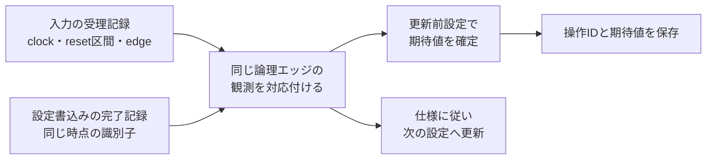

# UVM環境の設定・協調・上位再利用を設計する

[基礎の学習案内](uvm-basics.md)から進む実践資料です。設定オブジェクト、複数agentの協調、設定に依存する期待値、RALの所有範囲、SVA、カバレッジの収束をつなぎます。Qiitaの[実践編・前半](https://qiita.com/sukimaengineer/items/1fb074acc63fb61aea91)・[実践編・後半](https://qiita.com/sukimaengineer/items/5bc4af399d766d2a53c3)を参考に、既存の実行例と独自の設計例へ整理しています。

## 1. 設定オブジェクトとagentの所有範囲

testが構成を決め、envがagentごとの設定を配り、agentがdriver・monitorへ必要なハンドルを渡す形にすると、設定の出所を追いやすくなります。設定の共有は意図して行い、構築後に別testや別agentが同じオブジェクトを書き換えないようにします。

| 設定 | 決める担当と確認点 |
| --- | --- |
| virtual interface | 対応するインスタンスと信号方向を確定し、未取得を即座に検出する。 |
| active／passive | 駆動担当を決め、driver・sequencerの生成と接続を条件分岐する。 |
| 待ち・外部応答 | DUTの仕様と、検証環境が与える負荷の設定を分ける。 |
| チェッカー・カバレッジの有効化 | 対象インスタンスと実効値を記録し、無効化しても合格し続けないか検査する。 |
| 外部RALモデル・map | envが作るのか上位から借りるのか、アクセスと予測の担当を決める。 |

[passive移行例](../../examples/local-uvm-migration/tb/migration_pkg.sv)の`migration_cfg`は、対象のinterface、待ち構成、予定観測数、active／passive、比較の有効化をまとめています。envは`agent`だけへ設定を登録し、agentはmonitorへ直接ハンドルを渡します。activeを誤って指定した診断では、旧入力再生との駆動競合を起こす前に停止します。

## 2. 複数agentをvirtual sequenceで協調させる

レジスタ設定とデータ入力、受信側のready制御など、異なる役割を協調させるときは、シナリオ側で順序・並行動作・終了条件をまとめます。virtual sequence自体はピンを駆動せず、各役割のsequenceを開始します。

| 設計上の問い | 決めること |
| --- | --- |
| 設定後にデータを流すか、動作中にも変更するか | 逐次開始と並行開始を使い分け、同時受理を検証するケースを明示する。 |
| virtual sequencerを置くか | 複数sequencerのハンドルを部品としてまとめる必要と、直接ハンドルを渡す構成の簡潔さを比較する。 |
| RALを使うか | reg mapに登録したsequencer・adapterを使う経路と、raw操作の経路を区別する。 |
| readyを誰が駆動するか | 応答agentの設定で制御するか、readyパターンのsequenceとして制御するか決める。 |
| 何を待って終了するか | 入力sequenceの終了に加え、受理・出力・照合・取消・残件を確認する。 |

virtual sequencerを置かない構成では、coordinatorへ必要なsequencer・RALのハンドルを渡して`start(null)`で始められます。置く構成では、上位envが各sequencerをまとめ、virtual sequenceの開始先へ渡します。どちらも必要なハンドル・型・役割を確認し、再構成で乱数の呼出し順が変わる場合は実際の入力も保存します。

並行開始しただけでは、狙う同時受理やバックプレッシャが起きた証拠にはなりません。受理エッジ・FIFO状態・実際のreadyを観測し、[クロス条件の選定](cross-test-selection-walkthrough.md)へ対応付けます。

この節は複数インターフェースを持つUVM環境の構成案です。現行のpassive移行例は、旧ベクタの再生と観測を扱い、virtual sequenceでデータ経路を協調させる例ではありません。

## 3. 設定変更とデータ受理が同じエッジに重なる場合

レジスタのmirrorが新しくなった時点と、DUTがその設定を採用した時点は同じとは限りません。monitorのcallbackが先に来た順に参照状態を更新すると、シミュレータの実行順に依存した期待値になる場合があります。

独自の説明用仕様として、xとGAINは符号なし8ビットとし、「入力xを受理したエッジの更新前GAINを使い、十分な幅で乗算して結果を`min(255, x × GAIN)`へ飽和する。GAINへの書込みはそのエッジの更新後に反映」とします。

| 受理エッジ | 更新前GAIN | 同じエッジの操作 | その入力の期待値 | 更新後GAIN |
| --- | --- | --- | --- | --- |
| k | 3 | x=7を受理、GAINへ5を書込み | 21 | 5 |
| k+1 | 5 | x=7を受理 | 35 | 5 |

エッジkの入力を、新しいmirror値5で計算すると35となり、期待値を誤ります。後で出てきた出力にも、出力時点のGAINを使わず、受理時に確定した期待値を対応付けます。



collectorでエッジごとの観測をそろえる、入力に適用設定の版を付ける、設定履歴を受理時点へ対応付ける、といった方法を選びます。`$time`だけではclocking blockのskewや観測の遅延を混同するため、クロック領域・リセット区間・受理エッジの識別子を定義します。`#0`を加えただけで、すべての観測がそろったと判断しません。

collectorがエッジを閉じる条件も設計します。例えば、各monitorが取引の有無に関係なく「このエッジの観測完了」を通知する方式にすると、実際の取引が発生するまで待ち続けることを防げます。

callbackの到着順へ依存しない期待値計算は、次の小さなモデルで検算できます。これは計画用モデルの確認で、RTLの証明ではありません。

```python
from itertools import permutations

def close_edge(gain_before, events):
    events = tuple(events)
    if any(kind not in ("input", "gain_write") for kind, value in events):
        raise ValueError("unknown event kind")
    accepted = [value for kind, value in events if kind == "input"]
    writes = [value for kind, value in events if kind == "gain_write"]
    if any(not 0 <= value <= 255 for value in [gain_before, *accepted, *writes]):
        raise ValueError("unsigned 8-bit values required")
    if len(writes) > 1:
        raise ValueError("one accepted register write per edge in this example")
    expected = [min(255, value * gain_before) for value in accepted]
    gain_after = writes[0] if writes else gain_before
    return expected, gain_after

for arrival_order in permutations([("input", 7), ("gain_write", 5)]):
    expected, gain = close_edge(3, arrival_order)
    assert expected == [21] and gain == 5
    assert close_edge(gain, [("input", 7)]) == ([35], 5)
print("both callback orders: expected values 21, 35")
```

仕様が動作中の設定変更を許すなら、入力を止める対策だけでその相互作用を確認済みにはしません。入力を止めるケースと、同時受理の規則を判定するケースを別に残します。設定に依存するcoverageも、同じ受理時点の設定をサンプルします。

## 4. RALとブロック環境を上位で再利用する

### 4.1 mirrorの予測とデータの正しさを分ける

auto predictionはRALを通るアクセス、明示的なpredictorはmonitorが観測したバスアクセスをモデルへ反映する経路です。mapごとの予測の担当を決め、二重更新を避けます。ハードウェア更新、W1C、read-clear、volatileなどは、予測と比較の方針を個別に決めます。[公式のregister predictor](https://github.com/accellera-official/uvm-core/blob/main/src/reg/uvm_reg_predictor.svh)

volatileの設定によって比較が省略される場合があります。採用ライブラリの`configure`・比較方針を確認し、値を別のscoreboardやSVAで判定するか、仕様から予測して実読出しと比較するかを決めます。`predict()`の成功だけを、DUTの値が正しい証拠にはしません。[公式のfield実装](https://github.com/accellera-official/uvm-core/blob/main/src/reg/uvm_reg_field.svh)

backdoorを使う場合は、既知の非ゼロ値を用意し、実際の読出し・書込み・対象パス・statusを校正します。DPIを含む実装とツールの対応を確認し、statusが正常でも意図したハードウェアへ到達したかを別に確かめます。frontdoorで確認するデコード・応答・待ちの検査も保持します。

### 4.2 上位とブロックで所有するものを決める

| 部品・状態 | 上位で決めること | ブロック側で保持すること |
| --- | --- | --- |
| インターフェースの駆動 | 上位のactive agentと実回路の接続 | 内部接点はpassiveで観測し、driverを生成しない。 |
| RAL階層とmap | 子モデルの割付け、アドレス単位、offset、予測経路 | 必要なら外部から渡された子モデルを使い、重複して別モデルを作らない。 |
| scoreboard | ブロック間の受渡し・順序・通知を検査 | 各ブロックの局所的な仕様を、正しい設定・観測点で継続判定する。 |
| カバレッジ・SVA | 上位で追加する相互作用と必須構成 | インスタンスを区別し、局所目標と有効化設定を保持する。 |
| リセット・取消・終了 | 複数ブロックの波及と完了の規則 | 操作ID・区間をそろえ、別インスタンスの成功で不足を補完しない。 |

例えば説明用に、子Aのbaseを`0x2000`、子Bを`0x2400`、各子のCONFIGをoffset `0x00`とすると、上位のCONFIGアドレスはそれぞれのbaseになります。上位mapと子mapの単位・幅・offsetを照合し、アドレス変換をadapterとmonitorで二重に加減算しないようにします。

modelの階層・mapを組み立ててから最上位で`lock_model()`する方針を基本にできます。ただし「子がすでにlock済みなら必ず再利用できない」と一律に判断せず、採用ライブラリの`add_submap`と構成条件を確認します。[公式のmap実装](https://github.com/accellera-official/uvm-core/blob/main/src/reg/uvm_reg_map.svh)

内部信号の観測用interfaceやbindを使う場合も、タップがDUTを駆動しないこと、リセット・クロック・信号方向、各インスタンスのvifを確認します。単体で合格した目標を、そのまま上位の合格へ移しません。この複数ブロック構成は設計例で、現行の単一APB移行例が実装する範囲には含みません。

### 4.3 生成したRALも仕様と照合する

生成器・版・生成オプションと原本を固定し、アドレス・幅・リセット値・アクセス属性・エンディアン・volatile／比較設定・HDLパス・factory登録を確認します。生成物同士の一致と、仕様の正しさを分けます。[SystemRDLの例](../../examples/local-register-spec/README.md)と[生成RTL＋RALの結合例](../../examples/local-generated-ral/README.md)へ進めます。

## 5. アサーションをUVMの判定へ接続する

concurrent SVAはinterface・moduleなどに置き、必要ならbindで接続します。SVAの失敗がUVM reportへ自動的に数えられるとは限らないので、actionの報告と外側のランナーを確認します。

[passive移行例の`ap_sync_reset`](../../examples/local-uvm-migration/tb/top.sv)は、同期リセットの後件違反で固有の失敗ラベルと`uvm_error`を出します。UVM側のエラー件数を確認し、最終的にプロセスも非0終了にします。チェッカー入力だけを故意に壊す診断で、この経路を実際に検査します。

期待したエラーをreport catcherで許可する方式を使う場合は、発生元・ID・重大度・件数・ケースを先に限定し、未発生、過剰、別のエラーを失敗にします。正常ケースの基準を緩めないようにします。本リポジトリの移行例は、期待するラベルと非0終了を外側で判定し、エラーを正常ケースへ混ぜません。

チェックのオン・オフは、対象インスタンスと実効値を記録します。共通packageの変数は複数インスタンスを同時に変えるため、局所的な制御には注意します。`$assertoff`などを使うなら、対象だけが止まり他の検査は動くことを負例で確認します。

## 6. 未達を埋めることと割合を表示することを分ける

### 6.1 有効な実行の未達から追加する

1. 要求から選んだbin・cross・時間関係と、構成・インスタンス・必要ヒット数を固定する。
2. 正常に判定を完了した実行だけから、観測と未達を集計する。
3. 刺激不足、観測不足、チェック不足、到達不能、仕様課題を分ける。
4. 重要な境界へdirected sequenceや制約付きの派生itemを追加する。
5. 再実行で未達・比較・終了を確認し、追加した制約の実効値と分布も保存する。

factoryで制約を足した型へ差し替える場合も、実際の生成型、`randomize()`の成否、受理された値の分布を確認します。ランダムに狙う割合を上げたことは、必須binへ到達した保証ではありません。

移行例では、名目動作だけの最初のケースに残る未達を、境界ケースの追加で埋め、`coverage-progress.json`へ段階ごとの不足を保存します。これは固定の境界追加による収束確認です。SVの制約付きランダムとnative covergroupは[UVMランダム例](../../examples/local-uvm-random/README.md)で別に確認できます。

### 6.2 binの割合と項目の平均を区別する

独自の校正例として、policyが2 bin、sizeが3 bin、そのcrossが6 binのモデルを考えます。policy 0／1に対しsizeがどちらもmediumの2サンプルだけを与えると、次の到達になります。

| 集計する項目 | 到達bin／全bin | 項目内の到達率 |
| --- | --- | --- |
| policy | 2/2 | 100% |
| size | 1/3 | 33.33…% |
| policy×size | 2/6 | 33.33…% |

全binを一つに数える比率は5/11＝45.45…%です。各項目の達成率を等重みで平均する指標なら、`(100 + 100/3 + 200/6) / 3`＝55.55…%になります。どの分母と重みを使うかを明示し、同じ「カバレッジ」と呼んで値だけを比べません。

[校正コード](../../examples/local-uvm-migration/coverage_probe.sv)をVerilator 5.052で実行したところ、このモデルの`get_inst_coverage()`は45.45…%、`get_coverage()`は0%でした。等重み平均の55.55…%とは一致しません。記事にある確認結果を、別のモデル・API・ツール版へ一般化しないための追加検算です。[5.052のruntime実装](https://github.com/verilator/verilator/blob/v5.052/include/verilated_covergroup.cpp)も参照できます。

実際の必須条件は、固定したbin一覧とnative DBのカウンター、対応する比較結果から判定します。groupの割合、単純な全bin比率、構成・インスタンス間の和集合を分けます。重み・`at_least`・除外・インスタンス統合の設定を変えた場合も、小さな既知サンプルで校正します。

## 7. 実行済みの範囲と設計案を区別する

| 内容 | このリポジトリでの位置 |
| --- | --- |
| 設定オブジェクト、passive生成、factory差替え、同一入力再生、SVA報告、固定境界による未達解消 | [passive移行例](../../examples/local-uvm-migration/README.md)で実行。 |
| 単一APBのRAL frontdoor、auto prediction、ハードウェア更新後の明示的predictと実読出し | [基本UVM例](../../examples/local-uvm/README.md)で実行。 |
| SV制約とnative covergroup | [UVMランダム例](../../examples/local-uvm-random/README.md)で実行。 |
| GAINの同時更新、複数データagentのvirtual sequence、複数IPの上位RAL・tap | 本書の設計・数値例。これらを一体化したUVM環境は未実装。 |

製品へ適用する際は、[移行計画](../templates/uvm-migration-plan.md)、[クロスモデルの記録](../templates/interaction-coverage-plan.md)、[サインオフ記録](../templates/signoff-record.md)へ、必須範囲、実行証跡、未確認、残リスクを対応付けます。
